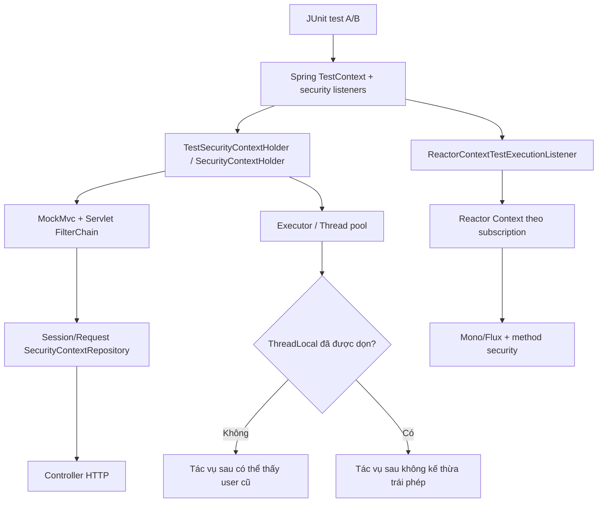
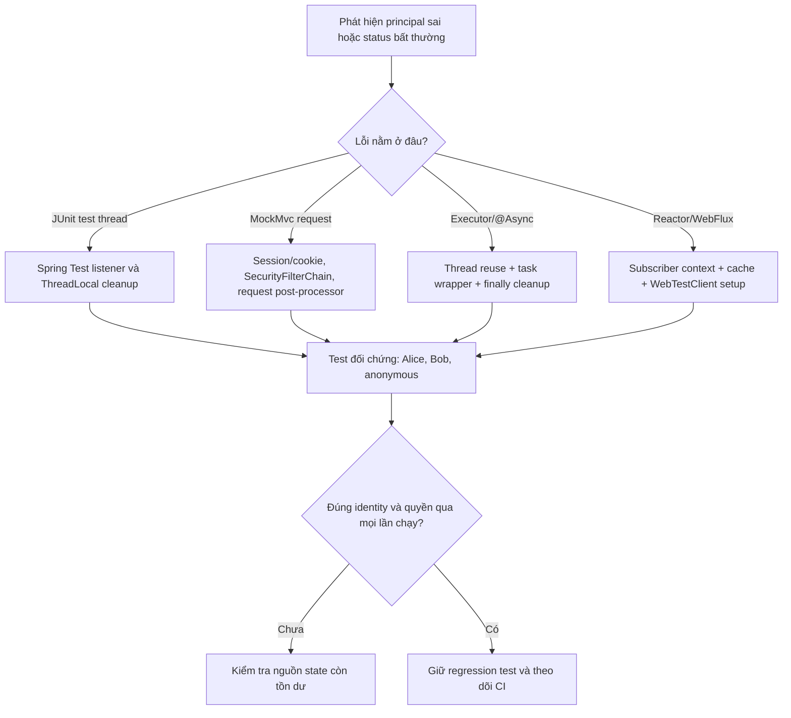

# SecurityContext bị rò rỉ giữa test, luồng hoặc tác vụ

## 1. Triệu chứng: user của ca trước xuất hiện trong ca sau

Một suite Spring Security có hai ca độc lập:

- **Ca A:** giả lập người dùng `alice` có `ROLE_ADMIN` và xác minh Alice truy cập được tài nguyên quản trị.
- **Ca B:** gửi request không có thông tin xác thực; endpoint quản trị phải yêu cầu đăng nhập.

Khi chạy riêng, ca B trả `401 Unauthorized`. Nhưng sau ca A, đôi lúc ca B lại nhận `200 OK`, hoặc service đọc được principal `alice`. Trong một hệ thống Reactive, một publisher của Bob có thể nhận dữ liệu đã tính theo danh tính Alice. Ở một executor chạy tác vụ nền, log của task sau có thể mang tên user của task trước.

Những hiện tượng đó đáng chú ý vì **SecurityContext là một phần của ranh giới phân quyền**. Danh tính sai không chỉ làm test flaky mà có thể dẫn đến lộ dữ liệu giữa người dùng, tenant hoặc request nếu lỗi thực sự tồn tại trong ứng dụng.

Bài này nằm trong chương **Chẩn đoán sự cố** của module **SPRING_SECURITY_TESTING**, chuyên kiểm chứng authentication, authorization và HTTP security bằng `spring-security-test` trên Servlet/MockMvc và Reactive/WebTestClient. Ta sẽ phân biệt ba dạng rò rỉ: **giữa các test**, **giữa các luồng chạy** và **giữa các tác vụ/subscription**, đồng thời phân biệt context giả lập với việc dùng JWT/OAuth2/OIDC và session thật.

Sau bài học, bạn có thể:

1. Giải thích nơi lưu `SecurityContext` trong Servlet, Spring Security Test và Reactor.
2. Xác định test listener, request/session, thread pool, executor hay reactive pipeline đang giữ Authentication ngoài phạm vi mong muốn.
3. Viết negative test phát hiện người dùng còn sót mà không phụ thuộc vào thứ tự test.
4. Sử dụng `SecurityContextHolder.clearContext()`, `TestSecurityContextHolder.clearContext()` và các wrapper executor đúng chỗ.
5. Thiết kế session/MockMvc/WebTestClient riêng cho từng ca và tránh giữ user trong shared fixture.
6. Phân biệt rò rỉ SecurityContext với lỗi role matcher, CSRF, HTTP entry point và token cache.
7. Xây dựng quy trình điều tra có bằng chứng cho lỗi chỉ xảy ra khi chạy cả suite hoặc trên CI.

## 2. Ba loại ngữ cảnh không nên đánh đồng

Spring Security có nhiều cách biểu diễn và truyền `SecurityContext`. Một test cần biết **nguồn Authentication** và **phạm vi tồn tại** của nó.

| Thành phần | Nơi/lifecycle điển hình | Lỗi khi sử dụng sai |
| --- | --- | --- |
| `SecurityContextHolder` | Thông thường dùng chiến lược `MODE_THREADLOCAL` cho Servlet và code đồng bộ | Quên dọn ThreadLocal trên thread được tái sử dụng |
| `TestSecurityContextHolder` | Hỗ trợ Spring Security Test và request post-processors | Tự ghi fixture nhưng không cleanup; nhầm context của thân test với request |
| `HttpSessionSecurityContextRepository` | Lưu/lấy `SecurityContext` theo Servlet session nếu ứng dụng chọn cơ chế này | Hai test dùng chung `MockHttpSession` hoặc cookie/session ID |
| `ReactiveSecurityContextHolder` | Lưu `SecurityContext` trong **Reactor Context** theo subscription | Giữ publisher/cache dùng chung danh tính hoặc tự tạo subscription tách context |
| `SecurityContextRepository` khác | Theo request, session hoặc implementation tùy chỉnh | Giả định app stateless có session, hoặc ngược lại |
| `OAuth2AuthorizedClientService`/token cache | State OAuth2 Client theo registration/principal | Nhầm token/authorized client của user A với user B; **không nhất thiết** là SecurityContext leak |

Trong Servlet, `SecurityContextHolder.getContext()` không phải “kho toàn cục cho toàn JVM” theo cấu hình mặc định; nó thường truy cập ngữ cảnh gắn với **thread hiện tại**. Điều nguy hiểm là thread trong pool được tái sử dụng cho task khác.

Trong WebFlux, `ReactiveSecurityContextHolder.getContext()` trả một `Mono<SecurityContext>` dựa trên **Reactor Context**. Đây không phải cùng một ThreadLocal mà Servlet thường dùng. Do đó gọi `SecurityContextHolder.clearContext()` trên test thread không thể tự dọn mọi subscriber hay cache Reactive.

### 2.1. Sơ đồ các ranh giới



Không phải mọi mũi tên đều xảy ra trong cùng một loại test. Phải chỉ ra cụ thể request/tác vụ đi theo đường nào trước khi kết luận context bị rò rỉ.

## 3. Rò rỉ thật hay chỉ là test setup sai?

Một HTTP 200 ngoài mong đợi **không đủ** kết luận SecurityContext bị rò. Có thể endpoint đang `permitAll()`, test tắt filters, application context nạp security chain khác, hoặc client đang cố ý mang cookie.

| Triệu chứng | Giả thuyết | Kiểm tra phân biệt |
| --- | --- | --- |
| Anonymous test nhận 200 | Shared session/user, `permitAll`, hoặc filter bị bỏ qua | Xem security chain, cookie/session, thử anonymous trên endpoint bảo vệ có thật |
| Test B nhận principal Alice | ThreadLocal còn sót hoặc session A được reuse | Probe test thread và request/session riêng; xác định nơi đọc principal |
| `@WithMockUser` của B không có hiệu lực | Listener chưa chạy, principal khác ghi đè, sai chain | Probe Authentication trong thân test và HTTP request |
| Reader nhận 403 dù mong 200 | Sai authority, CSRF hoặc method security | So authorities, request method và test có CSRF |
| Background task thấy Alice | Executor tái dùng thread còn context hoặc wrapper chụp context cố định | Task độc lập không user trên cùng executor |
| Reactive task thấy Alice | Shared publisher/cache hoặc context gắn sai subscription | Cấp Authentication per-subscription; thử Alice/Bob/anonymous |
| Chỉ CI hoặc chạy song song mới lỗi | Shared fixture/static bean, data store hoặc pooled thread | Test isolation, logging theo task, chạy riêng và theo suite |

Phân loại trước khi sửa: **context đang đến từ đâu?** Từ Spring Test annotation, request post-processor, session cookie, bearer token, custom filter, executor hay một object đã cache?

## 4. Vòng đời Spring Security Test và công việc của listener

`@WithMockUser` tạo một Authentication giả qua `WithSecurityContextTestExecutionListener` khi test được chạy trong Spring TestContext. Listener chuẩn bị context trước phần test theo `setupBefore` và dọn ngữ cảnh sau khi test hoàn tất. Với Reactive method test, `ReactorContextTestExecutionListener` hỗ trợ đưa Authentication từ test context sang Reactor Context.

```java
@SpringBootTest
class SecurityContextLifecycleTest {

    @Test
    @WithMockUser(username = "alice", roles = "ADMIN")
    void aliceHasExpectedContext() {
        Authentication authentication =
            SecurityContextHolder.getContext().getAuthentication();

        assertThat(authentication.getName()).isEqualTo("alice");
        assertThat(authentication.getAuthorities())
            .extracting("authority")
            .contains("ROLE_ADMIN");
    }

    @Test
    void methodWithoutFixtureStartsUnauthenticated() {
        assertThat(SecurityContextHolder.getContext()
            .getAuthentication()).isNull();
    }
}
```

Ở đây cần import JUnit 5, Spring Boot Test, `@WithMockUser`, `Authentication`, `SecurityContextHolder` và AssertJ. Đây là **probe trong test thread**: khi không có user fixture, test method thứ hai phải bắt đầu không có Authentication từ ca trước. Không thêm `@WithMockUser` ở cấp class nếu muốn ca thứ hai thật sự không có fixture.

Hai test **không phụ thuộc thứ tự**: ca thứ hai phải pass cả khi chạy trước ca đầu. Nếu fail, kiểm tra listener bị thay, code tự gọi `SecurityContextHolder.setContext(...)`, extension tùy chỉnh hoặc tài nguyên đồng bộ đã ghi context vào test thread.

### 4.1. Khi test dùng @TestExecutionListeners tùy chỉnh

```java
@SpringJUnitConfig(classes = TestSecurityConfig.class)
@TestExecutionListeners(
    listeners = {
        WithSecurityContextTestExecutionListener.class,
        ReactorContextTestExecutionListener.class
    },
    mergeMode = TestExecutionListeners.MergeMode.MERGE_WITH_DEFAULTS)
class ReactiveMethodTest {
    // Chỉ minh họa cách đăng ký listeners khi cần.
}
```

`MERGE_WITH_DEFAULTS` giữ các listener thiết yếu khác. Nếu thay toàn bộ bằng `REPLACE_DEFAULTS` và vô tình loại listener bảo mật, `@WithMockUser` có thể không hoạt động. **Không thêm listeners trùng lặp nếu Spring Test đã đăng ký sẵn**; chỉ khai báo tường minh khi cần sửa một test setup đặc biệt.

### 4.2. Thời điểm setupBefore

```java
@Test
@WithMockUser(
    username = "alice",
    setupBefore = TestExecutionEvent.TEST_EXECUTION)
void authenticationIsSetJustBeforeTestBody() {
    // Với TEST_EXECUTION, @BeforeEach đã chạy trước khi
    // fixture Authentication được thiết lập cho thân test.
}
```

Nếu `@BeforeEach` đọc null còn test body đọc Alice, đây có thể là **lifecycle đúng theo cấu hình**, không phải leak. Mặc định `@WithMockUser` thường chuẩn bị context trước `@BeforeEach`; đổi `setupBefore` chỉ khi có yêu cầu rõ.

## 5. Những nguồn shared state tạo leak giữa các test

Một bộ test không độc lập thường chứa một hoặc nhiều mẫu sau:

```java
// Các mẫu cần tránh khi được dùng như mutable global fixtures:
static MockHttpSession sharedSession;
static SecurityContext sharedContext;
static WebTestClient aliceClient;
static String sessionCookieFromPreviousTest;
static Map<String, OAuth2AuthorizedClient> authorizedClients;
```

Ngay cả khi mỗi test method tạo một object test class mới, Spring TestContext vẫn có thể **cache cùng ApplicationContext** giữa nhiều test. Bean singleton, `InMemoryUserDetailsManager`, in-memory repository, Redis session store, SecurityContextRepository hay một thread pool bean không tự động được tạo mới sau mỗi `@Test`.

### 5.1. Bốn nguyên tắc ngăn trộn state

1. **Fixture per-test:** session, cookie jar, principal, JWT, request ID, oauth2 `state`/`nonce` và token cache key được tạo trong `@Test` hoặc `@BeforeEach`, không lấy từ test khác.
2. **Dữ liệu bất biến:** chia sẻ cấu hình security policy hoặc RSA public key fixture bất biến có thể hợp lý; không chia sẻ một `SecurityContext` object mutable rồi thay Authentication trong đó.
3. **Cleanup theo nơi lưu:** dọn `ThreadLocal` trên **thread thực thi**, dọn session trong store, xóa authorized client của principal tương ứng và đóng executor/container khi cần. Dọn Spring TestContext không tự động xóa Redis/database ngoài process.
4. **Không lệ thuộc thứ tự:** flow “login → gọi API → logout” được viết trong **một** test có vòng đời rõ ràng, không chia thành ba `@Test` dùng chung cookie.

## 6. Ví dụ Servlet để phát hiện context dùng sai

Ví dụ ứng dụng MVC có một endpoint đọc tên người đang xác thực và một endpoint chỉ dành cho admin:

```java
import java.util.Map;
import org.springframework.security.core.Authentication;
import org.springframework.web.bind.annotation.GetMapping;
import org.springframework.web.bind.annotation.RestController;

@RestController
class IdentityController {

    @GetMapping("/api/me")
    Map<String, String> current(Authentication authentication) {
        return Map.of("username", authentication.getName());
    }

    @GetMapping("/api/admin")
    String adminOnly() {
        return "admin";
    }
}
```

Security policy:

```java
import org.springframework.context.annotation.Bean;
import org.springframework.context.annotation.Configuration;
import org.springframework.security.config.Customizer;
import org.springframework.security.config.annotation.web.builders.HttpSecurity;
import org.springframework.security.web.SecurityFilterChain;

@Configuration(proxyBeanMethods = false)
class IsolationSecurityConfig {

    @Bean
    SecurityFilterChain chain(HttpSecurity http) throws Exception {
        return http
            .authorizeHttpRequests(auth -> auth
                .requestMatchers("/api/admin").hasRole("ADMIN")
                .requestMatchers("/api/me").authenticated()
                .anyRequest().denyAll())
            .httpBasic(Customizer.withDefaults())
            .formLogin(form -> form.disable())
            .build();
    }
}
```

Với config này, anonymous vào `/api/me` nhận **401 theo Basic entry point**; một người đã xác thực nhưng không có `ROLE_ADMIN` vào `/api/admin` nhận **403**. Cả hai rule đều dùng GET để tránh ảnh hưởng CSRF khi chẩn đoán context.

### 6.1. Test HTTP không dùng chung Authentication

```java
import org.junit.jupiter.api.Test;
import org.springframework.beans.factory.annotation.Autowired;
import org.springframework.boot.test.autoconfigure.web.servlet
    .AutoConfigureMockMvc;
import org.springframework.boot.test.context.SpringBootTest;
import org.springframework.test.web.servlet.MockMvc;

import static org.springframework.security.test.web.servlet.request
    .SecurityMockMvcRequestPostProcessors.user;
import static org.springframework.test.web.servlet.request
    .MockMvcRequestBuilders.get;
import static org.springframework.test.web.servlet.result
    .MockMvcResultMatchers.*;

@SpringBootTest
@AutoConfigureMockMvc
class IdentityIsolationHttpTest {

    @Autowired MockMvc mvc;

    @Test
    void twoUsersStaySeparateWithinRequests() throws Exception {
        mvc.perform(get("/api/me")
                .with(user("alice").roles("USER")))
            .andExpect(status().isOk())
            .andExpect(jsonPath("$.username").value("alice"));

        mvc.perform(get("/api/me")
                .with(user("bob").roles("USER")))
            .andExpect(status().isOk())
            .andExpect(jsonPath("$.username").value("bob"));
    }

    @Test
    void anonymousRequestHasNoOldIdentity() throws Exception {
        mvc.perform(get("/api/me"))
            .andExpect(status().isUnauthorized());
    }

    @Test
    void nonAdminCannotUseResidualAdminIdentity()
            throws Exception {
        mvc.perform(get("/api/admin")
                .with(user("bob").roles("USER")))
            .andExpect(status().isForbidden());
    }
}
```

Để thực thi đoạn test, ứng dụng phải nạp `IdentityController` và `IsolationSecurityConfig` trong Spring Boot MVC context, dùng `spring-security-test` cùng JUnit Jupiter. `@AutoConfigureMockMvc` phải giữ filters hoạt động; cấu hình `addFilters = false` sẽ bỏ qua security filters và làm suy luận từ HTTP status sai.

**Giới hạn:** `with(user(...))` tạo Authentication giả **cho request**. Nó không kiểm tra mật khẩu HTTP Basic, không login thật và không tự sinh session cookie. Nhưng nó rất hữu ích để phát hiện việc controller hoặc policy không đối xử riêng với từng user.

## 7. @WithMockUser và with(user(...)) có phạm vi khác nhau

| Cách cấp identity | Phạm vi thường dùng | Rủi ro nếu dùng nhầm |
| --- | --- | --- |
| `@WithMockUser` ở method | Test method qua Spring Test listener | Thiếu listener; context setup sai; principal type không phù hợp |
| `@WithMockUser` ở class | Mọi test method thuộc phạm vi annotation | Ca “anonymous” thực ra vẫn có mock user |
| `with(user("alice"))` | Một request MockMvc cụ thể | Test sau không có request post-processor có thể là anonymous |
| `with(jwt())` | JWT Authentication giả cho request | Không kiểm tra signature/issuer/expiry; role/claims được mock |
| `mockUser()`/`mockJwt()` | Mutated WebTestClient mock Reactive | Client đã mutate được reuse sai nơi |
| Header Bearer thật | Một HTTP request | Token của Alice bị reuse trong client fixture dùng cho Bob |

Một mẫu dễ gây lỗi:

```java
@WithMockUser(username = "alice")
class MisleadingTests {
    @Test
    void expectsAnonymous() {
        // Ca này KHÔNG anonymous: annotation cấp class
        // vẫn đang áp dụng.
    }
}
```

Nếu muốn đối chứng anonymous trong class có annotation mặc định, có thể dùng `@WithAnonymousUser` ở method để thay fixture thích hợp hoặc chuyển mock user xuống từng method. Tuy nhiên, phải hiểu tùy ứng dụng anonymous Authentication có thể mang `ROLE_ANONYMOUS`; nó **không** đồng nghĩa với mọi nơi `Authentication == null`.

## 8. Session Servlet: context được lưu qua request theo policy nào?

Một lỗi thường bị gọi nhầm là “ThreadLocal leak”: test B đang gửi **session của test A**. Đây là session reuse, không nhất thiết do `SecurityContextHolder` chưa được dọn.

Nếu application sử dụng `HttpSessionSecurityContextRepository` và security context persistence dựa trên session, `SPRING_SECURITY_CONTEXT` có thể được lưu làm thuộc tính session. Khi hai request dùng cùng `MockHttpSession`, chuyện chúng thấy cùng Authentication **có thể là hành vi được thiết kế**.

Ví dụ tạo session test rõ ràng cho từng user:

```java
import java.util.List;
import org.springframework.mock.web.MockHttpSession;
import org.springframework.security.authentication
    .UsernamePasswordAuthenticationToken;
import org.springframework.security.core.context.SecurityContext;
import org.springframework.security.core.context.SecurityContextHolder;
import org.springframework.security.core.authority.SimpleGrantedAuthority;
import org.springframework.security.web.context.HttpSessionSecurityContextRepository;

final class SessionFixtures {
    private SessionFixtures() {}

    static MockHttpSession forUser(String username) {
        SecurityContext context =
            SecurityContextHolder.createEmptyContext();
        context.setAuthentication(
            new UsernamePasswordAuthenticationToken(
                username,
                "unused",
                List.of(new SimpleGrantedAuthority("ROLE_USER"))));

        MockHttpSession session = new MockHttpSession();
        session.setAttribute(
            HttpSessionSecurityContextRepository
                .SPRING_SECURITY_CONTEXT_KEY,
            context);
        return session;
    }
}
```

Test:

```java
@Test
void sessionAAndSessionBHaveDistinctIdentities()
        throws Exception {
    MockHttpSession sessionA = SessionFixtures.forUser("alice");
    MockHttpSession sessionB = SessionFixtures.forUser("bob");

    assertThat(sessionA.getId()).isNotEqualTo(sessionB.getId());

    mvc.perform(get("/api/me").session(sessionA))
        .andExpect(status().isOk())
        .andExpect(jsonPath("$.username").value("alice"));

    mvc.perform(get("/api/me").session(sessionB))
        .andExpect(status().isOk())
        .andExpect(jsonPath("$.username").value("bob"));
}
```

Đây là test **session context repository**, không phải login/password test. Với `SessionCreationPolicy.STATELESS` hoặc repository không lấy context từ session, các request trên không tự trở thành authenticated. Khi đó dùng Bearer/Basic request fixtures đúng với kiến trúc, không ép session vào một hệ thống stateless.

### 8.1. Không dùng static MockHttpSession hoặc cookie jar

```java
// Anti-pattern:
static MockHttpSession session;

@BeforeAll
static void signInOnceForEntireSuite() {
    // Session và identity của ca đầu bị chia sẻ ngầm.
}
```

Khi muốn test login qua nhiều HTTP request, hãy gom các bước **login → gọi API → logout** trong cùng test, dùng session/cookie được phát hành bởi flow đó, rồi hủy state theo policy. Test khác thực hiện login mới hoặc cung cấp fixture riêng.

## 9. Spring Security 6: load/save context và giới hạn của cleanup

Trong các phiên bản hiện đại, `SecurityContextHolderFilter` thường tải/đưa context vào scope request rồi dọn khi request hoàn thành, còn việc **lưu** SecurityContext có thể cần được thực hiện tường minh tùy cấu hình và authentication mechanism. Một số cấu hình hoặc ứng dụng cũ sử dụng `SecurityContextPersistenceFilter` với hành vi persistence khác.

Vì vậy, phân biệt:

1. **Dọn thread-local:** `SecurityContextHolder.clearContext()` trên thread đang xử lý.
2. **Dọn context test:** Spring Security test listeners quản lý fixture trong test lifecycle.
3. **Hủy session:** invalidate session hoặc xóa record khỏi session repository; bước 1 không tự làm bước này.
4. **Xóa persisted token:** logout/revocation hoặc cleanup repository riêng; không liên quan trực tiếp ThreadLocal.

Một request mới đi qua filter chain đúng và context repository phù hợp **không được âm thầm lấy Authentication từ một request khác**. Nếu thấy identity cũ, kiểm tra xem request có dùng cùng session/cookie hay filter tùy chỉnh đã tự giữ context trong một bean singleton.

Không dùng `SecurityContextHolder.clearContext()` ở cuối test để kết luận logout đã đúng. Logout thực tế cần hủy session/credential theo policy rồi **gửi request mới** với cookie/session cũ để chứng minh không truy cập được.

## 10. Khi tự đặt SecurityContextHolder, trách nhiệm dọn thuộc về bạn

Trong một unit test không chạy Spring Security Test listener, có thể tạo Authentication thủ công:

```java
import java.util.List;
import org.springframework.security.authentication
    .UsernamePasswordAuthenticationToken;
import org.springframework.security.core.context.SecurityContext;
import org.springframework.security.core.context.SecurityContextHolder;
import org.springframework.security.core.authority.SimpleGrantedAuthority;

SecurityContext context =
    SecurityContextHolder.createEmptyContext();
context.setAuthentication(
    new UsernamePasswordAuthenticationToken(
        "alice", "unused",
        List.of(new SimpleGrantedAuthority("ROLE_USER"))));

try {
    SecurityContextHolder.setContext(context);
    // Gọi logic đồng bộ cần Authentication.
} finally {
    SecurityContextHolder.clearContext();
}
```

**Luôn có `finally`** ngay nơi tự thay ThreadLocal. Chỉ gọi `clearContext()` trên test thread sẽ dọn context của **thread hiện tại**, không tự dọn các worker thread khác.

### 10.1. Không tái sử dụng một SecurityContext mutable cho nhiều user

```java
// Anti-pattern: cùng một object context được chia sẻ.
static final SecurityContext SHARED =
    SecurityContextHolder.createEmptyContext();

// Test A:
SHARED.setAuthentication(alice);

// Test B:
SHARED.setAuthentication(bob);
```

`SecurityContext` là object có thể thay Authentication. Ngay cả khi gắn cùng object vào hai ThreadLocal khác nhau, cả hai thread vẫn có thể nhìn thấy thay đổi trên **cùng reference**. Với mỗi request/task, tạo một `SecurityContextHolder.createEmptyContext()` riêng khi cần thay context.

Đừng chia sẻ object `Authentication` hoặc principal có field mutable rồi thay authorities/tenant giữa các test chạy song song.

## 11. Thread pool: nguyên nhân điển hình của rò rỉ giữa các tác vụ

Giả sử một executor có một worker thread tái sử dụng. Task A chủ động gắn `SecurityContextHolder` và quên dọn:

```java
// Ví dụ CỐ Ý SAI, chỉ dùng để phân tích:
executor.execute(() -> {
    SecurityContext ctx =
        SecurityContextHolder.createEmptyContext();
    ctx.setAuthentication(authenticationOfAlice);
    SecurityContextHolder.setContext(ctx);

    auditService.writeAudit();
    // Thiếu finally { SecurityContextHolder.clearContext(); }
});
```

Khi task B được lên lịch lên đúng worker thread, code trong B có thể đọc `alice` dù caller của B không hề được xác thực. Đây là **ThreadLocal reuse**, không phải chứng minh `@WithMockUser` tự động bị lỗi.

### 11.1. Tái hiện có kiểm soát, không dùng sleep

```java
@Test
void diagnosticDemonstratesWhyUnclearedPoolContextIsUnsafe()
        throws Exception {
    ExecutorService pool = Executors.newSingleThreadExecutor();
    try {
        Future<String> first = pool.submit(() -> {
            SecurityContext context =
                SecurityContextHolder.createEmptyContext();
            context.setAuthentication(
                new UsernamePasswordAuthenticationToken(
                    "alice", "unused",
                    AuthorityUtils.createAuthorityList("ROLE_USER")));
            SecurityContextHolder.setContext(context);
            return SecurityContextHolder.getContext()
                .getAuthentication().getName();
            // Cố ý không clear trong task này.
        });
        assertThat(first.get()).isEqualTo("alice");

        Future<String> second = pool.submit(() -> {
            Authentication auth = SecurityContextHolder
                .getContext().getAuthentication();
            return auth == null ? "<none>" : auth.getName();
        });
        // Đây là bằng chứng về leak; KHÔNG phải behavior mong muốn.
        assertThat(second.get()).isEqualTo("alice");
    } finally {
        // Cleanup CHÍNH worker thread trước khi kết thúc thử nghiệm.
        pool.submit(SecurityContextHolder::clearContext).get();
        pool.shutdownNow();
    }
}
```

`newSingleThreadExecutor()` làm cho hai task chạy tuần tự trên cùng worker thread; `Future.get()` đồng bộ hoàn thành, không cần `Thread.sleep()`. Ví dụ này **cố ý tạo leak để chẩn đoán trong một executor riêng**; không giữ cấu hình lỗi trong production hoặc suite thường ngày.

Điểm cốt lõi: `SecurityContextHolder.clearContext()` trên **JUnit thread** không làm worker thread trong pool sạch trở lại. Cần cleanup tại task hoặc dùng security-aware wrapper có lifecycle đúng.

## 12. Cách an toàn: DelegatingSecurityContextRunnable/Executor

Spring Security cung cấp công cụ bọc task để gắn `SecurityContext` đúng lúc và dọn khi task kết thúc, chẳng hạn:

- `DelegatingSecurityContextRunnable` và `DelegatingSecurityContextCallable`.
- `DelegatingSecurityContextExecutor`.
- `DelegatingSecurityContextAsyncTaskExecutor` khi tích hợp `@Async`/Spring `AsyncTaskExecutor`.

Ví dụ với `DelegatingSecurityContextExecutor`:

```java
import java.util.concurrent.CompletableFuture;
import java.util.concurrent.ExecutorService;
import java.util.concurrent.Executors;
import org.springframework.security.concurrent
    .DelegatingSecurityContextExecutor;

@Test
void securityAwareExecutorDoesNotLeakUserToNextTask()
        throws Exception {
    ExecutorService delegate = Executors.newSingleThreadExecutor();
    DelegatingSecurityContextExecutor executor =
        new DelegatingSecurityContextExecutor(delegate);

    try {
        SecurityContext aliceContext =
            SecurityContextHolder.createEmptyContext();
        aliceContext.setAuthentication(
            new UsernamePasswordAuthenticationToken(
                "alice", "unused",
                AuthorityUtils.createAuthorityList("ROLE_USER")));

        SecurityContextHolder.setContext(aliceContext);

        CompletableFuture<String> first = new CompletableFuture<>();
        executor.execute(() -> first.complete(
            SecurityContextHolder.getContext()
                .getAuthentication().getName()));
        assertThat(first.get()).isEqualTo("alice");

        // Caller dọn identity trước khi submit task tiếp theo.
        SecurityContextHolder.clearContext();

        CompletableFuture<String> second = new CompletableFuture<>();
        executor.execute(() -> {
            Authentication auth = SecurityContextHolder
                .getContext().getAuthentication();
            second.complete(auth == null ? "<none>" : auth.getName());
        });
        assertThat(second.get()).isEqualTo("<none>");
    } finally {
        SecurityContextHolder.clearContext();
        delegate.shutdownNow();
    }
}
```

`DelegatingSecurityContextExecutor` kiểu không truyền context cố định giúp bọc task với context của caller **tại lúc submit** theo contract của Spring Security, rồi thực thi/cleanup trên worker. Nếu khởi tạo wrapper với một **context cố định** và tái sử dụng nó cho nhiều principal khác nhau, bạn có thể cố ý cấp cùng danh tính cho mọi task; đó thường không phải điều muốn làm trong multi-user app.

### 12.1. Nguyên tắc với wrapper

1. Chụp/gắn context tại đúng boundary **sau khi đã xác thực** và trước khi submit task.
2. Không giữ một context mutable rồi đổi Authentication trong lúc nhiều task đang chạy.
3. Để wrapper dọn worker thread sau task; vẫn dọn context của caller nếu caller đã tự set.
4. Không assume mọi `CompletableFuture.supplyAsync(...)` đều dùng executor bảo mật: nếu không truyền executor, nó có thể chạy trên common pool không có propagation.
5. Test phải có **task B không có Authentication** làm ca âm tính; test A “đọc đúng Alice” một mình chưa chứng minh không leak.

## 13. @Async: proxy, executor và context propagation

Trong Spring, `@Async` làm method thực thi trên executor khi lời gọi đi qua proxy phù hợp. SecurityContext kiểu ThreadLocal **không mặc nhiên** theo caller sang thread khác.

Ví dụ cấu hình một executor bọc bằng Spring Security:

```java
import org.springframework.context.annotation.Bean;
import org.springframework.context.annotation.Configuration;
import org.springframework.core.task.AsyncTaskExecutor;
import org.springframework.scheduling.annotation.EnableAsync;
import org.springframework.scheduling.concurrent.ThreadPoolTaskExecutor;
import org.springframework.security.task
    .DelegatingSecurityContextAsyncTaskExecutor;

@Configuration
@EnableAsync
class AsyncSecurityConfig {

    @Bean
    ThreadPoolTaskExecutor basePool() {
        ThreadPoolTaskExecutor pool = new ThreadPoolTaskExecutor();
        pool.setCorePoolSize(2);
        pool.setMaxPoolSize(4);
        pool.setThreadNamePrefix("audit-");
        pool.initialize();
        return pool;
    }

    @Bean("securityAwarePool")
    AsyncTaskExecutor securityAwarePool(
            ThreadPoolTaskExecutor basePool) {
        return new DelegatingSecurityContextAsyncTaskExecutor(
            basePool);
    }
}
```

Service:

```java
@Service
class AsyncAuditService {

    @Async("securityAwarePool")
    public CompletableFuture<String> currentPrincipal() {
        Authentication auth = SecurityContextHolder
            .getContext().getAuthentication();
        return CompletableFuture.completedFuture(
            auth == null ? "<none>" : auth.getName());
    }
}
```

Để test, gọi qua **bean do Spring tạo**, không gọi `new AsyncAuditService()` và không tự gọi method `@Async` từ một method khác trong cùng class. Hai ca nên dùng caller Alice và caller anonymous, kiểm tra `Future.get()` cho đúng danh tính và không có user dư.

Chú ý: cấu hình base pool và wrapper là ví dụ; khi tích hợp vào ứng dụng có nhiều `TaskExecutor`, hãy đặt tên và chọn executor rõ ràng. Không bọc lại cùng executor nhiều lần hoặc thay global executor vô điều kiện.

### 13.1. Context propagation không thay authorization

Một worker được cấp Authentication Alice không tự có quyền gọi mọi tài nguyên. Service vẫn cần áp dụng rule `@PreAuthorize` hoặc kiểm tra owner/tenant phù hợp; propagation chỉ làm đúng **ai** đang gọi, không quyết định **được làm gì**.

Đối với task chạy theo lịch (`@Scheduled`) không gắn với HTTP request, không nên sao chép user cuối cùng của request vào scheduled job. Hãy xác định service identity riêng với quyền tối thiểu hoặc thiết kế task không phụ thuộc user context.

## 14. MODE_INHERITABLETHREADLOCAL và MODE_GLOBAL không phải cách chữa leak

Spring Security hỗ trợ các strategy của `SecurityContextHolder` như `MODE_THREADLOCAL`, `MODE_INHERITABLETHREADLOCAL` và `MODE_GLOBAL`. Chúng có phạm vi khác nhau:

| Strategy | Ý nghĩa | Nguy cơ trong server/test |
| --- | --- | --- |
| `MODE_THREADLOCAL` | Context theo thread hiện tại (thông thường) | Phải dọn khi thread được dùng lại |
| `MODE_INHERITABLETHREADLOCAL` | Thread con có thể nhận context từ parent khi thread được tạo | Thread pool tạo thread một lần rồi giữ context ban đầu; dễ thành stale identity |
| `MODE_GLOBAL` | Một context dùng chung rộng trong JVM | Không phù hợp server đa người dùng; rò rỉ giữa request/test |

**Không chuyển sang `MODE_GLOBAL` chỉ để `@Async` hoặc test thread khác “nhìn thấy” Authentication.** Nó có thể biến một lỗi context propagation thành lỗi chia sẻ danh tính toàn ứng dụng.

`MODE_INHERITABLETHREADLOCAL` không phải giải pháp đáng tin cậy cho thread pool, vì worker thường được tạo và tái sử dụng độc lập với từng request. Dùng wrapper executor hoặc cơ chế propagation chính thức phù hợp.

### 14.1. Không đổi SecurityContextHolderStrategy trong từng test tùy tiện

`SecurityContextHolder.setStrategyName(...)` thay đổi cách hoạt động ở mức JVM và có thể ảnh hưởng test khác, đặc biệt khi chạy song song. Nếu cần kiểm thử strategy riêng, hãy cô lập quá trình/test fixture phù hợp và phục hồi strategy sau ca; tránh thay global strategy trong suite security thông thường.

## 15. Servlet async và error dispatch: đừng nhầm với leak

Servlet có `REQUEST`, `ASYNC`, `ERROR` dispatch. Một request async có thể tạo lần dispatch khác với request ban đầu; filter/security integration cần xử lý theo dispatcher types và policy.

Với MockMvc, một controller trả async result thường cần:

```java
MvcResult initial = mvc.perform(get("/api/async-report")
        .with(user("alice").roles("READER")))
    .andExpect(request().asyncStarted())
    .andReturn();

mvc.perform(asyncDispatch(initial))
    .andExpect(status().isOk());
```

Đây là **mẫu**: cần endpoint thực có xử lý Servlet async và bộ lọc Spring Security được áp dụng đúng. Nó không chứng minh context propagation trong mọi executor nếu chỉ assert status; hãy thêm assertion xác nhận principal mà async task đọc, và request thứ hai anonymous bị từ chối.

Khi custom filter kế thừa `OncePerRequestFilter`, xem `shouldNotFilterAsyncDispatch()` và `shouldNotFilterErrorDispatch()` cùng dispatcher registration. Một filter chạy thêm ở dispatch khác không nhất thiết là “rò rỉ SecurityContext”; cần so correlation ID, request/session và worker thread.

## 16. Reactive: SecurityContext gắn với subscriber, không phải worker thread

Trong WebFlux, một publisher có thể chuyển scheduler nhưng vẫn giữ đúng Reactor Context khi được xây bằng các operator tương thích. Không cần và không nên set `SecurityContextHolder` ThreadLocal để “giữ user” cho `Mono`/`Flux`.

Tạo Authentication riêng:

```java
import org.springframework.security.authentication
    .UsernamePasswordAuthenticationToken;
import org.springframework.security.core.Authentication;
import org.springframework.security.core.authority.AuthorityUtils;
import org.springframework.security.core.context
    .ReactiveSecurityContextHolder;
import reactor.core.publisher.Mono;
import reactor.test.StepVerifier;

Authentication alice =
    new UsernamePasswordAuthenticationToken(
        "alice", "unused",
        AuthorityUtils.createAuthorityList("ROLE_USER"));

Authentication bob =
    new UsernamePasswordAuthenticationToken(
        "bob", "unused",
        AuthorityUtils.createAuthorityList("ROLE_USER"));

Mono<String> currentName =
    ReactiveSecurityContextHolder.getContext()
        .map(ctx -> ctx.getAuthentication().getName())
        .switchIfEmpty(Mono.just("<none>"));

StepVerifier.create(currentName.contextWrite(
        ReactiveSecurityContextHolder.withAuthentication(alice)))
    .expectNext("alice")
    .verifyComplete();

StepVerifier.create(currentName.contextWrite(
        ReactiveSecurityContextHolder.withAuthentication(bob)))
    .expectNext("bob")
    .verifyComplete();

StepVerifier.create(currentName)
    .expectNext("<none>")
    .verifyComplete();
```

Ở đây **cùng publisher mô tả logic** được subscribe ba lần nhưng mỗi subscription có Reactor Context riêng. `contextWrite(...)` cung cấp context cho operator upstream tương ứng; subscriber không tự kế thừa Authentication của subscriber trước.

### 16.1. Scheduler switch không tự xóa Reactor Context

```java
Mono<String> switched = ReactiveSecurityContextHolder
    .getContext()
    .map(ctx -> ctx.getAuthentication().getName())
    .publishOn(Schedulers.parallel());

StepVerifier.create(switched.contextWrite(
        ReactiveSecurityContextHolder.withAuthentication(alice)))
    .expectNext("alice")
    .verifyComplete();
```

`publishOn` do Reactor điều phối vẫn giữ context thuộc subscription. Nhưng nếu code tự gọi `subscribe()` ở một nơi khác, dùng callback API không có context propagation hoặc cache tín hiệu đã tính cho Alice rồi reuse cho Bob, có thể xuất hiện lỗi giống leak.

### 16.2. Anti-pattern: cache dữ liệu chứa identity trên publisher dùng chung

```java
// Anti-pattern: cachedResult là singleton dùng chung tất cả user.
Mono<String> cachedResult =
    reportService.currentUserSensitiveResult().cache();
```

Nếu publisher tạo dữ liệu phụ thuộc principal, lần subscription đầu tiên có thể khiến kết quả được cache và phục vụ cho subscription sau với user khác. Đây có thể là **lỗi cache dữ liệu xuyên user**, không phải Reactor Context tự rò rỉ.

**Sửa đúng:** không cache dữ liệu phụ thuộc user ở scope toàn ứng dụng, hoặc thiết kế cache key chứa định danh/tenant và các yếu tố phân quyền cần thiết, cùng invalidation phù hợp. Khi test, subscribe Alice rồi Bob và đối chiếu response **theo người dùng**, không chỉ status 200.

## 17. WebTestClient: mutated client và cookie phải có vòng đời rõ

Spring Security Test cho WebFlux có thể gắn `SecurityWebFilterChain` vào client:

```java
WebTestClient baseClient = WebTestClient
    .bindToApplicationContext(applicationContext)
    .apply(SecurityMockServerConfigurers.springSecurity())
    .configureClient()
    .build();
```

Giả sử ứng dụng có endpoint `GET /api/whoami` trả username từ `ReactiveSecurityContextHolder` và chain dùng HTTP Basic, test:

```java
@Test
void webTestClientDoesNotReusePreviousPrincipal() {
    baseClient.mutateWith(SecurityMockServerConfigurers
            .mockUser("alice").roles("READER"))
        .get().uri("/api/whoami")
        .exchange()
        .expectStatus().isOk()
        .expectBody(String.class).isEqualTo("alice");

    baseClient.mutateWith(SecurityMockServerConfigurers
            .mockUser("bob").roles("READER"))
        .get().uri("/api/whoami")
        .exchange()
        .expectStatus().isOk()
        .expectBody(String.class).isEqualTo("bob");

    baseClient.get().uri("/api/whoami")
        .exchange()
        .expectStatus().isUnauthorized();
}
```

`mutateWith(mockUser(...))` trả về client đã được tùy biến; nó không có nghĩa Authentication của Alice được ghi vào **baseClient**. Nhưng nếu test lưu một `aliceClient` đã mutate dưới dạng singleton/static và dùng lại cho Bob, các request sau có thể vẫn mang fixture Alice. Hãy luôn bắt đầu từ base client chưa gắn danh tính hoặc tạo client mới theo từng ca.

### 17.1. Cookie/WebSession khác mockUser

Một WebFlux app dùng `WebSession` có thể duy trì Authentication qua cookie session (tên tùy `WebSessionIdResolver`). Khi test sử dụng cùng cookie jar/session ID ở hai request, đó có thể là **session reuse hợp lệ**, không phải Reactor Context của publisher A tự động rò sang B.

Muốn kiểm tra session isolation, tạo flow login/session riêng cho Alice và Bob, không dùng chung cookie jar, và thử truy cập chéo. Với API stateless bearer JWT, không cố thêm WebSession vào test chỉ để “xóa context”.

## 18. @WithMockUser trong Reactive method test: thêm Reactor listener khi cần

Với service trả `Mono`/`Flux` và `@PreAuthorize`, Spring method security phải nhận Authentication trong **Reactor Context**. Spring Security Test cung cấp `ReactorContextTestExecutionListener` để hỗ trợ bridge từ fixture của `@WithMockUser`.

Service:

```java
import org.springframework.security.access.prepost.PreAuthorize;
import org.springframework.security.core.context
    .ReactiveSecurityContextHolder;
import reactor.core.publisher.Mono;

class ReactiveReportService {
    @PreAuthorize("hasRole('READER')")
    public Mono<String> currentUser() {
        return ReactiveSecurityContextHolder.getContext()
            .map(ctx -> ctx.getAuthentication().getName());
    }
}
```

Configuration:

```java
@Configuration(proxyBeanMethods = false)
@EnableReactiveMethodSecurity
class ReactiveMethodConfig {
    @Bean
    ReactiveReportService reportService() {
        return new ReactiveReportService();
    }
}
```

Test:

```java
@SpringJUnitConfig(classes = ReactiveMethodConfig.class)
@TestExecutionListeners(
    listeners = {
        WithSecurityContextTestExecutionListener.class,
        ReactorContextTestExecutionListener.class
    },
    mergeMode = TestExecutionListeners.MergeMode.MERGE_WITH_DEFAULTS)
class ReactiveMethodContextIsolationTest {

    @Autowired ReactiveReportService service;

    @Test
    @WithMockUser(username = "alice", roles = "READER")
    void aliceContextIsVisible() {
        StepVerifier.create(service.currentUser())
            .expectNext("alice")
            .verifyComplete();
    }

    @Test
    @WithMockUser(username = "bob", roles = "READER")
    void bobDoesNotInheritAlice() {
        StepVerifier.create(service.currentUser())
            .expectNext("bob")
            .verifyComplete();
    }

    @Test
    @WithMockUser(username = "guest", roles = "GUEST")
    void insufficientRoleIsRejected() {
        StepVerifier.create(service.currentUser())
            .expectError(AccessDeniedException.class)
            .verify();
    }
}
```

Test class phải sử dụng bean do Spring tạo và `@EnableReactiveMethodSecurity`. Nếu gọi `new ReactiveReportService()` trực tiếp, `@PreAuthorize` không được proxy xử lý. `StepVerifier` thực hiện subscription; chỉ kiểm tra `Mono != null` không chứng minh policy đã chạy.

**Không nhầm lỗi listener với leak:** nếu test Bob không có context, hãy kiểm tra listener/setup trước. Nếu Bob thấy Alice, kiểm tra shared publisher/cache/context hoặc static fixtures; nếu Bob thấy Bob nhưng có quyền sai, xem authorities và method-security policy.

## 19. Async, cancellation và ngữ cảnh bị dọn muộn

Một test kết thúc không đồng nghĩa mọi tác vụ nó khởi tạo đều đã hoàn thành. Các lỗi thường gặp:

- Tạo `CompletableFuture` nhưng không `get()/join()` hoặc không chờ tín hiệu hoàn thành.
- Gọi `subscribe()` trên một publisher rồi kết thúc JUnit test ngay lập tức.
- Dùng shared scheduler/executor không đóng hoặc không cleanup state.
- Cancellation khiến đường xử lý kết thúc trước khi callback dọn custom ThreadLocal chạy.
- Một listener dọn context của test thread, nhưng worker task còn chạy và có context riêng.

**Cách sửa:** sử dụng structured test lifecycle: chờ `Future.get()`/`StepVerifier.verifyComplete()`, thiết lập timeout phù hợp, dọn trong `finally`, và dùng task wrappers có cleanup ngay cả khi code ném exception.

Không dùng `Thread.sleep` để đoán task đã kết thúc. Sleep làm test chậm và flaky; nó không chứng minh cleanup trên đúng worker thread.

### 19.1. MDC và SecurityContext là hai vấn đề khác nhau

MDC logging thường là ThreadLocal riêng của thư viện logging. Một task có thể có đúng SecurityContext nhưng vẫn log correlation ID của task trước nếu MDC không được dọn. Ngược lại, log hiển thị tên Alice từ MDC không nhất thiết chứng minh `SecurityContextHolder` đang chứa Alice.

Khi chẩn đoán, log **đồng thời** một request/task ID phi nhạy cảm, thread name, principal name đọc từ SecurityContext và MDC correlation ID. Không in JWT, cookie, access token, password hay private key.

## 20. CI và chạy song song: context cache không phải test isolation

Spring TestContext thường cache ApplicationContext theo cấu hình để tránh khởi tạo lại application nhiều lần. Điều đó cải thiện tốc độ nhưng khiến các bean singleton, in-memory stores và executor được dùng chung giữa nhiều test class.

| Tài nguyên | Cách cô lập gợi ý | Điểm cần tránh |
| --- | --- | --- |
| `SecurityContextHolder` | Để listener quản lý; nếu tự set thì clear trong finally trên đúng thread | Static holder, không cleanup |
| `MockHttpSession` / cookie | Tạo mới per-test hoặc trong một flow multi-step | Share giữa Alice/Bob |
| `OAuth2AuthorizedClientService` | Principal/registration keys riêng; cleanup store | Dùng cùng principal và cache token ngầm |
| JWT fixture | Claims/JTI per-test; trust root test theo context khi cần | Dùng token production hoặc key không khớp decoder |
| Executor | Wrapper security-aware; dọn task; đóng pool theo lifecycle | Reuse ThreadLocal identity từ task trước |
| Reactive publisher | Subscription context riêng; không cache dữ liệu nhạy cảm cross-user | Singleton `Mono.cache()` phụ thuộc user |
| Database/Redis | Namespace/schema/container riêng, cleanup rõ | Nghĩ `@Transactional` rollback cả Redis/async |
| Test application context | Bất biến hoặc reset state; `@DirtiesContext` khi thực sự cần | Lạm dụng `@DirtiesContext` như phép “xóa mọi thứ” |

Nếu bật JUnit parallel execution, phải đảm bảo tất cả shared mutable fixtures đều hỗ trợ concurrency. Có thể sử dụng `@ResourceLock` để bảo vệ một tài nguyên dùng chung **trong test**, nhưng đó là biện pháp đồng bộ test, **không chữa** lỗi leak của ứng dụng. Ưu tiên per-test isolation và không dùng global strategy như `MODE_GLOBAL`.

### 20.1. Kịch bản kiểm tra độ ổn định

Một bộ test nên:

1. Chạy từng method độc lập.
2. Chạy toàn test class theo thứ tự thay đổi.
3. Chạy test class cùng các class khác có cùng context được cache.
4. Chạy lặp lại và song song khi hạ tầng hỗ trợ.
5. Assert principal thật trong response, không chỉ assert `200`.
6. Có ca anonymous/thiếu quyền làm negative controls.
7. Chứng minh task B không nhận identity task A trên cùng thread pool.

Nếu một test chỉ pass khi chạy sau một test khác, hãy coi đó là **dấu hiệu phụ thuộc state** và truy nguồn, không sửa bằng `@TestMethodOrder`.

## 21. Quy trình chẩn đoán từng bước

### Bước 1 — Ghi nhận ranh giới gây lỗi

Lỗi xảy ra ở JUnit test thread, request MockMvc, Servlet async worker, `@Async` executor, WebTestClient hay Reactor subscription? Ghi rõ request ID, task ID, thread name và principal name (đã làm sạch).

### Bước 2 — Xác định nguồn Authentication

Đến từ `@WithMockUser`, `with(user())`, HTTP Basic/Bearer, session cookie, remember-me filter, custom filter, `ReactiveSecurityContextHolder.withAuthentication(...)` hay cache/token store? Không coi tất cả là “context mặc định”.

### Bước 3 — Probe nơi context được đọc

Đối với Servlet synchronous:

```java
Authentication auth =
    SecurityContextHolder.getContext().getAuthentication();
String principal = auth == null ? "<none>" : auth.getName();
```

Đối với Reactive:

```java
Mono<String> principal = ReactiveSecurityContextHolder
    .getContext()
    .map(ctx -> ctx.getAuthentication().getName())
    .switchIfEmpty(Mono.just("<none>"));
```

### Bước 4 — Kiểm tra test listener và filter chain

Với annotation, test phải chạy trong Spring TestContext có `WithSecurityContextTestExecutionListener`. MockMvc phải gắn `springSecurity()` khi setup thủ công, hoặc dùng `@AutoConfigureMockMvc` với filters. WebTestClient cần `bindToApplicationContext(...).apply(springSecurity())` khi test mock security.

### Bước 5 — Kiểm tra session/cookie/HTTP client

Nếu identity cũ chỉ xuất hiện khi kèm `JSESSIONID` hoặc cookie tương ứng, hãy xem session repository và chuỗi login/logout. Đừng vội thêm `clearContext()` vào controller vì đó thường không phải nguyên nhân.

### Bước 6 — Kiểm tra thread pool và lifecycle

Xác định nơi `setContext` được gọi, có `finally clearContext` hoặc wrapper executor không, có dùng context cố định không, task có thực sự kết thúc trước test tiếp theo không.

### Bước 7 — Kiểm tra Reactor subscriptions và cache

Đối với WebFlux, tìm `contextWrite`, `subscribe()` tự tạo, hot/shared publisher, `cache()` và các boundary external callback. Kiểm tra Alice/Bob/anonymous theo subscriber hoặc request riêng.

### Bước 8 — Kiểm tra cấu hình phân quyền trước khi kết luận

Một 403 có thể do thiếu role hoặc CSRF; một 401 có thể do thiếu credentials; một 302 có thể do form login; 200 có thể do `permitAll`. Sử dụng endpoint được bảo vệ và assertions status/body/principal/authority theo policy thật.

### Bước 9 — Viết test hồi quy âm tính

Test sửa lỗi cần chứng minh không còn leak khi thực hiện cùng tình huống trước đó, chẳng hạn submit Alice rồi task B không identity lên **cùng single-thread executor**, hoặc gửi request Bob/anonymous sau Alice với client/session khác nhau.



## 22. Ma trận test hồi quy và kết quả mong đợi

| Ca | Fixture/kích thích | Kết quả cần chứng minh |
| --- | --- | --- |
| Listener test A | `@WithMockUser("alice")` | Test body thấy Alice |
| Listener test B | Không có user annotation | Không kế thừa Authentication từ A |
| Servlet request Alice | `with(user("alice"))` | `/api/me` trả Alice |
| Servlet request Bob | `with(user("bob"))` | `/api/me` trả Bob |
| Servlet anonymous | Request mới không credential/session | 401 theo Basic API policy |
| Admin/reader | Role khác nhau | Đủ quyền 200; thiếu quyền 403 |
| Session A/B | Hai `MockHttpSession` riêng | Không trộn danh tính |
| ThreadPool sai | Task A set context không dọn; B cùng worker | Tái hiện stale context trong test chẩn đoán có cleanup |
| ThreadPool đúng | `DelegatingSecurityContextExecutor` hoặc finally | Task B không có Alice |
| `@Async` | Caller A/B và security-aware executor | Worker thấy đúng danh tính theo task |
| Reactor subscriber A | `contextWrite(withAuthentication(alice))` | `onNext("alice")` |
| Reactor subscriber B | `contextWrite(withAuthentication(bob))` | `onNext("bob")`, không phải Alice |
| Reactor anonymous | Không có security context | Không nhận identity từ subscriber trước |
| Reactive method auth | `@WithMockUser` + Reactor listener | Đủ role được phép; thiếu role báo lỗi |
| WebTestClient base | Mutate client mới cho từng request | Alice/Bob/anonymous tách biệt |
| Cached reactive result | Không cache cross-user, hoặc cache key theo user | Không phát dữ liệu Alice cho Bob |
| CI parallel | Fixture mỗi test, không có static mutable context | Không lệ thuộc thứ tự/chạy song song |

Các ca mong đợi status 401/403 chỉ áp dụng khi security policy/entry point tương ứng đã được cấu hình như bài. Với form login, anonymous có thể nhận redirect thay vì 401; với POST, CSRF có thể trả 403 trước bước authorization.

## 23. Bài thực hành

### Bài 1 — Phân biệt leak ở listener với leak ở HTTP

Tạo Spring Test dùng `@WithMockUser` trong một method và một method anonymous. Probe `SecurityContextHolder` trong test thread. Sau đó gửi MockMvc tới `/api/me` và assert username. Nếu probe pass nhưng HTTP sai, tìm lỗi MockMvc security setup hoặc shared session.

### Bài 2 — Hai session Servlet

Tạo session Alice/Bob riêng, đặt SecurityContext qua `HttpSessionSecurityContextRepository` theo fixture của bài, gửi GET tới endpoint trả username. Thử tái sử dụng session A cho request Bob và giải thích vì sao đó là reuse sai, không chứng minh ThreadLocal tự leak.

### Bài 3 — Thread pool rò rỉ có kiểm soát

Dùng `newSingleThreadExecutor()` như mục 11: task A set Authentication nhưng không clear, task B đọc lại. Chứng minh B thấy Alice, sau đó dọn worker thread trong `finally`. Không sử dụng executor này trong ứng dụng thật.

### Bài 4 — Sửa propagation với wrapper

Chuyển task sang `DelegatingSecurityContextExecutor`. Trong test đầu, Alice được truyền tới worker; trong test thứ hai, không có Authentication thì worker không thấy Alice. Assert qua `Future.get()` hoặc `CompletableFuture` mà không dùng sleep.

### Bài 5 — @Async và method security

Tạo một bean `@Async("securityAwarePool")` trả username. Cấu hình executor có `DelegatingSecurityContextAsyncTaskExecutor`, gọi qua Spring proxy và kiểm tra hai caller có danh tính khác nhau. Thêm ca anonymous.

### Bài 6 — MODE_INHERITABLETHREADLOCAL không phải câu trả lời

Giải thích vì sao một pooled worker thread được tạo trước khi caller thay Authentication không tự nhận identity mới. Không đổi strategy global trong suite thường ngày; dùng ví dụ lý thuyết hoặc test cô lập.

### Bài 7 — Reactor Context theo subscriber

Tạo một `Mono<String>` đọc `ReactiveSecurityContextHolder`. Subscribe ba lần: Alice, Bob và không context. Assert ba kết quả khác nhau; thêm `publishOn` và xác minh context vẫn đi theo subscription.

### Bài 8 — Reactive method security listeners

Tạo service Reactive với `@PreAuthorize`, dùng `@SpringJUnitConfig`, `WithSecurityContextTestExecutionListener` và `ReactorContextTestExecutionListener`. Viết test đủ quyền, thiếu quyền và test đối chiếu với `contextWrite(withAuthentication(...))`.

### Bài 9 — WebTestClient và cache nhạy cảm

Kiểm tra `mockUser("alice")` và `mockUser("bob")` từ cùng base client. Sau đó khảo sát một `Mono.cache()` dùng chung kết quả phụ thuộc user: chứng minh lỗi chia sẻ dữ liệu, rồi sửa bằng publisher hoặc cache scoped đúng theo user/tenant.

### Bài 10 — CI isolation

Chạy các test riêng lẻ, toàn suite và parallel nếu môi trường cho phép. Loại bỏ shared `MockHttpSession`/static Authentication/executor cache; đảm bảo negative tests vẫn ổn định, không cần thứ tự chạy.

**Tiêu chí đạt:** Người học chỉ ra được *nơi lưu SecurityContext*, *nguồn tạo Authentication*, *thread/subscription/session nào sở hữu*, *cách dọn hoặc truyền context* và *bằng chứng negative sau khi sửa*. Một test cho phép Alice truy cập không đủ chứng minh không leak; phải có Bob/anonymous và các tác vụ độc lập làm đối chứng.

## 24. Tài liệu tham khảo

- [Spring Security — SecurityContextHolder](https://docs.spring.io/spring-security/reference/servlet/authentication/architecture.html): Authentication, SecurityContext, thread-local strategy và context lifecycle.
- [Spring Security — SecurityContext Persistence](https://docs.spring.io/spring-security/reference/servlet/authentication/persistence.html): `SecurityContextHolderFilter`, repository và request lifecycle.
- [Spring Security — Testing Method Security](https://docs.spring.io/spring-security/reference/servlet/test/method.html): `@WithMockUser`, `WithSecurityContextTestExecutionListener`.
- [Spring Security — MockMvc Testing](https://docs.spring.io/spring-security/reference/servlet/test/mockmvc/index.html): security test request post-processors và MockMvc integration.
- [Spring Security — Concurrency Support](https://docs.spring.io/spring-security/reference/servlet/integrations/concurrency.html): `DelegatingSecurityContextRunnable`/`Executor` và cách dọn worker context.
- [Spring Security — Testing Reactive Method Security](https://docs.spring.io/spring-security/reference/reactive/test/method.html): `ReactorContextTestExecutionListener` và `StepVerifier`.
- [Spring Security — Reactive Method Security](https://docs.spring.io/spring-security/reference/reactive/authorization/method.html): `ReactiveSecurityContextHolder`, `@EnableReactiveMethodSecurity`.
- [Spring Security — Testing WebFlux Setup](https://docs.spring.io/spring-security/reference/reactive/test/web/setup.html): `WebTestClient` + `springSecurity()`.
- [Spring Security — Reactive Authentication Test](https://docs.spring.io/spring-security/reference/reactive/test/web/authentication.html): `mockUser()` và WebTestClient.
- [Spring Framework — TestContext Caching](https://docs.spring.io/spring-framework/reference/testing/testcontext-framework/ctx-management/caching.html): ApplicationContext cache và test lifecycle.
- [Spring Framework — Task Execution and Scheduling](https://docs.spring.io/spring-framework/reference/integration/scheduling.html): `@Async`, `TaskExecutor` và proxy invocation.
- [Project Reactor — Adding a Context to a Reactive Sequence](https://projectreactor.io/docs/core/release/reference/advancedFeatures/context.html): Reactor Context theo subscription, `contextWrite` và giới hạn.
- [Project Reactor — Testing](https://projectreactor.io/docs/core/release/reference/testing.html): `StepVerifier` để quan sát các tín hiệu của publisher.
