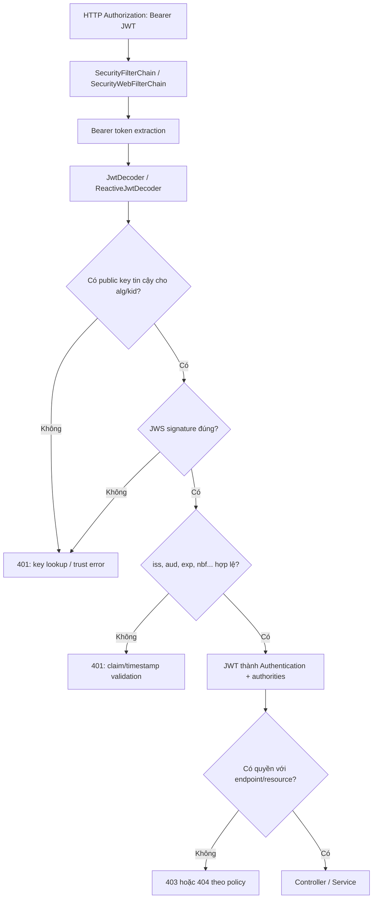
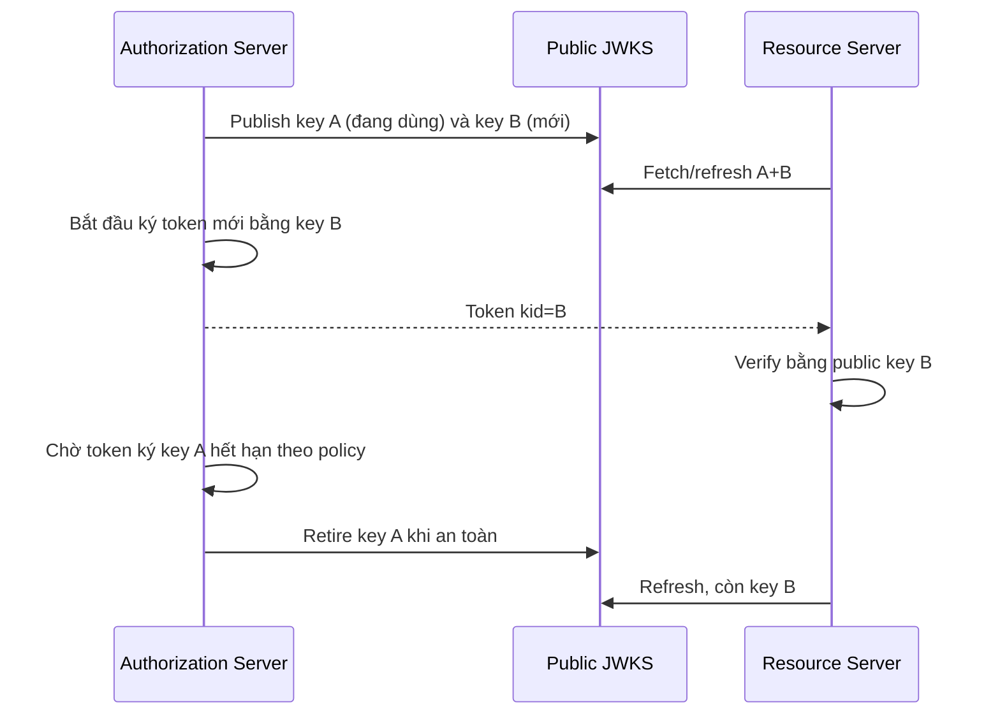

# Token hết hạn, clock skew hoặc cache khóa làm test không ổn định

Một ca kiểm thử Spring Security có thể xanh ở máy cá nhân nhưng thỉnh thoảng đỏ trên CI dù cùng mã nguồn: sáng sớm token được chấp nhận, vài phút sau lại nhận `401 Unauthorized`; một JWT vừa được ký bằng khóa mới có lúc hợp lệ, có lúc bị từ chối; hoặc test chỉ thất bại khi chạy cùng những lớp khác. Ba nhóm nguyên nhân thường bị gộp nhầm là **token hết hạn**, **đồng hồ của các thành phần lệch nhau (clock skew)** và **cache khóa công khai/JWKS chưa đồng bộ sau khi xoay khóa**.

Bài thuộc chương **Chẩn đoán sự cố** của module **SPRING_SECURITY_TESTING**. Module dạy kiểm chứng xác thực, phân quyền và bảo vệ HTTP thực tế bằng `spring-security-test` trên ứng dụng Servlet và Reactive, với `MockMvc`, `WebTestClient`, `@WithMockUser`, `SecurityContext`, JWT/OAuth2/OIDC giả lập và các ca được phép hoặc bị từ chối. Nội dung dưới đây đi từ việc xác định lớp hỏng đến tạo fixture xác định, viết test JWT ký thật, mô phỏng JWKS/key rotation, kiểm tra trạng thái trên CI và tránh các “cách sửa” làm yếu chính sách bảo mật.

> **Quy tắc quan trọng:** Đừng làm test xanh bằng cách bỏ kiểm `exp`, tăng clock skew tùy tiện, tắt xác minh chữ ký hoặc thay `401` bằng `200`. Phải phân biệt **lỗi timestamp**, **lỗi tìm/xác minh khóa**, **lỗi claim** và **lỗi phân quyền**, rồi thiết kế test điều khiển chính xác nguyên nhân.

## 1. Ba nhóm sự cố với biểu hiện giống nhau

HTTP Resource Server thường trả cùng một status `401` cho nhiều lỗi xác thực. Vì vậy chỉ nhìn status không xác định được nguyên nhân.

| Nhóm | Điều kiện kỹ thuật | Triệu chứng điển hình | Hướng kiểm chứng |
|---|---|---|---|
| **Token hết hạn** | `exp` nằm ngoài cửa sổ được validator chấp nhận | Test chạy muộn nhận `401`; fixture được dùng lại qua nhiều lần chạy | Kiểm `exp`, clock, thời điểm tạo fixture và validator thực |
| **Token chưa có hiệu lực** | `nbf` ở tương lai so với đồng hồ verifier | CI nhận `401` ngay sau phát hành; chạy lại một lúc sau thì qua | Kiểm `nbf`, đồng hồ issuer/resource server, skew |
| **Clock skew** | Authorization Server và Resource Server đọc thời gian khác nhau | Cùng token được chấp nhận ở node này nhưng bị từ chối ở node khác | Đối chiếu thời gian UTC và policy dung sai |
| **JWKS cache cũ** | Decoder vẫn dùng bộ public keys cũ | JWT `kid=new` bị từ chối cho đến khi lấy JWKS mới | Kiểm JWKS URL, `kid`, public key, cache lifecycle |
| **Key rotation sai thứ tự** | Issuer ký bằng key mới khi JWKS chưa công bố key mới | Token mới bị `401` hàng loạt sau deploy | Kiểm thứ tự publish key / bắt đầu ký / retire key |
| **Sai chữ ký** | Token ký bằng private key không khớp public JWK | `401` ngay cả khi thời gian hợp lệ | Giữ các claims hợp lệ, thay duy nhất key ký |
| **Sai `iss`/`aud`** | JWT không dành cho issuer/API được tin cậy | `401` dù JWKS và thời gian đều đúng | Test từng validator độc lập |
| **Thiếu scope/role** | JWT đã xác thực nhưng thiếu authority | Thường `403` trên endpoint yêu cầu quyền | Kiểm converter, matcher và authority |
| **Không có Bearer** | Header không được gửi/đã bị client mất | Thường `401` | Kiểm test client, `Authorization` scheme và chain |

Cùng một “`401` lúc có lúc không” cũng có thể do test harness, network/JWKS endpoint, lệch thời gian hệ điều hành, token cache của OAuth2 Client hoặc test chạy song song. Không kết luận chỉ từ một dòng log `invalid_token`.

### 1.1. Hai đường kiểm thử không thể thay thế nhau

```java
// Kiểm authorization với Authentication đã được giả lập:
mvc.perform(get("/api/reports")
        .with(jwt()
            .authorities(
                new SimpleGrantedAuthority(
                    "SCOPE_reports.read"))))
    .andExpect(status().isOk());
```

`jwt()` của Spring Security Test **không kiểm chữ ký và thời hạn của raw JWT**. Test này có thể xanh ngay cả khi decoder/JWKS bị cấu hình sai.

```java
// Kiểm đường xác thực Bearer thật:
http.get()
    .uri("/api/reports")
    .headers(h -> h.setBearerAuth(signedJwt))
    .exchange()
    .expectStatus().isOk();
```

Đoạn thứ hai chỉ thực sự kiểm decoder khi `http` gọi ứng dụng qua HTTP hoặc security stack đã nạp đúng, `signedJwt` là JWT ký thật, và **không mock** `JwtDecoder`/`ReactiveJwtDecoder`. Cần xác định rõ loại test trước khi chẩn đoán.

## 2. Dòng chảy xác thực và điểm hỏng có thể quan sát



Các lớp có chức năng khác nhau:

1. **Bearer extraction**: Có nhận đúng header hay không?
2. **JWS/key verification**: Có key tin cậy, thuật toán hợp lệ, chữ ký chính xác hay không?
3. **JWT validation**: Issuer, audience, thời gian, token type và claims khác có đúng chính sách không?
4. **Authority conversion**: Từ `scope`/`scp`/role sang `SCOPE_...` hoặc authority theo cấu hình.
5. **Authorization**: Endpoint và object-level policy cho phép hay từ chối?
6. **Business side effects**: Không có write/command trái phép nếu một bước trước đã từ chối.

`401` không cho phép suy ra “chắc chắn JWT hết hạn”; `403` không cho phép suy ra “chắc chắn scope sai”, vì CSRF hoặc custom handler cũng có thể tạo status này. Cần đối chứng dương và input chỉ sai **một điều kiện**.

## 3. Hiểu đúng `exp`, `nbf`, `iat` và thời gian UTC

JWT dùng các NumericDate theo thời điểm Unix epoch, tính bằng **giây UTC**. Ba claim phổ biến:

- `exp` (*expiration time*): token không được chấp nhận sau hạn, trừ dung sai do verifier cho phép.
- `nbf` (*not before*): token chưa có hiệu lực trước thời điểm này, có thể có dung sai.
- `iat` (*issued at*): thời điểm phát hành; **không** mặc định thay thế `exp` và `nbf`, cũng không có nghĩa mọi validator đều từ chối một `iat` ở tương lai nếu chưa được cấu hình.

Ví dụ JWT payload đã giải mã để **đọc nội bộ trong test**, không phải raw token cần ghi vào log:

```json
{
  "iss": "https://issuer.example.invalid",
  "sub": "alice",
  "aud": ["reports-api"],
  "iat": 1893456000,
  "nbf": 1893456000,
  "exp": 1893459600,
  "scope": "reports.read"
}
```

Mốc số trên minh họa định dạng, **không** dùng làm token tĩnh cho một bộ integration test chạy nhiều tháng. Mỗi lần test cần một bộ thời gian được tạo từ clock kiểm soát được hoặc một `Clock.fixed(...)` tại unit validator test.

### 3.1. Sai lệch đơn vị giây và mili giây

Đây là lỗi test fixture phổ biến:

```java
long epochMilliseconds =
        System.currentTimeMillis();

// Sai nếu claim NumericDate yêu cầu đơn vị giây:
claims.claim("exp", epochMilliseconds);
```

Giá trị epoch milliseconds lớn hơn epoch seconds khoảng 1.000 lần, khiến token trông còn hạn rất lâu. Một lỗi ngược lại là dùng epoch seconds nơi parser mong milliseconds khi xây `Date`.

Nên dùng API có kiểu thời gian rõ:

```java
Instant now = Instant.now();

Date issuedAt = Date.from(now);
Date expiresAt = Date.from(
        now.plus(Duration.ofMinutes(10)));
```

Khi làm việc với JSON NumericDate, dùng `Instant.getEpochSecond()` hoặc thư viện JWT/JWS xử lý conversion đúng. Không thao tác bằng một số `long` không ghi rõ đơn vị.

### 3.2. Múi giờ không trực tiếp đổi JWT epoch

Một token `exp` ở epoch UTC không “hết hạn sớm” chỉ vì runner đang đặt timezone `Asia/Ho_Chi_Minh` thay vì UTC. Sự cố xuất hiện khi **code fixture tự parse chuỗi giờ local**, thiếu offset, hoặc chuyển `LocalDateTime` sang `Instant` bằng timezone khác nhau.

Dùng:

```java
Instant fixedNow =
        Instant.parse("2032-01-15T10:00:00Z");
```

thay vì:

```java
// Giá trị này chưa có timezone/offset:
LocalDateTime ambiguous =
        LocalDateTime.parse(
            "2032-01-15T10:00:00");
```

Nếu cần lịch địa phương, chọn `ZoneId` tường minh trước khi chuyển sang `Instant`; nhưng token validation vẫn phải so sánh các thời điểm tuyệt đối.

## 4. Clock skew: dung sai là một chính sách, không phải cách sửa flaky

Một Resource Server có thể chạy đồng hồ nhanh hơn issuer 20 giây. Token vừa được issuer phát hành với `nbf=now` có thể bị node chậm/nhanh từ chối ở biên. `JwtTimestampValidator` của Spring Security hỗ trợ **clock skew** để cho phép sai lệch có giới hạn; tài liệu Spring Security mô tả mặc định khoảng **60 giây** trong các cấu hình Resource Server được tài liệu hóa. Hãy đối chiếu phiên bản cụ thể và validator đang được ứng dụng dùng, **đừng giả định mọi custom decoder đều giữ mặc định đó**.

Một mô hình minh họa với skew 30 giây:

```text
now của Resource Server = 10:00:00Z
skew = 30 giây

exp = 09:59:50Z  → có thể được chấp nhận do còn trong leeway
exp = 09:58:00Z  → phải bị từ chối vì đã quá xa

nbf = 10:00:20Z  → có thể được chấp nhận do leeway
nbf = 10:02:00Z  → phải bị từ chối vì chưa hiệu lực quá xa
```

Giá trị ranh giới chính xác phụ thuộc implementation và kiểu so sánh; **không viết test sát một mili giây ở biên trên clock thật**.

### 4.1. Không tăng skew lên vài giờ để làm test hết đỏ

Một thay đổi như:

```java
new JwtTimestampValidator(
        Duration.ofHours(24));
```

có thể làm token đã hết hạn hoặc chưa có hiệu lực rất lâu vẫn được chấp nhận. Đây là **thay đổi phạm vi tin cậy**, không phải tối ưu test. Chọn skew theo yêu cầu bảo mật, hạ tầng đồng bộ thời gian và profile của identity provider. Nếu muốn kiểm token quá hạn thì tạo token hết hạn **xa hơn skew**, không nới skew.

### 4.2. Clock skew không sửa được clock drift không giới hạn

Nếu hai node lệch nhau nhiều phút/giờ, cần sửa đồng hồ/NTP và health monitoring. Không dùng test fixture hoặc validator để che sai lệch hệ thống. Trong CI, ghi metadata về thời gian UTC, loại lỗi và build agent **không kèm raw credential** để tìm pattern lệch node.

## 5. Vì sao `Thread.sleep()` thường là cách chữa sai?

Một anti-pattern:

```java
String token = issueJwtExpiringInOneSecond();

Thread.sleep(1500);

mvc.perform(get("/api/reports")
        .header("Authorization",
                "Bearer " + token))
    .andExpect(status().isUnauthorized());
```

Lý do kém ổn định:

- Tốc độ CI/scheduler khác nhau.
- `exp` có thể được chấp nhận trong khoảng clock skew.
- Test tiêu tốn thời gian vô ích.
- Một thay đổi validator skew làm kết quả đảo chiều.
- Không tách được lỗi hết hạn khỏi lỗi signature/JWKS.
- Nếu test dùng mock authentication, token có thể không được giải mã dù sleep đủ lâu.

Cách tốt hơn:

- Với **unit test validator**, dùng `Clock.fixed()` và token object có `exp`/`nbf` rõ ràng.
- Với **HTTP integration**, ký token test có `exp` nằm trong quá khứ đủ xa so với skew và `nbf` trong quá khứ; giữ chữ ký, issuer/audience đúng.
- Với **OAuth2 Client refresh**, điều khiển authorized-client expiry qua fixture hoặc clock được cấu hình, kiểm token endpoint/stub thay vì chờ access token thật hết hạn.
- Với **JWKS cache**, dùng cache lifecycle/clock hoặc isolate decoder theo test; không ngủ đoán thời gian refresh.

## 6. Unit test `JwtTimestampValidator` với đồng hồ cố định

Phép thử cấp thấp có thể xác định chính xác validator xử lý `exp` và `nbf` thế nào, không liên quan HTTP, chữ ký hay JWKS.

Mã minh họa Java/JUnit 5 + AssertJ:

```java
class JwtTimestampValidatorTest {

    private static final Instant NOW =
        Instant.parse("2032-01-15T10:00:00Z");

    private static final Duration SKEW =
        Duration.ofSeconds(30);

    private final JwtTimestampValidator validator =
        new JwtTimestampValidator(SKEW);

    @BeforeEach
    void setClock() {
        validator.setClock(
            Clock.fixed(NOW, ZoneOffset.UTC));
    }

    private Jwt jwt(
            Instant notBefore,
            Instant expiresAt) {

        return Jwt.withTokenValue(
                "fixture-only-not-a-signed-token")
            .header("alg", "RS256")
            .subject("alice")
            .issuedAt(NOW.minusSeconds(3600))
            .notBefore(notBefore)
            .expiresAt(expiresAt)
            .build();
    }

    @Test
    void validWindowIsAccepted() {
        Jwt token = jwt(
            NOW.minusSeconds(60),
            NOW.plusSeconds(600));

        assertThat(validator.validate(token)
            .hasErrors()).isFalse();
    }

    @Test
    void expiryFarBeyondSkewIsRejected() {
        Jwt token = jwt(
            NOW.minusSeconds(3600),
            NOW.minusSeconds(120));

        assertThat(validator.validate(token)
            .hasErrors()).isTrue();
    }

    @Test
    void notBeforeFarBeyondSkewIsRejected() {
        Jwt token = jwt(
            NOW.plusSeconds(120),
            NOW.plusSeconds(600));

        assertThat(validator.validate(token)
            .hasErrors()).isTrue();
    }

    @Test
    void expiryInsideConfiguredLeewayIsAccepted() {
        Jwt token = jwt(
            NOW.minusSeconds(3600),
            NOW.minusSeconds(10));

        assertThat(validator.validate(token)
            .hasErrors()).isFalse();
    }
}
```

Import:

```java
import java.time.Clock;
import java.time.Duration;
import java.time.Instant;
import java.time.ZoneOffset;

import org.junit.jupiter.api.BeforeEach;
import org.junit.jupiter.api.Test;
import org.springframework.security.oauth2.jwt.Jwt;
import org.springframework.security.oauth2.jwt.JwtTimestampValidator;

import static org.assertj.core.api.Assertions.assertThat;
```

**Giới hạn của test:** `Jwt` object do builder tạo trực tiếp, không phải chuỗi JWS đã ký. Test chỉ đo `JwtTimestampValidator`, không chứng minh `NimbusJwtDecoder` đã xác minh chữ ký hoặc issuer/audience. Đây là điều có chủ đích: cần **mỗi test sai một nguyên nhân**.

### 6.1. Khi nào nên kiểm sát biên?

Có thể viết những ca ngay tại `exp ± skew` nếu **clock cố định** và biết implementation đang dùng so sánh `isBefore`/`isAfter` theo contract. Tuy nhiên, nếu không cần chứng minh chính xác ranh giới một nanosecond, nên đặt mốc **cách biên đáng kể** để tránh thay đổi kỹ thuật không mang ý nghĩa nghiệp vụ làm test đỏ.

### 6.2. Lưu ý khi tự ghép validators

Khi thay validator của decoder:

```java
decoder.setJwtValidator(customValidator);
```

bạn có thể **thay thế** bộ validators mặc định thay vì cộng thêm. Vì vậy, nếu thêm kiểm audience nhưng quên timestamp/issuer, token hết hạn có thể được nhận.

Một nhóm đầy đủ thường cần:

```java
OAuth2TokenValidator<Jwt> validators =
    new DelegatingOAuth2TokenValidator<>(
        new JwtTimestampValidator(
            Duration.ofSeconds(30)),
        new JwtIssuerValidator(expectedIssuer),
        audienceValidator);
```

`audienceValidator` phải được định nghĩa theo hợp đồng API. Nếu phiên bản/framework sử dụng thêm validator token type hoặc profile RFC 9068, cần giữ các quy tắc ấy khi tùy biến, không chỉ ba mục ở ví dụ. Một test `exp` và một test `iss` riêng phát hiện lỗi bỏ mặc định.

## 7. Cấu hình Resource Server rõ ràng và bảo toàn validators

Giả sử API chỉ nhận JWT RS256 có issuer tin cậy và audience `reports-api`. Ứng dụng Servlet có thể dùng:

```java
@Configuration(proxyBeanMethods = false)
class JwtValidationConfig {

    @Bean
    JwtDecoder jwtDecoder(
            @Value("${app.jwt.jwks-uri}")
                String jwksUri,
            @Value("${app.jwt.issuer}")
                String expectedIssuer,
            @Value("${app.jwt.audience}")
                String expectedAudience) {

        NimbusJwtDecoder decoder =
            NimbusJwtDecoder
                .withJwkSetUri(jwksUri)
                .jwsAlgorithm(SignatureAlgorithm.RS256)
                .build();

        OAuth2TokenValidator<Jwt> audience =
            jwt -> jwt.getAudience() != null
                    && jwt.getAudience()
                        .contains(expectedAudience)
                ? OAuth2TokenValidatorResult.success()
                : OAuth2TokenValidatorResult.failure(
                    new OAuth2Error(
                        "invalid_token",
                        "Invalid audience",
                        null));

        OAuth2TokenValidator<Jwt> validators =
            new DelegatingOAuth2TokenValidator<>(
                new JwtTimestampValidator(
                    Duration.ofSeconds(30)),
                new JwtIssuerValidator(expectedIssuer),
                audience);

        decoder.setJwtValidator(validators);
        return decoder;
    }
}
```

Import:

```java
import java.time.Duration;

import org.springframework.beans.factory.annotation.Value;
import org.springframework.context.annotation.Bean;
import org.springframework.context.annotation.Configuration;
import org.springframework.security.oauth2.core.DelegatingOAuth2TokenValidator;
import org.springframework.security.oauth2.core.OAuth2Error;
import org.springframework.security.oauth2.core.OAuth2TokenValidator;
import org.springframework.security.oauth2.core.OAuth2TokenValidatorResult;
import org.springframework.security.oauth2.jose.jws.SignatureAlgorithm;
import org.springframework.security.oauth2.jwt.Jwt;
import org.springframework.security.oauth2.jwt.JwtDecoder;
import org.springframework.security.oauth2.jwt.JwtIssuerValidator;
import org.springframework.security.oauth2.jwt.JwtTimestampValidator;
import org.springframework.security.oauth2.jwt.NimbusJwtDecoder;
```

**Điểm cần hiểu:**

- JWKS dùng xác minh **chữ ký**; không tự quyết định issuer/audience/time.
- `JwtTimestampValidator` kiểm timestamp với skew được chọn.
- `JwtIssuerValidator` kiểm issuer.
- Audience validator kiểm token **dành cho API này**.
- Converter authority và `SecurityFilterChain` kiểm scope/role ở bước sau.
- Đây là cấu hình minh họa một số rule phổ biến; ứng dụng có thể có claim/token-type/profile validators khác mà **không được bỏ** khi áp dụng.

Nếu dùng Spring Boot auto-config với `issuer-uri` và `jwk-set-uri`, Spring Security có cấu hình defaults tùy phiên bản. Khi tự định nghĩa `JwtDecoder` bean, hãy đọc lại toàn bộ yêu cầu xác minh của ứng dụng: việc thay bean có thể làm mất issuer validator ngoài ý muốn.

## 8. Tạo JWT ký thật cho integration test

Để test đường HTTP xác thực thực, cần private key test để ký JWT và public key để Resource Server xác minh. Không dùng secret/khóa production trong fixtures.

Mẫu factory dùng Nimbus JOSE/JWT:

```java
static RSAKey newKey(String kid) {
    try {
        KeyPairGenerator generator =
            KeyPairGenerator.getInstance("RSA");
        generator.initialize(2048);

        KeyPair pair = generator.generateKeyPair();

        return new RSAKey.Builder(
                (RSAPublicKey) pair.getPublic())
            .privateKey(
                (RSAPrivateKey) pair.getPrivate())
            .keyID(kid)
            .build();
    } catch (GeneralSecurityException exception) {
        throw new IllegalStateException(
            "Cannot create test key", exception);
    }
}
```

Ký token:

```java
static String signedJwt(
        RSAKey key,
        String issuer,
        List<String> audience,
        Instant issuedAt,
        Instant notBefore,
        Instant expiresAt,
        String scope) throws Exception {

    JWTClaimsSet claims =
        new JWTClaimsSet.Builder()
            .issuer(issuer)
            .subject("alice")
            .audience(audience)
            .issueTime(Date.from(issuedAt))
            .notBeforeTime(Date.from(notBefore))
            .expirationTime(Date.from(expiresAt))
            .claim("scope", scope)
            .jwtID(UUID.randomUUID().toString())
            .build();

    SignedJWT token = new SignedJWT(
        new JWSHeader.Builder(JWSAlgorithm.RS256)
            .keyID(key.getKeyID())
            .build(),
        claims);

    token.sign(new RSASSASigner(
        key.toRSAPrivateKey()));

    return token.serialize();
}
```

Import chính:

```java
import com.nimbusds.jose.JWSAlgorithm;
import com.nimbusds.jose.JWSHeader;
import com.nimbusds.jose.crypto.RSASSASigner;
import com.nimbusds.jose.jwk.RSAKey;
import com.nimbusds.jwt.JWTClaimsSet;
import com.nimbusds.jwt.SignedJWT;

import java.security.GeneralSecurityException;
import java.security.KeyPair;
import java.security.KeyPairGenerator;
import java.security.interfaces.RSAPrivateKey;
import java.security.interfaces.RSAPublicKey;
import java.time.Instant;
import java.util.Date;
import java.util.List;
import java.util.UUID;
```

**Chỉ đưa public JWK vào JWKS endpoint:**

```java
String jwksJson = new JWKSet(
        key.toPublicJWK()).toString();
```

Không dùng `new JWKSet(key)` với private key đầy đủ để làm HTTP response; có thể làm lộ thông tin bí mật nếu serialization không được kiểm soát. Dùng `.toPublicJWK()` là ranh giới rõ ràng.

### 8.1. Sinh thời gian xa khỏi biên để giảm flaky

```java
Instant now = Instant.now();

String valid = signedJwt(
    trustedKey, expectedIssuer,
    List.of("reports-api"),
    now.minusSeconds(60),
    now.minusSeconds(60),
    now.plusSeconds(600),
    "reports.read");

String expired = signedJwt(
    trustedKey, expectedIssuer,
    List.of("reports-api"),
    now.minusSeconds(3600),
    now.minusSeconds(3600),
    now.minusSeconds(600),
    "reports.read");

String notYetValid = signedJwt(
    trustedKey, expectedIssuer,
    List.of("reports-api"),
    now.minusSeconds(10),
    now.plusSeconds(600),
    now.plusSeconds(1200),
    "reports.read");
```

Với skew 30/60 giây, các mốc ±600 giây ở đây đủ cách xa biên thông thường. Nếu CI thật sự có clock drift hàng chục phút, cần sửa đồng bộ thời gian thay vì tiếp tục tăng thời hạn vô hạn. Khi bài test cần chính xác biên, dùng `Clock.fixed()` trên validator test.

## 9. JWKS HTTP stub có kiểm soát, không gọi IdP thật

Một integration test ổn định không nên phụ thuộc endpoint JWKS của IdP production, mạng công cộng hay thông tin bí mật có thời hạn.

Với `MockWebServer`, có thể tạo một server trả JSON JWKS của key test:

```java
final class TestJwksServer implements AutoCloseable {

    private final AtomicReference<String> document =
        new AtomicReference<>();

    private final MockWebServer server =
        new MockWebServer();

    TestJwksServer(RSAKey initialKey)
            throws IOException {

        publish(initialKey);

        server.setDispatcher(new Dispatcher() {
            @Override
            public MockResponse dispatch(
                    RecordedRequest request) {

                if ("/jwks".equals(request.getPath())) {
                    return new MockResponse()
                        .setResponseCode(200)
                        .setHeader(
                            "Content-Type",
                            "application/json")
                        .setBody(document.get());
                }

                return new MockResponse()
                    .setResponseCode(404);
            }
        });

        server.start();
    }

    void publish(RSAKey... publicKeys) {
        List<JWK> keys = Arrays.stream(publicKeys)
            .map(RSAKey::toPublicJWK)
            .map(jwk -> (JWK) jwk)
            .toList();

        document.set(
            new JWKSet(keys).toString());
    }

    String jwksUri() {
        return server.url("/jwks").toString();
    }

    @Override
    public void close() throws IOException {
        server.shutdown();
    }
}
```

Import:

```java
import com.nimbusds.jose.jwk.JWK;
import com.nimbusds.jose.jwk.JWKSet;
import com.nimbusds.jose.jwk.RSAKey;
import okhttp3.mockwebserver.Dispatcher;
import okhttp3.mockwebserver.MockResponse;
import okhttp3.mockwebserver.MockWebServer;
import okhttp3.mockwebserver.RecordedRequest;

import java.io.IOException;
import java.util.Arrays;
import java.util.List;
import java.util.concurrent.atomic.AtomicReference;
```

`TestJwksServer` là **test fixture**. `publish(keyA, keyB)` công bố các public keys tương ứng. Server bắt đầu trước khi ứng dụng/decoder cần truy cập URI; request từ decoder chạy qua HTTP loopback.

Không gọi API `RecordedRequest.toString()` để in toàn bộ request khi có khả năng chứa credentials. JWKS GET không cần raw Bearer, nhưng các stub token endpoint/introspection ở cùng bộ test có thể nhận Basic client secret hoặc refresh token.

### 9.1. Đường dẫn JWKS và issuer phải được xác định độc lập

Một cấu hình test có thể là:

```yaml
app:
  jwt:
    issuer: https://issuer.example.invalid
    audience: reports-api
    jwks-uri: http://127.0.0.1:<test-port>/jwks
```

`issuer` vẫn là URI mang ý nghĩa danh tính và phải **khớp `iss` của token**. JWKS URI có thể trỏ tới localhost trong test; không cần làm giả `iss` thành `http://localhost:...` chỉ vì key được phục vụ ở đó. Khi dùng metadata discovery từ `issuer-uri`, cần giả lập endpoint metadata hoặc cấu hình `jwk-set-uri` trực tiếp theo cơ chế framework, không nhầm hai tính năng.

## 10. Servlet: HTTP test phân biệt expiry, signature, issuer và audience

Giả định ứng dụng dùng cấu hình mục 7, `SecurityFilterChain` bảo vệ `GET /api/reports` bằng authority `SCOPE_reports.read`, và có controller trả một marker.

```java
@Bean
SecurityFilterChain reportChain(HttpSecurity http)
        throws Exception {

    return http
        .authorizeHttpRequests(auth -> auth
            .requestMatchers(
                HttpMethod.GET, "/api/reports")
                .hasAuthority("SCOPE_reports.read")
            .anyRequest().denyAll())
        .oauth2ResourceServer(oauth2 -> oauth2
            .jwt(Customizer.withDefaults()))
        .build();
}
```

Controller đơn giản:

```java
@RestController
class ReportController {

    @GetMapping("/api/reports")
    Map<String, String> reports() {
        return Map.of(
            "data", "AUTHORIZED_REPORT_MARKER");
    }
}
```

Test HTTP thật có thể dùng `@SpringBootTest(RANDOM_PORT)` và `WebTestClient.bindToServer()` ngay cả khi server là Spring MVC Servlet:

```java
@SpringBootTest(
    webEnvironment =
        SpringBootTest.WebEnvironment.RANDOM_PORT)
class ReportBearerHttpIT {

    @LocalServerPort
    int port;

    WebTestClient client;

    @BeforeEach
    void setUp() {
        client = WebTestClient.bindToServer()
            .baseUrl("http://localhost:" + port)
            .responseTimeout(
                Duration.ofSeconds(3))
            .build();
    }

    private void expect(
            String token, HttpStatus status) {

        client.get()
            .uri("/api/reports")
            .headers(h ->
                h.setBearerAuth(token))
            .exchange()
            .expectStatus()
            .isEqualTo(status);
    }

    // test methods dùng factory signedJwt(...)
}
```

`expectStatus().isEqualTo(status)` là API Spring WebTestClient; các ký hiệu `HttpStatus` ở đây mang status mong đợi. Với code thực, dùng `expectStatus().isOk()`/`isUnauthorized()` nếu phù hợp.

### 10.1. Đối chứng dương bắt buộc

```java
@Test
void validSignedJwtReachesController()
        throws Exception {

    Instant now = Instant.now();
    String jwt = signedJwt(
        trustedKey, expectedIssuer,
        List.of("reports-api"),
        now.minusSeconds(60),
        now.minusSeconds(60),
        now.plusSeconds(600),
        "reports.read");

    client.get()
        .uri("/api/reports")
        .headers(h -> h.setBearerAuth(jwt))
        .exchange()
        .expectStatus().isOk()
        .expectBody()
        .jsonPath("$.data")
            .isEqualTo("AUTHORIZED_REPORT_MARKER");
}
```

Nếu JWKS endpoint hỏng, issuer sai hoặc authority converter không hoạt động, positive test sẽ đỏ. Không có đối chứng dương, một loạt test invalid JWT `401` vẫn có thể xanh trong khi decoder từ chối **mọi token**.

### 10.2. JWT hết hạn nhưng mọi thứ khác hợp lệ

```java
@Test
void expiredJwtIsUnauthorized()
        throws Exception {

    Instant now = Instant.now();
    String jwt = signedJwt(
        trustedKey, expectedIssuer,
        List.of("reports-api"),
        now.minusSeconds(3600),
        now.minusSeconds(3600),
        now.minusSeconds(600),
        "reports.read");

    expect(jwt, HttpStatus.UNAUTHORIZED);
}
```

Một token dùng `exp=now.minusSeconds(1)` có thể còn nằm trong clock skew nên **không** phải fixture ổn định cho test expired.

### 10.3. `nbf` ở tương lai

```java
@Test
void jwtNotYetValidIsUnauthorized()
        throws Exception {

    Instant now = Instant.now();
    String jwt = signedJwt(
        trustedKey, expectedIssuer,
        List.of("reports-api"),
        now.minusSeconds(10),
        now.plusSeconds(600),
        now.plusSeconds(1200),
        "reports.read");

    expect(jwt, HttpStatus.UNAUTHORIZED);
}
```

### 10.4. Sai issuer hoặc audience, không cố ý sai giờ

```java
@Test
void wrongAudienceIsUnauthorized()
        throws Exception {

    Instant now = Instant.now();
    String jwt = signedJwt(
        trustedKey, expectedIssuer,
        List.of("payments-api"),
        now.minusSeconds(60),
        now.minusSeconds(60),
        now.plusSeconds(600),
        "reports.read");

    expect(jwt, HttpStatus.UNAUTHORIZED);
}

@Test
void wrongIssuerIsUnauthorized()
        throws Exception {

    Instant now = Instant.now();
    String jwt = signedJwt(
        trustedKey,
        "https://other-issuer.example.invalid",
        List.of("reports-api"),
        now.minusSeconds(60),
        now.minusSeconds(60),
        now.plusSeconds(600),
        "reports.read");

    expect(jwt, HttpStatus.UNAUTHORIZED);
}
```

### 10.5. Sai chữ ký với cùng `kid`

```java
@Test
void wrongPrivateKeyIsUnauthorized()
        throws Exception {

    Instant now = Instant.now();

    // foreignKey có cùng kid nhưng KHÁC private key;
    // public key của foreignKey KHÔNG nằm trong JWKS.
    String jwt = signedJwt(
        foreignKey, expectedIssuer,
        List.of("reports-api"),
        now.minusSeconds(60),
        now.minusSeconds(60),
        now.plusSeconds(600),
        "reports.read");

    expect(jwt, HttpStatus.UNAUTHORIZED);
}
```

Cùng `kid` giúp thử xác minh chữ ký bằng một public key được tìm thấy; nếu dùng `kid` không tồn tại, decoder có thể từ chối sớm vì **không tìm thấy key**. Hai tình huống cần test riêng khi muốn định vị JWKS/cache.

### 10.6. Token hợp lệ nhưng scope sai: đây không phải expiry

```java
@Test
void validJwtWithoutReadScopeIsForbidden()
        throws Exception {

    Instant now = Instant.now();
    String jwt = signedJwt(
        trustedKey, expectedIssuer,
        List.of("reports-api"),
        now.minusSeconds(60),
        now.minusSeconds(60),
        now.plusSeconds(600),
        "reports.export");

    expect(jwt, HttpStatus.FORBIDDEN);
}
```

Ca này kiểm xác thực đã thành công nhưng authorization từ chối. Nếu token scope sai lại `401`, cần xem claim validation policy hoặc decoder; nếu `200`, cần kiểm converter/HTTP matcher.

**Fixture wiring:** Các biến `trustedKey`, `foreignKey`, `expectedIssuer`, `client` và cấu hình `@DynamicPropertySource` phải được định nghĩa trong test class/fixture thực. Không phải mọi đoạn code trong bài là một file có thể chạy độc lập khi copy riêng lẻ.

## 11. MockMvc: kiểm behavior policy nhưng không kiểm token clock/JWKS

Với Servlet, `MockMvc` thường nhanh và hữu ích:

```java
mvc.perform(get("/api/reports")
        .with(jwt()
            .jwt(j -> j
                .subject("alice")
                .expiresAt(
                    Instant.now().minusSeconds(600)))
            .authorities(
                new SimpleGrantedAuthority(
                    "SCOPE_reports.read"))))
    .andExpect(status().isOk());
```

Đây là **kết quả có thể xảy ra và hợp lệ của mock test**: JWT object đã được chèn vào authentication nên decoder không xác minh `exp`. Vì thế test này **không được dùng** để kết luận token hết hạn được chấp nhận trong production.

Nếu muốn `MockMvc` kiểm đường Bearer thực, vẫn có thể gửi header `Authorization: Bearer <signedJwt>` qua MockMvc với `SecurityFilterChain` và decoder thật, **không** dùng `.with(jwt())`. Không nhất thiết mở socket để chạy decoder, nhưng cần xác nhận test không mock/bypass security.

### 11.1. `@WithMockUser` càng không kiểm thời hạn JWT

```java
@Test
@WithMockUser(
    username = "alice",
    authorities = "SCOPE_reports.read")
void allowedWithMockPrincipal() {
    // Test authorization với user giả lập.
}
```

`@WithMockUser` không có raw access token, `kid`, `exp`, `nbf` hay JWKS. Nó phù hợp để kiểm policy khi danh tính đã xác thực; không phù hợp để tái hiện cache key/clock skew.

## 12. WebFlux: ReactiveJwtDecoder và WebTestClient

Spring WebFlux dùng `SecurityWebFilterChain`, `ReactiveJwtDecoder` và Reactor Context. Bản chất thời gian/JWKS vẫn giống, nhưng cơ chế test và lifecycle khác.

Cấu hình Reactive mẫu:

```java
@Configuration(proxyBeanMethods = false)
@EnableWebFluxSecurity
class ReactiveReportSecurity {

    @Bean
    SecurityWebFilterChain chain(
            ServerHttpSecurity http) {

        return http
            .authorizeExchange(auth -> auth
                .pathMatchers(
                    HttpMethod.GET, "/api/reports")
                .hasAuthority("SCOPE_reports.read")
                .anyExchange().denyAll())
            .httpBasic(
                ServerHttpSecurity.HttpBasicSpec::disable)
            .formLogin(
                ServerHttpSecurity.FormLoginSpec::disable)
            .oauth2ResourceServer(oauth2 -> oauth2
                .jwt(Customizer.withDefaults()))
            .build();
    }

    @Bean
    ReactiveJwtDecoder decoder(
            @Value("${app.jwt.jwks-uri}")
                String jwksUri,
            @Value("${app.jwt.issuer}")
                String issuer) {

        NimbusReactiveJwtDecoder decoder =
            NimbusReactiveJwtDecoder
                .withJwkSetUri(jwksUri)
                .jwsAlgorithm(SignatureAlgorithm.RS256)
                .build();

        decoder.setJwtValidator(
            new DelegatingOAuth2TokenValidator<>(
                new JwtTimestampValidator(
                    Duration.ofSeconds(30)),
                new JwtIssuerValidator(issuer)));

        return decoder;
    }
}
```

Đây là **skeleton** chỉ có time+issuer, để minh họa Reactive decoder; nếu API còn yêu cầu audience/token type/tenant, cần bổ sung validators như mục 7. Không được bỏ audience validator của production khi dùng ví dụ này.

### 12.1. Test HTTP Reactive bằng raw Bearer

```java
WebTestClient http =
    WebTestClient.bindToServer()
        .baseUrl("http://localhost:" + port)
        .responseTimeout(Duration.ofSeconds(3))
        .build();

http.get()
    .uri("/api/reports")
    .headers(h -> h.setBearerAuth(
        validSignedJwt))
    .exchange()
    .expectStatus().isOk();
```

Với `@SpringBootTest(RANDOM_PORT)`, đây là request HTTP thực tới WebFlux server. Decoder Reactive phải xác minh token trước khi controller chạy. Để test expiry/key rotation, dùng JWT ký thật và JWKS/test clock phù hợp.

### 12.2. Test mockJwt không đi qua decoder

```java
client.mutateWith(mockJwt()
        .authorities(
            new SimpleGrantedAuthority(
                "SCOPE_reports.read")))
    .get()
    .uri("/api/reports")
    .exchange()
    .expectStatus().isOk();
```

`mockJwt()` chỉ kiểm authorization khi authentication đã tồn tại. Không thay thế test `ReactiveJwtDecoder` thật. Khi dùng WebTestClient `bindToServer()` qua mạng, mutation `mockJwt()` của Spring Security Test **không tự truyền security context qua HTTP**; gửi raw Bearer header mới đúng.

### 12.3. Reactor virtual time không tự đổi đồng hồ JWT decoder

`StepVerifier.withVirtualTime(...)` tiến thời gian cho các operator Reactor dùng scheduler tương thích, **không mặc nhiên thay `Clock.systemUTC()` mà JWT validator sử dụng**, không làm JWKS HTTP cache hết hạn, và không thay đồng hồ của external IdP. Để test thời gian JWT, dùng `JwtTimestampValidator.setClock()` ở test validator; để test expiry trong HTTP thật, tạo token quá hạn đủ xa.

## 13. Hiểu cơ chế JWKS và `kid`

JWT ký bằng thuật toán bất đối xứng chứa JWS header, ví dụ:

```json
{
  "alg": "RS256",
  "typ": "JWT",
  "kid": "reports-key-a"
}
```

`kid` là **định danh gợi ý chọn public key** trong JWKS; nó **không tự chứng minh token được tin cậy**. Decoder còn phải giới hạn thuật toán, tải JWK Set từ nguồn được tin cậy và xác minh chữ ký.

JWKS dạng rút gọn:

```json
{
  "keys": [
    {
      "kty": "RSA",
      "kid": "reports-key-a",
      "use": "sig",
      "alg": "RS256",
      "n": "<public-modulus-base64url>",
      "e": "AQAB"
    }
  ]
}
```

Phần public key là `n` và `e`. Private exponent/private key không được xuất hiện trong JWKS HTTP response.

### 13.1. Một `401` do key có thể có nhiều nguyên nhân

- `kid` không có trong JWKS mà decoder đang nhìn thấy.
- `kid` có nhưng private key ký token khác với public key.
- Token dùng `alg` không nằm trong trusted algorithms.
- JWKS URL sai, không truy cập được hoặc trả JSON lỗi.
- JWKS endpoint đã công bố key mới nhưng cache vẫn giữ bản cũ.
- Có nhiều issuer nhưng resolver chọn nhầm JWKS của issuer khác.
- Một proxy/CDN giữ bản cũ hoặc trả response cache không mong muốn.
- `kid` bị tái sử dụng cho một key mới và cache/selector không phân biệt được.
- Decoder bean được tạo từ config khác với config test mong đợi.

Đừng chỉ xóa cache theo phản xạ. Kiểm trước **khóa nào đã ký token, khóa nào được công bố, decoder nào đang sử dụng nguồn nào**.

## 14. Các tầng cache liên quan JWKS

Không phải mọi môi trường đều dùng một cache duy nhất.

| Tầng | Dữ liệu có thể được giữ | Khi nào gây khác biệt |
|---|---|---|
| Authorization Server | Bộ JWK công khai đang publish | AS chưa công bố key mới khi bắt đầu ký |
| CDN/reverse proxy | HTTP response JWKS | JWKS đổi nhưng proxy còn trả bản cũ |
| Nimbus JWK source / decoder | JWK Set đã tải | Decoder dùng key set trước rotation |
| Spring Cache tự cấu hình | JSON JWKS theo URI | Cache key/TTL/eviction khác thiết lập mong đợi |
| Spring TestContext/ApplicationContext | Decoder bean được tái sử dụng | Test B kế thừa trạng thái cache từ test A |
| HTTP stub/test server | Response JSON và routing | Test song song thay server state giữa các request |
| OAuth2 Client authorized-client store | **Access token đã cấp**, không phải JWKS | Client tiếp tục dùng token sắp hết hạn, gây `401` downstream |

Tài liệu Spring Security cho Servlet `NimbusJwtDecoder` mô tả cache in-memory JWKS mặc định khoảng **5 phút** trong cấu hình được tài liệu hóa; có thể cung cấp Spring `Cache` tùy chỉnh. **Không dùng “5 phút” như hằng số bất biến cho tất cả phiên bản, Reactive decoder và mọi cache layer**. Cache behavior còn tùy Nimbus/JWK source, HTTP headers và cấu hình ứng dụng.

### 14.1. Đừng nhầm cache key với cache token

- **JWKS cache** giữ **public keys** được dùng xác minh chữ ký của nhiều JWT.
- **Access token cache / OAuth2AuthorizedClient** giữ **token đã được cấp** cho một client/user.
- **Introspection response cache** (nếu ứng dụng tự thêm) giữ trạng thái active/scope của opaque token.
- **SecurityContext/session** giữ authentication giữa requests theo cấu hình.

Xóa JWKS cache không khiến JWT cũ hết hạn và không refresh access token của OAuth2 Client. Xóa access token cache không tự làm decoder tải lại JWKS.

## 15. Xoay khóa đúng thứ tự và điều kiện overlap

Một quy trình key rotation an toàn thường có ba giai đoạn:



### 15.1. Công bố trước, ký sau

Nếu Authorization Server **bắt đầu ký bằng B** trước khi JWKS công bố B, Resource Server không có public key để xác minh. Một số implementation có thể refresh JWKS khi gặp `kid` chưa biết, nhưng không được coi là bảo đảm chữa được thứ tự publish sai. Phải chủ động test quá trình rotation.

### 15.2. Overlap A+B là điều kiện quan trọng

Trong khoảng token A còn hạn, JWKS cần giữ A để Resource Server xác minh token cũ **nếu chính sách vẫn cho phép**. Gỡ A quá sớm khiến token hợp lệ bị `401`, dù `exp` chưa đến. Thời gian overlap phụ thuộc token lifetime, clock skew và cách rollout.

### 15.3. Không dùng lại `kid` cho public key khác

`kid` cần giúp decoder chọn key ổn định. Nếu thay cặp RSA nhưng giữ `kid=A`, cache có thể giữ public key cũ cho ID A và xác minh token mới thất bại. Dùng `kid` mới cho key mới, công bố cả hai trong overlap.

### 15.4. Gỡ key không phải là cơ chế revocation thông thường

Gỡ public key khỏi JWKS có thể khiến những JWT còn hạn ký bằng key ấy không được chấp nhận **sau khi verifier cập nhật trust**. Nhưng trong khoảng cache cũ còn hoạt động, node khác có thể tiếp tục chấp nhận. Đừng xem xóa JWK là phương án revoke chính xác tức thời cho từng token. Revocation/denylist/introspection/token lifetime là chính sách khác.

## 16. Test key rotation có kiểm soát, không ngủ theo TTL

Một test đơn giản nhưng **không đủ**:

```java
jwksServer.publish(keyA, keyB);

Thread.sleep(300000);

assertValid(tokenSignedWithB);
```

Test mất 5 phút, phụ thuộc TTL thật và có thể vẫn sai vì Spring Cache/CDN/ApplicationContext. Thay bằng **test phân pha**, cô lập từng ranh giới:

| Pha | Public JWKS | Token | Bằng chứng |
|---|---|---|---|
| R01 | A | Token ký A | Decoder A nhận `200` |
| R02 | A | Token ký B | Decoder A từ chối; đây là test chưa công bố B |
| R03 | A+B | Token ký A | Token cũ còn được nhận |
| R04 | A+B | Token ký B | Decoder sau khi được cập nhật nhìn thấy B và nhận |
| R05 | B | Token ký B | Decoder chỉ B nhận |
| R06 | B | Token ký A còn hạn | Decoder chỉ B từ chối **sau khi trust/caches đã cập nhật** |
| R07 | A+B | Token ký bằng key lạ có cùng `kid` | Từ chối vì chữ ký |
| R08 | A+B | Token có `alg` ngoài policy | Từ chối |

### 16.1. Phân biệt kiểm JWKS document với kiểm refresh của decoder

**Test 1 — JWKS publisher:** Sau `jwksServer.publish(A,B)`, gọi GET `/jwks` và assert JSON chứa đúng hai public JWK. Điều này **không** chứng minh decoder đang dùng bản mới.

**Test 2 — Decoder đọc trạng thái mới:** Tạo **decoder mới** sau khi JWKS đổi, decode token ký B và assert thành công. Điều này chứng minh cấu hình/khóa B đúng, không chứng minh cache của decoder cũ tự refresh.

**Test 3 — Decoder đang chạy refresh:** Giữ **cùng instance decoder**, để nó tải A trước, thay JWKS thành A+B, kích hoạt refresh theo cơ chế được tài liệu hóa của **đúng phiên bản/cache đang dùng**, rồi assert B thành công. Đây mới là test hành vi cache/rotation khi đang chạy.

Không gom ba câu hỏi này vào một test với `Thread.sleep` rồi kết luận “Spring Security tự xoay khóa đúng”.

### 16.2. Mẫu test cho decoder mới và source JWKS

```java
@Test
void freshlyBuiltDecoderAcceptsNewPublicKey()
        throws Exception {

    RSAKey keyA = newKey("kid-a");
    RSAKey keyB = newKey("kid-b");

    try (TestJwksServer jwks =
            new TestJwksServer(keyA)) {

        Instant now = Instant.now();

        String tokenA = signedJwt(
            keyA, EXPECTED_ISSUER,
            List.of("reports-api"),
            now.minusSeconds(60),
            now.minusSeconds(60),
            now.plusSeconds(600),
            "reports.read");

        NimbusJwtDecoder before =
            newDecoder(jwks.jwksUri());

        assertThat(before.decode(tokenA)
            .getSubject()).isEqualTo("alice");

        jwks.publish(keyA, keyB);

        String tokenB = signedJwt(
            keyB, EXPECTED_ISSUER,
            List.of("reports-api"),
            now.minusSeconds(60),
            now.minusSeconds(60),
            now.plusSeconds(600),
            "reports.read");

        // Tạo instance decoder mới: không phụ thuộc cache cũ.
        NimbusJwtDecoder after =
            newDecoder(jwks.jwksUri());

        assertThat(after.decode(tokenB)
            .getSubject()).isEqualTo("alice");
    }
}
```

Helper:

```java
private NimbusJwtDecoder newDecoder(String jwksUri) {
    NimbusJwtDecoder decoder =
        NimbusJwtDecoder
            .withJwkSetUri(jwksUri)
            .build();

    decoder.setJwtValidator(
        new DelegatingOAuth2TokenValidator<>(
            new JwtTimestampValidator(
                Duration.ofSeconds(30)),
            new JwtIssuerValidator(EXPECTED_ISSUER),
            audienceValidator("reports-api")));

    return decoder;
}
```

`audienceValidator(...)` là helper của test tạo `OAuth2TokenValidator<Jwt>` như trong mục 7. Bản thân test trên **không thử TTL của cùng decoder**. Nó thiết lập hai điểm đối chứng quan trọng trước khi bổ sung test cache behavior.

### 16.3. Kiểm behavior cache cụ thể của phiên bản

Đối với Servlet `NimbusJwtDecoder`, Spring Security có API cấu hình `Cache` tùy chỉnh ở những phiên bản được hỗ trợ:

```java
NimbusJwtDecoder decoder =
    NimbusJwtDecoder
        .withJwkSetUri(jwksUri)
        .cache(testControlledCache)
        .build();
```

`testControlledCache` cần được tạo với chính sách TTL/eviction phù hợp để test có thể điều khiển, không dùng một global production cache được chia sẻ với nhiều lớp test. Nếu muốn chứng minh **cùng decoder** nạp lại JWKS sau eviction, hãy kiểm cache key là URI và dữ liệu JSON phù hợp với API của phiên bản đang dùng, sau đó tạo token B và assert thật.

**Cảnh báo:** Cơ chế fetch-on-unknown-`kid`, refresh và cache tương tác giữa Spring Security/Nimbus/Spring Cache có thể thay đổi theo phiên bản. Không viết một assertion như “chắc chắn đúng ba GET `/jwks`” nếu contract không cam kết số lần gọi. Kiểm kết quả bảo mật và số request trong một khoảng hợp lý khi cần chẩn đoán, không ràng buộc vào implementation detail.

## 17. Spring TestContext cache: vì sao test A qua nhưng test B đỏ?

Trong `@SpringBootTest`, Spring có thể cache `ApplicationContext` để tăng tốc. Nếu một context chứa decoder đã tải JWKS A, test tiếp theo thay response của HTTP stub thành JWKS B **mà không làm mới context/decoder/cache**, nó có thể vẫn dùng A.

Ví dụ mô hình lỗi:

```text
TestClassA:
  JWT kid=A -> decoder fetches JWKS[A] -> 200

TestClassB:
  Stub JWKS updated to [B]
  JWT kid=B -> same cached decoder sees [A] -> 401
  Run TestClassB alone -> decoder fresh -> 200
```

Đây là triệu chứng điển hình của **test isolation/caching**, không nhất thiết là bug của authorization production.

Các cách giải quyết:

1. Mỗi test class có JWKS URL/port riêng, để context cache key phân biệt khi cần.
2. Giữ JWKS stable trong suite kiểm timestamp/authorization; tách suite rotation.
3. Dùng decoder/test context mới khi mục tiêu không phải đo cache persistence.
4. Nếu chính mục tiêu là test refresh, cấu hình cache/lifecycle tường minh, kiểm đúng cùng decoder.
5. Chỉ dùng `@DirtiesContext` khi có lý do cần làm mới Spring context; đừng thêm khắp suite để che shared state không được quản lý.
6. Không dùng `static AtomicReference<JWKS>` dùng chung và mutate từ các test chạy song song mà không có isolation.
7. Giữ HTTP stub sống trong toàn bộ thời gian decoder cần nó; nếu app context còn được dùng sau khi stub đã shutdown, test có thể hành xử phụ thuộc key đã được cache.

### 17.1. Port và `@DynamicPropertySource`

Một setup phổ biến:

```java
@DynamicPropertySource
static void configureJwt(
        DynamicPropertyRegistry registry) {

    registry.add(
        "app.jwt.jwks-uri",
        () -> testJwksServer.jwksUri());

    registry.add(
        "app.jwt.issuer",
        () -> EXPECTED_ISSUER);

    registry.add(
        "app.jwt.audience",
        () -> "reports-api");
}
```

Bảo đảm server JWKS khởi động **trước khi Spring tạo decoder**. Nếu nhiều test class chia sẻ cấu hình/dynamic property nhưng khác server lifecycle, kiểm context caching và test order cẩn thận.

Không thay JWKS URI bằng URL IdP thật trên CI chỉ vì stub “hay bị 401”; dùng môi trường test cô lập có thời gian/key ổn định sẽ đáng tin hơn.

## 18. Dùng test matrix để tách từng nguyên nhân lỗi

Một cách kiểm soát chặt là **chỉ làm sai một biến**. Với mỗi test âm tính có đối chứng dương sử dụng cùng endpoint/security chain.

| ID | Chữ ký | Public key hiện tại | `iss` | `aud` | Thời gian | Scope | Kỳ vọng |
|---|---|---|---|---|---|---|---|
| T01 | Đúng A | A | Đúng | Đúng | Còn hạn | Có | `200` |
| T02 | Đúng A | A | Đúng | Đúng | Quá hạn xa skew | Có | `401` |
| T03 | Đúng A | A | Đúng | Đúng | `nbf` tương lai xa skew | Có | `401` |
| T04 | Sai key, cùng `kid` | A | Đúng | Đúng | Còn hạn | Có | `401` |
| T05 | Đúng B | A | Đúng | Đúng | Còn hạn | Có | `401` do thiếu B (khi cache chỉ A) |
| T06 | Đúng B | A+B | Đúng | Đúng | Còn hạn | Có | `200` sau khi decoder nhìn thấy B |
| T07 | Đúng A | A | Sai | Đúng | Còn hạn | Có | `401` |
| T08 | Đúng A | A | Đúng | Sai | Còn hạn | Có | `401` |
| T09 | Đúng A | A | Đúng | Đúng | Còn hạn | Thiếu | `403` |
| T10 | Không có Bearer | — | — | — | — | — | `401` |
| T11 | Đúng A | A | Đúng | Đúng | Còn hạn | Có, sai owner | `403/404` |
| T12 | Đúng A | A | Đúng | Đúng | Còn hạn | Có, đúng owner | `200` |
| T13 | Đúng A | A | Đúng | Đúng | Còn hạn | Có | Không tạo business state khi một request khác bị từ chối |
| T14 | Đúng A | A | Đúng | Đúng | Còn hạn | Có | Request sau không header vẫn `401` |
| T15 | Đúng A | A | Đúng | Đúng | Còn hạn | Có | Kết quả ổn định khi chạy song song cô lập |

Nếu kiểm `exp` nhưng token còn có `kid` không tồn tại, kết quả `401` không chứng minh timestamp validator. Nếu kiểm rotation nhưng token B đã quá hạn, kết quả không chứng minh JWKS refresh.

## 19. JWT Resource Server khác OAuth2 Client token refresh

Đôi khi “token đã hết hạn nên request thất bại” xảy ra ở **client outbound**, không phải Resource Server inbound.

**Resource Server inbound:**

```text
Client gửi Bearer token -> API kiểm chữ ký/exp/issuer/audience
```

**OAuth2 Client outbound:**

```text
Spring app giữ OAuth2AuthorizedClient với access token
      |
      +-- WebClient gắn Bearer token khi gọi service khác
      |
      +-- Token hết hạn -> cần re-authorize/refresh nếu provider hỗ trợ
```

Một test OAuth2 Client có thể fail vì:

- `OAuth2AuthorizedClient` được cache với access token đã hết hạn.
- Authorized client manager/provider không có refresh-token support phù hợp.
- Một clock skew của authorized client manager quyết định “sắp hết hạn”.
- Refresh token hết hạn/thu hồi hoặc token endpoint test trả lỗi.
- AuthorizedClientService/repository dùng stale value từ test trước.
- Consumer outbound gửi lại token cũ do WebClient filter chưa reauthorize.

**Đừng sửa bằng cách tăng Resource Server `JwtTimestampValidator` skew.** Vấn đề nằm ở OAuth2 Client quản lý token hoặc token endpoint.

### 19.1. Test refresh có kiểm soát

Để kiểm luồng refresh:

1. Dựng một `OAuth2AuthorizedClient` có access token hết hạn theo clock của client nhưng refresh token test còn hợp lệ.
2. Giữ đúng `ReactiveOAuth2AuthorizedClientManager`/`OAuth2AuthorizedClientManager` và authorized-client provider đang dùng.
3. Dùng token endpoint HTTP stub trả access token mới.
4. Gọi API downstream qua WebClient hoặc client service.
5. Assert request downstream dùng **token mới**, không dùng token cũ.
6. Assert trạng thái authorized client được lưu đúng theo policy.
7. Tạo ca refresh thất bại và kiểm không gọi downstream với token chưa hợp lệ.
8. Không log raw access/refresh token hoặc client secret.

Một test chỉ viết:

```java
headers.setBearerAuth("new-token");
```

không chứng minh manager đã refresh. Nó chỉ chứng minh WebClient gửi được một header đã được test gắn thủ công.

## 20. Opaque token và cache kết quả introspection

Không phải mọi access token đều là JWT. Với **opaque token**, Resource Server gọi introspection endpoint hoặc dùng một cơ chế xác thực khác theo provider; không có `kid`, public JWKS hay JWT signature trên chính token opaque đó.

```json
{
  "active": true,
  "sub": "alice",
  "scope": "reports.read",
  "exp": 1893459600
}
```

Sự cố có thể liên quan:

- Token đã hết hạn theo Authorization Server nên introspection trả `"active": false`.
- Introspection endpoint test/remote trả dữ liệu khác do clock skew.
- Ứng dụng có **cache introspection response** với TTL sai.
- Token bị revoke nhưng cache vẫn giữ `"active": true`.
- Mock introspector trong test luôn trả active, không phản ánh response thật.
- HTTP Basic client authentication tới introspection endpoint sai.

Một test tốt có `active=true` được chấp nhận, `active=false` bị từ chối, scope thiếu bị `403` và các lỗi external service được xử lý theo hợp đồng. Không dùng JWT factory của mục 8 để test opaque token chỉ vì chuỗi Bearer trông tương tự.

## 21. Không sửa sự cố CI bằng cách tắt validation

Những “cách chữa” nguy hiểm:

| Hành động | Rủi ro | Giải pháp đúng |
|---|---|---|
| Bỏ `JwtTimestampValidator` | Chấp nhận token hết hạn/chưa hiệu lực | Sửa fixture/clock/skew đúng policy |
| Dùng skew vài giờ | Kéo dài thời gian token được tin cậy | Đồng bộ đồng hồ, test xa biên |
| Bỏ issuer validator | Token từ issuer khác có thể vào API | Cấu hình issuer và test IdP đúng |
| Bỏ audience validator | Token dành cho service khác được chấp nhận | Giữ `aud` đúng trong fixture |
| Bỏ kiểm chữ ký | Chấp nhận token giả mạo | Dùng public JWKS key test đúng |
| Trust tất cả `alg` | Mở rộng trust boundary không kiểm soát | Giữ trusted algorithms rõ ràng |
| Dùng `.with(jwt())` cho mọi integration test | Không đo decoder/JWKS | Tách mock policy test và signed JWT test |
| Đổi expected `401` thành `200` | Hợp thức hóa failure bảo mật | Điều tra validator và source |
| `Thread.sleep` lâu hơn | Test chậm mà vẫn flaky | Clock.fixed/controlled cache/test lifecycle |
| Dùng JWT fixture hardcode vĩnh viễn | Token dần quá hạn | Sinh token theo clock điều khiển |
| Tạo decoder mới cho mỗi request production | Cache mất ý nghĩa/tăng tải | Test riêng cache; giữ production lifecycle |
| Xóa cache toàn cục trước mọi request | Che lỗi rotation và tải JWKS quá mức | Test phiên bản cache và refresh chính xác |
| Dùng static key/state chung trong parallel tests | Test thứ tự ngẫu nhiên | Isolate fixtures/cache/server/context |
| Ghi raw JWT trong CI log | Lộ credential và PII | Log request ID, error category, `kid` test nếu an toàn |
| Bật HTTP wiretap trên CI có secrets | Rò Authorization/Cookie | Dùng fixture giả và log allowlist |

**Không** sửa production configuration để làm một fixture test quá hạn được chấp nhận. Production security policy và test clock/fixtures phải được thiết kế đúng ở hai tầng riêng.

## 22. Thu thập bằng chứng chẩn đoán mà không lộ token

Khi `401` xuất hiện ngẫu nhiên, có thể cần thông tin:

```text
request_id=7f1f...
route=/api/reports
status=401
auth_mechanism=bearer
failure_category=JWT_TIMESTAMP_INVALID
test_case=expiredJwtIsUnauthorized
jwks_endpoint=local-test-stub
decoder_instance=report-api-context
ci_node=runner-03
```

**Không ghi:**

```text
Authorization: Bearer eyJ...
Cookie: SESSION=...
refresh_token=...
client_secret=...
jwt.getTokenValue()
rawJwtClaims=...
```

Nếu muốn log `kid` và thuật toán để debug key rotation, chỉ ghi khi nguồn dữ liệu được kiểm soát, mức log/retention phù hợp, và không biến dữ liệu client gửi thành nguồn tin cậy. `kid` tự nó không phải bằng chứng chữ ký hợp lệ; giá trị JWS header chưa được xác minh có thể do attacker tự đặt.

### 22.1. Khi cần phân loại lỗi

Tách tối thiểu:

- `MISSING_BEARER`
- `JWT_MALFORMED`
- `JWT_SIGNATURE_INVALID`
- `JWT_KEY_NOT_FOUND`
- `JWT_TIMESTAMP_INVALID`
- `JWT_ISSUER_INVALID`
- `JWT_AUDIENCE_INVALID`
- `JWKS_FETCH_FAILED`
- `AUTHORIZATION_DENIED`

Chỉ dùng category chi tiết nếu decoder/stub có thể cung cấp nguyên nhân **đáng tin**. Nếu library trả chung `invalid_token`, đừng suy nguyên nhân từ error description tùy phiên bản bằng cách parse chuỗi. Không trả chi tiết key/validation nội bộ vào response public khiến attacker có thêm oracle.

### 22.2. Tránh lưu raw test fixtures vào artifact

Dùng key pair và token **chỉ dành cho test**. Trên CI, không in `signedJwt` để debug, không upload HTTP dump chứa Bearer header, không lưu private key vào test report. Nếu phải thu thập JWKS response, chỉ là public keys nhưng vẫn nên phân biệt môi trường và tránh lẫn config production.

## 23. Runbook khi lỗi chỉ xuất hiện trên CI

Khi thấy suite “ngẫu nhiên `401`”, đi theo thứ tự:

1. **Đọc mục tiêu test:** Test muốn kiểm auth failure, authorization hay key refresh?
2. **Ghi expected và actual:** `401`, `403`, `200`, hoặc timeout/network error?
3. **Kiểm request có Bearer thực không:** Không bị `.with(jwt())`/`mockJwt()` hoặc default header làm lệch.
4. **Có đối chứng dương ký thật không:** Nếu token hợp lệ cũng `401`, JWKS/config/decoder đang hỏng rộng.
5. **Kiểm `exp`, `nbf`, `iat` trong fixture:** Đơn vị giây, mốc UTC, khoảng cách với skew.
6. **Kiểm clock nguồn:** Test clock, Java process, container, CI node và IdP test.
7. **Kiểm validators đang thực thi:** Có vô tình thay defaults khi `setJwtValidator()` không?
8. **Kiểm issuer/audience:** Token dành đúng API không? Có client token vs ID token không?
9. **Kiểm chữ ký/key:** `alg`, `kid`, public JWKS, private key ký có khớp?
10. **Kiểm JWKS response thực của stub:** Đã publish A hay A+B? HTTP status/content-type hợp lệ?
11. **Kiểm cache layers:** Decoder có reused giữa test classes không? Context caching/static server có chia sẻ?
12. **Kiểm rotation order:** Có công bố public key trước khi ký bằng private key mới không?
13. **Kiểm OAuth2 Client nếu outbound:** Token store và refresh flow có dùng token cũ?
14. **Kiểm concurrency:** Tests có mutate cùng stub/static JWKS/cache?
15. **Kiểm effect:** Dù trả `401`, DB/outbox có còn không đổi?
16. **Rerun cô lập có ý nghĩa:** Nếu test chỉ đỏ khi chạy suite, ưu tiên test isolation/cache; nếu luôn đỏ, ưu tiên config/fixture.
17. **Giữ failure diagnostics an toàn:** Không in raw credentials.
18. **Sửa đúng tầng và chạy lại matrix:** Positive/negative, boundary, rotation và CI parallel.

### 23.1. Cách ghi nhận kết quả điều tra

Một báo cáo hữu ích:

```text
Test: bearerWithNewKidIsAcceptedAfterRotation
Expected: 200
Actual: 401
Security mechanism: JWT Resource Server (real Bearer header)
Fixture: token B còn hạn > 10 phút, iss/aud đúng
JWKS stub: A+B được công bố
Decoder: cùng instance đã tải A từ test trước
Suspected boundary: cache refresh / TestContext reuse
Evidence: decoder mới nhận B; decoder cũ chưa nhận B
Action: isolate context hoặc kiểm refresh cache theo version
Security policy change: NONE
```

Không có token raw trong report. Kết luận chính xác là **khác biệt giữa decoder mới và decoder cũ**, không vội gọi là “Spring Security không hỗ trợ key rotation”.

## 24. Kiểm hậu điều kiện nghiệp vụ khi token bị từ chối

Một test từ chối đúng status chưa bảo đảm service không ghi dữ liệu trái phép, nhất là với custom filter hoặc tác vụ async.

```java
@Test
void expiredBearerDoesNotCreateExport()
        throws Exception {

    String cid = "deny-exp-" + UUID.randomUUID();

    String expiredJwt = testTokens
        .signedExpiredTokenFor("alice");

    http.post()
        .uri("/api/exports")
        .headers(h -> h.setBearerAuth(
            expiredJwt))
        .header("X-Correlation-ID", cid)
        .exchange()
        .expectStatus().isUnauthorized();

    assertThat(exportJobs
        .findByCorrelationId(cid))
        .isEmpty();

    assertThat(outbox
        .findByCorrelationId(cid))
        .isEmpty();
}
```

`testTokens`, repositories và endpoint là ví dụ domain; phải có implementation tương ứng. Nếu việc enqueue/ghi trạng thái bất đồng bộ có thể đến sau HTTP response, bổ sung spy/gate ở cổng business command hoặc một khoảng quan sát có cơ sở; snapshot DB tức thời chưa thể chứng minh không có side effect đến muộn.

Một đối chứng dương **cùng endpoint** với token còn hạn và scope đúng phải tạo job thành công. Nếu cả token hợp lệ lẫn hết hạn đều bị `401` do JWKS không hoạt động, negative test có thể xanh giả.

## 25. Ma trận nguyên nhân → hành động đầu tiên

| Triệu chứng | Giả thuyết ưu tiên | Phép thử xác minh |
|---|---|---|
| Chỉ đỏ sau vài phút chạy suite | Token fixture sắp hết hạn | Kiểm `exp` và timestamp tạo fixture |
| Đỏ khi chạy CI, xanh local | Clock drift, timezone parse hoặc khác config | UTC/epoch units; fixed clock unit test |
| Đỏ đúng sát `exp` | Skew + scheduling | Đưa fixture ra xa biên; kiểm validator riêng |
| JWT mới bị 401 sau key rotation | JWKS chưa công bố B/cache A | Test publisher, decoder mới, decoder cũ riêng |
| Token A cũ đột ngột bị từ chối | Gỡ A quá sớm | Kiểm overlap, lifetime A còn hạn |
| Chỉ đỏ khi chạy hai test class cùng nhau | ApplicationContext cache/shared JWKS | Isolate URL/context/decoder lifecycle |
| Chỉ đỏ khi chạy parallel | Static fixture/AtomicReference bị sửa đồng thời | Isolate state, bỏ global shared mutation |
| MockJwt xanh, real Bearer đỏ | Decoder/JWKS/claims validators hỏng | Ký token thật, xem issuer/audience/time |
| Real Bearer 401, thiếu scope test kỳ vọng 403 | Auth không thành công trước authorization | Sửa chữ ký/claims trước khi kiểm scope |
| Token sai issuer vẫn 200 | Validator bị bỏ hoặc test bypass decoder | Kiểm `setJwtValidator` và test HTTP thật |
| Token hết hạn vẫn 200 | Clock skew quá lớn, validator bị bỏ, hoặc mock | Test validator fixed clock + real HTTP |
| Opaque token luôn active trong test | Mock introspector | Dùng introspection stub có active=false |
| Outbound API nhận 401 sau thời gian dài | OAuth2 Client giữ expired token | Kiểm authorized client/refresh manager |
| JWKS endpoint lỗi mạng | Stub/CDN/proxy/timeout | Kiểm HTTP fetch và error handling |
| Một `401` nhưng DB vẫn đổi | Filter/async side effect trước auth | Kiểm không enqueue, persistence và event |

## 26. Bài thực hành tổng hợp

**Bối cảnh:** Spring Boot Resource Server dùng RS256, issuer `https://issuer.example.invalid`, audience `reports-api`, scope `reports.read`; endpoint `GET /api/reports` yêu cầu scope và `POST /api/exports` chỉ cho phép token hợp lệ.

### Phần A — Cố định đồng hồ ở unit validator test

1. Chọn `NOW=2032-01-15T10:00:00Z`.
2. Đặt skew 30 giây cho `JwtTimestampValidator`.
3. Kiểm token `exp=NOW+10 phút` được chấp nhận.
4. Kiểm `exp=NOW-2 phút` bị từ chối.
5. Kiểm `nbf=NOW+2 phút` bị từ chối.
6. Kiểm một token nằm **trong** leeway được chấp nhận để hiểu policy.
7. Không dùng `Thread.sleep` hay `StepVerifier.withVirtualTime` để giả lập `Clock` của validator.

### Phần B — JWT ký thật qua HTTP

1. Tạo RSA key A, công bố public JWK A ở HTTP stub.
2. Giữ decoder và validators/authority converter của ứng dụng.
3. Token A hợp lệ, đủ scope → `200`.
4. Token A hết hạn xa skew → `401`.
5. Token A `nbf` tương lai xa skew → `401`.
6. Token A sai issuer → `401`.
7. Token A sai audience → `401`.
8. Token ký key khác nhưng có cùng `kid` với A → `401`.
9. Token A hợp lệ nhưng thiếu scope → `403`.
10. Kiểm response không lộ secret và request bị từ chối không ghi business state.

### Phần C — Key rotation

1. JWKS ban đầu chỉ có A; token A được xác minh.
2. Sinh key B với `kid` khác.
3. Công bố A+B ở stub, kiểm response JSON từ endpoint.
4. Tạo **decoder mới** và kiểm token B được xác minh.
5. Giữ decoder cũ, nghiên cứu refresh behavior của đúng phiên bản/cache.
6. Dùng cache/lifecycle có kiểm soát để kiểm B được chấp nhận sau cập nhật.
7. Gỡ A theo policy, kiểm token A còn hạn bị từ chối **sau khi verifier cập nhật trust**.
8. Không `Thread.sleep(300000)` để hy vọng cache tự hết hạn.

### Phần D — CI và chạy song song

1. Chạy từng ca riêng và chạy toàn suite.
2. Tạo correlation ID và JWKS URL/decoder state riêng cho test khi cần.
3. Cố ý chạy class thử rotation và class thử expiry cùng nhau để tìm shared cache.
4. Xác minh không có static mutable JWKS document bị các test ghi đồng thời.
5. Đọc log metadata không chứa token.
6. Ghi root cause theo ranh giới: clock/fixture, validators, JWKS, cache hay test harness.

### Câu hỏi tự kiểm tra

**1.** Tại sao token `exp=now-1s` có thể vẫn được chấp nhận? Vì clock skew/leeway của verifier có thể cho phép một khoảng trễ nhỏ.

**2.** `@WithMockUser` hoặc `mockJwt()` xanh có chứng minh `exp` được kiểm? Không. Chúng đã tạo authentication giả lập mà không đi qua decoder raw JWT.

**3.** JWT ký bằng B bị `401` khi JWKS chỉ công bố A. Đây chắc chắn là token hết hạn? Không. Đây có thể là key lookup/signature failure; giữ token B còn hạn để phân biệt.

**4.** Vì sao không dùng lại `kid=A` cho key B? Vì cache và key selector có thể chọn public key A dù token được ký bằng private key B.

**5.** Tạo decoder mới nhận token B có chứng minh decoder cũ tự refresh được không? Không. Nó chỉ chứng minh cấu hình/key B đúng khi không có cache cũ.

**6.** Xóa JWKS cache có refresh access token đã hết hạn của OAuth2 Client không? Không. Public key cache và authorized-client token cache là hai thứ khác nhau.

**7.** Một token đã hết hạn nhưng Resource Server chấp nhận trong test, có nên bỏ validator thời gian? Không. Cần kiểm mock-vs-real, skew, custom validator và nguồn clock; không nới chính sách để làm xanh test.

**8.** `202 Accepted` cho request có token sai, nhưng vài giây sau DB xuất hiện job mới, test HTTP đã đạt yêu cầu chưa? Chưa. Đây có thể là tác dụng phụ nghiệp vụ trái phép, cần kiểm ranh giới enqueue và hậu điều kiện.

## 27. Checklist trước khi merge hoặc nâng cấp framework

- [ ] Phân biệt lỗi `exp/nbf`, signature/key, issuer/audience và authorization.
- [ ] JWT NumericDate dùng epoch seconds đúng, không nhầm milliseconds.
- [ ] Không dùng `LocalDateTime` thiếu timezone để xây JWT fixture.
- [ ] Test timestamp bằng `Clock.fixed` ở cấp validator.
- [ ] HTTP integration dùng token ký thật, hạn xa biên skew khi muốn test rõ nguyên nhân.
- [ ] Không dùng `mockJwt`/`jwt()` để tuyên bố kiểm chữ ký/expiry.
- [ ] Không thay toàn bộ validators bằng audience validator đơn lẻ.
- [ ] Không mở rộng clock skew chỉ để sửa CI.
- [ ] Có đối chứng token hợp lệ được chấp nhận qua đúng endpoint.
- [ ] JWKS chỉ chứa **public** keys của test; private key không được công bố.
- [ ] `kid` mới cho key mới và overlap A+B trước khi issuer chuyển sang ký B.
- [ ] Test JWKS publisher, decoder mới và decoder cũ là **ba câu hỏi riêng**.
- [ ] Cache TTL/eviction được kiểm trên đúng phiên bản thay vì đoán mặc định.
- [ ] `@DynamicPropertySource`/test server lifecycle/context caching nhất quán.
- [ ] Không có shared mutable JWKS state làm test parallel bị lẫn.
- [ ] JWKS test không gọi IdP production hoặc phụ thuộc Internet.
- [ ] Opaque token dùng introspection, không JWT decoder.
- [ ] OAuth2 Client refresh được kiểm tách khỏi Resource Server JWT validation.
- [ ] Không có token/cookie/client secret thực trong CI logs hoặc artifacts.
- [ ] Với `401/403`, kiểm thêm không có DB/outbox/queue business side effects.
- [ ] Có ma trận dương/âm cho signature, issuer, audience, time, scope và owner.
- [ ] Không cập nhật expected `401` thành `200` chỉ để che thay đổi policy ngoài ý muốn.
- [ ] Báo cáo ghi rõ mock test, decoder unit test và HTTP signed-token integration test.
- [ ] Cleanup JWKS server, executor/cache/test fixtures sau ca test.

## 28. Tài liệu tham khảo

- [Spring Security — Servlet OAuth2 Resource Server JWT](https://docs.spring.io/spring-security/reference/servlet/oauth2/resource-server/jwt.html)
- [Spring Security — Reactive OAuth2 Resource Server JWT](https://docs.spring.io/spring-security/reference/reactive/oauth2/resource-server/jwt.html)
- [Spring Security — JwtTimestampValidator API](https://docs.spring.io/spring-security/reference/api/java/org/springframework/security/oauth2/jwt/JwtTimestampValidator.html)
- [Spring Security — MockMvc OAuth2 Testing](https://docs.spring.io/spring-security/reference/servlet/test/mockmvc/oauth2.html)
- [Spring Security — WebFlux OAuth2 Testing](https://docs.spring.io/spring-security/reference/reactive/test/web/oauth2.html)
- [Spring Framework — WebTestClient](https://docs.spring.io/spring-framework/reference/testing/webtestclient.html)
- [Spring Security — Servlet Authentication Persistence](https://docs.spring.io/spring-security/reference/servlet/authentication/persistence.html)
- [RFC 7519 — JSON Web Token (JWT)](https://www.rfc-editor.org/rfc/rfc7519.html)
- [RFC 7517 — JSON Web Key (JWK)](https://www.rfc-editor.org/rfc/rfc7517.html)
- [RFC 7515 — JSON Web Signature (JWS)](https://www.rfc-editor.org/rfc/rfc7515.html)
- [RFC 8725 — JSON Web Token Best Current Practices](https://www.rfc-editor.org/rfc/rfc8725.html)
- [RFC 6750 — OAuth 2.0 Bearer Token Usage](https://www.rfc-editor.org/rfc/rfc6750.html)
- [RFC 7662 — OAuth 2.0 Token Introspection](https://www.rfc-editor.org/rfc/rfc7662.html)
- [RFC 8414 — OAuth 2.0 Authorization Server Metadata](https://www.rfc-editor.org/rfc/rfc8414.html)

**Kết luận:** Test JWT không ổn định thường không phải một vấn đề duy nhất. `exp`/`nbf` và clock skew cần được đo bằng một đồng hồ có kiểm soát; signature/JWKS cần được kiểm bằng raw Bearer token đã ký cùng bộ public keys tin cậy; key rotation cần có giai đoạn overlap và test cache lifecycle tách biệt; OAuth2 Client refresh hoặc opaque-token introspection cần workflow riêng. Một bộ test tốt luôn có đối chứng token hợp lệ, chủ động làm sai **một điều kiện**, không log credential, và không nới lỏng validator để chỉ khiến CI xanh.
