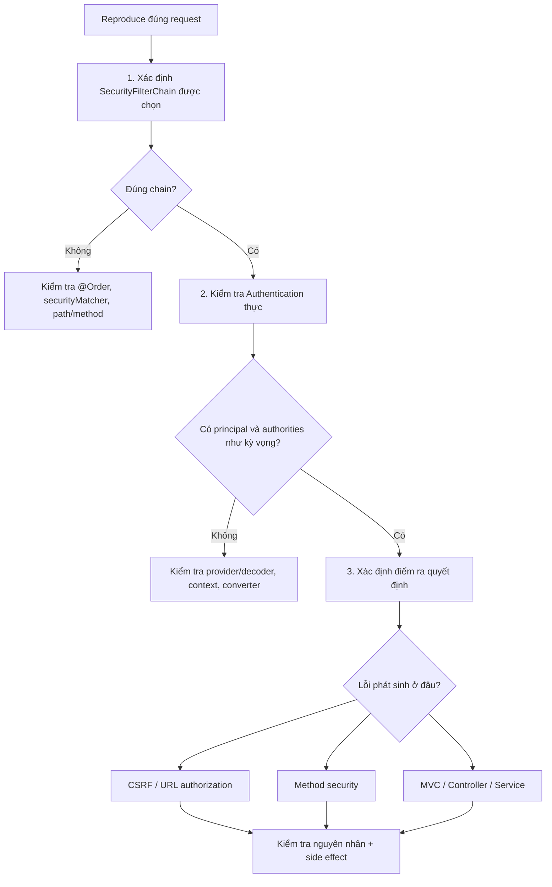

# Thu hẹp lỗi bằng chuỗi filter được chọn, danh tính thực và lớp phát sinh quyết định

Khi một test Spring Security trả **401** thay vì **200**, hoặc trả **403** dù người dùng “đã đăng nhập”, việc đổi đại một authority trong `@WithMockUser` có thể làm test xanh nhưng không cho biết lỗi gốc. Request có thể đã vào **sai SecurityFilterChain**, authentication thực tế có thể là **anonymous** hoặc khác loại principal mà controller trông đợi, và quyết định từ chối có thể phát sinh **tại CSRF filter, AuthorizationFilter, method-security proxy, MVC hay service nghiệp vụ**.

Bài học thuộc chương **Chẩn đoán sự cố** trong module **SPRING_SECURITY_TESTING**. Phạm vi module là kiểm chứng xác thực, phân quyền và bảo vệ HTTP thực tế bằng `spring-security-test` trên ứng dụng Servlet và Reactive; công cụ gồm MockMvc, WebTestClient, `@WithMockUser`, SecurityContext, JWT/OAuth2/OIDC giả lập, cùng các ca được phép hoặc bị từ chối. Chủ đề này xây dựng một quy trình điều tra có thể lặp lại để **thu hẹp lỗi bằng đúng chuỗi filter được chọn, đúng danh tính thực và đúng lớp đưa ra quyết định**.

## 1. Ba trục chẩn đoán không được gộp làm một

Trước khi sửa test, hãy trả lời lần lượt ba câu hỏi:

1. **Chuỗi filter nào được chọn?** Request với HTTP method, URL, servlet path hoặc WebFlux exchange hiện tại có khớp `securityMatcher` của chain mong muốn không? Có chain nào ưu tiên cao hơn bắt request trước không?
2. **Danh tính thực là gì?** Tại thời điểm quyết định, `Authentication` thuộc loại nào, `getName()` là gì, `isAuthenticated()` ra sao, `principal` có kiểu gì và `getAuthorities()` chứa những chuỗi nào? Đây là credential đã được xác minh, hay chỉ là mock được gắn sẵn?
3. **Lớp nào từ chối?** Authentication filter, `CsrfFilter`, `AuthorizationFilter`, method-security interceptor, MVC binding, controller hay service?



Một HTTP status **không tự cung cấp câu trả lời cho cả ba trục**. Chẳng hạn:

| Triệu chứng | Hai nguyên nhân khác nhau nhưng cùng status |
| --- | --- |
| `401` | Password sai ở `BasicAuthenticationFilter`; request anonymous bị authentication entry point từ chối |
| `403` | Thiếu `SCOPE_orders.write`; thiếu CSRF token |
| `403` | `AuthorizationFilter` từ chối trước controller; `@PreAuthorize` từ chối khi controller gọi service |
| `200` | Credential thật được xác minh; `@WithMockUser` đã đưa sẵn user vào context |
| `400` | Request đã qua security nhưng JSON sai; custom request-validation filter trả 400 trước MVC |
| `409` | Service ném business exception được advice ánh xạ; controller tự trả 409 |

Vì vậy quy trình chẩn đoán phải **gắn kết request, security context, filter trace, kết quả HTTP và tương tác nghiệp vụ**, thay vì chỉ xem assertion `status().isForbidden()`.

## 2. Trục thứ nhất: FilterChainProxy chọn chain như thế nào?

Trong Servlet stack, `FilterChainProxy` quản lý một danh sách `SecurityFilterChain`. Một request được so khớp với các chain theo thứ tự; **chain phù hợp đầu tiên** là chain được dùng. Các filter và rule của chain khác không được cộng dồn vào request đó.

Phân biệt chính xác:

- **`http.securityMatcher(...)`**: quyết định một **SecurityFilterChain có áp dụng cho request không**.
- **`authorizeHttpRequests(...).requestMatchers(...)`**: quyết định **quy tắc authorization bên trong chain đã chọn**.
- **`@Order`** trên bean `SecurityFilterChain`: điều khiển độ ưu tiên khi có nhiều chain.
- **`anyRequest()`**: chỉ áp dụng trong **chain đang xét**, không phải bảo vệ mọi request nếu tất cả securityMatcher đều không khớp.

Ví dụ lỗi đáng chú ý:

```java
@Bean
@Order(1)
SecurityFilterChain api(HttpSecurity http) throws Exception {
    return http
        .securityMatcher("/api/v1/**") // Chỉ áp dụng api/v1.
        .authorizeHttpRequests(auth -> auth
            .anyRequest().authenticated())
        .httpBasic(Customizer.withDefaults())
        .build();
}
```

Nếu một endpoint mới được chuyển thành `/api/v2/payments`, nó không thuộc chain trên. Nếu không có catch-all chain, Spring Security có thể **không bảo vệ URL ấy**; nếu có fallback chain quá rộng, nó có thể nhận rule/entry point khác với thiết kế. Test `/api/v1/**` xanh không chứng minh `/api/v2/**` an toàn.

**Quy tắc thực hành:** với nhiều chain, thường nên có một **catch-all fallback chain** định nghĩa chính sách rõ ràng (ví dụ mặc định từ chối), đồng thời viết test cho cả URL nằm trong và nằm ngoài mỗi nhóm matcher.

## 3. Ví dụ hai chain: API trả 401, UI chuyển hướng đăng nhập

Cùng một ứng dụng có thể cần hai cơ chế HTTP khác nhau:

- `/api/**`: HTTP Basic, khi anonymous thì trả `401`; đường dẫn chỉ được phép theo scope.
- `/ui/**`: form login, khi anonymous thường trả `302` chuyển hướng đến trang đăng nhập.
- Các đường dẫn còn lại được từ chối bằng fallback policy thay vì tự động cho phép.

Cấu hình minh họa Spring Security Servlet 6.x:

```java
import org.springframework.context.annotation.Bean;
import org.springframework.context.annotation.Configuration;
import org.springframework.core.annotation.Order;
import org.springframework.http.HttpMethod;
import org.springframework.security.config.Customizer;
import org.springframework.security.config.annotation.web.builders.HttpSecurity;
import org.springframework.security.web.SecurityFilterChain;

@Configuration
class TriageSecurityChains {

    @Bean
    @Order(1)
    SecurityFilterChain apiChain(HttpSecurity http) throws Exception {
        return http
            .securityMatcher("/api/**")
            .authorizeHttpRequests(auth -> auth
                .requestMatchers(HttpMethod.GET, "/api/whoami")
                    .authenticated()
                .requestMatchers(HttpMethod.GET, "/api/orders/**")
                    .hasAuthority("SCOPE_orders.read")
                .requestMatchers(HttpMethod.POST, "/api/orders")
                    .hasAuthority("SCOPE_orders.write")
                .anyRequest().denyAll())
            .httpBasic(Customizer.withDefaults())
            // Để CSRF bật, giúp phân biệt lỗi CSRF và thiếu scope.
            .build();
    }

    @Bean
    @Order(2)
    SecurityFilterChain fallbackChain(HttpSecurity http) throws Exception {
        return http
            .authorizeHttpRequests(auth -> auth
                .requestMatchers("/login", "/error").permitAll()
                .requestMatchers("/ui/**").authenticated()
                .anyRequest().denyAll())
            .formLogin(Customizer.withDefaults())
            .build();
    }
}
```

Cách đọc cấu hình:

1. Request `GET /api/orders/42` khớp `apiChain` trước, nên phải có `SCOPE_orders.read`.
2. `POST /api/orders` khớp `apiChain` và yêu cầu `SCOPE_orders.write`; vì CSRF còn bật, request unsafe method còn cần CSRF token hợp lệ trong mô hình test.
3. `GET /ui/dashboard` không khớp `apiChain` nên đi vào fallback chain và yêu cầu login.
4. `GET /unknown` cũng đi vào fallback chain, nhưng bị `anyRequest().denyAll()` chặn. Nó không được tự do vì “không thuộc /api”.

**Hạn chế về kỳ vọng status:** anonymous API với HTTP Basic thường nhận 401; anonymous UI với form login thường được chuyển hướng 302. Tuy nhiên, request chặn do CSRF, custom entry point hoặc chính sách production có thể tạo status khác. Các assert của bài chỉ hợp lệ khi đúng cấu hình mẫu này được nạp.

## 4. Dấu hiệu xác nhận request đã vào chain nào

Ưu tiên ba loại bằng chứng, theo thứ tự từ ít can thiệp đến nhiều:

1. **Đọc cấu hình và tái tạo chính xác request**: method, URL, servlet path/context path, forwarded path, HTTP headers, Accept, cookie. Đừng thử một path khác rồi suy luận cho path lỗi.
2. **Bật log ở môi trường test**: quan sát `FilterChainProxy` xử lý request và những filter được gọi; đối chiếu thứ tự/matcher.
3. **Kiểm thử hành vi đặc trưng của chain**: một API anonymous nhận challenge 401, trong khi đường UI anonymous được redirect 302; kiểm tra cả positive và negative.

Ví dụ logging chỉ dùng tạm ở test profile:

```properties
logging.level.org.springframework.security.web.FilterChainProxy=TRACE
logging.level.org.springframework.security.web.access=DEBUG
logging.level.org.springframework.security.authorization=TRACE
logging.level.org.springframework.security.web.authentication=DEBUG
```

Tên logger và độ chi tiết thông điệp có thể thay đổi theo phiên bản Spring Security. Hãy đối chiếu log với **request đang lỗi**, không suy đoán rằng thấy một tên filter trong log khởi tạo nghĩa là filter đã chạy ở request đó.

**An toàn log:** chỉ bật debug/trace trong môi trường thử nghiệm có dữ liệu giả. Không lưu raw Authorization header, cookie, password, client secret, access/refresh token hoặc thông tin nhạy cảm vào artifact CI. Khi gửi log trong issue, cần ẩn credential và dữ liệu cá nhân.

### Mẹo chẩn đoán nhiều SecurityFilterChain

| Biểu hiện | Giả thuyết về chain | Bằng chứng cần tìm |
| --- | --- | --- |
| API anonymous nhận 302 thay vì 401 | Form-login chain đang được chọn | `securityMatcher`/`@Order`, log chain được áp dụng |
| API mới trả 200 khi không có token | Không có matching chain hoặc fallback `permitAll` | Test anonymous và kiểm tra catch-all |
| URL `/api/orders/42` khác `/api/orders` | Matcher method/path khác nhau | Test đủ GET/POST và path variables |
| Có JWT filter nhưng chỉ nhận Basic principal | Request đang vào chain HTTP Basic hoặc test gắn mock user | Type Authentication, matcher và provider |
| `/api/admin` mất quyền sau migration | Matcher order/chain priority đã đổi | Cặp test admin và non-admin ở đúng URL |
| `/actuator/**` bất ngờ bị chặn/mở | Management server/chain khác | Context path, management port và matcher riêng |

Nếu không có chain nào match, đó là **một vấn đề bảo vệ request**, không phải lý do để đổi assertion từ 401 sang 200.

## 5. Trục thứ hai: “Danh tính thực” bao gồm những thông tin nào?

Sau khi xác định chain, hãy kiểm tra Authentication được dùng **tại điểm authorization**, không chỉ username được test khai báo lúc setup.

Những thuộc tính cần xem:

| Thông tin | Phương thức/đường đọc | Vì sao quan trọng |
| --- | --- | --- |
| Kiểu Authentication | `authentication.getClass()` | Phân biệt username/password, JWT, OAuth2/OIDC |
| Tên principal | `authentication.getName()` | Ai là actor/owner đang được dùng? |
| Kiểu principal | `authentication.getPrincipal().getClass()` | Controller mong `UserDetails`, `Jwt` hay `OAuth2User`? |
| Đã xác thực? | `authentication.isAuthenticated()` | Không được nhầm anonymous token với tài khoản hợp lệ |
| Authorities | `authentication.getAuthorities()` | Chuỗi `ROLE_`/`SCOPE_` thật có khớp rule? |
| Details | `authentication.getDetails()` | Có metadata request nếu cần; không dùng làm nguồn quyền mặc định |
| JWT claims/issuer/audience | Principal/decoded token (khi có) | Converter và validator đã tạo identity đúng chưa? |
| OAuth2 registration ID | `OAuth2AuthenticationToken` | Đăng nhập từ client/provider nào? |

**Lưu ý anonymous:** `AnonymousAuthenticationToken.isAuthenticated()` có thể trả `true` theo cách token được khởi tạo, nhưng Spring Security vẫn xem anonymous là **chưa đăng nhập đầy đủ** qua các trust resolver và logic authorization phù hợp. Vì vậy **không được** kiểm tra duy nhất `isAuthenticated() == true` rồi kết luận “đây chắc chắn là user đã đăng nhập”. Hãy kiểm tra loại Authentication và quy tắc của Spring Security.

### Một endpoint chẩn đoán chỉ dành cho test

Ví dụ dưới trả những thông tin **không chứa credential** để giúp viết assertion về principal. Đừng đưa endpoint này ra production công khai.

```java
import java.util.List;
import java.util.Map;
import org.springframework.security.core.Authentication;
import org.springframework.security.core.GrantedAuthority;
import org.springframework.web.bind.annotation.*;

@RestController
@RequestMapping("/api")
class TriageController {

    private final OrderService orders;

    TriageController(OrderService orders) {
        this.orders = orders;
    }

    @GetMapping("/whoami")
    Map<String, Object> whoami(Authentication authentication) {
        List<String> authorities = authentication.getAuthorities().stream()
            .map(GrantedAuthority::getAuthority)
            .sorted()
            .toList();

        return Map.of(
            "name", authentication.getName(),
            "authenticationType",
                authentication.getClass().getSimpleName(),
            "principalType",
                authentication.getPrincipal().getClass().getSimpleName(),
            "authorities", authorities
        );
    }

    @GetMapping("/orders/{id}")
    OrderView read(@PathVariable String id) {
        return orders.read(id);
    }

    @PostMapping("/orders")
    OrderView create(
            @RequestBody CreateOrderRequest request,
            Authentication authentication) {
        return orders.create(request.sku(), authentication.getName());
    }
}

record CreateOrderRequest(String sku) {}
record OrderView(String id, String owner) {}

interface OrderService {
    OrderView read(String id);
    OrderView create(String sku, String owner);
}
```

Đoạn này cho phép quan sát **Authentication đã vào controller**, nhưng có giới hạn: nếu request bị chặn ở filter thì controller **không chạy**. Khi 401/403 xảy ra trước controller, phải xem filter/log/test expectation hoặc dùng instrumentation **test-only** đặt ở đúng lớp, thay vì kỳ vọng `/api/whoami` luôn phản hồi.

Không trả token, principal object đầy đủ, thông tin session hoặc credential từ một endpoint chẩn đoán. Với production, nếu cần observability hãy sử dụng log/metrics có kiểm soát và không làm lộ thông tin bảo mật.

## 6. Fixture password thực cho HTTP Basic

Một test `@WithMockUser` không xác minh password. Để phân biệt credential đã được xử lý bởi provider với Authentication được mock, tạo một `UserDetailsService` test-only và BCrypt encoder.

```java
import org.springframework.boot.test.context.TestConfiguration;
import org.springframework.context.annotation.Bean;
import org.springframework.security.core.userdetails.*;
import org.springframework.security.crypto.bcrypt.BCryptPasswordEncoder;
import org.springframework.security.crypto.password.PasswordEncoder;

@TestConfiguration(proxyBeanMethods = false)
class TriageTestAccounts {

    @Bean
    PasswordEncoder encoderForTests() {
        return new BCryptPasswordEncoder();
    }

    @Bean
    UserDetailsService testUsers(PasswordEncoder encoder) {
        UserDetails reader = User.withUsername("reader")
            .password(encoder.encode("reader-test-password"))
            .authorities("SCOPE_orders.read")
            .build();

        UserDetails writer = User.withUsername("writer")
            .password(encoder.encode("writer-test-password"))
            .authorities("SCOPE_orders.read", "SCOPE_orders.write")
            .build();

        UserDetails guest = User.withUsername("guest")
            .password(encoder.encode("guest-test-password"))
            .authorities("ROLE_GUEST")
            .build();

        return new InMemoryUserDetailsManager(reader, writer, guest);
    }
}
```

Trong một test context chỉ có các provider này, `httpBasic("reader", "reader-test-password")` sẽ gửi header Basic đến `BasicAuthenticationFilter`, rồi username/password được kiểm chứng qua `AuthenticationManager` và `UserDetailsService`. Nhưng `.with(user("reader"))` bỏ qua bước đó và trực tiếp gắn Authentication giả.

**Không nhầm “real HTTP Basic” với “LDAP/JWT/OIDC production”.** Fixture in-memory chứng minh luồng Basic + password encoder. Nếu production dùng LDAP bind, bearer JWT hoặc OAuth2/OIDC, cần test tích hợp bằng provider/decoder đúng công nghệ đó.

## 7. Một lớp test MockMvc dùng đúng filter chain đã cấu hình

Để minh họa có thể ghép các đoạn code, tạo test context Spring Boot chỉ chứa controller, hai security chains, user fixture và một mock OrderService.

```java
import org.springframework.boot.SpringBootConfiguration;
import org.springframework.boot.autoconfigure.EnableAutoConfiguration;
import org.springframework.context.annotation.Import;

@SpringBootConfiguration
@EnableAutoConfiguration
@Import({TriageSecurityChains.class, TriageController.class})
class TriageTestApplication {
}
```

Và lớp JUnit 5:

```java
import org.junit.jupiter.api.Test;
import org.springframework.beans.factory.annotation.Autowired;
import org.springframework.boot.test.autoconfigure.web.servlet.AutoConfigureMockMvc;
import org.springframework.boot.test.context.SpringBootTest;
import org.springframework.context.annotation.Import;
import org.springframework.http.MediaType;
import org.springframework.test.context.bean.override.mockito.MockitoBean;
import org.springframework.test.web.servlet.MockMvc;

import static org.mockito.Mockito.*;
import static org.springframework.security.test.web.servlet.request
    .SecurityMockMvcRequestPostProcessors.httpBasic;
import static org.springframework.security.test.web.servlet.request
    .SecurityMockMvcRequestPostProcessors.csrf;
import static org.springframework.test.web.servlet.request.MockMvcRequestBuilders.*;
import static org.springframework.test.web.servlet.result.MockMvcResultMatchers.*;

@SpringBootTest(classes = TriageTestApplication.class)
@AutoConfigureMockMvc
@Import(TriageTestAccounts.class)
class FilterChainAndIdentityTest {

    @Autowired MockMvc mvc;

    @MockitoBean OrderService orders;

    @Test
    void apiAnonymousReceivesBasic401() throws Exception {
        mvc.perform(get("/api/whoami"))
            .andExpect(status().isUnauthorized());

        verifyNoInteractions(orders);
    }

    @Test
    void uiAnonymousReceivesLoginRedirect() throws Exception {
        mvc.perform(get("/ui/dashboard"))
            .andExpect(status().is3xxRedirection());

        verifyNoInteractions(orders);
    }

    @Test
    void correctBasicCredentialsReachControllerAsReader() throws Exception {
        mvc.perform(get("/api/whoami")
                .with(httpBasic("reader", "reader-test-password")))
            .andExpect(status().isOk())
            .andExpect(jsonPath("$.name").value("reader"))
            .andExpect(jsonPath("$.authenticationType")
                .value("UsernamePasswordAuthenticationToken"))
            .andExpect(jsonPath("$.authorities[0]")
                .value("SCOPE_orders.read"));

        verifyNoInteractions(orders);
    }

    @Test
    void badPasswordIsRejectedBeforeController() throws Exception {
        mvc.perform(get("/api/whoami")
                .with(httpBasic("reader", "wrong-password")))
            .andExpect(status().isUnauthorized());

        verifyNoInteractions(orders);
    }

    @Test
    void unknownUserIsRejectedByProvider() throws Exception {
        mvc.perform(get("/api/whoami")
                .with(httpBasic("unknown", "some-password")))
            .andExpect(status().isUnauthorized());

        verifyNoInteractions(orders);
    }
}
```

Ca user không tồn tại và ca password sai đều được gửi qua HTTP Basic thật, nên giúp phát hiện lỗi tra cứu user/password provider thay vì chỉ xác minh một Authentication giả lập. Hai test không cần OrderService được stub vì request phải bị chặn trước controller.

Với Spring Framework **6.2+** (Spring Boot **3.4+**), `@MockitoBean` là công cụ inject mock vào test context. Nếu dự án ở phiên bản cũ hơn, dùng annotation phù hợp với phiên bản đó. Không kết luận các snippet đã được chạy thành công chỉ vì bài viết mô tả chúng; bài này tập trung kỹ thuật chẩn đoán, cần chạy build/test của dự án thực tế trong vòng kiểm thử riêng.

**Tại sao so sánh 401 và 302?** Cặp test giúp phát hiện một request đi vào entry point không như thiết kế. Tuy nhiên, đây mới là **bằng chứng hành vi**, không thay thế việc kiểm tra matcher/chain vì application có thể tùy chỉnh entry point trả cùng một status ở hai chain.

## 8. Phân biệt mock principal với Authentication đã kiểm credential

Từ cùng một controller `/api/whoami`, có thể gửi request **mock user** để quan sát sự khác biệt về giá trị kiểm thử:

```java
import org.springframework.security.core.authority.SimpleGrantedAuthority;
import static org.springframework.security.test.web.servlet.request
    .SecurityMockMvcRequestPostProcessors.user;

@Test
void mockUserSkipsActualPasswordCheck() throws Exception {
    mvc.perform(get("/api/whoami")
            .with(user("ghost")
                .authorities(
                    new SimpleGrantedAuthority("SCOPE_orders.read"))))
        .andExpect(status().isOk())
        .andExpect(jsonPath("$.name").value("ghost"));
}
```

Ở đây `ghost` **không tồn tại** trong `InMemoryUserDetailsManager`, nhưng request vẫn được phép vì test helper đã cung cấp Authentication. Kết quả 200 chứng minh **URL authorization sau khi có Authentication giả** đang hoạt động; nó **không** chứng minh authentication provider nhận ghost hoặc password nào đó.

Một test phản chứng quan trọng:

```java
mvc.perform(get("/api/whoami")
        .with(httpBasic("ghost", "guess")))
    .andExpect(status().isUnauthorized());
```

Nếu `@WithMockUser` được đặt ở cấp class, có thể làm sai lệch kỳ vọng “request không có identity”. Trong bài chẩn đoán, ưu tiên cấu hình principal **ngay trong từng request hoặc từng method test**, và viết riêng ca anonymous thật.

### Nếu principal là JWT hoặc OAuth2User?

| Cơ chế hoặc helper | Loại Authentication thường gặp | Principal thường gặp |
| --- | --- | --- |
| `user(...)` hoặc `@WithMockUser` | `UsernamePasswordAuthenticationToken` | `UserDetails` |
| HTTP Basic + Dao provider | `UsernamePasswordAuthenticationToken` | `UserDetails` |
| `jwt()` (Servlet), `mockJwt()` (Reactive) | `JwtAuthenticationToken` | `Jwt` |
| `oauth2Login()` / `mockOAuth2Login()` | `OAuth2AuthenticationToken` | `OAuth2User` |
| `oidcLogin()` / `mockOidcLogin()` | `OAuth2AuthenticationToken` | `OidcUser` |

Một controller sử dụng `@AuthenticationPrincipal Jwt` sẽ không đọc được một principal kiểu `UserDetails`. Ngược lại, một controller nhận `OAuth2User` không tự động nhận `Jwt` chỉ vì cả hai đều là “người dùng đã xác thực”.

**Lưu ý:** với `@AuthenticationPrincipal`, kiểu không tương thích thường nhận `null` theo mặc định hoặc ném `ClassCastException` nếu `errorOnInvalidType = true`. Nếu controller dereference `null`, test có thể báo 500 dù nguyên nhân gốc là mock sai kiểu principal.

## 9. Trục thứ ba: điểm nào thực sự trả 403?

Một `403 Forbidden` có ít nhất bốn nhánh cần phân biệt:

| Nơi quyết định | Điều kiện | Request đã tới controller? | Service ghi dữ liệu có chạy? |
| --- | --- | --- | --- |
| `CsrfFilter` | Thiếu/sai CSRF token ở request unsafe | **Không** | Không |
| `AuthorizationFilter` | Authentication thiếu authority theo URL | **Không** | Không |
| Method security | `@PreAuthorize` từ chối tại proxy | **Có thể đã tới controller** | Method body được bảo vệ không chạy |
| Controller/business logic | Tự trả 403 theo policy riêng | **Có** | Có thể đã chạy, phải kiểm tra |

Một test chỉ assert `403` không cho biết nhánh nào xảy ra. Với Spring Security, thứ tự filter/exception translation được cấu hình có thể làm CSRF xảy ra trước khi HTTP authorization rule kiểm tra quyền. Vì vậy cần thiết kế test có **đầu vào kiểm soát riêng từng điều kiện**.

### Tách 403 do authority khỏi 403 do CSRF

Ví dụ trên sử dụng CSRF mặc định; thêm các test vào `FilterChainAndIdentityTest`:

```java
@Test
void readerWithCsrfIsDeniedByAuthorization() throws Exception {
    mvc.perform(post("/api/orders")
            .with(httpBasic("reader", "reader-test-password"))
            .with(csrf())
            .contentType(MediaType.APPLICATION_JSON)
            .content("{\"sku\":\"PEN-1\"}"))
        .andExpect(status().isForbidden());

    verifyNoInteractions(orders);
}

@Test
void writerWithoutCsrfIsDeniedBeforeBusiness() throws Exception {
    mvc.perform(post("/api/orders")
            .with(httpBasic("writer", "writer-test-password"))
            .contentType(MediaType.APPLICATION_JSON)
            .content("{\"sku\":\"PEN-1\"}"))
        .andExpect(status().isForbidden());

    verifyNoInteractions(orders);
}

@Test
void writerWithCsrfPassesSecurityAndCallsBusiness() throws Exception {
    when(orders.create("PEN-1", "writer"))
        .thenReturn(new OrderView("order-1", "writer"));

    mvc.perform(post("/api/orders")
            .with(httpBasic("writer", "writer-test-password"))
            .with(csrf())
            .contentType(MediaType.APPLICATION_JSON)
            .content("{\"sku\":\"PEN-1\"}"))
        .andExpect(status().isOk())
        .andExpect(jsonPath("$.owner").value("writer"));

    verify(orders, times(1)).create("PEN-1", "writer");
    verifyNoMoreInteractions(orders);
}
```

Vì controller mẫu trả `OrderView` trực tiếp, response POST thành công mặc định là **200**, không phải 201. Nếu API contract yêu cầu **201 Created**, controller phải trả `ResponseEntity.status(HttpStatus.CREATED)` và test phải đổi theo contract ấy. Không sửa expected status tùy tiện khi không sửa controller.

Kết luận từ ba test:

- **Reader + CSRF hợp lệ → 403**: loại được giả thuyết CSRF thiếu, còn thiếu authority là nguyên nhân trong config mẫu.
- **Writer đủ scope + không CSRF → 403**: thiếu CSRF là nhánh được thử; không được kết luận thiếu authority.
- **Writer đủ scope + CSRF hợp lệ → 200**: request đi tới controller và collaborator.

Muốn chắc rằng 403 từ `AuthorizationFilter` chứ không phải một custom filter khác, có thể kiểm tra thêm TRACE logs/điểm đánh dấu test-only tại security chain, và xác minh không có filter khác chặn trước.

## 10. Lỗi 400/409 cũng giúp xác định request đã đi đến đâu

Hai tình huống quan trọng để phân biệt **security denial** với **MVC/business failure**:

1. **400 Bad Request**: JSON sai cú pháp sau khi đã qua security filters; controller/service có thể chưa chạy.
2. **409 Conflict**: service thật sự được gọi và ném exception nghiệp vụ, sau đó `@RestControllerAdvice` chuyển thành response.

Định nghĩa lỗi nghiệp vụ:

```java
final class OrderConflictException extends RuntimeException {
    OrderConflictException(String message) {
        super(message);
    }
}
```

Và advice:

```java
import java.util.Map;
import org.springframework.http.*;
import org.springframework.web.bind.annotation.*;

@RestControllerAdvice
class OrderConflictAdvice {

    @ExceptionHandler(OrderConflictException.class)
    ResponseEntity<Map<String, String>> handle(OrderConflictException error) {
        return ResponseEntity.status(HttpStatus.CONFLICT)
            .body(Map.of("code", "ORDER_CONFLICT"));
    }
}
```

Để chạy test này trong mini-app ở trên, thêm `OrderConflictAdvice.class` vào `@Import` của `TriageTestApplication`.

```java
@Test
void malformedJsonGets400BeforeOrderService() throws Exception {
    mvc.perform(post("/api/orders")
            .with(httpBasic("writer", "writer-test-password"))
            .with(csrf())
            .contentType(MediaType.APPLICATION_JSON)
            .content("{broken"))
        .andExpect(status().isBadRequest());

    verifyNoInteractions(orders);
}

@Test
void businessExceptionGets409AfterServiceCall() throws Exception {
    when(orders.create("PEN-1", "writer"))
        .thenThrow(new OrderConflictException("Already exists"));

    mvc.perform(post("/api/orders")
            .with(httpBasic("writer", "writer-test-password"))
            .with(csrf())
            .contentType(MediaType.APPLICATION_JSON)
            .content("{\"sku\":\"PEN-1\"}"))
        .andExpect(status().isConflict())
        .andExpect(jsonPath("$.code").value("ORDER_CONFLICT"));

    verify(orders, times(1)).create("PEN-1", "writer");
}
```

**Đọc kết quả đúng:** 400 không có service interaction là lỗi binding/mapping trước controller method; 409 có service interaction là lỗi **sau khi vào nghiệp vụ**. Cả hai không chứng minh authentication/authorization đang đúng nếu không có các test riêng cho 401/403.

Không viết một exception handler toàn cục kiểu `@ExceptionHandler(Exception.class)` rồi tự động chuyển mọi security exception thành HTTP 200/500. Điều đó có thể che nguồn gốc access denial.

## 11. Kiểm tra method security: controller có thể đã được gọi

Một điểm dễ nhầm là khi lỗi xuất hiện từ service có `@PreAuthorize`:

```java
import org.springframework.security.access.prepost.PreAuthorize;
import org.springframework.stereotype.Service;

@Service
class ProtectedOrderWriter {
    private final OrderRepository repository;

    ProtectedOrderWriter(OrderRepository repository) {
        this.repository = repository;
    }

    @PreAuthorize("hasAuthority('SCOPE_orders.write')")
    public OrderView create(String sku, String actor) {
        return repository.insert(sku, actor);
    }
}

interface OrderRepository {
    OrderView insert(String sku, String owner);
}
```

Muốn annotation có tác dụng, phải bật `@EnableMethodSecurity`, gọi qua **Spring-managed proxy** và tránh self-invocation bỏ qua proxy. Nếu HTTP route chỉ yêu cầu `authenticated()` còn method security kiểm scope write, request có thể **đi vào controller rồi gọi proxy service**, sau đó bị từ chối trước khi `repository.insert` chạy.

Vì vậy:

- `verifyNoInteractions(controllerMock)` hoặc `verifyNoInteractions(serviceProxy)` không phải lúc nào cũng là assertion phù hợp.
- Điều cần chứng minh là **method body/side-effect không chạy**: ví dụ `verifyNoInteractions(repository)`.
- HTTP `403` từ method security thường đi qua Spring Security exception translation nếu exception được chuyển về filter chain đúng cách; một `@ControllerAdvice` bắt rộng có thể thay đổi kết quả.
- Khi code gọi `new ProtectedOrderWriter(...)` hoặc gọi method có bảo vệ từ method khác trong cùng bean mà bỏ proxy, `@PreAuthorize` có thể **không được thực thi**.

Một ca chẩn đoán hữu ích: bỏ rule HTTP write trong **test configuration kiểm soát**, giữ `@PreAuthorize` và xác minh thiếu quyền vẫn không chạm repository. Sau đó khôi phục rule HTTP, đảm bảo cả hai lớp bảo vệ đều được test.

Trong WebFlux, service trả `Mono`/`Flux` và method security thường từ chối khi publisher được subscribe; cần `StepVerifier` để xác minh lỗi Reactive, không chờ một status HTTP tại cấp service.

## 12. 401 và 403 không đơn giản là “chưa login” và “đã login”

Thông thường:

- **401 Unauthorized**: request chưa có Authentication hợp lệ hoặc credential bị từ chối, và entry point phù hợp chọn HTTP 401.
- **403 Forbidden**: request có Authentication hợp lệ nhưng thiếu quyền, hoặc bị một filter khác như CSRF từ chối.

Tuy nhiên, những khác biệt quan trọng gồm:

1. **HTTP Basic API** thường trả 401 với `WWW-Authenticate: Basic ...` khi cần xác thực.
2. **Form-login UI** thường trả 302 redirect đến `/login` khi anonymous.
3. **Bearer Resource Server** thường trả 401 kèm Bearer challenge khi token thiếu/sai; một token hợp lệ thiếu scope thường dẫn tới 403.
4. **CSRF** có thể trả 403 cả khi user chưa đăng nhập; đây không phải chứng cứ về authorities.
5. **AnonymousAuthenticationToken** có thể có `isAuthenticated() == true` nhưng không được tính là đăng nhập đầy đủ.
6. **Custom exception handlers/entry points** có thể chọn mã HTTP khác; khi đó phải so với contract thực của ứng dụng, không ép mọi nơi thành 401/403.

Tại lớp service đơn thuần không có HTTP, exception được phát ra chẳng hạn `AccessDeniedException` hoặc `AuthenticationException`. Chỉ khi đi qua web stack mới có status HTTP tương ứng.

## 13. Khi JWT thật lỗi nhưng mockJwt lại xanh

Có hai đường kiểm thử khác nhau:

```text
Đường A — Mock:
MockMvc.with(jwt()) / WebTestClient.mutateWith(mockJwt())
    -> Authentication được dựng sẵn
    -> AuthorizationFilter / method security / controller

Đường B — Token thật:
Authorization: Bearer <signed-test-token>
    -> BearerTokenAuthenticationFilter / AuthenticationWebFilter
    -> JwtDecoder / ReactiveJwtDecoder + validators
    -> JwtAuthenticationToken + authorities converter
    -> authorization / controller
```

Nếu **A xanh nhưng B trả 401**, điều cần thu hẹp là lớp **decoder/validator**, chứ không phải nới rule authorization:

- Signature/JWK/key ID (`kid`) có đúng key được tin cậy không?
- `alg` có được decoder cho phép không?
- Token có hết hạn hoặc `nbf` chưa tới không?
- `iss`, `aud` có được validator kiểm đúng như policy không?
- Bearer header có được gửi đúng dạng không?
- Resource Server chain có được chọn không?

Nếu **B xác thực thành công nhưng trả 403**, hãy xem converter claims → `GrantedAuthority` và rule `hasAuthority("SCOPE_...")`. Đừng lầm việc claim có `scope=orders.read` với việc Authentication chắc chắn chứa `SCOPE_orders.read`: custom converter có thể ánh xạ khác.

Ví dụ so sánh giả lập:

```java
import org.springframework.security.core.authority.SimpleGrantedAuthority;
import static org.springframework.security.test.web.servlet.request
    .SecurityMockMvcRequestPostProcessors.jwt;

mvc.perform(get("/api/orders/o-1")
        .with(jwt().jwt(token -> token.subject("alice")
                .claim("scope", "orders.read"))
            .authorities(new SimpleGrantedAuthority("SCOPE_orders.read"))))
    .andExpect(status().isOk());
```

**Giới hạn:** đoạn trên chỉ chạy khi module đã có thư viện Spring Security OAuth2 JWT phục vụ test và mock OrderService có dữ liệu tương ứng; nó **bỏ qua chữ ký/decoder**. Với kiểm tra thực, gửi bearer token ký bằng khóa test qua header và chạy decoder thật trong chain Resource Server.

## 14. OAuth2/OIDC: xác định principal, registration và lớp quyết định

Với OAuth2 Login, Authentication thường là `OAuth2AuthenticationToken` chứa `OAuth2User`. Với OIDC Login, principal thường là `OidcUser` (mở rộng `OAuth2User`). Với JWT Resource Server, Authentication thường là `JwtAuthenticationToken`, principal là `Jwt`. Đây là ba mô hình khác nhau:

| Trường hợp | Triệu chứng | Cần xem |
| --- | --- | --- |
| `@AuthenticationPrincipal OAuth2User` nhận null | Test dùng `@WithMockUser` hoặc `mockJwt()` | Loại Authentication/principal |
| `OAuth2User.getName()` sai | `nameAttributeKey` khác dự kiến | `DefaultOAuth2User` attributes và provider mapping |
| OIDC claims thiếu | Dùng `mockOAuth2Login()` thay vì `mockOidcLogin()` | `OidcUser`, ID Token fixture |
| Provider đăng nhập sai | `ClientRegistration` hoặc registrationId không đúng | `OAuth2AuthenticationToken.getAuthorizedClientRegistrationId()` |
| Login redirect lặp vô hạn | Sai callback URL, session/state bị mất | Chain login, redirect URI, cookie/session |
| Đăng nhập được nhưng gọi downstream API bị 401 | Không có authorized client/access token hợp lệ | `OAuth2AuthorizedClientService`/repository và token |
| Token của Bob dùng nhầm cho Alice | Cache/repository key thiếu principal/session | Chỉ số registration + principal, session ownership |

`oauth2Login()`/`oidcLogin()` ở MockMvc và `mockOAuth2Login()`/`mockOidcLogin()` ở WebTestClient cung cấp **trạng thái sau đăng nhập giả lập**. Chúng không tự chạy Authorization Code, token exchange, xác minh ID Token/JWKS hay lưu authorized client trong kho production.

Vì vậy, khi mock login xanh nhưng login thật thất bại, hãy kiểm tra:
 
1. Chain nào xử lý `/oauth2/authorization/{registrationId}` và callback `/login/oauth2/code/{registrationId}`?
2. Client registration, redirect URI và state/nonce/PKCE có khớp phiên đăng nhập không?
3. Token endpoint/issuer/JWKS có đúng và hoạt động không?
4. Sau login, session và authorized client có được lưu/khôi phục không?
5. Authorities được gán theo principal/provider nào? User A/B có bị gộp nhầm không?

## 15. Trường hợp filter custom: đừng đổi lỗi service thành authentication failure

Custom authentication filter có thể chạy **trước** `ExceptionTranslationFilter`. Nếu filter ném `AuthenticationException` trước `chain.doFilter(...)`, không thể mặc định rằng translation filter nằm phía sau sẽ bắt nó.

Mô hình đúng cho filter tự xử lý credential sai:

```java
if (credentialInvalid) {
    SecurityContextHolder.clearContext();
    authenticationEntryPoint.commence(request, response,
        new BadCredentialsException("Invalid credential"));
    return; // Không cho request tiếp tục.
}

chain.doFilter(request, response);
```

Không viết:

```java
try {
    chain.doFilter(request, response);
} catch (Exception error) {
    response.setStatus(401); // Che cả lỗi controller/database/service.
}
```

**Trục chẩn đoán thứ ba** ở đây là: lỗi được quyết định **trước chain.doFilter** do credential, hay xuất hiện **sau chain.doFilter** khi business logic đã chạy? Nếu không tách hai nhánh, test có thể cho kết luận sai về bảo mật.

Khi viết test custom filter, hãy kiểm tra thêm `FilterChain.doFilter` có được gọi không và liệu service đã có interaction hay chưa. 401 đi cùng `verifyNoInteractions(service)` mạnh hơn chỉ kiểm tra status.

## 16. WebFlux: cùng ba câu hỏi, nhưng công cụ và Context khác

Trong WebFlux không dùng `HttpSecurity` và `OncePerRequestFilter` làm mô hình security chính. Thay thế bằng:

| Servlet | Reactive WebFlux | Ý nghĩa |
| --- | --- | --- |
| `SecurityFilterChain` | `SecurityWebFilterChain` | Chuỗi bảo vệ request |
| `FilterChainProxy` | `WebFilterChainProxy` | Chọn chain theo matcher/thứ tự |
| `HttpSecurity` | `ServerHttpSecurity` | Khai báo filter/rule |
| `MockMvc` | `WebTestClient` | Gửi request test |
| `SecurityContextHolder` | `ReactiveSecurityContextHolder` | Security context của pipeline |
| `jwt()` | `mockJwt()` | Principal JWT giả |
| `user()` | `mockUser()` | Principal user giả |
| `oauth2Login()` | `mockOAuth2Login()` | OAuth2 Login giả |

Các câu hỏi vẫn không thay đổi:

1. `SecurityWebFilterChain.matches(exchange)` nào được chọn? Một web filter khác có trả response sớm trước security chain không?
2. `Authentication` trong Reactor Context của **subscription hiện tại** là gì? Nó có bị đặt sai bằng `contextWrite` hoặc mất khi tự `subscribe()` ngoài pipeline không?
3. 401/403 đến từ authentication WebFilter, CSRF, exchange authorization hay Reactive method security? Dịch vụ có phát side effect trước lỗi không?

### WebTestClient dùng security configurer đúng

```java
import org.springframework.test.web.reactive.server.WebTestClient;
import static org.springframework.security.test.web.reactive.server
    .SecurityMockServerConfigurers.springSecurity;
import static org.springframework.security.test.web.reactive.server
    .SecurityMockServerConfigurers.mockUser;

WebTestClient baseClient = WebTestClient
    .bindToApplicationContext(applicationContext)
    .apply(springSecurity())
    .configureClient()
    .build();

WebTestClient alice = baseClient.mutateWith(
    mockUser("alice").authorities(
        new SimpleGrantedAuthority("SCOPE_orders.read")));

WebTestClient bob = baseClient.mutateWith(
    mockUser("bob").roles("VIEWER"));

// Với GET /api/orders/{id} yêu cầu SCOPE_orders.read:
alice.get().uri("/api/orders/o-1")
    .exchange()
    .expectStatus().isOk();

bob.get().uri("/api/orders/o-1")
    .exchange()
    .expectStatus().isForbidden();
```

Đây là **ví dụ minh họa yêu cầu một Reactive test application context** có controller, SecurityWebFilterChain và dữ liệu service phù hợp. Không thể chạy trực tiếp đoạn này chỉ bằng Servlet controller ở mục 5.

**Đặc biệt:** `baseClient.mutateWith(mockUser(...))` trả client mới. Nếu bỏ qua object trả về, request dùng baseClient vẫn anonymous. Đừng gán client có quyền ADMIN ngược vào field `baseClient` dùng chung cho các ca khác.

### Kiểm tra danh tính thực trong Reactor Context

```java
import org.springframework.security.core.context.ReactiveSecurityContextHolder;
import reactor.core.publisher.Mono;
import reactor.test.StepVerifier;

Mono<String> currentPrincipalName() {
    return ReactiveSecurityContextHolder.getContext()
        .map(ctx -> ctx.getAuthentication().getName());
}

StepVerifier.create(currentPrincipalName()
        .contextWrite(ReactiveSecurityContextHolder.withAuthentication(
            UsernamePasswordAuthenticationToken.authenticated(
                "alice", null,
                List.of(new SimpleGrantedAuthority("ROLE_USER"))))))
    .expectNext("alice")
    .verifyComplete();
```

Điều này chứng minh context của **subscription đang được test** chứa Alice, không chứng minh HTTP filter hoặc JWT decoder thật đã xác thực Alice. Để kiểm tra HTTP credential thật trên WebFlux, gửi HTTP Basic/Bearer credential qua WebTestClient được bind đúng chain/provider; khi dùng `bindToServer()` không thể chèn một Java Authentication object trực tiếp vào context server từ xa bằng mock configurer.

## 17. Log, instrumentation và thông tin nên thu thập

Khi debug, dùng một bộ thông tin **đủ để tái hiện** nhưng không lộ bí mật:

```text
Test case: reader_POST_without_scope
HTTP: POST /api/orders
Content-Type: application/json
Credential type: Basic (test fixture; không ghi password)
CSRF: present / valid
Expected: 403, service calls = 0
Actual: 403, service calls = 0
Chosen chain: /api/**, HTTP Basic
Auth type: UsernamePasswordAuthenticationToken
Principal name: reader
Authorities: [SCOPE_orders.read]
Decision: AuthorizationFilter requires SCOPE_orders.write
```

Tương tự với JWT, chỉ ghi các thông tin không nhạy cảm như **token type, key ID dạng test, issuer fixture, audience fixture, scope**; không xuất raw bearer token. Với OIDC, không log ID Token hoặc refresh token.

Khi gặp khó ở nhiều chain, có thể thêm một **test-only marker filter** trước một filter mốc để đánh dấu chain đã xử lý request. Cần bảo đảm marker:

- Chỉ xuất hiện trong cấu hình test/debug; không lộ cấu trúc security chain ở production.
- Không can thiệp vào Authentication/authorities hoặc thay đổi status.
- Được đặt **trước điểm có thể trả lỗi** nếu muốn đánh dấu cả authentication failure; marker nằm sau Basic filter sẽ không chạy nếu Basic filter đã trả 401.
- Không bị đăng ký kép thành servlet container filter và security filter.

Trong phần lớn trường hợp, log FilterChainProxy, hai ca đối chứng API/UI và test credential thật đủ để khoanh vùng mà không cần instrumentation bổ sung.

## 18. Bảng triage: từ triệu chứng đến ba nguyên nhân chính

| Triệu chứng | Chain được chọn? | Danh tính thực? | Nơi quyết định cần kiểm tra |
| --- | --- | --- | --- |
| API trả 302 bất ngờ | Có thể vào chain form login | Anonymous | Entry point |
| API trả 200 khi không đăng nhập | Sai chain/catch-all hoặc permitAll | Có thật là anonymous? | URL authorization |
| Basic đúng password nhưng 401 | Có BasicAuthenticationFilter? | Provider có nhận credential? | AuthenticationManager/UserDetailsService |
| Basic sai password vẫn 200 | Có mock user vô tình? | Authentication được chèn sẵn | Bypass credential verification |
| `@WithMockUser` xanh, Basic thật 401 | Chain vẫn có thể đúng | Mock vs provider khác | Password/encoder/lookup |
| JWT mock xanh, bearer thật 401 | Có resource server chain? | Decoder/validator fail | Signature, iss/aud/exp |
| JWT thật xác thực nhưng 403 | Đúng chain? | Authorities converter đúng? | hasAuthority rule |
| OAuth2 login vòng lặp 302 | Chain login/callback nào? | Session/authorized client còn không? | Login entry point/callback |
| `@AuthenticationPrincipal` null | Controller có được gọi? | Principal sai kiểu? | Argument resolver/type |
| Editor POST trả 403 | Đúng chain? | Đủ authority? | CSRF vs authorization |
| Controller chạy nhưng service bị chặn | Rule URL có thể permit | Authentication hợp lệ? | Method security proxy |
| Status 403 nhưng DB vẫn đổi | Chain có chặn trước controller? | Có dữ liệu owner không? | Controller/service side effect |
| JSON lỗi trả 400 | Security đã qua? | Credential hợp lệ? | MVC binding |
| Business exception trả 401 | Custom filter bắt quá rộng? | Credential vẫn hợp lệ? | Exception handler/filter error mapping |
| Test chạy riêng xanh, suite fail | Chain/context có tái sử dụng? | SecurityContext/session còn sót? | Isolation, mocks, cache |
| Reactive user bị lẫn | WebFilterChainProxy đúng? | Reactor Context đúng subscription? | contextWrite/cache/shared publisher |
| Matcher sau migration không còn áp dụng | @Order/securityMatcher/path | Có user nào được kiểm tra không? | Fallback/default deny |
| `@PreAuthorize` không hoạt động | HTTP chain có thể đúng | Principal đủ/thiếu quyền | Spring proxy/self-invocation |

Bảng này là **điểm bắt đầu điều tra**, không phải công thức kết luận. Mỗi nhánh phải có một test có đầu vào kiểm soát và một quan sát có thể xác minh.

## 19. Quy trình thu hẹp lỗi từng bước trong dự án

Một runbook phù hợp khi nhận một test thất bại trong CI:

### Bước 1 — Giữ nguyên request và contract

Lưu test name, HTTP method, path, headers không nhạy cảm, body fixture, cookie/session (chỉ metadata), auth scheme, CSRF present/absent và expected response. Chạy lại test **một mình** và trong cả suite để phát hiện shared state.

### Bước 2 — Chứng minh chain được chọn

Kiểm tra `@Order`, `securityMatcher`, requestMatchers và fallback. Bật FilterChainProxy TRACE ở test nếu cần. Nếu không có chain match, sửa cấu hình bảo vệ trước khi tiếp tục.

### Bước 3 — Chứng minh identity thực

Với Basic/form, chạy cả đúng và sai password qua provider. Với JWT, phân biệt `jwt()` mock với bearer token thật. Với OAuth2/OIDC, phân biệt login mock và flow thật. Với Reactive, kiểm tra Reactor Context tại subscription.

### Bước 4 — Cô lập điểm ra quyết định

Dùng các ca đối chứng:

- Same user, **thêm/bỏ CSRF** → phân biệt CSRF.
- Same request, **thêm/bỏ authority** → phân biệt URL/method authorization.
- Same credential, **đổi password đúng/sai** → phân biệt authentication.
- Same scope, **đổi object ownership Alice/Bob** → phân biệt business/data authorization.
- Same route, **JSON đúng/sai** → phân biệt MVC binding.
- Same service, **success/business exception** → phân biệt lỗi sau controller.

### Bước 5 — Xác minh side effect và khóa regression

Với request bị chặn trước controller, `verifyNoInteractions(service)`. Với method security, kiểm tra repository/downstream collaborator bên trong method body. Với integration test, đọc DB/queue để chứng minh không có dữ liệu ghi trái phép. Giữ cả positive và negative test trong CI.

**Dừng ở đúng lớp khi đã có bằng chứng**, không tiếp tục đổi vô cớ security matcher, CSRF config, provider hoặc error handler để “tìm cho ra 200”.

## 20. Mutation test: chứng minh bộ chẩn đoán bắt đúng lỗi

Một bộ test tốt phải **đỏ khi thay đổi sai đúng cơ chế đang kiểm tra**. Trong branch thử nghiệm và luôn khôi phục code sau mỗi lần thử:

1. **Đổi `securityMatcher("/api/**")` thành `"/api/v2/**"`**: ca API/401 và positive authorization phải phát hiện request không còn vào đúng chain.
2. **Đưa fallback chain lên @Order(0)**: ca API 401 vs UI 302 phải phát hiện entry point bị đổi hoặc policy sai.
3. **Bỏ rule `SCOPE_orders.write`**: reader+CSRF không được tự nhiên có quyền ghi. Nếu test 403 vẫn xanh, kiểm tra CSRF đang che lỗi.
4. **Bỏ `csrf()` trong ca thiếu quyền**: test nên làm rõ 403 do CSRF không chứng minh authorization; giữ lại ca đối chứng.
5. **Thay `httpBasic(...)` bằng `user(...)`**: test wrong-password phải không còn mang ý nghĩa credential real. Đây là lỗi phạm vi kiểm thử, không phải sửa hợp lệ.
6. **Chặn hết mọi JWT bằng decoder sai key**: mockJwt test vẫn có thể xanh, nhưng real-bearer test phải đỏ.
7. **Bỏ `@EnableMethodSecurity`**: negative method test cần phát hiện `@PreAuthorize` không còn bảo vệ method body.
8. **Cho controller gọi service trước khi return 403**: `verifyNoInteractions(service)` hoặc DB side-effect assertion phải phát hiện.
9. **Dùng lại client Alice cho Bob trên WebFlux**: identity assertions phải phát hiện rò rỉ principal.
10. **Bắt mọi exception trong filter và trả 401**: business 409 test phải thất bại, giúp xác nhận error layer bị gắn sai.

Không dùng mutation test như lý do đẩy code cố ý sai vào production. Mục đích là kiểm tra **độ nhạy của assertions**, không tạo thêm rủi ro.

## 21. Bài thực hành tổng hợp

Xây một ứng dụng nhỏ có:

- `GET /api/invoices/{id}` yêu cầu `SCOPE_invoices.read`.
- `POST /api/invoices` yêu cầu `SCOPE_invoices.write`.
- `GET /ui/profile` cho user đã đăng nhập qua form login.
- Một `InvoiceService` có `@PreAuthorize` bảo vệ thao tác chuyển trạng thái hóa đơn.
- Một endpoint tương đương trong WebFlux nếu module có hỗ trợ Reactive.

Hãy hoàn thành các ca sau:

1. Tạo **hai SecurityFilterChain** rõ thứ tự: chain API HTTP Basic hoặc Resource Server, chain UI form login. Thêm fallback deny.
2. Với anonymous, assert API bị 401 và UI được redirect theo đúng contract; giải thích chain đã chọn.
3. Tạo user Reader/Writer bằng test-only `UserDetailsService`, gọi HTTP Basic với password đúng/sai. Đối chiếu với `user(...)` để chứng minh mock không kiểm password.
4. Trả về trong endpoint test-only `name`, `authenticationType`, `principalType`, authorities, không để lộ secret. Assert đúng kiểu principal và quyền.
5. Reader có CSRF token hợp lệ gọi POST: 403 do thiếu scope; service không gọi.
6. Writer có scope nhưng thiếu CSRF: 403 do CSRF; service không gọi.
7. Writer đủ scope và CSRF: thành công, service gọi đúng một lần, owner lấy từ Authentication chứ không từ body client.
8. JSON sai cú pháp với Writer đủ quyền/CSRF: 400, service không gọi.
9. Service ném domain exception: trả 409 qua `@RestControllerAdvice`, service đã được gọi một lần.
10. Với `@PreAuthorize`, kiểm tra rằng thiếu quyền không gọi repository, dù controller có thể đã gọi proxy service.
11. Nếu dùng JWT/OIDC, viết một bài test **credential thật** qua decoder/provider thử nghiệm và một bài mock principal; nêu khác biệt phạm vi hai test.
12. Trên WebFlux, dùng `WebTestClient` đã áp dụng `springSecurity()`, tạo client riêng Alice/Bob; dùng `StepVerifier + ReactiveSecurityContextHolder` để kiểm tra identity của từng subscription.
13. Bật TRACE log ở test profile, tái hiện một ca 401, một ca 403; ghi lại request, chosen chain, identity, decision layer và side effect. Không lưu token/password.
14. Cố tình thay đổi chain order hoặc thiếu scope rule trong branch test; xác minh bộ test phát hiện được rồi khôi phục.

**Tiêu chí hoàn thành:** khi một request bất ngờ 401/403/400/409, người học có thể chỉ ra **chain nào được chọn**, **Authentication nào thật sự hiện diện** và **lớp nào quyết định**; có ít nhất một ca cho phép, một ca từ chối, kiểm chứng đúng nguồn lỗi và chứng minh không có side effect trái phép.

### Tài liệu tham khảo

- [Spring Security — Servlet Architecture](https://docs.spring.io/spring-security/reference/servlet/architecture.html): `FilterChainProxy`, nhiều `SecurityFilterChain` và `ExceptionTranslationFilter`.
- [Spring Security — Authorize HTTP Requests](https://docs.spring.io/spring-security/reference/servlet/authorization/authorize-http-requests.html): `securityMatcher`, `requestMatchers` và HTTP authorization.
- [Spring Security — Servlet MockMvc Testing](https://docs.spring.io/spring-security/reference/servlet/test/mockmvc/index.html): security filters, `@WithMockUser`, `user()`, `httpBasic()`, `csrf()` và `jwt()`.
- [Spring Security — Method Security](https://docs.spring.io/spring-security/reference/servlet/authorization/method-security.html): `@EnableMethodSecurity`, proxy và `@PreAuthorize`.
- [Spring Security — Reactive Web Testing](https://docs.spring.io/spring-security/reference/reactive/test/web/index.html): `WebTestClient`, `springSecurity()`, `mockUser()` và `mockJwt()`.
- [Spring Security — Reactive Method Security](https://docs.spring.io/spring-security/reference/reactive/authorization/method.html): Reactor Context và reactive authorization.
- [Spring Security — JWT Resource Server](https://docs.spring.io/spring-security/reference/servlet/oauth2/resource-server/jwt.html): decoder, JWT validators và authorities converter.
- [Spring Framework — Exception Handling](https://docs.spring.io/spring-framework/reference/web/webmvc/mvc-controller/ann-exceptionhandler.html): MVC exception resolution và `@RestControllerAdvice`.
