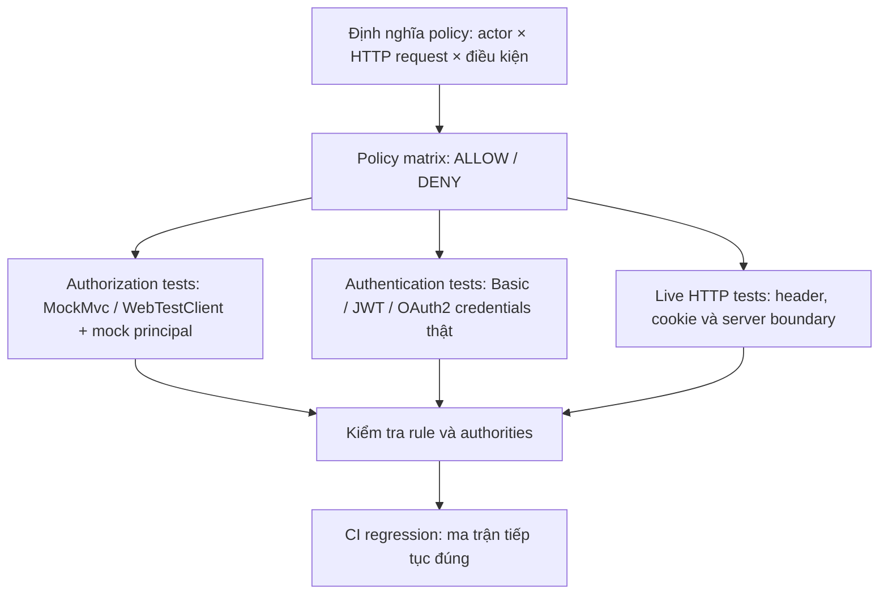

# Lập ma trận quyền cho API có người dùng thường, quản trị và truy cập ẩn danh

Một ứng dụng có ba loại người truy cập — **ẩn danh**, **người dùng thường** và **quản trị viên** — không thể được bảo vệ chỉ bằng một test xác nhận admin gọi API thành công. Nếu một endpoint vô tình chuyển từ `hasRole("ADMIN")` thành `permitAll()`, bài test admin nhận HTTP 200 vẫn xanh, trong khi người ẩn danh có thể đọc dữ liệu quản trị.

Trong chương **Thực hành tổng hợp** của module `SPRING_SECURITY_TESTING`, chúng ta xây dựng **ma trận quyền (authorization matrix)** trước, rồi biến từng ô trong bảng thành một trường hợp kiểm thử. Ví dụ sử dụng `MockMvc`, `spring-security-test`, `@WithMockUser`, HTTP Basic thật và `WebTestClient` để chứng minh các quyết định **cho phép hoặc từ chối** trên Spring Security Servlet và Reactive.

Mục tiêu không phải chỉ học cú pháp `roles("ADMIN")`. Người học cần trả lời được:

- **Ai** gửi request: anonymous, user có `ROLE_USER`, hay admin có `ROLE_ADMIN`?
- **Hành động nào** đang được thực hiện: GET dữ liệu công khai, đọc thông tin cá nhân, truy cập dữ liệu thành viên, xem báo cáo quản trị hay POST tạo báo cáo?
- **Điều kiện bảo mật nào** áp dụng: authentication, role/authority và CSRF?
- **HTTP status nào** được mong đợi, và điều gì thực sự được chứng minh khi test xanh?
- **Ranh giới nào** được kiểm tra: authorization với principal giả lập, provider xác thực credentials, hay header/cookie đi qua HTTP server thực?

**Nguyên tắc cốt lõi:** Một ma trận có giá trị khi có cả các ô **ALLOW** lẫn **DENY**. Đối với API quan trọng, negative cases ngăn việc quyền bị mở rộng ngoài ý muốn.

## 1. Xác định ba nhóm chủ thể và ý nghĩa của quyền

Ta thiết kế một ứng dụng minh họa theo mô hình RBAC (*Role-Based Access Control*) với ba nhóm.

| Chủ thể | Authentication | Authorities được cấp | Ý nghĩa |
| --- | --- | --- | --- |
| **Anonymous** | Không có tài khoản đăng nhập; Spring Security có thể tạo anonymous token nội bộ | Không có `ROLE_USER`/`ROLE_ADMIN` | Chỉ truy cập nội dung công khai |
| **USER — Linh** | Đã xác thực | `ROLE_USER` | Xem dữ liệu cá nhân và nội dung dành cho thành viên |
| **ADMIN — Root** | Đã xác thực | `ROLE_ADMIN` | Xem thông tin cá nhân và nội dung quản trị; được phép xem phần thành viên qua rule tường minh |

Hai quyết định thiết kế đáng chú ý:

1. **Admin không tự động kế thừa USER.** Spring Security không mặc định suy ra `ROLE_ADMIN` bao hàm `ROLE_USER`. Nếu ứng dụng muốn cả hai truy cập khu vực thành viên, có thể viết `hasAnyRole("USER", "ADMIN")`, cấp cả hai authorities cho admin hoặc định nghĩa role hierarchy một cách rõ ràng.
2. **Anonymous không phải “một user có username anonymousUser”.** Spring Security có thể dựng `AnonymousAuthenticationToken` để xử lý thống nhất nhưng `authenticated()` không xem anonymous như người dùng đã đăng nhập. Không tự kiểm tra riêng `isAuthenticated()` của anonymous token rồi cho phép truy cập.

Trong bài này, tài khoản admin chỉ cần `ROLE_ADMIN`; rule dành cho thành viên cho phép **cả USER và ADMIN**. Cách thiết kế này giúp kiểm tra chính xác khác biệt giữa “được phép vì rule” và “được phép vì kế thừa role”.

### 1.1. Role name khác authority string

Trong cấu hình phổ biến của Spring Security:

- `hasRole("ADMIN")` kỳ vọng authority `ROLE_ADMIN`.
- `hasAuthority("ROLE_ADMIN")` kiểm tra chính xác chuỗi `ROLE_ADMIN`.
- `hasAuthority("ADMIN")` kiểm tra chuỗi `ADMIN`, **khác** `ROLE_ADMIN`.
- `@WithMockUser(roles = "ADMIN")` tạo authority `ROLE_ADMIN`.
- `@WithMockUser(authorities = "ROLE_ADMIN")` sử dụng authority đúng như khai báo.
- `roles("ROLE_ADMIN")` không phải cách dùng đúng của những helper thêm sẵn tiền tố.

Nếu API sử dụng JWT Resource Server, scope `reports.read` thường ánh xạ sang `SCOPE_reports.read` chứ **không** tự trở thành `ROLE_ADMIN`. Ma trận phải ghi rõ mình dùng role/authority nào, không chỉ viết nhãn “đã có quyền”.

## 2. Định nghĩa tài nguyên và hợp đồng truy cập

Chúng ta chọn năm endpoint có ý nghĩa độc lập:

| Mã chính sách | HTTP method và URL | Quy tắc | Kết quả thành công |
| --- | --- | --- | --- |
| `P-PUBLIC` | `GET /api/public/catalog` | `permitAll()` | **200 OK** |
| `P-ME` | `GET /api/me` | `authenticated()` | **200 OK**, hiển thị tên người gọi |
| `P-MEMBER` | `GET /api/member/home` | `hasAnyRole("USER", "ADMIN")` | **200 OK** |
| `P-ADMIN-READ` | `GET /api/admin/summary` | `hasRole("ADMIN")` | **200 OK** |
| `P-ADMIN-WRITE` | `POST /api/admin/reports` | `hasRole("ADMIN")` **và CSRF hợp lệ** trong cấu hình session/browser bảo vệ CSRF | **201 Created** |

Giữ một quy tắc dự phòng `anyRequest().denyAll()` để đường dẫn chưa được liệt kê không trở thành tài nguyên công khai chỉ vì thiếu matcher.

Trong ví dụ Servlet bên dưới, ứng dụng bật **HTTP Basic** để entry point của request chưa xác thực trả 401 thay vì redirect form login. Spring Security vẫn bật **CSRF protection** mặc định cho request thay đổi trạng thái như POST. Vì vậy, ma trận cho POST sẽ **gắn CSRF token hợp lệ ở mọi actor**, kể cả anonymous, nhằm đo riêng kết quả authentication/authorization.

Sau đó, ta có một ma trận thứ hai kiểm tra trường hợp **không có CSRF**. Nếu bỏ qua điều này, một POST bị 403 do CSRF có thể bị hiểu sai thành “user thiếu role”.

## 3. Ma trận quyền chuẩn: actor × endpoint

Với các điều kiện đã xác định (HTTP Basic entry point, POST có CSRF token hợp lệ), ma trận là:

| Request | ANONYMOUS | USER | ADMIN |
| --- | --- | --- | --- |
| `GET /api/public/catalog` | **200** ALLOW | **200** ALLOW | **200** ALLOW |
| `GET /api/me` | **401** DENY | **200** ALLOW | **200** ALLOW |
| `GET /api/member/home` | **401** DENY | **200** ALLOW | **200** ALLOW |
| `GET /api/admin/summary` | **401** DENY | **403** DENY | **200** ALLOW |
| `POST /api/admin/reports` + CSRF hợp lệ | **401** DENY | **403** DENY | **201** ALLOW |

### 3.1. Vì sao POST của anonymous được kỳ vọng 401 thay vì 403?

Khi gửi **CSRF token hợp lệ**, request không bị `CsrfFilter` chặn do thiếu token. Nó tiếp tục tới authorization rule yêu cầu `ROLE_ADMIN`. Vì anonymous chưa được xác thực, entry point HTTP Basic của ví dụ trả 401. **Nếu không gửi CSRF**, request có thể bị chặn sớm bằng 403 bất kể actor là ai. Test không được dùng 403 thiếu CSRF làm bằng chứng rule `hasRole("ADMIN")` đã chạy.

### 3.2. Vì sao cần đủ cả 15 ô?

- Ba ô public khẳng định endpoint thực sự **công khai** cho mọi actor, không vô tình bắt đăng nhập.
- Các ô anonymous ở tài nguyên bảo vệ phát hiện rule vô tình bị đổi thành `permitAll()`.
- Các ô USER ở khu vực admin phát hiện việc quyền quản trị được nới rộng thành `authenticated()` hoặc `hasRole("USER")`.
- Các ô ADMIN xác nhận người đủ quyền thực sự sử dụng được API.
- Các ô POST có CSRF xác minh role mà không nhầm với phản hồi 403 từ CSRF filter.

Một bài test “admin vào được summary” chỉ bao phủ **1/15 ô**. Nó không phải đại diện đáng tin cậy cho toàn bộ chính sách.

### 3.3. Bổ sung ma trận bảo vệ CSRF

Đối với `POST /api/admin/reports` trong cấu hình CSRF mặc định:

| Chủ thể | CSRF token | Kỳ vọng | Điều chứng minh |
| --- | --- | --- | --- |
| ADMIN | Hợp lệ | **201** | Đúng role và CSRF |
| ADMIN | Thiếu | **403** | CSRF filter không bỏ qua admin |
| ADMIN | Sai | **403** | Invalid token bị chặn |
| USER | Hợp lệ | **403** | Có token không tạo ra quyền admin |
| ANONYMOUS | Hợp lệ | **401** | Có token không tạo ra authentication |
| ANONYMOUS | Thiếu | **403** | CSRF có thể chặn trước authentication |

Các số trạng thái trên là **kỳ vọng của fixture đang được xây**. Với form login, OAuth2 Login, Bearer-only stateless APIs hoặc CSRF policy tùy biến, có thể có các kết quả khác. Không sao chép nguyên ma trận HTTP status sang ứng dụng khác mà không kiểm tra entry point và security chains.

## 4. Biến ma trận thành kiến trúc kiểm thử

Một ma trận nên trải qua ba lớp kiểm thử, không dùng một helper để thay thế tất cả:



**Tầng 1 — Authorization matrix:** dùng `@WithMockUser`, `with(user(...))` hoặc `mockUser()`. Nhanh, ổn định, chủ đích bỏ qua password verification.

**Tầng 2 — Authentication boundary:** gửi HTTP Basic credentials hoặc Bearer JWT thật vào filter chain để bảo đảm người dùng thực tế được chuyển thành authorities đúng; credentials sai không được chấp nhận. Đây là bước khác với gắn principal test.

**Tầng 3 — Live HTTP boundary:** mở server ở random port, gửi header/cookie qua TCP tới server thật. Chỉ cần một số hành trình đại diện nếu phần lớn ma trận đã được phủ bởi tầng 1.

Với module `SPRING_SECURITY_TESTING`, cả Servlet MockMvc và Reactive WebTestClient đều có thể diễn tả các policy trên; chọn đúng công cụ theo application type.

## 5. Cấu hình ứng dụng Spring MVC/Servlet cho bài tập

Các đoạn code trong mục 5–9 tạo thành **một ứng dụng mẫu** dựa trên Java 17+, Spring Boot 3.x và Spring Security 6.x. Khi sử dụng phiên bản khác, kiểm tra lại package/import và migration guide tương ứng; đặc biệt các phiên bản Spring Boot lớn có thể thay đổi package test auto-configuration.

### 5.1. Dependencies Gradle

```groovy
dependencies {
    implementation 'org.springframework.boot:spring-boot-starter-web'
    implementation 'org.springframework.boot:spring-boot-starter-security'

    testImplementation 'org.springframework.boot:spring-boot-starter-test'
    testImplementation 'org.springframework.security:spring-security-test'
}
```

Ưu tiên dependency management do Spring Boot cung cấp thay vì pin một `spring-security-test` không tương thích với runtime Security. Khi project sử dụng Maven, chọn những starter tương đương và cùng release train.

### 5.2. SecurityFilterChain theo đúng bảng

```java
import org.springframework.context.annotation.Bean;
import org.springframework.context.annotation.Configuration;
import org.springframework.http.HttpMethod;
import org.springframework.security.config.Customizer;
import org.springframework.security.config.annotation.web.builders.HttpSecurity;
import org.springframework.security.web.SecurityFilterChain;

@Configuration
class MatrixSecurityConfig {

    @Bean
    SecurityFilterChain securityFilterChain(HttpSecurity http)
            throws Exception {
        return http
            .authorizeHttpRequests(auth -> auth
                .requestMatchers(
                    HttpMethod.GET, "/api/public/catalog"
                ).permitAll()
                .requestMatchers(
                    HttpMethod.GET, "/api/me"
                ).authenticated()
                .requestMatchers(
                    HttpMethod.GET, "/api/member/home"
                ).hasAnyRole("USER", "ADMIN")
                .requestMatchers(
                    HttpMethod.GET, "/api/admin/summary"
                ).hasRole("ADMIN")
                .requestMatchers(
                    HttpMethod.POST, "/api/admin/reports"
                ).hasRole("ADMIN")
                .anyRequest().denyAll()
            )
            .csrf(Customizer.withDefaults())
            .httpBasic(Customizer.withDefaults())
            .formLogin(form -> form.disable())
            .build();
    }
}
```

**Điểm cần hiểu:**

- Matcher được xét theo thứ tự khai báo; mỗi URL/method phải khớp với policy tương ứng.
- `GET /api/public/catalog` công khai, nhưng **POST cùng path không tự được công khai** vì matcher giới hạn theo HTTP method.
- `hasRole("ADMIN")` yêu cầu authority `ROLE_ADMIN` theo quy ước mặc định.
- `hasAnyRole("USER","ADMIN")` thể hiện rõ việc cả hai nhóm được vào khu vực thành viên.
- `anyRequest().denyAll()` phòng tránh đường dẫn mới vô tình bị mở.
- `httpBasic()` tạo entry point API; tắt form login giúp các test anonymous GET trong ví dụ có kết quả 401 nhất quán.
- `csrf()` vẫn bảo vệ POST. Cấp role admin **không** là lý do để miễn CSRF.

Nếu ứng dụng có nhiều `SecurityFilterChain`, các URL có thể bị xử lý bởi chain khác; cần kiểm tra `securityMatcher(...)` và thứ tự chain thay vì chỉ xem một bean.

### 5.3. Cấu hình user thật cho test Basic

Để phân biệt “mock principal” và “credentials được kiểm tra thật”, tạo hai user fixture:

```java
import org.springframework.context.annotation.Bean;
import org.springframework.context.annotation.Configuration;
import org.springframework.security.core.userdetails.User;
import org.springframework.security.core.userdetails.UserDetailsService;
import org.springframework.security.crypto.bcrypt.BCryptPasswordEncoder;
import org.springframework.security.crypto.password.PasswordEncoder;
import org.springframework.security.provisioning.InMemoryUserDetailsManager;

@Configuration
class MatrixTestUsersConfig {

    @Bean
    PasswordEncoder passwordEncoder() {
        return new BCryptPasswordEncoder();
    }

    @Bean
    UserDetailsService userDetailsService(
            PasswordEncoder encoder) {
        return new InMemoryUserDetailsManager(
            User.withUsername("linh")
                .password(encoder.encode("reader-only"))
                .roles("USER")
                .build(),
            User.withUsername("root")
                .password(encoder.encode("admin-only"))
                .roles("ADMIN")
                .build()
        );
    }
}
```

Cấu hình này chỉ dùng **tài khoản và mật khẩu ví dụ**. Không đưa password hoặc API credential production vào source test. Với user store thực, role mapping có thể nằm trong `UserDetailsService` hoặc IdP claims converter: bài test trong bộ nhớ chỉ mô phỏng authorities, còn test authentication phải kiểm tra mapping thật.

Ở đây root **không có `ROLE_USER`**. Root vẫn vào được `/api/member/home` vì rule cố ý sử dụng `hasAnyRole("USER", "ADMIN")`. Điều này loại bỏ suy đoán “admin tự nhiên thừa hưởng role user”.

### 5.4. Controller với output rõ ràng

```java
import java.util.Map;

import org.springframework.http.HttpStatus;
import org.springframework.http.ResponseEntity;
import org.springframework.security.core.Authentication;
import org.springframework.web.bind.annotation.GetMapping;
import org.springframework.web.bind.annotation.PostMapping;
import org.springframework.web.bind.annotation.RestController;

@RestController
class MatrixApiController {

    @GetMapping("/api/public/catalog")
    Map<String, String> publicCatalog() {
        return Map.of("visibility", "public");
    }

    @GetMapping("/api/me")
    Map<String, String> me(Authentication authentication) {
        return Map.of("username", authentication.getName());
    }

    @GetMapping("/api/member/home")
    String memberHome() {
        return "member-home";
    }

    @GetMapping("/api/admin/summary")
    String adminSummary() {
        return "admin-summary";
    }

    @PostMapping("/api/admin/reports")
    ResponseEntity<String> createReport() {
        return ResponseEntity
            .status(HttpStatus.CREATED)
            .body("report-created");
    }
}
```

Controller không tự kiểm tra `if (username.equals("root"))`; việc phân quyền nằm ở Spring Security. Kết quả `/api/me` giúp khẳng định handler nhận đúng principal name, nhưng không nên trả toàn bộ authorities, password, session ID hoặc Bearer token trong API production.

## 6. Chuyển 15 ô thành một bài kiểm thử bảng với MockMvc

Cách kiểm thử dễ mở rộng là dùng JUnit 5 `@ParameterizedTest`, mỗi hàng dữ liệu biểu diễn **actor, HTTP method, path, expected status**.

Test sử dụng `with(user(...))` của `spring-security-test` để chủ động cấp một principal giả lập, tách mục tiêu kiểm tra **authorization** khỏi Basic password verification.

### 6.1. Lớp test có đủ ba loại actor

```java
import java.util.stream.Stream;

import org.junit.jupiter.api.Tag;
import org.junit.jupiter.params.ParameterizedTest;
import org.junit.jupiter.params.provider.Arguments;
import org.junit.jupiter.params.provider.MethodSource;
import org.springframework.beans.factory.annotation.Autowired;
import org.springframework.boot.test.autoconfigure.web.servlet.AutoConfigureMockMvc;
import org.springframework.boot.test.context.SpringBootTest;
import org.springframework.http.MediaType;
import org.springframework.test.web.servlet.MockMvc;
import org.springframework.test.web.servlet.request.MockHttpServletRequestBuilder;

import static org.springframework.security.test.web.servlet.request
    .SecurityMockMvcRequestPostProcessors.csrf;
import static org.springframework.security.test.web.servlet.request
    .SecurityMockMvcRequestPostProcessors.user;
import static org.springframework.test.web.servlet.request
    .MockMvcRequestBuilders.get;
import static org.springframework.test.web.servlet.request
    .MockMvcRequestBuilders.post;
import static org.springframework.test.web.servlet.result
    .MockMvcResultMatchers.status;

@SpringBootTest
@AutoConfigureMockMvc
@Tag("web")
@Tag("authz")
class AuthorizationMatrixMvcTest {

    @Autowired
    MockMvc mvc;

    enum Actor { ANONYMOUS, USER, ADMIN }
    enum Verb { GET, POST }

    record Case(
        String policy,
        Actor actor,
        Verb verb,
        String path,
        int expectedStatus
    ) {}

    static Stream<Arguments> permissionMatrix() {
        return Stream.of(
            // GET public: cả ba nhóm được phép.
            new Case("P-PUBLIC", Actor.ANONYMOUS,
                Verb.GET, "/api/public/catalog", 200),
            new Case("P-PUBLIC", Actor.USER,
                Verb.GET, "/api/public/catalog", 200),
            new Case("P-PUBLIC", Actor.ADMIN,
                Verb.GET, "/api/public/catalog", 200),

            // GET me: chỉ cần đã xác thực.
            new Case("P-ME", Actor.ANONYMOUS,
                Verb.GET, "/api/me", 401),
            new Case("P-ME", Actor.USER,
                Verb.GET, "/api/me", 200),
            new Case("P-ME", Actor.ADMIN,
                Verb.GET, "/api/me", 200),

            // GET member: USER hoặc ADMIN.
            new Case("P-MEMBER", Actor.ANONYMOUS,
                Verb.GET, "/api/member/home", 401),
            new Case("P-MEMBER", Actor.USER,
                Verb.GET, "/api/member/home", 200),
            new Case("P-MEMBER", Actor.ADMIN,
                Verb.GET, "/api/member/home", 200),

            // GET admin: chỉ ADMIN.
            new Case("P-ADMIN-READ", Actor.ANONYMOUS,
                Verb.GET, "/api/admin/summary", 401),
            new Case("P-ADMIN-READ", Actor.USER,
                Verb.GET, "/api/admin/summary", 403),
            new Case("P-ADMIN-READ", Actor.ADMIN,
                Verb.GET, "/api/admin/summary", 200),

            // POST admin: các hàng này đều có CSRF hợp lệ.
            new Case("P-ADMIN-WRITE", Actor.ANONYMOUS,
                Verb.POST, "/api/admin/reports", 401),
            new Case("P-ADMIN-WRITE", Actor.USER,
                Verb.POST, "/api/admin/reports", 403),
            new Case("P-ADMIN-WRITE", Actor.ADMIN,
                Verb.POST, "/api/admin/reports", 201)
        ).map(c -> Arguments.of(c));
    }

    @ParameterizedTest(name = "{index}: {0}")
    @MethodSource("permissionMatrix")
    void eachMatrixCellMustMatchSecurityPolicy(Case c)
            throws Exception {
        MockHttpServletRequestBuilder request =
            c.verb() == Verb.POST
                ? post(c.path()).with(csrf())
                : get(c.path());

        if (c.actor() == Actor.USER) {
            request.with(user("linh").roles("USER"));
        } else if (c.actor() == Actor.ADMIN) {
            request.with(user("root").roles("ADMIN"));
        }

        mvc.perform(request.accept(MediaType.APPLICATION_JSON))
            .andExpect(status().is(c.expectedStatus()));
    }
}
```

Phần quan trọng ở cấu trúc test là các kiểu `MockMvc`, `MockHttpServletRequestBuilder` và JUnit Jupiter parameterized test.

**Tính chất đáng chú ý:**

- Không tạo principal cho `Actor.ANONYMOUS`, để Spring Security xử lý request chưa đăng nhập.
- Chỉ gắn `ROLE_USER` hoặc `ROLE_ADMIN` khi scenario yêu cầu, không dùng `@WithMockUser(roles="ADMIN")` ở **cấp class** vì sẽ làm sai những ô anonymous.
- Với POST, test luôn gửi `csrf()` hợp lệ để 403 (nếu có) xuất phát từ **authorization** chứ không chỉ do thiếu CSRF.
- Dùng `.andExpect(status().is(...))` theo từng case; failure message của parameterized test chứa actor, path và policy.
- Không dùng `@AutoConfigureMockMvc(addFilters = false)`; test phải giữ Spring Security filter chain thật.
- Không tái sử dụng session/authentication giữa các case. Mỗi lần `mvc.perform(...)` dùng một request được xây mới.

**Giới hạn:** `with(user(...))` cung cấp sẵn authentication. Các ca này không chứng minh mật khẩu “reader-only” hoặc “admin-only” đã được `AuthenticationManager` kiểm tra. Chúng chứng minh **ma trận authorization** khi chủ thể đã có authorities đúng.

### 6.2. Nếu không dùng ParameterizedTest

Có thể bắt đầu với một class đơn giản dùng `@WithMockUser` ở cấp method:

```java
import org.junit.jupiter.api.Test;
import org.springframework.security.test.context.support.WithMockUser;

@Test
@WithMockUser(username = "linh", roles = "USER")
void regularUserCannotReadAdminSummary() throws Exception {
    mvc.perform(get("/api/admin/summary"))
        .andExpect(status().isForbidden());
}

@Test
@WithMockUser(username = "root", roles = "ADMIN")
void adminCanReadAdminSummary() throws Exception {
    mvc.perform(get("/api/admin/summary"))
        .andExpect(status().isOk());
}
```

Những method này được đặt trong một test class có `MockMvc` và context như phần trước. `@WithMockUser` tiện cho một vài case riêng lẻ, nhưng với ma trận lớn, dữ liệu tách khỏi code giúp giảm việc copy/paste và dễ audit coverage.

Không cần vừa dùng `@WithMockUser` vừa thêm `with(user(...))` cho cùng một scenario nếu không có chủ đích; hai cách setup identity có thể làm test khó hiểu.

## 7. Kiểm tra nội dung response, không chỉ HTTP status

Một status 200 có thể xuất hiện vì endpoint khác được match hoặc filter chain bị bỏ qua. Với vài ca quan trọng, nên assert thêm dữ liệu controller trả về.

```java
import static org.springframework.test.web.servlet.result
    .MockMvcResultMatchers.jsonPath;
import static org.springframework.test.web.servlet.result
    .MockMvcResultMatchers.content;

@Test
void regularUserReadsTheirOwnIdentity() throws Exception {
    mvc.perform(get("/api/me")
            .with(user("linh").roles("USER")))
        .andExpect(status().isOk())
        .andExpect(jsonPath("$.username").value("linh"));
}

@Test
void adminReadsTheirOwnIdentity() throws Exception {
    mvc.perform(get("/api/me")
            .with(user("root").roles("ADMIN")))
        .andExpect(status().isOk())
        .andExpect(jsonPath("$.username").value("root"));
}

@Test
void authorizedAdminCreatesReport() throws Exception {
    mvc.perform(post("/api/admin/reports")
            .with(user("root").roles("ADMIN"))
            .with(csrf()))
        .andExpect(status().isCreated())
        .andExpect(content().string("report-created"));
}
```

Ở hệ thống có database thật, còn cần assert tác dụng phụ: báo cáo đã được tạo **đúng tenant/owner** hay chưa, data không bị ghi khi request bị từ chối. Một 201 không tự chứng minh dữ liệu domain hợp lệ.

### 7.1. Kiểm tra tài nguyên công khai đúng nghĩa

```java
@Test
void publicCatalogIsAvailableWithoutCredentials() throws Exception {
    mvc.perform(get("/api/public/catalog"))
        .andExpect(status().isOk())
        .andExpect(jsonPath("$.visibility").value("public"));
}
```

Nếu toàn bộ test đều gửi `with(user())`, có thể không phát hiện public endpoint vô tình bị bảo vệ bởi `authenticated()`. Hãy giữ ít nhất một test anonymous thành công ở từng nhóm tài nguyên công khai quan trọng.

### 7.2. Kiểm tra route lạ không trở thành public

Với `anyRequest().denyAll()`, request tới một URL chưa được liệt kê không được phép đi qua authorization. Tuy nhiên, **status HTTP cụ thể** phụ thuộc trạng thái authentication và entry point; với anonymous có thể là 401, còn với principal đã xác thực thường là 403.

```java
@Test
void unknownApiIsDeniedForAuthenticatedUser()
        throws Exception {
    mvc.perform(get("/api/not-listed")
            .with(user("linh").roles("USER")))
        .andExpect(status().isForbidden());
}
```

Khi thay đổi matchers, ca này hữu ích để ngăn một `anyRequest().permitAll()` vô tình mở rộng bề mặt API. Nếu ứng dụng chủ đích trả 404 cho URL không tồn tại, cần thiết kế contract phù hợp và phân biệt HTTP routing với authorization.

## 8. CSRF là một chiều kiểm thử riêng, không phải role mới

Với Spring Security Servlet khi CSRF mặc định được bật, POST/PUT/PATCH/DELETE thường bị bảo vệ. Người có role ADMIN **không** tự được miễn CSRF.

```java
import static org.springframework.security.test.web.servlet.request
    .SecurityMockMvcRequestPostProcessors.csrf;

@Test
void adminPostWithoutCsrfIsForbidden() throws Exception {
    mvc.perform(post("/api/admin/reports")
            .with(user("root").roles("ADMIN")))
        .andExpect(status().isForbidden());
}

@Test
void adminPostWithInvalidCsrfIsForbidden() throws Exception {
    mvc.perform(post("/api/admin/reports")
            .with(user("root").roles("ADMIN"))
            .with(csrf().useInvalidToken()))
        .andExpect(status().isForbidden());
}

@Test
void csrfTokenDoesNotGrantUserAdminPermission()
        throws Exception {
    mvc.perform(post("/api/admin/reports")
            .with(user("linh").roles("USER"))
            .with(csrf()))
        .andExpect(status().isForbidden());
}
```

Cả ba trường hợp trả 403 nhưng **lý do khác nhau**:

- Admin thiếu token: CSRF chặn.
- Admin gửi token sai: CSRF chặn.
- USER gửi token hợp lệ: CSRF cho qua nhưng authorization `hasRole("ADMIN")` từ chối.

Đừng khẳng định một POST trả 403 chứng minh rule role đang hoạt động nếu request còn thiếu CSRF. Ngược lại, không tắt CSRF toàn ứng dụng để làm test của USER trở nên “dễ đọc” hơn; nên bổ sung token hợp lệ vào những trường hợp muốn đo **chỉ role**.

**Với API stateless chỉ nhận Bearer token từ Authorization header**, chính sách CSRF có thể khác. Nếu tắt CSRF theo một threat model đã review, ma trận cần cập nhật điều kiện đó và có test bảo vệ phù hợp. Đừng dùng ví dụ này làm quy tắc tắt/bật CSRF cho mọi hệ thống.

## 9. Kiểm tra role mapping thực tế bằng HTTP Basic

Các case dùng `with(user())` tạo principal kiểm thử. Nếu cấu hình user store bị sai, chẳng hạn tài khoản root trong `UserDetailsService` không có `ROLE_ADMIN`, ma trận vẫn có thể xanh.

Bởi vậy cần một nhóm **authentication integration** gửi credentials qua HTTP Basic, đi qua filter và provider thật.

### 9.1. Test password đúng/sai cho USER

```java
import org.junit.jupiter.api.Test;
import org.springframework.beans.factory.annotation.Autowired;
import org.springframework.boot.test.autoconfigure.web.servlet.AutoConfigureMockMvc;
import org.springframework.boot.test.context.SpringBootTest;
import org.springframework.test.web.servlet.MockMvc;

import static org.springframework.security.test.web.servlet.request
    .SecurityMockMvcRequestPostProcessors.httpBasic;
import static org.springframework.test.web.servlet.request
    .MockMvcRequestBuilders.get;
import static org.springframework.test.web.servlet.result
    .MockMvcResultMatchers.jsonPath;
import static org.springframework.test.web.servlet.result
    .MockMvcResultMatchers.status;

@SpringBootTest
@AutoConfigureMockMvc
class BasicCredentialBoundaryMvcTest {

    @Autowired
    MockMvc mvc;

    @Test
    void correctUserCredentialsProduceUserIdentity()
            throws Exception {
        mvc.perform(get("/api/me")
                .with(httpBasic("linh", "reader-only")))
            .andExpect(status().isOk())
            .andExpect(jsonPath("$.username").value("linh"));
    }

    @Test
    void wrongPasswordIsRejected() throws Exception {
        mvc.perform(get("/api/me")
                .with(httpBasic("linh", "wrong")))
            .andExpect(status().isUnauthorized());
    }

    @Test
    void realAdminCredentialsPassAdminPolicy()
            throws Exception {
        mvc.perform(get("/api/admin/summary")
                .with(httpBasic("root", "admin-only")))
            .andExpect(status().isOk());
    }

    @Test
    void realUserCredentialsStillFailAdminPolicy()
            throws Exception {
        mvc.perform(get("/api/admin/summary")
                .with(httpBasic("linh", "reader-only")))
            .andExpect(status().isForbidden());
    }
}
```

Khác biệt so với `with(user(...))`:

- `httpBasic("linh", "reader-only")` tạo **HTTP Authorization header** của request MockMvc.
- `BasicAuthenticationFilter` (hoặc cấu hình tương ứng) và `AuthenticationManager`/`UserDetailsService`/`PasswordEncoder` phải kiểm tra credentials.
- Authorities được lấy từ user store fixture, **không** do test post-processor cấp sẵn.
- Kết quả xác thực sai password phải bị từ chối.

Tuy nhiên, `MockMvc` vẫn chạy trong JVM, **không mở TCP socket**. Với yêu cầu kiểm tra header đi qua proxy hoặc cookie/network, phải dùng live HTTP test.

### 9.2. Không dùng @WithMockUser trong credential-boundary test

Ví dụ **không có giá trị để chứng minh password verification**:

```java
@WithMockUser(roles = "ADMIN")
@Test
void notARealPasswordTest() throws Exception {
    mvc.perform(get("/api/admin/summary"))
        .andExpect(status().isOk());
}
```

Kết quả 200 chỉ có ý nghĩa đối với authorization với principal đã được dựng sẵn. Test mật khẩu cần request mang credentials thực và không cài trước authentication được tin cậy.

## 10. Kiểm tra ma trận qua HTTP server thật

Khi acceptance criterion yêu cầu “client gửi header đến server và server áp dụng policy”, có thể chạy Spring Boot trên cổng ngẫu nhiên với `WebTestClient.bindToServer()`.

Thêm WebTestClient vào test classpath của ứng dụng MVC theo dependency được quản lý tương thích; một cách phổ biến ở Boot 3.x là:

```groovy
testImplementation 'org.springframework.boot:spring-boot-starter-webflux'
```

Thêm starter này cho **test** không có nghĩa phải chuyển ứng dụng Servlet sang Reactive. Hãy xác nhận application type thực tế, nhất là ở project có nhiều starters.

### 10.1. Live HTTP smoke tests

```java
import java.time.Duration;

import org.junit.jupiter.api.BeforeEach;
import org.junit.jupiter.api.Test;
import org.springframework.boot.test.context.SpringBootTest;
import org.springframework.boot.test.web.server.LocalServerPort;
import org.springframework.http.MediaType;
import org.springframework.test.web.reactive.server.WebTestClient;

@SpringBootTest(
    webEnvironment = SpringBootTest.WebEnvironment.RANDOM_PORT
)
class LiveAuthorizationMatrixTest {

    @LocalServerPort
    int port;

    WebTestClient client;

    @BeforeEach
    void configureClient() {
        client = WebTestClient.bindToServer()
            .baseUrl("http://localhost:" + port)
            .responseTimeout(Duration.ofSeconds(5))
            .build();
    }

    @Test
    void anonymousCanReadPublicCatalogOverHttp() {
        client.get()
            .uri("/api/public/catalog")
            .exchange()
            .expectStatus().isOk()
            .expectBody()
            .jsonPath("$.visibility").isEqualTo("public");
    }

    @Test
    void basicUserCannotReadAdminSummaryOverHttp() {
        client.get()
            .uri("/api/admin/summary")
            .headers(h -> h.setBasicAuth("linh", "reader-only"))
            .exchange()
            .expectStatus().isForbidden();
    }

    @Test
    void basicAdminCanReadAdminSummaryOverHttp() {
        client.get()
            .uri("/api/admin/summary")
            .headers(h -> h.setBasicAuth("root", "admin-only"))
            .exchange()
            .expectStatus().isOk()
            .expectBody(String.class).isEqualTo("admin-summary");
    }

    @Test
    void missingCredentialsAreUnauthorizedOverHttp() {
        client.get()
            .uri("/api/admin/summary")
            .accept(MediaType.APPLICATION_JSON)
            .exchange()
            .expectStatus().isUnauthorized();
    }
}
```

Đây là phép kiểm tra **địa chỉ URL, HTTP headers, server port và filter chain thật**, nhưng vẫn không bao gồm reverse proxy, TLS termination, API gateway hay browser. Nếu những thành phần đó là ranh giới cần kiểm thử, base URL phải đi qua chúng.

Với POST có CSRF trong một live HTTP session, test phải lấy token hợp lệ từ server và gửi kèm cookie/session tương ứng. Không thể dùng `with(csrf())` của MockMvc như một “CSRF header” tự truyền qua mạng.

## 11. WebFlux: áp dụng cùng ma trận với WebTestClient

Nếu ứng dụng được triển khai bằng WebFlux, **bảng quyền không thay đổi chỉ vì framework Reactive**; điều thay đổi là security pipeline và công cụ test.

### 11.1. Reactive SecurityWebFilterChain tương ứng

```java
import org.springframework.context.annotation.Bean;
import org.springframework.context.annotation.Configuration;
import org.springframework.http.HttpMethod;
import org.springframework.security.config.Customizer;
import org.springframework.security.config.web.server.ServerHttpSecurity;
import org.springframework.security.web.server.SecurityWebFilterChain;

@Configuration
class ReactiveMatrixSecurityConfig {

    @Bean
    SecurityWebFilterChain webFilterChain(ServerHttpSecurity http) {
        return http
            .authorizeExchange(auth -> auth
                .pathMatchers(
                    HttpMethod.GET, "/api/public/catalog"
                ).permitAll()
                .pathMatchers(
                    HttpMethod.GET, "/api/me"
                ).authenticated()
                .pathMatchers(
                    HttpMethod.GET, "/api/member/home"
                ).hasAnyRole("USER", "ADMIN")
                .pathMatchers(
                    HttpMethod.GET, "/api/admin/summary"
                ).hasRole("ADMIN")
                .pathMatchers(
                    HttpMethod.POST, "/api/admin/reports"
                ).hasRole("ADMIN")
                .anyExchange().denyAll()
            )
            .csrf(Customizer.withDefaults())
            .httpBasic(Customizer.withDefaults())
            .formLogin(form -> form.disable())
            .build();
    }
}
```

Trong một project **Reactive thuần**, dùng `spring-boot-starter-webflux` và `spring-boot-starter-security`; không sao chép Servlet SecurityFilterChain vào đó. Các endpoint tương đương phải tồn tại để kiểm tra đúng status, response và principal.

### 11.2. WebTestClient với mockUser()

```java
import org.junit.jupiter.api.BeforeEach;
import org.junit.jupiter.api.Test;
import org.springframework.beans.factory.annotation.Autowired;
import org.springframework.boot.test.context.SpringBootTest;
import org.springframework.context.ApplicationContext;
import org.springframework.test.web.reactive.server.WebTestClient;

import static org.springframework.security.test.web.reactive.server
    .SecurityMockServerConfigurers.springSecurity;
import static org.springframework.security.test.web.reactive.server
    .SecurityMockServerConfigurers.mockUser;
import static org.springframework.security.test.web.reactive.server
    .SecurityMockServerConfigurers.csrf;

@SpringBootTest(
    webEnvironment = SpringBootTest.WebEnvironment.MOCK
)
class ReactiveMatrixWebTest {

    @Autowired
    ApplicationContext context;

    WebTestClient client;

    @BeforeEach
    void setUp() {
        client = WebTestClient
            .bindToApplicationContext(context)
            .apply(springSecurity())
            .configureClient()
            .build();
    }

    @Test
    void anonymousMayReadPublicApi() {
        client.get()
            .uri("/api/public/catalog")
            .exchange()
            .expectStatus().isOk();
    }

    @Test
    void regularUserCannotReadAdminApi() {
        client.mutateWith(mockUser("linh").roles("USER"))
            .get()
            .uri("/api/admin/summary")
            .exchange()
            .expectStatus().isForbidden();
    }

    @Test
    void adminMayReadAdminApi() {
        client.mutateWith(mockUser("root").roles("ADMIN"))
            .get()
            .uri("/api/admin/summary")
            .exchange()
            .expectStatus().isOk();
    }

    @Test
    void adminNeedsCsrfForPost() {
        client.mutateWith(mockUser("root").roles("ADMIN"))
            .post()
            .uri("/api/admin/reports")
            .exchange()
            .expectStatus().isForbidden();
    }

    @Test
    void adminWithCsrfMayCreateReport() {
        client.mutateWith(mockUser("root").roles("ADMIN"))
            .mutateWith(csrf())
            .post()
            .uri("/api/admin/reports")
            .exchange()
            .expectStatus().isCreated();
    }
}
```

Các helper WebFlux được thiết kế cho **mock-server WebTestClient**, nơi Spring Security Test có thể thiết lập authentication trong Reactive security context của request. Chúng không “gửi mock principal qua mạng” tới ứng dụng khác. Với live `bindToServer()`, phải gửi Basic/Bearer credentials hoặc session cookie qua HTTP.

Lưu ý `Reactor Context` khác với `SecurityContextHolder` dựa trên ThreadLocal của Servlet. Khi chẩn đoán một test WebFlux trả 403, cần phân biệt thiếu authority và không có authentication trong subscriber context.

## 12. JWT/OAuth2/OIDC: không lấy scope thay thế role khi chưa thiết kế

Một hệ thống có thể nhận danh tính từ nhiều cơ chế:

- HTTP Basic từ `UserDetailsService`.
- Session sau form login hoặc OAuth2 Login.
- JWT Bearer từ Resource Server.
- OIDC user sau login.
- Opaque access token qua introspection.

**Ma trận quyền là một đặc tả policy chung**, nhưng mỗi authentication mechanism phải ánh xạ principal/authorities vào cùng ngôn ngữ quyền của ứng dụng một cách có chủ đích.

Ví dụ token JWT có `scope=reports.read` thường tạo `SCOPE_reports.read`, không tạo `ROLE_ADMIN`. Nếu policy quản trị dùng `hasRole("ADMIN")`, một token chỉ có scope đó không đủ quyền. Đừng chuyển rule thành `permitAll()` hoặc tự cho mọi Bearer token role admin để test xanh.

### 12.1. Mock JWT chỉ dùng để kiểm tra authorization

Ví dụ Servlet Resource Server **trong một cấu hình test riêng có endpoint/policy phù hợp**:

```java
mvc.perform(get("/api/admin/summary")
        .with(jwt().authorities(
            new SimpleGrantedAuthority("ROLE_ADMIN"))))
    .andExpect(status().isOk());

mvc.perform(get("/api/admin/summary")
        .with(jwt().authorities(
            new SimpleGrantedAuthority("SCOPE_reports.read"))))
    .andExpect(status().isForbidden());
```

Ở đây `jwt()` tạo principal/JWT authentication giả lập, không kiểm tra chữ ký, `iss`, `aud` hoặc `exp`. Các ca hữu ích để kiểm tra **quy tắc ADMIN**, nhưng chưa phải integration test của JWT decoder. Nếu cần xác minh token thật, gửi `Authorization: Bearer <signedToken>` với một JWT đã ký bằng test key và decoder/validators thật.

### 12.2. OAuth2/OIDC Login và authorized client

Các helper `oauth2Login()`, `oidcLogin()` và các biến thể Reactive có thể cung cấp OAuth2/OIDC principal để test authorization với authorities được ánh xạ. Chúng **không** tự chạy redirect, kiểm tra `state`, Authorization Code + PKCE, token exchange hoặc validation ID token.

Với một ma trận quyền dựa trên người dùng đăng nhập qua OIDC, có hai nhóm test:

1. **Mapping/authorization:** OIDC principal đã xác thực giả lập với/không có `ROLE_ADMIN`; kiểm tra 200/403.
2. **Protocol integration:** dùng IdP test hoặc local stub để chứng minh callback/claims được ứng dụng xác minh và chuyển thành authorities đúng, rồi truy cập tài nguyên bảo vệ.

Không coi `OAuth2AuthorizedClient` — đối tượng mang access token để gọi downstream — là bằng chứng tự động rằng browser request hiện tại có `ROLE_ADMIN`.

## 13. Role/authority không thay thế quy tắc sở hữu tài nguyên

Ma trận USER/ADMIN/ANONYMOUS là **điểm bắt đầu**, không đủ cho mọi chính sách sản phẩm. Ví dụ hai người dùng đều có `ROLE_USER`, nhưng Linh không được đọc hóa đơn riêng của Nam.

Nếu API mở rộng thành:

```http
GET /api/users/{userId}/invoices/{invoiceId}
```

thì phải bổ sung trục **quyền sở hữu**:

| Actor | Tài nguyên của mình | Tài nguyên người khác |
| --- | --- | --- |
| ANONYMOUS | Không được | Không được |
| USER | Được nếu domain policy cho phép | Không được, trừ khi được chia sẻ hợp lệ |
| ADMIN | Theo quyền quản trị được phê duyệt | Theo policy audit/privacy, không mặc nhiên được mọi thứ |

Một test chỉ kiểm tra `hasRole("USER")` có thể bỏ sót **IDOR/BOLA** khi người dùng đổi `userId` hoặc `invoiceId` trong URL. Khi API có dữ liệu theo tenant, thêm trục tenant isolation; khi có trạng thái nghiệp vụ, thêm trục ownership/state. Đừng thay chúng bằng việc mặc định mọi admin đều được đọc mọi dữ liệu riêng tư.

## 14. Bảo đảm test thực sự đi qua security filters

Một nguyên nhân “xanh giả” phổ biến là setup test bypass chính cơ chế cần xác minh.

### 14.1. Sai khi dùng MockMvc không có security

```java
@AutoConfigureMockMvc(addFilters = false)
```

Với thiết lập này, các test controller có thể trả 200 dù security rules trong ứng dụng không chạy. Không dùng nó để kết luận ma trận đã được bảo vệ.

Khi tự dựng `MockMvc` bằng `MockMvcBuilders.webAppContextSetup(...)`, nên tích hợp Spring Security:

```java
MockMvc mvc = MockMvcBuilders
    .webAppContextSetup(webApplicationContext)
    .apply(springSecurity())
    .build();
```

`springSecurity()` ở đây là `SecurityMockMvcConfigurers.springSecurity()`. Khi dùng `@SpringBootTest + @AutoConfigureMockMvc` với filters bật, Spring Boot thường tự tích hợp filter chain.

### 14.2. Không chỉ dùng status 200

Nếu một đường dẫn bị đổi thành `permitAll()`, ô ADMIN nhận 200 vẫn xanh. Các ô USER nhận 403 và ANONYMOUS nhận 401 phải thất bại, cảnh báo regression.

Nếu một đường dẫn bị đổi thành `authenticated()`, ô ADMIN và USER đều có thể nhận 200; ô USER cho route admin sẽ phát hiện policy bị nới.

Nếu một đường dẫn bị đổi thành `denyAll()`, cả USER và ADMIN bị chặn; các ô positive sẽ phát hiện policy bị thắt sai.

Ma trận có cả allow/deny phát hiện hai hướng lỗi: **nới quyền ngoài ý muốn** và **khóa nhầm người có quyền hợp lệ**.

### 14.3. Chẩn đoán 401, 403, 302

| Kết quả | Khả năng thường gặp | Kiểm tra đầu tiên |
| --- | --- | --- |
| **401** | Không có credentials hoặc authentication thất bại tại API entry point | Header, provider/decoder, authentication |
| **403** | Authenticated nhưng thiếu quyền, hoặc CSRF từ chối | Authorities, URL/method rules, CSRF |
| **302/303** | Login redirect hoặc success/failure handler | Header `Location`, cơ chế session/login |
| **200/201 ngoài mong đợi** | Rule quá rộng, principal bị cấp sai, filters bị tắt | Matcher, chain, test fixture |

Đừng sửa expected 401 thành 403 “cho test xanh” nếu nguyên nhân là CSRF chặn trước authorization. Cũng không đổi `hasRole("ADMIN")` thành `hasAuthority("ADMIN")` chỉ vì một helper đã tạo sai authority string.

## 15. Tạo ma trận có thể duy trì trong CI

Ma trận quyền không nên là bảng tĩnh bị bỏ quên sau lần đầu viết test. Khi thêm endpoint hoặc vai trò mới, cập nhật:

1. **Policy ID:** Tài nguyên, method, role/authority, CSRF, ownership, cơ chế login.
2. **Allow cases:** Ai được truy cập?
3. **Deny cases:** Anonymous, thiếu quyền, sai credentials/token và tài nguyên không thuộc sở hữu.
4. **Test boundary:** MockMvc/WebTestClient mock principal, real provider, live HTTP, OAuth2/IdP stub.
5. **CI gate:** Suite nào chạy trên mọi pull request? Suite nào cần môi trường ngoài?

Ví dụ tổ chức lớp test:

```text
src/test/java/com/example/security/
  matrix/
    AuthorizationMatrixMvcTest.java
    CsrfAdminWriteMvcTest.java
  authentication/
    BasicCredentialBoundaryMvcTest.java
    JwtBearerValidationTest.java
  http/
    LiveAuthorizationMatrixTest.java
  reactive/
    ReactiveMatrixWebTest.java
```

Nếu một project chỉ dùng Servlet, không bắt buộc tạo thêm Reactive test. Những class trên minh họa **cách phân tầng có mục đích**, không phải yêu cầu phải chạy mọi lớp cùng lúc trong một module.

### 15.1. JUnit tags và PR gate

```java
@Tag("web")
@Tag("authz")
class AuthorizationMatrixMvcTest { /* ... */ }

@Tag("http")
@Tag("authn")
class LiveAuthorizationMatrixTest { /* ... */ }
```

Có thể cấu hình Gradle tasks chạy unit/web trên mỗi PR và live HTTP/protocol tests theo chính sách CI của đội. Nếu dùng `includeTags`, phải bảo đảm các test không có tier tag không bị **loại khỏi việc phát hiện** mà không ai biết.

Ma trận phải được review khi thay đổi `SecurityFilterChain`, `SecurityWebFilterChain`, `@PreAuthorize`, mappers từ JWT/OIDC claims hoặc cách browser session hoạt động.

### 15.2. Không dựa vào thứ tự test hoặc state chung

Mỗi scenario nên tự tạo request/credentials/session cần thiết, tránh phụ thuộc bài test chạy trước đã đăng nhập. Với live HTTP integration, các thay đổi database/session store có thể nằm ở server thread khác; `@Transactional` trong test method không mặc nhiên rollback side effects của live server. Hãy dùng dữ liệu test cô lập và cleanup có kiểm soát.

Nếu bật parallel test execution, đừng dùng một singleton mutable chứa “current user” hoặc một cookie/session chung cho mọi actor. Bộ ma trận sẽ mất giá trị nếu một case USER vô tình kế thừa authentication của ADMIN.

## 16. Bài thực hành tổng hợp

Bắt đầu với ứng dụng có năm endpoint và bảng 15 ô ở mục 3. Thực hiện theo thứ tự:

1. **Đặc tả:** Ghi lại ba actor `ANONYMOUS`, `USER`, `ADMIN`; năm URL/method; rules `permitAll`, `authenticated`, `hasAnyRole`, `hasRole`; condition CSRF cho POST.
2. **Cấu hình:** Viết `SecurityFilterChain` có các matcher tường minh và `anyRequest().denyAll()`. Giữ HTTP Basic để test unauthenticated trả 401 và bật CSRF cho POST.
3. **Ma trận MockMvc:** Dùng `@ParameterizedTest` hoặc một test method cho mỗi ô. Với USER/ADMIN, tạo mock principal với roles chính xác. Với POST, gửi CSRF hợp lệ để đo role; đối chiếu tất cả 15 status mong đợi.
4. **CSRF riêng:** Test admin POST thiếu CSRF, token sai và USER có token đúng. Giải thích vì sao cả ba có thể nhận 403 nhưng do các nguyên nhân khác nhau.
5. **Authentication thật:** Gửi `httpBasic("linh","reader-only")` và `httpBasic("root","admin-only")`; kiểm tra identities và role mapping. Thử password sai; không dùng `@WithMockUser` cho ca này.
6. **Live HTTP:** Khởi động cổng ngẫu nhiên và dùng `WebTestClient.bindToServer()`; xác nhận anonymous vẫn vào public, USER không được vào admin, ADMIN được vào admin.
7. **Negative regression:** Tạm sửa rule `/api/admin/summary` thành `permitAll()` trong nhánh thực hành. Chạy lại ma trận, quan sát ô USER/ANONYMOUS thất bại, rồi **hoàn nguyên cấu hình**.
8. **Mở rộng:** Nếu API có JWT, OIDC hoặc WebFlux, giữ ma trận **policy** nhưng thay cách cung cấp authentication cho đúng ranh giới; thêm các test decoder/callback/authority mapping khi cần.
9. **CI:** Đặt authorization matrix và CSRF tests vào PR gate. Kiểm tra báo cáo failed tests có actor, URL, HTTP method và policy ID dễ tra cứu.

### Câu hỏi tự đánh giá

- Vì sao ma trận có 15 ô thay vì chỉ có “admin được truy cập”?
- Vì sao POST admin không gửi CSRF có thể nhận 403 ngay cả khi đã có `ROLE_ADMIN`?
- Vì sao `@WithMockUser(roles="ADMIN")` không kiểm tra mật khẩu của admin?
- Vì sao root có thể truy cập `/api/member/home` dù không có `ROLE_USER`?
- Một JWT có `SCOPE_reports.read` có tự vượt qua `hasRole("ADMIN")` không?
- Vì sao sau khi bỏ security filters một số test 200 vẫn có thể xanh, nhưng bộ negative tests phải báo lỗi?
- Khi có tài nguyên thuộc từng user/tenant, cần bổ sung trục nào ngoài ba actor?

**Tiêu chí hoàn thành:** Người học xây được **ma trận quyền có thể chạy thành test** với ba nhóm chủ thể, năm tài nguyên và các trường hợp allow/deny; phân biệt đúng 401 (chưa xác thực), 403 (thiếu quyền hoặc bị CSRF chặn) và 200/201; chứng minh rule qua `MockMvc`/`WebTestClient`, và xác nhận ít nhất một ranh giới credentials thật. Quan trọng nhất, khi ai đó vô tình mở một tài nguyên admin cho USER hoặc ANONYMOUS, **bộ test phải thất bại** — đó mới là bằng chứng ma trận đang bảo vệ chính sách.

