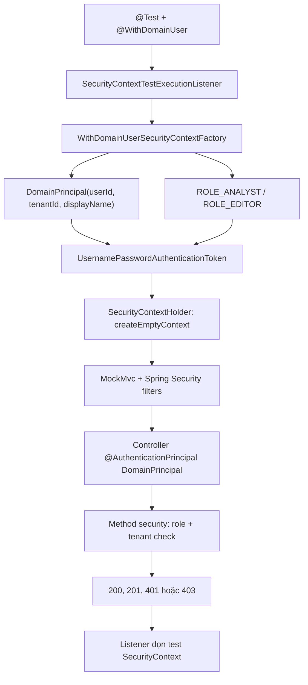

# Tạo annotation người dùng miền bằng @WithSecurityContext

Trong một ứng dụng có nhiều tenant, vai trò nghiệp vụ và quyền truy cập theo tổ chức, một username đơn giản thường **không đủ** để diễn đạt người đang thực hiện request. Ví dụ một người dùng có `userId = "u-101"`, thuộc `tenant-a`, mang `ROLE_ANALYST`; cùng role đó ở `tenant-b` không mặc nhiên cho phép người dùng đọc dữ liệu của `tenant-a`.

`@WithMockUser(username = "alice", roles = "ANALYST")` rất hữu ích khi kiểm tra rule dựa trên username và authority. Tuy nhiên, nếu controller hoặc service dùng `@AuthenticationPrincipal DomainPrincipal` để đọc `userId`, `tenantId` và thuộc tính miền, principal mặc định do `@WithMockUser` tạo ra **không phải** `DomainPrincipal`. Điều này có thể khiến test chỉ dùng `@WithMockUser` không phản ánh đúng đường xử lý của ứng dụng.

Bài thuộc chương **Thực hành tổng hợp** của module **SPRING_SECURITY_TESTING**. Ta sẽ tạo annotation `@WithDomainUser` dựa trên **`@WithSecurityContext`** để thiết lập `SecurityContext` kiểm thử có principal đúng kiểu dữ liệu miền, kiểm tra Servlet qua **MockMvc**, kết hợp role, tenant, CSRF và các ca HTTP được phép hoặc từ chối. Cuối bài sẽ phân biệt kỹ thuật này với **JWT/OAuth2/OIDC thật**, **WebTestClient Reactive**, HTTP server khác tiến trình và quản lý test isolation.

## 1. Kết quả học tập và ranh giới của kỹ thuật

Sau bài này, người học có thể:

1. Giải thích vì sao `@WithMockUser` không luôn đáp ứng được một principal tùy biến.
2. Khai báo annotation `@WithDomainUser` có `userId`, `tenantId`, `displayName` và `roles`.
3. Triển khai `WithSecurityContextFactory<WithDomainUser>` để tạo `SecurityContext` độc lập và một `Authentication` đã xác thực.
4. Dùng annotation trên phương thức JUnit 5 để chạy MockMvc qua **SecurityFilterChain thật** và kiểm tra `401/403/200/201`.
5. Phân biệt từ chối vì thiếu role, sai tenant và thiếu CSRF.
6. Hiểu thời điểm `SecurityContextTestExecutionListener` thiết lập/dọn context, cùng những giới hạn khi dùng `@Async` hoặc server HTTP thật.
7. Quyết định lúc nào cần test cơ chế authentication thật thay vì chỉ gắn sẵn Authentication giả.

**Phạm vi:** `@WithDomainUser` giả lập **kết quả xác thực đã thành công**. Annotation không tạo password hợp lệ, không ký JWT, không gọi opaque-token introspection, không thực hiện OAuth2 Authorization Code hoặc OIDC callback. Đây là công cụ kiểm thử **quyết định phân quyền và cách ứng dụng dùng principal sau xác thực**.

## 2. Thiết kế tình huống miền: analyst, editor và tenant

Giả sử ứng dụng có API:

| Hành động | Route | Điều kiện bảo mật |
| --- | --- | --- |
| Đọc báo cáo | `GET /api/tenants/{tenantId}/reports` | Đã xác thực, có `ROLE_ANALYST`, thuộc chính tenant được yêu cầu |
| Tạo báo cáo | `POST /api/tenants/{tenantId}/reports` | Đã xác thực, có `ROLE_EDITOR`, đúng tenant, CSRF hợp lệ |
| Đọc báo cáo khi anonymous | Cùng GET | Bị từ chối, với HTTP Basic entry point minh họa là 401 |
| Người dùng tenant khác | Cùng GET/POST | Bị từ chối 403 dù có role phù hợp |

Ta muốn test có thể đọc tự nhiên:

```java
@Test
@WithDomainUser(
    userId = "u-101",
    tenantId = "tenant-a",
    roles = {"ANALYST"})
void analystOfTenantA_whenReadingTenantAReports_isAllowed() {
    // ...
}
```

Tương phản với việc nhiều lần tự xây `SecurityContext` trong mỗi test:

```java
SecurityContext context = SecurityContextHolder.createEmptyContext();
context.setAuthentication(new UsernamePasswordAuthenticationToken(
    new DomainPrincipal("u-101", "tenant-a", "Alice"),
    null,
    List.of(new SimpleGrantedAuthority("ROLE_ANALYST"))));
SecurityContextHolder.setContext(context);
```

Đoạn thiết lập thủ công không sai nếu dùng đúng lifecycle, nhưng dễ tạo code trùng lặp, khác nhau giữa các test và quên khôi phục `SecurityContextHolder`. Annotation tùy biến gom fixture bảo mật vào **một nơi có thể tái sử dụng và được Spring Security Test quản lý**.

## 3. Quy trình nội bộ của @WithSecurityContext

`@WithSecurityContext` là một meta-annotation của `spring-security-test`. Khi có Spring TestContext framework và các test execution listener tương ứng, nó cho phép một annotation mới chỉ định **factory tạo SecurityContext**.



Ba lớp dữ liệu phải tách rõ:

| Thành phần | Chức năng |
| --- | --- |
| `@WithDomainUser` | Ghi **dữ liệu fixture** ngay tại test |
| `WithDomainUserSecurityContextFactory` | Chuyển fixture thành principal, authorities và Authentication |
| `SecurityContextTestExecutionListener` | Thiết lập và dọn SecurityContext theo vòng đời test |

Không viết `@WithDomainUser` để tự đặt vai trò vào request HTTP ngoài tiến trình. Factory chạy trong **JVM của test**, không tạo ra một credential có thể chuyển qua network.

## 4. Dependency và cấu hình ứng dụng ví dụ

Bài dùng Spring Boot 3.x, Spring Security 6.x, Java 17+, JUnit Jupiter, Spring MVC và MockMvc. Gradle:

```gradle
dependencies {
    implementation("org.springframework.boot:spring-boot-starter-web")
    implementation("org.springframework.boot:spring-boot-starter-security")

    testImplementation("org.springframework.boot:spring-boot-starter-test")
    testImplementation("org.springframework.security:spring-security-test")
}
```

Đặt `DomainPrincipal`, controller, service và `SecurityFilterChain` dưới `src/main/java` của ứng dụng. Đặt annotation `@WithDomainUser`, factory và lớp test dưới **`src/test/java`**: ta muốn dùng principal thật của miền, nhưng không đưa **cơ chế tự giả lập người dùng** vào production.

Một cấu trúc gợi ý:

```text
src/main/java/com/example/reports/
  DomainPrincipal.java
  TenantReportService.java
  TenantReportController.java
  DomainSecurityConfig.java

src/test/java/com/example/reports/
  WithDomainUser.java
  WithDomainUserSecurityContextFactory.java
  TenantReportSecurityTests.java
```

Đây là **sơ đồ tổ chức ví dụ trong bài học**, không phải các file sẽ được tạo thêm trong STEP 4 NEW. Các đoạn Java bên dưới giả định cùng package `com.example.reports` để tập trung vào SecurityContext; nếu tách package, cần import các lớp miền tương ứng.

## 5. DomainPrincipal: danh tính nghiệp vụ bất biến

Một principal đơn giản có thể là Java record. Để `Authentication.getName()` và các API chung hoạt động nhất quán, ta cho nó thực hiện `java.security.Principal`:

```java
package com.example.reports;

import java.security.Principal;

public record DomainPrincipal(
        String userId,
        String tenantId,
        String displayName) implements Principal {

    @Override
    public String getName() {
        return userId;
    }
}
```

Ta chọn `userId` làm tên principal ổn định, thay vì dùng tên hiển thị có thể trùng nhau. `tenantId` là ngữ cảnh phân quyền theo tenant. `displayName` chỉ dùng cho hiển thị, **không tự cấp quyền**.

Trong hệ thống thật, `DomainPrincipal` phải được xây dựng từ **nguồn đã được xác thực và tin cậy**: kết quả login, directory, database chính sách, token đã được decoder kiểm tra hoặc một converter hợp lệ. Không nhận `tenantId` từ header tùy ý rồi coi đó là principal đã xác thực.

## 6. SecurityFilterChain và method security của ứng dụng

Để bài test có ý nghĩa, giữ cấu hình bảo mật thật và phân vai rõ:

```java
package com.example.reports;

import org.springframework.context.annotation.Bean;
import org.springframework.context.annotation.Configuration;
import org.springframework.security.config.Customizer;
import org.springframework.security.config.annotation.method.configuration.EnableMethodSecurity;
import org.springframework.security.config.annotation.web.builders.HttpSecurity;
import org.springframework.security.web.SecurityFilterChain;

@Configuration
@EnableMethodSecurity
class DomainSecurityConfig {

    @Bean
    SecurityFilterChain securityFilterChain(HttpSecurity http)
            throws Exception {

        return http
            .authorizeHttpRequests(auth -> auth
                .requestMatchers("/api/tenants/**").authenticated()
                .anyRequest().denyAll())
            .httpBasic(Customizer.withDefaults())
            // CSRF được giữ theo cấu hình mặc định.
            .build();
    }
}
```

Ở đây:

- `.authenticated()` đảm bảo request có Authentication đã được chấp nhận.
- `@PreAuthorize` trên service quyết định **role**.
- Service kiểm tra **tenant** theo principal đã xác thực.
- CSRF của Spring Security bảo vệ thao tác POST.

`httpBasic()` được chọn để minh họa request anonymous trả 401. Dự án dùng form login có thể trả 302 đến trang login, còn JWT Resource Server có thể trả 401 với `WWW-Authenticate: Bearer`. **Không đổi authentication mechanism của production chỉ để test nhận một mã HTTP đẹp**.

### Service kiểm tra role và tenant

```java
package com.example.reports;

import org.springframework.http.HttpStatus;
import org.springframework.security.access.prepost.PreAuthorize;
import org.springframework.stereotype.Service;
import org.springframework.web.server.ResponseStatusException;

@Service
class TenantReportService {

    @PreAuthorize("hasRole('ANALYST')")
    public String readReports(
            DomainPrincipal principal, String requestedTenant) {
        verifyTenant(principal, requestedTenant);
        return "reports-for-" + requestedTenant;
    }

    @PreAuthorize("hasRole('EDITOR')")
    public String createReport(
            DomainPrincipal principal, String requestedTenant) {
        verifyTenant(principal, requestedTenant);
        return "created-for-" + requestedTenant;
    }

    private void verifyTenant(
            DomainPrincipal principal, String requestedTenant) {

        if (!principal.tenantId().equals(requestedTenant)) {
            throw new ResponseStatusException(
                HttpStatus.FORBIDDEN,
                "Tenant access denied");
        }
    }
}
```

Test thiếu role sẽ bị method security chặn bởi `@PreAuthorize`. Test có role nhưng sai tenant sẽ đi vào `verifyTenant()` và bị từ chối. Đây là hai cơ chế khác nhau cùng có thể trả **403**. Trong ứng dụng thật, quy tắc tenant có thể được triển khai trong một `AuthorizationManager`, một policy service hoặc lớp truy vấn dữ liệu; bài ví dụ tách nó ra để nhìn rõ điều kiện.

### Controller nhận đúng kiểu principal

```java
package com.example.reports;

import org.springframework.http.HttpStatus;
import org.springframework.security.core.annotation.AuthenticationPrincipal;
import org.springframework.web.bind.annotation.GetMapping;
import org.springframework.web.bind.annotation.PathVariable;
import org.springframework.web.bind.annotation.PostMapping;
import org.springframework.web.bind.annotation.RequestMapping;
import org.springframework.web.bind.annotation.ResponseStatus;
import org.springframework.web.bind.annotation.RestController;

@RestController
@RequestMapping("/api/tenants")
class TenantReportController {

    private final TenantReportService service;

    TenantReportController(TenantReportService service) {
        this.service = service;
    }

    @GetMapping("/{tenantId}/reports")
    String list(
            @PathVariable String tenantId,
            @AuthenticationPrincipal DomainPrincipal principal) {
        return service.readReports(principal, tenantId);
    }

    @PostMapping("/{tenantId}/reports")
    @ResponseStatus(HttpStatus.CREATED)
    String create(
            @PathVariable String tenantId,
            @AuthenticationPrincipal DomainPrincipal principal) {
        return service.createReport(principal, tenantId);
    }
}
```

Nếu test dùng `@WithMockUser`, principal thường là đối tượng `UserDetails` của Spring Security Test, **không đúng `DomainPrincipal`**. Trong cấu hình mặc định, `@AuthenticationPrincipal DomainPrincipal` có thể trả `null` khi kiểu không khớp, khiến service lỗi hoặc test không đo đúng policy. Annotation tùy biến sẽ giải quyết chính điểm đó.

Đừng suy luận việc test có DomainPrincipal nghĩa là mọi authentication mechanism trong production đều tạo DomainPrincipal như thế. Nếu ứng dụng thật dùng JWT/OIDC, cần có lớp mapping principal tương ứng; hãy kiểm thử mapping đó riêng.

## 7. Tạo annotation @WithDomainUser bằng @WithSecurityContext

Đây là nội dung chính của bài. Tệp **`src/test/java/com/example/reports/WithDomainUser.java`**:

```java
package com.example.reports;

import java.lang.annotation.ElementType;
import java.lang.annotation.Inherited;
import java.lang.annotation.Retention;
import java.lang.annotation.RetentionPolicy;
import java.lang.annotation.Target;

import org.springframework.security.test.context.support.WithSecurityContext;

@Target({ElementType.METHOD, ElementType.TYPE})
@Retention(RetentionPolicy.RUNTIME)
@Inherited
@WithSecurityContext(
    factory = WithDomainUserSecurityContextFactory.class)
public @interface WithDomainUser {

    String userId() default "u-101";

    String tenantId() default "tenant-a";

    String displayName() default "Alice";

    // Dùng tên vai trò nghiệp vụ chưa có tiền tố ROLE_.
    String[] roles() default {"ANALYST"};
}
```

Ý nghĩa các annotation meta:

- `@Target({METHOD, TYPE})`: dùng cho phương thức test hoặc cả class test.
- `@Retention(RUNTIME)`: cho phép test listener đọc annotation khi chạy.
- `@Inherited`: hỗ trợ kế thừa annotation ở cấp class theo quy tắc annotation inheritance của Java; không tự áp dụng cho mọi cấu trúc composition.
- `@WithSecurityContext(factory = ...)`: chỉ định lớp factory tạo Authentication và SecurityContext cho test.

Dữ liệu mặc định phù hợp với ví dụ, nhưng trong codebase nhiều tenant, nên **khai báo rõ user/tenant** tại những ca mà quyền sở hữu dữ liệu là phần cốt lõi. Mục tiêu là để người đọc thấy được điều kiện truy cập trong tên test và annotation.

`roles = {"ANALYST"}` là **role name không kèm `ROLE_`**. Factory sẽ chuyển nó thành `SimpleGrantedAuthority("ROLE_ANALYST")`. Không nhầm `ROLE_ANALYST` với OAuth2 scope `SCOPE_reports:read`: role và scope dùng tiền tố khác nhau.

## 8. Tạo WithSecurityContextFactory<WithDomainUser>

Tệp **`src/test/java/com/example/reports/WithDomainUserSecurityContextFactory.java`**:

```java
package com.example.reports;

import java.util.ArrayList;
import java.util.List;

import org.springframework.security.authentication.UsernamePasswordAuthenticationToken;
import org.springframework.security.core.GrantedAuthority;
import org.springframework.security.core.authority.SimpleGrantedAuthority;
import org.springframework.security.core.context.SecurityContext;
import org.springframework.security.core.context.SecurityContextHolder;
import org.springframework.security.test.context.support.WithSecurityContextFactory;

public final class WithDomainUserSecurityContextFactory
        implements WithSecurityContextFactory<WithDomainUser> {

    @Override
    public SecurityContext createSecurityContext(WithDomainUser user) {
        if (user.userId().isBlank() || user.tenantId().isBlank()) {
            throw new IllegalArgumentException(
                "userId and tenantId must not be blank");
        }

        DomainPrincipal principal = new DomainPrincipal(
            user.userId(),
            user.tenantId(),
            user.displayName());

        List<GrantedAuthority> authorities = new ArrayList<>();
        for (String role : user.roles()) {
            if (role.isBlank() || role.startsWith("ROLE_")) {
                throw new IllegalArgumentException(
                    "roles must be non-blank and must omit ROLE_");
            }

            authorities.add(
                new SimpleGrantedAuthority("ROLE_" + role));
        }

        var authentication = new UsernamePasswordAuthenticationToken(
            principal,
            null,       // Test fixture không dùng credential thật.
            authorities // Constructor ba tham số tạo token authenticated.
        );

        SecurityContext context =
            SecurityContextHolder.createEmptyContext();

        context.setAuthentication(authentication);
        return context;
    }
}
```

Các điểm cần hiểu kỹ:

1. `WithSecurityContextFactory<WithDomainUser>` nhận chính annotation mà test khai báo.
2. `DomainPrincipal` có `userId` và `tenantId` đúng miền ứng dụng.
3. `new SimpleGrantedAuthority("ROLE_" + role)` tạo authority mà `hasRole("ANALYST")` kỳ vọng.
4. Constructor `UsernamePasswordAuthenticationToken(principal, credentials, authorities)` tạo Authentication **được coi là đã xác thực**. Đây chỉ là **đặc quyền của test**, không phải cách xác minh người dùng production.
5. `SecurityContextHolder.createEmptyContext()` tạo **context riêng** cho mỗi lần factory được gọi; không lấy rồi sửa trực tiếp context có thể đang tồn tại trên test thread.
6. Factory **trả về** SecurityContext; nó không tự gọi `SecurityContextHolder.setContext()`. Test listener quản lý việc gắn và dọn context.

Dùng role thiếu/không có quyền bằng `roles = {}` nếu muốn kiểm tra một user đã xác thực không có business roles. Nếu ứng dụng có authorities dạng scope hoặc permission, nên thiết kế một thuộc tính khác (ví dụ `authorities`) và quy tắc mapping riêng, không gán bừa `ROLE_` lên mọi chuỗi.

### Vì sao không dùng UsernamePasswordAuthenticationToken hai tham số?

Constructor hai tham số `new UsernamePasswordAuthenticationToken(principal, credentials)` tạo một token **chưa xác thực**. Dùng nó cho một annotation mang nghĩa “đã đăng nhập” sẽ không phản ánh đúng `.authenticated()` và method security.

Trong test này ta dùng constructor ba tham số với authorities do factory kiểm soát, hoặc API static `UsernamePasswordAuthenticationToken.authenticated(...)` ở những phiên bản Spring Security hỗ trợ. Cách tạo này **chỉ thích hợp cho factory test tin cậy**, không đưa vào request handler production với dữ liệu từ client.

## 9. Kiểm thử tích hợp bằng MockMvc: được phép, bị từ chối, CSRF

Đặt class test trong `src/test/java` cùng package với các lớp ví dụ:

```java
package com.example.reports;

import org.junit.jupiter.api.Test;
import org.springframework.beans.factory.annotation.Autowired;
import org.springframework.boot.test.autoconfigure.web.servlet.AutoConfigureMockMvc;
import org.springframework.boot.test.context.SpringBootTest;
import org.springframework.test.web.servlet.MockMvc;

import static org.springframework.security.test.web.servlet.request.SecurityMockMvcRequestPostProcessors.csrf;
import static org.springframework.test.web.servlet.request.MockMvcRequestBuilders.get;
import static org.springframework.test.web.servlet.request.MockMvcRequestBuilders.post;
import static org.springframework.test.web.servlet.result.MockMvcResultMatchers.content;
import static org.springframework.test.web.servlet.result.MockMvcResultMatchers.status;

@SpringBootTest
@AutoConfigureMockMvc
class TenantReportSecurityTests {

    @Autowired
    MockMvc mvc;

    @Test
    @WithDomainUser(
        userId = "u-101",
        tenantId = "tenant-a",
        roles = {"ANALYST"})
    void analystOfTenantA_whenReadingTenantAReports_isAllowed()
            throws Exception {

        mvc.perform(get("/api/tenants/tenant-a/reports"))
            .andExpect(status().isOk())
            .andExpect(content().string("reports-for-tenant-a"));
    }

    @Test
    @WithDomainUser(
        userId = "u-202",
        tenantId = "tenant-b",
        roles = {"ANALYST"})
    void analystOfTenantB_whenReadingTenantAReports_isForbidden()
            throws Exception {

        mvc.perform(get("/api/tenants/tenant-a/reports"))
            .andExpect(status().isForbidden());
    }

    @Test
    @WithDomainUser(
        userId = "u-101",
        tenantId = "tenant-a",
        roles = {"VIEWER"})
    void viewerOfTenantA_whenReadingReports_isForbidden()
            throws Exception {

        mvc.perform(get("/api/tenants/tenant-a/reports"))
            .andExpect(status().isForbidden());
    }

    @Test
    void anonymous_whenReadingTenantAReports_isUnauthorized()
            throws Exception {

        mvc.perform(get("/api/tenants/tenant-a/reports"))
            .andExpect(status().isUnauthorized());
    }

    @Test
    @WithDomainUser(
        userId = "u-303",
        tenantId = "tenant-a",
        roles = {"EDITOR"})
    void editorOfTenantA_whenCreatingWithoutCsrf_isForbidden()
            throws Exception {

        mvc.perform(post("/api/tenants/tenant-a/reports"))
            .andExpect(status().isForbidden());
    }

    @Test
    @WithDomainUser(
        userId = "u-303",
        tenantId = "tenant-a",
        roles = {"EDITOR"})
    void editorOfTenantA_whenCreatingWithCsrf_isCreated()
            throws Exception {

        mvc.perform(post("/api/tenants/tenant-a/reports")
                .with(csrf()))
            .andExpect(status().isCreated())
            .andExpect(content().string("created-for-tenant-a"));
    }

    @Test
    @WithDomainUser(
        userId = "u-202",
        tenantId = "tenant-b",
        roles = {"EDITOR"})
    void editorOfTenantB_whenCreatingTenantAReportWithCsrf_isForbidden()
            throws Exception {

        mvc.perform(post("/api/tenants/tenant-a/reports")
                .with(csrf()))
            .andExpect(status().isForbidden());
    }
}
```

Chú ý: không có `.with(user(...))` trên từng request. `@WithDomainUser` đã cung cấp Authentication cho **test method** thông qua Spring TestContext. Các request MockMvc trong test chạy qua filter chain, method security và controller.

### Đọc đúng nguyên nhân từng kết quả

| Test | Authentication trong test | Hành động | Expected | Nguyên nhân |
| --- | --- | --- | --- | --- |
| Analyst tenant-a | `ROLE_ANALYST`, tenant-a | GET tenant-a | 200 | Đủ role và đúng tenant |
| Analyst tenant-b | `ROLE_ANALYST`, tenant-b | GET tenant-a | 403 | Role đúng nhưng **tenant sai** |
| Viewer tenant-a | `ROLE_VIEWER`, tenant-a | GET tenant-a | 403 | Đúng tenant nhưng **thiếu role** |
| Anonymous | Không gắn user | GET tenant-a | 401 | Cần authentication; Basic entry point |
| Editor tenant-a thiếu CSRF | `ROLE_EDITOR`, tenant-a | POST tenant-a | 403 | **CSRF**, không phải role |
| Editor tenant-a có CSRF | `ROLE_EDITOR`, tenant-a | POST tenant-a | 201 | Đúng role/tenant và có CSRF |
| Editor tenant-b có CSRF | `ROLE_EDITOR`, tenant-b | POST tenant-a | 403 | CSRF hợp lệ, **tenant sai** |

Ở các ca POST cần đo role/tenant, hãy gửi `.with(csrf())` để không bị chặn sớm vì CSRF. Ở ca cố ý kiểm tra CSRF, cung cấp role và tenant **đúng**. Đây là cách thiết kế **test cô lập một nguyên nhân bị từ chối**.

Một `403` duy nhất không chứng minh được tầng nào chặn request; cần fixture đúng tiền điều kiện, cặp đối chứng 201 và khi cần, kiểm tra tương tác service/event để xác nhận request không làm thay đổi dữ liệu.

## 10. Kiểm tra trực tiếp SecurityContext mà factory tạo

Bên cạnh MockMvc, có thể kiểm chứng `Authentication` và principal bên trong test thread. Bổ sung method sau trong một lớp có `@SpringBootTest`, được TestContext framework quản lý:

```java
import org.junit.jupiter.api.Test;
import org.springframework.security.core.Authentication;
import org.springframework.security.core.GrantedAuthority;
import org.springframework.security.core.context.SecurityContextHolder;

import static org.assertj.core.api.Assertions.assertThat;

@Test
@WithDomainUser(
    userId = "u-404",
    tenantId = "tenant-c",
    displayName = "Carol",
    roles = {"ANALYST", "EDITOR"})
void domainAnnotation_whenBuildingContext_setsPrincipalAndRoles() {

    Authentication authentication =
        SecurityContextHolder.getContext().getAuthentication();

    assertThat(authentication).isNotNull();
    assertThat(authentication.isAuthenticated()).isTrue();
    assertThat(authentication.getPrincipal())
        .isInstanceOf(DomainPrincipal.class);

    DomainPrincipal principal =
        (DomainPrincipal) authentication.getPrincipal();

    assertThat(principal.userId()).isEqualTo("u-404");
    assertThat(principal.tenantId()).isEqualTo("tenant-c");
    assertThat(principal.displayName()).isEqualTo("Carol");
    assertThat(authentication.getName()).isEqualTo("u-404");

    assertThat(authentication.getAuthorities())
        .extracting(GrantedAuthority::getAuthority)
        .containsExactlyInAnyOrder(
            "ROLE_ANALYST", "ROLE_EDITOR");
}
```

Đây là phép kiểm tra **fixture**. Nó giúp phát hiện lỗi factory như đặt nhầm `ROLE_` hai lần, `getName()` không khớp userId hoặc principal sai kiểu. Nhưng nó **không thay thế** các ca MockMvc: việc factory tạo đúng `Authentication` chưa chứng minh filter chain và method security thực thi policy.

Ngoài ra, không lạm dụng `authentication.isAuthenticated()` làm bằng chứng “đã xác minh password”: factory có quyền tạo authenticated token trực tiếp; điều này đúng cho test nhưng không phải cơ chế login production.

## 11. Thời điểm setupBefore và TestExecutionListener

Mặc định, `@WithSecurityContext` dùng `TestExecutionEvent.TEST_METHOD`. Spring Security Test thiết lập context **trước khi chạy `@BeforeEach`** trong test lifecycle được quản lý bởi Spring TestContext.

```text
Spring TestContext (mặc định TEST_METHOD):
  beforeTestMethod
    -> SecurityContextTestExecutionListener tạo @WithDomainUser
  @BeforeEach
  @Test
  @AfterEach
  afterTestMethod
    -> Listener dọn SecurityContextHolder
```

Khi setup fixture trong `@BeforeEach` cần biết danh tính hiện tại, đây là behavior phù hợp. Nhưng nếu muốn `@BeforeEach` chạy **trước khi context test được gắn**, có thể cấu hình meta-annotation:

```java
import org.springframework.security.test.context.support.TestExecutionEvent;
import org.springframework.security.test.context.support.WithSecurityContext;

// Một biến thể annotation riêng, không khai báo đồng thời
// với @WithDomainUser đã định nghĩa ở mục 7.
@WithSecurityContext(
    factory = WithDomainUserSecurityContextFactory.class,
    setupBefore = TestExecutionEvent.TEST_EXECUTION)
```

Ở chế độ `TEST_EXECUTION`, listener thiết lập context trước khi thực thi thân `@Test`, **sau `@BeforeEach`**. Dòng code trên minh họa **tham số của meta-annotation**, không phải một Java class hoàn chỉnh dùng để biên dịch độc lập. Nếu cần, hãy đưa nó vào khai báo annotation tương ứng.

Đừng thay `setupBefore` theo cảm tính để sửa test thất bại; hãy hỏi fixture ở `@BeforeEach` có cần thấy security context hay không.

### Ai dọn SecurityContext sau test?

`SecurityContextTestExecutionListener` dọn context đã thiết lập trong test lifecycle. Điều này tránh trường hợp test kế tiếp vô tình thừa hưởng userId/roles của test trước trên JUnit thread.

Tuy nhiên, nếu test tự tạo executor rồi gọi `SecurityContextHolder.setContext(...)` ở **worker thread**, việc cleanup trên test thread **không tự xóa** context trong worker. Với `@Async`, dùng cơ chế propagation như `DelegatingSecurityContextAsyncTaskExecutor` và kiểm thử context được khôi phục kể cả khi task ném exception.

## 12. Dùng annotation ở class-level và ghi đè theo method

Annotation có `@Target(TYPE)` nên dùng được ở class:

```java
@SpringBootTest
@AutoConfigureMockMvc
@WithDomainUser(
    userId = "u-101",
    tenantId = "tenant-a",
    roles = {"ANALYST"})
class TenantAAnalystContractTests {

    @Autowired MockMvc mvc;

    @Test
    void defaultAnalyst_whenReadingOwnReports_isAllowed()
            throws Exception {
        mvc.perform(get("/api/tenants/tenant-a/reports"))
            .andExpect(status().isOk());
    }

    @Test
    @WithDomainUser(
        userId = "u-202",
        tenantId = "tenant-b",
        roles = {"ANALYST"})
    void tenantBAnalyst_whenReadingTenantAReports_isForbidden()
            throws Exception {
        mvc.perform(get("/api/tenants/tenant-a/reports"))
            .andExpect(status().isForbidden());
    }
}
```

Phương thức có annotation riêng dùng fixture ở **method-level** thay vì mặc định của class. Khi test anonymous, **không đặt class-level `@WithDomainUser`** hoặc dùng annotation `@WithAnonymousUser` để ghi đè theo đúng Spring Security Test.

Không nên đặt một user mặc định có quyền cao cho toàn bộ test suite nếu phần lớn test nhằm chứng minh request anonymous/thiếu role bị từ chối. Fixture mặc định quá mạnh có thể khiến ca bị từ chối “xanh giả” hoặc bị bỏ sót.

## 13. Từ annotation tĩnh đến fixture động: khi nào cần cách khác?

`@WithDomainUser` phù hợp khi danh tính của một test method được biết tại thời điểm viết code. Nhưng Java annotation nhận giá trị **hằng**; nó không đọc `tenantId` động từ một `@ParameterizedTest` invocation.

Ví dụ phù hợp:

```java
@WithDomainUser(
    userId = "u-101",
    tenantId = "tenant-a",
    roles = {"ANALYST"})
@ParameterizedTest
@ValueSource(strings = {"tenant-b", "tenant-c"})
void analystOfTenantA_whenReadingOtherTenants_isForbidden(
        String targetTenant) throws Exception {

    mvc.perform(get("/api/tenants/{tenantId}/reports", targetTenant))
        .andExpect(status().isForbidden());
}
```

Nhớ import `org.junit.jupiter.params.ParameterizedTest` và `org.junit.jupiter.params.provider.ValueSource`, và đặt method trong lớp có `mvc`. Ở đây **người dùng là hằng**, còn tenant đích thay đổi theo row.

Nếu muốn thay **principal, role và tenant nguồn** theo từng row, những lựa chọn đúng hơn gồm:

- Tạo test method riêng với `@WithDomainUser` cho các security contract quan trọng.
- Dùng `SecurityMockMvcRequestPostProcessors.authentication(authentication)` cho từng MockMvc request, với builder fixture tạo `DomainPrincipal` + authorities tương ứng.
- Dùng một JUnit extension/`TestTemplate` chuyên biệt khi cần ma trận phức tạp; phải thiết kế cleanup, lifecycle rõ ràng.

Không cố truyền kết quả `MethodSource` trực tiếp vào thuộc tính annotation; Java không hỗ trợ cách đó.

### Annotation có thể dùng dependency injection trong factory không?

Có. Factory trong Spring Security Test có thể được Spring TestContext hỗ trợ autowiring, ví dụ truy vấn một **test-only directory** để lấy danh tính mẫu. Tuy nhiên, tránh để factory tự gọi IdP thật, database production hoặc service từ xa chỉ để dựng principal: test sẽ chậm, dễ flaky và làm mất mục tiêu kiểm chứng **authorization cô lập**. Nếu cần xác minh rằng directory/JWT/IdP thực sự tạo đúng user/tenant, viết integration test cho phần mapping đó.

## 14. Cô lập SecurityContext, session và dữ liệu giữa các test

Một annotation tốt chỉ là một phần của bộ test đáng tin. Cần phân biệt:

| Trạng thái | Ai quản lý | Nguy cơ nếu bị dùng lại |
| --- | --- | --- |
| `SecurityContextHolder` trên JUnit thread | Spring Security Test listener | Test sau tưởng là anonymous nhưng vẫn có Authentication |
| SecurityContext trên worker executor | Executor wrapper/cơ chế ứng dụng | Task của Bob thấy Alice |
| `MockHttpSession` | Fixture/MockMvc request | Test anonymous kế thừa session đã login |
| HTTP session trên server thật | Session cookie do server cấp | Request mới vô tình chạy dưới user trước |
| Database row/tenant ownership | Fixture transaction + cleanup | Test cross-tenant “pass” do không có dữ liệu |
| JWT/opaque token và client credentials | Test IdP/issuer/fixture | Token hết hạn, scope sai hoặc secret lộ qua log |

Một số nguyên tắc:

1. Tạo fixture độc lập cho từng test; không giữ `SecurityContext` mutable trong static field.
2. Để Spring Security Test listener dọn context của test method; khi tự dùng thread khác, bổ sung cleanup đúng thread.
3. Không chia sẻ `MockHttpSession` giữa ca login và ca anonymous nếu không có chủ đích.
4. Nếu API thật có persistence, xác minh request bị từ chối **không tạo/sửa dữ liệu**, nhất là ca tenant sai.
5. Với HTTP server thực, `@Transactional` trên JUnit test thread **không tự rollback** transaction đã commit ở server thread. Dọn dữ liệu ngoài test-managed transaction hoặc dùng schema/database riêng.
6. Không in access token, session cookie, SAML response hay dữ liệu cá nhân vào test report/CI logs.

**Không dùng `@DirtiesContext` chỉ để “xóa user” sau mỗi test**. Phần lớn test `@WithSecurityContext` được listener quản lý; làm bẩn ApplicationContext thường làm test chậm mà không thay thế việc dọn session/database hay worker thread.

## 15. Liên hệ WebTestClient Reactive và giới hạn HTTP thật

`@WithSecurityContext` liên quan tới Spring TestContext. Trong Servlet, ví dụ MockMvc ở trên đọc `SecurityContextHolder` từ test-managed context. Với WebFlux, authentication được lưu theo **Reactor Context**; cần cơ chế tích hợp Spring Security Test và `WebTestClient` đúng stack.

### WebFlux mock server

Một ứng dụng WebFlux có thể dùng:

```java
WebTestClient client = WebTestClient
    .bindToApplicationContext(applicationContext)
    .apply(SecurityMockServerConfigurers.springSecurity())
    .configureClient()
    .build();
```

Với Spring TestContext và `ReactorContextTestExecutionListener` của Spring Security Test được thiết lập phù hợp, `@WithSecurityContext` có thể phục vụ test Reactive. Nhưng phải **xác minh Authentication được đưa đúng vào Reactor Context** trước khi kết luận method security hoạt động; không sao chép nguyên ví dụ `SecurityFilterChain` Servlet sang `SecurityWebFilterChain`.

Khi cần gắn Authentication **tường minh cho từng request WebTestClient mock server**, có thể dùng `SecurityMockServerConfigurers.mockAuthentication(authentication)` với domain Authentication được xây bằng fixture test. Cách này khác về API với `@WithDomainUser`, nhưng bảo đảm request Reactive đang xét có principal mong muốn.

### Server HTTP thật hoặc ngoài tiến trình

`WebTestClient.bindToServer()` và `TestRestTemplate` gửi HTTP qua mạng. **`@WithDomainUser` không làm server bên kia tự có SecurityContext**; nó không đặt `Authorization: Bearer ...`, HTTP Basic header hay session cookie vào request.

Đối với server thật, test phải đi qua cơ chế authentication mà ứng dụng triển khai: Basic credentials, JWT có chữ ký hợp lệ, opaque token được introspect, OAuth2/OIDC login/session hoặc test IdP theo giao thức phù hợp.

Đây là lý do một bộ kiểm thử tổng hợp nên có **hai nhóm khác nhau**:

| Nhóm test | Dùng gì | Khẳng định hợp lệ |
| --- | --- | --- |
| Authorization và principal mapping *sau khi xác thực* | `@WithDomainUser` + MockMvc | Controller/service dùng userId/tenantId/roles đúng và chặn thiếu quyền |
| Authentication và principal mapping *từ credential thật* | HTTP request + filter/provider/decoder/IdP phù hợp | Server thật tạo đúng Authentication/DomainPrincipal và áp dụng policy |

Nếu production chỉ tạo `JwtAuthenticationToken` với principal kiểu `Jwt`, còn controller đòi `DomainPrincipal`, test `@WithDomainUser` vẫn có thể pass dù production gặp lỗi principal type. Cần thêm test cho converter/mapping `Jwt` hoặc OIDC user sang domain principal, thay vì chỉ tin mock annotation.

## 16. Chẩn đoán lỗi thường gặp

| Hiện tượng | Nguyên nhân thường gặp | Cách kiểm tra |
| --- | --- | --- |
| `@AuthenticationPrincipal DomainPrincipal` là `null` | Test dùng `@WithMockUser` tạo principal khác kiểu | Dùng custom factory hoặc kiểm tra production principal mapping |
| `hasRole("ANALYST")` luôn trả 403 | Factory tạo authority `ANALYST` thay vì `ROLE_ANALYST` | Assert `getAuthorities()`, kiểm prefix |
| Request anonymous bất ngờ trả 200 | Annotation đặt ở class-level hoặc session cũ | Xác nhận test không kế thừa Authentication |
| Test thiếu role trả 403 nhưng không rõ nguyên nhân | POST thiếu CSRF trước khi tới method security | Cung cấp `.with(csrf())` cho ca đo role |
| Tenant-b đọc được tenant-a | Test chỉ kiểm role, service không kiểm tenant | Viết ca cùng role khác tenant và assert 403 |
| Không có `@WithDomainUser` dù đã đánh dấu method | Test không chạy qua Spring TestContext listener | Kiểm tra `@SpringBootTest`/SpringExtension và TestExecutionListeners |
| Context bị giữ sau test | Tự gọi `setContext` ở worker/static fixture không cleanup | Tách listener cleanup và worker cleanup |
| `@BeforeEach` không thấy user | Annotation dùng `setupBefore = TEST_EXECUTION` | Đổi sang `TEST_METHOD` nếu fixture setup cần context |
| Test WebFlux thiếu principal | Reactor Context chưa nhận test Authentication | Kiểm tra `springSecurity()`, listener Reactor hoặc `mockAuthentication()` |
| Test MockMvc pass nhưng RANDOM_PORT trả 401 | Annotation không tạo HTTP credential thật | Gửi header/cookie hợp lệ tới server |
| JWT test pass nhưng token production không hợp lệ | Custom annotation bỏ qua JwtDecoder | Viết JWT integration test với chữ ký/issuer/audience thật |
| Factory lấy user từ DB khiến test flaky | Seed data thiếu, fixture không cô lập | Tạo test-only data rõ ràng hoặc mock repository ở đúng mức |

Không sửa production bằng `permitAll()`, bỏ method security hay tắt CSRF chỉ để khiến `@WithDomainUser` “hoạt động”. Hãy xác định vấn đề thuộc **test fixture**, **Spring TestContext lifecycle**, **principal mapping** hay **security policy**.

## 17. Bài tập thực hành

1. Tạo `DomainPrincipal` bất biến với `userId`, `tenantId`, `displayName`; implement `Principal.getName()` theo userId.
2. Tạo annotation `@WithDomainUser` có `@Target(METHOD, TYPE)`, `@Retention(RUNTIME)` và `@WithSecurityContext(factory = ...)`.
3. Triển khai `WithDomainUserSecurityContextFactory` để tạo `UsernamePasswordAuthenticationToken` đã xác thực với `ROLE_ANALYST` và context mới.
4. Viết test đọc trực tiếp `SecurityContextHolder` để assert principal type, userId, tenantId, displayName và authorities.
5. Viết ca analyst thuộc `tenant-a` đọc báo cáo của `tenant-a` trả 200, rồi đổi sang tenant-b với **cùng role** và kiểm tra 403.
6. Viết ca viewer cùng tenant nhưng không có `ROLE_ANALYST` và kiểm tra 403 do method security.
7. Viết ca editor thuộc tenant-a POST thiếu CSRF trả 403, rồi có CSRF trả 201. Giải thích vì sao hai ca không thể thay thế cho test role.
8. Đặt `@WithDomainUser` trên class, sau đó ghi đè ở method cho principal khác tenant. Thêm một ca `@WithAnonymousUser` và xác minh 401.
9. Dùng `@ParameterizedTest` để giữ principal cố định nhưng thay tenant trong URL; giải thích giới hạn giá trị annotation là hằng.
10. So sánh `TEST_METHOD` và `TEST_EXECUTION` bằng `@BeforeEach` đọc `SecurityContextHolder`.
11. Chuyển bài test sang WebFlux mock server. Kiểm tra Reactor Context/Authentication đã được gắn trước khi assert policy; phân biệt với `bindToServer()`.
12. Bổ sung một integration test JWT/OIDC thực: server tự chuyển credential đã xác thực thành `DomainPrincipal`, rồi kiểm tra policy cùng tenant và khác tenant. So sánh phạm vi với `@WithDomainUser`.

## 18. Ghi nhớ

- **`@WithSecurityContext` tạo ra một annotation fixture có ngữ nghĩa miền**, ví dụ `@WithDomainUser(userId, tenantId, roles)`, thay vì viết lặp logic tạo Authentication trong mọi test.
- **Factory phải trả `SecurityContext` độc lập** chứa principal đúng kiểu và authorities đúng prefix; `SecurityContextTestExecutionListener` quản lý việc gắn/dọn context cho test.
- **Role và tenant là hai điều kiện khác nhau.** User đủ role nhưng sai tenant vẫn phải bị từ chối; test cần hai ca âm riêng.
- **Đừng đo nhầm CSRF thành thiếu role.** Khi kiểm tra authorization cho POST, cung cấp token CSRF hợp lệ rồi mới đánh giá quyền.
- **`@WithDomainUser` mô phỏng danh tính đã được xác thực**, không kiểm password, chữ ký JWT, introspection hay OAuth2/OIDC flow thực.
- **Test class-level, method-level và setupBefore có vòng đời riêng.** Tránh để fixture quyền cao vô tình áp dụng cho test anonymous.
- **SecurityContext ở worker và Reactor Context không được suy ra từ ThreadLocal của JUnit test.** Cần propagation/cô lập đúng stack.
- **HTTP server thật không nhận Authentication từ annotation của test JVM.** Hãy gửi credential thật và kiểm tra converter/principal mapping production.
- **Một bộ test tích hợp tốt kiểm cả cho phép và từ chối**, với tên mô tả identity, action và expected decision để CI dễ chẩn đoán.

Trong **SPRING_SECURITY_TESTING**, `@WithDomainUser` giúp viết test gần với ngôn ngữ nghiệp vụ: **người dùng nào, thuộc tenant nào, mang quyền gì, được làm gì và bị từ chối khi nào**. Khi giữ đúng ranh giới giữa *Authentication giả lập để kiểm tra authorization* và *cơ chế xác thực thật*, annotation tùy biến trở thành một công cụ mạnh mà không che khuất các kiểm thử bảo mật cần thiết ở tầng HTTP.

