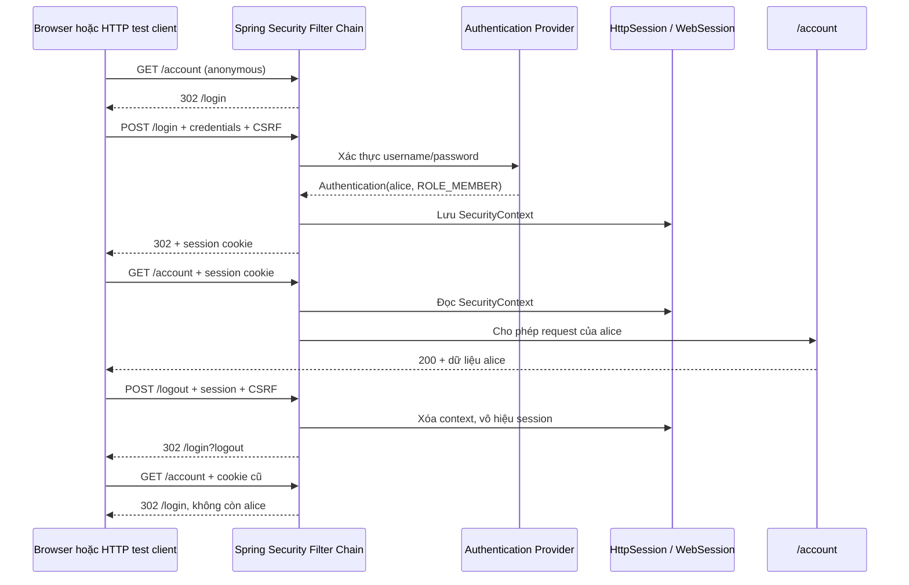

# Kiểm thử form login, giữ phiên rồi logout và gọi lại tài nguyên

> **Chương:** Thực hành tổng hợp  
> **Module:** `SPRING_SECURITY_TESTING`  
> **Mục tiêu:** Dùng `spring-security-test` kiểm tra một chuỗi tương tác thật của người dùng: **chưa đăng nhập → gửi form login → giữ phiên → truy cập tài nguyên được bảo vệ → logout → gọi lại tài nguyên bằng phiên cũ và bị từ chối**. Bài thực hành dùng `MockMvc` cho Servlet, đối chiếu với `WebTestClient` trên WebFlux, đồng thời phân biệt việc gắn `@WithMockUser`/principal JWT/OAuth2/OIDC giả với kiểm chứng đăng nhập, session, CSRF và logout thực tế.

## 1. Vì sao cần một kịch bản nhiều request?

Một test độc lập như `mvc.perform(get("/account").with(user("alice"))).andExpect(status().isOk())` chỉ chứng minh endpoint chấp nhận một `Authentication` đã được chuẩn bị. Nó **không chứng minh** rằng Alice đã nhập đúng mật khẩu, Spring Security đã lưu danh tính vào session, request tiếp theo tái sử dụng đúng session, hoặc logout làm phiên không còn giá trị.

Kiểm thử form login phải xem một **chuỗi trạng thái** thay vì nhiều request rời rạc. Cùng một principal test được gắn lại ở request sau logout sẽ làm che mất đúng điều cần kiểm tra: authentication cũ đáng lẽ phải biến mất.

| Thời điểm | Request | Danh tính phía server | Kết quả kỳ vọng trong ví dụ |
| --- | --- | --- | --- |
| T0 | `GET /account`, chưa có session login | Anonymous | Redirect tới `/login` |
| T1 | `POST /login` với credential và CSRF hợp lệ | Được xác thực, lưu vào session | Redirect tới trang đích |
| T2 | `GET /account` sử dụng session sau login | Alice, `ROLE_MEMBER` | `200 OK`, trả thông tin của Alice |
| T3 | `POST /logout` sử dụng cùng session và CSRF hợp lệ | Logout handler xóa context, vô hiệu session | Redirect tới `/login?logout` |
| T4 | `GET /account` không có phiên hợp lệ | Anonymous | Redirect tới `/login`, không trả dữ liệu Alice |
| T5 | Gửi lại cookie/session ID cũ qua HTTP thật | Không được khôi phục Alice | Bị yêu cầu đăng nhập lại |

**T4 và T5 khác nhau:** một request không gửi session cho biết trạng thái anonymous được bảo vệ; replay **cookie phiên đã logout** mới kiểm tra trực tiếp liệu session cũ có bị chấp nhận không. Trong `MockMvc`, có thể kiểm tra `MockHttpSession` đã bị invalidated rồi gửi request mới không có session. Để kiểm tra cookie ID thực qua servlet container, cần thêm test HTTP chạy trên server thật.

### 1.1. Những bất biến cần bảo vệ

- Sai mật khẩu hoặc thiếu CSRF không tạo ra phiên **đã xác thực**.
- Form login thành công chỉ khi credential được kiểm chứng qua authentication provider/password encoder thực của fixture.
- Sau login, request kế tiếp dùng cùng session thấy đúng user và role.
- Một người dùng khác hoặc một request anonymous không tự có quyền của Alice.
- Logout phải xóa ngữ cảnh và vô hiệu hóa session theo cấu hình đã công bố.
- Sau logout, tài nguyên bảo vệ không còn trả dữ liệu với session cũ.
- Không gọi nghiệp vụ được bảo vệ khi request bị từ chối; không rò session ID, password, CSRF token vào log/test report.



Sơ đồ là hợp đồng minh họa dành cho **form login sử dụng session**. Status và redirect có thể thay đổi khi ứng dụng cấu hình custom success/failure handler, API entry point hoặc đường login/logout khác. Không dùng kịch bản này để suy luận một API chỉ dùng Bearer JWT phải có session hoặc chuyển hướng HTML.

## 2. Chốt ranh giới của bài test

Form login là một cơ chế Servlet/Reactive authentication thực; các helper `spring-security-test` có nhiều mức can thiệp.

| Công cụ | Đã chạy login/password thật? | Giữ session giữa request? | Dùng để kiểm tra |
| --- | --- | --- | --- |
| `@WithMockUser` | Không | Không tự kiểm tra session lifecycle | Quyền của principal đã có |
| MockMvc `with(user("alice"))` | Không | Không tạo bằng chứng login | Authorization ở một request |
| MockMvc `formLogin()` | Gửi request mô phỏng form login vào security filters | Phải chủ động chuyển session sang request sau | Credential, login processing; helper có thể chuẩn bị CSRF |
| MockMvc `POST /login` với form fields + `csrf()` | Có, nếu giữ provider/filter thật | Cần giữ `MockHttpSession` | Contract form login, CSRF và redirect |
| WebTestClient `mockUser()` | Không | Không chứng minh login cookie/session | Authorization Reactive một request |
| WebTestClient `POST /login` với body form | Có, nếu WebFilter/manager thật | Cần giữ cookie `SESSION`/WebSession | Reactive form login lifecycle |
| HTTP client qua cổng server thật | Có | Tự quản lý cookie jar hoặc header `Cookie` | Cookie/session ID thật và hành vi replay sau logout |

Ở bài này, **không dùng `@WithMockUser` trong các request xác minh login → session → logout**. Chỉ dùng helper CSRF phù hợp khi cần đi qua CSRF filter; ở một bài test riêng, kiểm tra trọn quá trình lấy/gửi token như trình duyệt thực.

## 3. Fixture Servlet: SecurityFilterChain và user store thật

Các ví dụ dựa trên Java 17+, Spring Boot 3.x và Spring Security 6.x. Đặt các class mẫu vào một gói test Spring Boot có thể nạp, hoặc điều chỉnh bean và tên class theo ứng dụng của bạn. Đây là **ứng dụng fixture**, không phải lời khuyên thay cấu hình production.

### 3.1. Dependency cho Servlet test

```groovy
dependencies {
    implementation("org.springframework.boot:spring-boot-starter-web")
    implementation("org.springframework.boot:spring-boot-starter-security")

    testImplementation("org.springframework.boot:spring-boot-starter-test")
    testImplementation("org.springframework.security:spring-security-test")
}
```

Không cần cài JWT/OAuth2/OIDC cho bài form login cơ bản. Khi ứng dụng có nhiều cơ chế, cần kiểm tra đúng `SecurityFilterChain` được chọn. Dùng version Spring Security Test do Spring Boot quản lý; không ghép tùy tiện helper phiên bản khác runtime.

### 3.2. Bật form login, logout và CSRF

```java
@Configuration
@EnableWebSecurity
class FormSessionSecurity {

    @Bean
    SecurityFilterChain security(HttpSecurity http)
            throws Exception {
        return http
            .authorizeHttpRequests(auth -> auth
                .requestMatchers(
                    HttpMethod.GET, "/csrf").permitAll()
                .requestMatchers(
                    HttpMethod.GET, "/account").hasRole("MEMBER")
                .anyRequest().denyAll())
            .formLogin(Customizer.withDefaults())
            .logout(Customizer.withDefaults())
            .csrf(Customizer.withDefaults())
            .build();
    }

    @Bean
    PasswordEncoder passwordEncoder() {
        return new BCryptPasswordEncoder();
    }

    @Bean
    UserDetailsService userDetailsService(
            PasswordEncoder encoder) {
        UserDetails alice = User.withUsername("alice")
            .password(encoder.encode("test-password"))
            .roles("MEMBER")
            .build();
        return new InMemoryUserDetailsManager(alice);
    }
}
```

Ở cấu hình này:

- `GET /account` đòi `ROLE_MEMBER`. User chưa đăng nhập sẽ được chuyển về form login qua entry point.
- `POST /login` được form-login filter xử lý bằng username/password, không cần controller riêng.
- `POST /logout` được logout filter xử lý; với CSRF đang bật, đây là phương thức phù hợp để thực sự logout.
- `GET /csrf` là **endpoint chỉ phục vụ bài thực hành** để minh họa lấy token thật; đừng tự tạo một endpoint phát CSRF token công khai cho production nếu chưa đánh giá chính sách của ứng dụng.
- Mật khẩu test được encode bằng BCrypt thật; một `UserDetailsService` mock trả Authentication đã xác thực sẽ làm mất bằng chứng password validation.

Lưu ý thứ tự xử lý: form login filter/logout filter được Spring Security đăng ký trước authorization quyết định `anyRequest().denyAll()` cho request thông thường. Với cấu hình tùy biến, hãy dùng `formLogin(form -> form.permitAll())` và policy endpoint login cụ thể nếu cần. Không vô tình tạo một second chain cho `/login` làm thay đổi contract.

### 3.3. Controller hiển thị principal và CSRF token

```java
@RestController
class AccountController {

    @GetMapping("/account")
    Map<String, String> account(Authentication authentication) {
        return Map.of("username", authentication.getName());
    }

    // Endpoint test-only dùng để diễn tập token round trip.
    @GetMapping("/csrf")
    Map<String, String> csrf(HttpServletRequest request) {
        CsrfToken token = (CsrfToken) request.getAttribute(
            CsrfToken.class.getName());
        if (token == null) {
            throw new IllegalStateException(
                "CSRF filter was not applied");
        }
        return Map.of(
            "parameterName", token.getParameterName(),
            "headerName", token.getHeaderName(),
            "token", token.getToken());
    }
}
```

Đọc `getToken()` khiến token deferred được truy cập. Với Spring Security phiên bản có Xor CSRF request handler, giá trị expose có thể được che giấu để chống BREACH; hãy **gửi lại giá trị ứng dụng đã expose** qua đúng parameter/header, thay vì tự so sánh với raw value lưu trong repository.

### 3.4. Test configuration nạp đúng fixture

```java
@SpringBootConfiguration
@EnableAutoConfiguration
@Import({FormSessionSecurity.class, AccountController.class})
class FormSessionTestApplication {}
```

Đây là bootstrap **dành riêng cho ứng dụng fixture**. Trong project thực tế đã có `@SpringBootApplication`, thường chỉ cần `@SpringBootTest` và không tạo một bootstrap thứ hai. Mục tiêu là chạy bean security/filter/controller thật, không chỉ gọi controller trực tiếp.

## 4. MockMvc: login, giữ phiên, logout và truy cập lại

### 4.1. Chuẩn bị lớp test

```java
@SpringBootTest(
    classes = FormSessionTestApplication.class,
    webEnvironment = SpringBootTest.WebEnvironment.MOCK)
@AutoConfigureMockMvc(addFilters = true)
class FormSessionLifecycleMvcIT {

    @Autowired MockMvc mvc;

    // Các phương thức test bên dưới nằm trong lớp này.
}
```

`@AutoConfigureMockMvc(addFilters = true)` giữ Spring Security filters trên request. Nếu tự tạo MockMvc từ `WebApplicationContext`, dùng:

```java
MockMvc securedMvc = MockMvcBuilders
    .webAppContextSetup(webApplicationContext)
    .apply(SecurityMockMvcConfigurers.springSecurity())
    .build();
```

Không dùng `standaloneSetup(controller)` rồi kết luận form login/logout an toàn: mô hình đó có thể bỏ qua các security filters mà bạn muốn kiểm thử.

### 4.2. Một test duy nhất chứng minh đúng thứ tự

```java
@Test
void loginRetainSessionLogoutThenDenyAccess() throws Exception {
    // Bước 0: Chưa đăng nhập, tài nguyên được bảo vệ.
    mvc.perform(get("/account"))
        .andExpect(status().is3xxRedirection())
        .andExpect(redirectedUrlPattern("**/login"));

    // Bước 1: Form login gửi credential thật vào filter.
    MvcResult login = mvc.perform(post("/login")
            .with(csrf())
            .param("username", "alice")
            .param("password", "test-password"))
        .andExpect(status().is3xxRedirection())
        .andReturn();

    MockHttpSession session = (MockHttpSession)
        login.getRequest().getSession(false);
    assertNotNull(session);
    assertFalse(session.isInvalid());

    // Bước 2: Request khác giữ cùng HttpSession đã đăng nhập.
    mvc.perform(get("/account").session(session))
        .andExpect(status().isOk())
        .andExpect(jsonPath("$.username").value("alice"));

    // Bước 3: Logout qua POST hợp lệ, không dùng GET logout.
    mvc.perform(post("/logout")
            .session(session)
            .with(csrf()))
        .andExpect(status().is3xxRedirection());

    // Logout mặc định vô hiệu hóa HttpSession.
    assertTrue(session.isInvalid());

    // Bước 4: Không có phiên hợp lệ, không đọc được account.
    mvc.perform(get("/account"))
        .andExpect(status().is3xxRedirection())
        .andExpect(redirectedUrlPattern("**/login"));
}
```

Các assertion tạo thành một chuỗi nhân quả:

1. **Anonymous không được xem dữ liệu**: nếu filter chain bị mất, bước 0 sẽ không còn redirect.
2. **Đăng nhập thật**: POST đi qua form-login authentication filter, user store và encoder fixture, không gắn principal giả.
3. **Giữ đúng session**: `.session(session)` trên GET sau login khiến security context được tải lại từ session.
4. **Logout**: POST đi qua logout filter, session bị invalidated, không chỉ redirect một cách giả.
5. **Không còn truy cập**: request không có session sau logout quay lại trạng thái chưa đăng nhập.

Đây là test quan trọng nhất của bài. Nó không thể thay bằng bốn phương thức JUnit độc lập dùng chung test instance: thứ tự test không được JUnit bảo đảm và trạng thái shared làm test dễ nhiễm bẩn.

### 4.3. Giới hạn cần hiểu về MockHttpSession

`MockMvc` chạy trong một servlet mock environment, không phải server TCP có session cookie jar và session ID transport thực. Một `MockHttpSession` có thể mang trạng thái giữa các request **nếu bạn chủ động truyền vào bằng `.session(session)`**. Khi session đã invalidated, không nên coi việc cố truyền lại chính object này là mô phỏng trung thực hành vi browser gửi cookie cũ; nhiều mock request operation sẽ phản ứng khác container thật khi object đã vô hiệu.

Vì vậy:

- `assertTrue(session.isInvalid())` kiểm chứng logout invalidation trong môi trường MockMvc.
- GET không có session sau logout kiểm chứng tài nguyên được bảo vệ cho anonymous.
- **Một test HTTP server thật replay cookie cũ** mới kiểm tra servlet container có từ chối ID phiên đã invalidated không; mục 8 hướng dẫn.

Không tạo session mới bằng tay rồi sao chép thuộc tính `SPRING_SECURITY_CONTEXT` từ session trước; cách đó đưa identity trở lại ngoài authentication flow và làm bài test mất ý nghĩa.

## 5. Test các trường hợp âm tính của form login

### 5.1. Sai password không được biến thành user đã đăng nhập

```java
@Test
void incorrectPasswordMustNotAuthenticate() throws Exception {
    mvc.perform(post("/login")
            .with(csrf())
            .param("username", "alice")
            .param("password", "wrong-password"))
        .andExpect(status().is3xxRedirection())
        .andExpect(redirectedUrlPattern("**/login?error"));

    mvc.perform(get("/account"))
        .andExpect(status().is3xxRedirection());
}
```

Redirect về `/login?error` là hợp đồng mặc định của form login trong fixture. Một ứng dụng có failure handler hoặc response API riêng có thể trả status khác; kiểm tra **điều quan trọng** là authentication đã không được tạo. Nếu failure handler tạo một session chỉ để lưu error/redirect state, sự tồn tại của session **không đồng nghĩa** người dùng đã đăng nhập.

Muốn kiểm tra chặt hơn, lưu session sau login thất bại (nếu có), gửi `GET /account` với chính session ấy và assert vẫn bị yêu cầu đăng nhập. Không chỉ gửi GET hoàn toàn mới như trên rồi suy ra đã test state của failed-login session.

### 5.2. Login POST thiếu CSRF bị chặn trước khi kiểm tra password

```java
@Test
void loginPostWithoutCsrfIsForbidden() throws Exception {
    mvc.perform(post("/login")
            .param("username", "alice")
            .param("password", "test-password"))
        .andExpect(status().isForbidden());
}
```

Ca này chứng minh hàng rào CSRF của request login, không chứng minh password có đúng hay sai. Ngược lại, muốn test credential failure, **cấp CSRF hợp lệ** như mục 5.1 để không bị CSRF che mất lỗi authentication.

Test viết theo `formLogin()` của Spring Security Test có thể rút ngắn setup, nhưng phải biết helper của phiên bản đang dùng đã bổ sung CSRF token hay chưa. Khi mục tiêu là kiểm tra cấu trúc form submission, POST tường minh giúp reviewer nhìn thấy method, URL, field và CSRF rõ hơn.

### 5.3. GET /logout không được dùng để khẳng định đã logout

Khi CSRF enabled, Spring Security thường xử lý logout **qua POST**; `GET /logout` có thể hiển thị trang xác nhận logout thay vì hủy session ngay. Vì vậy câu lệnh:

```java
mvc.perform(get("/logout").session(session));
```

...không đủ để khẳng định Alice đã logout. Bài test phải dùng POST có CSRF theo contract, rồi kiểm tra session invalidation và tài nguyên sau logout. Nếu ứng dụng cố ý cho GET logout, đó là quyết định bảo mật phải được đánh giá riêng, không nên coi như mặc định an toàn.

### 5.4. Logout thiếu CSRF phải không làm mất phiên hợp lệ

```java
@Test
void logoutWithoutCsrfDoesNotSilentlyLogOut()
        throws Exception {
    MvcResult login = mvc.perform(post("/login")
            .with(csrf())
            .param("username", "alice")
            .param("password", "test-password"))
        .andExpect(status().is3xxRedirection())
        .andReturn();
    MockHttpSession session = (MockHttpSession)
        login.getRequest().getSession(false);
    assertNotNull(session);

    mvc.perform(post("/logout").session(session))
        .andExpect(status().isForbidden());

    assertFalse(session.isInvalid());

    mvc.perform(get("/account").session(session))
        .andExpect(status().isOk())
        .andExpect(jsonPath("$.username").value("alice"));
}
```

Ca này bắt một regression đặc biệt: nếu ai đó vô tình tắt CSRF, POST logout thiếu token có thể thực sự xóa phiên và làm test đỏ. **Không coi `403` của POST không token là một lỗi phân quyền**; khi đủ user/session, đây là bảo vệ CSRF.

## 6. CSRF round trip: lấy token từ server rồi gửi lại

`with(csrf())` giúp tạo request hợp lệ trong MockMvc, nhưng không chứng minh frontend lấy CSRF token từ server và gửi lại đúng. Khi mục tiêu là form login hoạt động như trình duyệt, bổ sung một test đi qua endpoint `GET /csrf` của fixture.

### 6.1. Đọc token và giữ session trước login

```java
@Test
void csrfFromServerCanBeSubmittedWithSameSession()
        throws Exception {
    MvcResult issued = mvc.perform(get("/csrf"))
        .andExpect(status().isOk())
        .andReturn();

    MockHttpSession beforeLogin = (MockHttpSession)
        issued.getRequest().getSession(false);
    assertNotNull(beforeLogin);

    String csrfParam =
        JsonPath.read(issued.getResponse().getContentAsString(),
            "$.parameterName");
    String issuedToken =
        JsonPath.read(issued.getResponse().getContentAsString(),
            "$.token");

    MvcResult login = mvc.perform(post("/login")
            .session(beforeLogin)
            .param("username", "alice")
            .param("password", "test-password")
            .param(csrfParam, issuedToken))
        .andExpect(status().is3xxRedirection())
        .andReturn();

    MockHttpSession authenticated = (MockHttpSession)
        login.getRequest().getSession(false);
    assertNotNull(authenticated);

    mvc.perform(get("/account").session(authenticated))
        .andExpect(status().isOk())
        .andExpect(jsonPath("$.username").value("alice"));
}
```

`JsonPath` ở đây là `com.jayway.jsonpath.JsonPath`, thường có trong dependency test của Spring Boot. Test này **không sử dụng `with(csrf())` trên request login**: token đến từ một GET trước đó và được gửi lại cùng session.

Những trường hợp cần test thêm:

| Kịch bản | Kết quả |
| --- | --- |
| Token từ GET và đúng session | Login được xử lý, nếu credential đúng |
| Token bị sửa một ký tự | `403`, không tạo authentication |
| Có credential nhưng không gửi token | `403` nếu matcher CSRF áp dụng |
| Token từ session A gửi trong session B | Bị từ chối theo repository/session policy |
| Lấy lại CSRF sau login/session rotation | Token mới được gửi thành công khi logout |
| Session hết hạn rồi gửi token cũ | Không trở thành phiên đã đăng nhập |

Spring Security có thể **xóa/đổi CSRF token sau authentication hoặc logout**. Vì vậy đừng cố dùng lại một token trước login cho mọi POST tiếp theo. Hãy lấy token tương ứng với session hiện tại và cách repository/handler đang cấu hình.

### 6.2. Lấy token mới sau login rồi POST logout

Đoạn sau nối tiếp phần test ở mục 6.1, dùng biến `authenticated` đã có:

```java
MvcResult csrfAfterLogin = mvc.perform(
        get("/csrf").session(authenticated))
    .andExpect(status().isOk())
    .andReturn();

String currentCsrf = JsonPath.read(
    csrfAfterLogin.getResponse().getContentAsString(),
    "$.token");
String parameter = JsonPath.read(
    csrfAfterLogin.getResponse().getContentAsString(),
    "$.parameterName");

mvc.perform(post("/logout")
        .session(authenticated)
        .param(parameter, currentCsrf))
    .andExpect(status().is3xxRedirection());

assertTrue(authenticated.isInvalid());
```

Với `HttpSessionCsrfTokenRepository` và request handler mặc định, cách làm này giúp kiểm tra repository/session/token handling ở nhiều request thay vì luôn dùng helper synthetic. Nếu ứng dụng dùng `CookieCsrfTokenRepository` hoặc SPA header CSRF, giữ đúng cookie và header đã định thay vì nhất thiết gửi form parameter.

### 6.3. CSRF token, OAuth2 state và OIDC nonce không cùng chức năng

Form login dùng CSRF token chống giả mạo request thay đổi trạng thái. Khi chuyển sang OAuth2/OIDC Login, có thêm các giá trị giao thức: `state` của authorization request, PKCE code verifier/challenge và `nonce` trong OIDC. Các giá trị này không thay thế lẫn nhau.

`oauth2Login()` và `oidcLogin()` giúp test controller sau khi đã có principal, **không** chứng minh redirect/callback/ID Token validation. Để kiểm tra login OAuth2/OIDC qua session thực, dùng IdP/JWKS stub cục bộ và chạy authorization-code callback với state phù hợp; vẫn kiểm tra CSRF cho POST nghiệp vụ sau khi đăng nhập nếu session cookie được dùng.

## 7. Session fixation: kiểm tra session trước và sau login

Một phần quan trọng của form login là **session fixation protection**. Khi một user chưa đăng nhập có session A, cơ chế session fixation mặc định trong môi trường Servlet hiện đại thường đổi session ID sau authentication thành công. Mục tiêu: tránh để một ID phiên có trước đăng nhập tiếp tục là chìa khóa cho phiên authenticated.

Một phép thử có thể:

1. Gửi GET `/csrf` để có session trước khi login.
2. Ghi nhận `String oldId = session.getId()`.
3. POST `/login` với session ấy và CSRF hợp lệ.
4. Lấy session sau login và so sánh `getId()` với `oldId` theo chiến lược session fixation **được cấu hình**.
5. Dùng session sau login để GET tài nguyên, rồi logout và kiểm tra invalidation.

Với Servlet container hỗ trợ `changeSessionId()`, một `MockHttpSession` có thể là cùng object nhưng **ID đã thay đổi**. Vì thế test phải lưu chuỗi old ID **trước** authentication:

```java
String oldId = beforeLogin.getId();

MvcResult login = mvc.perform(post("/login")
        .session(beforeLogin)
        .param("username", "alice")
        .param("password", "test-password")
        .param(csrfParam, issuedToken))
    .andExpect(status().is3xxRedirection())
    .andReturn();

MockHttpSession current = (MockHttpSession)
    login.getRequest().getSession(false);
assertNotNull(current);
assertNotEquals(oldId, current.getId());
```

Assertion đổi ID chỉ đúng khi ứng dụng đã chủ động lựa chọn chiến lược bảo vệ session fixation tương ứng. Nếu cấu hình `newSession` hoặc cách session repository khác, test phải theo hợp đồng cụ thể; nếu dự án cố ý tắt fixation protection, đó là rủi ro cần đánh giá chứ không nên âm thầm xóa test.

Việc session ID đổi sau login **không đủ** để chứng minh container không chấp nhận cookie ID cũ qua network. Phần đó cần HTTP-level test; đồng thời hãy kiểm tra cookie mới được client nhận và gửi cho request tiếp theo.

## 8. Kiểm thử replay cookie phiên cũ trên server thật

Với `@SpringBootTest(webEnvironment = RANDOM_PORT)` hoặc một môi trường HTTP test tương đương, dùng Java `HttpClient`/RestClient, WebTestClient bindToServer hoặc thư viện HTTP client có cookie jar. Đây là cấp kiểm thử cần thiết khi mục tiêu là **cookie và session ID đi qua TCP như browser**.

### 8.1. Chuỗi HTTP bắt buộc

```text
1. GET /csrf hoặc GET /login:
   - giữ Set-Cookie: JSESSIONID=...
   - lấy CSRF token từ response theo hợp đồng giao diện.

2. POST /login:
   - gửi Cookie: JSESSIONID=... của bước 1
   - gửi Content-Type: application/x-www-form-urlencoded
   - gửi username, password và CSRF token
   - không tự follow redirect khi cần kiểm tra Location/Set-Cookie
   - lưu cookie phiên SAU login, vì session ID có thể đã thay đổi.

3. GET /account:
   - gửi cookie phiên sau login
   - kỳ vọng 200 + user alice.

4. GET token CSRF hiện hành, POST /logout:
   - dùng đúng cookie phiên đang đăng nhập
   - gửi token CSRF theo header/parameter đã cấu hình
   - kiểm tra redirect, Set-Cookie invalidation nếu có.

5. GET /account với cookie ID ghi nhận trước logout:
   - kỳ vọng bị yêu cầu đăng nhập lại.
   - không được thấy nội dung alice.

6. GET /account với cookie trước login:
   - cũng không được khôi phục phiên authenticated.
```

**Không khẳng định rằng chỉ header `Set-Cookie` trên logout là đủ.** Session có thể được vô hiệu trong server store, còn cookie ID ở browser vẫn tồn tại cho đến khi bị xóa/thay. Hợp đồng bảo mật là request dùng ID cũ **không truy cập được tài nguyên**.

### 8.2. Skeleton dùng Java HttpClient để kiểm tra cookie cũ

```java
HttpClient http = HttpClient.newBuilder()
    .followRedirects(HttpClient.Redirect.NEVER)
    .build();

// serverBaseUrl trỏ tới @LocalServerPort của test ứng dụng.
// oldSessionCookie được lấy từ Set-Cookie trước logout.
HttpRequest afterLogout = HttpRequest.newBuilder()
    .uri(URI.create(serverBaseUrl + "/account"))
    .header("Cookie", oldSessionCookie)
    .GET()
    .build();

HttpResponse<String> response =
    http.send(afterLogout, HttpResponse.BodyHandlers.ofString());

assertEquals(302, response.statusCode());
assertTrue(response.headers()
    .firstValue("Location").orElse("")
    .contains("/login"));
```

Đây là **mảnh xác minh cuối** trong chuỗi HTTP ở trên, không phải toàn bộ test chạy độc lập. Cần bootstrap server, lấy đúng cookie, hoàn thành login/logout và ngăn redirect tự động trước khi thực thi. Nếu ứng dụng sử dụng API entry point trả `401` thay vì form-login redirect, assertion phải thay theo hợp đồng của endpoint.

Chú ý parse cookie đúng: giá trị `Set-Cookie` có nhiều thuộc tính (Path/HttpOnly/SameSite/Expires), nhưng request header `Cookie` phải chứa cặp `name=value` cần thiết, không gửi nguyên chuỗi thuộc tính `Set-Cookie`. Không hiển thị session ID thật trong log và báo cáo CI.

## 9. WebFlux: giữ WebSession qua WebTestClient

WebFlux cũng hỗ trợ form login và logout nhưng dùng `SecurityWebFilterChain`, `WebSession` và Reactor Context thay vì toàn bộ mô hình Servlet `HttpSession`/ThreadLocal. Không cố chuyển `MockHttpSession` sang WebTestClient.

### 9.1. Fixture Reactive Security

```java
@Configuration
@EnableWebFluxSecurity
class ReactiveFormSessionSecurity {

    @Bean
    SecurityWebFilterChain springSecurityFilterChain(
            ServerHttpSecurity http) {
        return http
            .authorizeExchange(exchanges -> exchanges
                .pathMatchers(
                    HttpMethod.GET, "/account").hasRole("MEMBER")
                .anyExchange().denyAll())
            .formLogin(Customizer.withDefaults())
            .logout(Customizer.withDefaults())
            .csrf(Customizer.withDefaults())
            .build();
    }

    @Bean
    PasswordEncoder passwordEncoder() {
        return new BCryptPasswordEncoder();
    }

    @Bean
    MapReactiveUserDetailsService reactiveUsers(
            PasswordEncoder encoder) {
        UserDetails alice = User.withUsername("alice")
            .password(encoder.encode("test-password"))
            .roles("MEMBER")
            .build();
        return new MapReactiveUserDetailsService(alice);
    }
}
```

Reactive controller:

```java
@RestController
class ReactiveAccountController {

    @GetMapping("/account")
    Mono<Map<String, String>> account(Mono<Principal> principal) {
        return principal.map(p ->
            Map.of("username", p.getName()));
    }
}
```

Ví dụ xử lý principal theo Reactor-friendly WebFlux argument binding, không truy cập `SecurityContextHolder` ThreadLocal trong controller. Nếu controller cần authority/claims, lấy Authentication/principal theo cơ chế Reactive hoặc sử dụng `ReactiveSecurityContextHolder` trong pipeline.

### 9.2. WebTestClient bind vào application context

```java
@SpringBootTest(
    webEnvironment = SpringBootTest.WebEnvironment.MOCK,
    properties = "spring.main.web-application-type=reactive")
class FormSessionLifecycleReactiveIT {

    @Autowired ApplicationContext applicationContext;

    WebTestClient client;

    @BeforeEach
    void setUp() {
        client = WebTestClient
            .bindToApplicationContext(applicationContext)
            .apply(SecurityMockServerConfigurers.springSecurity())
            .configureClient()
            .build();
    }
}
```

Test giả định Reactive configuration và controller ở mục 9.1 được nạp trong Spring context. Khi ứng dụng có cả servlet và reactive starters, kiểm tra web application type và security chain thực; `MockMvc` không kiểm chứng `SecurityWebFilterChain` của WebFlux.

### 9.3. Form login và giữ cookie SESSION

```java
@Test
void reactiveLoginSessionLogoutThenDeny() {
    client.get()
        .uri("/account")
        .exchange()
        .expectStatus().is3xxRedirection();

    EntityExchangeResult<byte[]> login = client
        .mutateWith(SecurityMockServerConfigurers.csrf())
        .post()
        .uri("/login")
        .contentType(MediaType.APPLICATION_FORM_URLENCODED)
        .body(BodyInserters.fromFormData(
            "username", "alice")
            .with("password", "test-password"))
        .exchange()
        .expectStatus().is3xxRedirection()
        .expectBody()
        .returnResult();

    ResponseCookie cookie =
        login.getResponseCookies().getFirst("SESSION");
    assertNotNull(cookie);
    String sessionId = cookie.getValue();

    client.get()
        .uri("/account")
        .cookie("SESSION", sessionId)
        .exchange()
        .expectStatus().isOk()
        .expectBody()
        .jsonPath("$.username").isEqualTo("alice");

    client.mutateWith(SecurityMockServerConfigurers.csrf())
        .post()
        .uri("/logout")
        .cookie("SESSION", sessionId)
        .exchange()
        .expectStatus().is3xxRedirection();

    client.get()
        .uri("/account")
        .cookie("SESSION", sessionId)
        .exchange()
        .expectStatus().is3xxRedirection();
}
```

Trên WebFlux mặc định, WebSession thường được nhận diện bằng cookie tên `SESSION`; tên có thể thay bằng custom `WebSessionIdResolver`. Khác với MockMvc, client phải mang cookie qua request bằng `.cookie(...)` (hoặc cấu hình cookie jar phù hợp). `mutateWith(csrf())` là tiện ích của test khi bind vào application context; nó không chứng minh vòng đời lấy token từ response thực.

**Giới hạn của mảnh test:** Cần WebFlux application có chính xác form login/logout filter và session persistence như fixture; cần xem lại session cookie nếu hệ thống đổi resolver. Để kiểm tra CSRF round trip trong browser, dùng GET expose CSRF token từ WebFlux server rồi POST với cùng session/token, không chỉ dùng mutator.

### 9.4. Lấy Reactive CSRF token thực thay vì luôn dùng mutator

WebFlux có thể expose CSRF token trong exchange attribute dưới dạng publisher. Một endpoint **chỉ dành cho fixture** có thể thực hiện:

```java
@GetMapping("/csrf")
Mono<Map<String, String>> csrf(ServerWebExchange exchange) {
    Mono<CsrfToken> token =
        exchange.getAttribute(CsrfToken.class.getName());
    if (token == null) {
        return Mono.error(new IllegalStateException(
            "Missing CsrfWebFilter attribute"));
    }
    return token.map(value -> Map.of(
        "token", value.getToken(),
        "headerName", value.getHeaderName(),
        "parameterName", value.getParameterName()));
}
```

Để dùng endpoint, cho phép `GET /csrf` trong security configuration của fixture. Sau đó test cần giữ cookie session/token và gửi đúng header/parameter sang POST. Nếu dùng CSRF request handler/repository custom, assert hợp đồng **đúng phiên bản**; đừng giả định token raw, token masked và giá trị cookie luôn giống nhau.

## 10. Phân biệt lỗi login, session, CSRF và authorization bằng các ca đối chứng

| Hiện tượng | Nguyên nhân có thể | Test giúp phân biệt |
| --- | --- | --- |
| POST /login trả `403` | Thiếu/sai CSRF | Thêm token hợp lệ, giữ nguyên credential |
| POST /login redirect `/login?error` | Sai password, provider failure, user disabled | Giữ CSRF hợp lệ; kiểm tra user store/encoder |
| POST /login thành công nhưng GET /account redirect | Không truyền session/cookie, session repository sai, chain khác | Dùng `.session(session)` hoặc cookie thật của response login |
| GET /account `403` sau login | Đã xác thực nhưng thiếu `ROLE_MEMBER` | Quan sát authorities và hasRole/hasAuthority |
| Logout trả `403` | CSRF token thiếu/sai | Tạo token hợp lệ cho session đang đăng nhập |
| Logout redirect nhưng GET /account vẫn 200 | Session/context chưa bị xóa; test tự gắn user | Không dùng `@WithMockUser` trên request sau logout; kiểm tra invalidation |
| Request mới 302 nhưng cookie cũ vẫn xem được | Chưa kiểm tra replay session ID | HTTP test gửi cookie cũ sau logout |
| Test xanh với `with(user("alice"))` | Principal được mock, không có login thật | Chạy POST login/password và GET giữ session |
| Chỉ lỗi khi dùng multiple nodes | Session store sticky/redis/cookie domain khác | Integration test session repository và LB/proxy thực |
| Test Reactive xanh nhưng production không giữ login | Cookie/WebSession không được giữ giữa exchanges | Gửi cookie `SESSION` và kiểm tra session store |
| Sau login CSRF cũ thất bại | CSRF authentication strategy đổi/xóa token | Lấy CSRF mới cho session sau login |
| GET /logout trả 200 nhưng user vẫn login | Đó là trang xác nhận, chưa xử lý logout | Gửi POST /logout có CSRF |

### 10.1. Trạng thái HTTP không đủ; phải kiểm tra dữ liệu và side effect

Nếu endpoint bảo vệ là POST, thêm phép kiểm tra service bị chặn không chạy:

```java
@Test
void anonymousCannotUpdateAccount() throws Exception {
    mvc.perform(post("/account/settings")
            .with(csrf()))
        .andExpect(status().is3xxRedirection());

    verifyNoInteractions(settingsWriter);
}
```

Ví dụ là **mảnh test**: cần endpoint `/account/settings`, policy yêu cầu login và `settingsWriter` mock. Cấp CSRF hợp lệ cố ý để request anonymous bị chặn **vì thiếu authentication**, không bị CSRF chặn trước. Với GET `/account`, kiểm tra không trả dữ liệu Alice khi session mất hiệu lực.

### 10.2. Không sử dụng mutable SecurityContext chung qua các test

Một số test thất bại vì code tự gọi `SecurityContextHolder.setContext(...)` nhưng không cleanup; thread của JUnit được tái sử dụng và principal cũ còn đó. Khi dùng `@WithMockUser`, để Spring Security Test listener quản lý lifecycle; khi tự tạo context, dọn trong `try/finally`. Với WebFlux, Reactor Context gắn theo subscription, không nên dùng một static Authentication dùng chung cho mọi request hoặc trông đợi ThreadLocal Servlet tự truyền qua scheduler.

Nếu logout đúng nhưng test chạy sau vẫn thấy Alice, hãy xem test state contamination trước khi kết luận session repository production sai.

## 11. Session fixation, đồng thời và những trường hợp nâng cao

Một suite đủ sâu nên thêm các tình huống sau, tùy phạm vi sản phẩm:

1. **Session fixation:** login làm đổi session ID theo chiến lược; ID trước login không cấp quyền sau login.
2. **Hai tài khoản:** Alice và Bob có hai session riêng; request bằng cookie Alice không trả user Bob.
3. **Session expiration:** một session hết hạn không được hồi sinh chỉ vì client gửi cookie cũ.
4. **Concurrent sessions:** nếu có giới hạn số phiên, login mới ảnh hưởng phiên cũ theo chính sách có thể kiểm tra được.
5. **Remember-me:** sau logout, cookie remember-me có bị thu hồi/xóa theo cấu hình không; không chỉ invalid HttpSession.
6. **OAuth2 authorized clients:** nếu login gắn với OAuth2 client, chính sách về authorized client/token của người dùng khi logout có thể cần cleanup riêng.
7. **Custom logout:** thành công/thất bại của logout handler có được quan sát đúng; không để session sống khi exception.
8. **Session distributed store:** Redis/JDBC session, cookie path/domain, proxy headers và load balancer có thể ảnh hưởng hành vi giữa node.
9. **Logout CSRF:** nếu CSRF disabled cho API stateless nhưng session UI còn dùng cookie, POST logout thuộc chain đúng và vẫn bảo vệ.
10. **Audit:** login/logout được ghi đúng principal và sự kiện, không log password, session ID hoặc CSRF token.

### 11.1. Tại sao không dùng JWT giả để thay session test?

JWT Resource Server thường xác thực **mỗi request từ Bearer token**, không nhất thiết tạo phiên đăng nhập. Test `jwt()`/`mockJwt()` chứng minh quyền trong request chứa principal JWT giả lập; nó không chứng minh `POST /login` lưu `SecurityContext` hoặc `POST /logout` vô hiệu JWT đã phát hành.

JWT stateless cần chính sách revoke/denylist hoặc expiry riêng nếu muốn logout thực sự chặn token trước hạn. Không coi vô hiệu một HttpSession là cơ chế tự thu hồi Bearer JWT. Tương tự, `oidcLogin()`/`mockOidcLogin()` đặt OIDC principal đã xác thực, không mô phỏng token exchange/callback hay browser session logout toàn cục.

## 12. Bài thực hành hoàn chỉnh

Hãy dựng cùng một bài toán ở hai nền tảng:

- **Servlet:** `SecurityFilterChain` + formLogin/logout + CSRF + `InMemoryUserDetailsManager` + `MockMvc`.
- **Reactive:** `SecurityWebFilterChain` + formLogin/logout + CSRF + `MapReactiveUserDetailsService` + `WebTestClient`.
- Có ít nhất hai tài khoản: Alice với `ROLE_MEMBER` và Bob với quyền thấp hơn; không để hai user dùng chung session.
- Tài nguyên `GET /account` chỉ trả tên người dùng của phiên đang đăng nhập, không trả token/session ID.

Thực hiện theo thứ tự:

1. **Anonymous:** GET tài nguyên trước đăng nhập → redirect về login, không trả dữ liệu.
2. **Login thất bại:** POST form sai mật khẩu nhưng CSRF đúng → authentication failure; GET cùng session (nếu có) vẫn chưa được phép.
3. **Login thiếu CSRF:** POST form đúng mật khẩu nhưng không token → bị từ chối trước authentication.
4. **Login thành công:** POST form đúng với CSRF hợp lệ → redirect; lấy session sau login.
5. **Session continuity:** GET tài nguyên bằng cùng session/cookie → 200, username Alice.
6. **CSRF sau login:** lấy token hiện tại, POST logout không token → 403, user vẫn được phép; POST có token → logout thành công.
7. **Session invalidation:** với MockMvc assert session invalidated; với WebTestClient dùng cookie `SESSION` cũ và yêu cầu đăng nhập lại.
8. **Replay thật:** qua random-port server, gửi lại cookie phiên đã logout → không truy cập được tài nguyên.
9. **Session fixation:** so sánh session ID trước/sau login theo policy, không nhầm session object với ID.
10. **Cross-user:** Alice và Bob có session khác nhau; không rò principal hoặc quyền giữa hai chuỗi request.
11. **Ghi chú ranh giới:** giải thích tại sao `@WithMockUser` không thay thế form login thật, tại sao helper `csrf()` không thay thế browser round trip và tại sao OIDC/JWT logout là bài toán khác.

### 12.1. Tiêu chí đánh giá

| Tiêu chí | Bằng chứng tối thiểu |
| --- | --- |
| Authentication | POST /login chạy provider/encoder test thật, wrong password không được phép |
| CSRF | Thiếu token bị chặn; token hợp lệ cho login/logout đi tiếp |
| Session | GET /account sau login sử dụng **session/cookie nhận được từ login** |
| Principal | Body trả đúng user đang đăng nhập, không lấy identity từ `@WithMockUser` |
| Logout | POST /logout có CSRF, session bị invalidated, không chỉ nhận redirect |
| Sau logout | Anonymous bị từ chối; cookie đã logout không còn được server chấp nhận |
| Isolation | Alice/Bob không dùng chung session, user trước không rò sang request sau |
| HTTP contract | Status/redirect theo cấu hình, không hardcode kỳ vọng sai cho app custom |
| Test fidelity | Phân biệt MockMvc session object, WebSession cookie và HTTP container thật |
| An toàn | Không log credentials, token, session ID; không side effect khi bị từ chối |

## 13. Checklist rà soát lỗi trước khi báo hoàn thành

```text
[ ] SecurityFilterChain hoặc SecurityWebFilterChain được nạp thật
[ ] Form login không bị bypass bằng @WithMockUser/user()/mockUser()
[ ] Login request có đúng username/password parameters và CSRF
[ ] Test sai mật khẩu có CSRF hợp lệ để không bị CSRF che lỗi
[ ] Sau login lấy đúng session/cookie được cấp
[ ] GET tài nguyên sau login dùng lại cùng session/cookie
[ ] Response hiển thị đúng principal, không trả dữ liệu người khác
[ ] Logout dùng POST và CSRF theo policy
[ ] Thiếu CSRF khi logout không vô tình xóa session
[ ] Sau logout session bị invalidated hoặc store xóa đúng trạng thái
[ ] GET tài nguyên khi chưa đăng nhập bị từ chối hoặc redirect
[ ] HTTP test replay cookie cũ không truy cập tài nguyên
[ ] Đã xét session fixation nếu app sử dụng session ID migration
[ ] Có ca negative, success và no-side-effect khi phù hợp
[ ] Session/test state và Reactor Context không rò giữa các ca
[ ] Không đánh đồng CSRF token, OAuth2 state và OIDC nonce
[ ] Không dùng helper mock principal để tuyên bố JWT/OIDC protocol đã được test
```

**Ghi nhớ:** Bằng chứng quan trọng nhất của form login không phải một `302` sau POST, mà là **một phiên đã xác thực thực sự hoạt động ở request tiếp theo, rồi ngừng hoạt động sau logout**. Trên Servlet, hãy chủ động giữ `MockHttpSession` khi dùng MockMvc; trên Reactive, giữ WebSession cookie khi dùng WebTestClient; và khi cần chứng minh cookie cũ không thể tái sử dụng, chạy thêm HTTP test qua server thật. Tách rõ authentication, CSRF, session lifecycle và authorization để mỗi assertion chứng minh đúng cơ chế bảo mật cần kiểm tra.
