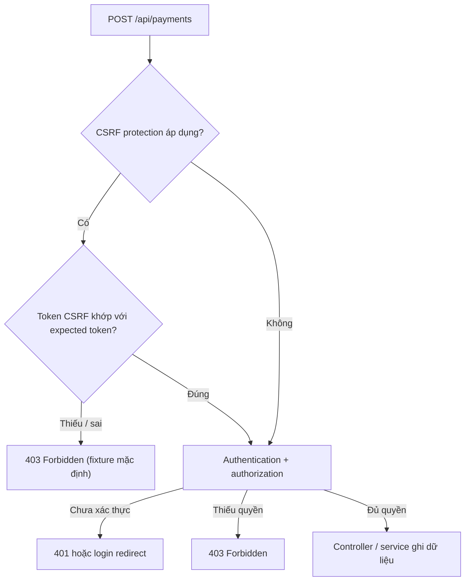
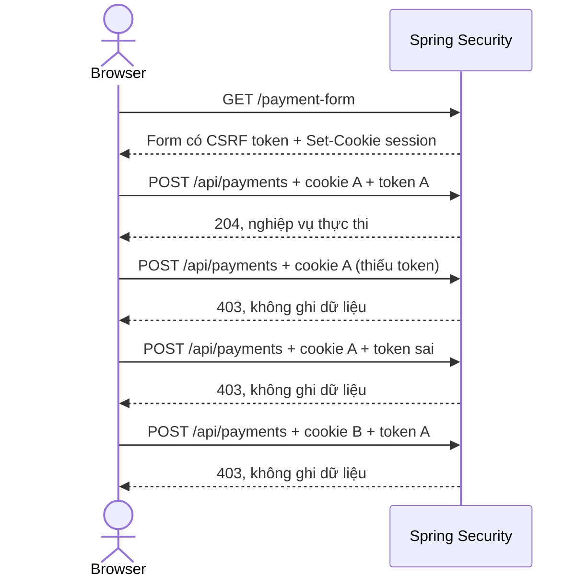

# Xây bộ ca CSRF đủ token hợp lệ, thiếu và không hợp lệ

Một endpoint thay đổi dữ liệu có thể được bảo vệ đúng bằng `authenticated()` hoặc `hasAuthority(...)` nhưng vẫn chưa an toàn trước **Cross-Site Request Forgery (CSRF)** khi browser tự động đính kèm credential (chẳng hạn cookie phiên). Kẻ tấn công không nhất thiết biết mật khẩu hoặc cookie: trong một số ngữ cảnh, họ chỉ cần khiến browser của người dùng đã đăng nhập gửi một request ghi dữ liệu tới ứng dụng. Nếu server chỉ dựa vào cookie để xác nhận người gửi và thiếu một cơ chế chống CSRF phù hợp, request đó có thể được thực hiện ngoài ý muốn của người dùng.

Trong chương **Thực hành tổng hợp** của module **SPRING_SECURITY_TESTING**, bài học này hướng dẫn dựng một bộ kiểm thử **đủ ba trạng thái: token CSRF hợp lệ, thiếu token và token không hợp lệ**. Ta kiểm cả đường **Servlet + MockMvc** và **Reactive + WebTestClient**, xác minh các nhánh được phép/bị từ chối, `SecurityContext`, `@WithMockUser` và các helper JWT/OAuth2/OIDC giả lập khi cần. Đích đến không phải chỉ có một test trả 403, mà là bằng chứng rằng **request đủ quyền và có token hợp lệ thực hiện đúng một lần; các request thiếu/sai token không lọt đến nghiệp vụ**.

Các ví dụ sử dụng Java 17+, Spring Security 6.x theo phong cách DSL hiện đại, Spring Security Test và JUnit Jupiter. Những class/bean ứng dụng minh họa được trình bày để người đọc hiểu cách ghép thành fixture. Một số annotation test mock bean phụ thuộc phiên bản Spring Boot/Spring Framework; bài sẽ nêu lựa chọn thay thế tương ứng. Không cần tắt security hoặc chạy qua IdP thật để kiểm riêng behavior CSRF.

## 1. CSRF là một lớp kiểm tra khác authentication và authorization

Giả sử ứng dụng có form chuyển tiền hoặc API thanh toán:

```text
POST /api/payments
Cookie: JSESSIONID=<session-id>
Content-Type: application/json

{"recipient":"vendor-01","amountCents":129900}
```

Browser có thể tự đính kèm cookie xác thực theo chính sách cookie và ngữ cảnh request. Spring Security cần xác định:

1. **Authentication:** request đại diện cho người dùng nào?
2. **Authorization:** người dùng có authority để tạo thanh toán không?
3. **CSRF:** request thay đổi dữ liệu có đưa bằng chứng chống yêu cầu giả mạo theo cơ chế đã cấu hình không?
4. **Business validation:** payload và trạng thái giao dịch có hợp lệ không?



Đây là **sơ đồ khái niệm**: thứ tự thực tế của các filter, exception handler và response code phụ thuộc stack/cấu hình. Với test muốn chẩn đoán **CSRF**, hãy cấp một Authentication **đã xác thực, đủ quyền**. Nếu thiếu cả token và credential, response có thể là 403 từ CSRF thay vì 401 từ authentication; không thể chỉ nhìn status để xác định duy nhất nguyên nhân.

### Token CSRF không phải access token

| Thành phần | Trả lời câu hỏi | Có thể test bằng |
|---|---|---|
| Session cookie | Request thuộc phiên browser nào? | HTTP session/WebSession test |
| `Authentication`/authorities | User là ai, được làm gì? | `user()`, `mockUser()`, `jwt()`, `mockJwt()` |
| CSRF token | Request ghi dữ liệu có token hợp lệ theo CSRF repository/handler? | Servlet `csrf()` hoặc Reactive `csrf()` |
| OAuth2 `state` | Callback login có khớp authorization request ban đầu? | OAuth2 redirect/callback integration |
| OIDC `nonce` | ID token gắn với authentication request dự kiến? | OIDC login/ID token validation |
| Bearer JWT | API nhận token truy cập có hợp lệ? | Decoder/JWKS/HTTP Bearer tests |

Không dùng `@WithMockUser`, `mockJwt()` hay `oidcLogin()` làm bằng chứng CSRF đã được kiểm. Chúng tạo một danh tính giả; **CSRF là điều kiện độc lập**. Ngược lại, một token CSRF hợp lệ không cấp thêm quyền cho user thiếu authority.

## 2. Mặc định Spring Security bảo vệ những HTTP method nào?

Với chính sách CSRF thông dụng của Spring Security, những phương thức được coi là **safe** không cần token CSRF, còn phương thức không thuộc nhóm safe cần kiểm. Khi không tùy chỉnh request matcher, quy ước thường là:

| HTTP method | CSRF protection mặc định | Ghi chú |
|---|---|---|
| `GET` | Không yêu cầu | Không được tạo side effect nghiệp vụ |
| `HEAD` | Không yêu cầu | Ngữ nghĩa tương tự GET về tính an toàn |
| `OPTIONS` | Không yêu cầu | Preflight CORS là một trường hợp thường gặp |
| `TRACE` | Không yêu cầu | Nhiều hệ thống tắt TRACE vì lý do khác |
| `POST` | Yêu cầu | Tạo/cập nhật dữ liệu |
| `PUT` | Yêu cầu | Ghi đè/cập nhật |
| `PATCH` | Yêu cầu | Thay đổi một phần |
| `DELETE` | Yêu cầu | Xóa dữ liệu |

Nếu hệ thống có `requireCsrfProtectionMatcher(...)`, bỏ qua đường dẫn, hoặc `csrf().disable()` theo policy riêng, kỳ vọng phải được thay đổi có chủ đích. Đừng viết test yêu cầu 403 cho một endpoint đã được loại khỏi CSRF protection rồi nhận định framework lỗi.

**Ràng buộc thiết kế:** GET/HEAD phải không gây thay đổi trạng thái quan trọng. CSRF protection bỏ qua các phương thức safe theo tiền đề đó; một endpoint `GET /delete-account` thực sự xóa account là vấn đề thiết kế API, không được chữa bằng cách đặt token ngầm rồi vẫn gọi GET.

## 3. Ma trận tối thiểu: token đúng, thiếu và sai

Trước khi viết code, cố định **cùng principal, cùng authority và cùng payload**; chỉ thay điều kiện CSRF:

| Ca | User/authority | CSRF | Kỳ vọng HTTP | Nghiệp vụ có được gọi? |
|---|---|---|---|---|
| V1 — Hợp lệ | Alice, `PAYMENTS_WRITE` | Có, khớp repository/handler | 2xx theo endpoint | **Đúng 1 lần** |
| V2 — Thiếu | Alice, `PAYMENTS_WRITE` | Không có header/parameter được chấp nhận | 403 | **0 lần** |
| V3 — Sai | Alice, `PAYMENTS_WRITE` | Có nhưng không khớp | 403 | **0 lần** |
| A1 — Anonymous | Không có | Có token hợp lệ | 401/302 theo entry point | 0 lần |
| A2 — Thiếu quyền | Bob, `PAYMENTS_READ` | Có token hợp lệ | 403 | 0 lần |
| S1 — Safe method | User phù hợp với rule GET | Không có | Theo authorization của GET | Không ghi dữ liệu |

Các mã 403 ở V2/V3 là kỳ vọng với cấu hình Spring Security CSRF mặc định của những ví dụ tiếp theo. Nếu ứng dụng có custom `AccessDeniedHandler`, response body, content type hoặc status có thể được chuẩn hóa khác; phải kiểm theo contract của chính ứng dụng.

Điểm quan trọng: **V2 và V3 là hai nhánh riêng**. Một hệ thống có thể từ chối header thiếu nhưng vô tình chấp nhận chuỗi bất kỳ (hoặc ngược lại); chỉ test một trong hai chưa đủ.

### Vì sao cần kiểm số lần service được gọi?

Giả sử response cuối là 403 nhưng code vẫn kịp ghi thanh toán trước khi phát lỗi. Một assertion chỉ kiểm `status().isForbidden()` có thể **xanh giả**. Cần `verifyNoInteractions(paymentService)` hoặc kiểm số bản ghi/side effect không tăng. Với ca V1, kiểm service nhận đúng principal và payload **một lần**.

## 4. Servlet: bảo vệ endpoint bằng SecurityFilterChain

Xét một REST endpoint mẫu. Để có response không phụ thuộc business database, controller gọi một interface service được mock trong test:

```java
import org.springframework.http.HttpStatus;
import org.springframework.security.core.Authentication;
import org.springframework.web.bind.annotation.PostMapping;
import org.springframework.web.bind.annotation.RequestBody;
import org.springframework.web.bind.annotation.ResponseStatus;
import org.springframework.web.bind.annotation.RestController;

record PaymentCommand(String recipient, long amountCents) {}

interface PaymentService {
    void submit(String username, PaymentCommand command);
}

@RestController
class PaymentController {
    private final PaymentService service;

    PaymentController(PaymentService service) {
        this.service = service;
    }

    @PostMapping("/api/payments")
    @ResponseStatus(HttpStatus.NO_CONTENT)
    void create(
            @RequestBody PaymentCommand command,
            Authentication authentication) {
        service.submit(authentication.getName(), command);
    }
}
```

Ví dụ security configuration cho **Servlet**:

```java
import org.springframework.context.annotation.Bean;
import org.springframework.context.annotation.Configuration;
import org.springframework.http.HttpMethod;
import org.springframework.security.config.Customizer;
import org.springframework.security.config.annotation.web.configuration
        .EnableWebSecurity;
import org.springframework.security.config.annotation.web.builders.HttpSecurity;
import org.springframework.security.web.SecurityFilterChain;

@Configuration
@EnableWebSecurity
class PaymentServletSecurity {

    @Bean
    SecurityFilterChain paymentChain(HttpSecurity http)
            throws Exception {
        return http
            .authorizeHttpRequests(auth -> auth
                .requestMatchers(HttpMethod.POST, "/api/payments")
                    .hasAuthority("PAYMENTS_WRITE")
                .anyRequest().denyAll())
            .httpBasic(Customizer.withDefaults())
            .csrf(Customizer.withDefaults())
            .build();
    }
}
```

`csrf(Customizer.withDefaults())` thể hiện chủ đích bật CSRF. Với một ứng dụng không tùy chỉnh, CSRF thường đã được bật mặc định; viết tường minh trong fixture giúp người đọc không phụ thuộc giả định. `PAYMENTS_WRITE` là một `GrantedAuthority` chính xác, không phải role `ROLE_PAYMENTS_WRITE`.

> **Ranh giới test:** Cấu hình này minh họa một API dùng session/browser hoặc cơ chế tự động gửi credential, nơi CSRF được giữ để bảo vệ request ghi dữ liệu. Đối với API chỉ nhận Bearer token trong `Authorization` header và không dùng credential browser tự gắn, threat model khác; không tự động copy policy này hoặc vô hiệu CSRF mà không xét bề mặt tấn công thật.

## 5. MockMvc: bộ ba test đầy đủ

Trong Servlet, helper CSRF đến từ **đúng package**:

```java
import static org.springframework.security.test.web.servlet.request
        .SecurityMockMvcRequestPostProcessors.csrf;
import static org.springframework.security.test.web.servlet.request
        .SecurityMockMvcRequestPostProcessors.user;
```

Test slice dưới đây giả định Spring Boot test có sẵn `spring-security-test`, Mockito, JUnit Jupiter và các class application ở mục 4:

```java
import org.junit.jupiter.api.Test;
import org.springframework.beans.factory.annotation.Autowired;
import org.springframework.boot.test.autoconfigure.web.servlet.WebMvcTest;
import org.springframework.context.annotation.Import;
import org.springframework.http.MediaType;
import org.springframework.security.core.authority.SimpleGrantedAuthority;
import org.springframework.test.web.servlet.MockMvc;
import org.springframework.test.web.servlet.request.RequestPostProcessor;
import org.springframework.test.web.servlet.request.MockMvcRequestBuilders;

import static org.mockito.ArgumentMatchers.any;
import static org.mockito.ArgumentMatchers.eq;
import static org.mockito.Mockito.verify;
import static org.mockito.Mockito.verifyNoInteractions;
import static org.springframework.test.web.servlet.request
        .MockMvcRequestBuilders.post;
import static org.springframework.test.web.servlet.result
        .MockMvcResultMatchers.status;

@WebMvcTest(controllers = PaymentController.class)
@Import(PaymentServletSecurity.class)
class PaymentCsrfMvcTest {

    @Autowired MockMvc mvc;

    @MockitoBean PaymentService service;

    private static final String JSON =
        "{\"recipient\":\"vendor-01\",\"amountCents\":129900}";

    private static RequestPostProcessor operator() {
        return user("alice").authorities(
            new SimpleGrantedAuthority("PAYMENTS_WRITE"));
    }

    @Test
    void validCsrfTokenAllowsExactlyOnePayment() throws Exception {
        mvc.perform(post("/api/payments")
                .with(operator())
                .with(csrf())
                .contentType(MediaType.APPLICATION_JSON)
                .content(JSON))
            .andExpect(status().isNoContent());

        verify(service).submit(
            eq("alice"), any(PaymentCommand.class));
    }

    @Test
    void missingCsrfTokenRejectsWithoutPayment() throws Exception {
        mvc.perform(post("/api/payments")
                .with(operator())
                .contentType(MediaType.APPLICATION_JSON)
                .content(JSON))
            .andExpect(status().isForbidden());

        verifyNoInteractions(service);
    }

    @Test
    void invalidCsrfTokenRejectsWithoutPayment() throws Exception {
        mvc.perform(post("/api/payments")
                .with(operator())
                .with(csrf().useInvalidToken())
                .contentType(MediaType.APPLICATION_JSON)
                .content(JSON))
            .andExpect(status().isForbidden());

        verifyNoInteractions(service);
    }
}
```

`@MockitoBean` thuộc các phiên bản Spring Framework hỗ trợ annotation bean override (ví dụ Spring Framework 6.2+/Spring Boot tương thích). Dự án Spring Boot cũ có thể dùng `@MockBean` của Spring Boot thay cho nó. Import tương ứng với dự án, ví dụ `org.springframework.test.context.bean.override.mockito.MockitoBean`. Không khai báo cả hai cho cùng bean chỉ để “chắc ăn”.

**Cách test hoạt động:**

- `.with(operator())` đưa một principal đã xác thực có `PAYMENTS_WRITE` vào request.
- `.with(csrf())` dùng Servlet CSRF request post-processor để chuẩn bị token được test infrastructure chấp nhận.
- Không thêm `csrf()` là nhánh **thiếu token**.
- `.with(csrf().useInvalidToken())` gửi token cố ý không hợp lệ cho nhánh **sai token**.
- `verifyNoInteractions(service)` kiểm controller/service không bị gọi khi CSRF filter chặn request.

Đây là kiểm thử **CSRF validation trong security filter chain**, không phải bằng chứng browser ngoài đời đã lưu/gửi cookie đúng policy. Các helper đã chuẩn bị token hợp lệ ở lớp test; để kiểm session/cookie đời thực cần vòng HTTP khác ở những mục sau.

### Không “fix” test sai token bằng cách vô hiệu CSRF

Đoạn sau khiến cả hai ca từ chối mất ý nghĩa:

```java
// Không dùng làm cách sửa test đơn thuần:
http.csrf(csrf -> csrf.disable());
```

Nếu một nhóm endpoint thực sự được loại khỏi CSRF, cần nêu rõ threat model và viết các ca tương ứng. Không vì thiếu token trong test mà tắt CSRF cho toàn bộ ứng dụng, đặc biệt khi browser gửi session cookie tự động.

## 6. Đọc đúng các helper Servlet: parameter và header

Với `SecurityMockMvcRequestPostProcessors.csrf()`:

```java
// Token hợp lệ dưới dạng request parameter (tùy repository/handler).
mvc.perform(post("/api/payments")
        .with(operator())
        .with(csrf())
        .contentType(MediaType.APPLICATION_JSON)
        .content(JSON))
    .andExpect(status().isNoContent());

// Token hợp lệ dưới dạng HTTP header mà CSRF repository kỳ vọng.
mvc.perform(post("/api/payments")
        .with(operator())
        .with(csrf().asHeader())
        .contentType(MediaType.APPLICATION_JSON)
        .content(JSON))
    .andExpect(status().isNoContent());

// Token cố ý sai: vẫn phải bị từ chối.
mvc.perform(post("/api/payments")
        .with(operator())
        .with(csrf().asHeader().useInvalidToken())
        .contentType(MediaType.APPLICATION_JSON)
        .content(JSON))
    .andExpect(status().isForbidden());
```

Việc ghép `asHeader()` và `useInvalidToken()` là API của Servlet test post-processor. Tên header và parameter cuối cùng phụ thuộc `CsrfTokenRepository` của ứng dụng. Thông thường Spring Security hỗ trợ `_csrf` như request parameter và `X-CSRF-TOKEN` như header cho repository mặc định; cấu hình `CookieCsrfTokenRepository` hay handler tùy chỉnh có thể sử dụng quy ước `X-XSRF-TOKEN`.

**Không thêm đồng thời** một token hợp lệ từ `csrf()` và một header “sai” rồi mặc định header sai phải thắng. Nếu request chứa **hai vị trí token**, handler có thể ưu tiên một vị trí nhất định; test phải biết thứ tự giải quyết token của cấu hình. Để kiểm sai token, hãy đảm bảo request **chỉ có một nguồn token đang được thử** hoặc dùng API `useInvalidToken()` của helper thích hợp.

## 7. Bổ sung negative cases: role và anonymous

Khi bộ ba CSRF đã chạy, thêm ca tách **authorization** và **authentication**. Cả hai ca đều dùng **token CSRF hợp lệ**, để request đi qua CSRF filter trước:

```java
@Test
void authenticatedWithoutWriteAuthorityIsForbidden()
        throws Exception {
    mvc.perform(post("/api/payments")
            .with(user("bob").authorities(
                new SimpleGrantedAuthority("PAYMENTS_READ")))
            .with(csrf())
            .contentType(MediaType.APPLICATION_JSON)
            .content(JSON))
        .andExpect(status().isForbidden());

    verifyNoInteractions(service);
}

@Test
void anonymousWithValidCsrfIsNotAuthenticated()
        throws Exception {
    mvc.perform(post("/api/payments")
            .with(csrf())
            .contentType(MediaType.APPLICATION_JSON)
            .content(JSON))
        .andExpect(status().isUnauthorized());

    verifyNoInteractions(service);
}
```

Đây là các method **bổ sung vào class `PaymentCsrfMvcTest`**. Vì fixture bật `httpBasic()`, anonymous với CSRF hợp lệ thường bị trả `401 Unauthorized`. Nếu app dùng form/OIDC login, anonymous có thể được redirect 302. Không viết test anonymous **thiếu CSRF** rồi khẳng định 401 là chắc chắn: nó có thể bị CSRF filter từ chối 403 trước authentication entry point.

Như vậy, cùng một HTTP status 403 có thể có **hai nguyên nhân độc lập**:

- `PAYMENTS_WRITE` hợp lệ nhưng token CSRF thiếu/sai ⇒ **CSRF rejection**.
- Token CSRF hợp lệ nhưng chỉ có `PAYMENTS_READ` ⇒ **authorization rejection**.

Test giữ mọi điều kiện khác cố định giúp phân biệt hai nguyên nhân và tránh sửa sai chính sách.

## 8. Kiểm tải dữ liệu và ngăn tác dụng phụ

Khi controller dùng @RequestBody, việc gửi body JSON hợp lệ có hai lợi ích:

1. Ca token hợp lệ không bị thất bại vì 400 do JSON binding hoặc validation, khiến người học nhầm đó là lỗi CSRF.
2. Các ca token thiếu/sai đi qua cùng input business và có thể chứng minh **CSRF chặn trước khi controller gọi service**.

Với mock service, có thể assert payload:

```java
ArgumentCaptor<PaymentCommand> command =
        ArgumentCaptor.forClass(PaymentCommand.class);

verify(service).submit(eq("alice"), command.capture());
assertThat(command.getValue().recipient())
        .isEqualTo("vendor-01");
assertThat(command.getValue().amountCents())
        .isEqualTo(129_900L);
```

Đây là assertion thay/bổ sung cho ca hợp lệ, không phải test thứ hai chạy tiếp trên mock đã có interactions mà không reset. Nếu service thật lưu database hoặc phát event, hãy kiểm số records/messages thay đổi đúng một lần ở ca hợp lệ, và **không thay đổi** ở ca bị từ chối.

**Tránh shared mutable state trong CI:** Mockito mock bean có thể được Spring TestContext cache cùng ApplicationContext. Nếu nhiều test cùng reset/stub/verify một mock singleton đang chạy song song, kết quả có thể lẫn nhau. Dùng test context/fixture độc lập hoặc chạy class có chung mock tuần tự; tránh thay đổi mock toàn cục giữa các execution.

## 9. Reactive: CSRF filter trong SecurityWebFilterChain

Trên WebFlux, Spring Security dùng `ServerHttpSecurity` và `SecurityWebFilterChain`, **không** dùng Servlet `HttpSecurity` hoặc `CsrfFilter`. Một cấu hình tương đương với API ở mục 4:

```java
import org.springframework.context.annotation.Bean;
import org.springframework.context.annotation.Configuration;
import org.springframework.http.HttpMethod;
import org.springframework.security.config.Customizer;
import org.springframework.security.config.annotation.web.reactive
        .EnableWebFluxSecurity;
import org.springframework.security.config.web.server.ServerHttpSecurity;
import org.springframework.security.web.server.SecurityWebFilterChain;

@Configuration
@EnableWebFluxSecurity
class PaymentReactiveSecurity {

    @Bean
    SecurityWebFilterChain paymentChain(ServerHttpSecurity http) {
        return http
            .authorizeExchange(exchanges -> exchanges
                .pathMatchers(HttpMethod.POST, "/api/payments")
                    .hasAuthority("PAYMENTS_WRITE")
                .anyExchange().denyAll())
            .httpBasic(Customizer.withDefaults())
            .csrf(Customizer.withDefaults())
            .build();
    }
}
```

Tại tầng Reactive, business service trả publisher. Giữ toàn bộ xử lý trong cùng chain để kết quả hoàn tất, lỗi và context được truyền đúng:

```java
import org.springframework.http.HttpStatus;
import org.springframework.security.core.context
        .ReactiveSecurityContextHolder;
import org.springframework.web.bind.annotation.PostMapping;
import org.springframework.web.bind.annotation.RequestBody;
import org.springframework.web.bind.annotation.ResponseStatus;
import org.springframework.web.bind.annotation.RestController;
import reactor.core.publisher.Mono;

interface ReactivePaymentService {
    Mono<Void> submit(String username, PaymentCommand command);
}

@RestController
class ReactivePaymentController {
    private final ReactivePaymentService service;

    ReactivePaymentController(ReactivePaymentService service) {
        this.service = service;
    }

    @PostMapping("/api/payments")
    @ResponseStatus(HttpStatus.NO_CONTENT)
    Mono<Void> create(@RequestBody Mono<PaymentCommand> body) {
        return ReactiveSecurityContextHolder.getContext()
            .map(context -> context.getAuthentication().getName())
            .flatMap(username ->
                body.flatMap(command ->
                    service.submit(username, command)));
    }
}
```

`PaymentCommand` là record đã định nghĩa ở mục 4; các mẫu Servlet/Reactive được xem như **hai cấu hình ứng dụng test độc lập**, không yêu cầu đưa cả hai controller trùng path vào cùng context. Controller reactive không gọi `subscribe()` hoặc `block()`; WebFlux subscribe vào `Mono<Void>`, và `ReactiveSecurityContextHolder` đọc Authentication từ Reactor Context của request.

## 10. WebTestClient: bộ ba valid/missing/invalid

Helper Reactive `csrf()` là configurer của **`SecurityMockServerConfigurers`**, không phải `SecurityMockMvcRequestPostProcessors`:

```java
import static org.springframework.security.test.web.reactive.server
        .SecurityMockServerConfigurers.csrf;
import static org.springframework.security.test.web.reactive.server
        .SecurityMockServerConfigurers.mockUser;
```

Trong WebFlux test slice có `SecurityWebFilterChain`:

```java
import org.junit.jupiter.api.Test;
import org.springframework.beans.factory.annotation.Autowired;
import org.springframework.boot.test.autoconfigure.web.reactive.WebFluxTest;
import org.springframework.context.annotation.Import;
import org.springframework.http.MediaType;
import org.springframework.security.core.authority.SimpleGrantedAuthority;
import org.springframework.test.web.reactive.server.WebTestClient;
import reactor.core.publisher.Mono;

import static org.mockito.ArgumentMatchers.any;
import static org.mockito.ArgumentMatchers.eq;
import static org.mockito.Mockito.verify;
import static org.mockito.Mockito.verifyNoInteractions;
import static org.mockito.Mockito.when;

@WebFluxTest(controllers = ReactivePaymentController.class)
@Import(PaymentReactiveSecurity.class)
class PaymentCsrfWebFluxTest {

    @Autowired WebTestClient client;

    @MockitoBean ReactivePaymentService service;

    private static final String JSON =
        "{\"recipient\":\"vendor-01\",\"amountCents\":129900}";

    private WebTestClient operatorClient() {
        return client.mutateWith(
            mockUser("alice").authorities(
                new SimpleGrantedAuthority("PAYMENTS_WRITE")));
    }

    @Test
    void validCsrfAllowsReactiveRequest() {
        when(service.submit(
                eq("alice"), any(PaymentCommand.class)))
            .thenReturn(Mono.empty());

        operatorClient()
            .mutateWith(csrf())
            .post().uri("/api/payments")
            .contentType(MediaType.APPLICATION_JSON)
            .bodyValue(JSON)
            .exchange()
            .expectStatus().isNoContent();

        verify(service).submit(
            eq("alice"), any(PaymentCommand.class));
    }

    @Test
    void missingCsrfIsForbidden() {
        operatorClient()
            .post().uri("/api/payments")
            .contentType(MediaType.APPLICATION_JSON)
            .bodyValue(JSON)
            .exchange()
            .expectStatus().isForbidden();

        verifyNoInteractions(service);
    }

    @Test
    void invalidCsrfIsForbidden() {
        operatorClient()
            .post().uri("/api/payments")
            .header("X-CSRF-TOKEN", "definitely-not-valid")
            .contentType(MediaType.APPLICATION_JSON)
            .bodyValue(JSON)
            .exchange()
            .expectStatus().isForbidden();

        verifyNoInteractions(service);
    }
}
```

Tương tự Servlet, `@MockitoBean` cần Spring Framework có hỗ trợ bean override; dự án Spring Boot cũ có thể dùng `@MockBean` và imports phù hợp. Không cần chia sẻ mock service giữa hai test classes chạy đồng thời.

**Tại sao test invalid không gọi `mutateWith(csrf())`?** Trong fixture mặc định, `csrf()` tạo token hợp lệ cho exchange. Nếu vừa gắn token hợp lệ bằng helper vừa thêm header cố ý sai, request có thể mang nhiều dạng token và handler chọn một nguồn khác dự kiến. Ở đây ta chỉ gửi một header CSRF sai và để WebFlux CSRF filter/repository xác định token được kỳ vọng.

Với WebFlux CSRF repository/handler đã tùy chỉnh, header được chấp nhận **có thể không phải `X-CSRF-TOKEN`**. Khi đó thay header theo cấu hình và bảo đảm token thử sai thực sự được handler đọc. Để chứng minh một token *không khớp token đã phát cho phiên*, có thể thêm bài kiểm tra session-bound ở mục 15.

### Bổ sung hai điều kiện authentication và authority

```java
@Test
void validCsrfButWrongAuthorityIsForbidden() {
    client.mutateWith(
            mockUser("bob").authorities(
                new SimpleGrantedAuthority("PAYMENTS_READ")))
        .mutateWith(csrf())
        .post().uri("/api/payments")
        .contentType(MediaType.APPLICATION_JSON)
        .bodyValue(JSON)
        .exchange()
        .expectStatus().isForbidden();

    verifyNoInteractions(service);
}

@Test
void validCsrfWithoutAuthenticationIsUnauthorized() {
    client.mutateWith(csrf())
        .post().uri("/api/payments")
        .contentType(MediaType.APPLICATION_JSON)
        .bodyValue(JSON)
        .exchange()
        .expectStatus().isUnauthorized();

    verifyNoInteractions(service);
}
```

Đặt hai method này trong class Reactive ở trên. Với `httpBasic()` trong fixture, anonymous có token CSRF hợp lệ thường trả 401. Nếu Spring Security cấu hình form login, OAuth2/OIDC login hoặc entry point riêng, có thể là redirect 302 hoặc error response khác. Dù thế nào, request **không được kích hoạt thanh toán**.

## 11. Phân biệt helper của hai stack

| Bài test | Servlet / MockMvc | Reactive / WebTestClient |
|---|---|---|
| Gắn user giả | `.with(user("alice"))` | `.mutateWith(mockUser("alice"))` |
| Gắn token CSRF hợp lệ | `.with(csrf())` | `.mutateWith(csrf())` |
| Token CSRF sai | `.with(csrf().useInvalidToken())` | Gửi token sai theo repository/handler; không giả định API Servlet tồn tại |
| Gửi token dưới dạng header | `.with(csrf().asHeader())` | Cấu hình exchange/helper hoặc gửi header theo policy |
| Security configuration | `HttpSecurity` / `SecurityFilterChain` | `ServerHttpSecurity` / `SecurityWebFilterChain` |
| Session | `MockHttpSession` | `WebSession`/cookie exchange |
| Principal trong code | `SecurityContextHolder`/request Authentication | `ReactiveSecurityContextHolder`/Reactor Context |
| Test HTTP response | `.andExpect(status()...)` | `.expectStatus()...` |

Hai phương thức `csrf()` có tên giống nhau nhưng **khác package và kiểu trả về**. Đừng import `SecurityMockMvcRequestPostProcessors.csrf` rồi cố truyền vào `WebTestClient.mutateWith(...)`. Tương tự, đừng dùng `.with(mockUser())` trong Servlet.

Nếu tự dựng client, cần tích hợp đúng security:

```java
// Servlet:
MockMvc mvc = MockMvcBuilders.webAppContextSetup(webContext)
    .apply(springSecurity())
    .build();

// Reactive:
WebTestClient client = WebTestClient
    .bindToApplicationContext(applicationContext)
    .apply(springSecurity())
    .configureClient()
    .build();
```

`springSecurity()` ở hai dòng là hai static methods **thuộc hai package test khác nhau**. Khi dùng `@AutoConfigureMockMvc` hoặc WebTestClient đã được Spring Boot cấu hình đúng, có thể không cần tự dựng lại. Client bind thẳng controller nhưng bỏ qua security filters **không thể chứng minh CSRF đã được thực thi**.

## 12. Không được lẫn CSRF token với body validation hoặc authentication failure

Khi xem một failure, lần lượt kiểm:

| HTTP result | Nguyên nhân có thể | Cách tách nguyên nhân |
|---|---|---|
| 204 | Request đã qua policy và service trả thành công | Verify service được gọi với payload |
| 403 | CSRF thiếu hoặc sai | Gửi đủ authentication/authority rồi thay riêng token |
| 403 | Authority không đủ | Gắn CSRF hợp lệ, thay riêng authority |
| 401 / 302 | Chưa xác thực | Gắn CSRF hợp lệ rồi gửi request anonymous |
| 400 | JSON binding/validation thất bại | Đối chứng payload JSON hợp lệ với CSRF hợp lệ |
| 404 | Đường dẫn hoặc handler sai | Kiểm route, tránh coi là CSRF rejection |
| 405 | HTTP method không được map | Kiểm @PostMapping và method gửi |
| 500 | Service hoặc exception handler lỗi | Quan sát stack trace, không quy mặc định cho CSRF |

Nhiều test bị đỏ vì:

```java
// Không đủ: thiếu authentication và CSRF cùng lúc.
mvc.perform(post("/api/payments")
    .contentType(MediaType.APPLICATION_JSON)
    .content(JSON))
    .andExpect(status().isUnauthorized());
```

Nếu CSRF filter chặn trước authentication, request này có thể nhận 403; vì vậy test **anonymous** phải có token CSRF hợp lệ khi muốn cô lập authentication failure. Ngược lại, test **thiếu CSRF** phải có principal đủ quyền để cô lập đúng vấn đề token.

Trong môi trường trình duyệt, response 403 cũng có thể đến từ rule CORS/CSRF custom hoặc gateway. Test cần chạy đúng SecurityFilterChain/WebFilterChain và quan sát side effect để xác nhận nguyên nhân.

## 13. Bước tiếp theo: test token thực được phát và gắn với session

`.with(csrf())` và `.mutateWith(csrf())` rất hiệu quả để kiểm authorization/CSRF filter, nhưng chúng không chứng minh **browser lấy được token, lưu cookie/session và gửi lại token đúng cách**.

Với một ứng dụng dùng `HttpSessionCsrfTokenRepository` (Servlet) hoặc `WebSessionServerCsrfTokenRepository` (WebFlux) theo chính sách session-based, một bài test gần thực tế phải mô phỏng:

1. Browser gửi `GET` tới một form hoặc endpoint hợp lệ để ứng dụng có thể tạo và phát CSRF token.
2. Test giữ lại session cookie/HTTP session **cùng với token được phát**.
3. Test gửi `POST` với cùng session và token đó ⇒ được phép nếu Authentication/authority cũng hợp lệ.
4. Test gửi `POST` với cùng session nhưng **thiếu token** ⇒ từ chối.
5. Test gửi `POST` với cùng session và **token khác** ⇒ từ chối.
6. Test gửi token của **session A** cùng cookie của **session B** ⇒ từ chối.



**Điều kiện:** application của test phải có đường render form hoặc endpoint cấp token hợp lệ. Trong Spring Security 6, CSRF token có thể được **deferred/lazy loaded** và **masked** để giảm nguy cơ BREACH. Một GET bất kỳ trả 200 **không bảo đảm** session đã được tạo hoặc token đã được materialize. Cần khiến tầng render/template hoặc endpoint test **truy cập giá trị CSRF token** một cách chủ đích.

### Endpoint CSRF chỉ dành cho fixture/trusted UI

Trong một ứng dụng Servlet thử nghiệm, có thể dùng endpoint nhỏ để trả thông tin token đã được security filter tạo:

```java
import java.util.Map;
import org.springframework.security.web.csrf.CsrfToken;
import org.springframework.web.bind.annotation.GetMapping;
import org.springframework.web.bind.annotation.RequestAttribute;
import org.springframework.web.bind.annotation.RestController;

@RestController
class CsrfFixtureController {

    @GetMapping("/csrf")
    Map<String, String> current(
            @RequestAttribute("_csrf") CsrfToken token) {
        return Map.of(
            "headerName", token.getHeaderName(),
            "parameterName", token.getParameterName(),
            "token", token.getToken());
    }
}
```

Để endpoint này chạy, test security configuration cần cho phép `GET /csrf` với Authentication phù hợp, chẳng hạn khai báo trước `anyRequest().denyAll()`:

```java
.requestMatchers(HttpMethod.GET, "/csrf")
    .authenticated()
```

Đây là **fixture minh họa**, không phải yêu cầu mở một endpoint trả token cho mọi client trên production. Nếu application có cơ chế render CSRF hidden field trong Thymeleaf/JSP hoặc cấp token cho SPA, nên kiểm chính cơ chế đó. Endpoint cung cấp token phải tuân thủ same-origin/CORS policy và không bị cache công khai; CSRF token không phải thông tin cho website tùy ý đọc.

### MockMvc sử dụng token do repository sinh

Với endpoint `/csrf` và `PaymentController` ở trên, test có thể đọc JSON token cùng session:

```java
@Test
void tokenFromSameSessionIsAccepted() throws Exception {
    MvcResult issued = mvc.perform(get("/csrf")
            .with(operator()))
        .andExpect(status().isOk())
        .andReturn();

    JsonNode json = objectMapper.readTree(
        issued.getResponse().getContentAsString());
    String token = json.path("token").asText();
    String headerName = json.path("headerName").asText();
    MockHttpSession session =
        (MockHttpSession) issued.getRequest().getSession(false);

    assertThat(session).isNotNull();
    assertThat(token).isNotBlank();

    mvc.perform(post("/api/payments")
            .session(session)
            .with(operator())
            .header(headerName, token)
            .contentType(MediaType.APPLICATION_JSON)
            .content(JSON))
        .andExpect(status().isNoContent());

    verify(service).submit(
        eq("alice"), any(PaymentCommand.class));
}
```

Đây là một method **bổ sung cho integration fixture** có `CsrfFixtureController`, `ObjectMapper objectMapper` được inject, và cấu hình `GET /csrf` được phép. Các import thêm gồm `com.fasterxml.jackson.databind.JsonNode`, `MockHttpSession` và `MvcResult`. Để test chạy được, test slice phải include fixture controller hoặc dùng `@SpringBootTest` với cấu hình tương ứng.

Đoạn test khác với `.with(csrf())`: token được **lấy từ response của một request trước** rồi dùng trong request sau với **cùng session**. Nếu CSRF token được mask theo request, giá trị phát ra phải được gửi lại qua đúng header/parameter và request handler đã cấu hình; đừng lấy raw token trong repository rồi thay thế một cách tùy tiện.

### Kiểm token thuộc session khác

Sau khi dựng hai session độc lập, cố ý kết hợp **token từ A** với **cookie/session B** và assert 403, không có side effect. Mỗi session nên được tạo qua cùng đường phát token, không chỉ tạo một `MockHttpSession` rỗng rồi gắn một header bất kỳ; bằng cách đó ta thực sự kiểm **mismatch giữa hai token đã được cấp hợp lệ**.

Chú ý `csrf()` của Spring Security Test có thể tự chuẩn bị token phù hợp với request và làm bài test mất khả năng phát hiện cross-session mismatch. Trong các phép thử token từ session A sang B, hãy dùng **giá trị token thật được đọc từ bước cấp token** và không gọi `.with(csrf())` ở request bị cố ý giả mạo.

## 14. CookieCsrfTokenRepository và ứng dụng SPA

Một SPA thường lấy CSRF token từ HTML bootstrap, endpoint token hoặc một cookie do ứng dụng phát. Spring Security có `CookieCsrfTokenRepository` trên Servlet và cơ chế repository cookie tương ứng cho Reactive để hỗ trợ mô hình lấy token từ cookie rồi gửi lại trong HTTP header.

Ví dụ luồng ở browser:

```text
Response từ ứng dụng:
  Set-Cookie: XSRF-TOKEN=<test-token>; Path=/; Secure; SameSite=Lax

JavaScript cùng origin đọc token theo chính sách của ứng dụng
và gửi trong request thay đổi dữ liệu:
  X-XSRF-TOKEN: <giá trị token đúng định dạng mà handler chấp nhận>

Browser đồng thời gửi các cookie được policy cho phép.
```

Đây là **mô hình khái niệm**: cookie name, header name, `HttpOnly`, `SameSite`, cách mã hóa/mask token và request handler **phải khớp cấu hình triển khai**. Không dùng một đoạn JavaScript giả định token cookie thô luôn tương đương token request attribute đã được XOR-mask.

### Cookie CSRF khác session cookie

| Cookie | Dùng để | Thuộc tính cần chú ý |
|---|---|---|
| `JSESSIONID`/`SESSION` | Nhận dạng phiên, có thể liên kết Authentication | Thường `HttpOnly; Secure`, phạm vi host/path chặt |
| `XSRF-TOKEN` | Cung cấp CSRF token cho client theo cấu hình | Một số SPA phải đọc bằng JavaScript, nên `HttpOnly` có thể khác |

**Không bỏ `HttpOnly` khỏi cookie phiên chỉ vì SPA cần đọc CSRF token**. Cũng không cho phép JavaScript từ origin không tin cậy đọc token CSRF thông qua CORS misconfiguration.

Với Spring Security 6, cơ chế **deferred CSRF token** và **BREACH protection** có thể dùng XOR/masked token cho giá trị đưa vào HTML. Nếu SPA đọc **raw CSRF token từ cookie** và gửi vào header, handler cần được cấu hình hỗ trợ cách resolve đó một cách có chủ đích. Đừng tự tắt bảo vệ CSRF hoặc thay cookie/session token bằng chuỗi cố định vì gặp lỗi 403 khi nâng phiên bản Spring Security.

### Bộ ca SPA phải có

| Ca | Cookie/session | Header CSRF | Kỳ vọng |
|---|---|---|---|
| Client khởi tạo đúng | Cookie do server cấp | Header đúng format, đúng token | 2xx nếu đủ quyền |
| Thiếu header | Cookie còn hợp lệ | Không có | 403 |
| Header sai | Cookie còn hợp lệ | Token sai | 403 |
| Cookie thiếu (nếu repository phụ thuộc cookie) | Không có token/session như policy yêu cầu | Header từ phiên cũ | Từ chối |
| Đăng nhập mới | Session/token có thể được rotate | Header/token cũ | Từ chối nếu repository/strategy đã làm token cũ mất hiệu lực |
| Đúng token, thiếu role | Session đã xác thực | Header đúng | 403 do authorization |
| Khác origin | Browser tuân SameSite/CORS | Header không được script độc hại tự do đọc | Không cấp quyền/không lộ dữ liệu |

Một test HTTP client tự gắn cookie và header đúng vẫn có thể vượt qua các kiểm tra mà **browser sẽ không thực hiện được vì SameSite, Secure, Path hoặc Domain**. Do đó, với SPA/browser thật cần kiểm thêm cookie policies và nguồn gốc request, không chỉ MockMvc/WebTestClient.

## 15. Token rotation sau login/logout và session fixation

Một số cấu hình Spring Security có thể **xóa hoặc thay token CSRF** khi xác thực thành công hoặc logout, để hạn chế tái sử dụng token cũ. Session ID cũng có thể thay đổi vì session fixation protection. Không xây một test giả định mãi mãi cùng token/session nếu chính sách triển khai đã thay đổi chúng.

Một regression flow hữu ích:

1. Khởi tạo phiên chưa login và nhận token A từ form/CSRF endpoint.
2. Thực hiện login qua filter thật và quan sát session cookie mới (nếu policy đổi).
3. Lấy token B từ request sau login, bằng cơ chế ứng dụng thực cung cấp.
4. Gửi POST với token B và session hiện tại ⇒ được phép nếu đủ quyền.
5. Gửi token A cũ ⇒ phải bị từ chối **nếu cơ chế rotate/invalidate của ứng dụng quy định token A không còn hợp lệ**.
6. Logout; thử POST hoặc truy cập dữ liệu với cookie/token trước logout ⇒ không được coi là phiên xác thực hợp lệ.

Trong Spring Security hiện đại, CSRF token có thể được xóa khi authentication hoặc logout theo các strategy/handlers đã được cấu hình; token mới có thể chỉ được phát **khi client truy cập nó** do deferred loading. Vì vậy sau login, một SPA có thể cần **refresh token** trước request ghi dữ liệu tiếp theo.

Không gán nhầm một 403 vì token cũ sau login thành “user không có quyền”. Hãy lấy token mới, giữ cùng Authentication/authority và kiểm lại. Đừng dùng `@WithMockUser` để khẳng định rotation đã xảy ra: annotation không thực hiện đầy đủ login lifecycle hoặc session fixation behavior.

## 16. Bearer JWT, OAuth2/OIDC và lựa chọn chính sách CSRF

Trong module SPRING_SECURITY_TESTING, người học cũng dùng `jwt()`, `mockJwt()`, `oauth2Login()` và `mockOidcLogin()`. Các helper này **không quyết định tự động** endpoint có cần CSRF hay không.

| Kiểu ứng dụng | Credential browser tự gửi? | Cách đánh giá CSRF |
|---|---|---|
| MVC form login + session cookie | Có | CSRF protection thường rất quan trọng |
| WebFlux browser login + WebSession cookie | Có | Cần kiểm các phương thức unsafe |
| OIDC Login browser + session | Có ở request ứng dụng sau login | Không bỏ CSRF chỉ vì dùng OIDC |
| API nhận Bearer token trong `Authorization` do client chủ động gắn | Thường không tự động | Có thể có chính sách CSRF khác nếu không dùng cookie/Basic auth tự động |
| JWT nằm trong cookie tự động gửi | Có | Vẫn có CSRF risk dù token là JWT |
| HTTP Basic dùng credential browser lưu | Có thể tự động gửi | Đánh giá CSRF, không mặc định “Basic là stateless nên an toàn” |
| API trộn cookie session và Bearer | Có ít nhất một đường tự động | Cần xác định matcher/entrypoint và bảo vệ đường cookie phù hợp |

Với **stateless Bearer-only API** có threat model rõ, team có thể chủ động bỏ yêu cầu CSRF cho những endpoint nhất định. Khi đó **không** ép test token thiếu phải nhận 403 nếu cấu hình đã quyết định không yêu cầu CSRF; ngược lại hãy test policy được áp dụng **đúng phạm vi** và credential cookie không vô tình trở thành đường vào bỏ qua CSRF.

Ví dụ một ứng dụng có UI session và API token:

```text
POST /web/profile       -> cookie session, CSRF required
POST /api/public-events -> Bearer-only policy, CSRF decision riêng
POST /admin/settings    -> role + session + CSRF required
```

Không khuyến nghị một `csrf().disable()` toàn cục khi app vừa phục vụ trang browser login vừa có API Bearer. Nếu tách thành nhiều security filter chains, hãy test **mỗi chain và endpoint matcher**: một request không nên rơi vào chain “Bearer-only” có policy rộng rồi bỏ qua CSRF cho đường dùng cookie.

### JWT/OIDC helpers có ích ở đâu?

```java
// Servlet: kiểm authorization với principal JWT giả.
mockMvc.perform(post("/api/payments")
        .with(jwt().authorities(
            new SimpleGrantedAuthority("PAYMENTS_WRITE")))
        .with(csrf())
        .contentType(MediaType.APPLICATION_JSON)
        .content(JSON))
    .andExpect(status().isNoContent());
```

Nếu SecurityFilterChain trong test chỉ yêu cầu authority `PAYMENTS_WRITE` và CSRF bật, helper JWT giả này có thể dùng để kiểm các lớp **authorization + CSRF**. Nhưng nó **không kiểm chữ ký JWT/JWKS**. Với OAuth2/OIDC browser login, `oidcLogin()`/`mockOidcLogin()` giả principal sau đăng nhập, không thử redirect, token endpoint, cookie session hoặc việc phát CSRF token thật.

## 17. Kiểm tra behavior qua HTTP/browser thay vì chỉ helper

Trong ứng dụng browser session thực, một bài test end-to-end có thể chia thành hai giai đoạn:

**Giai đoạn cấp token:** browser truy cập trang form cùng origin, nhận session cookie và một CSRF token mà ứng dụng phát qua hidden field, response JSON hợp lệ hoặc cookie theo cấu hình.

**Giai đoạn gửi yêu cầu:** browser gửi POST với body và **đúng session cookie**; bộ test gửi ba request riêng biệt:

```text
Case 1 — valid:
  Cookie: <cookie của session A>
  X-CSRF-TOKEN: <token hợp lệ được cấp cho session A>
  Expected: 2xx nếu đã xác thực và đủ quyền

Case 2 — missing:
  Cookie: <cookie của session A>
  Không có CSRF request header/parameter
  Expected: 403, không có tác dụng phụ

Case 3 — invalid:
  Cookie: <cookie của session A>
  X-CSRF-TOKEN: definitely-invalid
  Expected: 403, không có tác dụng phụ
```

Tên header trong ví dụ giả định CSRF repository/handler chấp nhận `X-CSRF-TOKEN`. Với SPA dùng `X-XSRF-TOKEN`, thay đúng tên. Không copy session ID hoặc CSRF token thật vào source code hay log CI.

Khi dùng một HTTP client không phải browser, **đừng tự giả định nó tuân SameSite**. Nó có thể gửi cookie trong cross-site POST dù browser thật không gửi. Cần thêm browser automation nếu mục tiêu là kiểm tra chính sách cookie qua OAuth2/OIDC redirect hoặc form POST từ origin khác.

### Tối thiểu cần ghi nhận từ mỗi request

| Thông tin | Có thể log? | Mục đích |
|---|---|---|
| HTTP method/path | Có, nếu không chứa thông tin nhạy cảm | Xác định rule áp dụng |
| Security chain/CSRF matcher | Có thể ghi nhãn trong test report | Biết có yêu cầu CSRF không |
| Authentication có/không | Có thể ghi trạng thái, không ghi credential | Tách lỗi authentication |
| Authority được test | Có thể ghi tên authority giả | Tách lỗi authorization |
| Token có/không, valid/invalid | Chỉ ghi trạng thái, không ghi giá trị thật | Tách lỗi CSRF |
| Session ID, CSRF token, OAuth2 code | **Không** log nguyên văn | Tránh lộ dữ liệu phiên |
| HTTP status và số lần service gọi | Có | Chứng minh hành vi và side effect |

Nếu cần tìm vì sao một POST được đánh dấu invalid, hãy đối chiếu **cookie/session có đúng không, token được lấy từ request nào, header name nào được chấp nhận**, thay vì in thẳng full `Cookie` và token ra console.

## 18. CSRF và CORS/SameSite: ba lớp khác nhau

Lỗi browser liên quan cross-site thường bị gộp thành “lỗi CSRF”, nhưng có ít nhất ba cơ chế cần phân biệt:

| Cơ chế | Bảo vệ/quy định điều gì? | Test cần gì? |
|---|---|---|
| CSRF token validation | Request unsafe có bằng chứng phù hợp với token repository không? | Ba ca valid/missing/invalid, side effects |
| CORS | Script ở origin khác có được đọc/gửi các cross-origin requests theo policy browser không? | Preflight, allowed/denied origins, credentials |
| SameSite cookie | Browser có gửi cookie theo site và ngữ cảnh navigation/request không? | Browser test GET/POST, cookie attributes |

**CORS không phải giải pháp thay thế CSRF**. Một cross-site HTML form POST có thể gây tác dụng phụ ngay cả khi JavaScript của origin lạ không đọc được response, vì browser đã gửi request. Ngược lại, một CORS preflight bị chặn có thể xảy ra **trước khi endpoint nhận POST** và không chứng minh CSRF filter hoạt động.

**SameSite không thay thế hoàn toàn CSRF token** cho mọi threat model. Site và origin là hai khái niệm khác nhau; cookie có thể được gửi trong những ngữ cảnh trình duyệt cho phép, kể cả khi đó không phải hành động có chủ đích. Khi cần bảo vệ ứng dụng browser session, hãy xét các lớp bảo vệ kết hợp.

### Preflight OPTIONS không phải “POST thiếu CSRF”

Browser có thể gửi:

```http
OPTIONS /api/payments HTTP/1.1
Origin: https://frontend.example.test
Access-Control-Request-Method: POST
Access-Control-Request-Headers: content-type,x-csrf-token
```

Theo CSRF matcher mặc định, `OPTIONS` là safe và thường không cần token CSRF. Nếu server trả lỗi ở bước này, kiểm cấu hình CORS/filter order thay vì cố nhét `csrf()` vào OPTIONS. Khi preflight thành công, **POST thật sau đó** vẫn phải đi qua CSRF validation nếu endpoint cần.

## 19. Chiến lược test không flaky khi chạy song song

CSRF thường liên quan session/token repository, nên test chạy song song dễ lẫn state hơn một test controller không có session. Trong CI cần:

- Tạo **session mới cho từng case** hoặc dùng một session có kiểm soát **bên trong cùng case** khi kiểm replay/mismatch.
- Không chia sẻ `MockHttpSession`, WebSession cookie jar hoặc value CSRF token qua biến `static` cho nhiều tests.
- Không mutate singleton CSRF repository/handler để thay đổi behavior trong lúc test khác đang chạy.
- Khi dùng `@MockitoBean`/`@MockBean`, tránh hai tests cùng stubbing/reset một mock bean ở cached ApplicationContext; tách context hoặc chạy class theo chế độ thích hợp.
- Với integration test dùng database, cleanup theo bản ghi của chính ca, không `deleteAll()` khi ca khác đang chạy.
- Với browser E2E, mỗi browser profile/user test cần cookie storage độc lập; không giả định login từ một test có thể được test kế tiếp dùng lại.
- Nếu đang dùng `RANDOM_PORT` cho server, lấy cổng thực từ Spring Boot; không cố bind cổng cố định cho hai forks/CI jobs.

Một ca test token thiếu/sai mà trả 403 **không đủ**, nếu service chưa từng được gọi vì database không tìm thấy bản ghi hoặc vì user đã bị logout từ test khác. Hãy xác minh cả đối chứng token hợp lệ và dữ liệu nghiệp vụ để giữ ý nghĩa của kết quả.

### Chạy theo ma trận thay vì chỉ một happy path

Các tình huống nên có trong test suite:

| Nhóm | Case | Cần xác minh |
|---|---|---|
| CSRF cơ bản | POST hợp lệ | 2xx + service đúng một lần |
| CSRF cơ bản | POST thiếu token | 403 + service 0 lần |
| CSRF cơ bản | POST token sai | 403 + service 0 lần |
| CSRF truyền tải | Token dạng parameter | Được chấp nhận nếu policy cho phép |
| CSRF truyền tải | Token dạng header | Được chấp nhận nếu policy cho phép |
| CSRF session | Token phiên A + session B | Từ chối |
| HTTP methods | GET thiếu CSRF | Không bị CSRF từ chối; vẫn kiểm auth |
| HTTP methods | PUT/PATCH/DELETE thiếu CSRF | Bị từ chối nếu cùng matcher |
| Authentication | Anonymous + token CSRF đúng | 401 hoặc redirect theo entry point |
| Authorization | Thiếu authority + token CSRF đúng | 403, không side effect |
| SPA/browser | Raw cookie token và handler config | Chỉ nhận token đúng định dạng theo cấu hình |
| Lifecycle | Sau login/logout | Token/session cũ bị xử lý theo strategy |
| Scope | Endpoint CSRF-exempt có chủ đích | Không bị chặn bởi CSRF, nhưng auth đúng |
| Security policy | JSON body không hợp lệ + CSRF đúng | Lỗi binding/validation, không bị nhầm CSRF |

Không phải ứng dụng nào cũng cần mọi dòng trong cùng test class. Hãy chọn các dòng phù hợp với các request matchers, CSRF repository và login mechanism **thực tế** của dự án.

## 20. Checklist debug khi request vẫn bị 403

Khi một test có CSRF token mà vẫn trả 403, kiểm theo thứ tự:

1. **Security filters đã thực sự chạy chưa?** Với MockMvc có Spring Security filter chain; với WebTestClient có SecurityWebFilterChain và đúng configurer.
2. **Endpoint có yêu cầu CSRF không?** Method unsafe, request matcher/ignore rules, filter chain phù hợp.
3. **Authentication đã được cấp chưa?** Có principal đúng kiểu và user đã được coi là authenticated trong request?
4. **Authority có đúng chính xác không?** `PAYMENTS_WRITE` khác `ROLE_PAYMENTS_WRITE` và `SCOPE_payments.write`.
5. **Token nằm ở đâu?** Header/parameter name có khớp repository và handler không?
6. **Token thuộc session nào?** Có dùng cookie/session cùng lượt phát token không?
7. **Token raw hay masked?** Với Spring Security 6, kiểm CSRF request handler/BREACH policy; không trộn giá trị cookie thô với field masked một cách tùy tiện.
8. **Token đã bị rotate/clear chưa?** Sau login/logout, có cần fetch token mới không?
9. **Có đồng thời token hợp lệ và sai không?** Nếu test gửi cả hai, handler có thể đọc nguồn không như kỳ vọng.
10. **Phản hồi thực sự do CSRF tạo?** Role/access-denied handler, authentication, validation hoặc reverse proxy cũng có thể trả lỗi.
11. **Service có được gọi không?** Tránh assertion status che tác dụng phụ hoặc che routing sai.
12. **Có lỗi chỉ khi chạy cùng suite không?** Kiểm session/mock/cache/DB shared state trước khi tăng timeout.

### Bảng phản chứng

| Hiện tượng | Chẩn đoán sơ bộ | Cách tái hiện gọn |
|---|---|---|
| Missing token được chấp nhận | CSRF bị disable, ignore matcher quá rộng hoặc test bypass filters | Kiểm POST không helper + config chain |
| Invalid token được chấp nhận | Handler đọc token hợp lệ từ nguồn thứ hai hoặc repository custom sai | Chỉ gửi một token sai, kiểm source resolution |
| Token đúng vẫn 403 | Role thiếu, session mismatch, masking/handler sai | Giữ role đủ quyền, dùng token thật cùng session |
| GET không token bị 403 | Authorization/route/custom matcher, không mặc định CSRF | Gắn auth đủ quyền rồi kiểm matcher |
| POST anonymous thiếu token trả 403 thay vì 401 | CSRF chặn trước authentication | Thử POST anonymous với CSRF hợp lệ |
| POST thiếu token trả 302 | Security entry point/form flow xử lý trước hoặc CSRF matcher bỏ qua | Kiểm filter order/config/Location |
| SPA login xong POST đầu tiên 403 | Token cũ bị clear/deferred, cookie/token chưa refresh | Fetch CSRF token sau login rồi gửi lại |
| WebFlux `csrf().useInvalidToken()` không biên dịch | Đang áp API Servlet vào Reactive | Dùng token sai theo cấu hình WebFlux, không copy post-processor |
| Token từ test A làm test B pass | Shared session/cookie hoặc mock config gây lẫn | Tạo hai sessions độc lập, thử cross-session mismatch |

## 21. Bài thực hành tổng hợp

Hãy xây một API quản lý chuyển tiền với hai đường triển khai thử nghiệm **Servlet** và **Reactive**. Endpoint `POST /api/payments` yêu cầu `PAYMENTS_WRITE`, nhận JSON `PaymentCommand(recipient, amountCents)`, trả 204 khi thành công và gọi `PaymentService.submit(...)` đúng một lần. Bật CSRF ở security chain trong những bài test này.

Thực hiện:

1. **Viết security config Servlet** với `HttpSecurity`, `SecurityFilterChain`, `hasAuthority("PAYMENTS_WRITE")` và CSRF bật tường minh.
2. **Viết ba MockMvc tests** có cùng payload, cùng principal Alice đủ quyền: `csrf()` ⇒ 204, thiếu token ⇒ 403, `csrf().useInvalidToken()` ⇒ 403. Assert service 1/0/0 lần.
3. **Thêm header cases:** `csrf().asHeader()` hợp lệ và `csrf().asHeader().useInvalidToken()` sai. Không chèn token hợp lệ khác vào request sai.
4. **Đối chứng authentication:** anonymous nhưng CSRF hợp lệ phải bị từ chối theo entry point (401 hoặc redirect); ghi nhận nguyên nhân.
5. **Đối chứng authorization:** Bob có `PAYMENTS_READ` nhưng CSRF hợp lệ vẫn phải nhận 403; service 0 lần.
6. **Viết security config Reactive** bằng `ServerHttpSecurity`/`SecurityWebFilterChain` với cùng rule.
7. **Viết ba WebTestClient tests**: `mutateWith(csrf())` hợp lệ, không helper là thiếu, header token sai theo handler là invalid. Kiểm `ReactivePaymentService` không chạy ở nhánh từ chối.
8. **Kiểm token qua session:** bổ sung một form/endpoint fixture phát token, giữ cùng cookie/session, POST valid; thử token A trong session B để xác nhận bị từ chối.
9. **Thử token lifecycle:** đăng nhập và logout thật qua filter phù hợp; xác định khi nào token cũ bị clear, khi nào cần lấy token mới.
10. **Thử SPA cookie policy:** nếu ứng dụng dùng `CookieCsrfTokenRepository`, kiểm đúng header `X-XSRF-TOKEN` và sự phù hợp giữa raw/masked token theo handler.
11. **Kiểm safe method:** GET không token phải vẫn có thể đi qua CSRF (nhưng phải tuân authentication/authorization riêng).
12. **Chạy cả suite trong CI:** các test có session/mock/fixtures riêng, không ghi token/session ID vào report, không reset shared beans khi class khác chạy song song.

### Câu hỏi tự kiểm tra

**Câu 1.** Vì sao POST thiếu cả CSRF token lẫn authentication có thể nhận 403 thay vì 401?

**Trả lời:** CSRF protection có thể từ chối request unsafe trước khi authentication entry point xử lý. Muốn kiểm anonymous 401/redirect, phải gửi CSRF token hợp lệ để cô lập điều kiện authentication.

**Câu 2.** Vì sao phải có cả test thiếu token và sai token?

**Trả lời:** Đó là hai nhánh khác nhau của CSRF validation. Một implementation có thể vô tình chấp nhận chuỗi bất kỳ nhưng vẫn chặn giá trị thiếu, hoặc ngược lại. Bộ ca phải phát hiện cả hai.

**Câu 3.** Khi `mockMvc.perform(...).with(csrf())` trả 204, có chứng minh browser thật gửi cookie đúng SameSite không?

**Trả lời:** Không. Helper chuẩn bị token cho test exchange; browser cookie policy, session persistence và token được phát qua UI/API cần integration/browser tests riêng.

**Câu 4.** JWT Bearer API có mặc định phải bật CSRF cho mọi request không?

**Trả lời:** Quyết định phụ thuộc threat model, đặc biệt credential có được browser tự gắn hay không. Bearer token đặt thủ công trong Authorization header thường khác session cookie tự động; nhưng nếu JWT đặt trong cookie, vẫn có CSRF risk.

**Câu 5.** Nếu test token hợp lệ vẫn trả 403, có nên gọi `csrf().disable()`?

**Trả lời:** Không. Kiểm security chain, authorities, session, header name, repository, request handler raw/masked token và token rotation trước. Tắt CSRF để chữa test có thể làm mất bảo vệ ứng dụng.

**Tiêu chí hoàn thành:** Có bộ ca **valid/missing/invalid** trên Servlet và Reactive, cùng principal đủ quyền và payload xác định; ca hợp lệ thực hiện đúng một tác dụng nghiệp vụ, hai ca còn lại thực hiện **0** tác dụng và bị từ chối theo policy. Test còn tách riêng lỗi authentication/authorization, biết giới hạn của `spring-security-test` helpers và kiểm session/cookie/token thật ở tầng tích hợp khi yêu cầu bảo vệ trình duyệt.
