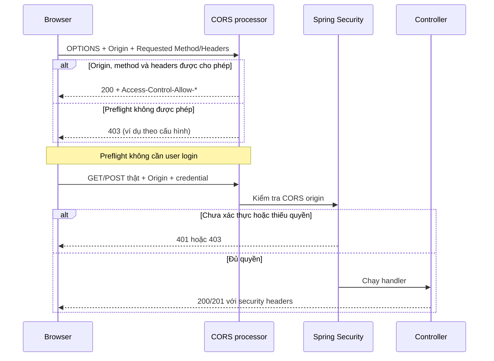

# Kiểm tra CORS preflight cùng các header bảo vệ của ứng dụng

Trong chương **Thực hành tổng hợp** của module **SPRING_SECURITY_TESTING**, người học kiểm chứng xác thực, phân quyền và bảo vệ HTTP thực tế bằng `spring-security-test` trên ứng dụng **Servlet** và **Reactive**. `MockMvc`, `WebTestClient`, `@WithMockUser`, `SecurityContext`, JWT/OAuth2/OIDC giả lập giúp tạo các ca request **được phép** và **bị từ chối**. Bài này kết hợp hai vấn đề thường bị kiểm thử rời rạc: **CORS preflight** khi trình duyệt gọi API khác origin và **các header bảo vệ** mà Spring Security thêm vào HTTP response.

Một API có thể trả `200 OK` cho request GET có quyền nhưng vẫn không hoạt động trong trình duyệt do preflight bị trả `401`. Ngược lại, một API có thể cho preflight `200` và phát `Access-Control-Allow-Origin` chính xác nhưng lại **vô tình cho phép anonymous xem dữ liệu**, hoặc thiếu `Content-Security-Policy`, `X-Content-Type-Options` và HSTS ở các response HTTPS. Vì thế cần một bộ test kiểm tra **đúng cả ba phần**:

1. Browser có được phép gửi **request cross-origin** theo CORS policy không?
2. Khi request thật tới server, Spring Security có **xác thực và phân quyền** đúng không?
3. Response có **security headers** đúng theo môi trường và loại nội dung không?

Mục tiêu là kiểm chứng hợp đồng HTTP, không chỉ làm cho một request OPTIONS trả `200`. Ví dụ chính dùng Spring MVC Servlet và `MockMvc` với `SecurityFilterChain` thật; cuối bài có biến thể `WebTestClient` cho WebFlux.

## 1. Phân biệt CORS, xác thực, phân quyền và header bảo vệ

| Cơ chế | Trả lời câu hỏi | Ví dụ | Không thay thế được |
| --- | --- | --- | --- |
| **CORS** | Trình duyệt ở origin nào được đọc response của API khác origin? | `Access-Control-Allow-Origin` | Authentication, authorization |
| **Preflight** | Browser có thể gửi method/header dự kiến qua cross-origin không? | `OPTIONS` cùng `Origin` và `Access-Control-Request-Method` | Request GET/POST thật |
| **Authentication** | Credential của request thật thuộc người dùng/ứng dụng nào? | HTTP Basic, Bearer JWT, session | CORS |
| **Authorization** | Principal đó có được xem hoặc sửa tài nguyên không? | `hasRole`, `hasAuthority`, tenant policy | Preflight |
| **Security response headers** | Browser cần áp dụng biện pháp bảo vệ nào lên nội dung/connection? | CSP, HSTS, `X-Frame-Options`, `nosniff` | Kiểm soát truy cập dữ liệu trên server |

**CORS không phải firewall hay cơ chế cấp quyền API.** Trình duyệt tuân thủ CORS khi quyết định có cho JavaScript truy cập response cross-origin không; HTTP client, script backend hoặc người dùng gọi `curl` vẫn có thể gửi HTTP request. Vì thế phải kiểm tra `401`/`403` cho request thật độc lập với việc preflight được chấp nhận.

**Header bảo vệ cũng không đồng nghĩa CORS.** `Strict-Transport-Security` giúp trình duyệt ưu tiên HTTPS theo chính sách HSTS; `Content-Security-Policy` giới hạn nguồn tài nguyên có thể tải/chạy trong ngữ cảnh trình duyệt; `X-Content-Type-Options: nosniff` giảm hành vi đoán MIME không mong muốn. Chúng không quyết định user nào có `ROLE_READER`.

## 2. Khi nào trình duyệt phát sinh preflight?

Một request cross-origin không thuộc nhóm request đơn giản theo tiêu chí Fetch/CORS có thể cần **preflight OPTIONS** trước request thật. Ví dụ, JavaScript từ `https://portal.example.test` muốn gọi API `https://api.example.test` với header `Authorization` và `X-Request-Id`:

```http
OPTIONS /api/reports/42 HTTP/1.1
Origin: https://portal.example.test
Access-Control-Request-Method: GET
Access-Control-Request-Headers: Authorization,X-Request-Id
```

Nếu cho phép, server có thể trả:

```http
HTTP/1.1 200 OK
Access-Control-Allow-Origin: https://portal.example.test
Access-Control-Allow-Methods: GET,POST
Access-Control-Allow-Headers: Authorization,X-Request-Id
Access-Control-Allow-Credentials: true
Access-Control-Max-Age: 3600
Vary: Origin
```

Đây là **response minh họa**; bộ filter/framework có thể chọn thứ tự và cách định dạng danh sách header khác nhau, đồng thời trả thêm các trường `Vary`. Bộ test nên kiểm tra giá trị có ý nghĩa, không phụ thuộc khoảng trắng hoặc thứ tự danh sách nếu contract không yêu cầu.

Sau preflight thành công, trình duyệt mới gửi request thật:

```http
GET /api/reports/42 HTTP/1.1
Origin: https://portal.example.test
Authorization: Basic <test-credential>
```

**Điểm then chốt:** preflight do browser phát sinh thường **không có cookie/session authentication hay Bearer token của request thật**. Nếu security filter yêu cầu login trước khi xử lý preflight, nó có thể trả `401` khiến browser không gửi GET/POST tiếp theo, dù credential của request thật hoàn toàn hợp lệ.

Một request `OPTIONS` **không có** `Origin` hoặc `Access-Control-Request-Method` không phải một CORS preflight đầy đủ. Không đặt kỳ vọng `200` cho mọi request OPTIONS chỉ vì ứng dụng hỗ trợ CORS.

## 3. Luồng xử lý đúng: CORS trước authentication

Trong Spring Security Servlet, cấu hình `http.cors(...)` tích hợp CORS processing vào security filter chain đúng vị trí tương đối với authentication. Preflight hợp lệ được CORS processor xử lý **trước khi** rule cần người dùng đăng nhập chặn request.



Sơ đồ có chủ ý bỏ bớt các filter trung gian. Trên request thật, `CorsFilter` hoặc cơ chế CORS tích hợp **không tự bypass authorization**. Ngay cả khi server phát `Access-Control-Allow-Origin`, nó vẫn có thể trả `401` hoặc `403`.

Với preflight, CORS processor thường trả lời ngay mà **không đi tới controller hay các header writers đứng phía sau**. Do vậy, không nên áp dụng một cách máy móc mọi assertion `Content-Security-Policy`, `X-Frame-Options` hoặc HSTS của response GET lên response OPTIONS. Hãy kiểm tra nhóm **CORS headers trên preflight** và **security headers trên response thật** theo từng mục tiêu.

## 4. Thiết kế policy rõ ràng cho ví dụ

Ứng dụng mẫu có API:

- `GET /api/public`: endpoint công khai.
- `GET /api/reports/{id}`: yêu cầu đăng nhập và `ROLE_READER` hoặc `ROLE_EDITOR`.
- `POST /api/reports`: yêu cầu `ROLE_EDITOR` và CSRF hợp lệ trong cấu hình Servlet này.
- `OPTIONS` preflight: origin được phép là **`https://portal.example.test`**, methods `GET` và `POST`, request headers `Authorization`, `Content-Type` và `X-Request-Id`.
- Các origin, method hoặc request headers ngoài allowlist phải bị CORS processor từ chối.

Các security headers mong đợi:

| Header | Áp dụng trong ví dụ | Lưu ý |
| --- | --- | --- |
| `X-Content-Type-Options` | `nosniff` | Spring Security mặc định thường bật |
| `X-Frame-Options` | `DENY` | Spring Security mặc định thường bật; cân nhắc cùng CSP `frame-ancestors` |
| `Cache-Control` | Có chỉ thị hạn chế lưu cache | Kiểm tra chính sách cho dữ liệu nhạy cảm; ứng dụng có thể ghi đè |
| `Content-Security-Policy` | `default-src 'self'; object-src 'none'; frame-ancestors 'none'` | **Phải cấu hình**, không được giả định Spring Security tự sinh CSP |
| `Referrer-Policy` | `strict-origin-when-cross-origin` | **Cấu hình tường minh** |
| `Strict-Transport-Security` | Có trên response **HTTPS** | Trong `MockMvc` mô phỏng bằng `secure(true)`; không kỳ vọng trên HTTP |
| `Permissions-Policy` | Không bắt buộc trong ví dụ | Muốn kiểm tra phải chủ động cấu hình |

Chính sách CSP ở đây chỉ là fixture học thuật cho API đơn giản; một ứng dụng có frontend script, inline content, CDN, iframe, WebSocket hoặc OAuth2 callback phải thiết kế CSP phù hợp threat model. Không copy một CSP bất kỳ lên production chỉ vì test ví dụ PASS.

## 5. Cấu hình Spring Security Servlet và CorsConfigurationSource

Ví dụ dùng Spring Boot 3.x/Spring Security 6.x, Java 17+, Spring MVC, JUnit Jupiter và `spring-security-test`. Các dependency Gradle Groovy thường cần:

```gradle
dependencies {
    implementation "org.springframework.boot:spring-boot-starter-web"
    implementation "org.springframework.boot:spring-boot-starter-security"
    testImplementation "org.springframework.boot:spring-boot-starter-test"
    testImplementation "org.springframework.security:spring-security-test"
}
```

Trong test, khai báo `CorsConfigurationSource` với allowlist explicit và bật CORS processing bằng `http.cors(Customizer.withDefaults())`. Các bean dưới đây được định nghĩa như **lớp lồng trong test class** ở mục tiếp theo để tránh phụ thuộc quét bean của một ứng dụng khác.

```java
import java.util.List;

import org.springframework.context.annotation.Bean;
import org.springframework.context.annotation.Configuration;
import org.springframework.http.HttpMethod;
import org.springframework.security.config.Customizer;
import org.springframework.security.config.annotation.web.builders.HttpSecurity;
import org.springframework.security.config.annotation.web.configuration.EnableWebSecurity;
import org.springframework.security.config.annotation.web.configurers.AbstractHttpConfigurer;
import org.springframework.security.core.userdetails.User;
import org.springframework.security.core.userdetails.UserDetailsService;
import org.springframework.security.provisioning.InMemoryUserDetailsManager;
import org.springframework.security.web.SecurityFilterChain;
import org.springframework.security.web.header.writers.ReferrerPolicyHeaderWriter;
import org.springframework.web.cors.CorsConfiguration;
import org.springframework.web.cors.CorsConfigurationSource;
import org.springframework.web.cors.UrlBasedCorsConfigurationSource;

@Configuration
@EnableWebSecurity
static class SecurityConfig {

    @Bean
    SecurityFilterChain securityFilterChain(HttpSecurity http)
            throws Exception {
        return http
                .cors(Customizer.withDefaults())
                .authorizeHttpRequests(auth -> auth
                    .requestMatchers("/api/public").permitAll()
                    .requestMatchers(
                            HttpMethod.GET, "/api/reports/**")
                        .hasAnyRole("READER", "EDITOR")
                    .requestMatchers(
                            HttpMethod.POST, "/api/reports")
                        .hasRole("EDITOR")
                    .anyRequest().denyAll())
                .httpBasic(Customizer.withDefaults())
                .formLogin(AbstractHttpConfigurer::disable)
                .headers(headers -> headers
                    .contentSecurityPolicy(csp -> csp
                        .policyDirectives(
                            "default-src 'self'; object-src 'none'; "
                            + "frame-ancestors 'none'"))
                    .referrerPolicy(referrer -> referrer.policy(
                        ReferrerPolicyHeaderWriter.ReferrerPolicy
                            .STRICT_ORIGIN_WHEN_CROSS_ORIGIN)))
                // Không tắt CSRF: POST thật vẫn cần CSRF khi test role.
                .build();
    }

    @Bean
    CorsConfigurationSource corsConfigurationSource() {
        CorsConfiguration config = new CorsConfiguration();
        config.setAllowedOrigins(List.of(
                "https://portal.example.test"));
        config.setAllowedMethods(List.of("GET", "POST"));
        config.setAllowedHeaders(List.of(
                "Authorization", "Content-Type", "X-Request-Id"));
        config.setAllowCredentials(true);
        config.setMaxAge(3600L);

        UrlBasedCorsConfigurationSource source =
                new UrlBasedCorsConfigurationSource();
        source.registerCorsConfiguration("/api/**", config);
        return source;
    }

    @Bean
    UserDetailsService users() {
        return new InMemoryUserDetailsManager(
            User.withUsername("reader")
                .password("{noop}pw").roles("READER").build(),
            User.withUsername("editor")
                .password("{noop}pw").roles("EDITOR").build(),
            User.withUsername("guest")
                .password("{noop}pw").roles("GUEST").build());
    }
}
```

Chỉ dùng mật khẩu `{noop}` với người dùng mẫu trong môi trường test. Ứng dụng production cần user store, password encoder, OAuth2/OIDC/JWT hoặc authentication provider theo thiết kế thật.

**Vì sao cần cả hai phần?** Bean `CorsConfigurationSource` cung cấp allowlist, còn `http.cors(...)` gắn xử lý CORS đúng chỗ trong Spring Security Servlet. Chỉ tạo bean cấu hình mà không tích hợp CORS đúng đường filter chain có thể vẫn khiến preflight bị authentication chặn. Không tự đăng ký thêm một `CorsFilter` bên ngoài chain nếu chưa xác định thứ tự và tránh được đăng ký trùng.

## 6. Controller thật và test context tối thiểu

Để kiểm chứng cả preflight lẫn security headers, không dùng `MockMvcBuilders.standaloneSetup(controller)` nếu chưa tích hợp security filters. Ví dụ test dùng `@SpringBootTest` với `@AutoConfigureMockMvc` để request đi qua `springSecurityFilterChain`.

```java
import org.junit.jupiter.api.Test;
import org.springframework.beans.factory.annotation.Autowired;
import org.springframework.boot.SpringBootConfiguration;
import org.springframework.boot.autoconfigure.EnableAutoConfiguration;
import org.springframework.boot.test.autoconfigure.web.servlet.AutoConfigureMockMvc;
import org.springframework.boot.test.context.SpringBootTest;
import org.springframework.context.annotation.Import;
import org.springframework.http.HttpStatus;
import org.springframework.http.ResponseEntity;
import org.springframework.test.web.servlet.MockMvc;
import org.springframework.web.bind.annotation.GetMapping;
import org.springframework.web.bind.annotation.PathVariable;
import org.springframework.web.bind.annotation.PostMapping;
import org.springframework.web.bind.annotation.RestController;

@SpringBootTest(classes = CorsAndHeadersIT.TestApplication.class)
@AutoConfigureMockMvc
class CorsAndHeadersIT {

    static final String ALLOWED_ORIGIN =
            "https://portal.example.test";
    static final String BLOCKED_ORIGIN =
            "https://attacker.example.test";

    @SpringBootConfiguration
    @EnableAutoConfiguration
    @Import({SecurityConfig.class, ApiController.class})
    static class TestApplication {}

    @Autowired
    MockMvc mvc;

    @RestController
    static class ApiController {

        @GetMapping("/api/public")
        String publicInfo() {
            return "public";
        }

        @GetMapping("/api/reports/{id}")
        String report(@PathVariable("id") long id) {
            return "report:" + id;
        }

        @PostMapping("/api/reports")
        ResponseEntity<String> create() {
            return ResponseEntity.status(HttpStatus.CREATED)
                    .body("created");
        }
    }

    // Thêm SecurityConfig ở mục 5 và các @Test ở mục 7–10
    // vào cùng class này.
}
```

**Cách tổ chức code:** đoạn `SecurityConfig` ở mục 5 là lớp `static` lồng bên trong `CorsAndHeadersIT`. Các test ở những mục tiếp theo cũng nằm trong class đó; những đoạn `import` phân tách theo chủ đề cần đặt ở đầu cùng file Java. Trong ứng dụng thật, dùng security config **production** của project khi muốn kiểm chứng không có sai khác giữa cấu hình test và triển khai.

Ví dụ này đặt `Origin` cố định trong test fixture. Không có DNS, browser hoặc dịch vụ ngoài thực sự được gọi; đây là **HTTP integration test trong Servlet application context**, chưa phải kiểm thử end-to-end qua mạng với CDN, reverse proxy hoặc browser.

## 7. Test preflight hợp lệ: OPTIONS không cần đăng nhập

Các static import cho những test dưới:

```java
import static org.hamcrest.Matchers.containsString;
import static org.assertj.core.api.Assertions.assertThat;
import static org.springframework.security.test.web.servlet.request
        .SecurityMockMvcRequestPostProcessors.csrf;
import static org.springframework.security.test.web.servlet.request
        .SecurityMockMvcRequestPostProcessors.httpBasic;
import static org.springframework.test.web.servlet.request
        .MockMvcRequestBuilders.get;
import static org.springframework.test.web.servlet.request
        .MockMvcRequestBuilders.options;
import static org.springframework.test.web.servlet.request
        .MockMvcRequestBuilders.post;
import static org.springframework.test.web.servlet.result
        .MockMvcResultMatchers.content;
import static org.springframework.test.web.servlet.result
        .MockMvcResultMatchers.header;
import static org.springframework.test.web.servlet.result
        .MockMvcResultMatchers.status;

import org.springframework.http.HttpHeaders;
import org.springframework.http.MediaType;
import org.springframework.test.web.servlet.MvcResult;
```

**Ca quan trọng nhất:** gọi preflight cho endpoint bảo vệ mà **không gửi HTTP Basic**, nhưng origin, requested method và headers nằm trong allowlist:

```java
@Test
void preflightHopLe_khongCanAuthorizationHeader()
        throws Exception {
    mvc.perform(options("/api/reports/42")
            .header(HttpHeaders.ORIGIN, ALLOWED_ORIGIN)
            .header(HttpHeaders.ACCESS_CONTROL_REQUEST_METHOD, "GET")
            .header(HttpHeaders.ACCESS_CONTROL_REQUEST_HEADERS,
                    "Authorization,X-Request-Id"))
        .andExpect(status().isOk())
        .andExpect(header().string(
                HttpHeaders.ACCESS_CONTROL_ALLOW_ORIGIN,
                ALLOWED_ORIGIN))
        .andExpect(header().string(
                HttpHeaders.ACCESS_CONTROL_ALLOW_CREDENTIALS,
                "true"))
        .andExpect(header().string(
                HttpHeaders.ACCESS_CONTROL_ALLOW_METHODS,
                containsString("GET")))
        .andExpect(header().string(
                HttpHeaders.ACCESS_CONTROL_ALLOW_HEADERS,
                containsString("Authorization")))
        .andExpect(header().exists(
                HttpHeaders.ACCESS_CONTROL_MAX_AGE));
}
```

Test này đặc biệt hữu ích vì endpoint `GET /api/reports/42` yêu cầu `ROLE_READER` hoặc `ROLE_EDITOR`, nhưng preflight `OPTIONS` được CORS processor chấp nhận **trước khi** controller và rule authorization cho GET được thực thi. Nếu cấu hình vô tình yêu cầu authentication trước CORS, test có thể trả `401`.

### Test preflight cho POST

```java
@Test
void preflightPost_duocChapNhanDuPostThatCanCsrf()
        throws Exception {
    mvc.perform(options("/api/reports")
            .header(HttpHeaders.ORIGIN, ALLOWED_ORIGIN)
            .header(HttpHeaders.ACCESS_CONTROL_REQUEST_METHOD, "POST")
            .header(HttpHeaders.ACCESS_CONTROL_REQUEST_HEADERS,
                    "Content-Type,Authorization"))
        .andExpect(status().isOk())
        .andExpect(header().string(
                HttpHeaders.ACCESS_CONTROL_ALLOW_ORIGIN,
                ALLOWED_ORIGIN))
        .andExpect(header().string(
                HttpHeaders.ACCESS_CONTROL_ALLOW_METHODS,
                containsString("POST")));
}
```

**Preflight POST thành công không có nghĩa POST thật không cần CSRF.** `OPTIONS` là request kiểm tra điều kiện browser được gửi POST; thao tác ghi sau đó vẫn phải được xác thực, phân quyền và kiểm tra CSRF theo chính sách của ứng dụng.

## 8. Test preflight bị từ chối theo origin, method và request headers

Chỉ assert các ca thành công khiến CORS policy dễ bị nới rộng ngoài ý muốn. Cần tối thiểu ba ca âm tính độc lập:

```java
@Test
void preflightOriginKhongChoPhep_tra403()
        throws Exception {
    mvc.perform(options("/api/reports/42")
            .header(HttpHeaders.ORIGIN, BLOCKED_ORIGIN)
            .header(HttpHeaders.ACCESS_CONTROL_REQUEST_METHOD, "GET"))
        .andExpect(status().isForbidden())
        .andExpect(header().doesNotExist(
                HttpHeaders.ACCESS_CONTROL_ALLOW_ORIGIN));
}

@Test
void preflightDeleteKhongDuocAllowlist_tra403()
        throws Exception {
    mvc.perform(options("/api/reports/42")
            .header(HttpHeaders.ORIGIN, ALLOWED_ORIGIN)
            .header(HttpHeaders.ACCESS_CONTROL_REQUEST_METHOD, "DELETE"))
        .andExpect(status().isForbidden());
}

@Test
void preflightHeaderLaKhongDuocChoPhep_tra403()
        throws Exception {
    mvc.perform(options("/api/reports/42")
            .header(HttpHeaders.ORIGIN, ALLOWED_ORIGIN)
            .header(HttpHeaders.ACCESS_CONTROL_REQUEST_METHOD, "GET")
            .header(HttpHeaders.ACCESS_CONTROL_REQUEST_HEADERS,
                    "X-Admin-Override"))
        .andExpect(status().isForbidden());
}
```

Trong cấu hình Spring CORS processor của bài, các preflight không hợp lệ trả `403 Forbidden`. Đây là kỳ vọng **của bộ cấu hình ví dụ**, không phải yêu cầu mọi gateway/proxy phải trả đúng `403`. Một reverse proxy có thể trả mã khác hoặc xử lý CORS trước khi đến Spring; khi test qua mạng thật, phải xác định lớp nào đang tạo response.

Nếu origin có cổng khác, scheme `http` thay vì `https`, hoặc subdomain khác, đó là **origin khác**. Với `setAllowedOrigins(List.of("https://portal.example.test"))`, không tự coi `https://evil.portal.example.test` hoặc `http://portal.example.test` là origin hợp lệ.

## 9. Test request thật: CORS thành công vẫn không vượt authorization

Sau khi preflight thành công, browser gửi request thật. Ta phải chứng minh `SecurityFilterChain` vẫn thực thi chính sách role trên GET:

```java
@Test
void requestThatChuaDangNhap_tra401DuOriginDuocPhep()
        throws Exception {
    mvc.perform(get("/api/reports/42")
            .header(HttpHeaders.ORIGIN, ALLOWED_ORIGIN))
        .andExpect(status().isUnauthorized())
        .andExpect(header().string(
                HttpHeaders.ACCESS_CONTROL_ALLOW_ORIGIN,
                ALLOWED_ORIGIN));
}

@Test
void requestThatGuestThieuRole_tra403()
        throws Exception {
    mvc.perform(get("/api/reports/42")
            .header(HttpHeaders.ORIGIN, ALLOWED_ORIGIN)
            .with(httpBasic("guest", "pw")))
        .andExpect(status().isForbidden())
        .andExpect(header().string(
                HttpHeaders.ACCESS_CONTROL_ALLOW_ORIGIN,
                ALLOWED_ORIGIN));
}

@Test
void requestThatReaderDuRole_tra200VaBodyDung()
        throws Exception {
    mvc.perform(get("/api/reports/42")
            .header(HttpHeaders.ORIGIN, ALLOWED_ORIGIN)
            .with(httpBasic("reader", "pw")))
        .andExpect(status().isOk())
        .andExpect(content().string("report:42"))
        .andExpect(header().string(
                HttpHeaders.ACCESS_CONTROL_ALLOW_ORIGIN,
                ALLOWED_ORIGIN));
}
```

Lớp CORS có thể thêm `Access-Control-Allow-Origin` cả trên response `401` hoặc `403` đối với **origin hợp lệ** vì kiểm tra origin đã được thực hiện trước authentication. Điều đó **không cấp quyền** đọc dữ liệu: body vẫn là lỗi và server không chuyển tài nguyên bí mật cho người chưa đủ quyền.

Khi không gửi `Origin`, đây là request **không có ngữ cảnh CORS cross-origin**. Người dùng hợp lệ vẫn được truy cập, còn header `Access-Control-Allow-Origin` thường không xuất hiện:

```java
@Test
void sameOriginKhongCanAccessControlAllowOrigin()
        throws Exception {
    mvc.perform(get("/api/reports/42")
            .with(httpBasic("reader", "pw")))
        .andExpect(status().isOk())
        .andExpect(header().doesNotExist(
                HttpHeaders.ACCESS_CONTROL_ALLOW_ORIGIN));
}
```

Nếu một test request có origin bị từ chối, CORS processor có thể chặn nó **trước khi** authentication hoặc controller chạy. Không dùng kết quả của request bị CORS chặn để kết luận tenant/role policy đã đúng. Muốn kiểm tra role, hãy dùng origin được phép hoặc không gửi Origin.

## 10. POST thật: phân biệt CORS, CSRF và thiếu quyền

Với `POST /api/reports`, có ít nhất ba lớp kiểm tra:

1. Origin/headers được CORS cho phép.
2. Spring Security yêu cầu `ROLE_EDITOR`.
3. CSRF hợp lệ theo policy Servlet của ví dụ.

Test các nhánh độc lập:

```java
@Test
void editorThieuCsrf_tra403DuOriginHopLe()
        throws Exception {
    mvc.perform(post("/api/reports")
            .header(HttpHeaders.ORIGIN, ALLOWED_ORIGIN)
            .with(httpBasic("editor", "pw")))
        .andExpect(status().isForbidden())
        .andExpect(header().string(
                HttpHeaders.ACCESS_CONTROL_ALLOW_ORIGIN,
                ALLOWED_ORIGIN));
}

@Test
void readerCoCsrfNhungThieuRole_tra403()
        throws Exception {
    mvc.perform(post("/api/reports")
            .header(HttpHeaders.ORIGIN, ALLOWED_ORIGIN)
            .with(httpBasic("reader", "pw"))
            .with(csrf()))
        .andExpect(status().isForbidden());
}

@Test
void editorCoCsrfVaDuRole_tra201()
        throws Exception {
    mvc.perform(post("/api/reports")
            .header(HttpHeaders.ORIGIN, ALLOWED_ORIGIN)
            .with(httpBasic("editor", "pw"))
            .with(csrf()))
        .andExpect(status().isCreated())
        .andExpect(content().string("created"))
        .andExpect(header().string(
                HttpHeaders.ACCESS_CONTROL_ALLOW_ORIGIN,
                ALLOWED_ORIGIN));
}
```

Vì controller ví dụ không đọc request body, `POST` test không cần JSON body. Trong ứng dụng thật, request có `Content-Type: application/json` và header `Authorization` thường kích hoạt preflight; hãy bao phủ đúng combination mà browser gửi. Cấp `csrf()` cho bài test role **không có nghĩa browser thật sẽ nhận được CSRF token**: đường lấy/lưu/gửi token theo cookie/header còn cần test tích hợp hoặc trình duyệt riêng khi sản phẩm dùng session authentication.

**Khi dùng Bearer JWT stateless**, chính sách CSRF có thể khác hệ thống cookie/session. Đừng sao chép `csrf(AbstractHttpConfigurer::disable)` chỉ để làm POST test xanh; xác định threat model và cơ chế lưu credential của ứng dụng rồi chọn test tương ứng.

## 11. Header bảo vệ trên response GET: điều gì là mặc định, điều gì phải bật?

Một response GET thành công nên được kiểm tra bằng một test riêng, ngoài các assertion CORS. Trong cấu hình mẫu:

```java
@Test
void getResponseCoSecurityHeadersDaCauHinh()
        throws Exception {
    mvc.perform(get("/api/reports/42")
            .with(httpBasic("reader", "pw")))
        .andExpect(status().isOk())
        .andExpect(header().string(
                "X-Content-Type-Options", "nosniff"))
        .andExpect(header().string(
                "X-Frame-Options", "DENY"))
        .andExpect(header().string(
                "Cache-Control", containsString("no-store")))
        .andExpect(header().string(
                "Content-Security-Policy",
                "default-src 'self'; object-src 'none'; "
                    + "frame-ancestors 'none'"))
        .andExpect(header().string(
                "Referrer-Policy",
                "strict-origin-when-cross-origin"));
}
```

Giải thích các nhóm:

- `X-Content-Type-Options: nosniff` giúp browser không tự suy đoán MIME theo kiểu không mong muốn.
- `X-Frame-Options: DENY` là lớp phòng vệ chống nhúng trong frame cho trình duyệt hỗ trợ header; CSP `frame-ancestors 'none'` cũng giới hạn việc nhúng. Không coi hai chính sách là hoàn toàn thay thế nhau trên mọi trình duyệt.
- `Cache-Control` theo mặc định Spring Security thường hạn chế cache; nhưng một endpoint chủ động đặt cache policy có thể thay đổi giá trị. Với dữ liệu cá nhân, đừng bỏ `no-store` mà chưa xem xét rủi ro.
- `Content-Security-Policy` **không được Spring Security tự phát sinh theo mặc định**; test phía trên PASS vì ta chủ động cấu hình `.contentSecurityPolicy(...)`.
- `Referrer-Policy` cũng đã được cấu hình tường minh trong ví dụ. Không mặc định xem header có mặt trong mọi ứng dụng.

Với response JSON hoặc plain-text API, CSP chủ yếu có hiệu lực trong **ngữ cảnh trình duyệt có thể hiển thị nội dung**; nó không thay thế validate dữ liệu và encoding an toàn ở frontend. Với app có HTML, CDN hoặc third-party scripts, CSP cần được thiết kế và test dựa trên nhu cầu thực tế.

### Không kiểm tra “mọi security header trên mọi response” một cách máy móc

Response preflight thường dừng tại CORS processor. Response `401`, `403`, redirect login, static resource hay error handler có thể đi qua pipeline khác với response `200`. Bộ test nên chọn **một số đường đại diện** và phân biệt header nào thuộc contract của từng đường. Nếu sản phẩm yêu cầu header cả trên lỗi, viết assertion cụ thể cho nhánh lỗi thay vì suy từ happy path.

## 12. HSTS: test riêng HTTP và HTTPS

`Strict-Transport-Security` có ý nghĩa với **HTTPS**. Spring Security mặc định thường chỉ ghi HSTS khi `HttpServletRequest.isSecure()` trả true. Một test `MockMvc` mặc định sử dụng request không secure sẽ không kiểm chứng được HSTS trên HTTPS production.

```java
@Test
void httpsResponseCoHsts()
        throws Exception {
    mvc.perform(get("/api/reports/42")
            .secure(true)
            .with(httpBasic("reader", "pw")))
        .andExpect(status().isOk())
        .andExpect(header().exists("Strict-Transport-Security"))
        .andExpect(header().string(
            "Strict-Transport-Security", containsString("max-age=")));
}

@Test
void httpResponseKhongBatBuocCoHsts()
        throws Exception {
    mvc.perform(get("/api/reports/42")
            .secure(false)
            .with(httpBasic("reader", "pw")))
        .andExpect(status().isOk())
        .andExpect(header().doesNotExist(
                "Strict-Transport-Security"));
}
```

Với cấu hình mặc định của ví dụ, HSTS xuất hiện trên request HTTPS giả lập và không xuất hiện trên request HTTP. Nếu ứng dụng tùy biến `HstsHeaderWriter` hoặc bảo vệ header ở reverse proxy, test và expected phải phản ánh lớp thực sự phát header.

Khi production nằm sau load balancer/TLS terminator, request được ứng dụng coi là HTTPS hay không phụ thuộc cấu hình xử lý forwarded headers và mức tin cậy của proxy. Không tự tin cậy header `X-Forwarded-Proto` do client tùy ý gửi; chỉ nhận thông tin proxy trong mô hình hạ tầng đã được bảo vệ.

**HSTS không chữa một endpoint HTTP trả 200 không xác thực.** Nó xử lý nâng cấp scheme trong browser, còn authorization vẫn phải kiểm tra role/tenant/token.

## 13. CORS credentials, wildcard, Vary và caching

Trong ví dụ `setAllowCredentials(true)` chỉ định server cho phép browser gửi credentials khi policy trình duyệt và client request phù hợp. Khi đó server phải trả origin được phép **cụ thể**, không nên kết hợp `Access-Control-Allow-Origin: *` với `Access-Control-Allow-Credentials: true`.

```java
// Ví dụ chọn origin cụ thể:
config.setAllowedOrigins(List.of(
        "https://portal.example.test"));
config.setAllowCredentials(true);

// Không sử dụng với allowCredentials=true:
// config.setAllowedOrigins(List.of("*"));
```

Với Spring `CorsConfiguration`, tổ hợp literal wildcard `*` và `allowCredentials=true` không hợp lệ và có thể gây lỗi cấu hình/xử lý. Nếu thực sự cần match nhóm origin động, `allowedOriginPatterns` có cách xử lý khác, nhưng vẫn phải thiết kế allowlist chặt và kiểm chứng origin được echo lại; đừng mở pattern mọi origin chỉ để frontend thử nghiệm hoạt động.

### Vary giúp cache phân biệt response theo Origin

Khi server trả CORS policy khác nhau tùy `Origin`/requested method/headers, `Vary` giúp cache trung gian không nhầm response của origin A sang origin B:

```java
@Test
void preflightResponseCoVaryHopLy() throws Exception {
    MvcResult result = mvc.perform(options("/api/reports/42")
            .header(HttpHeaders.ORIGIN, ALLOWED_ORIGIN)
            .header(HttpHeaders.ACCESS_CONTROL_REQUEST_METHOD, "GET"))
        .andExpect(status().isOk())
        .andReturn();

    assertThat(result.getResponse().getHeaders(HttpHeaders.VARY))
        .contains("Origin");
}
```

Spring CORS processor có thể ghi nhiều `Vary` values như `Origin`, `Access-Control-Request-Method` và `Access-Control-Request-Headers`. Không dựa vào thứ tự chuỗi header nếu không phải contract. `Vary` không thay thế `Cache-Control: no-store` cho response chứa dữ liệu nhạy cảm.

### Allowed headers khác exposed headers

| Cấu hình | Chiều giao tiếp | Ví dụ |
| --- | --- | --- |
| `setAllowedHeaders(...)` | Browser được gửi **request headers** gì trong cross-origin request | `Authorization`, `Content-Type`, `X-Request-Id` |
| `setExposedHeaders(...)` | JavaScript của browser được đọc thêm **response headers** nào ngoài danh sách được phép mặc định | `X-Request-Id`, `X-Export-Status` |

Nếu frontend cần đọc response header tùy biến, có thể thêm `config.setExposedHeaders(List.of("X-Request-Id"))` và test `Access-Control-Expose-Headers`. Đừng nhầm `Access-Control-Allow-Headers` của preflight với `Access-Control-Expose-Headers` trên response.

## 14. Các tình huống dễ gây false positive

| Triệu chứng | Nguyên nhân có thể | Cách kiểm tra |
| --- | --- | --- |
| Preflight trả `401` | CORS xử lý sau authentication, hoặc không có CORS config | Gửi OPTIONS đúng `Origin`/`Access-Control-Request-Method` và không credential |
| Preflight trả `403` | Origin/method/header ngoài allowlist | Kiểm tra chính xác scheme, host, port, requested method/headers |
| GET cross-origin trả `200` trên MockMvc nhưng browser vẫn báo CORS | Chỉ assert HTTP status, không kiểm tra `Access-Control-Allow-Origin` | Assert CORS headers trên response thật |
| GET anonymous trả `200` | `permitAll` quá rộng, matcher lọt, filters bị tắt | Test `401`/`403` với security chain thật |
| POST có role nhưng trả `403` | Thiếu CSRF hoặc role thiếu | Dùng `csrf()` trong test role; test thiếu CSRF riêng |
| Security headers thiếu trên response OPTIONS | Preflight được CORS processor trả lời sớm | Kiểm tra headers bảo vệ trên response GET/POST tương ứng |
| CSP không tồn tại | Spring Security không mặc định sinh CSP | Thêm cấu hình CSP thích hợp rồi assert |
| HSTS vắng mặt ở MockMvc | Request mặc định là HTTP không secure | Dùng `.secure(true)` để kiểm chứng chính sách HTTPS |
| HSTS vắng mặt sau TLS terminator | Proxy/forwarded headers chưa cấu hình đúng | Kiểm tra ranh giới tin cậy và HTTPS thật |
| `Access-Control-Allow-Origin: *` với credentials | Cấu hình origin quá rộng hoặc không hợp lệ | Dùng allowlist origin cụ thể khi bật credentials |
| Request CORS từ origin xấu bị `403` | CORS chặn trước auth | Không kết luận role/tenant policy đã được test |
| Test security headers xanh dù filter chain bị bypass | Header được thêm bởi proxy/Servlet filter khác | Kiểm tra `401`/`403` và vị trí header writer |

### Những lỗi cấu hình phổ biến

**Cho phép toàn bộ OPTIONS bằng `permitAll` nhưng quên CORS processor.** Request OPTIONS có thể vượt authorization nhưng response thiếu `Access-Control-Allow-Origin`/`Allow-Methods`, browser vẫn chặn. `permitAll` không tự tạo CORS headers.

**Test `@WithMockUser` rồi kết luận Basic/Bearer authentication hoạt động.** Annotation cung cấp sẵn principal giả, không kiểm tra mật khẩu hoặc decoder. Dùng credential thật trong những ca kiểm tra trust boundary.

**Dùng `@AutoConfigureMockMvc(addFilters = false)` cho test HTTP security.** Controller có thể trả `200` mà không hề đi qua security filters, làm sai cả kết quả CORS và header writers.

**Nhầm CORS request bị browser chặn với server từ chối xác thực.** Browser có thể không cho JavaScript đọc response vì CORS dù server thực sự trả `200`; ngược lại server có thể trả `401` cùng CORS header đúng. Cần xem status ở network/server và response headers.

**Giả định preflight phải mang CSRF token.** Preflight là `OPTIONS` kiểm tra cross-origin request, không phải thao tác ghi; đừng gắn `csrf()` vào preflight chỉ để che lỗi filter ordering.

**Kiểm tra HSTS trên request HTTP và coi vắng mặt là lỗi.** Theo thiết kế, HSTS thường chỉ được ghi trên HTTPS. Cần test bằng request secure hoặc test TLS thật.

## 15. Kiểm thử tương đương trên WebFlux với WebTestClient

WebFlux dùng `SecurityWebFilterChain`, `ServerHttpSecurity`, `ReactiveSecurityContextHolder` và `WebFilter` thay cho Servlet `FilterChainProxy`. Trong Reactive, CORS cần được tích hợp đúng thứ tự so với authentication; test preflight vẫn **không cần credential**, nhưng không sử dụng `MockMvc`.

Ví dụ cấu hình **riêng cho WebFlux** (không trộn `UrlBasedCorsConfigurationSource` của Servlet với loại Reactive):

```java
import java.util.List;
import org.springframework.context.annotation.Bean;
import org.springframework.context.annotation.Configuration;
import org.springframework.http.HttpMethod;
import org.springframework.security.config.Customizer;
import org.springframework.security.config.annotation.web.reactive.EnableWebFluxSecurity;
import org.springframework.security.config.web.server.ServerHttpSecurity;
import org.springframework.security.web.server.SecurityWebFilterChain;
import org.springframework.web.cors.CorsConfiguration;
import org.springframework.web.cors.reactive.CorsConfigurationSource;
import org.springframework.web.cors.reactive.UrlBasedCorsConfigurationSource;

@Configuration
@EnableWebFluxSecurity
class ReactiveCorsSecurity {

    @Bean
    CorsConfigurationSource reactiveCorsSource() {
        CorsConfiguration config = new CorsConfiguration();
        config.setAllowedOrigins(List.of(
                "https://portal.example.test"));
        config.setAllowedMethods(List.of("GET", "POST"));
        config.setAllowedHeaders(List.of(
                "Authorization", "Content-Type"));
        config.setAllowCredentials(true);

        UrlBasedCorsConfigurationSource source =
                new UrlBasedCorsConfigurationSource();
        source.registerCorsConfiguration("/api/**", config);
        return source;
    }

    @Bean
    SecurityWebFilterChain reactiveChain(ServerHttpSecurity http,
            CorsConfigurationSource reactiveCorsSource) {
        return http
            .cors(cors -> cors.configurationSource(
                    reactiveCorsSource))
            .authorizeExchange(exchanges -> exchanges
                .pathMatchers("/api/public").permitAll()
                .pathMatchers(HttpMethod.GET, "/api/reports/**")
                    .hasRole("READER")
                .anyExchange().denyAll())
            .httpBasic(Customizer.withDefaults())
            .build();
    }
}
```

Ví dụ test dùng `WebTestClient` đã gắn WebFlux security từ application context:

```java
import static org.springframework.security.test.web.reactive.server
        .SecurityMockServerConfigurers.mockUser;
import static org.springframework.security.test.web.reactive.server
        .SecurityMockServerConfigurers.springSecurity;

WebTestClient client = WebTestClient.bindToApplicationContext(context)
        .apply(springSecurity())
        .configureClient()
        .build();

client.options().uri("/api/reports/42")
    .header(HttpHeaders.ORIGIN, "https://portal.example.test")
    .header(HttpHeaders.ACCESS_CONTROL_REQUEST_METHOD, "GET")
    .exchange()
    .expectStatus().isOk()
    .expectHeader().valueEquals(
        HttpHeaders.ACCESS_CONTROL_ALLOW_ORIGIN,
        "https://portal.example.test");

client.get().uri("/api/reports/42")
    .header(HttpHeaders.ORIGIN, "https://portal.example.test")
    .exchange()
    .expectStatus().isUnauthorized();

client.mutateWith(mockUser("reader").roles("READER"))
    .get().uri("/api/reports/42")
    .header(HttpHeaders.ORIGIN, "https://portal.example.test")
    .exchange()
    .expectStatus().isOk();
```

Đoạn trên là **khung test Reactive**, giả định `context` đã có controller `/api/reports/42` và `ReactiveCorsSecurity`. `mockUser()` mô phỏng `Authentication` trong test context, không xác minh HTTP Basic credential; khi test `bindToServer()` qua mạng thật, phải gửi Basic/Bearer header và không coi `mockUser()` là credential được gửi tới server từ xa.

Security headers ở WebFlux cũng cần được kiểm tra trên response thật theo DSL Reactive tương ứng; không sao chép nguyên cấu hình `HttpSecurity.headers(...)` của Servlet sang `ServerHttpSecurity` mà không đối chiếu API.

## 16. JWT/OAuth2/OIDC và hệ thống sau reverse proxy

Trong một ứng dụng thực tế, frontend ở origin khác thường gửi Bearer token thay vì HTTP Basic. Khi đó preflight có thể yêu cầu `Access-Control-Request-Headers: Authorization`, còn request thật mới có `Authorization: Bearer ...`. Các phép kiểm thử nên được tách theo **trust boundary**:

| Nhóm test | Dùng gì? | Chứng minh |
| --- | --- | --- |
| CORS preflight | `OPTIONS`, `Origin`, `Access-Control-Request-*`, không credential | Browser được phép gửi request theo CORS policy |
| Authorization với JWT giả | `jwt()` của MockMvc hoặc `mockJwt()` của WebTestClient | Các rule với claim/scope/role đã mô phỏng |
| Bearer JWT thật | Header `Authorization: Bearer <signed-test-token>` và decoder test | Filter/decoder xác thực credential, rồi rule phân quyền |
| OIDC Login | IdP/test authorization server mô phỏng luồng protocol | Redirect, callback, state/nonce, ID token validation theo phạm vi |
| Headers qua proxy/CDN | HTTP client/browser tới endpoint staging kiểm soát được | Proxy có giữ/thêm/ghi đè CORS, CSP, HSTS đúng contract |

`mockOidcLogin()`, `mockOAuth2Login()`, `mockOpaqueToken()` và `jwt()` rất hữu ích cho test policy; chúng không chứng minh token thật được giải mã, introspect hoặc được trao đổi đúng giao thức. Một CORS preflight PASS không thay thế những kiểm tra đó.

Đặc biệt, khi `Content-Security-Policy` hoặc HSTS được gắn bởi gateway/CDN thay vì Spring Security, `MockMvc` trong app context **không nhìn thấy các header từ proxy**. Hãy giữ một smoke test qua HTTP/TLS thật để kiểm tra cấu hình sau reverse proxy. Ngược lại, khi Spring Security tự ghi header nhưng proxy ghi đè, một test `MockMvc` PASS cũng chưa đảm bảo header trình duyệt nhận được là đúng.

## 17. Ma trận kiểm thử đề xuất cho CI

| Mã ca | Request | Expected | Phần được chứng minh |
| --- | --- | --- | --- |
| C01 | OPTIONS, origin hợp lệ, GET + Authorization | `200`, Allow-Origin/Methods/Headers | Preflight không cần authentication |
| C02 | OPTIONS, origin hợp lệ, POST | `200` | Preflight không bị rule POST/CSRF chặn |
| C03 | OPTIONS, origin không được phép | `403` | Allowlist origin |
| C04 | OPTIONS, method DELETE bị cấm | `403` | Allowlist method |
| C05 | OPTIONS, request header không được phép | `403` | Allowlist request headers |
| A01 | GET thật, origin hợp lệ, anonymous | `401`, CORS header hợp lệ | CORS không bypass authentication |
| A02 | GET thật, guest thiếu role | `403` | CORS không bypass authorization |
| A03 | GET thật, reader đủ role | `200`, body đúng | Handler và role hợp lệ |
| A04 | GET không Origin, reader | `200`, không cần Allow-Origin | Không tự thêm CORS header vô điều kiện |
| A05 | POST editor thiếu CSRF | `403` | CSRF vẫn được bảo vệ |
| A06 | POST reader có CSRF | `403` | Thiếu role vẫn bị chặn |
| A07 | POST editor có CSRF | `201` | Role + CSRF đủ điều kiện |
| H01 | GET hợp lệ trên HTTP | nosniff, frame, CSP, Referrer-Policy, cache | Security headers của ứng dụng |
| H02 | GET hợp lệ trên HTTPS | Có HSTS | Header transport chỉ áp dụng HTTPS |
| H03 | GET HTTP | Không bắt buộc HSTS | Không tạo false failure do request không secure |
| H04 | OPTIONS hợp lệ | Có `Vary: Origin` | Cache phân biệt nguồn origin |

Tập CI nên chạy nhanh test `MockMvc`/`WebTestClient` với filter chain thật trong mỗi pull request. Chỉ thêm số ít smoke tests qua proxy/browser hoặc token server thật cho ranh giới **không xuất hiện** trong application context. Đừng nhân hàng trăm endpoint thành hàng nghìn ca nếu nhiều route dùng chính cùng một policy; hãy chọn đại diện cho từng matcher, method, origin và trust boundary.

## 18. Checklist thực hành

- Đã xác định cụ thể origin, HTTP method và request headers được phép; không sao chép wildcard rộng từ môi trường development.
- Preflight được dựng đúng **`OPTIONS` + `Origin` + `Access-Control-Request-Method`**, không gắn credential giả chỉ để pass.
- `http.cors(...)` hoặc cơ chế Reactive CORS được cấu hình đúng chỗ so với authentication và authorization.
- Có ca preflight hợp lệ trả CORS headers, và ca bị từ chối do origin/method/header không nằm trong allowlist.
- Có ca request thật `401` anonymous, `403` thiếu quyền, `200` đúng quyền với origin được phép.
- Nếu dùng credential cross-origin, `Access-Control-Allow-Credentials` và `Access-Control-Allow-Origin` cụ thể phù hợp; không dùng wildcard sai chính sách.
- Với request ghi, đã tách lỗi CSRF khỏi lỗi CORS và lỗi thiếu quyền.
- Security headers được assert trên **response thật**: nosniff, frame options, cache, CSP/Referrer-Policy khi được cấu hình.
- HSTS được test ở HTTPS/`secure(true)`; không mặc định yêu cầu nó trên HTTP.
- Không đánh đồng `setAllowedHeaders` với `setExposedHeaders`, hoặc `Vary` với bảo vệ cache dữ liệu nhạy cảm.
- `MockMvc`/`WebTestClient` chạy security filter chain phù hợp; không dùng standalone client chưa tích hợp security để tuyên bố test bảo mật.
- Đã xác định header nào do Spring Security tạo, header nào do proxy/CDN thêm; có network smoke test nếu production phụ thuộc proxy.
- Với JWT/OAuth2/OIDC, bài test CORS được tách khỏi bài test xác minh token/login protocol thật.

**Kết luận:** một bộ kiểm thử CORS và security headers đạt yêu cầu khi **preflight hợp lệ không bị bắt đăng nhập**, **preflight ngoài allowlist bị từ chối**, và **request thật vẫn chịu authentication, authorization, CSRF**. Song song, response cần mang những security headers đã được thiết kế cho đúng môi trường — đặc biệt phân biệt CSP cấu hình tường minh với header mặc định, và HSTS trên HTTPS so với HTTP. Kết hợp các ca này trong `spring-security-test` giúp phát hiện cả lỗi giao tiếp cross-origin lẫn hồi quy bảo mật mà một assertion `200 OK` đơn lẻ không thể chỉ ra.
