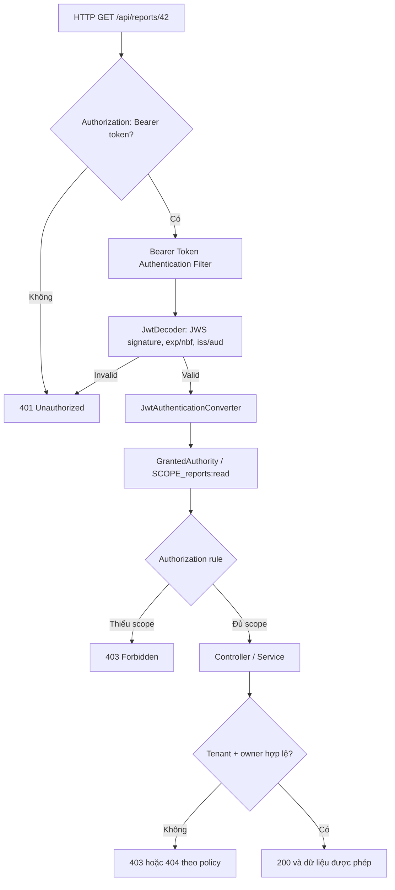

# Kiểm thử JWT bằng helper rồi bổ sung ca token ký thật

## 1. Bài toán: test quyền truy cập đã xanh, nhưng token thật vẫn có thể bị từ chối

Giả sử API `GET /api/reports/42` yêu cầu một JWT bearer token có authority `SCOPE_reports:read`. Một test Spring Security rất nhanh có thể viết:

```java
mvc.perform(get("/api/reports/42")
        .with(jwt().authorities(
            new SimpleGrantedAuthority("SCOPE_reports:read"))))
    .andExpect(status().isOk());
```

Phép thử này hữu ích: nó kiểm tra **quy tắc phân quyền khi một `JwtAuthenticationToken` đã tồn tại**. Nhưng Spring Security Test helper `jwt()` **không ký JWT, không tạo header `Authorization: Bearer ...` để chạy qua decoder và không kiểm tra chữ ký RSA, issuer, audience hoặc thời hạn**. Nếu cấu hình `JwtDecoder` của ứng dụng bị sai, test vẫn có thể xanh.

Ngược lại, test chỉ gửi một token tự ký thật qua HTTP và kỳ vọng 200 cũng chưa đủ. Nó có thể bỏ sót các trường hợp token giả mạo, sai audience, hết hạn hoặc một người có scope hợp lệ nhưng không được xem dữ liệu tenant khác.

Chủ đề **“Kiểm thử JWT bằng helper rồi bổ sung ca token ký thật”** thuộc chương **Thực hành tổng hợp** trong module **SPRING_SECURITY_TESTING**. Mục tiêu module là kiểm chứng xác thực, phân quyền và bảo vệ HTTP bằng `spring-security-test` trên Servlet/Reactive, sử dụng `MockMvc`, `WebTestClient`, `@WithMockUser`, `SecurityContext`, JWT/OAuth2/OIDC giả lập và các ca được phép/bị từ chối.

Ta sẽ tổ chức **hai lớp kiểm thử bổ sung cho nhau**:

1. **Helper tests:** dùng `jwt()` (Servlet) hoặc `mockJwt()` (Reactive) để dựng authentication có chủ đích, nhanh và độc lập với mật mã.
2. **Signed-token tests:** tạo JWT **được ký bằng private key thử nghiệm**, gửi đúng header Bearer, để `JwtDecoder` hoặc `ReactiveJwtDecoder` của Spring Security **xác minh thật** signature và validators trước khi tạo authentication.

Sau bài học, bạn có thể phân biệt điều từng lớp chứng minh, tạo khóa RSA test-only, ký JWT RS256, kiểm thử `iss`/`aud`/`exp`/`nbf`, scope và tenant, đồng thời bổ sung negative controls **401/403/404/200** để tránh test xanh giả.

## 2. Bản đồ kiểm thử: từ request đến dữ liệu

Một JWT resource server thường xử lý:



Test helper `jwt()` thường **đi thẳng vào nhánh authentication đã có**, không chạy qua phần decoder `E` theo cách token Bearer thật phải trải qua. Vì vậy, hai loại test cần nằm trong cùng chiến lược chất lượng.

| Điều cần kiểm chứng | `with(jwt())` / `mockJwt()` | Bearer JWT được ký và decoder thật |
|---|---|---|
| Quy tắc `hasAuthority("SCOPE_reports:read")` | Có, khi test chỉ định authority | Có |
| Xử lý claims trong controller | Có | Có |
| HTTP filter chain đang được gắn | Có thể, nếu test context cấu hình đúng | Có thể, khi gửi HTTP qua filter chain thật |
| Header `Authorization: Bearer ...` được trích đúng | Không | Có |
| Chữ ký RS256 có hợp lệ | Không | Có |
| Issuer `iss` đúng | Không kiểm tra decoder | Có, nếu decoder có validator |
| Audience `aud` đúng | Không kiểm tra decoder | Có, nếu **tự cấu hình audience validator** |
| `exp` / `nbf` hợp lệ | Không kiểm tra decoder | Có, nếu validator thời gian được bật |
| Mapping claim `scope` thành authority | Có thể bị bỏ qua khi `authorities(...)` đặt tường minh | Có, qua authentication converter thực |
| JWKS endpoint qua HTTP/TLS và key rotation | Không | **Chưa**, nếu decoder dùng public key nội bộ test |
| OAuth2 Login redirect/callback/ID Token | Không | **Không**; cần suite OAuth2/OIDC riêng |

**Điểm cần nhớ:** Một JWT có chữ ký hợp lệ vẫn không đủ quyền. Xác thực token (authentication) và quyết định truy cập dữ liệu (authorization) là hai lớp khác nhau.

## 3. Đặt hợp đồng API trước khi viết test

Trong ví dụ, `GET /api/reports/{id}` có chính sách:

- Người gọi phải gửi **Bearer JWT** đã được xác minh.
- JWT được ký bằng RS256 từ khóa tin cậy của test environment.
- `iss` phải bằng `https://issuer.example.test`.
- `aud` phải chứa `reports-api`.
- Token phải chưa hết hạn và chưa ở thời điểm `nbf` tương lai.
- Authentication phải có `SCOPE_reports:read`.
- Claim `sub` và `tenant_id` phải tồn tại, đúng kiểu và không rỗng.
- Dữ liệu chỉ được trả khi người gọi thuộc **đúng tenant và owner**. Ví dụ này dùng 404 cho tài liệu ngoài phạm vi, nhằm không tiết lộ sự tồn tại.

Dữ liệu minh họa:

| ID báo cáo | Tenant | Owner `sub` | Title |
|---|---|---|---|
| `42` | `alpha` | `alice` | `report-42-alpha` |
| `43` | `alpha` | `bob` | `report-43-alpha` |
| `52` | `beta` | `alice` | `report-52-beta` |

Hai bản ghi của `alice` nằm ở **hai tenant khác nhau** để test có thể phát hiện code chỉ lọc theo subject nhưng quên tenant.

### 3.1. Ma trận đầu ra mong đợi

| Request | Danh tính / token | Kết quả |
|---|---|---|
| GET `/api/reports/42` không Bearer | Anonymous | 401 |
| GET `/api/reports/42` | JWT hợp lệ Alice/alpha, `reports:read` | 200 + `report-42-alpha` |
| GET `/api/reports/42` | JWT hợp lệ Alice/alpha, chỉ có `profile` | 403 |
| GET `/api/reports/43` | JWT hợp lệ Alice/alpha, `reports:read` | 404: báo cáo của Bob |
| GET `/api/reports/52` | JWT hợp lệ Alice/alpha, `reports:read` | 404: Alice thuộc beta |
| GET `/api/reports/52` | JWT hợp lệ Alice/beta, `reports:read` | 200 |
| GET `/api/reports/42` | JWT sai chữ ký | 401 |
| GET `/api/reports/42` | JWT sai issuer | 401 |
| GET `/api/reports/42` | JWT sai audience | 401 |
| GET `/api/reports/42` | JWT hết hạn hoặc `nbf` tương lai | 401 |
| GET `/api/reports/42` | JWT hợp lệ nhưng thiếu `tenant_id` | 403 theo contract controller |

Những status áp dụng cho cấu hình Bearer Resource Server của ví dụ. Ứng dụng form-login/OAuth2 Client có thể redirect 302 khi anonymous. Với sản phẩm có policy tiết lộ resource khác, 403 hoặc 404 ở cấp object cần được định nghĩa nhất quán trước khi viết test.

## 4. Tạo ứng dụng Servlet mẫu cho cả hai lớp kiểm thử

Dùng Java 17+, Spring Boot 3 và Spring Security 6 với phiên bản được Spring Boot quản lý. Bài tập này dành cho Spring MVC/Servlet; phần WebFlux đối chứng nằm ở mục 11.

### 4.1. Dependencies

```kotlin
// build.gradle.kts
dependencies {
    implementation("org.springframework.boot:spring-boot-starter-web")
    implementation("org.springframework.boot:spring-boot-starter-security")
    implementation("org.springframework.boot:spring-boot-starter-oauth2-resource-server")

    testImplementation("org.springframework.boot:spring-boot-starter-test")
    testImplementation("org.springframework.security:spring-security-test")
}
```

Spring Boot Resource Server starter cung cấp các thư viện JWT/Jose cần thiết theo BOM. Các class `NimbusJwtEncoder`/`NimbusJwtDecoder` dùng Nimbus JOSE JWT do hệ sinh thái Spring Security tích hợp. Khi đưa vào project khác, không gắn tùy tiện phiên bản JOSE lệch với Spring Boot.

### 4.2. Controller, service và dữ liệu mẫu

```java
record ReportRow(
    long id, String tenantId,
    String ownerSubject, String title) {}

record ReportDto(long id, String title) {}

@Service
class ReportService {

    private final List<ReportRow> rows = List.of(
        new ReportRow(42L, "alpha", "alice",
            "report-42-alpha"),
        new ReportRow(43L, "alpha", "bob",
            "report-43-alpha"),
        new ReportRow(52L, "beta", "alice",
            "report-52-beta")
    );

    Optional<ReportDto> findVisible(
            long id, String tenant, String subject) {

        return rows.stream()
            .filter(row -> row.id() == id)
            .filter(row -> row.tenantId().equals(tenant))
            .filter(row -> row.ownerSubject().equals(subject))
            .map(row -> new ReportDto(row.id(), row.title()))
            .findFirst();
    }
}

@RestController
@RequestMapping("/api/reports")
class ReportController {

    private final ReportService reports;

    ReportController(ReportService reports) {
        this.reports = reports;
    }

    @GetMapping("/{id}")
    ResponseEntity<ReportDto> get(
            @PathVariable long id,
            @AuthenticationPrincipal Jwt jwt) {

        if (jwt == null) {
            return ResponseEntity.status(
                HttpStatus.FORBIDDEN).build();
        }

        String subject = jwt.getSubject();
        Object tenantClaim = jwt.getClaim("tenant_id");

        if (subject == null || subject.isBlank()
                || !(tenantClaim instanceof String tenant)
                || tenant.isBlank()) {
            return ResponseEntity.status(
                HttpStatus.FORBIDDEN).build();
        }

        return reports.findVisible(id, tenant, subject)
            .map(ResponseEntity::ok)
            .orElseGet(() -> ResponseEntity.notFound().build());
    }
}
```

Ví dụ dùng danh sách bất biến để giữ trọng tâm ở Spring Security. Trong ứng dụng thật, hãy dùng repository query đã có điều kiện tenant/owner, không lấy toàn bộ dữ liệu rồi lọc Java; sau PUT/PATCH/DELETE phải kiểm tra **database không thay đổi** khi request trái quyền.

Những import chính: `java.util.List`, `java.util.Optional`, `@Service`, `@RestController`, `@RequestMapping`, `@GetMapping`, `@PathVariable`, `@AuthenticationPrincipal`, `org.springframework.security.oauth2.jwt.Jwt`, `ResponseEntity` và `HttpStatus`.

### 4.3. SecurityFilterChain: Bearer JWT và rule scope

```java
@Configuration
@EnableWebSecurity
class ReportSecurityConfig {

    @Bean
    SecurityFilterChain apiSecurity(HttpSecurity http)
            throws Exception {
        return http
            .authorizeHttpRequests(auth -> auth
                .requestMatchers(
                    HttpMethod.GET, "/api/reports/**")
                    .hasAuthority("SCOPE_reports:read")
                .anyRequest().denyAll()
            )
            .oauth2ResourceServer(oauth2 ->
                oauth2.jwt(Customizer.withDefaults()))
            .sessionManagement(session ->
                session.sessionCreationPolicy(
                    SessionCreationPolicy.STATELESS))
            .csrf(AbstractHttpConfigurer::disable)
            .build();
    }
}
```

Các import chính: `HttpSecurity`, `SecurityFilterChain`, `HttpMethod`, `Customizer`, `SessionCreationPolicy`, `AbstractHttpConfigurer`, `@EnableWebSecurity`, `@Configuration` và `@Bean`.

- `hasAuthority("SCOPE_reports:read")` bảo vệ quyền chức năng.
- `ReportService.findVisible(...)` bảo vệ dữ liệu cấp đối tượng.
- `oauth2ResourceServer().jwt()` bật bearer filter và decoder cho test token ký thật.
- `STATELESS` và tắt CSRF ở ví dụ chỉ dành cho API stateless dùng Bearer header; browser cookie/session cần chính sách CSRF riêng.

Không thêm `permitAll()` cho `/api/reports/**` chỉ để làm test xanh. Nếu test thiếu quyền trả 200, phải điều tra filter chain hoặc rule.

## 5. Lớp 1: kiểm thử authorization nhanh với jwt() helper

Đây là lớp test ưu tiên chạy liên tục trong CI. `SecurityMockMvcRequestPostProcessors.jwt()` cho phép dựng `JwtAuthenticationToken`, chọn `sub`, `tenant_id` và authorities mà không phải tạo khóa RSA.

```java
@SpringBootTest(
    webEnvironment = SpringBootTest.WebEnvironment.MOCK
)
@AutoConfigureMockMvc
@Import(LocalJwtCryptoConfig.class)
class ReportJwtHelperMvcTest {

    @Autowired
    MockMvc mvc;

    private static RequestPostProcessor asReader(
            String subject, String tenant) {
        return jwt()
            .jwt(token -> token
                .subject(subject)
                .claim("tenant_id", tenant))
            .authorities(
                new SimpleGrantedAuthority(
                    "SCOPE_reports:read"));
    }

    @Test
    void anonymousIsUnauthorized() throws Exception {
        mvc.perform(get("/api/reports/42"))
            .andExpect(status().isUnauthorized());
    }

    @Test
    void readerCanReadOwnReport() throws Exception {
        mvc.perform(get("/api/reports/42")
                .with(asReader("alice", "alpha")))
            .andExpect(status().isOk())
            .andExpect(jsonPath("$.title")
                .value("report-42-alpha"));
    }

    @Test
    void authenticatedWithoutReadScopeIsForbidden()
            throws Exception {
        mvc.perform(get("/api/reports/42")
                .with(jwt()
                    .jwt(token -> token
                        .subject("bob")
                        .claim("tenant_id", "alpha"))
                    .authorities(
                        new SimpleGrantedAuthority(
                            "SCOPE_profile"))))
            .andExpect(status().isForbidden());
    }

    @Test
    void otherOwnerSameTenantIsNotVisible()
            throws Exception {
        mvc.perform(get("/api/reports/43")
                .with(asReader("alice", "alpha")))
            .andExpect(status().isNotFound());
    }

    @Test
    void sameSubjectOtherTenantIsNotVisible()
            throws Exception {
        mvc.perform(get("/api/reports/52")
                .with(asReader("alice", "alpha")))
            .andExpect(status().isNotFound());
    }

    @Test
    void missingTenantClaimIsForbidden()
            throws Exception {
        mvc.perform(get("/api/reports/42")
                .with(jwt()
                    .jwt(token ->
                        token.subject("alice"))
                    .authorities(
                        new SimpleGrantedAuthority(
                            "SCOPE_reports:read"))))
            .andExpect(status().isForbidden());
    }
}
```

Các static imports: `SecurityMockMvcRequestPostProcessors.jwt`, `MockMvcRequestBuilders.get`, `MockMvcResultMatchers.status/jsonPath`. Các kiểu khác: `@SpringBootTest`, `@AutoConfigureMockMvc`, `@Import`, `@Autowired`, `@Test`, `MockMvc`, `RequestPostProcessor` và `SimpleGrantedAuthority`.

`LocalJwtCryptoConfig` sẽ được tạo ở mục 6. Nó cung cấp decoder để ứng dụng khởi tạo Resource Server; **các test dùng `with(jwt())` không đi qua decoder**.

### 5.1. Tại sao .authorities(...) được đặt tường minh?

`jwt().jwt(token -> token.claim("scope", "reports:read"))` thay claim trong JWT giả. Nhưng nếu test cũng chỉ định `.authorities(...)`, bạn đang đặt **kết quả phân quyền** mà không yêu cầu `JwtGrantedAuthoritiesConverter` tính ra chuỗi đó.

```java
.with(jwt()
    .jwt(token -> token.claim("scope", "profile"))
    .authorities(new SimpleGrantedAuthority(
        "SCOPE_reports:read")))
```

Đoạn trên **có thể được cho phép** bởi `hasAuthority("SCOPE_reports:read")` dù claim scope nói `profile`. Đây là ví dụ cố ý cho thấy helper test có thể không kiểm tra mapping thật. Không viết một phép thử như thế rồi tuyên bố “scope converter đã đúng”.

Cách sử dụng hợp lý:

- Khi muốn test **authorization của controller/service**, đặt authorities rõ ràng cho nhanh và dễ đọc.
- Khi muốn test **mapping claim sang authority**, test converter riêng hoặc gửi token ký thật để Spring Security chạy converter thực.
- Khi dùng custom converter, test rằng claim không mong muốn **không** vô tình nhận authority nhạy cảm.

### 5.2. Test helper chưa chứng minh gì?

Kết quả 200 ở `readerCanReadOwnReport()` **không** chứng minh:

- Token có chữ ký hợp lệ.
- Header Bearer được parse.
- `iss` hoặc `aud` được xác minh.
- `exp` và `nbf` được kiểm tra.
- Public key/JWKS endpoint đáng tin và hoạt động.
- Token bị thu hồi (revocation) đã được kiểm tra.
- Quyền `scope` được Spring converter ánh xạ từ token ký thật.

Một bộ test chỉ có `@WithMockUser` còn có khoảng trống lớn hơn nếu controller cần `@AuthenticationPrincipal Jwt`: user/password principal giả không có cùng kiểu `Jwt`. Vì vậy bài thực hành cần **bổ sung lớp 2**, thay vì thay thế lớp 1.

## 6. Lớp 2: dựng cặp khóa RSA và JwtEncoder/JwtDecoder thử nghiệm

Để kiểm thử chữ ký **RS256**, tạo một cặp khóa RSA **riêng trong test context**. Private key chỉ dùng để ký token trong test; decoder chỉ nhận public key của cặp này. Không dùng khóa production, client secret thật hay token người dùng thật.

### 6.1. TestConfiguration tạo khóa tại lúc dựng context

```java
@TestConfiguration(proxyBeanMethods = false)
class LocalJwtCryptoConfig {

    static final String ISSUER =
        "https://issuer.example.test";

    static final String AUDIENCE = "reports-api";

    @Bean
    KeyPair localRsaKeyPair() throws Exception {
        KeyPairGenerator generator =
            KeyPairGenerator.getInstance("RSA");
        generator.initialize(2048);
        return generator.generateKeyPair();
    }

    @Bean
    JwtEncoder jwtEncoder(KeyPair localRsaKeyPair) {
        RSAKey key = new RSAKey.Builder(
                (RSAPublicKey) localRsaKeyPair.getPublic())
            .privateKey(
                (RSAPrivateKey) localRsaKeyPair.getPrivate())
            .keyID("local-test-rsa")
            .build();

        return new NimbusJwtEncoder(
            new ImmutableJWKSet<>(new JWKSet(key))
        );
    }

    @Bean
    JwtDecoder jwtDecoder(KeyPair localRsaKeyPair) {
        NimbusJwtDecoder decoder =
            NimbusJwtDecoder.withPublicKey(
                (RSAPublicKey) localRsaKeyPair.getPublic())
                .build();

        OAuth2TokenValidator<Jwt> issuerAndTime =
            JwtValidators.createDefaultWithIssuer(ISSUER);

        OAuth2TokenValidator<Jwt> audience = jwt ->
            jwt.getAudience() != null
                && jwt.getAudience().contains(AUDIENCE)
                ? OAuth2TokenValidatorResult.success()
                : OAuth2TokenValidatorResult.failure(
                    new OAuth2Error(
                        "invalid_token",
                        "Required audience is missing",
                        null));

        decoder.setJwtValidator(
            new DelegatingOAuth2TokenValidator<>(
                issuerAndTime, audience));

        return decoder;
    }
}
```

Các import quan trọng:

```java
import java.security.KeyPair;
import java.security.KeyPairGenerator;
import java.security.interfaces.RSAPublicKey;
import java.security.interfaces.RSAPrivateKey;

import com.nimbusds.jose.jwk.RSAKey;
import com.nimbusds.jose.jwk.JWKSet;
import com.nimbusds.jose.jwk.source.ImmutableJWKSet;

import org.springframework.boot.test.context.TestConfiguration;
import org.springframework.context.annotation.Bean;
import org.springframework.security.oauth2.core.OAuth2Error;
import org.springframework.security.oauth2.core.OAuth2TokenValidator;
import org.springframework.security.oauth2.core.OAuth2TokenValidatorResult;
import org.springframework.security.oauth2.core.DelegatingOAuth2TokenValidator;
import org.springframework.security.oauth2.jwt.Jwt;
import org.springframework.security.oauth2.jwt.JwtDecoder;
import org.springframework.security.oauth2.jwt.JwtEncoder;
import org.springframework.security.oauth2.jwt.JwtValidators;
import org.springframework.security.oauth2.jwt.NimbusJwtDecoder;
import org.springframework.security.oauth2.jwt.NimbusJwtEncoder;
```

**Ý nghĩa của cấu hình:**

- `JwtEncoder` giữ private key test để tạo JWS RS256.
- `JwtDecoder` dùng public key để **verify chữ ký**.
- `JwtValidators.createDefaultWithIssuer(...)` bao gồm kiểm tra issuer và những validator mặc định thích hợp như timestamp.
- Audience **không được đảm bảo chỉ vì decoder có issuer validator**, nên ví dụ bổ sung một `OAuth2TokenValidator<Jwt>` riêng.
- Một token ký bằng **khóa khác**, issuer khác, audience khác, hoặc hết hạn đều phải bị từ chối trước khi đến controller.

`@TestConfiguration` không được dùng như cấu hình production. Không cấp public key production của Authorization Server vào test để ký token; không lưu private key hoặc signed test token vào git.

### 6.2. Vì sao không dùng chuỗi JWT hardcode?

Một token ba phần được copy từ đâu đó có thể hết hạn, sai issuer, dùng thuật toán khác hoặc khóa ký không khớp. Khi tạo khóa/token ngay trong test, kết quả được kiểm soát và không phụ thuộc token production.

Đồng thời tránh dùng JWT được “ký” với `alg: none`, bỏ signature validation hoặc cấu hình decoder luôn chấp nhận token để làm cho positive test PASS. Nếu làm vậy, lớp 2 lại chỉ trở thành một mock trá hình.

### 6.3. Cần nhớ clock skew

Validator mặc định của Spring Security có thể chấp nhận một mức clock skew nhỏ. Vì vậy muốn test expired hoặc not-before tương lai, hãy đặt thời điểm cách xa `Instant.now()` hơn mức skew cấu hình, thay vì chỉ lệch một giây. Nếu ứng dụng sử dụng `Clock` được inject để test thời gian, thiết kế riêng cho đồng hồ đó và cả encoder/decoder cần nhất quán.

## 7. Hàm ký token RS256 dùng cho các ca test

Ta tạo một helper nhận subject, tenant, scope và thời gian, rồi trả **chuỗi compact JWT ba phần**:

```java
private String signedToken(
        String subject,
        String tenant,
        String scope,
        String issuer,
        List<String> audiences,
        Instant issuedAt,
        Instant notBefore,
        Instant expiresAt) {

    JwtClaimsSet.Builder claims = JwtClaimsSet.builder()
        .issuer(issuer)
        .subject(subject)
        .audience(audiences)
        .issuedAt(issuedAt)
        .notBefore(notBefore)
        .expiresAt(expiresAt)
        .claim("scope", scope);

    if (tenant != null) {
        claims.claim("tenant_id", tenant);
    }

    JwsHeader header = JwsHeader
        .with(SignatureAlgorithm.RS256)
        .keyId("local-test-rsa")
        .build();

    return encoder.encode(
        JwtEncoderParameters.from(
            header, claims.build()))
        .getTokenValue();
}
```

Các import cần thiết: `JwtClaimsSet`, `JwtEncoderParameters`, `JwsHeader`, `SignatureAlgorithm`, `Instant`, `List`. Biến `encoder` là một field `@Autowired JwtEncoder encoder;` của test class.

Để giảm lặp lại, có thể thêm overload cho trường hợp chuẩn:

```java
private String normalToken(
        String subject, String tenant, String scope) {
    Instant now = Instant.now();

    return signedToken(
        subject,
        tenant,
        scope,
        LocalJwtCryptoConfig.ISSUER,
        List.of(LocalJwtCryptoConfig.AUDIENCE),
        now.minusSeconds(10),
        now.minusSeconds(10),
        now.plusSeconds(300));
}
```

Phải truyền claim `scope` dưới dạng chuỗi có các scope cách nhau bằng dấu cách, ví dụ `"profile reports:read"`. Với Spring Security Resource Server mặc định, `JwtGrantedAuthoritiesConverter` chuyển từng scope thành authority prefix `SCOPE_`. Nếu ứng dụng dùng custom converter, test cần đối chiếu cấu hình thật thay vì giả định prefix luôn giống ví dụ.

### 7.1. Một JWT có ba phần nhưng không tự động là token hợp lệ

Header và payload JSON có thể đọc bằng Base64URL, **nhưng đọc được không có nghĩa đã xác minh**. JWS signature và validators phải được áp dụng trước khi tin `sub`/`tenant_id`/`scope`. Không lấy tenant trực tiếp bằng cách tự decode payload trong controller rồi bỏ `JwtDecoder`.

## 8. Signed-token test: đi qua header Bearer và JwtDecoder thật

Dùng cùng `ReportController`, `ReportService` và `ReportSecurityConfig` ở mục 4, nhưng **không gọi `with(jwt())`**. Thay vào đó, gửi token được ký bằng `JwtEncoder` của mục 6.

```java
@SpringBootTest(
    webEnvironment = SpringBootTest.WebEnvironment.MOCK
)
@AutoConfigureMockMvc
@Import(LocalJwtCryptoConfig.class)
class SignedJwtReportMvcTest {

    @Autowired
    MockMvc mvc;

    @Autowired
    JwtEncoder encoder;

    // Đặt signedToken(...) và normalToken(...)
    // từ mục 7 làm các instance helper của class này.

    @Test
    void validSignedTokenCanAccessOwnedReport()
            throws Exception {
        String token = normalToken(
            "alice", "alpha", "reports:read");

        mvc.perform(get("/api/reports/42")
                .header(HttpHeaders.AUTHORIZATION,
                    "Bearer " + token))
            .andExpect(status().isOk())
            .andExpect(jsonPath("$.title")
                .value("report-42-alpha"));
    }

    @Test
    void validSignedTokenMissingScopeGets403()
            throws Exception {
        String token = normalToken(
            "alice", "alpha", "profile");

        mvc.perform(get("/api/reports/42")
                .header(HttpHeaders.AUTHORIZATION,
                    "Bearer " + token))
            .andExpect(status().isForbidden());
    }

    @Test
    void validSignedTokenCannotReadOtherTenant()
            throws Exception {
        String token = normalToken(
            "alice", "alpha", "reports:read");

        mvc.perform(get("/api/reports/52")
                .header(HttpHeaders.AUTHORIZATION,
                    "Bearer " + token))
            .andExpect(status().isNotFound());
    }

    @Test
    void validSignedTokenForOtherTenantCanReadOwnReport()
            throws Exception {
        String token = normalToken(
            "alice", "beta", "reports:read");

        mvc.perform(get("/api/reports/52")
                .header(HttpHeaders.AUTHORIZATION,
                    "Bearer " + token))
            .andExpect(status().isOk())
            .andExpect(jsonPath("$.title")
                .value("report-52-beta"));
    }

    @Test
    void anonymousGets401() throws Exception {
        mvc.perform(get("/api/reports/42"))
            .andExpect(status().isUnauthorized());
    }
}
```

Trong test ở trên, `.header("Authorization", "Bearer " + token)` chính là HTTP credential. Có thể dùng `headers.setBearerAuth(token)` nếu builder/callback tương ứng hỗ trợ. Không gắn đồng thời `with(jwt())` vào những test cần chứng minh decoder thực hoạt động, vì helper có thể cung cấp authentication trước và **làm sai mục tiêu kiểm thử**.

### 8.1. Điều khác biệt với lớp helper

Khi gửi header Bearer, Spring Security phải:

1. Trích token từ Authorization header.
2. Gọi `JwtDecoder` đã inject từ `LocalJwtCryptoConfig`.
3. Kiểm tra signature với public key và các validators `iss`, `aud`, thời gian.
4. Chuyển scope claim sang `SCOPE_reports:read` qua converter.
5. Chạy rule `hasAuthority(...)`.
6. Cho controller đọc subject/tenant từ JWT đã được chấp nhận.

Vì vậy test signed-token có thể bắt được lỗi ở những bước mà `with(jwt())` chủ động bỏ qua.

**Giới hạn còn lại:** `MockMvc` chạy request trong test process, không mở cổng TCP, không kiểm tra TLS, reverse proxy, DNS hoặc JWKS discovery từ Authorization Server. Đó là một **integration test của bearer filter và JWT decoder**, không phải E2E với IdP bên ngoài.

## 9. Negative cases: chữ ký, issuer, audience và thời hạn

Chỉ kiểm tra token hợp lệ 200 chưa đủ. Một decoder bỏ validation có thể vẫn cho phép; cần thêm các token **được tạo có chủ đích để thất bại**.

### 9.1. Sai issuer nhưng chữ ký vẫn đúng

```java
@Test
void wrongIssuerIsRejectedWith401() throws Exception {
    Instant now = Instant.now();

    String token = signedToken(
        "alice", "alpha", "reports:read",
        "https://untrusted-issuer.example.test",
        List.of(LocalJwtCryptoConfig.AUDIENCE),
        now.minusSeconds(10),
        now.minusSeconds(10),
        now.plusSeconds(300));

    mvc.perform(get("/api/reports/42")
            .header(HttpHeaders.AUTHORIZATION,
                "Bearer " + token))
        .andExpect(status().isUnauthorized());
}
```

Token vẫn được ký bằng private key test. Điều khiến nó bị từ chối là **validator issuer**, không phải signature. Nếu bạn quên `JwtValidators.createDefaultWithIssuer(...)`, test này có thể phát hiện lỗ hổng cấu hình.

### 9.2. Sai audience nhưng chữ ký vẫn đúng

```java
@Test
void wrongAudienceIsRejectedWith401() throws Exception {
    Instant now = Instant.now();

    String token = signedToken(
        "alice", "alpha", "reports:read",
        LocalJwtCryptoConfig.ISSUER,
        List.of("another-api"),
        now.minusSeconds(10),
        now.minusSeconds(10),
        now.plusSeconds(300));

    mvc.perform(get("/api/reports/42")
            .header(HttpHeaders.AUTHORIZATION,
                "Bearer " + token))
        .andExpect(status().isUnauthorized());
}
```

`aud` phải được resource server kiểm tra theo đối tượng sử dụng token. Chỉ kiểm tra issuer và chữ ký **không** đủ: một access token dành cho API khác không nên tự động được chấp nhận.

### 9.3. Token hết hạn

```java
@Test
void expiredTokenIsRejectedWith401() throws Exception {
    Instant now = Instant.now();

    String token = signedToken(
        "alice", "alpha", "reports:read",
        LocalJwtCryptoConfig.ISSUER,
        List.of(LocalJwtCryptoConfig.AUDIENCE),
        now.minusSeconds(900),
        now.minusSeconds(900),
        now.minusSeconds(300));

    mvc.perform(get("/api/reports/42")
            .header(HttpHeaders.AUTHORIZATION,
                "Bearer " + token))
        .andExpect(status().isUnauthorized());
}
```

Đặt `exp` trong quá khứ **nhiều phút** để không phụ thuộc clock skew nhỏ của decoder.

### 9.4. Token chưa đến thời điểm nbf

```java
@Test
void notBeforeInFutureIsRejectedWith401()
        throws Exception {
    Instant now = Instant.now();

    String token = signedToken(
        "alice", "alpha", "reports:read",
        LocalJwtCryptoConfig.ISSUER,
        List.of(LocalJwtCryptoConfig.AUDIENCE),
        now,
        now.plusSeconds(600),
        now.plusSeconds(1200));

    mvc.perform(get("/api/reports/42")
            .header(HttpHeaders.AUTHORIZATION,
                "Bearer " + token))
        .andExpect(status().isUnauthorized());
}
```

Token có `nbf` ở tương lai không được chấp nhận dù chữ ký hợp lệ và scope đúng. Test ở đây dùng validator mặc định của `JwtValidators`, không mock clock hoặc ThreadLocal.

### 9.5. Thay đổi chữ ký của một JWT hợp lệ

Một cách tạo token sai chữ ký có chủ đích là **thay đổi một ký tự ở phần signature** sau khi ký:

```java
@Test
void tamperedSignatureIsRejectedWith401()
        throws Exception {
    String valid = normalToken(
        "alice", "alpha", "reports:read");

    String[] parts = valid.split("\\.");
    assertThat(parts).hasSize(3);

    String signature = parts[2];
    char replacement =
        signature.charAt(0) == 'A' ? 'B' : 'A';

    parts[2] = replacement + signature.substring(1);
    String forged = String.join(".", parts);

    mvc.perform(get("/api/reports/42")
            .header(HttpHeaders.AUTHORIZATION,
                "Bearer " + forged))
        .andExpect(status().isUnauthorized());
}
```

Mục tiêu là thấy **decoder từ chối token bị sửa**, không phải minh họa một cách tấn công để vượt kiểm tra chữ ký. Có thể thay bằng việc ký với một cặp khóa test khác hoàn toàn và gửi vào decoder chỉ tin public key gốc. Cách dùng khóa khác còn tránh phụ thuộc vào cách sửa chuỗi Base64URL.

### 9.6. Token hợp lệ nhưng claim thiếu: phân biệt authentication và authorization

```java
@Test
void signedTokenWithoutTenantGets403() throws Exception {
    String token = normalToken(
        "alice", null, "reports:read");

    mvc.perform(get("/api/reports/42")
            .header(HttpHeaders.AUTHORIZATION,
                "Bearer " + token))
        .andExpect(status().isForbidden());
}
```

Trong hợp đồng ứng dụng mẫu, decoder vẫn có thể chấp nhận token này về mặt **chữ ký, issuer, audience, thời gian**. Nhưng controller từ chối vì thiếu `tenant_id`, nên trả **403**.

Nếu yêu cầu hệ thống là mọi access token phải có tenant claim, bạn có thể thêm **validator claim bắt buộc vào JwtDecoder**. Khi đó token thiếu tenant sẽ bị từ chối ngay tại authentication và thường cho **401**, không phải 403. Cần thống nhất policy và điều chỉnh test tương ứng.

## 10. Kiểm chứng converter: claim scope không tự động là authority

Trong signed-token test, ta **không dùng `.authorities(...)`**. Thay vào đó, token ký chứa:

```json
{
  "sub": "alice",
  "iss": "https://issuer.example.test",
  "aud": ["reports-api"],
  "scope": "profile reports:read",
  "tenant_id": "alpha",
  "exp": 1999999999
}
```

`exp` trong khối JSON chỉ để minh họa cấu trúc claim; test thực tế dùng `Instant.now()` từ helper, không sử dụng giá trị cố định này.

Spring Security mặc định thường dùng `JwtGrantedAuthoritiesConverter` đọc claim `scope` hoặc `scp` và tạo authorities có prefix `SCOPE_`. Với `scope = "profile reports:read"`, ta mong đợi `SCOPE_profile` và `SCOPE_reports:read`.

Nếu ứng dụng tùy biến:

```java
JwtGrantedAuthoritiesConverter converter =
    new JwtGrantedAuthoritiesConverter();

converter.setAuthoritiesClaimName("permissions");
converter.setAuthorityPrefix("PERM_");
```

thì behavior sẽ khác. Không giả định bộ chuyển đổi sẽ dùng `scope` khi production đã chọn claim `permissions`. Phải kiểm tra custom converter riêng và test một bearer token ký thật đi qua configuration thực.

### 10.1. Một phép test để phát hiện mapping scope sai

Trong ví dụ, gửi token có `scope="profile"` và chữ ký hợp lệ; kỳ vọng `403`. Sau đó gửi token có `scope="profile reports:read"`; kỳ vọng `200`.

```java
@Test
void multipleScopesAreConvertedToAuthorities()
        throws Exception {
    String token = normalToken(
        "alice", "alpha", "profile reports:read");

    mvc.perform(get("/api/reports/42")
            .header(HttpHeaders.AUTHORIZATION,
                "Bearer " + token))
        .andExpect(status().isOk());
}
```

Đây là phép thử ở tầng **decoder + converter + rule**, khác với helper test trực tiếp gắn `SCOPE_reports:read`. Nếu test chỉ dùng `with(jwt().authorities(...))`, mapping sai trong converter có thể bị che khuất.

## 11. Đối chứng Reactive: mockJwt trước, signed Bearer sau

Trong Spring WebFlux, Spring Security dùng `SecurityWebFilterChain` và `ReactiveJwtDecoder`. Cách tổ chức hai lớp test tương tự, nhưng API và security context khác Servlet.

**Lưu ý môi trường:** Những code Reactive dưới đây thuộc **một ứng dụng WebFlux/test context riêng**. Không đồng thời nạp các controller Servlet và Reactive có cùng route, cũng không giả định Spring Boot tự dùng WebFlux nếu classpath chứa cả Spring MVC và WebFlux.

### 11.1. WebFlux security và controller

```java
@Configuration
@EnableWebFluxSecurity
class ReactiveReportSecurityConfig {

    @Bean
    SecurityWebFilterChain security(ServerHttpSecurity http) {
        return http
            .authorizeExchange(auth -> auth
                .pathMatchers(
                    HttpMethod.GET, "/api/reports/**")
                    .hasAuthority("SCOPE_reports:read")
                .anyExchange().denyAll()
            )
            .oauth2ResourceServer(oauth2 ->
                oauth2.jwt(Customizer.withDefaults()))
            .httpBasic(
                ServerHttpSecurity.HttpBasicSpec::disable)
            .formLogin(
                ServerHttpSecurity.FormLoginSpec::disable)
            .csrf(ServerHttpSecurity.CsrfSpec::disable)
            .build();
    }
}

@RestController
@RequestMapping("/api/reports")
class ReactiveReportController {

    private final ReportService reports;

    ReactiveReportController(ReportService reports) {
        this.reports = reports;
    }

    @GetMapping("/{id}")
    Mono<ResponseEntity<ReportDto>> get(
            @PathVariable long id,
            @AuthenticationPrincipal Jwt jwt) {

        if (jwt == null) {
            return Mono.just(ResponseEntity
                .status(HttpStatus.FORBIDDEN).build());
        }

        String subject = jwt.getSubject();
        Object claim = jwt.getClaim("tenant_id");
        if (subject == null || subject.isBlank()
                || !(claim instanceof String tenant)
                || tenant.isBlank()) {
            return Mono.just(ResponseEntity
                .status(HttpStatus.FORBIDDEN).build());
        }

        return Mono.just(
            reports.findVisible(id, tenant, subject)
                .map(ResponseEntity::ok)
                .orElseGet(() ->
                    ResponseEntity.notFound().build()));
    }
}
```

Ở đây `ReportService` minh họa bằng dữ liệu bất biến nên lời gọi đồng bộ rất ngắn. Khi sử dụng database Reactive, thay bằng repository trả `Mono`/`Flux` và không dùng `block()` trong event-loop.

### 11.2. ReactiveJwtDecoder với public key test

Trong test configuration của ứng dụng WebFlux riêng, dùng cùng cặp khóa RSA và `JwtEncoder` thử nghiệm như mục 6, nhưng thay `JwtDecoder` bằng `ReactiveJwtDecoder`:

```java
@Bean
ReactiveJwtDecoder reactiveJwtDecoder(
        KeyPair localRsaKeyPair) {

    NimbusReactiveJwtDecoder decoder =
        NimbusReactiveJwtDecoder.withPublicKey(
            (RSAPublicKey) localRsaKeyPair.getPublic())
            .build();

    OAuth2TokenValidator<Jwt> issuerAndTime =
        JwtValidators.createDefaultWithIssuer(
            LocalJwtCryptoConfig.ISSUER);

    OAuth2TokenValidator<Jwt> audience = jwt ->
        jwt.getAudience() != null
            && jwt.getAudience().contains(
                LocalJwtCryptoConfig.AUDIENCE)
            ? OAuth2TokenValidatorResult.success()
            : OAuth2TokenValidatorResult.failure(
                new OAuth2Error("invalid_token",
                    "Audience mismatch", null));

    decoder.setJwtValidator(
        new DelegatingOAuth2TokenValidator<>(
            issuerAndTime, audience));
    return decoder;
}
```

Để tránh nạp bean `JwtDecoder` đồng bộ không cần thiết, có thể tách phần sinh khóa/encoder vào một config dùng chung cho test và khai báo **chỉ `ReactiveJwtDecoder`** trong Reactive test context. Không đưa các bean khóa thử nghiệm vào production.

### 11.3. WebTestClient: mockJwt()

```java
@Test
void mockJwtWithScopeCanReadReport() {
    client.mutateWith(mockJwt()
            .jwt(jwt -> jwt
                .subject("alice")
                .claim("tenant_id", "alpha"))
            .authorities(new SimpleGrantedAuthority(
                "SCOPE_reports:read")))
        .get().uri("/api/reports/42")
        .exchange()
        .expectStatus().isOk()
        .expectBody()
        .jsonPath("$.title")
        .isEqualTo("report-42-alpha");
}

@Test
void mockJwtWithoutScopeIsForbidden() {
    client.mutateWith(mockJwt()
            .jwt(jwt -> jwt.subject("bob"))
            .authorities(new SimpleGrantedAuthority(
                "SCOPE_profile")))
        .get().uri("/api/reports/42")
        .exchange()
        .expectStatus().isForbidden();
}
```

Các test trên giả định `client` là `WebTestClient` được cấu hình cho **Reactive mock application context có security chain**. Khi tự dựng:

```java
WebTestClient client = WebTestClient
    .bindToApplicationContext(applicationContext)
    .apply(springSecurity())
    .build();
```

`springSecurity()` là helper từ `SecurityMockServerConfigurers`, không phải helper của MockMvc.

### 11.4. WebTestClient: Bearer JWT ký thật

Dùng cùng `JwtEncoder` và helper `normalToken(...)` để tạo token (chúng cần nằm trong test class hoặc fixture có thể gọi). Nhưng **không mutateWith(mockJwt())**:

```java
@Test
void signedTokenGoesThroughReactiveJwtDecoder() {
    String token = normalToken(
        "alice", "alpha", "reports:read");

    client.get()
        .uri("/api/reports/42")
        .headers(h -> h.setBearerAuth(token))
        .exchange()
        .expectStatus().isOk()
        .expectBody()
        .jsonPath("$.title")
        .isEqualTo("report-42-alpha");
}

@Test
void reactiveDecoderRejectsExpiredToken() {
    Instant now = Instant.now();
    String expired = signedToken(
        "alice", "alpha", "reports:read",
        LocalJwtCryptoConfig.ISSUER,
        List.of(LocalJwtCryptoConfig.AUDIENCE),
        now.minusSeconds(900),
        now.minusSeconds(900),
        now.minusSeconds(300));

    client.get()
        .uri("/api/reports/42")
        .headers(h -> h.setBearerAuth(expired))
        .exchange()
        .expectStatus().isUnauthorized();
}
```

Dùng `@SpringBootTest(webEnvironment = MOCK)` + `@AutoConfigureWebTestClient` trong **WebFlux context**, nạp security chain và test keys/decoder đúng. Một controller-only `bindToController(...)` không tự bảo đảm filter chạy.

`mockJwt()` đi qua mock server security context; signed-token request dùng header Bearer để `ReactiveJwtDecoder` xử lý. Sự khác biệt này quan trọng khi debug test Reactive “xanh” nhưng bearer thật trả 401.

## 12. Thêm một lớp live HTTP khi cần kiểm chứng server thật

`MockMvc` hoặc WebTestClient bind vào application context **không mở TCP socket**. Nếu yêu cầu là kiểm tra HTTP server binding, serialization/network boundary và bearer header qua một cổng thật, dùng test `RANDOM_PORT`.

Ví dụ cho ứng dụng **Servlet** với test keys và decoder giống mục 6:

```java
@SpringBootTest(
    webEnvironment =
        SpringBootTest.WebEnvironment.RANDOM_PORT
)
@Import(LocalJwtCryptoConfig.class)
class LiveJwtHttpTest {

    @Autowired
    TestRestTemplate http;

    @Autowired
    JwtEncoder encoder;

    // signedToken(...) / normalToken(...) như mục 7.

    @Test
    void signedBearerWorksOverLocalHttp() {
        String token = normalToken(
            "alice", "alpha", "reports:read");

        HttpHeaders headers = new HttpHeaders();
        headers.setBearerAuth(token);

        ResponseEntity<ReportDto> response =
            http.exchange(
                "/api/reports/42",
                HttpMethod.GET,
                new HttpEntity<Void>(headers),
                ReportDto.class);

        assertThat(response.getStatusCode())
            .isEqualTo(HttpStatus.OK);

        assertThat(response.getBody())
            .isNotNull();

        assertThat(response.getBody().title())
            .isEqualTo("report-42-alpha");
    }

    @Test
    void anonymousIsRejectedOverLocalHttp() {
        ResponseEntity<String> response =
            http.getForEntity(
                "/api/reports/42", String.class);

        assertThat(response.getStatusCode())
            .isEqualTo(HttpStatus.UNAUTHORIZED);
    }
}
```

`TestRestTemplate` từ Spring Boot Test có thể gửi request tới server của `RANDOM_PORT`. Do test helper và decoder cùng ở test context, đây là một test HTTP **đã ký và xác minh token thật** trong môi trường local; vẫn chưa chứng minh production Authorization Server, reverse proxy, DNS, TLS hoặc JWKS network hoạt động.

Đối với WebFlux live HTTP, `WebTestClient.bindToServer()` hoặc một WebTestClient được auto-configure cho random port có thể gửi Bearer header tương tự. Không dùng `mutateWith(mockJwt())` với giả định mock authentication sẽ tự đi qua TCP đến server.

## 13. Những giới hạn còn lại dù đã có token ký thật

Có một khác biệt quan trọng giữa **“token ký thật do test tự tạo”** và **“token được một Authorization Server phát hành trong môi trường production-like”**.

| Điều cần xác minh | Test với cặp khóa RSA nội bộ | Test E2E với IdP/JWKS giả lập hoặc môi trường thực |
|---|---|---|
| Chữ ký JWT RS256 | Có | Có |
| Decoder của Resource Server được gọi | Có | Có |
| Issuer/audience/expiry validator | Có khi đã cấu hình | Có, theo policy môi trường |
| Scope converter | Có | Có |
| HTTP Bearer parsing | Có | Có |
| JWKS URL, HTTP client, cache và key rotation | Không, decoder dùng public key trực tiếp | Cần fake JWKS HTTP server/IdP thật |
| OAuth2 Client credentials và Token Endpoint | Không | Cần flow/client integration test riêng |
| OAuth2 Login state/redirect URI | Không | Cần authorization-code flow riêng |
| OIDC ID Token nonce/UserInfo | Không | Cần OIDC login validation riêng |
| Revocation opaque access token | Không | Cần introspection test riêng nếu kiến trúc sử dụng opaque token |
| TLS/proxy/gateway production | Không trong mock/localhost HTTP | Cần môi trường kiểm thử tương ứng |

Nếu production sử dụng cấu hình `issuer-uri` và tự lấy metadata/JWKS, lớp signed-token local mới chứng minh những phần mà test đã cấu hình. Để kiểm tra discovery, timeout, cache key rotation, DNS hoặc TLS, cần **fake Authorization Server có endpoint metadata/JWKS** hoặc môi trường tích hợp được kiểm soát. Không chuyển sang public key hardcode trong production chỉ vì test local như vậy dễ hơn.

### 13.1. Key rotation là một nhánh riêng

Một resource server production có thể tin nhiều key công khai theo `kid` của JWS, thông qua JWKS. Test cặp khóa RSA duy nhất không kiểm tra:

- `kid` chưa được biết và JWKS phải được làm mới.
- Cache JWKS hết hạn hoặc key quay vòng.
- Key bị thu hồi.
- Authorization Server trả 5xx hoặc timeout.
- Policy chỉ cho phép thuật toán ký được chấp thuận.

Để kiểm tra những nhánh này, cần một integration suite với JWKS endpoint giả lập và kiểm soát thời gian/caching. Nếu token không thể được xác minh vì JWKS unavailable, **không cấp quyền theo payload chưa verify**.

## 14. Tránh những cách làm khiến signed-token test bị vô hiệu

### 14.1. Vừa dùng signed header, vừa dùng jwt() helper

```java
// KHÔNG dùng cho phép thử có mục tiêu xác minh chữ ký.
mvc.perform(get("/api/reports/42")
        .header(HttpHeaders.AUTHORIZATION,
            "Bearer " + forgedToken)
        .with(jwt().authorities(
            new SimpleGrantedAuthority(
                "SCOPE_reports:read"))))
    .andExpect(status().isOk());
```

Đoạn trên có thể làm request được coi đã xác thực bởi post-processor, khiến token Bearer giả mạo không còn là nguồn authentication được kiểm tra. **Một ca test decoder thật tuyệt đối không gắn mock authentication**.

### 14.2. Tạo decoder luôn chấp nhận token

```java
// Không dùng cho signed-token verification suite.
@Bean
JwtDecoder permissiveDecoder() {
    return token -> Jwt.withTokenValue(token)
        .header("alg", "RS256")
        .subject("alice")
        .claim("scope", "reports:read")
        .build();
}
```

Decoder này dựng claims mà **không xác minh signature**. Nó chỉ là một stub, dù test gửi header Bearer. Nếu hệ thống kiểm thử dùng decoder giả như vậy, không được tuyên bố chữ ký JWT đã được verify.

### 14.3. Chỉ test 200, không test 401 và 403

`permitAll` hoặc `@AutoConfigureMockMvc(addFilters=false)` có thể làm positive test 200 vẫn PASS. Test phải có anonymous 401 và authenticated thiếu scope 403 **trên cùng URI/method** để phát hiện security chain bị bỏ qua.

### 14.4. Lẫn lộn lỗi token và lỗi quyền

- Token sai chữ ký, issuer, audience, quá hạn: authentication không thành công → **401** với Bearer API mẫu.
- Token hợp lệ nhưng thiếu `SCOPE_reports:read`: authentication thành công, authorization thất bại → **403**.
- Token hợp lệ có scope nhưng tenant không phù hợp: controller/service từ chối → **403/404** theo policy.
- JWKS không kết nối được: không chứng minh token hợp lệ; status HTTP phụ thuộc decoder, exception handler và hệ thống, **không tự fallback cho phép**.
- Anonymous form login thường có thể nhận **302**, không phải quy luật cố định 401.

Một test 403 có thể do CSRF khi POST dùng cookie/session; nếu muốn kiểm tra scope, phải kiểm soát CSRF để không gây nhầm lẫn.

## 15. Tổ chức fixture và sự cô lập của các ca test

### 15.1. Không dùng khóa hoặc token production

Khóa tạo ở `LocalJwtCryptoConfig` phải chỉ tồn tại trong test. Dù private key không được log, **signed JWT** cũng là bearer credential trong phạm vi test server; đừng gửi nó vào log hoặc issue tracker nếu có dữ liệu nhạy cảm. Dùng issuer `https://issuer.example.test`, audience `reports-api` và tenant/user giả lập.

Không commit private key PEM thật vào repository. Với bài tập cần file key ổn định, chỉ dùng một bộ key **công khai là test fixture** và quy định rõ không bao giờ dùng làm production trust anchor.

### 15.2. Bảo đảm không phụ thuộc đồng hồ và test order

- Sử dụng `Instant.now()` gần lúc phát hành, token hợp lệ có `exp` cách tương lai đủ xa.
- Token expired có `exp` cách quá khứ đủ xa để vượt clock skew.
- Test không phụ thuộc thứ tự JUnit hoặc shared mutable `SecurityContextHolder`.
- Các class test có cùng application context có thể tái sử dụng Spring context; key pair test được tạo một lần theo bean scope. Nếu cần nhiều khóa cho test rotation, tạo fixtures có phạm vi rõ và không sửa cùng bean mutable.
- Tránh gửi cùng JWT cho các test có quyền khác nhau: tạo token theo từng persona/scope/tenant.

### 15.3. Không nhầm stateful login với resource server

JWT bearer resource server thường xác minh từng request và không dựa trên login session. Helper `@WithMockUser` hoặc `oauth2Login()`/`oidcLogin()` thuộc loại authentication khác. Test muốn xác nhận `@AuthenticationPrincipal Jwt` nên tạo `JwtAuthenticationToken` phù hợp, không dùng `UserDetails` mock rồi kết luận tenant claim vắng mặt là lỗi Resource Server.

Nếu ứng dụng đồng thời hỗ trợ OAuth2 Login và Bearer Resource Server qua các filter chain khác nhau, test **đúng route và chain** để tránh 302 thay vì 401 do login entry point đang được chọn.

## 16. Ma trận regression chạy trong CI

Phân tách test nhanh và test sâu sẽ giúp CI vừa phát hiện regression authorization sớm, vừa xác minh token thực sự được chấp nhận hoặc từ chối.

| Suite | Test | Bằng chứng |
|---|---|---|
| Helper Servlet | Anonymous, thiếu authority, đủ authority, khác tenant/owner | Rule HTTP và object access với JwtAuthenticationToken giả lập |
| Signed JWT Servlet | Valid RS256, invalid signature, issuer/audience, expired/nbf | Bearer filter + JwtDecoder + validators |
| Converter | `scope=profile` → 403, `scope=reports:read` → 200 | Claim mapping thành `SCOPE_` |
| Reactive helper | `mockJwt()` 403/200 | Reactive authorization trong mock exchange |
| Reactive signed JWT | Bearer valid/expired | ReactiveJwtDecoder thật |
| Live HTTP | RANDOM_PORT và token test đã ký | Network HTTP server + JWT verification |
| Identity integration | Fake JWKS issuer/rotation | JWKS discovery/cache và trust boundary |
| Data isolation | Cross-tenant/cross-owner, mutations | Không lộ hoặc sửa dữ liệu ngoài phạm vi |

### 16.1. Test discovery và báo cáo là một phần của tiêu chí PASS

Một job `./gradlew test` xanh chưa chứng minh các ca signed-token đã chạy nếu:

- Test nằm trong source set `integrationTest` nhưng CI chỉ gọi `test`.
- Có `@Disabled`/JUnit tag filter loại trừ suite.
- Resource Server test không có application context và bị bỏ qua.
- Job dùng `ignoreFailures`, `continue-on-error` hoặc script bỏ qua exit code.
- Test bị fail do dependency/container chưa sẵn sàng nhưng hệ thống báo “PASS” không có evidence.

Hãy kiểm tra số lượng test executed trong JUnit XML và chia trạng thái **PASS / FAIL / BLOCKED** theo hợp đồng; test không chạy không được xem là PASS.

### 16.2. Không dùng unit mock làm cớ bỏ live token suite

Helper tests thường nhanh và rẻ, có thể chạy ở mọi commit. Signed-token verification nên được đưa ít nhất vào PR hoặc pipeline release quan trọng. Nếu ứng dụng phụ thuộc IdP/JWKS thật, tích hợp thêm fake issuer/JWKS service trong CI để loại bỏ độ không ổn định của dịch vụ bên ngoài; chỉ đưa production-like E2E vào môi trường thích hợp, không dùng token sản xuất thật.

## 17. Troubleshooting: mock xanh nhưng token ký thật nhận 401

Khi `ReportJwtHelperMvcTest` PASS mà `SignedJwtReportMvcTest` trả 401, kiểm tra tuần tự:

1. **Có thật sự gửi Bearer header?** Không để trống hoặc thêm tiền tố `Bearer Bearer ...`.
2. **Không gắn mock authentication?** Loại `with(jwt())` / `mockJwt()` trong signed-token suite.
3. **Đúng JwtDecoder bean?** Kiểm tra test context, bean override và profile.
4. **Khóa ký có khớp public key?** Encoder và decoder phải cùng cặp khóa test.
5. **Thuật toán có được chấp nhận?** Ví dụ này dùng RS256.
6. **Issuer và audience đúng?** Signed token phải thỏa validators đã cấu hình.
7. **`exp`/`nbf`/clock skew?** Không dùng token đã hết hạn hoặc ở tương lai khi test positive.
8. **Converter có mapping scope đúng?** Nếu status là 403, authentication thường đã thành công nhưng authority thiếu.
9. **Security chain có khớp route không?** `@Order`, `securityMatcher`, `requestMatchers` hoặc path prefix có thể đưa request vào chain khác.
10. **Có nguồn lỗi ngoài phạm vi không?** Nếu production dùng JWKS URL, DNS/TLS/HTTP hoặc cache key có thể khác test local.

### 17.1. Tình huống debug điển hình

| Hiện tượng | Nguyên nhân khả dĩ | Hướng xử lý |
|---|---|---|
| Helper test 200, signed test 401 | Sai signature/issuer/audience/time; decoder bean khác | Kiểm tra key và validators |
| Helper 200, signed 403 | Claim scope không ánh xạ thành authority | Kiểm tra `JwtGrantedAuthoritiesConverter` |
| Signed 200, sai tenant vẫn 200 | Service bỏ điều kiện tenant | Test cross-tenant và query scope |
| Signed invalid signature vẫn 200 | Decoder permissive hoặc rule `permitAll`/filter bị bỏ | Dùng negative controls và kiểm tra filter |
| JWT có `aud` khác vẫn 200 | Audience validator chưa được thêm | Thêm validator, test token ký thật sai audience |
| JWT expired vẫn 200 | Validator timestamp thiếu hoặc clock sai | Kiểm tra `JwtValidators` và thời gian |
| @WithMockUser test null Jwt | Principal type sai | Dùng `jwt()` hoặc signed token |
| Reactive mockJwt 200, live token 401 | Mock không gửi credentials qua HTTP | Gửi header Bearer và kiểm tra decoder |
| Test 404 dù reader đủ quyền | Route/fixture không tồn tại | Positive control trên đúng URI và dữ liệu |
| Test hạ tầng IdP lỗi | JWKS/issuer endpoint unreachable | Không tắt validation; dùng fake IdP có kiểm soát |

## 18. Bài thực hành tổng hợp

Xây dựng ứng dụng mẫu, rồi hoàn thiện các ca theo thứ tự:

1. **Mock helper cơ bản:** Alice/alpha có `SCOPE_reports:read` đọc ID 42 → 200 + đúng body.
2. **Negative controls:** anonymous → 401; Bob có `SCOPE_profile` → 403.
3. **Object-level:** Alice/alpha không đọc được 43 của Bob và 52 của Alice/beta; Alice/beta đọc 52 → 200.
4. **Tạo khóa:** sinh cặp RSA 2048-bit chỉ trong test, dựng `NimbusJwtEncoder` và `NimbusJwtDecoder` tin cậy public key tương ứng.
5. **Ký JWT chuẩn:** tạo RS256 với `iss`, `aud`, `sub`, `scope`, `tenant_id`, `iat`, `nbf`, `exp`.
6. **Gửi Bearer thật:** gửi token từ encoder qua `Authorization`, không dùng `with(jwt())`; nhận 200 cho Alice/alpha ID 42.
7. **Sai scope hợp lệ chữ ký:** gửi `scope=profile` → 403.
8. **Sai issuer:** cùng khóa ký, issuer khác → 401.
9. **Sai audience:** cùng khóa ký, audience khác → 401.
10. **Hết hạn:** `exp` quá khứ → 401.
11. **Chưa hợp lệ theo nbf:** `nbf` tương lai → 401.
12. **Sai chữ ký:** thay signature hoặc ký bằng khóa test khác → 401.
13. **Thiếu tenant claim:** token hợp lệ mật mã nhưng thiếu tenant → 403 theo contract controller.
14. **Nhiều scope:** `scope="profile reports:read"` → 200; giải thích vì sao helper chỉ định authorities thủ công không kiểm tra converter.
15. **Reactive đối chứng:** dùng `WebTestClient.mutateWith(mockJwt())`, sau đó header Bearer đi qua `ReactiveJwtDecoder`.
16. **Live HTTP:** chạy `RANDOM_PORT` và một token test được ký, xác nhận request thực sự qua HTTP.
17. **JWKS mở rộng:** nếu có điều kiện, chạy fake JWKS endpoint để kiểm tra key rotation và key không được tin.
18. **Mutation kiểm tra suite:** tạm đổi `hasAuthority(...)` thành `permitAll()` hoặc thay decoder bằng stub permissive; negative cases phải đỏ. Khôi phục cấu hình trước commit.

### Checklist trước khi kết luận tích hợp JWT đã PASS

- [ ] Có test helper **được phép** và **bị từ chối** trên cùng URI/method.
- [ ] Spring Security filter chain thực được nạp trong MockMvc/WebTestClient.
- [ ] Test signed-token dùng **Bearer header**, không dùng mock authentication.
- [ ] Encoder và decoder dùng cặp khóa test nhất quán, không dùng private key production.
- [ ] Test chữ ký sai bị 401.
- [ ] Test issuer sai bị 401.
- [ ] Test audience sai bị 401 và decoder **có audience validator**.
- [ ] Test `exp` quá khứ và `nbf` tương lai bị 401.
- [ ] Scope hợp lệ và scope thiếu cho kết quả 200/403 khác nhau.
- [ ] Tenant và owner được kiểm tra; không chỉ dựa vào scope.
- [ ] Kết quả mock không bị hiểu nhầm là JWKS/IdP E2E.
- [ ] Không có decoder permissive hoặc `permitAll` trong suite cần bảo vệ.
- [ ] CI thực sự chạy các signed-token tests và kiểm tra JUnit reports.

**Tiêu chí hoàn thành:** Bộ kiểm thử phải chứng minh **hai sự thật khác nhau nhưng bổ sung nhau**. Thứ nhất, khi ứng dụng nhận một `JwtAuthenticationToken` với authorities đã chọn, `SecurityFilterChain` và logic cấp tài nguyên trả **200/403/404** đúng policy. Thứ hai, khi client gửi **JWT RS256 được ký bằng private key thử nghiệm** qua `Authorization: Bearer ...`, Spring Security phải xác minh signature, issuer, audience và thời gian bằng **decoder thật**, rồi chuyển scope thành authority trước khi phân quyền: token hợp lệ đủ quyền được **200**, token đã xác thực thiếu quyền **403**, token không hợp lệ **401**. Kết quả cần ghi rõ phạm vi mock-context, local signed-token integration và live HTTP/JWKS/IdP để không tuyên bố quá những gì đã kiểm chứng.
