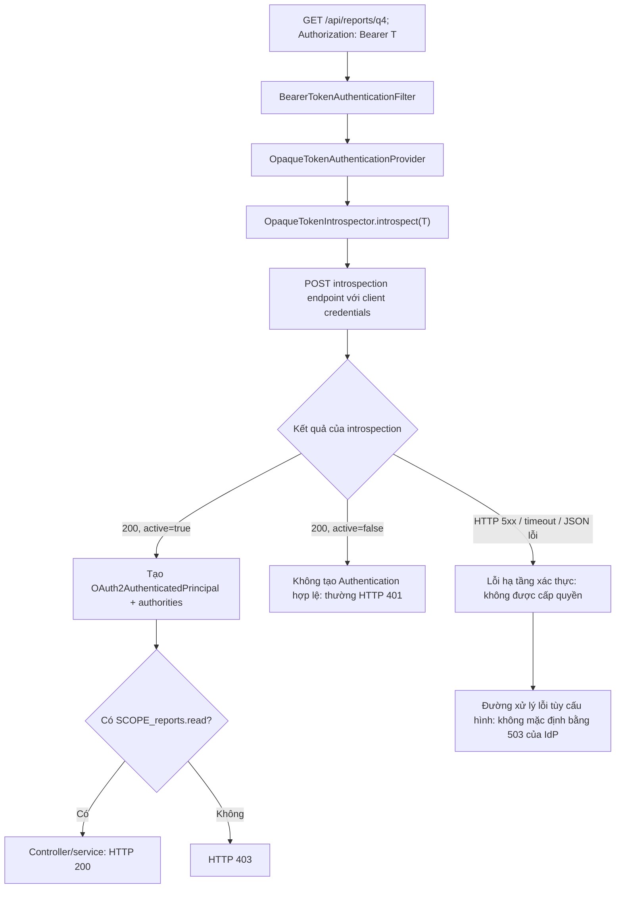

# Kiểm thử introspection thành công, token không active và lỗi dịch vụ

OAuth2 Resource Server có thể nhận **opaque access token**: client gửi một chuỗi bearer không được Resource Server tự giải mã như JWT. Để quyết định token có dùng được hay không, ứng dụng gọi **token introspection endpoint** của Authorization Server, nhận trạng thái `active` và các metadata liên quan. Luồng này tạo thêm một phụ thuộc bảo mật rất quan trọng: **đường HTTP từ ứng dụng đến introspection service**.

Bài thuộc chương **Thực hành tổng hợp** trong module `SPRING_SECURITY_TESTING`, nơi người học kiểm chứng xác thực, phân quyền và bảo vệ HTTP thực tế bằng `spring-security-test` trên Servlet và Reactive, với `MockMvc`, `WebTestClient`, `@WithMockUser`, `SecurityContext`, JWT/OAuth2/OIDC giả lập và các ca được phép hoặc bị từ chối. Chủ đề ở đây là **ba kết quả introspection cần được phân biệt và kiểm thử độc lập**:

1. **Thành công:** introspection trả `active: true`, Resource Server dựng Authentication và kiểm tra scope/authority trước khi xử lý nghiệp vụ.
2. **Token không active:** introspection trả `active: false`, Resource Server từ chối request, không chạy nghiệp vụ.
3. **Lỗi dịch vụ:** introspection endpoint trả lỗi 5xx, quá hạn, không thể kết nối hoặc phản hồi hỏng. Resource Server phải **không mở quyền vì không xác định được token**, đồng thời cần quan sát và xử lý lỗi vận hành theo hợp đồng ứng dụng.

> **Nguyên tắc cốt lõi:** “Introspection trả `active: false`” là kết luận về **token**; “không gọi được introspection service” là lỗi của **hạ tầng xác thực**. Hai trường hợp đều phải fail closed, nhưng không được đánh đồng trong việc ghi log, cảnh báo, retry, mã HTTP hay điều tra sự cố.

## 1. Hiểu vai trò của token introspection

Với OAuth2 Resource Server sử dụng opaque token, luồng khái quát:

```http
GET /api/reports/q4 HTTP/1.1
Host: resource-server.test
Authorization: Bearer opaque-token-value
```

Resource Server không suy đoán token hợp lệ chỉ bằng cách kiểm tra chuỗi có đúng định dạng hay không. Thay vào đó, cấu hình `opaqueToken()` yêu cầu Spring Security lấy bearer credential và gọi `OpaqueTokenIntrospector` (Servlet) hoặc `ReactiveOpaqueTokenIntrospector` (Reactive).



Chức năng introspection theo RFC 7662 thường dùng **HTTP POST** với form body mang tham số `token`. Authorization Server còn xác thực **introspection client** bằng credential/cơ chế riêng; đây không phải username/password của người dùng trong ứng dụng.

Ví dụ response khi token active:

```json
{
  "active": true,
  "sub": "alice",
  "client_id": "reports-client",
  "scope": "reports.read",
  "token_type": "Bearer"
}
```

Ví dụ response khi token không active:

```json
{
  "active": false
}
```

Response không active không bắt buộc công bố chi tiết nguyên nhân hết hạn, thu hồi, sai token hay scope. Người viết test **không được đòi Authorization Server trả sub/scope khi active=false**. Một resource server an toàn sẽ từ chối nếu introspection không chứng nhận token còn active.

### Phân biệt Access Token và ID Token

Introspection trong bài áp dụng cho **Bearer Access Token** mà Resource Server nhận qua `Authorization` header. Nó không phải thử login flow của `oauth2Login()`/`oidcLogin()`, không phải xác minh chữ ký ID Token OIDC và cũng không phải decoder JWT nội bộ. Một token có hình thức giống JWT vẫn có thể được xử lý qua introspection nếu hệ thống được cấu hình vậy; **cơ chế xác thực được cấu hình**, chứ không phải độ dài chuỗi, mới quyết định test phải đi qua bước nào.

## 2. Ba tầng test, ba loại kết luận khác nhau

| Tầng | Test gửi gì? | Có gọi introspector của ứng dụng? | Có HTTP thật tới introspection stub? | Nên dùng để chứng minh |
|---|---|---|---|---|
| **A.** `MockMvc.with(opaqueToken())` / `WebTestClient.mutateWith(mockOpaqueToken())` | Authentication opaque token giả lập gắn vào request | **Không** | **Không** | Authorization và controller **sau khi đã xác thực**. |
| **B.** Bearer header + mock `OpaqueTokenIntrospector` | Bearer token và response giả lập từ interface | **Có gọi mock bean** | **Không** | Bearer filter, mapping authorities, hành vi khi introspector trả principal hoặc ném lỗi. |
| **C.** Bearer header + introspector thật + HTTP stub | Request thực qua `Authorization: Bearer ...` | **Có, bean thật** | **Có** | POST introspection, client authentication, active true/false, service errors và HTTP authorization. |

**Không có tầng nào thay thế tất cả tầng khác.** Dùng A cho ma trận nhiều scopes nhanh; B để dựng những nhánh hiếm và chẩn đoán wiring; C để xác minh giao tiếp thực tế cùng các kịch bản fail-closed. Một bài test A xanh dù introspection URI trỏ sai, client secret không đúng hoặc mạng bị mất, vì A không gọi introspection.

### Trạng thái HTTP nào nên kỳ vọng?

| Tình huống trong chain mặc định | HTTP status thường gặp ở Resource Server | Ý nghĩa |
|---|---|---|
| Không có bearer token | **401** | Chưa có Authentication phù hợp. |
| `active=false` | **401** | Bearer token không hợp lệ/không còn active. |
| `active=true` nhưng thiếu `SCOPE_reports.read` | **403** | Đã xác thực nhưng thiếu quyền. |
| `active=true` và đủ scope | **200** (hoặc 2xx theo endpoint) | Được phép và nghiệp vụ trả kết quả. |
| Introspection endpoint trả 503/timeout | **Phụ thuộc cách exception được ánh xạ** | Không được coi là token active; upstream 503 **không mặc nhiên** thành HTTP 503 trả cho client. |

Với Spring Security mặc định, lỗi request thiếu/invalid bearer thường dùng `BearerTokenAuthenticationEntryPoint`. Với lỗi upstream, exception có thể đi qua cơ chế xử lý authentication hoặc nổi lên thành lỗi server, tùy introspector, HTTP client và custom exception handling. Vì vậy nên viết **test riêng cho hợp đồng HTTP khi dịch vụ xác thực hỏng** thay vì assert tùy tiện `401` hay `503` dựa trên status của Authorization Server.

## 3. Ứng dụng Servlet mẫu: Resource Server và endpoint cần scope

Ví dụ dùng Java 17+, Spring Boot 3.x/Spring Security 6.x với dependencies `spring-boot-starter-web`, `spring-boot-starter-security`, `spring-boot-starter-oauth2-resource-server`, `spring-boot-starter-test` và `spring-security-test`.

### SecurityFilterChain

```java
import org.springframework.context.annotation.Bean;
import org.springframework.context.annotation.Configuration;
import org.springframework.http.HttpMethod;
import org.springframework.security.config.Customizer;
import org.springframework.security.config.annotation.web.builders.HttpSecurity;
import org.springframework.security.web.SecurityFilterChain;

@Configuration
class ReportResourceServerSecurity {
    @Bean
    SecurityFilterChain resourceServer(HttpSecurity http)
            throws Exception {
        return http
                .authorizeHttpRequests(auth -> auth
                        .requestMatchers(
                                HttpMethod.GET, "/api/reports/**")
                        .hasAuthority("SCOPE_reports.read")
                        .requestMatchers(
                                HttpMethod.GET, "/api/identity")
                        .authenticated()
                        .anyRequest().denyAll())
                .oauth2ResourceServer(oauth2 ->
                        oauth2.opaqueToken(Customizer.withDefaults()))
                .build();
    }
}
```

`hasAuthority("SCOPE_reports.read")` kiểm tra chuỗi authority chính xác. Trong cấu hình introspector mặc định, chuỗi `scope` của response thường được ánh xạ thành authorities có tiền tố `SCOPE_`. Nếu ứng dụng tùy chỉnh introspector/converter, test phải kiểm tra **mapping production** chứ không chỉ gắn sẵn authority cần đạt.

Chúng ta dùng GET để không bị trộn với 403 do CSRF trên các thao tác ghi dữ liệu. Nếu hệ thống có POST/PUT/DELETE, thêm ca CSRF riêng theo chính sách Resource Server (đặc biệt với API nhận Bearer token và không dùng cookie authentication).

### Controller và dịch vụ có thể quan sát

```java
import org.springframework.security.core.annotation.AuthenticationPrincipal;
import org.springframework.security.oauth2.core.OAuth2AuthenticatedPrincipal;
import org.springframework.stereotype.Service;
import org.springframework.web.bind.annotation.GetMapping;
import org.springframework.web.bind.annotation.PathVariable;
import org.springframework.web.bind.annotation.RestController;

interface ReportReader {
    String read(String id);
}

@Service
class DefaultReportReader implements ReportReader {
    @Override
    public String read(String id) {
        return "report-" + id;
    }
}

record IdentityResponse(String subject, String clientId) {}

@RestController
class ReportController {
    private final ReportReader reader;

    ReportController(ReportReader reader) {
        this.reader = reader;
    }

    @GetMapping("/api/reports/{id}")
    String report(@PathVariable String id) {
        return reader.read(id);
    }

    @GetMapping("/api/identity")
    IdentityResponse identity(
            @AuthenticationPrincipal
            OAuth2AuthenticatedPrincipal principal) {
        return new IdentityResponse(
                principal.getAttribute("sub"),
                principal.getAttribute("client_id"));
    }
}
```

Ở ví dụ này, HTTP filter chain kiểm tra quyền đọc báo cáo **trước** khi controller gọi `ReportReader`. Vì vậy trong bài test ta có thể mock `ReportReader` để bảo đảm request thiếu quyền/không active **không gọi nghiệp vụ**. Nếu quyền nằm trong `@PreAuthorize` trên chính service, phải giữ service đó là bean thật để không bypass method-security proxy.

`@AuthenticationPrincipal OAuth2AuthenticatedPrincipal` thích hợp với bearer opaque token sau introspection; nó không nhận principal giả lập từ `@WithMockUser` theo cùng kiểu. Đọc claim `sub`/`client_id` từ response introspection giúp test kiểm chứng mapping identity đã thực sự được đưa vào Authentication.

## 4. Cấu hình introspection URI và credential

Với Spring Boot OAuth2 Resource Server, có thể để framework cấu hình introspector từ properties:

```properties
spring.security.oauth2.resourceserver.opaquetoken.introspection-uri=https://identity.example.test/oauth2/introspect
spring.security.oauth2.resourceserver.opaquetoken.client-id=reports-resource-server
spring.security.oauth2.resourceserver.opaquetoken.client-secret=REPLACE_WITH_SECRET_FROM_VAULT
```

Đây là **ví dụ cấu hình về hình thức**, không phải URI hay credential thật để chạy test. Trong production, dùng HTTPS và cơ chế lưu secret an toàn. **Không dùng introspection endpoint production trong CI** để tránh phụ thuộc mạng, dữ liệu người dùng, quota và rủi ro ghi lộ access token.

Trong test tích hợp, thay URI bằng **HTTP stub tại loopback** với cổng ngẫu nhiên; dùng client ID/secret dành riêng cho test. Mục đích là kiểm tra:

- Resource Server gửi request đúng **HTTP POST** và đưa token qua form body.
- Request gửi **client authentication** phù hợp cấu hình (ví dụ Basic authentication, không phải user credential).
- Response `active:true` tạo Authentication; `active:false` bị từ chối.
- HTTP 5xx, timeout hoặc phản hồi không hợp lệ **không được mở đường tới nghiệp vụ**.

## 5. HTTP introspection stub tự chứa bằng JDK

Để không cần một Authorization Server ngoài thật, ta dùng `com.sun.net.httpserver.HttpServer` của JDK (module `jdk.httpserver`) làm một fixture HTTP nhỏ. Có thể thay bằng WireMock hoặc MockWebServer nếu dự án đã dùng chúng.

```java
import com.sun.net.httpserver.HttpServer;
import java.io.IOException;
import java.net.InetSocketAddress;
import java.nio.charset.StandardCharsets;
import java.util.concurrent.atomic.AtomicInteger;
import java.util.concurrent.atomic.AtomicReference;

final class LocalIntrospectionServer implements AutoCloseable {

    record Reply(int status, String json) {}

    private final HttpServer server;
    private final AtomicReference<Reply> reply =
            new AtomicReference<>(new Reply(200, "{\"active\":false}"));
    private final AtomicInteger calls = new AtomicInteger();
    private final AtomicReference<String> method = new AtomicReference<>();
    private final AtomicReference<String> auth = new AtomicReference<>();
    private final AtomicReference<String> body = new AtomicReference<>();

    LocalIntrospectionServer() throws IOException {
        server = HttpServer.create(
                new InetSocketAddress("127.0.0.1", 0), 0);
        server.createContext("/introspect", exchange -> {
            calls.incrementAndGet();
            method.set(exchange.getRequestMethod());
            auth.set(exchange.getRequestHeaders()
                    .getFirst("Authorization"));
            body.set(new String(
                    exchange.getRequestBody().readAllBytes(),
                    StandardCharsets.UTF_8));

            Reply response = reply.get();
            byte[] bytes = response.json()
                    .getBytes(StandardCharsets.UTF_8);
            exchange.getResponseHeaders().set(
                    "Content-Type", "application/json");
            exchange.sendResponseHeaders(
                    response.status(), bytes.length);
            try (var output = exchange.getResponseBody()) {
                output.write(bytes);
            }
        });
        server.start();
    }

    String url() {
        return "http://127.0.0.1:"
                + server.getAddress().getPort() + "/introspect";
    }

    void respond(int status, String json) {
        reply.set(new Reply(status, json));
        calls.set(0);
        method.set(null);
        auth.set(null);
        body.set(null);
    }

    int calls() { return calls.get(); }
    String method() { return method.get(); }
    String authorization() { return auth.get(); }
    String requestBody() { return body.get(); }

    @Override
    public void close() {
        server.stop(0);
    }
}
```

Stub này giữ một response chung và các quan sát của request gần nhất, nên các test dùng chung phải **chạy tuần tự** hoặc được tách fixture. Nó không mô phỏng đầy đủ Authorization Server production. Đừng dùng stub trả `active:true` vô điều kiện làm bằng chứng token thực sự an toàn; mục tiêu ở đây là kiểm thử **Resource Server xử lý phản hồi của dịch vụ introspection đúng thế nào**.

Để kiểm tra khả năng retry, concurrency, rate limiting hoặc timeout, cần một fixture có kịch bản theo từng request, đồng hồ/latency kiểm soát được và assertions tương ứng. Không thêm `Thread.sleep` dài để ép network timeout trong mọi test CI.

## 6. Spring Boot và MockMvc gọi introspection qua HTTP thật

Ta nạp `SecurityFilterChain` ở mục 3, controller và introspector do Spring Boot cấu hình từ properties. **Không thay `OpaqueTokenIntrospector` bằng Mockito trong lớp test này**, vì điều cần chứng minh là Resource Server thực sự phát HTTP request đến endpoint introspection.

Ứng dụng mẫu có thể dùng entry point:

```java
import org.springframework.boot.SpringApplication;
import org.springframework.boot.autoconfigure.SpringBootApplication;

@SpringBootApplication
public class ReportResourceServerApplication {
    public static void main(String[] args) {
        SpringApplication.run(
                ReportResourceServerApplication.class, args);
    }
}
```

Lớp test sử dụng `@DynamicPropertySource` để đưa URI của stub loopback vào cấu hình **trước khi Spring dựng introspector**:

```java
import java.io.IOException;
import java.io.UncheckedIOException;
import org.junit.jupiter.api.AfterAll;
import org.junit.jupiter.api.BeforeEach;
import org.junit.jupiter.api.Test;
import org.springframework.beans.factory.annotation.Autowired;
import org.springframework.boot.test.autoconfigure.web.servlet.AutoConfigureMockMvc;
import org.springframework.boot.test.context.SpringBootTest;
import org.springframework.http.HttpHeaders;
import org.springframework.test.annotation.DirtiesContext;
import org.springframework.test.context.DynamicPropertyRegistry;
import org.springframework.test.context.DynamicPropertySource;
import org.springframework.test.context.bean.override.mockito.MockitoBean;
import org.springframework.test.web.servlet.MockMvc;
import org.springframework.test.web.servlet.MvcResult;

import static org.assertj.core.api.Assertions.assertThat;
import static org.mockito.Mockito.verify;
import static org.mockito.Mockito.verifyNoInteractions;
import static org.mockito.Mockito.when;
import static org.springframework.test.web.servlet.request
        .MockMvcRequestBuilders.get;
import static org.springframework.test.web.servlet.result
        .MockMvcResultMatchers.*;

@SpringBootTest(
        webEnvironment = SpringBootTest.WebEnvironment.MOCK,
        properties = {
                "spring.security.oauth2.resourceserver.opaquetoken.client-id=test-client",
                "spring.security.oauth2.resourceserver.opaquetoken.client-secret=test-secret"
        })
@AutoConfigureMockMvc
@DirtiesContext(classMode = DirtiesContext.ClassMode.AFTER_CLASS)
class OpaqueTokenIntrospectionHttpTest {

    static final LocalIntrospectionServer STUB = startStub();

    private static LocalIntrospectionServer startStub() {
        try {
            return new LocalIntrospectionServer();
        } catch (IOException ex) {
            throw new UncheckedIOException(ex);
        }
    }

    @DynamicPropertySource
    static void introspectionProperties(
            DynamicPropertyRegistry registry) {
        registry.add(
                "spring.security.oauth2.resourceserver.opaquetoken.introspection-uri",
                STUB::url);
    }

    @Autowired
    MockMvc mvc;

    @MockitoBean
    ReportReader reports;

    @BeforeEach
    void prepareResponse() {
        STUB.respond(200, "{\"active\":false}");
    }

    @AfterAll
    static void stopStub() {
        STUB.close();
    }

    // Các @Test ở mục 7-9 đặt tiếp trong lớp này.
}
```

`@MockitoBean` thuộc Spring Framework 6.2+/Spring Boot 3.4+; với stack cũ hơn, dùng giải pháp mock bean được hỗ trợ tương ứng. **Chỉ mock `ReportReader`**, không mock `OpaqueTokenIntrospector` hoặc Spring Security filter chain. Test giả định các class cấu hình/controller nằm trong component scan của `ReportResourceServerApplication`.

`@DirtiesContext(AFTER_CLASS)` có một lý do **cụ thể** trong ví dụ này: cuối lớp ta dừng HTTP stub riêng, nên một Spring `ApplicationContext` đã cache introspection URI tới cổng đó không được tái sử dụng bởi lớp khác. Đây không phải cách dọn token của từng test. Trong bộ test thực tế, có thể thay bằng vòng đời stub/server dùng chung đúng cách và bỏ `@DirtiesContext` nếu không còn cần.

### Điều quan trọng khi dùng MockMvc

`@AutoConfigureMockMvc` với security filters được bật chạy Spring Security Servlet filter chain. Nếu tự dùng `MockMvcBuilders.webAppContextSetup(context)`, phải `.apply(springSecurity())` để bảo đảm tích hợp security. `MockMvcBuilders.standaloneSetup(controller)` không tự tạo toàn bộ filter chain; nó không phù hợp để chứng minh HTTP Bearer introspection hoạt động.

Một request dùng `.with(opaqueToken())` hoặc `@WithMockUser` sẽ **không đại diện cho bearer introspection qua HTTP**. Trong các test tích hợp bên dưới, ta chỉ dùng:

```java
mvc.perform(get("/api/reports/q4")
        .header(HttpHeaders.AUTHORIZATION, "Bearer allow-read"));
```

Không gắn thêm mock authentication lên request đó; nếu gắn, test có thể được phép dù introspection endpoint không được gọi.

## 7. Ca thành công: active=true, đủ scope, không bỏ qua nghiệp vụ

Introspection stub trả lời một access token active, có thông tin người dùng và scope đủ quyền:

```java
@Test
void activeTokenWithReadScope_allowsRequest() throws Exception {
    STUB.respond(200, """
        {
          "active": true,
          "sub": "alice",
          "client_id": "reports-client",
          "scope": "reports.read",
          "token_type": "Bearer"
        }
        """);

    when(reports.read("q4")).thenReturn("report-q4");

    mvc.perform(get("/api/reports/q4")
                    .header(HttpHeaders.AUTHORIZATION,
                            "Bearer allow-read"))
            .andExpect(status().isOk())
            .andExpect(content().string("report-q4"));

    verify(reports).read("q4");
    assertThat(STUB.calls()).isEqualTo(1);
    assertThat(STUB.method()).isEqualTo("POST");
    assertThat(STUB.requestBody())
            .contains("token=allow-read");
}
```

Đây là chuỗi bằng chứng nối tiếp:

1. Client gửi **Bearer token** tới Resource Server.
2. Resource Server thực hiện **HTTP POST introspection**, gửi chính giá trị token tới stub.
3. Response `active=true` và `scope=reports.read` tạo Authentication với authority thích hợp.
4. Security filter cho phép request, controller gọi `ReportReader`, HTTP response trả đúng nội dung.

Nếu test chỉ kiểm tra 200, một cấu hình `permitAll()` sai vẫn có thể làm nó xanh. Assertion `STUB.calls() == 1` và `verify(reports)` giúp chứng minh đường introspection và nghiệp vụ đã thực sự hoạt động. Với test có retry được cấu hình, **số lần HTTP call** có thể khác 1; khi đó thay assertion bằng kỳ vọng có chủ đích, không giả định retry mặc định.

### Kiểm tra HTTP client authentication

Với client ID và client secret trong ví dụ, introspection request thường dùng HTTP Basic. Có thể thêm assertion:

```java
import java.nio.charset.StandardCharsets;
import java.util.Base64;

String expectedBasic = "Basic " + Base64.getEncoder()
        .encodeToString(
                "test-client:test-secret".getBytes(
                        StandardCharsets.UTF_8));

assertThat(STUB.authorization()).isEqualTo(expectedBasic);
```

Đây là credential **chỉ dành cho test**, không phải secret của IdP production. Không in header này ra log. Nếu Authorization Server sử dụng phương thức client authentication khác (ví dụ private_key_jwt hoặc mTLS), test phải kiểm tra đúng cơ chế đó; **không ép mọi hệ thống dùng Basic**.

### Kiểm tra claims từ introspection vào Authentication

```java
@Test
void activeToken_exposesPrincipalAttributes() throws Exception {
    STUB.respond(200, """
        {
          "active": true,
          "sub": "alice",
          "client_id": "reports-client",
          "scope": "reports.read"
        }
        """);

    mvc.perform(get("/api/identity")
                    .header(HttpHeaders.AUTHORIZATION,
                            "Bearer whoami-token"))
            .andExpect(status().isOk())
            .andExpect(jsonPath("$.subject").value("alice"))
            .andExpect(jsonPath("$.clientId")
                    .value("reports-client"));

    assertThat(STUB.calls()).isEqualTo(1);
    assertThat(STUB.requestBody())
            .contains("token=whoami-token");
}
```

Endpoint `/api/identity` xác nhận Spring đã tạo `OAuth2AuthenticatedPrincipal` từ **introspection response**; `sub` và `client_id` không được lấy từ token string hoặc query parameter do client tự khai.

### Token active nhưng scope không phù hợp phải nhận 403

```java
@Test
void activeTokenWithoutReadScope_isForbidden()
        throws Exception {
    STUB.respond(200, """
        {
          "active": true,
          "sub": "alice",
          "scope": "reports.write"
        }
        """);

    mvc.perform(get("/api/reports/q4")
                    .header(HttpHeaders.AUTHORIZATION,
                            "Bearer write-only"))
            .andExpect(status().isForbidden());

    assertThat(STUB.calls()).isEqualTo(1);
    verifyNoInteractions(reports);
}
```

Hai ca trên có cùng `active:true` nhưng **khác scope**. Điều này chứng minh authentication thành công không tự đồng nghĩa với authorization thành công. Nếu chỉ thử token active và kiểm tra 200, có thể bỏ sót bug cấp quá nhiều quyền.

## 8. Ca inactive: active=false phải bị từ chối, không vào nghiệp vụ

Introspection endpoint có thể trả HTTP 200 cùng JSON `{"active": false}`. Đây **không phải lỗi HTTP của Authorization Server**; đó là **phản hồi giao thức hợp lệ báo token không sử dụng được**.

```java
@Test
void inactiveToken_isRejectedWith401() throws Exception {
    STUB.respond(200, """
        {
          "active": false
        }
        """);

    mvc.perform(get("/api/reports/q4")
                    .header(HttpHeaders.AUTHORIZATION,
                            "Bearer revoked-token"))
            .andExpect(status().isUnauthorized());

    assertThat(STUB.calls()).isEqualTo(1);
    assertThat(STUB.requestBody())
            .contains("token=revoked-token");
    verifyNoInteractions(reports);
}
```

`OpaqueTokenIntrospector` đúng trách nhiệm phải coi response `active:false` là token không hợp lệ, không trả principal có thể xác thực. Với Bearer entry point thông thường của Spring Security, Resource Server trả 401; nội dung `WWW-Authenticate` có thể chứa thông tin `invalid_token` tùy đường đi và cấu hình.

### Đối chứng: không có Bearer token thì không được gọi introspection

```java
@Test
void missingBearerToken_returns401_withoutIntrospection()
        throws Exception {
    mvc.perform(get("/api/reports/q4"))
            .andExpect(status().isUnauthorized());

    assertThat(STUB.calls()).isZero();
    verifyNoInteractions(reports);
}
```

Không có Bearer header thì ứng dụng chưa nhận được token để introspect. Một hệ thống tự gọi introspection ngay cả khi không có token có thể tăng tải, và thường báo hiệu luồng filter/adapter bị thiết kế sai.

### Inactive không phải thiếu scope

Đừng lấy một principal thiếu quyền rồi kỳ vọng 401. **403** thường nghĩa là `active:true` và đã xác thực, nhưng không có authority tương ứng. **401** thường nghĩa là token thiếu/không được chấp nhận. Để tránh test xanh giả, luôn kiểm tra cả ba nhánh:

- `active:true` + `reports.read` → **200** và nghiệp vụ chạy.
- `active:true` + `reports.write` → **403** và nghiệp vụ không chạy.
- `active:false` → **401** và nghiệp vụ không chạy.

## 9. Ca lỗi introspection service: fail closed, không giả định sai HTTP status

Lỗi của introspection service có nhiều loại:

- Authorization Server trả `503 Service Unavailable` hoặc `500 Internal Server Error`.
- HTTP client không thể kết nối, DNS lỗi hoặc connection timeout.
- Introspection endpoint trả `401 Unauthorized` vì **client credential dùng để introspect** không đúng.
- Endpoint trả `200` nhưng body không phải JSON hợp lệ hoặc thiếu cấu trúc bắt buộc.
- Dịch vụ quá chậm, vượt thời gian chờ cho phép.

Những lỗi ấy **không tương đương token inactive**. Với `active=false`, Authorization Server đã trả lời thành công rằng token không dùng được. Với HTTP 503, Resource Server **không biết** token còn active hay không. Không được tự chuyển trạng thái “không biết” thành “active”.

### 9.1. Introspection upstream trả 503

Ta kiểm tra **đường gọi HTTP thật** và rằng nghiệp vụ không được gọi. Đường xử lý exception có thể khác nhau giữa các cấu hình (authentication failure, server error hoặc exception bị propagate), vì thế ví dụ chấp nhận **HTTP lỗi từ 400 trở lên hoặc ServletException có nguyên nhân**. Nó không coi upstream 503 đồng nghĩa resource-server HTTP 503.

```java
import jakarta.servlet.ServletException;

@Test
void introspectionService503_mustNotAllowBusinessOperation()
        throws Exception {
    STUB.respond(503, """
        {
          "error": "temporarily_unavailable"
        }
        """);

    try {
        MvcResult result = mvc.perform(get("/api/reports/q4")
                        .header(HttpHeaders.AUTHORIZATION,
                                "Bearer possibly-valid-token"))
                .andReturn();

        assertThat(result.getResponse().getStatus())
                .isGreaterThanOrEqualTo(400);
    } catch (ServletException failure) {
        // Một số cấu hình propagate lỗi dịch vụ xác thực
        // thay vì chuyển trực tiếp thành HTTP response.
        assertThat(failure.getCause()).isNotNull();
    }

    assertThat(STUB.calls()).isEqualTo(1);
    verifyNoInteractions(reports);
}
```

Assertion này kiểm tra nguyên tắc **fail closed** mà không áp đặt mapping lỗi không tồn tại trong cấu hình minh họa. Nếu API có hợp đồng rõ rằng IdP outage phải trả **503** hoặc **502**, hãy cấu hình exception translation/entry point nhất quán trước, rồi viết một test chặt chẽ assert đúng status, headers và body theo hợp đồng đó. Không được chỉ sửa kỳ vọng test để phù hợp với HTTP 401 tình cờ nếu mục tiêu sản phẩm đòi phân biệt lỗi hạ tầng và token invalid.

**Lưu ý về security:** Một lỗi upstream **không được** khiến hệ thống bỏ qua introspection rồi trả 200 theo kiểu “best effort” cho API bảo vệ. Nếu có thiết kế cache kết quả introspection để tiếp tục hoạt động khi upstream hỏng, phải có chính sách TTL, revocation risk và key isolation rõ ràng, rồi kiểm thử riêng các kịch bản stale-cache.

### 9.2. HTTP 200 nhưng JSON không hợp lệ

Không phải mọi HTTP 200 từ introspection endpoint đều là thành công xác thực. Body phải được phân tích và `active` phải được xử lý đúng kiểu boolean:

```java
@Test
void invalidJsonFromIntrospection_mustNotGrantAccess()
        throws Exception {
    STUB.respond(200, "not-json");

    try {
        MvcResult result = mvc.perform(get("/api/reports/q4")
                        .header(HttpHeaders.AUTHORIZATION,
                                "Bearer suspect-token"))
                .andReturn();

        assertThat(result.getResponse().getStatus())
                .isGreaterThanOrEqualTo(400);
    } catch (ServletException failure) {
        assertThat(failure.getCause()).isNotNull();
    }

    assertThat(STUB.calls()).isEqualTo(1);
    verifyNoInteractions(reports);
}
```

Tương tự, cần có ca `active` bị thiếu hoặc trả sai kiểu (ví dụ chuỗi `"true"` thay cho boolean) nếu dự án viết **custom introspector**. Một test không được mặc định rằng khi HTTP 200 thì cứ trả principal mặc dù JSON không xác nhận trạng thái active.

### 9.3. Sai credentials của introspection client

Đừng nhầm:

```text
Authorization: Bearer opaque-user-token
```

trong request tới **Resource Server** với:

```text
Authorization: Basic base64(introspection-client-id:client-secret)
```

trong request **từ Resource Server tới Authorization Server**. Nếu introspection client secret sai, Authorization Server có thể từ chối chính HTTP introspection request; khi đó mọi bearer token đều có nguy cơ không được xác minh, chứ không có nghĩa mọi user token đều bị revoke.

Để test kịch bản này, cấu hình stub kiểm tra `Authorization` header; khi client credentials không đúng, nó trả 401. Kiểm tra Resource Server **không chạy nghiệp vụ**, đồng thời ứng dụng ghi nhận trạng thái lỗi dependency với mức cảnh báo phù hợp. Nếu có retry, bảo đảm không vô tình retry liên tục một lỗi credential cố định, làm tăng tải và nguy cơ lộ thông tin.

### 9.4. Timeout và unreachable endpoint

Một test timeout ổn định không nên dựa vào thời gian chờ mặc định của hệ điều hành hoặc `Thread.sleep(30000)`. Thay vào đó:

1. Cấu hình connect/read/response timeout có giới hạn trên **HTTP client mà introspector thực sự sử dụng**.
2. Dùng HTTP stub có delay được kiểm soát hoặc một fake HTTP transport có khả năng phát lỗi timeout theo kịch bản.
3. Gửi request bảo vệ với bearer token, đợi lỗi có deadline hợp lý; xác nhận **không có data/side effect**.
4. Nếu ứng dụng có circuit breaker/retry, xác nhận số lần gọi, ngân sách thời gian, backoff và điều kiện ngừng retry.
5. Đảm bảo đường success vẫn hoạt động khi stub hồi phục; tránh một circuit breaker bị kẹt mở trong toàn bộ suite.

Trong Spring Security 6.x có nhiều cách cấu hình introspector/HTTP client tùy phiên bản; hãy sử dụng API tương ứng với thư viện đang dùng, không chỉ đặt timeout trên một HTTP client khác không tham gia thực hiện introspection. Nếu test cần assert chính xác HTTP 503 của ứng dụng, test phải bao gồm **cấu hình mapping exception đó**.

## 10. Mock introspector: kiểm tra wiring mà không gọi HTTP

Đôi khi một ca cần test lỗi introspection mà không cần khởi động stub. Ta có thể thay `OpaqueTokenIntrospector` bằng mock để kiểm tra đường:

```text
Authorization: Bearer T
    -> BearerTokenAuthenticationFilter
    -> OpaqueTokenAuthenticationProvider
    -> introspector.introspect(T) (Mockito)
    -> Authentication / authorization / error
```

Ví dụ **một lớp test riêng**:

```java
import java.util.List;
import java.util.Map;
import org.junit.jupiter.api.Test;
import org.springframework.beans.factory.annotation.Autowired;
import org.springframework.boot.test.autoconfigure.web.servlet.AutoConfigureMockMvc;
import org.springframework.boot.test.context.SpringBootTest;
import org.springframework.http.HttpHeaders;
import org.springframework.security.core.authority.SimpleGrantedAuthority;
import org.springframework.security.oauth2.core
        .DefaultOAuth2AuthenticatedPrincipal;
import org.springframework.security.oauth2.server.resource.introspection
        .BadOpaqueTokenException;
import org.springframework.security.oauth2.server.resource.introspection
        .OpaqueTokenIntrospector;
import org.springframework.test.context.bean.override.mockito.MockitoBean;
import org.springframework.test.web.servlet.MockMvc;

import static org.mockito.Mockito.verify;
import static org.mockito.Mockito.when;
import static org.springframework.test.web.servlet.request
        .MockMvcRequestBuilders.get;
import static org.springframework.test.web.servlet.result
        .MockMvcResultMatchers.status;

@SpringBootTest(properties = {
        "spring.security.oauth2.resourceserver.opaquetoken.introspection-uri=http://127.0.0.1:9/unused",
        "spring.security.oauth2.resourceserver.opaquetoken.client-id=test-client",
        "spring.security.oauth2.resourceserver.opaquetoken.client-secret=test-secret"
})
@AutoConfigureMockMvc
class MockOpaqueTokenIntrospectorTest {
    @Autowired MockMvc mvc;

    @MockitoBean
    OpaqueTokenIntrospector introspector;

    @Test
    void bearerIsPassedToIntrospector_andReadScopeWorks()
            throws Exception {
        var principal = new DefaultOAuth2AuthenticatedPrincipal(
                "alice",
                Map.of(
                        "sub", "alice",
                        "scope", "reports.read"),
                List.of(new SimpleGrantedAuthority(
                        "SCOPE_reports.read")));

        when(introspector.introspect("stubbed-valid"))
                .thenReturn(principal);

        mvc.perform(get("/api/reports/q4")
                        .header(HttpHeaders.AUTHORIZATION,
                                "Bearer stubbed-valid"))
                .andExpect(status().isOk());

        verify(introspector).introspect("stubbed-valid");
    }

    @Test
    void mockRejectsToken_returns401() throws Exception {
        when(introspector.introspect("stubbed-invalid"))
                .thenThrow(new BadOpaqueTokenException(
                        "Inactive token"));

        mvc.perform(get("/api/reports/q4")
                        .header(HttpHeaders.AUTHORIZATION,
                                "Bearer stubbed-invalid"))
                .andExpect(status().isUnauthorized());

        verify(introspector).introspect("stubbed-invalid");
    }
}
```

Lớp mock này cần ứng dụng đã có `ReportResourceServerSecurity`, controller và bean `ReportReader` thích hợp. Test **không kiểm tra URI, Basic client credentials, HTTP status upstream hay JSON `active`**: các chi tiết đó đều bị bỏ qua khi introspector là Mockito. `@MockitoBean` được giới thiệu từ Spring Framework 6.2; với các phiên bản cũ hơn, dùng cơ chế phù hợp.

**Đừng suy diễn từ mock:** Nếu `thenReturn(principal)` với claim `active=false` nhưng principal lại có authority đọc, bài test có thể vẫn cho phép vì mock **đã giả lập kết quả introspection thành công**. Để kiểm tra xử lý `active=false` theo RFC 7662, phải dùng **introspector thật** (tầng C) hoặc test riêng implementation custom nhận raw JSON. Trong tầng B, cách thể hiện token inactive là **ném exception**, không phải trả principal chứa một flag giả.

## 11. OpaqueToken() của spring-security-test: tiện nhưng bỏ qua introspection

Trong `MockMvc`, Spring Security Test cung cấp `SecurityMockMvcRequestPostProcessors.opaqueToken()` để đặt một `BearerTokenAuthentication` giả lập vào request:

```java
import org.springframework.security.core.authority.SimpleGrantedAuthority;

import static org.springframework.security.test.web.servlet.request
        .SecurityMockMvcRequestPostProcessors.opaqueToken;

mvc.perform(get("/api/reports/q4")
        .with(opaqueToken()
                .authorities(new SimpleGrantedAuthority(
                        "SCOPE_reports.read"))))
        .andExpect(status().isOk());
```

Đây là cách rất hữu ích để **test nhanh luật authorization và hành vi controller sau khi token được xem là hợp lệ**. Nó không gửi HTTP `Authorization: Bearer ...` để introspect; `OpaqueTokenIntrospector` thật có thể đang hỏng, nhưng test trên vẫn xanh. Vì vậy:

- Dùng `opaqueToken()` cho nhiều tổ hợp authorities và dữ liệu nghiệp vụ.
- Dùng mock `OpaqueTokenIntrospector` khi muốn giữ đường bearer filter nhưng không cần HTTP introspection.
- Dùng introspector thật + HTTP stub khi mục tiêu là `active:true/false`, client authentication, HTTP lỗi hoặc mapping phản hồi.

Không gắn `opaqueToken()` lên **cùng request** đang dùng để thử gửi bearer token tới introspection; việc thêm một Authentication đã có sẵn có thể làm đường xác thực cần kiểm tra bị bỏ qua hoặc gây kết quả khó diễn giải.

## 12. WebFlux: cùng chính sách nhưng phải dùng ReactiveOpaqueTokenIntrospector

Với WebFlux, chuỗi là `SecurityWebFilterChain` và interface là `ReactiveOpaqueTokenIntrospector` trả về `Mono<OAuth2AuthenticatedPrincipal>`. Không dùng Servlet `OpaqueTokenIntrospector`, `MockMvc` post-processor hoặc `SecurityContextHolder` kiểu ThreadLocal để thử request Reactive.

### SecurityWebFilterChain và controller minh họa

```java
import org.springframework.context.annotation.Bean;
import org.springframework.context.annotation.Configuration;
import org.springframework.http.HttpMethod;
import org.springframework.security.config.Customizer;
import org.springframework.security.config.annotation.web.reactive.EnableWebFluxSecurity;
import org.springframework.security.config.web.server.ServerHttpSecurity;
import org.springframework.security.web.server.SecurityWebFilterChain;

@Configuration
@EnableWebFluxSecurity
class ReactiveReportSecurity {
    @Bean
    SecurityWebFilterChain chain(ServerHttpSecurity http) {
        return http
                .authorizeExchange(auth -> auth
                        .pathMatchers(
                                HttpMethod.GET, "/reactive/reports/**")
                        .hasAuthority("SCOPE_reports.read")
                        .anyExchange().denyAll())
                .oauth2ResourceServer(oauth2 ->
                        oauth2.opaqueToken(Customizer.withDefaults()))
                .build();
    }
}
```

```java
import org.springframework.web.bind.annotation.GetMapping;
import org.springframework.web.bind.annotation.PathVariable;
import org.springframework.web.bind.annotation.RestController;
import reactor.core.publisher.Mono;

@RestController
class ReactiveReportController {
    @GetMapping("/reactive/reports/{id}")
    Mono<String> report(@PathVariable String id) {
        return Mono.just("report-" + id);
    }
}
```

Đây là **một ứng dụng WebFlux mẫu riêng**; không ghép trực tiếp vào Servlet MVC app trước đó rồi giả định các filter vẫn chạy giống nhau. Với `ReactiveOpaqueTokenIntrospector` production, có thể cấu hình introspection URI/client credentials của Reactive Resource Server qua Spring Boot properties tương ứng và dùng cùng HTTP stub loopback.

### Test Reactive bằng WebTestClient với mock introspector

```java
import java.util.List;
import java.util.Map;
import org.junit.jupiter.api.BeforeEach;
import org.junit.jupiter.api.Test;
import org.springframework.beans.factory.annotation.Autowired;
import org.springframework.boot.test.context.SpringBootTest;
import org.springframework.context.ApplicationContext;
import org.springframework.http.HttpHeaders;
import org.springframework.security.core.authority.SimpleGrantedAuthority;
import org.springframework.security.oauth2.core
        .DefaultOAuth2AuthenticatedPrincipal;
import org.springframework.security.oauth2.server.resource.introspection
        .BadOpaqueTokenException;
import org.springframework.security.oauth2.server.resource.introspection
        .ReactiveOpaqueTokenIntrospector;
import org.springframework.test.context.bean.override.mockito.MockitoBean;
import org.springframework.test.web.reactive.server.WebTestClient;
import reactor.core.publisher.Mono;

import static org.mockito.Mockito.verify;
import static org.mockito.Mockito.when;
import static org.springframework.security.test.web.reactive.server
        .SecurityMockServerConfigurers.springSecurity;

@SpringBootTest(
        webEnvironment = SpringBootTest.WebEnvironment.MOCK,
        properties = {
                "spring.main.web-application-type=reactive",
                "spring.security.oauth2.resourceserver.opaquetoken.introspection-uri=http://127.0.0.1:9/unused",
                "spring.security.oauth2.resourceserver.opaquetoken.client-id=test-client",
                "spring.security.oauth2.resourceserver.opaquetoken.client-secret=test-secret"
        })
class ReactiveIntrospectionTest {
    @Autowired ApplicationContext context;

    @MockitoBean
    ReactiveOpaqueTokenIntrospector introspector;

    WebTestClient client;

    @BeforeEach
    void setUp() {
        client = WebTestClient.bindToApplicationContext(context)
                .apply(springSecurity())
                .configureClient()
                .build();
    }

    @Test
    void activePrincipalWithScope_isAllowed() {
        var principal = new DefaultOAuth2AuthenticatedPrincipal(
                "alice",
                Map.of("sub", "alice", "scope", "reports.read"),
                List.of(new SimpleGrantedAuthority(
                        "SCOPE_reports.read")));
        when(introspector.introspect("reactive-valid"))
                .thenReturn(Mono.just(principal));

        client.get()
                .uri("/reactive/reports/q4")
                .header(HttpHeaders.AUTHORIZATION,
                        "Bearer reactive-valid")
                .exchange()
                .expectStatus().isOk()
                .expectBody(String.class).isEqualTo("report-q4");

        verify(introspector).introspect("reactive-valid");
    }

    @Test
    void inactiveToken_isRejected() {
        when(introspector.introspect("reactive-inactive"))
                .thenReturn(Mono.error(
                        new BadOpaqueTokenException("Inactive token")));

        client.get()
                .uri("/reactive/reports/q4")
                .header(HttpHeaders.AUTHORIZATION,
                        "Bearer reactive-inactive")
                .exchange()
                .expectStatus().isUnauthorized();

        verify(introspector).introspect("reactive-inactive");
    }
}
```

Các test này giữ **Reactive bearer authentication flow**, nhưng vì introspector là mock, chúng không xác nhận HTTP POST, credentials hay xử lý `active:false` của JSON introspection. Chúng mô phỏng kết quả `Mono.just(principal)` và `Mono.error(...)`. Để kiểm thử **giao thức HTTP thật ở WebFlux**, hãy bỏ `@MockitoBean`, khởi động `LocalIntrospectionServer` từ mục 5, trỏ property introspection URI đến stub bằng `@DynamicPropertySource` rồi gửi bearer token tương tự.

### WebFlux không có nghĩa là có thể chỉ tạo một Mono mà kết luận đã xác thực

Nếu test trực tiếp một reactive service trả `Mono`, phải subscribe và quan sát terminal signal, ví dụ `StepVerifier.create(publisher).expectError(...).verify()`. Chỉ tạo Publisher hoặc viết `StepVerifier.create(...)` mà không `verify()` không kích hoạt toàn bộ pipeline. Với `WebTestClient.exchange()`, request được thực sự xử lý qua HTTP pipeline.

`SecurityMockServerConfigurers.mockOpaqueToken()` giúp gắn Authentication giả lập vào request WebFlux:

```java
import static org.springframework.security.test.web.reactive.server
        .SecurityMockServerConfigurers.mockOpaqueToken;

client.mutateWith(mockOpaqueToken()
                .authorities(new SimpleGrantedAuthority(
                        "SCOPE_reports.read")))
        .get()
        .uri("/reactive/reports/q4")
        .exchange()
        .expectStatus().isOk();
```

Đây là tầng A, **bỏ qua `ReactiveOpaqueTokenIntrospector`**. Dùng đúng khi mục tiêu là quyền sau authentication, không dùng nó để khẳng định introspection thành công hoặc đã xử lý dịch vụ introspection lỗi.

## 13. Trạng thái token thay đổi giữa hai request

Một token có thể active ở request đầu và bị thu hồi trước request sau. Nếu Resource Server **thực hiện introspection cho mỗi request theo cấu hình minh họa và không dùng cache kết quả**, một bài test có thể cho stub đổi từ `active:true` sang `active:false` ngay trong cùng kịch bản.

```java
@Test
void revokedTokenIsRejectedOnNextRequest_whenNoCache()
        throws Exception {
    STUB.respond(200, """
        {
          "active": true,
          "sub": "alice",
          "scope": "reports.read"
        }
        """);
    when(reports.read("q4")).thenReturn("report-q4");

    mvc.perform(get("/api/reports/q4")
                    .header(HttpHeaders.AUTHORIZATION,
                            "Bearer token-to-revoke"))
            .andExpect(status().isOk());

    // Mô phỏng Authorization Server đã thu hồi token.
    STUB.respond(200, "{\"active\":false}");

    mvc.perform(get("/api/reports/q4")
                    .header(HttpHeaders.AUTHORIZATION,
                            "Bearer token-to-revoke"))
            .andExpect(status().isUnauthorized());

    assertThat(STUB.calls()).isEqualTo(1);
    verify(reports).read("q4");
}
```

Trong ví dụ, `STUB.respond(...)` cũng **reset bộ đếm** nên `STUB.calls()==1` ở cuối chỉ đếm **request thứ hai**. Muốn kiểm chứng cả hai request, thêm assertion `calls()==1` sau request đầu hoặc dùng bộ đếm tích lũy riêng. Việc `verify(reports).read("q4")` xác nhận service chỉ được gọi ở request hợp lệ; có thể thêm `verify(reports, times(1)).read("q4")` để nêu tường minh số lần.

**Nếu ứng dụng có cache introspection**, đừng sao chép kỳ vọng “thu hồi có hiệu lực ngay request kế tiếp” một cách mù quáng. Cache có thể được thiết kế với TTL, key khác nhau theo token/issuer và một khoảng trễ thu hồi có chủ đích. Bài test phải xác minh **hợp đồng thật** về thời điểm hết hiệu lực, cache invalidation và rủi ro dùng token đã bị thu hồi. Đừng tắt cache chỉ để test revocation xanh nếu sản phẩm thực sự sử dụng cache trong production.

### Introspection không tự thay thế mọi validator nghiệp vụ

Một response `active:true` không đồng nghĩa mọi thuộc tính token phù hợp với API đang gọi. Tùy introspector và custom policy, ứng dụng có thể phải kiểm tra thêm:

- **Audience/resource:** token có được cấp cho Resource Server này không?
- **Issuer/Authorization Server:** kết quả introspection đến từ nguồn tin cậy nào?
- **Client ID:** token thuộc client nào; có bị giới hạn truy cập một nghiệp vụ đặc biệt không?
- **Expiration, not-before:** introspection server đã xử lý các điều kiện thời gian theo hợp đồng chưa, và Resource Server có yêu cầu kiểm tra thêm không?
- **Scope/permission/tenant:** scope nào được ánh xạ sang authority, tenant membership nào còn hiệu lực?

Đừng mặc định implementation introspector mặc định **tự kiểm tra audience, issuer hoặc quy tắc tenant của ứng dụng** chỉ vì `active=true`. Nếu chính sách yêu cầu các điều kiện ấy, cần viết custom validator/policy rõ ràng, rồi test với response có `active:true` nhưng claim không phù hợp.

Phân biệt hai giá trị dễ nhầm: `client-id=test-client` trong properties của Resource Server là **danh tính dùng xác thực HTTP call tới introspection endpoint**. Claim `"client_id":"reports-client"` trong response là thông tin về **OAuth client gắn với access token**; hai giá trị có thể khác và không nên bị đồng nhất trong test.

## 14. Ma trận kiểm thử tổng hợp

| Kịch bản | Response introspection | Kỳ vọng ở Resource Server | Bằng chứng bổ sung |
|---|---|---|---|
| A. Token active, đủ scope | 200, `active:true`, `scope:reports.read` | **200** | Introspection được gọi, service chạy. |
| B. Token active, thiếu scope | 200, `active:true`, `scope:reports.write` | **403** | Introspection được gọi, service **không** chạy. |
| C. Token inactive | 200, `active:false` | **401** | Không có principal hợp lệ, service không chạy. |
| D. Không có bearer | Không được gọi endpoint | **401** | Số lần introspection bằng 0. |
| E. Introspection service lỗi | HTTP 503/500 | **Không 2xx**, hoặc lỗi có chủ đích theo cấu hình | Không chạy nghiệp vụ; ghi nhận dependency error. |
| F. Sai client credentials | Introspection trả 401 | Không được mở quyền | Phân biệt lỗi client auth với token inactive. |
| G. Body lỗi | HTTP 200 + JSON không hợp lệ | Không được mở quyền | Parse/validation error không bị biến thành success. |
| H. Timeout/mất kết nối | Không nhận response hợp lệ | Không được mở quyền; có timeout phù hợp | Deadline, retry budget, observability. |
| I. Token bị thu hồi giữa requests | `active:true` rồi `active:false` | Yêu cầu thứ hai bị từ chối **nếu không cache** | Cache/revocation policy được kiểm chứng. |
| J. Token active nhưng audience/tenant sai | 200, `active:true`, claim không phù hợp | Theo policy bổ sung, thường từ chối | Phải test validator/custom mapping thật. |
| K. Chỉ test quyền sau xác thực | `opaqueToken()` giả lập Authentication | 200/403 theo authority | **Không kết luận introspection chạy**. |
| L. Reactive token inactive | `Mono.error(BadOpaqueTokenException)` trong test mock | **401** | Đã subscribe qua WebTestClient, mock được gọi. |

Một bộ regression suite thực tế nên chia test thành hai nhóm:

- **Nhanh, cô lập:** nhiều test với `opaqueToken()`/`mockOpaqueToken()` để phủ nhiều combination scopes, roles và tác dụng nghiệp vụ; một số test dùng mock introspector để xác minh bearer filter/wiring.
- **Tích hợp giao thức:** một số ca bắt buộc với HTTP introspection stub thật cho `active=true`, `active=false`, service error, credential, response hỏng và thời gian chờ.

Không nên đổi tất cả test nhanh thành integration test nặng, nhưng cũng không để toàn bộ bộ kiểm thử chỉ có mock authentication rồi kết luận hệ thống đã an toàn khi Authorization Server gặp sự cố.

## 15. Chẩn đoán kết quả sai và test xanh giả

### Chẩn đoán theo HTTP status và dấu vết

| Triệu chứng | Khả năng cần điều tra | Cách thử rõ ràng |
|---|---|---|
| `active:false` nhưng API trả 200 | Security chain không bảo vệ route, test gắn sẵn mock Authentication hoặc custom introspector fail open | Bỏ post-processor, gửi Bearer header, xác minh stub được gọi. |
| Introspection stub không có request nào | `@WithMockUser`/`opaqueToken()` bypass, URL `permitAll`, thiếu security filter | Kiểm tra `SecurityFilterChain`, `MockMvc` setup và `STUB.calls()`. |
| `active:true` nhưng API trả 401 | Bearer header sai; client auth tới introspection lỗi; JSON parse/claim sai; security config trỏ sai URI | Kiểm tra request form, Basic auth header và response stub trước khi kết luận token invalid. |
| `active:true` nhưng trả 403 | Scope không được ánh xạ thành authority đòi hỏi; URL rule chặt hơn | So sánh `SCOPE_reports.read` với authorities thật. |
| Introspection trả 503 nhưng API cũng trả 503 | Có thể do custom mapping; không mặc định đó là đường xử lý mọi phiên bản | Assert response contract cụ thể, logs/metrics và không chạy nghiệp vụ. |
| Introspection trả 503 nhưng API trả 401 | Infrastructure error có thể đã được ánh xạ thành authentication failure | Xác định exception/entry point; không báo mọi user token bị thu hồi. |
| HTTP 200 với body `active:true` nhưng controller null principal | Principal type/controller contract không phù hợp, sai filter, hoặc test mock khác | Quan sát `Authentication`, `OAuth2AuthenticatedPrincipal` và claims. |
| Request thứ hai vẫn active sau khi stub đã trả false | Introspection cache, context/stub state bị reuse hoặc request không gọi lại introspector | Quan sát `STUB.calls()`, cache policy và token-specific keys. |
| Test chỉ fail trong CI | Stub port cố định trùng, test song song cùng đổi response, context cache giữ URI cũ | Dùng port 0, tách state, đồng bộ lifecycle và chạy test cô lập. |

### Cách bắt đầu debug mà không lộ access token

1. Xác nhận **request Resource Server** có `Authorization: Bearer ...` và đúng endpoint.
2. Xác nhận **introspection stub** nhận POST, có form parameter `token` và client authentication đúng loại.
3. Xác nhận stub trả `Content-Type`/JSON/schema đúng; `active` là boolean và scope được mã hóa theo hợp đồng.
4. Đối chiếu `Authentication.getClass()`, principal và authorities ngay trong request test (không đọc `SecurityContextHolder` ngoài vòng đời filter rồi suy đoán).
5. Kiểm tra filter authorization có chạy trước controller; với nhánh bị từ chối, `verifyNoInteractions(service)` hoặc truy vấn lại DB để chắc chắn không có side effect.
6. Nếu là lỗi upstream, đối chiếu exception, metrics và HTTP mapping của Resource Server; không trộn kết quả lỗi hạ tầng với lỗi token invalid.
7. Kiểm tra lại kết quả sau khi sửa; chạy đầy đủ các ca A–H, không chỉ ca vừa đỏ.

Log an toàn có thể ghi **loại lỗi, mã upstream, endpoint name, request correlation ID và thời gian**, nhưng không in bearer token, Basic client secret hoặc đầy đủ response introspection chứa PII. Nếu cần phân biệt token trong log vận hành, dùng định danh không thể dùng lại làm credential và tuân thủ chính sách bảo mật của hệ thống.

## 16. Bảo vệ introspection trong môi trường thực tế

Các ca test ở trên không chỉ hữu ích cho tính đúng đắn của code. Chúng gợi ra những yêu cầu vận hành bảo mật quan trọng:

### Không fail open

Một implementation sai có thể bắt mọi exception rồi tạo principal mặc định:

```java
// SAI: không bao giờ được coi lỗi introspection là token hợp lệ.
try {
    return delegate.introspect(token);
} catch (Exception ex) {
    return principalWithAllPermissions();
}
```

Làm như vậy biến việc làm gián đoạn Authorization Server thành cách vượt qua authentication. Test dịch vụ lỗi **phải thất bại** khi một implementation kiểu này được đưa vào code. Nếu ứng dụng muốn có cơ chế dự phòng cache, phải có chính sách chặt về dữ liệu xác thực trước đó, TTL, quyền, revocation và ranh giới của từng Authorization Server; không tự cấp quyền mới khi upstream hỏng.

### Không xem active=true là giấy phép cho mọi API

`active=true` chỉ chứng minh introspection server công nhận trạng thái token theo hợp đồng của nó. Authorization vẫn phải kiểm tra scope/permissions phù hợp với **tài nguyên đang truy cập**. Một token có `scope=reports.write` không vì thế được đọc `/api/reports/q4`; test 403 là bắt buộc.

Nếu có nhiều tenant hoặc nhiều APIs, có thể cần kiểm tra thêm audience/resource indicators, issuer/tenant hoặc client policy. Các điều kiện ấy phải nằm trong policy cụ thể và có các ca **active=true nhưng không được phép** để phát hiện cấp quyền thừa.

### Bảo vệ kênh gọi introspection

- Production dùng `https://` và xác thực TLS/host phù hợp; chỉ dùng `http://127.0.0.1` cho stub trong test.
- Client ID và secret dành cho introspection phải được quản lý như credential của server, không gắn vào frontend hoặc log.
- Thiết lập timeout và giới hạn retry hợp lý để tránh mỗi request của client làm cạn thread/connection khi IdP chậm.
- Giám sát tỷ lệ `active=false` **tách biệt** với lỗi HTTP 5xx/timeout và client credential error.
- Cân nhắc rate limiting và cơ chế bảo vệ nguồn lực khi attacker gửi rất nhiều token ngẫu nhiên khiến Resource Server gọi introspection liên tục.
- Nếu cache introspection, tách cache theo token và nguồn phát hành/tenant khi cần, xác định TTL và chính sách thu hồi.
- Định kỳ thử token bị revoke, token không có scope, service mất kết nối và server hồi phục — không chỉ thử một token active có quyền cao.

### Khi ứng dụng có nhiều SecurityFilterChain

Nếu chỉ `/api/**` dùng opaque token, còn `/admin/**` dùng form login hoặc một chain khác sử dụng JWT, bài test phải đi đúng **chain khớp đầu tiên**. Đừng áp `.with(opaqueToken())` lên URL thuộc form-login chain rồi suy rằng introspection đã hoạt động. Với nhiều chain có `@Order`/`securityMatcher`, nên có cả bài test kiểm tra chain được chọn, và ca HTTP introspection ở **route thực sự được bảo vệ bởi Resource Server**.

## 17. Cô lập fixture và CI

Một HTTP introspection stub đơn giản có thể gây flaky test nếu nhiều test đồng thời thay trạng thái phản hồi:

| Nguồn nhiễu | Triệu chứng | Biện pháp |
|---|---|---|
| Dùng cổng cố định, nhiều worker CI | Không bind được cổng hoặc gọi nhầm stub | Bind `127.0.0.1:0` để hệ điều hành chọn port tự do. |
| Test chạy song song và cùng dùng `STUB.respond(...)` | Ca inactive bất ngờ nhận `active=true` từ test khác | Chạy tuần tự trong class hoặc tạo instance/kịch bản per-test. |
| Spring context cache giữ URI của stub đã stop | Test class sau kết nối vào port không còn listener | Đồng bộ vòng đời context/stub hoặc dùng `@DirtiesContext(AFTER_CLASS)` ở ranh giới cần thiết. |
| Dùng introspection endpoint thật | CI phụ thuộc mạng, quota, token/certificate production | Dùng HTTP stub tin cậy trong test; test sản xuất riêng theo quy trình được phép. |
| Test chỉ có HTTP 200 | Bỏ sót inactive/revoke/outage | Bắt buộc có các ca âm tính và lỗi dịch vụ. |
| Request không có assertion về side effect | Controller có thể chạy trước khi bị từ chối | Mockito verify hoặc kiểm tra database thật theo loại nghiệp vụ. |
| Cấu hình timeout rất dài | Suite CI bị treo khi stub không phản hồi | HTTP client timeouts và test deadlines được kiểm soát. |

`@DirtiesContext` trong lớp test HTTP stub ở mục 6 được dùng vì context có **URI động của một server sẽ bị dừng sau class**, không phải vì mỗi request thay đổi JSON response. Đừng thêm `@DirtiesContext` cho từng `@Test` rồi để nguyên stub dùng chung; việc reload context không tự giải quyết tranh chấp response khi chạy song song.

Với hệ thống dùng Database/Redis/queue trong cùng suite, dữ liệu phụ thuộc các tài nguyên đó cần được reset hoặc cô lập riêng. Đóng ApplicationContext không tự rollback mọi giao dịch đã commit, xóa token cache Redis hoặc dọn queue.

## 18. Checklist khi hoàn thành bài kiểm thử introspection

- [ ] Đã xác định ứng dụng thật dùng **opaque token introspection**, không nhầm JWT decoder hoặc OAuth2/OIDC login.
- [ ] Đã phân biệt tầng test `opaqueToken()` giả lập Authentication, mock introspector interface và introspector thật gọi HTTP.
- [ ] `MockMvc` hoặc `WebTestClient` có Spring Security filter chain thật; request introspection tích hợp gửi `Authorization: Bearer ...`, không gắn sẵn mock Authentication.
- [ ] HTTP stub nhận **POST**, form parameter `token` và client authentication phù hợp.
- [ ] Test `active:true` với scope đủ trả 200 và nghiệp vụ thực sự chạy.
- [ ] Test `active:true` thiếu scope trả 403 và nghiệp vụ không chạy.
- [ ] Test `active:false` trả 401 theo Bearer entry point mặc định và nghiệp vụ không chạy.
- [ ] Test không có Bearer header không gọi introspection và không được truy cập route bảo vệ.
- [ ] Test introspection service 5xx, timeout hoặc body lỗi **không cấp quyền**; HTTP status của Resource Server được assert theo **exception handling thực tế**.
- [ ] Có test phân biệt sai client credentials introspection với user token không active khi ứng dụng yêu cầu chẩn đoán loại lỗi này.
- [ ] Nếu có cache hoặc thu hồi token, đã xác định rõ thời gian hiệu lực và thử lại token sau revoke.
- [ ] Nếu thêm audience, tenant, issuer hoặc custom permission mapping, đã có ca `active:true` nhưng các thuộc tính đó không hợp lệ.
- [ ] Test không dùng endpoint/token/secret production; HTTP stub có vòng đời rõ, không tranh chấp giữa test chạy song song.
- [ ] Không log nguyên bearer token, Basic client secret hay claims chứa PII; có metrics/trace lỗi dependency phù hợp.
- [ ] Reactive test dùng `ReactiveOpaqueTokenIntrospector`/`Mono`/`WebTestClient`, không dùng Servlet post-processors hoặc `SecurityContextHolder` ThreadLocal để mô phỏng request.
- [ ] Suite có positive và negative assertions cùng kiểm tra side effects, không chỉ một loạt status 401/403.

## 19. Kết luận

**Opaque-token introspection phải được kiểm thử như một giao thức xác thực có phụ thuộc mạng**, không chỉ như một cách gắn role vào `SecurityContext`. Ba kết quả quan trọng có ranh giới rõ:

- `active=true`: xác thực thành công; tiếp tục **phân quyền theo scope và chính sách dữ liệu** (200 hoặc 403).
- `active=false`: token không hợp lệ/đã bị vô hiệu theo kết quả của Authorization Server; **từ chối, không chạy nghiệp vụ** (thường 401).
- Lỗi dịch vụ introspection: không thể xác minh token; **không cấp quyền**, đồng thời xử lý như sự cố hạ tầng theo hợp đồng HTTP, logging và giám sát của ứng dụng.

Với `SPRING_SECURITY_TESTING`, phối hợp `MockMvc`/`WebTestClient`, `spring-security-test`, mock introspector và HTTP stub cục bộ giúp phủ cả **luật phân quyền nhanh** lẫn **đường introspection thật**. Một bài test tin cậy không chỉ kiểm tra status: nó chứng minh đúng request đã tới introspection, đúng dữ liệu được xử lý và nghiệp vụ nhạy cảm không chạy khi token bị từ chối hoặc dịch vụ xác thực gặp lỗi.
