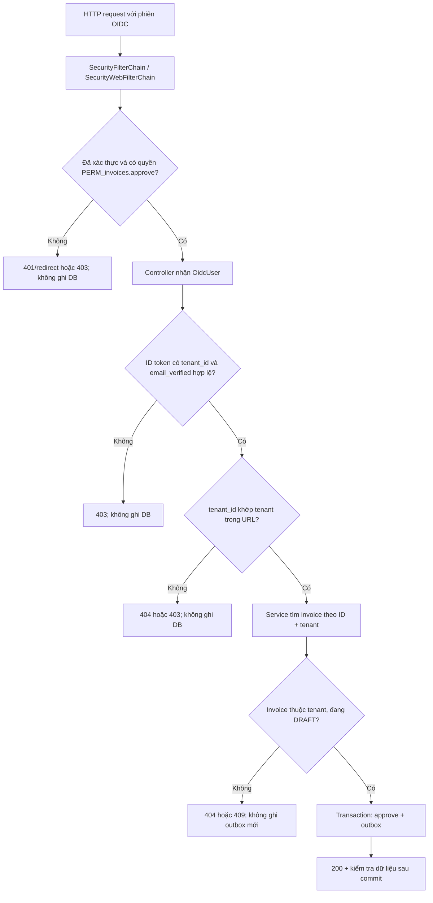

# Kiểm thử principal OIDC có claim phục vụ quy tắc nghiệp vụ

Trong chương **Thực hành tổng hợp** của module **SPRING_SECURITY_TESTING**, người học cần viết một bộ kiểm thử không chỉ xác nhận người dùng đã đăng nhập mà còn chứng minh **danh tính OIDC mang đúng claim và các claim đó được dùng đúng trong quyết định nghiệp vụ**. Một request có principal hợp lệ về mặt kiểu dữ liệu nhưng thiếu `tenant_id`, có `email_verified=false` hoặc thuộc tenant khác vẫn có thể phải bị từ chối. Ngược lại, principal đúng claim nhưng thiếu authority cũng không được thực hiện hành động có quyền hạn cao.

Bài thực hành kết hợp `spring-security-test` với **Servlet/MockMvc** và **Reactive/WebTestClient**, từ cách tạo `OidcUser`, ID token/UserInfo, `SecurityContext`, claims, authorities đến xác nhận HTTP 200/401/403/404 và tác dụng phụ lưu trữ. Trọng tâm là **kiểm thử hành vi sau khi OIDC Login đã xác thực**. Các helper `oidcLogin()` và `mockOidcLogin()` không thực hiện Authorization Code exchange, không gọi OIDC Provider, không kiểm tra chữ ký ID token, `nonce`, `issuer` hay `audience`; những cơ chế đó cần nhóm tích hợp với provider stub riêng.

## 1. Bài toán xuyên suốt: phê duyệt hóa đơn theo tenant

Giả sử một ứng dụng quản lý hóa đơn cho nhiều tổ chức. Người dùng đăng nhập bằng **OpenID Connect (OIDC)** qua trình duyệt, sau đó gọi:

```http
POST /api/tenants/tenant-a/invoices/42/approve
Cookie: <session-cookie-from-browser>
X-CSRF-TOKEN: <csrf-token-from-page>
```

Các chuỗi trong ví dụ HTTP chỉ là placeholder, không phải session hoặc token thực. Hợp đồng nghiệp vụ minh họa:

1. Session chứa principal đúng kiểu `OidcUser` của OIDC Login.
2. Spring Security cho phép endpoint khi `Authentication` có authority `PERM_invoices.approve`.
3. ID token phải có claim ứng dụng tự định nghĩa `tenant_id` là chuỗi không rỗng, khớp tenant trong URL.
4. ID token phải có `email_verified` đúng kiểu boolean và bằng `true`; thiếu/sai kiểu/`false` đều không hợp lệ cho hành động này.
5. Hóa đơn phải được truy xuất bằng **cả ID và tenant**, để không thể lấy hóa đơn thuộc tổ chức khác chỉ bằng cách biết ID.
6. Khi hợp lệ, trạng thái hóa đơn chuyển từ `DRAFT` sang `APPROVED` và một event outbox được ghi trong **cùng transaction**. Mọi trường hợp bị từ chối phải để dữ liệu không đổi.

Claim `tenant_id` là **claim tùy biến theo hợp đồng với Identity Provider**, không phải claim tiêu chuẩn OIDC được bảo đảm có trong mọi ID token. Chính sách bắt buộc `email_verified` cũng là **lựa chọn nghiệp vụ minh họa**: việc email đã được xác minh không thay thế kiểm tra quyền hay quyền sở hữu tenant.



## 2. Kiểu authentication và principal cần dùng

Sau OIDC Login thành công, Spring Security thông thường sử dụng `OAuth2AuthenticationToken` chứa principal `OidcUser`, chẳng hạn implementation `DefaultOidcUser`. Điều này khác với resource server nhận Bearer JWT.

| Đường xác thực | Authentication thường gặp | Principal thường gặp | Test helper phù hợp |
| --- | --- | --- | --- |
| OIDC Login, ứng dụng web có session | `OAuth2AuthenticationToken` | `OidcUser` | MockMvc `oidcLogin()`; WebFlux `mockOidcLogin()` |
| OAuth2 Login thông thường, không phải OIDC | `OAuth2AuthenticationToken` | `OAuth2User` | `oauth2Login()` / `mockOAuth2Login()` |
| API nhận Bearer JWT | `JwtAuthenticationToken` | `Jwt` | `jwt()` / `mockJwt()` |
| API nhận opaque bearer token | `BearerTokenAuthentication` | `OAuth2AuthenticatedPrincipal` | `opaqueToken()` / `mockOpaqueToken()` |
| Form/Basic username-password | `UsernamePasswordAuthenticationToken` | Thường là `UserDetails` | `@WithMockUser` / `user(...)` / `mockUser()` |

Ví dụ code ứng dụng cần `OidcUser.getIdToken()`. `@WithMockUser` chỉ tạo principal username thông thường; `jwt()` tạo `Jwt` của **resource server**, không tạo phiên OIDC Login. Một test `200` nhờ giả lập authority bằng helper sai kiểu có thể che một lỗi `ClassCastException` hoặc `null` khi controller đọc claim thật.

### Ba nhóm dữ liệu trong OIDC principal

| Nhóm | API tiêu biểu | Dùng cho |
| --- | --- | --- |
| ID token | `oidcUser.getIdToken()`, `getSubject()`, `getClaim("tenant_id")` | Danh tính và claims đã nằm trong ID token |
| UserInfo | `oidcUser.getUserInfo()` | Các attributes bổ sung nếu client/provider có UserInfo |
| Authorities | `authentication.getAuthorities()` hoặc `oidcUser.getAuthorities()` | Quy tắc `hasAuthority`, `hasRole`, method security |

`OidcUser.getClaims()` có thể trình bày tập hợp claims từ ID token và UserInfo theo implementation. Đối với claim nhạy cảm phục vụ authorization, **chỉ rõ nguồn được hệ thống tin cậy**: ví dụ minh họa cố ý đọc `tenant_id` và `email_verified` **trực tiếp từ ID token**. Đừng ngầm dựa vào thứ tự ghi đè khi cùng một tên claim xuất hiện ở ID token và UserInfo. Nếu hợp đồng identity provider dùng UserInfo làm nguồn chính, phải thay đổi chính sách/adapter và có test tương ứng.

## 3. Tạo principal OIDC fixture bằng `oidcLogin()`

Với MockMvc và Spring Security Test, `oidcLogin()` đưa một principal OIDC đã xác thực vào request:

```java
import static org.springframework.security.test.web.servlet.request.SecurityMockMvcRequestPostProcessors.oidcLogin;
import static org.springframework.security.test.web.servlet.request.SecurityMockMvcRequestPostProcessors.csrf;

RequestPostProcessor approverFromTenantA() {
    return oidcLogin()
        .idToken(token -> token
            .claim("sub", "fixture-oidc-sub-101")
            .claim("iss", "https://idp.test.invalid")
            .claim("tenant_id", "tenant-a")
            .claim("email_verified", true))
        .authorities(new SimpleGrantedAuthority(
            "PERM_invoices.approve"));
}
```

Trong ví dụ, `idToken(...)` thiết lập **nội dung principal giả**, còn `authorities(...)` đặt trực tiếp quyền. Test này **không chứng minh** rằng một `GrantedAuthoritiesMapper` hoặc custom `OidcUserService` đã chuyển group/role claim thành `PERM_invoices.approve`. Cần kiểm thử riêng bước mapping nếu quyền của ứng dụng được sinh từ claims.

Ở OIDC ID token, `sub` là định danh chủ thể, còn `iss` là issuer. Dù fixture có đặt `iss`, helper **không xác minh issuer được tin cậy**. Các URL `.test.invalid` chỉ là dữ liệu giả, không gọi được qua mạng. Không dùng email làm khóa duy nhất cho danh tính khi contract không bảo đảm uniqueness; với nhiều issuer/tenant, định danh nghiệp vụ thường cần ràng buộc rõ phạm vi issuer và subject.

### Biến đổi độc lập một claim cho mỗi ca test

Để tạo các trường hợp âm tính mà không nhân bản nhiều đoạn code:

```java
RequestPostProcessor oidcPrincipal(
        Object tenantValue, Object verifiedValue, String authority) {
    return oidcLogin()
        .idToken(token -> {
            token.claim("sub", "fixture-oidc-sub-101");
            token.claim("iss", "https://idp.test.invalid");
            if (tenantValue != null) {
                token.claim("tenant_id", tenantValue);
            }
            if (verifiedValue != null) {
                token.claim("email_verified", verifiedValue);
            }
        })
        .authorities(new SimpleGrantedAuthority(authority));
}
```

Ở đây giá trị `null` được hiểu là **bỏ claim khỏi fixture**, còn một giá trị như `42` hoặc chuỗi `"true"` sẽ kiểm tra lỗi **sai kiểu claim**. Không dùng `@WithMockUser` để tạo các case OIDC, vì nó không mang `OidcIdToken`.

## 4. Chính sách HTTP và yêu cầu CSRF của OIDC Login

Một ứng dụng OIDC Login trên Servlet thường dùng **session/cookie**, vì vậy các thao tác thay đổi trạng thái cần được bảo vệ bằng CSRF. Bộ test không được tắt CSRF chỉ để POST thành công.

```java
@Configuration
@EnableWebSecurity
class InvoiceWebSecurityConfig {

    @Bean
    SecurityFilterChain webSecurity(HttpSecurity http) throws Exception {
        return http
            .authorizeHttpRequests(auth -> auth
                .requestMatchers(
                    HttpMethod.POST,
                    "/api/tenants/*/invoices/*/approve")
                    .hasAuthority("PERM_invoices.approve")
                .requestMatchers("/login/**", "/oauth2/**", "/error")
                    .permitAll()
                .anyRequest().authenticated())
            .oauth2Login(Customizer.withDefaults())
            .exceptionHandling(ex -> ex.defaultAuthenticationEntryPointFor(
                new HttpStatusEntryPoint(HttpStatus.UNAUTHORIZED),
                request -> request.getRequestURI().startsWith("/api/")))
            .build();
    }
}
```

Đây là **cấu hình minh họa** cho Spring Security Servlet sử dụng HTTP 401 cho API anonymous, trong khi các trang UI vẫn có thể sử dụng redirect của OAuth2 Login. Test context cũng cần `ClientRegistrationRepository` chứa **OIDC client registration giả** hoặc cấu hình test tương đương để khởi tạo `oauth2Login()`; không nên trỏ test authorization mock principal tới IdP production. Theo phiên bản Spring Security và thứ tự entry point, hãy kiểm tra thực tế entry point được chọn; nếu hệ thống dùng redirect cho API, assertion anonymous phải theo hợp đồng đó.

**CSRF:** Trong các test POST bên dưới, sau `.with(oidcLogin(...))` phải thêm `.with(csrf())` khi muốn đi tới authorization/logic nghiệp vụ. Nếu không có CSRF token, Spring Security có thể trả **403 trước khi kiểm tra claim hoặc quyền**; một test báo 403 khi thiếu role nhưng cũng thiếu CSRF sẽ cho kết quả gây hiểu lầm. Để chứng minh rule role/claim, luôn đáp ứng mọi điều kiện filter khác không thuộc mục tiêu kiểm tra.

## 5. Controller đọc claim với kiểm tra kiểu tường minh

Endpoint không nên cast claim trực tiếp khi không có hợp đồng kiểu rõ ràng. Ví dụ:

```java
record InvoiceView(Long id, String tenantId, String status) {}

@RestController
class InvoiceApprovalController {

    private final InvoiceApprovalService approvals;

    InvoiceApprovalController(InvoiceApprovalService approvals) {
        this.approvals = approvals;
    }

    @PostMapping("/api/tenants/{tenantId}/invoices/{invoiceId}/approve")
    InvoiceView approve(
            @PathVariable String tenantId,
            @PathVariable Long invoiceId,
            @AuthenticationPrincipal(errorOnInvalidType = true)
            OidcUser oidcUser) {

        if (oidcUser == null || oidcUser.getIdToken() == null) {
            throw new ResponseStatusException(
                HttpStatus.UNAUTHORIZED, "Missing OIDC principal");
        }

        Object rawTenant = oidcUser.getIdToken().getClaim("tenant_id");
        if (!(rawTenant instanceof String tokenTenant)
                || tokenTenant.isBlank()) {
            throw new ResponseStatusException(
                HttpStatus.FORBIDDEN, "Invalid tenant claim");
        }

        Object rawVerified =
            oidcUser.getIdToken().getClaim("email_verified");
        if (!Boolean.TRUE.equals(rawVerified)) {
            throw new ResponseStatusException(
                HttpStatus.FORBIDDEN, "Email not verified");
        }

        if (!tenantId.equals(tokenTenant)) {
            // Không tiết lộ chi tiết thành viên tenant khác.
            throw new ResponseStatusException(
                HttpStatus.NOT_FOUND, "Invoice not found");
        }

        return approvals.approve(invoiceId, tokenTenant,
            oidcUser.getSubject());
    }
}
```

`@AuthenticationPrincipal(errorOnInvalidType = true)` giúp lộ lỗi **sai kiểu principal** trong test. Nếu dùng `@WithMockUser` thay `oidcLogin()`, resolver có thể báo lỗi kiểu; không sửa bằng cách tắt `errorOnInvalidType` hoặc bỏ validation rồi coi test thành công. Phần xác thực ban đầu vẫn do Spring Security filter chain bảo vệ; kiểm tra `null` là phòng vệ bổ sung cho trường hợp gọi controller ngoài đường filter đúng.

**Không dùng `email_verified` làm bằng chứng thay cho authority.** Cùng một người đã xác minh email vẫn phải có `PERM_invoices.approve` và thuộc đúng tenant. Nếu điều kiện authorization nhạy cảm được triển khai ở service/method security thay vì controller, test phải chạy qua **bean/proxy thật** để bảo đảm policy hoạt động.

## 6. Service bảo vệ đối tượng và ghi side effect trong transaction

Để kiểm chứng tổng hợp, cần một kho dữ liệu test thật, không chỉ mock repository rồi đếm lời gọi. Entity/repository tối giản:

```java
@Entity
class Invoice {
    @Id @GeneratedValue(strategy = GenerationType.IDENTITY)
    private Long id;
    private String tenantId;
    private String status;

    protected Invoice() {}

    Invoice(String tenantId) {
        this.tenantId = tenantId;
        this.status = "DRAFT";
    }

    Long getId() { return id; }
    String getTenantId() { return tenantId; }
    String getStatus() { return status; }
    void markApproved() { status = "APPROVED"; }
}

@Entity
class InvoiceApprovalEvent {
    @Id @GeneratedValue(strategy = GenerationType.IDENTITY)
    private Long id;
    private Long invoiceId;
    private String approverSubject;

    protected InvoiceApprovalEvent() {}

    InvoiceApprovalEvent(Long invoiceId, String subject) {
        this.invoiceId = invoiceId;
        this.approverSubject = subject;
    }
}

interface InvoiceRepository extends JpaRepository<Invoice, Long> {
    Optional<Invoice> findByIdAndTenantId(Long id, String tenantId);
}

interface InvoiceApprovalEventRepository
        extends JpaRepository<InvoiceApprovalEvent, Long> {
    long countByInvoiceId(Long invoiceId);
}
```

Service phải là Spring bean, để `@Transactional` bảo vệ thay đổi invoice và tạo outbox trong một giao dịch:

```java
@Service
class InvoiceApprovalService {

    private final InvoiceRepository invoices;
    private final InvoiceApprovalEventRepository events;

    InvoiceApprovalService(InvoiceRepository invoices,
                           InvoiceApprovalEventRepository events) {
        this.invoices = invoices;
        this.events = events;
    }

    @Transactional
    public InvoiceView approve(
            Long invoiceId, String tenantId, String subject) {
        Invoice invoice = invoices.findByIdAndTenantId(
                invoiceId, tenantId)
            .orElseThrow(() -> new ResponseStatusException(
                HttpStatus.NOT_FOUND, "Invoice not found"));

        if (!"DRAFT".equals(invoice.getStatus())) {
            throw new ResponseStatusException(
                HttpStatus.CONFLICT, "Invoice already processed");
        }

        invoice.markApproved();
        events.save(new InvoiceApprovalEvent(invoiceId, subject));
        return new InvoiceView(invoice.getId(),
            invoice.getTenantId(), invoice.getStatus());
    }
}
```

Việc lọc `findByIdAndTenantId(...)` là lớp phòng vệ riêng với so sánh claim/URL ở controller. Ngay cả khi người dùng biết invoice ID của tenant khác, query sẽ không cho truy cập invoice đó. Khi transaction commit, JPA dirty checking cập nhật invoice và lưu event. Test cần đọc lại database **sau request**, không chỉ assert 200 hoặc `verify(repository).save(...)`.

Với sản phẩm thật, ràng buộc tenant có thể cần membership hiện hành, phân quyền theo đối tượng hoặc policy engine. `tenant_id` trong ID token có thể bị **cũ** nếu người dùng vừa mất quyền; tùy mức độ rủi ro, hãy xác minh thêm trạng thái membership hiện tại tại server. Không coi custom claim là sự thay thế cho mọi kiểm soát truy cập.

## 7. Thiết lập kiểm thử tích hợp Servlet có OIDC principal

Dùng `@SpringBootTest` và `@AutoConfigureMockMvc` để nạp security filter chain, controller, service, repository và database test:

```java
@SpringBootTest
@AutoConfigureMockMvc
class OidcInvoiceIntegrationTest {

    @Autowired MockMvc mvc;
    @Autowired InvoiceRepository invoices;
    @Autowired InvoiceApprovalEventRepository events;

    private Invoice tenantAInvoice;
    private Invoice tenantBInvoice;

    @BeforeEach
    void seed() {
        events.deleteAll();
        invoices.deleteAll();
        tenantAInvoice = invoices.saveAndFlush(new Invoice("tenant-a"));
        tenantBInvoice = invoices.saveAndFlush(new Invoice("tenant-b"));
    }

    @AfterEach
    void clean() {
        events.deleteAll();
        invoices.deleteAll();
    }

    private void assertNoApproval() {
        assertEquals("DRAFT", invoices.findById(
            tenantAInvoice.getId()).orElseThrow().getStatus());
        assertEquals("DRAFT", invoices.findById(
            tenantBInvoice.getId()).orElseThrow().getStatus());
        assertEquals(0L, events.count());
    }
}
```

Những đoạn test tiếp theo được đặt **trong lớp test trên**, dùng `oidcPrincipal(...)` của mục 3. Database có thể là H2 nếu hành vi SQL không phụ thuộc engine, hoặc Testcontainers với loại database production để kiểm chứng transaction/constraint; cần schema/migration và một OIDC `ClientRegistrationRepository` của **profile test**. Không đặt `@Transactional` trên toàn bộ test class khi mục tiêu là chứng minh request đã commit: với MockMvc đồng bộ, transaction của thread test có thể làm bạn đọc thấy thay đổi **chưa được commit**. Seed/cleanup và đọc lại dữ liệu nên diễn ra ở những transaction độc lập.

Các test cùng xóa tất cả bản ghi của schema, vì vậy chỉ phù hợp với **database chuyên dụng, không chia sẻ và không chạy song song trên cùng schema**. Ở CI song song, dùng schema riêng/test database riêng hoặc dọn theo ID fixture của từng case. Không hướng một test kiểu này vào staging/production.

## 8. Happy path: đúng principal, claim, authority, CSRF và dữ liệu

```java
@Test
void verifiedApproverFromSameTenantCanApprove() throws Exception {
    mvc.perform(post(
            "/api/tenants/{tenantId}/invoices/{invoiceId}/approve",
            "tenant-a", tenantAInvoice.getId())
            .with(oidcPrincipal(
                "tenant-a", Boolean.TRUE, "PERM_invoices.approve"))
            .with(csrf()))
        .andExpect(status().isOk())
        .andExpect(jsonPath("$.id").value(tenantAInvoice.getId()))
        .andExpect(jsonPath("$.tenantId").value("tenant-a"))
        .andExpect(jsonPath("$.status").value("APPROVED"));

    assertEquals("APPROVED", invoices.findById(
        tenantAInvoice.getId()).orElseThrow().getStatus());
    assertEquals("DRAFT", invoices.findById(
        tenantBInvoice.getId()).orElseThrow().getStatus());
    assertEquals(1L, events.countByInvoiceId(
        tenantAInvoice.getId()));
    assertEquals(0L, events.countByInvoiceId(
        tenantBInvoice.getId()));
}
```

Kết quả này có nhiều tầng bằng chứng: security filter chấp nhận principal có quyền, CSRF hợp lệ; controller nhận đúng `OidcUser` và đọc claim; service chỉ tìm invoice thuộc đúng tenant; transaction cập nhật đúng bản ghi và tạo đúng một event. **Một assertion 200 đơn lẻ không chứng minh được các điều này**.

Trong test thực tế, có thể truy vấn thêm `approverSubject` của event và khẳng định bằng `sub` giả để chắc chắn sự kiện được gán đúng danh tính, không ghi nhầm tên hiển thị hoặc email. Không đưa ID token thật hoặc UserInfo nhạy cảm vào event chỉ để phục vụ chẩn đoán.

## 9. Các ca âm tính: mỗi lần thay đúng một điều kiện

### 9.1. Principal đã xác thực nhưng thiếu quyền

```java
@Test
void verifiedUserWithoutApproveAuthorityIsForbidden()
        throws Exception {
    mvc.perform(post(
            "/api/tenants/{tenantId}/invoices/{invoiceId}/approve",
            "tenant-a", tenantAInvoice.getId())
            .with(oidcPrincipal(
                "tenant-a", Boolean.TRUE, "PERM_invoices.read"))
            .with(csrf()))
        .andExpect(status().isForbidden());

    assertNoApproval();
}
```

Đây là ca 403 **do authorization**, không phải CSRF, vì test đã cung cấp CSRF token hợp lệ. Test phải trở đỏ nếu vô tình đổi rule `hasAuthority("PERM_invoices.approve")` thành `permitAll()` mà không có policy tương đương ở tầng khác.

### 9.2. Thiếu tenant hoặc tenant sai kiểu

```java
@Test
void missingTenantClaimCannotApprove() throws Exception {
    mvc.perform(post(
            "/api/tenants/{tenantId}/invoices/{invoiceId}/approve",
            "tenant-a", tenantAInvoice.getId())
            .with(oidcPrincipal(
                null, Boolean.TRUE, "PERM_invoices.approve"))
            .with(csrf()))
        .andExpect(status().isForbidden());

    assertNoApproval();
}

@Test
void numericTenantClaimCannotApprove() throws Exception {
    mvc.perform(post(
            "/api/tenants/{tenantId}/invoices/{invoiceId}/approve",
            "tenant-a", tenantAInvoice.getId())
            .with(oidcPrincipal(
                42, Boolean.TRUE, "PERM_invoices.approve"))
            .with(csrf()))
        .andExpect(status().isForbidden());

    assertNoApproval();
}
```

Nếu controller làm `(String) user.getIdToken().getClaim("tenant_id")` mà không kiểm tra kiểu, trường hợp số nguyên có thể gây `ClassCastException` và HTTP 500. Bài test ở trên buộc ứng dụng **từ chối có kiểm soát** theo hợp đồng 403.

### 9.3. Email chưa xác minh, claim thiếu hoặc sai kiểu

```java
@ParameterizedTest
@ValueSource(strings = {"unverified", "missing", "wrong-type"})
void invalidEmailVerificationIsForbidden(String caseName)
        throws Exception {
    Object verified = switch (caseName) {
        case "unverified" -> Boolean.FALSE;
        case "missing" -> null;
        case "wrong-type" -> "true";
        default -> throw new IllegalArgumentException(caseName);
    };

    mvc.perform(post(
            "/api/tenants/{tenantId}/invoices/{invoiceId}/approve",
            "tenant-a", tenantAInvoice.getId())
            .with(oidcPrincipal(
                "tenant-a", verified, "PERM_invoices.approve"))
            .with(csrf()))
        .andExpect(status().isForbidden());

    assertNoApproval();
}
```

Không chuyển chuỗi `"true"` thành boolean thật chỉ vì nội dung giống nhau, trừ khi **hợp đồng nhận diện đã định nghĩa rõ chuyển đổi** và kiểm soát nguồn dữ liệu tương ứng. OIDC `email_verified` trong mẫu chính sách này phải là boolean thực.

### 9.4. Principal tenant A cố đọc/duyệt invoice của tenant B

```java
@Test
void sameClaimAndPathButForeignInvoiceIsNotFound()
        throws Exception {
    mvc.perform(post(
            "/api/tenants/{tenantId}/invoices/{invoiceId}/approve",
            "tenant-a", tenantBInvoice.getId())
            .with(oidcPrincipal(
                "tenant-a", Boolean.TRUE, "PERM_invoices.approve"))
            .with(csrf()))
        .andExpect(status().isNotFound());

    assertNoApproval();
}

@Test
void pathTenantDifferentFromIdTokenTenantIsRejected()
        throws Exception {
    mvc.perform(post(
            "/api/tenants/{tenantId}/invoices/{invoiceId}/approve",
            "tenant-b", tenantBInvoice.getId())
            .with(oidcPrincipal(
                "tenant-a", Boolean.TRUE, "PERM_invoices.approve"))
            .with(csrf()))
        .andExpect(status().isNotFound());

    assertNoApproval();
}
```

Hai test này bắt **hai lỗi khác nhau**: (1) claim tenant khớp URL nhưng invoice ID thuộc tenant khác; (2) claim tenant không khớp tenant URL. Mã 404 là policy minh họa tránh tiết lộ tài nguyên; dự án có thể chọn 403 nếu contract như vậy, nhưng không được phê duyệt hóa đơn tenant khác.

### 9.5. Thiếu CSRF và request anonymous

```java
@Test
void authenticatedRequestWithoutCsrfIsForbidden()
        throws Exception {
    mvc.perform(post(
            "/api/tenants/{tenantId}/invoices/{invoiceId}/approve",
            "tenant-a", tenantAInvoice.getId())
            .with(oidcPrincipal(
                "tenant-a", Boolean.TRUE, "PERM_invoices.approve")))
        .andExpect(status().isForbidden());

    assertNoApproval();
}

@Test
void anonymousWithCsrfStillCannotApprove() throws Exception {
    mvc.perform(post(
            "/api/tenants/{tenantId}/invoices/{invoiceId}/approve",
            "tenant-a", tenantAInvoice.getId())
            .with(csrf()))
        .andExpect(status().isUnauthorized());

    assertNoApproval();
}
```

Anonymous 401 giả định API authentication entry point đã cấu hình như mục 4. Nếu ứng dụng dùng OIDC login redirect cho anonymous API, hãy khẳng định 302/redirect theo contract. Việc **có CSRF token không đồng nghĩa đã đăng nhập**; ngược lại, người đã đăng nhập OIDC vẫn cần CSRF token khi hệ thống dùng session/cookie.

## 10. Trường hợp gọi lặp lại và không ghi event hai lần

Sau lần phê duyệt thành công, một request hợp lệ khác không được phát thêm event `APPROVED` cho cùng hóa đơn nếu nghiệp vụ chỉ cho xử lý một lần:

```java
@Test
void repeatApprovalDoesNotDuplicateEvent() throws Exception {
    String url =
        "/api/tenants/tenant-a/invoices/"
            + tenantAInvoice.getId() + "/approve";

    mvc.perform(post(url)
            .with(approverFromTenantA())
            .with(csrf()))
        .andExpect(status().isOk());

    mvc.perform(post(url)
            .with(approverFromTenantA())
            .with(csrf()))
        .andExpect(status().isConflict());

    assertEquals("APPROVED", invoices.findById(
        tenantAInvoice.getId()).orElseThrow().getStatus());
    assertEquals(1L, events.countByInvoiceId(
        tenantAInvoice.getId()));
}
```

Đây là contract minh họa với lần gọi thứ hai trả 409. Nếu API định nghĩa request lặp là idempotent và trả 200/204, vẫn phải kiểm tra không có event trùng. Với request song song, kiểm tra trạng thái chỉ bằng Java có thể có race condition; cần khóa/`@Version`/unique constraint hay thiết kế transaction phù hợp, rồi viết test concurrency riêng.

## 11. ID token và UserInfo: kiểm tra nguồn claim được tin cậy

`OidcUser` có thể có UserInfo hoặc không. Không nên dựa vào một UserInfo được giả định luôn có. Để minh họa nguồn dữ liệu, xét endpoint hiển thị tên:

```java
@GetMapping("/ui/profile")
Map<String, String> profile(
        @AuthenticationPrincipal OidcUser oidcUser) {
    OidcUserInfo userInfo = oidcUser.getUserInfo();
    String displayName = userInfo != null
        ? userInfo.getPreferredUsername()
        : null;
    return Map.of(
        "subject", oidcUser.getSubject(),
        "displayName",
        displayName != null ? displayName : oidcUser.getSubject());
}
```

Test với UserInfo:

```java
mvc.perform(get("/ui/profile")
        .with(oidcLogin()
            .idToken(token -> token.claim("sub", "fixture-sub-10"))
            .userInfoToken(info -> info.claim(
                "preferred_username", "fixture-reader"))))
    .andExpect(status().isOk())
    .andExpect(jsonPath("$.displayName").value("fixture-reader"));
```

Thêm test chỉ có ID token và không gắn UserInfo để xác minh fallback. Phần authorization ở invoice controller vẫn đọc `tenant_id` **từ ID token**; vì vậy nếu chỉ thêm `tenant_id` ở UserInfo mà ID token không có claim đó, request **phải bị từ chối** theo chính sách đang viết. Điều này ngăn thay đổi nguồn claim một cách vô tình.

Nếu identity provider thật chỉ cấp `tenant_id` qua UserInfo, ứng dụng cần hợp đồng rõ ràng về nguồn tin cậy, mapping và cơ chế cập nhật; sau đó test phải được viết lại theo **thiết kế chính thức**, không gắn bừa claim vào tất cả fixture cho test xanh.

## 12. Authorities không tự được sinh đúng chỉ vì ID token có claim

Trong môi trường OIDC Login thật, authorities có thể được tạo hoặc biến đổi bởi `OidcUserService`, `GrantedAuthoritiesMapper`, mapping group/realm role hoặc dịch vụ quyền ứng dụng. Ví dụ contract:

```json
{
  "sub": "fixture-oidc-sub-101",
  "tenant_id": "tenant-a",
  "email_verified": true,
  "groups": ["invoice-approvers"]
}
```

Ứng dụng quyết định mapping `invoice-approvers` thành `PERM_invoices.approve`. Test `oidcLogin().authorities(PERM_invoices.approve)` **bỏ qua phép biến đổi này**. Nên phân lớp:

| Mục tiêu | Cách kiểm thử |
| --- | --- |
| URL rule có chặn user thiếu `PERM_invoices.approve` không? | `oidcLogin().authorities(...)` với đủ/thiếu quyền |
| Controller/service kiểm tra `tenant_id`, `email_verified` đúng không? | `oidcLogin().idToken(...)` cùng claim hợp lệ/sai |
| Mapper có chuyển `groups` thành authority đúng không? | Unit/integration test **mapper thực**, đưa `OidcUserAuthority`/claims fixture theo API production |
| Spring Security có áp dụng mapper trong OIDC Login thật không? | OIDC Provider stub + authorization code callback + session test |
| JWT ID token có issuer/audience/chữ ký hợp lệ không? | Provider stub ký ID token với khóa test, decoder/validator thật |

Đặc biệt, OIDC login **không** phải resource server JWT. `jwt()`/`mockJwt()` dùng cho Bearer JWT API không chứng minh `OidcUserService` hoặc `GrantedAuthoritiesMapper` hoạt động ở OAuth2 Login.

## 13. Reactive/WebTestClient với `mockOidcLogin()`

Trong **WebFlux**, Spring Security dùng `SecurityWebFilterChain` và principal `OidcUser` tương ứng, nhưng ứng dụng/handler trả về `Mono` hoặc `Flux`. Để kiểm thử trạng thái đã login:

```java
import static org.springframework.security.test.web.reactive.server.SecurityMockServerConfigurers.mockOidcLogin;
import static org.springframework.security.test.web.reactive.server.SecurityMockServerConfigurers.csrf;

webTestClient.mutateWith(mockOidcLogin()
        .idToken(token -> token
            .claim("sub", "fixture-reactive-oidc")
            .claim("tenant_id", "tenant-a")
            .claim("email_verified", true))
        .authorities(new SimpleGrantedAuthority(
            "PERM_invoices.approve")))
    .mutateWith(csrf())
    .post()
    .uri("/api/tenants/tenant-a/invoices/42/approve")
    .exchange()
    .expectStatus().isOk()
    .expectBody()
    .jsonPath("$.status").isEqualTo("APPROVED");
```

Ví dụ chỉ mang tính **khung test Reactive**: cần ứng dụng WebFlux thật với endpoint trả `Mono<InvoiceView>`, `ReactiveInvoiceApprovalService`, security chain OIDC Login và một database fixture có invoice `42` chưa duyệt. Không sử dụng chung Servlet controller/JPA blocking trực tiếp trên event loop WebFlux.

Service reactive có thể thực hiện validation claim trước khi gọi repository:

```java
@PostMapping("/api/tenants/{tenantId}/invoices/{invoiceId}/approve")
Mono<InvoiceView> approve(
        @PathVariable String tenantId,
        @PathVariable String invoiceId,
        @AuthenticationPrincipal(errorOnInvalidType = true)
        OidcUser oidcUser) {

    Object tenant = oidcUser.getIdToken().getClaim("tenant_id");
    Object verified = oidcUser.getIdToken().getClaim("email_verified");
    if (!(tenant instanceof String allowedTenant)
            || allowedTenant.isBlank()
            || !Boolean.TRUE.equals(verified)) {
        return Mono.error(new ResponseStatusException(
            HttpStatus.FORBIDDEN));
    }
    if (!tenantId.equals(allowedTenant)) {
        return Mono.error(new ResponseStatusException(
            HttpStatus.NOT_FOUND));
    }
    return approvals.approve(invoiceId, allowedTenant,
        oidcUser.getSubject());
}
```

Ở đây `approvals` là reactive service/repository abstraction, cần transactional pipeline phù hợp (ví dụ `TransactionalOperator` hoặc `@Transactional` Reactive) để ghi invoice và outbox cùng một transaction. Test HTTP cần đọc lại repository bằng `StepVerifier`:

```java
StepVerifier.create(reactiveInvoices.findById(invoiceId))
    .assertNext(invoice ->
        assertEquals("APPROVED", invoice.getStatus()))
    .verifyComplete();

StepVerifier.create(reactiveEvents.countByInvoiceId(invoiceId))
    .expectNext(1L)
    .verifyComplete();
```

Request bị từ chối phải có các test tương ứng: thiếu authority (403), thiếu `tenant_id` (403), `email_verified=false` (403), sai tenant (403/404 theo contract), thiếu CSRF (403), anonymous (401/redirect theo entry point). **Đọc lại dữ liệu bằng publisher được subscribe**, không chỉ tạo `Mono` rồi `assertNotNull`.

Khi tự tạo `WebTestClient` từ application context, dùng:

```java
WebTestClient client = WebTestClient
    .bindToApplicationContext(applicationContext)
    .apply(springSecurity())
    .configureClient()
    .build();
```

Nếu dùng `bindToServer()` kết nối một server thật, `mockOidcLogin()` trong test **không truyền principal qua socket**. Phải thực hiện login qua provider stub, giữ cookie/session/CSRF phù hợp rồi gửi request HTTP thật. Một test `bindToController(...)` thuần không đủ để khẳng định `SecurityWebFilterChain` đang thực thi.

## 14. Test method security, SecurityContext và principal đã xác thực

Đôi khi policy còn được khai báo ở service, bên cạnh URL rule. Ví dụ một bean minh họa có method được bảo vệ riêng:

```java
@Service
class ApprovalPermissionProbe {
    @PreAuthorize("hasAuthority('PERM_invoices.approve')")
    public boolean canApprove() {
        return true;
    }
}
```

Khi đó cần bật `@EnableMethodSecurity` ở Servlet hoặc `@EnableReactiveMethodSecurity` ở Reactive. Service phải là **Spring bean được gọi qua proxy**; một object tạo bằng `new` hoặc lời gọi nội bộ `this.method()` có thể bỏ qua method interceptor. Test phải xác minh một principal cùng tenant nhưng thiếu authority không thể gọi method bảo vệ. Nếu dự án đặt `@PreAuthorize` lên `InvoiceApprovalService.approve(...)` ở mục 6, test cũng phải giữ service thật, không mock chính method được bảo vệ. Đồng thời, khi cả URL rule và method rule cùng yêu cầu một authority, bỏ một rule đơn lẻ có thể vẫn bị rule còn lại chặn; hãy thiết kế mutation test đủ phân biệt từng tầng, không suy luận một test 403 chứng minh cả hai rule.

Với Servlet, `SecurityContextHolder` dựa trên thread xử lý; trong controller có thể lấy `Authentication` để kiểm tra kiểu:

```java
Authentication authentication =
    SecurityContextHolder.getContext().getAuthentication();
if (authentication == null
        || !(authentication.getPrincipal() instanceof OidcUser)) {
    throw new IllegalStateException("Expected OIDC principal");
}
```

Đoạn này là **minh họa quan sát ở bên trong request**, không phải kiểm tra `SecurityContextHolder` ở thread JUnit sau khi filter đã dọn context. Với Reactive, principal nằm trong **Reactor Context** và có thể quan sát qua `ReactiveSecurityContextHolder.getContext()`:

```java
Mono<String> currentOidcSubject() {
    return ReactiveSecurityContextHolder.getContext()
        .map(SecurityContext::getAuthentication)
        .map(Authentication::getPrincipal)
        .cast(OidcUser.class)
        .map(OidcUser::getSubject);
}
```

Nếu test service Reactive trực tiếp, dùng `StepVerifier` subscribe và gắn `Authentication` đúng kiểu vào publisher. Không suy luận context của Reactor từ một thread-local bên ngoài subscription. Nếu service dựa vào claims trong `OidcUser`, `@WithMockUser` có thể làm test sai kiểu dù username/role trùng nhau.

## 15. Chứng minh độ mạnh của bộ test bằng mutation có kiểm soát

Sau khi bộ test xanh, có thể thử làm sai một điều kiện **chỉ ở nhánh thử nghiệm** và kiểm tra test phù hợp trở đỏ:

| Thay đổi thử nghiệm | Test nào phải phát hiện? |
| --- | --- |
| Bỏ rule `hasAuthority("PERM_invoices.approve")` khỏi HTTP security chain | Test thiếu authority phải thất bại |
| Bỏ kiểm tra `email_verified` | Test false/missing/wrong-type phải thất bại |
| Lấy `tenant_id` từ request body/URL thay vì ID token | Test sai tenant phải thất bại |
| Thay `findByIdAndTenantId` bằng `findById` | Test invoice ID tenant khác phải thất bại |
| Chuyển event outbox sang ghi ngoài transaction | Test rollback/side effect phải phát hiện khi có lỗi giữa chừng |
| Không bắt CSRF cho POST sử dụng cookie/session | Test POST thiếu CSRF phải thất bại |
| Thay `OidcUser` bằng `UserDetails` nhưng vẫn assert username | Test principal OIDC claim phải không còn hợp lệ |
| Bỏ kiểm tra signature/nonce ở luồng login thật | **Test provider-stub riêng** phải thất bại; `oidcLogin()` không phát hiện |

Không commit thay đổi cố tình làm yếu bảo mật. Giá trị của mutation check là chứng minh **assertion thật sự nhắm đúng quy tắc** thay vì tình cờ nhận cùng status từ filter khác (đặc biệt là CSRF 403 trước authorization).

## 16. Phân biệt test principal OIDC giả với test luồng login thật

`oidcLogin()` và `mockOidcLogin()` là lựa chọn phù hợp để kiểm tra:

- Controller nhận được `OidcUser` hay không, đọc ID token/UserInfo đúng cách không.
- Policy tenant, email verification, ownership, group/authority có áp dụng đúng khi đã có authentication không.
- CSRF, HTTP 401/403/404/200 và DB side effect của endpoint có phù hợp không.

Chúng **không** kiểm tra:

- Redirect đến authorization endpoint, `state`, PKCE, callback và trao đổi authorization code.
- `nonce` trong ID token có khớp phiên đăng nhập hay không.
- Chữ ký JWS của ID token, issuer `iss`, audience `aud`, expiration `exp`, JWKS rotation.
- UserInfo HTTP response thật, access token/refresh token và session được tạo bởi login flow.
- Mapping claims/authorities thực sự trong provider/service nếu test tự đặt chúng bằng `.authorities(...)`.

Để kiểm tra các bước này, tạo **OIDC provider stub nội bộ** có issuer, authorization endpoint, token endpoint và JWKS dùng khóa test; thực hiện login redirect/callback theo cấu hình thật, giữ session và CSRF token trong test client. Viết ca đúng/sai cho `state`, `nonce`, `iss`, `aud`, chữ ký, claim thiếu và mapper. Không dùng dịch vụ IdP triển khai hay user thật cho bộ integration CI.

Với claim `tenant_id`, cần đảm bảo quy tắc identity-provider **thực sự phát hành và xác thực** claim trong nguồn mà ứng dụng tin, không chỉ vì fixture test cho phép thêm bất kỳ key/value nào. Khi tenant membership thay đổi nhanh, kiểm thử thêm cách thu hồi/refresh hoặc tra cứu trạng thái server-side theo yêu cầu nghiệp vụ.

## 17. Ma trận kiểm thử tích hợp đề xuất

| Trường hợp | Fixture / đường thử | HTTP theo hợp đồng minh họa | Dữ liệu |
| --- | --- | --- | --- |
| OIDC principal đúng, quyền đúng, CSRF hợp lệ, đúng tenant | `oidcLogin().idToken(...).authorities(...)` | 200 | Invoice A `APPROVED`, một event |
| Thiếu quyền approve | OIDC principal đúng claims, authority khác | 403 | Không đổi |
| Thiếu `tenant_id` | OIDC principal không có tenant claim | 403 | Không đổi |
| `tenant_id` sai kiểu | Claim là number/object | 403 | Không đổi |
| `email_verified=false` | Claim boolean false | 403 | Không đổi |
| `email_verified` vắng hoặc chuỗi `"true"` | Claim thiếu/sai kiểu | 403 | Không đổi |
| Claim tenant khác path tenant | Principal tenant A, URL tenant B | 404 | Không đổi |
| Biết invoice ID tenant khác | URL/claim A, ID của invoice B | 404 | Không đổi |
| Không có CSRF | OIDC principal hợp lệ, thiếu CSRF trên POST | 403 | Không đổi |
| Anonymous có CSRF | Không gắn OIDC principal | 401 hoặc redirect theo entry point | Không đổi |
| Phê duyệt lại cùng invoice | Hai request hợp lệ | 200 rồi 409 theo contract | Một event |
| UserInfo có/không có | `userInfoToken(...)` hoặc chỉ ID token | Hiển thị theo fallback | Không dùng UserInfo để tự cấp quyền |
| Reactive claim/authority | `mockOidcLogin()` + `csrf()` | 200/403/404 | Verify qua `StepVerifier` |
| OIDC `nonce`/signature/issuer sai | Provider stub + callback thật | Không tạo session đăng nhập thành công | Không thực hiện hành động |

Các mã 401/403/404/409 và chính sách email verification là **hợp đồng minh họa**. Khi ứng dụng chọn status khác một cách có chủ đích, cập nhật test theo hợp đồng đó; bất biến an toàn vẫn là **không có hành vi nghiệp vụ trái phép và không có dữ liệu tenant khác bị lộ**.

## 18. Bài thực hành: xây bộ test OIDC claim-to-business-policy hoàn chỉnh

Tạo endpoint phê duyệt invoice như các mục trên, với một Identity Provider OIDC fixture, security chain có quyền `PERM_invoices.approve`, và database test cô lập chứa invoice của hai tenant.

1. **Xác định contract:** liệt kê nguồn của `sub`, `tenant_id`, `email_verified`, authority approve. Ghi rõ claim nào là tùy biến và điều gì xảy ra nếu claim không có.
2. **Viết happy path Servlet:** tạo principal bằng `oidcLogin()`, thêm CSRF và authority. Assert HTTP 200, body đúng, chỉ invoice cùng tenant đổi trạng thái và một outbox event.
3. **Tách nguyên nhân từ chối:** giữ CSRF hợp lệ rồi đổi riêng authority, tenant claim, email verification; mỗi ca phải bị từ chối mà không làm thay đổi database.
4. **Kiểm tra sở hữu tài nguyên:** principal tenant A truy cập invoice ID thuộc tenant B phải bị từ chối, kể cả khi URL ghi tenant A.
5. **Kiểm tra CSRF và anonymous:** request thiếu CSRF phải thất bại; anonymous có CSRF vẫn không được phê duyệt.
6. **Kiểm tra kiểu principal:** giải thích tại sao `@WithMockUser`, `jwt()` và `oauth2Login()` không thay thế `oidcLogin()` khi code cần `OidcUser.getIdToken()`.
7. **Test UserInfo riêng:** bổ sung display name hoặc một claim UserInfo đã được hợp đồng tin cậy; kiểm tra fallback nếu không có UserInfo.
8. **Test mapper quyền:** nếu OIDC groups được chuyển sang authorities, test mapper production tạo đúng quyền, không dùng chỉ `.authorities(...)` để khẳng định mapping.
9. **Lặp lại Reactive:** dùng `mockOidcLogin()`, `WebTestClient`/`csrf()`, repository reactive và `StepVerifier` cho side effects.
10. **Thêm test login thật:** provider stub ký ID token bằng khóa test; thử đúng/sai `state`, `nonce`, issuer/audience/chữ ký và callback. Không dùng token/secret của môi trường triển khai.
11. **Thử mutation:** bỏ kiểm tra claim hoặc query tenant trong test branch; ít nhất một ca âm tính phải trở đỏ.
12. **Đưa lên CI:** seed/cleanup riêng từng test, không phụ thuộc dữ liệu production, không ghi raw ID token/authorization code/session cookie; kiểm tra lại toàn suite, kể cả parallelism.

### Tiêu chí hoàn thành

- Test dùng **đúng `OidcUser` của OIDC Login** cho mã cần ID token và UserInfo, không thay bằng principal username đơn thuần.
- Mọi claim nghiệp vụ bắt buộc đều được kiểm tra **sự hiện diện, kiểu và giá trị**; có ca thiếu/sai kiểu.
- Authority `PERM_invoices.approve` được kiểm thử độc lập với claims `tenant_id` và `email_verified`.
- Có cả test được phép/bị từ chối và kiểm tra **HTTP lẫn trạng thái DB/outbox**.
- CSRF được kiểm tra đúng bối cảnh session-cookie của OIDC Login; test thiếu quyền không bị lẫn với lỗi CSRF.
- Có kiểm chứng chống cross-tenant/IDOR ở cả so sánh claim URL và lookup theo tenant.
- Các helper OIDC được phân biệt với kiểm thử signature/nonce/issuer/mapper thật, có nhóm provider-stub riêng khi cần.
- Test Servlet và Reactive được cô lập, dùng dữ liệu và credential fixture không nhạy cảm, có thể tái hiện trong CI.

## Ghi nhớ

**Một `OidcUser` đúng kiểu chưa đủ; claims và authorities phải phục vụ đúng quy tắc nghiệp vụ.** Trong **SPRING_SECURITY_TESTING**, dùng `oidcLogin()` hoặc `mockOidcLogin()` để kiểm tra principal OIDC sau xác thực, xác định rõ nguồn `tenant_id` và `email_verified`, tách authority khỏi claim, và dùng cả các ca 200/401/403/404 cùng kiểm tra side effect. Không coi `@WithMockUser` hay `jwt()` là principal OIDC; không coi một mock ID token có `iss`/`sub` là bằng chứng đã xác minh login callback hoặc chữ ký. Chỉ khi các request sai quyền, sai tenant và sai claim **thực sự bị chặn trước khi ghi dữ liệu**, bộ test tổng hợp mới bảo vệ được ranh giới tin cậy giữa danh tính OIDC và nghiệp vụ.
