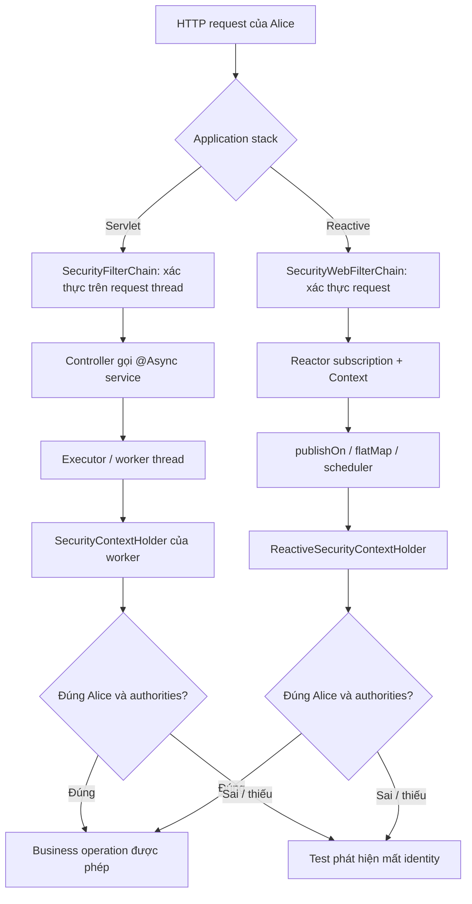

# Kiểm tra danh tính trong một tác vụ bất đồng bộ hoặc pipeline Reactive

Trong ứng dụng có bảo mật, việc một request được xác thực thành công **không tự bảo đảm** rằng mọi công việc bất đồng bộ được tạo từ request đó đều nhìn thấy đúng danh tính. Một service dùng `@Async` có thể chạy trên thread khác và mất `SecurityContext`; một pipeline WebFlux có thể đọc nhầm `SecurityContextHolder` dạng ThreadLocal; hoặc một publisher có thể chưa được subscribe nên kiểm thử chưa thực sự chạy logic cần kiểm tra.

Bài học **“Kiểm tra danh tính trong một tác vụ bất đồng bộ hoặc pipeline Reactive”** thuộc chương **Thực hành tổng hợp** của module **SPRING_SECURITY_TESTING**. Bài kết hợp những kỹ năng của `spring-security-test`: sử dụng `MockMvc`/`WebTestClient`, `@WithMockUser`, quản lý `SecurityContext`, tạo danh tính JWT/OAuth2/OIDC giả để thử phân quyền và bổ sung ca xác thực HTTP thật khi cần. Trọng tâm ở đây là **bảo toàn đúng danh tính, authority và tenant trên ranh giới bất đồng bộ**, chứ không chỉ kiểm tra một status `200`.

Sau bài này, bạn sẽ viết được test chứng minh Alice không bị thay bằng Bob, anonymous không thừa hưởng một người dùng trước đó, request thiếu quyền bị từ chối **trước tác dụng phụ**, và có thể phân biệt lỗi **thread context** trong Servlet với lỗi **subscription/Reactor Context** trong Reactive.

## 1. Xác định ranh giới cần kiểm chứng

Một request có thể đi qua hai kiểu luồng xử lý khác nhau:



| Đặc điểm | Servlet với `@Async` | WebFlux với Reactor |
| --- | --- | --- |
| Chỗ Spring Security thường lưu authentication | `SecurityContextHolder` với strategy phù hợp, mặc định dựa trên thread | `ReactiveSecurityContextHolder` trong Reactor Context |
| Khi chuyển thread | ThreadLocal không tự truyền sang worker tùy ý | Reactor Context theo **subscription** qua các operator Reactor được compose đúng |
| Cơ chế truyền ngữ cảnh được đề xuất | `DelegatingSecurityContextAsyncTaskExecutor` hoặc truyền dữ liệu identity đã xác minh | Giữ cùng publisher chain, `contextWrite(withAuthentication(...))` trong unit test |
| Nguy cơ chính | Worker không có auth, giữ auth cũ hoặc capture context sai thời điểm | `subscribe()` tách rời, cache identity dùng chung, đọc ThreadLocal |
| Test ở tầng HTTP | `MockMvc` + `asyncDispatch`; hoặc HTTP client đến `RANDOM_PORT` | `WebTestClient` + `mockUser()` hoặc raw HTTP credential |
| Test publisher độc lập | `CompletableFuture` với executor có kiểm soát | `StepVerifier` với Reactor Context |
| Điều **không** được suy ra từ helper | `@WithMockUser` không kiểm tra password thật | `mockJwt()` không kiểm tra chữ ký/token decoder thật |

**Nguyên tắc bảo mật:** một công việc được thực thi dưới danh tính nào phải có **contract rõ ràng**. Nếu đó là một job xử lý lâu dài, có thể cần dùng service identity hoặc truyền một snapshot bất biến gồm subject/tenant/authorities đã xác minh thay vì giả định HTTP security context tồn tại mãi.

## 2. Trước tiên, định nghĩa những gì cần assert

Một bộ test “danh tính qua async” không nên chỉ có `isOk()`. Với ví dụ API đọc job/report, hãy xác định:

- **Danh tính:** trả đúng `username`/`subject` của request được xác thực; không nhận nhầm username của request trước.
- **Quyền:** phải có `SCOPE_jobs.read` để gọi đường đọc; đã xác thực nhưng thiếu authority bị `403`.
- **Anonymous:** không mang authentication hợp lệ phải bị chặn theo entry point (với HTTP Basic/Resource Server API, thường `401`).
- **Tác dụng phụ:** request bị từ chối không được gọi task/repository/downstream ngoài ý muốn.
- **Thread/subscription:** test thực sự đi qua worker hoặc qua một scheduler Reactor như dự kiến, không chỉ chạy sync.
- **Ranh giới kiểm thử:** `@WithMockUser`/`mockUser()` chỉ mô phỏng authentication; test mật khẩu/Bearer/OIDC thật là lớp khác.
- **Trạng thái:** identity của Alice, Bob và request anonymous độc lập với thứ tự chạy.

Một ma trận tối thiểu:

| Ca | Credential hoặc principal | Authority | Kỳ vọng |
| --- | --- | --- | --- |
| S-01 | Alice | `SCOPE_jobs.read` | `200`; response có Alice |
| S-02 | Bob | `SCOPE_jobs.read` | `200`; response có Bob |
| S-03 | Alice sau request Bob | `SCOPE_jobs.read` | Vẫn Alice, không rò rỉ |
| S-04 | Anonymous | Không | `401`; worker không được tạo |
| S-05 | Bob | `SCOPE_inventory.read` | `403`; worker không được tạo |
| S-06 | Thiếu Reactor Context trong unit test | Không | Publisher không có identity, hoặc lỗi rõ ràng |
| S-07 | Worker không được truyền SecurityContext | Không | Test phải đỏ hoặc báo thiếu authentication |
| S-08 | HTTP Basic/Bearer thực | Quyền từ credential thật | Server tự xác thực và trả đúng identity |

Lưu ý `401/403` phụ thuộc entry point và exception handling được cấu hình. Ứng dụng form login có thể chuyển hướng sang trang đăng nhập; không ép mọi hệ thống vào status cố định.

## 3. Thiết lập dependency và chia ví dụ theo stack

Ví dụ Servlet dùng Java 17+, Spring Boot 3.4+ hoặc phiên bản tương đương, Spring Security 6.x, JUnit 5 và Spring Security Test:

```groovy
dependencies {
    implementation 'org.springframework.boot:spring-boot-starter-web'
    implementation 'org.springframework.boot:spring-boot-starter-security'

    testImplementation 'org.springframework.boot:spring-boot-starter-test'
    testImplementation 'org.springframework.security:spring-security-test'
}
```

Ví dụ Reactive sử dụng một **ứng dụng/test context riêng**:

```groovy
dependencies {
    implementation 'org.springframework.boot:spring-boot-starter-webflux'
    implementation 'org.springframework.boot:spring-boot-starter-security'

    testImplementation 'org.springframework.boot:spring-boot-starter-test'
    testImplementation 'org.springframework.security:spring-security-test'
}
```

Các đoạn code lược bỏ `package` và phần lớn `import`. Với Spring Boot 3.4+ (Spring Framework 6.2+), bean mock trong test có thể dùng `@MockitoBean`. Dự án Boot cũ hơn có thể dùng `@MockBean` tương thích. Với Boot 4, package của một số test slice/starter thay đổi; dùng import theo BOM và Javadoc của version đang chạy, **không trộn hai thế hệ**.

Không đặt `HttpSecurity` (Servlet) và `ServerHttpSecurity` (Reactive) vào cùng một test context với kỳ vọng chúng bảo vệ cùng controller. Chúng là **hai cơ chế độc lập**, được trình bày song song để đối chiếu.

## 4. Servlet: tại sao @Async có thể mất SecurityContext?

Mặc định, chiến lược phổ biến của `SecurityContextHolder` ở Servlet là `MODE_THREADLOCAL`. Khi HTTP request của Alice được xử lý ở thread A, authentication của Alice không tự xuất hiện ở một worker thread B được tạo bởi `@Async` hoặc `CompletableFuture.supplyAsync(...)`.

Một ví dụ không bảo đảm:

```java
@Service
class UnsafeBackgroundJob {

    @Async
    public CompletableFuture<String> whoAmI() {
        Authentication auth =
            SecurityContextHolder.getContext().getAuthentication();

        return CompletableFuture.completedFuture(
            auth == null ? "MISSING_AUTH" : auth.getName()
        );
    }
}
```

Nếu test chỉ kiểm tra rằng `CompletableFuture` đã hoàn thành mà không assert tên người dùng, nó có thể xanh khi trả `MISSING_AUTH`. Đừng sửa lỗi bằng cách thay tất cả `SecurityContextHolder` sang `MODE_INHERITABLETHREADLOCAL` rồi giả định thread pool sẽ luôn an toàn: thread được tạo và tái sử dụng ở những thời điểm khác nhau có thể giữ ngữ cảnh không phù hợp với request đang chạy.

### 4.1. Servlet MVC Callable có đường tích hợp riêng

Spring Security có `WebAsyncManagerIntegrationFilter` để hỗ trợ truyền `SecurityContext` trong mô hình xử lý `Callable` do Spring MVC quản lý. Vì vậy:

```java
@GetMapping("/api/async-callable")
Callable<String> callable() {
    return () -> SecurityContextHolder
        .getContext()
        .getAuthentication()
        .getName();
}
```

có thể đọc đúng identity khi chạy qua Spring MVC/Spring Security integration. **Không tổng quát hóa** điều này sang mọi `@Async`, `CompletableFuture.supplyAsync(...)`, `DeferredResult` được hoàn thành từ một thread bất kỳ hoặc executor tự tạo. Chúng có ranh giới context khác và cần test riêng.

Khi bài thực hành dùng `@Async` dưới đây, ta sẽ **chủ động bọc executor** thay vì trông đợi MVC tự truyền context.

## 5. Servlet: cấu hình executor có truyền authentication đúng thời điểm

Sử dụng `DelegatingSecurityContextAsyncTaskExecutor` của Spring Security. Khi tạo wrapper **không truyền một SecurityContext cố định**, nó có thể bọc từng task bằng security context hiện hành **tại thời điểm submit task**.

```java
@Configuration(proxyBeanMethods = false)
@EnableAsync
class AsyncIdentityExecutorConfig {

    @Bean("rawIdentityExecutor")
    ThreadPoolTaskExecutor rawIdentityExecutor() {
        ThreadPoolTaskExecutor executor = new ThreadPoolTaskExecutor();
        executor.setCorePoolSize(2);
        executor.setMaxPoolSize(4);
        executor.setQueueCapacity(16);
        executor.setThreadNamePrefix("identity-worker-");
        return executor;
    }

    @Bean("securityAwareExecutor")
    AsyncTaskExecutor securityAwareExecutor(
            @Qualifier("rawIdentityExecutor")
            ThreadPoolTaskExecutor rawExecutor) {

        return new DelegatingSecurityContextAsyncTaskExecutor(
            rawExecutor
        );
    }
}
```

**Không làm như sau với bean singleton** nếu mục tiêu là ngữ cảnh theo request:

```java
// Rủi ro: capture một SecurityContext ở lúc cấu hình bean,
// sau đó dùng nó cho mọi task/request.
SecurityContext fixed =
    SecurityContextHolder.getContext();

return new DelegatingSecurityContextAsyncTaskExecutor(
    rawExecutor, fixed
);
```

Constructor có `SecurityContext` cố định là một tùy chọn dành cho những trường hợp chạy task dưới **một identity được chọn rõ ràng**, không phải để tự động kế thừa Alice/Bob của từng request. Nếu capture context trống ở startup hoặc context của một user rồi tái dùng, job sẽ mang identity sai.

Wrapper theo từng task có cơ chế thiết lập và khôi phục/clear context xung quanh việc thực thi, giúp giảm nguy cơ để auth của task trước còn trên thread pool. Tuy nhiên, hãy tiếp tục viết test Alice → Bob → Alice và trường hợp anonymous để kiểm chứng tích hợp thực tế.

### 5.1. @Async phải chạy qua Spring proxy

Chỉ thêm `@Async` vào một method không bảo đảm nó chạy async:

- `@EnableAsync` phải được bật trong context liên quan.
- Service phải là bean do Spring quản lý.
- Gọi method qua proxy của bean, không phải `new Service()`.
- **Self-invocation** như `this.asyncMethod()` trong cùng bean có thể bypass proxy.
- Method phải dùng executor được chỉ định (ví dụ `@Async("securityAwareExecutor")`).
- Khi cần quan sát kết quả/lỗi, nên trả `CompletableFuture<T>` thay vì `void`.

Để chứng minh worker thực sự được dùng, test bên dưới quan sát thêm tên thread của tác vụ; trong ứng dụng thực, không nhất thiết nên công khai tên thread trên API.

## 6. Servlet: service và controller mẫu bảo toàn identity

Ta tạo response chỉ dùng cho bài thực hành:

```java
record AsyncIdentityView(
    String username,
    String workerThread,
    List<String> authorities
) {}

@Service
class AsyncIdentityService {

    @Async("securityAwareExecutor")
    public CompletableFuture<AsyncIdentityView> inspectIdentity() {
        Authentication authentication =
            SecurityContextHolder.getContext().getAuthentication();

        if (authentication == null ||
                !authentication.isAuthenticated()) {
            throw new IllegalStateException(
                "Authentication was not propagated to worker"
            );
        }

        List<String> authorities =
            authentication.getAuthorities().stream()
                .map(GrantedAuthority::getAuthority)
                .sorted()
                .toList();

        return CompletableFuture.completedFuture(
            new AsyncIdentityView(
                authentication.getName(),
                Thread.currentThread().getName(),
                authorities
            )
        );
    }
}

@RestController
class AsyncIdentityController {

    private final AsyncIdentityService service;

    AsyncIdentityController(AsyncIdentityService service) {
        this.service = service;
    }

    @GetMapping("/api/jobs/identity")
    CompletableFuture<AsyncIdentityView> identity() {
        return service.inspectIdentity();
    }
}
```

Ở đây Spring MVC nhận một `CompletableFuture<AsyncIdentityView>`, khởi động async request và dispatch response sau khi worker hoàn thành. Nếu authentication không được truyền vào worker, service chủ động báo lỗi, giúp test không “xanh” với một username giả như `anonymousUser` hay `MISSING_AUTH`.

**Lưu ý về phạm vi:** việc context có authentication không thay thế xác minh quyền theo nghiệp vụ. Authorization ở HTTP chain vẫn phải được áp dụng **trước khi controller gọi service**.

Cấu hình HTTP security:

```java
@Configuration(proxyBeanMethods = false)
@EnableWebSecurity
class AsyncIdentityHttpSecurity {

    @Bean
    SecurityFilterChain security(HttpSecurity http)
            throws Exception {

        return http
            .authorizeHttpRequests(authorize -> authorize
                .requestMatchers(
                    HttpMethod.GET, "/api/jobs/identity"
                ).hasAuthority("SCOPE_jobs.read")
                .anyRequest().denyAll()
            )
            .httpBasic(Customizer.withDefaults())
            .build();
    }
}
```

`httpBasic()` làm rõ entry point: với endpoint này, anonymous thường nhận `401`; authenticated nhưng thiếu `SCOPE_jobs.read` nhận `403`. Test ở mục sau chỉ tạo user giả trong `MockMvc` để tập trung vào **context propagation và policy**, không kiểm tra password.

## 7. MockMvc: dùng asyncDispatch để kiểm tra identity trong worker

Với `@SpringBootTest` và `@AutoConfigureMockMvc`, request chạy qua `SecurityFilterChain` của ứng dụng, controller và service thật. Ví dụ giả định các class ở mục 5–6 được component scan trong context test.

```java
@SpringBootTest
@AutoConfigureMockMvc
class AsyncIdentityMvcIT {

    @Autowired
    MockMvc mvc;

    private ResultActions getAs(String username) throws Exception {
        MvcResult initial = mvc.perform(
                get("/api/jobs/identity")
                    .with(user(username).authorities(
                        new SimpleGrantedAuthority("SCOPE_jobs.read")
                    ))
            )
            .andExpect(request().asyncStarted())
            .andReturn();

        return mvc.perform(asyncDispatch(initial));
    }

    @Test
    void aliceIdentitySurvivesAsyncExecutor() throws Exception {
        getAs("alice")
            .andExpect(status().isOk())
            .andExpect(jsonPath("$.username").value("alice"))
            .andExpect(jsonPath("$.authorities[0]")
                .value("SCOPE_jobs.read"))
            .andExpect(jsonPath("$.workerThread")
                .value(startsWith("identity-worker-")));
    }

    @Test
    void aliceAndBobDoNotLeakAcrossRequests() throws Exception {
        getAs("alice")
            .andExpect(status().isOk())
            .andExpect(jsonPath("$.username").value("alice"));

        getAs("bob")
            .andExpect(status().isOk())
            .andExpect(jsonPath("$.username").value("bob"));

        getAs("alice")
            .andExpect(status().isOk())
            .andExpect(jsonPath("$.username").value("alice"));
    }

    @Test
    void anonymousCannotStartAsyncWork() throws Exception {
        mvc.perform(get("/api/jobs/identity"))
            .andExpect(status().isUnauthorized())
            .andExpect(request().asyncNotStarted());
    }

    @Test
    void authenticatedWithoutAuthorityGets403() throws Exception {
        mvc.perform(get("/api/jobs/identity")
                .with(user("bob").authorities(
                    new SimpleGrantedAuthority("SCOPE_inventory.read")
                ))
            )
            .andExpect(status().isForbidden())
            .andExpect(request().asyncNotStarted());
    }
}
```

Static imports trong ví dụ gồm `get`/`asyncDispatch` (MockMvc request builders), `user` (`SecurityMockMvcRequestPostProcessors`), `request`/`status`/`jsonPath` (MockMvc matchers), và `startsWith` (Hamcrest).

### 7.1. Điều gì được chứng minh?

- `asyncStarted()`: request đã đi vào cơ chế async của Spring MVC; không chỉ gọi controller đồng bộ rồi trả kết quả.
- `asyncDispatch(initial)`: test thực hiện dispatch tiếp theo để quan sát response cuối, thay vì chỉ đọc response trước khi async hoàn thành.
- `workerThread` bắt đầu bằng `identity-worker-`: kết quả được tạo ở executor chuyên dụng, giảm nguy cơ test “xanh” do method `@Async` vô tình chạy đồng bộ.
- `username` và `authorities`: worker nhìn thấy đúng authentication của từng request.
- Ca `401/403` với `asyncNotStarted()`: request bị chặn trước khi controller khởi tạo công việc async.

Đây là **bằng chứng HTTP authorization với user giả**. `user("alice")` không kiểm tra mật khẩu và không tạo HTTP Basic header thật. Để chứng minh authn trên server, phải thêm integration test gửi Basic/Bearer credential thực như mục 10.

### 7.2. Vì sao chỉ isOk() là chưa đủ?

Nếu filter chain vô tình thành `permitAll()`, hoặc worker luôn dùng identity Alice cố định, một test chỉ assert `200` có thể vẫn xanh. Bộ test ở trên kiểm tra **đúng chủ thể**, **đúng authority**, **worker thực**, và **hai nhánh deny**. Để kiểm tra service nhạy cảm có side effect, còn phải xác nhận request từ chối không ghi DB hoặc phát event.

### 7.3. Ca tuần tự chưa chứng minh mọi điều kiện cạnh tranh

Chuỗi Alice → Bob → Alice phát hiện nhiều lỗi lưu context nhầm trong field/static hoặc executor tái dùng. Nhưng đó là kiểm tra **tuần tự**. Nếu ứng dụng thực chạy nhiều request cùng lúc, bổ sung test có **barrier/latch hoặc CompletableFuture điều khiển được** để hai worker chồng lấp và trả kết quả xen kẽ. Không dùng `Thread.sleep` làm cách đảm bảo một race condition xảy ra.

## 8. Tách biệt ba kiểu bất đồng bộ trong Servlet

| Kiểu xử lý | Ai thực hiện task? | Có tự truyền SecurityContext? | Cách test |
| --- | --- | --- | --- |
| Spring MVC `Callable<T>` | MVC async infrastructure | Spring Security có `WebAsyncManagerIntegrationFilter` hỗ trợ Callable | `MockMvc` + `asyncDispatch` |
| Spring `@Async` | Executor của `@Async` | Không bảo đảm nếu dùng executor thường; cấu hình `DelegatingSecurityContextAsyncTaskExecutor` | MockMvc async endpoint + assert worker identity |
| `CompletableFuture.supplyAsync(...)` | Executor được chọn hoặc common pool | Không tự truyền Servlet ThreadLocal | Truyền context tường minh hoặc identity snapshot; assert kết quả |
| `DeferredResult` được set từ thread tùy ý | Task do ứng dụng tự quản lý | Không mặc nhiên có context ở worker | Test ranh giới tự tạo task và async dispatch |
| Spring `@Scheduled` | Scheduler/background worker | Không có request HTTP gốc để kế thừa | Chọn service identity hoặc metadata job hợp lệ |
| Queue/consumer ở tiến trình khác | Worker/consumer | Không thể mang ThreadLocal sang process khác | Truyền identity envelope, kiểm tra quyền tại consumer |

**Không dùng `MODE_INHERITABLETHREADLOCAL` như giải pháp chung cho thread pool.** Nó liên quan thời điểm thread được sinh, trong khi pool có thể tái sử dụng thread cho nhiều request. Wrapper executor đúng scope hoặc dữ liệu identity bất biến sẽ dễ kiểm soát hơn.

### 8.1. Khi nào nên truyền identity dưới dạng dữ liệu?

Với job được đưa vào queue và thực hiện sau nhiều phút, token/authority tại lúc enqueue có thể đã hết hạn hoặc bị thu hồi. Việc capture `Authentication` nguyên vẹn rồi dùng lại vô thời hạn có thể sai yêu cầu bảo mật.

Một cách thiết kế rõ hơn:

```java
record JobRequestContext(
    String subjectId,
    String tenantId,
    String initiatedBy,
    String jobId
) {}

record GenerateReportCommand(
    JobRequestContext requester,
    String reportId
) {}
```

Chỉ tạo context từ identity đã xác thực ở biên, không lấy `subjectId`/`tenantId` trực tiếp từ payload do caller tự khai. Consumer cần kiểm tra **quyền tại thời điểm thực thi** nếu chính sách yêu cầu, hoặc ghi rõ cơ chế delegated authorization/service identity được phép. Không truyền raw access token, refresh token hoặc session cookie vào message queue nếu không có thiết kế bảo mật cụ thể.

## 9. Reactive: Reactor Context được gắn với subscription

Trong WebFlux, Spring Security dùng `ReactiveSecurityContextHolder` dựa trên **Reactor Context**. Khi một publisher được subscribe, ngữ cảnh bảo mật đi cùng subscription qua các Reactor operators được compose đúng; nó không phụ thuộc một worker thread cố định.

Ví dụ đọc identity sau khi chuyển scheduler:

```java
record ReactiveIdentityView(
    String username,
    String workerThread,
    List<String> authorities
) {}

@Service
class ReactiveIdentityService {

    Mono<ReactiveIdentityView> inspectIdentity() {
        return Mono.just("work")
            .publishOn(Schedulers.boundedElastic())
            .flatMap(ignored ->
                ReactiveSecurityContextHolder.getContext()
            )
            .map(SecurityContext::getAuthentication)
            .map(authentication -> new ReactiveIdentityView(
                authentication.getName(),
                Thread.currentThread().getName(),
                authentication.getAuthorities().stream()
                    .map(GrantedAuthority::getAuthority)
                    .sorted()
                    .toList()
            ));
    }
}
```

`publishOn` chuyển quá trình xử lý downstream sang một Reactor scheduler; `ReactiveSecurityContextHolder.getContext()` đọc authentication **sau ranh giới scheduler**. Nếu pipeline được compose và subscription có authentication, username vẫn là user của request.

Ở ví dụ này, `boundedElastic()` chỉ minh họa việc đổi worker. Không nên mặc định chuyển mọi bước WebFlux sang boundedElastic; chỉ dùng scheduler khác khi có lý do kỹ thuật (ví dụ cần cô lập I/O blocking), và tốt hơn là giữ I/O hoàn toàn nonblocking khi có thể.

### 9.1. Controller và SecurityWebFilterChain

```java
@RestController
class ReactiveIdentityController {

    private final ReactiveIdentityService service;

    ReactiveIdentityController(ReactiveIdentityService service) {
        this.service = service;
    }

    @GetMapping("/api/reactive/identity")
    Mono<ReactiveIdentityView> identity() {
        return service.inspectIdentity();
    }
}

@Configuration(proxyBeanMethods = false)
@EnableWebFluxSecurity
class ReactiveIdentitySecurity {

    @Bean
    SecurityWebFilterChain reactiveSecurity(ServerHttpSecurity http) {
        return http
            .authorizeExchange(exchanges -> exchanges
                .pathMatchers(
                    HttpMethod.GET, "/api/reactive/identity"
                ).hasAuthority("SCOPE_jobs.read")
                .anyExchange().denyAll()
            )
            .httpBasic(Customizer.withDefaults())
            .build();
    }
}
```

Ví dụ là một ứng dụng WebFlux độc lập với `AsyncIdentityController` ở Servlet. Không dùng `SecurityContextHolder.getContext()` bên trong `ReactiveIdentityService` để thay cho `ReactiveSecurityContextHolder`.

### 9.2. Vì sao Mono phải được subscribe?

Tạo `Mono<ReactiveIdentityView> result = service.inspectIdentity()` **chưa chứng minh** dịch vụ đã đọc identity hay chuyển scheduler. Các operator reactive thông thường mô tả công việc sẽ được thực hiện khi subscribe. Với HTTP WebFlux, framework subscribe publisher khi phục vụ request; với unit test, dùng `StepVerifier.verify...()`.

Không chỉ dùng `assertThat(result).isNotNull()`. Đặc biệt, một publisher có thể hoàn thành rỗng vì không có Reactor Context; `StepVerifier.create(result).verifyComplete()` vẫn có thể xanh mà không xác nhận username.

## 10. WebTestClient: Alice/Bob/anonymous trên cùng base client

`@WebFluxTest` nạp controller và web infrastructure theo slice. Đưa security config và service thật vào test bằng `@Import` để không vô tình kiểm tra policy mặc định.

```java
@WebFluxTest(controllers = ReactiveIdentityController.class)
@Import({
    ReactiveIdentitySecurity.class,
    ReactiveIdentityService.class
})
class ReactiveIdentityWebTestClientTest {

    @Autowired
    WebTestClient baseClient;

    private WebTestClient asReader(String username) {
        return baseClient.mutateWith(
            mockUser(username).authorities(
                new SimpleGrantedAuthority("SCOPE_jobs.read")
            )
        );
    }

    @Test
    void identitySurvivesSchedulerSwitch() {
        asReader("alice")
            .get()
            .uri("/api/reactive/identity")
            .exchange()
            .expectStatus().isOk()
            .expectBody()
            .jsonPath("$.username").isEqualTo("alice")
            .jsonPath("$.authorities[0]")
                .isEqualTo("SCOPE_jobs.read");
    }

    @Test
    void aliceBobAliceRemainIndependent() {
        WebTestClient alice = asReader("alice");
        WebTestClient bob = asReader("bob");

        alice.get().uri("/api/reactive/identity")
            .exchange()
            .expectStatus().isOk()
            .expectBody()
            .jsonPath("$.username").isEqualTo("alice");

        bob.get().uri("/api/reactive/identity")
            .exchange()
            .expectStatus().isOk()
            .expectBody()
            .jsonPath("$.username").isEqualTo("bob");

        alice.get().uri("/api/reactive/identity")
            .exchange()
            .expectStatus().isOk()
            .expectBody()
            .jsonPath("$.username").isEqualTo("alice");

        baseClient.get().uri("/api/reactive/identity")
            .exchange()
            .expectStatus().isUnauthorized();
    }

    @Test
    void authenticatedWithoutScopeGets403() {
        baseClient.mutateWith(
                mockUser("bob").authorities(
                    new SimpleGrantedAuthority("SCOPE_inventory.read")
                )
            )
            .get()
            .uri("/api/reactive/identity")
            .exchange()
            .expectStatus().isForbidden();
    }
}
```

`mockUser()` nằm trong `SecurityMockServerConfigurers` của `spring-security-test`. `mutateWith(...)` tạo biến thể client phù hợp cho user được gắn; đừng gán lại `baseClient` thành client của Alice rồi dùng nó cho Bob.

**Các phép thử quan trọng:**

- User có authority đúng nhận `200` cùng **username thực tế trong body**.
- User có authentication nhưng scope sai nhận `403`.
- Client cơ sở không mang mock authentication nhận `401`.
- Sau Bob, Alice vẫn là Alice; không rò rỉ identity theo thứ tự request.
- `ReactiveIdentityService` đọc context **sau `publishOn`**, cho thấy context theo subscription, không phải thread gốc.

Trong test WebFlux được Boot auto-configure đúng, `@Autowired WebTestClient` thường đã gắn với context. Nếu tự dựng client bằng tay, dùng:

```java
WebTestClient manuallyBound = WebTestClient
    .bindToApplicationContext(applicationContext)
    .apply(springSecurity())
    .configureClient()
    .build();
```

Không dùng `bindToController(controller)` rồi mặc nhiên khẳng định chain production đã chạy. Nếu dùng `bindToServer()`, helper `mockUser()` của in-process test **không phải HTTP credential** gửi đến server.

## 11. StepVerifier: chứng minh context độc lập cho hai subscription

Test HTTP ở mục 10 chứng minh WebFlux chain. Để cô lập cơ chế Reactor Context khỏi HTTP, dùng `StepVerifier` với hai authentication giả khác nhau.

```java
@Test
void twoSubscriptionsReadDifferentIdentities() {
    ReactiveIdentityService service = new ReactiveIdentityService();

    Authentication alice =
        UsernamePasswordAuthenticationToken.authenticated(
            "alice",
            "unused",
            List.of(new SimpleGrantedAuthority("SCOPE_jobs.read"))
        );

    Authentication bob =
        UsernamePasswordAuthenticationToken.authenticated(
            "bob",
            "unused",
            List.of(new SimpleGrantedAuthority("SCOPE_jobs.read"))
        );

    Mono<ReactiveIdentityView> source =
        service.inspectIdentity();

    Mono<ReactiveIdentityView> forAlice = source.contextWrite(
        ReactiveSecurityContextHolder.withAuthentication(alice)
    );

    Mono<ReactiveIdentityView> forBob = source.contextWrite(
        ReactiveSecurityContextHolder.withAuthentication(bob)
    );

    StepVerifier.create(Mono.zip(forAlice, forBob))
        .assertNext(pair -> {
            assertThat(pair.getT1().username()).isEqualTo("alice");
            assertThat(pair.getT2().username()).isEqualTo("bob");
        })
        .verifyComplete();
}
```

`StepVerifier.create(...)` chỉ thiết lập verifier; `verifyComplete()` thực sự subscribe và chờ terminal signal. `Mono.zip(...)` subscribe hai nhánh; mỗi nhánh có context riêng thông qua `contextWrite(withAuthentication(...))`.

Đây là một **Reactor unit test**, không chạy HTTP security filter, password decoder hoặc JWT signature validation. Nó giúp xác minh công việc theo scheduler vẫn giữ đúng identity **sau khi authentication đã được cung cấp**.

### 11.1. Negative case: publisher thiếu context

```java
@Test
void missingContextMustNotBeMistakenForAlice() {
    ReactiveIdentityService service = new ReactiveIdentityService();

    StepVerifier.create(service.inspectIdentity())
        .verifyComplete(); // Không onNext vì không có SecurityContext.
}
```

Đây là minh họa triệu chứng tại tầng service; ở HTTP level, endpoint bảo vệ phải từ chối anonymous **trước khi gọi service**. Nếu logic nghiệp vụ bắt buộc có identity, hãy cân nhắc phát một lỗi domain/security rõ ràng khi context không tồn tại thay vì im lặng trả `Mono.empty()`. Không nên làm một request nhận response `200` với body trống rồi tưởng danh tính đã được bảo toàn.

### 11.2. @WithMockUser và Reactive Method Security

Nếu policy nằm ở `@PreAuthorize` thay vì HTTP chain, cần một test qua **bean được Spring proxy**:

```java
@Service
class ReactiveJobsCommandService {

    @PreAuthorize("hasAuthority('SCOPE_jobs.execute')")
    public Mono<String> submitJob() {
        return ReactiveSecurityContextHolder.getContext()
            .map(SecurityContext::getAuthentication)
            .map(auth -> "submitted-by-" + auth.getName());
    }
}

@Configuration(proxyBeanMethods = false)
@EnableReactiveMethodSecurity
class ReactiveMethodConfig {

    @Bean
    ReactiveJobsCommandService jobsCommandService() {
        return new ReactiveJobsCommandService();
    }
}
```

Test:

```java
@SpringJUnitConfig(ReactiveMethodConfig.class)
class ReactiveJobsMethodSecurityTest {

    @Autowired ReactiveJobsCommandService service;

    @Test
    @WithMockUser(
        username = "alice",
        authorities = "SCOPE_jobs.execute"
    )
    void aliceMayExecute() {
        StepVerifier.create(service.submitJob())
            .expectNext("submitted-by-alice")
            .verifyComplete();
    }

    @Test
    @WithMockUser(
        username = "bob",
        authorities = "SCOPE_jobs.read"
    )
    void bobCannotExecute() {
        StepVerifier.create(service.submitJob())
            .expectError(AccessDeniedException.class)
            .verify();
    }
}
```

`@WithMockUser` cần Spring Security Test listeners hỗ trợ, bao gồm phần truyền context sang Reactor cho reactive test. Nếu dự án tự thay toàn bộ `@TestExecutionListeners` mặc định, hãy kiểm tra `ReactorContextTestExecutionListener` và lựa chọn merge listeners đúng cách.

**Không mock `ReactiveJobsCommandService` trong test này.** Nếu service bị Mockito thay thế hoặc được tạo bằng `new` ngoài Spring context, `@PreAuthorize` có thể không được thực thi; test xanh lúc đó không phải bằng chứng method security có hiệu lực.

## 12. Hai anti-pattern gây rò rỉ danh tính trong pipeline

### 12.1. Tự subscribe() làm tách nhiệm vụ khỏi request

```java
// Anti-pattern: tạo subscription riêng trong doOnNext.
Mono<Void> process() {
    return Mono.just("start")
        .doOnNext(value ->
            identityService.inspectIdentity()
                .subscribe(view -> sendAudit(view))
        )
        .then();
}
```

`subscribe()` tạo một subscription riêng, không tự chia sẻ vòng đời, cancellation, error và mọi ngữ cảnh với request gốc. Việc context có được truyền hay không phụ thuộc cách publisher mới được tạo và các cơ chế propagation đang bật; **không nên dựa vào điều đó** để bảo đảm identity cho audit.

Cách compose:

```java
Mono<Void> process() {
    return identityService.inspectIdentity()
        .flatMap(view -> sendAuditReactive(view))
        .then();
}
```

Giả sử `sendAuditReactive(view)` trả một publisher thích hợp. Khi compose vào một chain, context/errors thuộc cùng subscription, dễ test hơn và dễ xác nhận request bị từ chối không thực hiện công việc ngoài ý muốn.

### 12.2. Cache identity của subscription đầu tiên trong singleton

```java
@Service
class UnsafeCachedIdentityService {

    private final Mono<String> cachedIdentity =
        ReactiveSecurityContextHolder.getContext()
            .map(ctx -> ctx.getAuthentication().getName())
            .cache();

    Mono<String> username() {
        return cachedIdentity;
    }
}
```

Nếu Alice subscribe đầu tiên, `cache()` có thể lưu `alice` rồi phát lại cho Bob. Đây là lỗi **cache kết quả theo một request mà không có khóa user**, không phải lỗi Reactor Context tự lẫn thread.

Thay bằng publisher đọc context **mỗi subscription**:

```java
Mono<String> username() {
    return ReactiveSecurityContextHolder.getContext()
        .map(ctx -> ctx.getAuthentication().getName());
}
```

Nếu thật sự cần cache dữ liệu nghiệp vụ, khóa cache phải bao gồm tenant/subject và các thuộc tính ảnh hưởng quyền truy cập, có cơ chế invalidation sau thu hồi quyền. Bài test Alice → Bob → Alice rất hữu ích để phát hiện cache sai loại này.

## 13. Khi có JWT/OAuth2/OIDC, ranh giới kiểm chứng không thay đổi

Helper của `spring-security-test` giúp tạo **authentication giả**:

| Helper | Dùng ở đâu | Điều được chứng minh | Điều chưa được chứng minh |
| --- | --- | --- | --- |
| `@WithMockUser` | Spring TestContext | Logic sau authentication với user giả | Mật khẩu/session/token thật |
| `user(...)` trong `MockMvc` | Servlet in-process | Authorization và context của request | HTTP Basic thực |
| `mockUser(...)` | WebTestClient in-process | Reactor Context và policy | Login transport |
| `jwt()` | MockMvc Resource Server | Dữ liệu `JwtAuthenticationToken`/authorization | JWT signature/expiry validation |
| `mockJwt()` | WebTestClient Resource Server | Reactive JWT principal giả và scope | `ReactiveJwtDecoder` xác minh token |
| `opaqueToken()/mockOpaqueToken()` | Servlet/Reactive | Opaque principal giả | HTTP introspection |
| `oauth2Login()/mockOAuth2Login()` | Servlet/Reactive | OAuth2 principal đã được thiết lập | Redirect, state, code exchange |
| `oidcLogin()/mockOidcLogin()` | Servlet/Reactive | OIDC principal đã được thiết lập | ID token signature, nonce và callback |

Nếu bạn viết:

```java
client.mutateWith(
        mockJwt().jwt(jwt -> jwt.claim("sub", "alice"))
            .authorities(
                new SimpleGrantedAuthority("SCOPE_jobs.read")
            )
    )
    .get()
    .uri("/api/reactive/identity")
    .exchange()
    .expectStatus().isOk();
```

thì test chỉ phù hợp khi endpoint được cấu hình trong **test JWT Resource Server** và `mockJwt()` cấp authority cho security chain. Nó không phải phần thay thế trực tiếp cho chain `httpBasic()` ở mục 9 trong mọi cấu hình và **không xác minh chữ ký compact JWS**.

Muốn khẳng định JWT thật đã được xác thực và identity tiếp tục tồn tại sau async boundary:

1. Khởi động HTTP server với Resource Server và decoder thật.
2. Gửi `Authorization: Bearer <signed-test-jwt>` qua HTTP client.
3. Sử dụng khóa kiểm thử tin cậy và validator issuer/audience/expiry phù hợp.
4. Kiểm tra response identity đúng sau worker/scheduler; token không hợp lệ trả `401`.
5. Kiểm tra token hợp lệ thiếu `SCOPE_jobs.read` trả `403`.
6. Nếu có outbound API, kiểm chứng authorization tại downstream theo chính sách, không chỉ header chứa token.

Với OAuth2/OIDC login, phải kiểm tra cookie/session, `state`/`nonce` và token exchange thực khi mục tiêu là protocol. Một `mockOidcLogin()` xanh chỉ cho biết code xử lý principal giả ổn định.

## 14. Kiểm thử HTTP server thật: đừng truyền @WithMockUser qua mạng

`@SpringBootTest(webEnvironment = RANDOM_PORT)` khởi động embedded HTTP server thật. Với Servlet có `TestRestTemplate` và một `InMemoryUserDetailsManager` **chỉ dùng cho test**, có thể gửi Basic credential như sau:

```java
@SpringBootTest(
    webEnvironment = SpringBootTest.WebEnvironment.RANDOM_PORT
)
@Import(AsyncIdentityBasicUsers.class)
class AsyncIdentityRealHttpIT {

    @Autowired TestRestTemplate rest;

    @Test
    void authenticatedHttpRequestKeepsIdentityInWorker() {
        ResponseEntity<AsyncIdentityView> response =
            rest.withBasicAuth("alice", "alice-test-secret")
                .getForEntity(
                    "/api/jobs/identity",
                    AsyncIdentityView.class
                );

        assertThat(response.getStatusCode())
            .isEqualTo(HttpStatus.OK);
        assertThat(response.getBody().username())
            .isEqualTo("alice");
    }
}
```

Test-only users:

```java
@TestConfiguration(proxyBeanMethods = false)
class AsyncIdentityBasicUsers {

    @Bean
    PasswordEncoder testPasswordEncoder() {
        return new BCryptPasswordEncoder();
    }

    @Bean
    UserDetailsService testUserDetails(PasswordEncoder encoder) {
        UserDetails alice = User.withUsername("alice")
            .password(encoder.encode("alice-test-secret"))
            .authorities("SCOPE_jobs.read")
            .build();

        UserDetails bob = User.withUsername("bob")
            .password(encoder.encode("bob-test-secret"))
            .authorities("SCOPE_inventory.read")
            .build();

        return new InMemoryUserDetailsManager(alice, bob);
    }
}
```

Ví dụ giả định ứng dụng test không có `AuthenticationProvider` cạnh tranh và các bean test được dùng bởi HTTP Basic authentication. Khi hệ thống có provider tùy biến, phải thiết kế test profile/bean override đúng cấu trúc; không giả định import user store sẽ luôn thay provider production.

Ở đây, **HTTP Basic credential được server xác minh thật**. `@WithMockUser` đặt trên JUnit method **không tự tạo header** và không truyền identity qua TCP sang server thread. Nếu dùng `WebTestClient.bindToServer()` trên Reactive app, cũng phải gửi Basic/Bearer credential thực.

Một HTTP integration test với in-memory user store vẫn chưa chứng minh external IdP, distributed queue hoặc database production hoạt động. Hãy xác định chính xác ranh giới đã được kiểm tra.

## 15. Những sai sót trong test bất đồng bộ dễ tạo “màu xanh giả”

### 15.1. Chỉ assert Future hoàn thành

```java
assertThat(service.inspectIdentity()).isNotNull();
```

Không chứng minh task đã chạy, danh tính đúng hoặc quyền được kiểm tra. Với `CompletableFuture`, cần await với timeout hợp lý và assert **payload**; với MVC async dùng `asyncDispatch`, với Reactor dùng `StepVerifier`.

### 15.2. Dùng Thread.sleep để “đợi worker”

```java
Thread.sleep(1000); // Dễ flaky và chậm.
```

Không dùng sleep để bảo đảm async task đã chạy hoặc để ép concurrency xảy ra. Dùng `CompletableFuture.get(timeout, ...)`, `MockMvc request().asyncStarted()`, `asyncDispatch`, `StepVerifier`, hoặc barrier/latch có kiểm soát.

### 15.3. Tạo @Async service bằng new

```java
AsyncIdentityService service = new AsyncIdentityService();
service.inspectIdentity();
```

Từ `new`, method `@Async` không đi qua proxy; có thể chạy ngay trên thread gọi. Nếu test chỉ assert username, nó có thể xanh dù executor chưa bao giờ được dùng. Vì thế test mục 7 kiểm tra thêm worker thread prefix.

### 15.4. Dùng MODE_INHERITABLETHREADLOCAL với thread pool dùng chung

Chế độ này không phải cơ chế propagation đúng theo từng lần submit task. Một pool có thread sống lâu có thể gây hiệu ứng identity cũ hoặc thiếu identity tùy thời điểm tạo thread. Bọc executor có scope từng task và test các request xen kẽ thay vì thay strategy global.

### 15.5. Đặt Authentication vào field singleton

```java
@Service
class BadUserHolder {
    private Authentication lastUser;
}
```

Nếu worker A cập nhật `lastUser=alice` rồi worker B cập nhật `lastUser=bob`, mọi request có thể đọc nhầm. Không đặt authentication của request trong `static`, field mutable của singleton hoặc cache một phần tử duy nhất.

### 15.6. @WithMockUser chỉ ở test thread nhưng dùng HTTP RANDOM_PORT

Mock security context không tự chuyển thành header/cookie. Khi test real HTTP, hãy cung cấp credential hợp lệ và để server xác thực. Tương tự, `jwt()`/`mockJwt()` là helper authorization, không phải compact token đã ký.

### 15.7. Reactor pipeline chưa subscribe

`Mono<Identity> mono = service.identity()` không đủ. `StepVerifier.create(mono)` mà không gọi `verify()`/`verifyComplete()` cũng chưa chạy verification. Một publisher có thể `Mono.empty()` nhưng `verifyComplete()` vẫn xanh; hãy assert `expectNext` hoặc `assertNext` với identity chính xác.

### 15.8. Thất bại vì missing authority nhưng quy trách nhiệm cho Context

`ROLE_USER` không giống `SCOPE_jobs.read`. Một pipeline có thể mang identity chính xác nhưng `AuthorizationFilter`/`AuthorizationWebFilter` từ chối vì scope sai. Kiểm tra cả tên user và authorities; phân biệt `401`, `403` và CSRF error.

### 15.9. @PostAuthorize từ chối sau khi worker đã có side effect

Nếu một tác vụ ghi DB hoặc gửi event **trước khi kiểm tra quyền**, response `403` không tự chứng minh tác dụng phụ chưa xảy ra. Ưu tiên kiểm tra quyền trước công việc nhạy cảm và assert repository/queue/downstream không nhận call khi request bị từ chối.

### 15.10. Tác vụ dài vẫn dùng quyền đã bị thu hồi

Context được capture khi submit task chỉ phản ánh authentication tại thời điểm đó. Nếu quyền hoặc token bị thu hồi sau đó, queued job không tự cập nhật. Xác định rõ chính sách authorization tại enqueue so với execute; job nguy hiểm nên có kiểm tra quyền mới hoặc service delegation được kiểm soát.

## 16. Gợi ý test song song có kiểm soát

Nếu nghi ngờ rò rỉ identity khi hai task đồng thời, chỉ chạy Alice rồi Bob tuần tự sẽ chưa đủ. Một test nâng cao có thể:

1. Tạo executor test với ít nhất hai worker.
2. Dùng `CountDownLatch` hoặc `CyclicBarrier` trong fake operation để **cả hai task cùng đi tới một điểm đồng bộ**.
3. Submit hai request với principal Alice/Bob, đợi cả hai worker đến barrier.
4. Giải phóng barrier và assert kết quả được ghép với **đúng request**.
5. Giới hạn timeout và dọn executor/barrier trong `finally` để CI không bị treo.
6. Chạy lại với thứ tự đảo; luôn có thêm anonymous request để phát hiện context cũ.

Với Reactive, tạo hai publisher có contextWrite khác nhau rồi `Mono.zip`/`Flux.merge` giúp kiểm tra độc lập theo subscription; có thể thêm scheduler điều khiển nếu cần làm rõ interleaving. **Không dùng scheduler global/cached authentication dùng chung** để dựng fixture dễ hơn, vì chính nó có thể tạo lỗi mà bạn đang cố đo.

## 17. Checklist bàn giao kiểm thử identity trong async pipeline

| Câu hỏi | Bằng chứng cần có |
| --- | --- |
| Request đầu vào đã được xác thực đúng cách chưa? | Mock principal cho test policy hoặc HTTP credential thật cho test authentication |
| Quyền đầu vào có được kiểm tra trước khi chạy task không? | `401/403` và không có task/side effect khi deny |
| Worker/Reactive publisher có thực sự chạy không? | `asyncStarted/asyncDispatch`, thread marker, `StepVerifier.verify...` |
| Username/subject ở worker có đúng không? | Assert giá trị, không chỉ status |
| Authorities có được bảo toàn không? | Assert scope/role hoặc policy trong worker |
| Có rò rỉ giữa Alice/Bob không? | A → B → A, anonymous sau request đã xác thực |
| Executor có capture context theo từng request không? | `DelegatingSecurityContextAsyncTaskExecutor` đúng constructor và negative regression |
| Service có đi qua @Async/@PreAuthorize proxy không? | Bean Spring thật và test phát hiện khi proxy không hoạt động |
| Reactive publisher có dùng đúng Context không? | `ReactiveSecurityContextHolder` đọc sau scheduler và unit `contextWrite` |
| Có subscribe() detached hoặc cache identity dùng chung không? | Kiểm tra code và negative tests |
| Job có thể chạy sau khi token/quyền hết hạn không? | Policy enqueue/execute và re-authorization khi cần |
| Test helper đang bỏ qua điều gì? | Ghi rõ `@WithMockUser/mockJwt` khác decoder/login thật |
| CI có chạy những test này không? | JUnit/Gradle task và báo cáo `200/401/403` thực tế |

## 18. Bài thực hành tổng hợp

1. Tạo `AsyncIdentityExecutorConfig` với `ThreadPoolTaskExecutor` và `DelegatingSecurityContextAsyncTaskExecutor` như mục 5. Tránh truyền context cố định ở lúc bean khởi tạo.
2. Tạo `AsyncIdentityService` có `@Async("securityAwareExecutor")`, đọc `SecurityContextHolder` và trả username, authority cùng worker thread. Nạp service qua Spring, không `new`.
3. Tạo `GET /api/jobs/identity` trả `CompletableFuture`. Dùng `MockMvc` và `asyncDispatch` với user Alice có `SCOPE_jobs.read`: expect `200`, body Alice và worker thread prefix.
4. Gọi Alice → Bob → Alice, rồi anonymous và user thiếu scope. Xác nhận `200/401/403` đúng và request từ chối không khởi tạo worker.
5. Thử thay executor có propagation bằng raw executor **trên nhánh thực hành**, quan sát positive test fail vì worker thiếu authentication; khôi phục cấu hình đúng.
6. Trong ứng dụng WebFlux riêng, tạo `ReactiveIdentityService.inspectIdentity()` đọc `ReactiveSecurityContextHolder` **sau `publishOn`**. Tạo security chain yêu cầu `SCOPE_jobs.read`.
7. Dùng `WebTestClient.mutateWith(mockUser(...))` thử Alice/Bob/anonymous và thiếu scope. Assert username, authorities và HTTP status, không chỉ `200`.
8. Viết unit test `StepVerifier.create(Mono.zip(forAlice, forBob))` với `contextWrite(withAuthentication(...))` cho mỗi nhánh; thử bỏ contextWrite và giải thích vì sao publisher có thể complete rỗng.
9. Nếu ứng dụng có `@PreAuthorize` trên reactive service, nạp bean thật cùng `@EnableReactiveMethodSecurity` rồi kiểm tra allow/deny với `@WithMockUser` và `StepVerifier`.
10. Bổ sung một HTTP integration test bằng Basic hoặc Bearer credential thật. Nêu rõ thứ gì được xác thực thực, thứ gì vẫn là test fixture.
11. Với tác vụ phát event/ghi dữ liệu, bổ sung assertion **không có side effect** khi request thiếu quyền hoặc khi user thuộc tenant khác.

**Tiêu chí hoàn thành:** bạn chứng minh được đúng danh tính và authority xuyên qua một **worker Servlet hoặc Reactor subscription**, phát hiện mất context, không làm lẫn user khi nhiều request xen kẽ, và phân biệt chính xác giữa **authentication đã giả lập** với **credential thực sự được xác minh**. Test phải có cả đường cho phép lẫn đường từ chối, không chỉ một request `200` hay một `Mono` đã được tạo.

## Tài liệu tham khảo

- [Spring Security — Concurrency Support (Servlet)](https://docs.spring.io/spring-security/reference/servlet/integrations/concurrency.html): `DelegatingSecurityContextRunnable`, `DelegatingSecurityContextExecutor` và quản lý SecurityContext giữa threads.
- [Spring Security — Servlet Spring MVC Async Integration](https://docs.spring.io/spring-security/reference/servlet/integrations/mvc.html): `Callable` và `WebAsyncManagerIntegrationFilter`.
- [Spring Security — MockMvc Setup](https://docs.spring.io/spring-security/reference/servlet/test/mockmvc/setup.html): tích hợp security filter chain vào `MockMvc`.
- [Spring Framework — Async Requests with MVC](https://docs.spring.io/spring-framework/reference/web/webmvc/mvc-ann-async.html): `Callable`, `DeferredResult`, `CompletionStage` và async dispatch.
- [Spring Framework — Task Execution and Scheduling](https://docs.spring.io/spring-framework/reference/integration/scheduling.html): `@Async`, executor và proxy.
- [Spring Security — Reactive WebTestClient Setup](https://docs.spring.io/spring-security/reference/reactive/test/web/setup.html): `springSecurity()` và các reactive test configurers.
- [Spring Security — Reactive WebTestClient Authentication](https://docs.spring.io/spring-security/reference/reactive/test/web/authentication.html): `mockUser()` và `@WithMockUser`.
- [Spring Security — Reactive Method Security](https://docs.spring.io/spring-security/reference/reactive/authorization/method.html): Reactor Context và `@EnableReactiveMethodSecurity`.
- [Project Reactor — Context](https://projectreactor.io/docs/core/release/reference/advancedFeatures/context.html): subscription context và `contextWrite`.
- [Project Reactor — Testing](https://projectreactor.io/docs/core/release/reference/testing.html): `StepVerifier` và publishers.
