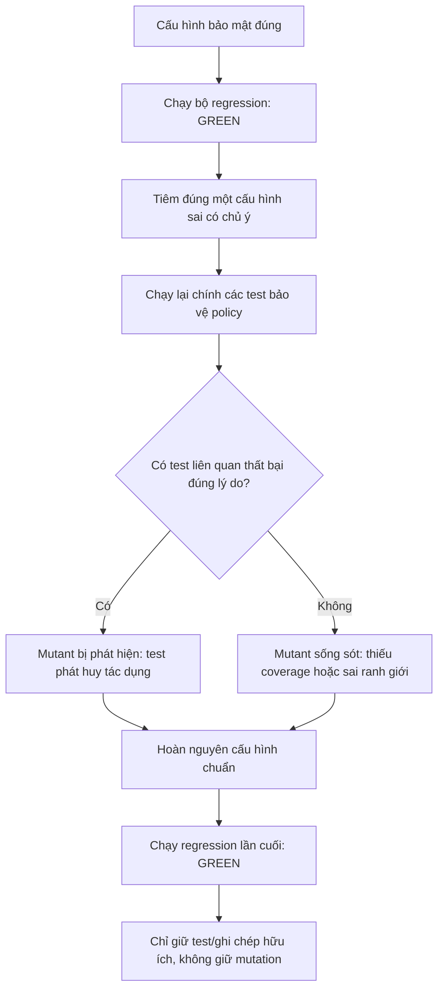

# Đưa vào một cấu hình sai có chủ ý để xác nhận bộ test phát hiện được

Một bộ kiểm thử bảo mật có thể báo **100% xanh** trong khi ứng dụng đã vô tình cho phép người dùng thường truy cập trang quản trị. Nguyên nhân có thể rất đơn giản: test chỉ kiểm tra rằng quản trị viên truy cập được, nhưng không kiểm tra người dùng thường **phải bị từ chối**.

Trong chương **Thực hành tổng hợp** của module `SPRING_SECURITY_TESTING`, chúng ta thực hiện một thí nghiệm có kiểm soát: **cố ý làm sai một cấu hình Spring Security trên môi trường thử nghiệm, quan sát bài test nào chuyển từ xanh sang đỏ, sau đó khôi phục cấu hình đúng và kiểm tra tất cả trở lại xanh**.

Cách làm này gần với *mutation testing* hoặc *fault injection*. Ta không hỏi “test có chạy được không?” mà hỏi: **“Nếu quy tắc bảo mật bị phá vỡ theo một cách có khả năng xảy ra trong thực tế, bộ test có phát hiện đúng lỗi đó không?”**

Bài sẽ kết hợp `MockMvc`, `@WithMockUser`, `SecurityMockMvcRequestPostProcessors`, Spring Security filter chain, `WebTestClient` trên Reactive WebFlux, CSRF, JWT/OAuth2/OIDC và các ranh giới xác thực. Mục tiêu là xác nhận năng lực phát hiện **cho phép sai, từ chối sai và bỏ qua xác thực**, chứ không chỉ tạo thêm nhiều assertions.

> **Giới hạn bắt buộc:** Chỉ tiêm lỗi trong nhánh, fixture hoặc môi trường kiểm thử cô lập. Không triển khai cấu hình sai lên production, không đẩy bản lỗi vào nhánh phát hành và không dùng credentials/tokens thật. Sau mỗi thử nghiệm phải hoàn nguyên cấu hình và chạy lại test ở trạng thái đúng.

## 1. Tư duy kiểm thử bằng cách cố ý phá một quy tắc

Đối với một API quản trị, có ba kết quả quan trọng:

- **ALLOW đúng:** User có `ROLE_ADMIN` gọi API và nhận 200.
- **DENY đúng:** User chỉ có `ROLE_USER` gọi API và nhận 403.
- **DENY khi chưa đăng nhập:** Request không có authentication nhận 401 hoặc redirect đến login tùy entry point.

Giả sử chính sách ban đầu là:

```java
.requestMatchers("/api/admin/**").hasRole("ADMIN")
```

Một lỗi cấu hình rất dễ xảy ra:

```java
// CỐ Ý SAI — chỉ dùng trong thí nghiệm đã cô lập:
.requestMatchers("/api/admin/**").authenticated()
```

Khi đó, **ADMIN vẫn được phép**, nhưng **USER thường cũng được phép**. Nếu suite chỉ có test “admin returns 200”, nó sẽ không báo lỗi.

Đây là ý tưởng cốt lõi của thí nghiệm:



Trong mutation testing, một cấu hình sai được gọi là **mutant**. Mutant được **killed** khi có test thất bại vì khác biệt hành vi do mutation tạo ra. Mutant **survived** nếu test vẫn xanh dù hành vi đã bị phá. Muốn kết luận đúng, phải kiểm tra rằng bài test *thực sự chạy đến assertion bảo mật*, không chỉ thất bại vì code không biên dịch hoặc vì test infrastructure không lên.

## 2. Xác định chính sách và kịch bản trước khi thay code

Thử nghiệm chỉ có ý nghĩa nếu có **trạng thái đúng làm chuẩn**. Ta dùng ba actor:

| Actor | Authentication | Authorities |
| --- | --- | --- |
| ANONYMOUS | Chưa xác thực | Không có `ROLE_USER` hoặc `ROLE_ADMIN` |
| USER | Đã xác thực | `ROLE_USER` |
| ADMIN | Đã xác thực | `ROLE_ADMIN` |

Tài nguyên minh họa:

| Chính sách | Request | Quy tắc đúng | ANONYMOUS | USER | ADMIN |
| --- | --- | --- | --- | --- | --- |
| `SEC-01` | `GET /api/public` | `permitAll()` | 200 | 200 | 200 |
| `SEC-02` | `GET /api/profile` | `authenticated()` | 401 | 200 | 200 |
| `SEC-03` | `GET /api/admin/report` | `hasRole("ADMIN")` | 401 | 403 | 200 |
| `SEC-04` | `POST /api/admin/reports` có CSRF hợp lệ | `hasRole("ADMIN")` và CSRF | 401 | 403 | 201 |
| `SEC-05` | `POST /api/admin/reports` thiếu CSRF | CSRF chặn | 403 | 403 | 403 |

Các trạng thái này áp dụng cho **fixture HTTP Basic + CSRF mặc định** sẽ cấu hình trong bài. Với form login, request anonymous có thể nhận redirect 302; nếu API hoàn toàn stateless và không dùng cookie xác thực, CSRF policy có thể khác. Đừng dùng status cố định mà không xem cấu hình thực tế.

### 2.1. Ý nghĩa của negative tests

Test `ADMIN → /api/admin/report → 200` chỉ chứng minh admin không bị chặn nhầm. Nó không phân biệt được:

```java
.hasRole("ADMIN")  // Đúng
.authenticated()   // Sai: mọi user đăng nhập đều được phép
.permitAll()       // Sai: anonymous cũng được phép
```

Ngược lại, test `USER → /api/admin/report → 403` sẽ phát hiện mutation `hasRole → authenticated`, còn test `ANONYMOUS → /api/admin/report → 401` có thể phát hiện thêm mutation `hasRole → permitAll`.

Một suite tốt cần **cặp allow/deny** để phát hiện cả việc mở quyền quá rộng lẫn khóa nhầm người hợp lệ.

### 2.2. Xác định phạm vi kiểm tra

Trước khi viết mutation, ghi rõ tầng nào được kiểm tra:

| Tầng | Công cụ | Câu trả lời có thể chứng minh |
| --- | --- | --- |
| Rule/handler | `@WithMockUser`, `MockMvc.with(user())` | Authority đã cấp có được phép truy cập không? |
| Servlet filter integration | `MockMvc` với filter chain thực | URL matcher, authorization, CSRF và entry point có hoạt động? |
| HTTP credential integration | `httpBasic()` hoặc Bearer header thực | Credentials có đi qua authentication filter/provider/decoder? |
| Reactive filter integration | `WebTestClient.bindToApplicationContext(...).apply(springSecurity())` | WebFlux SecurityWebFilterChain có thực thi rule? |
| Live server | `WebTestClient.bindToServer()` + RANDOM_PORT | Headers/cookies có được gửi qua HTTP đến server thật? |
| External protocol | IdP hoặc local stub/JWK/introspection | Redirect, token exchange, issuer/signature/introspection có được kiểm tra? |

Test ở tầng thấp không tự chứng minh tầng cao. Ví dụ `with(jwt())` cấp sẵn JWT authentication; khi mutation làm JWT decoder chấp nhận chữ ký giả, test dùng helper đó **không đủ khả năng phát hiện** vì decoder chưa được gọi.

## 3. Xây một ứng dụng Servlet nhỏ để kiểm tra

Ví dụ dùng Java 17+, Spring Boot 3.x và Spring Security 6.x theo kiểu cấu hình Bean. Các import, tên annotation và dependency cần được đối chiếu với phiên bản đang dùng nếu dự án nằm ở release line khác. Bài này không chạy build; các đoạn code là ví dụ giảng dạy cần được kiểm tra ở vòng QA chuyên môn.

### 3.1. Dependencies

```groovy
dependencies {
    implementation 'org.springframework.boot:spring-boot-starter-web'
    implementation 'org.springframework.boot:spring-boot-starter-security'

    testImplementation 'org.springframework.boot:spring-boot-starter-test'
    testImplementation 'org.springframework.security:spring-security-test'
}
```

Để phiên bản `spring-security-test` được quản lý cùng Spring Security runtime bằng BOM/dependency management của Spring Boot; tránh pin artifact test khác release line với `spring-security-web/config/core`.

### 3.2. SecurityFilterChain chuẩn — chưa tiêm lỗi

```java
import org.springframework.context.annotation.Bean;
import org.springframework.context.annotation.Configuration;
import org.springframework.http.HttpMethod;
import org.springframework.security.config.Customizer;
import org.springframework.security.config.annotation.web.builders.HttpSecurity;
import org.springframework.security.web.SecurityFilterChain;

@Configuration
class DemoSecurityConfiguration {

    @Bean
    SecurityFilterChain applicationSecurity(HttpSecurity http)
            throws Exception {

        return http
            .authorizeHttpRequests(auth -> auth
                .requestMatchers(HttpMethod.GET, "/api/public")
                    .permitAll()
                .requestMatchers(HttpMethod.GET, "/api/profile")
                    .authenticated()
                .requestMatchers(HttpMethod.GET, "/api/admin/report")
                    .hasRole("ADMIN")
                .requestMatchers(HttpMethod.POST, "/api/admin/reports")
                    .hasRole("ADMIN")
                .anyRequest().denyAll()
            )
            .httpBasic(Customizer.withDefaults())
            .csrf(Customizer.withDefaults())
            .build();
    }
}
```

Bản này cố ý dùng matchers cụ thể theo HTTP method. Việc thêm một rule quá rộng hoặc đổi thứ tự có thể tạo ra mutation khác ở phần sau.

- `hasRole("ADMIN")` thường kiểm tra authority `ROLE_ADMIN`.
- `authenticated()` chỉ yêu cầu request đã được xác thực, không kiểm tra admin role.
- `permitAll()` cho phép request không đăng nhập.
- `anyRequest().denyAll()` chặn những request chưa có policy explicit.
- `httpBasic()` giúp kịch bản API anonymous nhận 401 trong fixture.
- CSRF đang bật cho POST.

**Không tắt CSRF trong bản baseline**. Ta cần có một chính sách độc lập để kiểm tra liệu mutation vô hiệu hóa CSRF có bị phát hiện hay không.

### 3.3. Controller trả trạng thái rõ ràng

```java
import java.util.Map;

import org.springframework.http.HttpStatus;
import org.springframework.http.ResponseEntity;
import org.springframework.security.core.Authentication;
import org.springframework.web.bind.annotation.GetMapping;
import org.springframework.web.bind.annotation.PostMapping;
import org.springframework.web.bind.annotation.RestController;

@RestController
class DemoApiController {

    @GetMapping("/api/public")
    Map<String, String> publicInfo() {
        return Map.of("visibility", "public");
    }

    @GetMapping("/api/profile")
    Map<String, String> profile(Authentication authentication) {
        return Map.of("name", authentication.getName());
    }

    @GetMapping("/api/admin/report")
    String report() {
        return "admin-report";
    }

    @PostMapping("/api/admin/reports")
    ResponseEntity<String> createReport() {
        return ResponseEntity
            .status(HttpStatus.CREATED)
            .body("created");
    }
}
```

Không cài quyền trực tiếp bằng `if (username.equals("admin"))` trong controller; policy thuộc SecurityFilterChain. Giá trị trả về cố tình không chứa credentials hoặc SecurityContext vì bài test không cần quan sát dữ liệu nhạy cảm.

## 4. Viết bộ kiểm thử chuẩn trước khi cố ý phá cấu hình

Ta cần baseline test **GREEN** trước khi tiêm lỗi. Những bài test này phải đi qua Spring Security filter chain, vì mutation tác động ở đó.

```java
import org.junit.jupiter.api.Test;
import org.springframework.beans.factory.annotation.Autowired;
import org.springframework.boot.test.autoconfigure.web.servlet.AutoConfigureMockMvc;
import org.springframework.boot.test.context.SpringBootTest;
import org.springframework.test.web.servlet.MockMvc;

import static org.springframework.security.test.web.servlet.request
    .SecurityMockMvcRequestPostProcessors.user;
import static org.springframework.security.test.web.servlet.request
    .SecurityMockMvcRequestPostProcessors.csrf;
import static org.springframework.test.web.servlet.request
    .MockMvcRequestBuilders.get;
import static org.springframework.test.web.servlet.request
    .MockMvcRequestBuilders.post;
import static org.springframework.test.web.servlet.result
    .MockMvcResultMatchers.content;
import static org.springframework.test.web.servlet.result
    .MockMvcResultMatchers.jsonPath;
import static org.springframework.test.web.servlet.result
    .MockMvcResultMatchers.status;

@SpringBootTest
@AutoConfigureMockMvc
class AdminAccessPolicyTest {

    @Autowired
    MockMvc mvc;

    @Test
    void anonymousCannotReadAdminReport() throws Exception {
        mvc.perform(get("/api/admin/report"))
            .andExpect(status().isUnauthorized());
    }

    @Test
    void ordinaryUserCannotReadAdminReport() throws Exception {
        mvc.perform(get("/api/admin/report")
                .with(user("linh").roles("USER")))
            .andExpect(status().isForbidden());
    }

    @Test
    void adminCanReadAdminReport() throws Exception {
        mvc.perform(get("/api/admin/report")
                .with(user("root").roles("ADMIN")))
            .andExpect(status().isOk())
            .andExpect(content().string("admin-report"));
    }

    @Test
    void anonymousCanReadPublicEndpoint() throws Exception {
        mvc.perform(get("/api/public"))
            .andExpect(status().isOk())
            .andExpect(jsonPath("$.visibility").value("public"));
    }

    @Test
    void authenticatedUserCanReadProfile() throws Exception {
        mvc.perform(get("/api/profile")
                .with(user("linh").roles("USER")))
            .andExpect(status().isOk())
            .andExpect(jsonPath("$.name").value("linh"));
    }

    @Test
    void adminCanPostWithValidCsrf() throws Exception {
        mvc.perform(post("/api/admin/reports")
                .with(user("root").roles("ADMIN"))
                .with(csrf()))
            .andExpect(status().isCreated())
            .andExpect(content().string("created"));
    }

    @Test
    void ordinaryUserWithCsrfStillCannotPost() throws Exception {
        mvc.perform(post("/api/admin/reports")
                .with(user("linh").roles("USER"))
                .with(csrf()))
            .andExpect(status().isForbidden());
    }

    @Test
    void adminWithoutCsrfIsForbidden() throws Exception {
        mvc.perform(post("/api/admin/reports")
                .with(user("root").roles("ADMIN")))
            .andExpect(status().isForbidden());
    }

    @Test
    void adminWithInvalidCsrfIsForbidden() throws Exception {
        mvc.perform(post("/api/admin/reports")
                .with(user("root").roles("ADMIN"))
                .with(csrf().useInvalidToken()))
            .andExpect(status().isForbidden());
    }
}
```

**Mỗi assertion có mục đích riêng:**

- `anonymousCannotReadAdminReport` chứng minh URL không công khai.
- `ordinaryUserCannotReadAdminReport` chứng minh “đã đăng nhập” **không đủ** để vào khu vực admin.
- `adminCanReadAdminReport` chứng minh admin không bị chặn nhầm.
- `adminWithoutCsrfIsForbidden` và `adminWithInvalidCsrfIsForbidden` kiểm tra CSRF độc lập với role.
- `ordinaryUserWithCsrfStillCannotPost` cho thấy CSRF hợp lệ không cấp quyền admin.

Để test có ý nghĩa, **không** dùng `@AutoConfigureMockMvc(addFilters = false)`. Nếu tự dựng `MockMvc` bằng `MockMvcBuilders.webAppContextSetup(...)`, phải áp dụng `SecurityMockMvcConfigurers.springSecurity()`.

Những test trên dùng `with(user(...))` nên chúng **không xác minh mật khẩu**. Chúng được thiết kế để kiểm tra authorization và CSRF, là ranh giới phù hợp cho mutation cấu hình URL/role.

## 5. Mutation A — đổi hasRole thành authenticated

Đây là một trong những lỗi phân quyền nghiêm trọng nhưng dễ bị bỏ qua nhất.

### 5.1. Trạng thái đúng

```java
.requestMatchers(HttpMethod.GET, "/api/admin/report")
    .hasRole("ADMIN")
```

### 5.2. Trạng thái cố ý sai

```java
// MUTATION A — CỐ Ý SAI; KHÔNG ĐƯỢC GIỮ TRONG BẢN CHÍNH
.requestMatchers(HttpMethod.GET, "/api/admin/report")
    .authenticated()
```

Bây giờ mọi user đã xác thực, kể cả Linh chỉ có `ROLE_USER`, có thể đọc báo cáo admin.

| Test | Baseline | Sau mutation A | Mutation có bị phát hiện? |
| --- | --- | --- | --- |
| `adminCanReadAdminReport` | 200 | 200 | **Không** |
| `anonymousCannotReadAdminReport` | 401 | 401 | **Không** |
| `ordinaryUserCannotReadAdminReport` | 403 | **200** | **Có** |
| `anonymousCanReadPublicEndpoint` | 200 | 200 | Không liên quan |
| `adminWithoutCsrfIsForbidden` | 403 | 403 | Không liên quan |

Điều cần quan sát trong kết quả test là **assertion mismatch** ở đúng negative case: **expected 403, actual 200**. Nếu test fail vì context không khởi động hay class không compile, chưa thể coi mutation đã bị phát hiện bởi policy test.

### 5.3. Bằng chứng cần ghi lại

Một biên bản ngắn cho mutation này:

```text
Mutation ID: AUTHZ-ADMIN-01
Policy: GET /api/admin/report requires ROLE_ADMIN
Change: hasRole("ADMIN") -> authenticated()
Baseline: AdminAccessPolicyTest green
Expected killer: ordinaryUserCannotReadAdminReport
Observed failure: expected 403, actual 200
Classification: KILLED (authorization regression detected)
Restored baseline: yes
Rerun baseline: green
```

Đây là **ví dụ kết quả mong muốn**, không phải log đã được chạy. Nếu test vẫn xanh sau mutation, hãy kiểm tra xem filter chain thực có chạy không, URL có match rule vừa sửa không, test có cấp nhầm `ROLE_ADMIN` cho USER không hoặc rule khác vẫn chặn request.

## 6. Mutation B — đổi hasRole thành permitAll

Thay rule admin bằng:

```java
// MUTATION B — CỐ Ý SAI; CHỈ THỬ NGHIỆM CÔ LẬP
.requestMatchers(HttpMethod.GET, "/api/admin/report")
    .permitAll()
```

Mutation này mở rộng quyền hơn mutation A: **anonymous cũng có thể đọc báo cáo admin**.

| Test | Baseline | Sau mutation B |
| --- | --- | --- |
| Anonymous đọc admin | 401 | **200** → test phải đỏ |
| USER đọc admin | 403 | **200** → test phải đỏ |
| ADMIN đọc admin | 200 | 200 → test vẫn xanh |

Mutation này cho thấy lý do phải có ít nhất **hai negative cases**:

- Nếu chỉ kiểm tra anonymous, bạn có thể phát hiện `permitAll()` nhưng **không** phát hiện việc đổi `hasRole` thành `authenticated()`.
- Nếu chỉ kiểm tra USER thường, bạn có thể phát hiện cả hai trong fixture này, nhưng vẫn cần case anonymous để làm rõ đường HTTP entry point và tránh cấu hình công khai sai cho API khác.

Một test case không đủ cho mọi kiểu lỗi. Chọn negative cases theo **cách policy có thể bị phá**.

## 7. Mutation C — đổi hasRole thành denyAll

Không phải mọi sai cấu hình đều làm lộ dữ liệu. Một rule quá chặt cũng là regression:

```java
// MUTATION C — CỐ Ý SAI
.requestMatchers(HttpMethod.GET, "/api/admin/report")
    .denyAll()
```

Lúc này:

- ANONYMOUS vẫn bị từ chối.
- USER vẫn bị từ chối.
- **ADMIN hợp lệ cũng bị từ chối**, thường trả 403.

Test `adminCanReadAdminReport` là **killer** của mutation này: expected 200, actual 403.

Nếu suite chỉ tập trung vào từ chối, nó có thể xanh trong khi tất cả người dùng hợp lệ bị khóa khỏi chức năng. Vì thế bộ test cần cả **positive** và **negative** assertions.

## 8. Mutation D — vô hiệu hóa CSRF để thấy test có phát hiện

CSRF bảo vệ một nhóm request thay đổi trạng thái trong kiến trúc dùng browser credentials có thể tự được gửi kèm (ví dụ session cookies). Đối với fixture bài này, CSRF đang bật cho POST.

### 8.1. Trạng thái đúng

```java
.csrf(Customizer.withDefaults())
```

### 8.2. Mutation cố ý sai

```java
// MUTATION D — CỐ Ý SAI trên fixture có CSRF policy
.csrf(csrf -> csrf.disable())
```

Khi admin đã có `ROLE_ADMIN`, `POST /api/admin/reports` mà **không có CSRF token** có thể được xử lý và trả **201 Created**, thay vì 403 như policy ban đầu.

| Test | Baseline | Sau mutation D |
| --- | --- | --- |
| Admin POST có CSRF hợp lệ | 201 | 201 → không phát hiện |
| Admin POST thiếu CSRF | 403 | **201** → phát hiện |
| Admin POST CSRF sai | 403 | **201** → phát hiện |
| USER POST có CSRF hợp lệ | 403 | 403 → không phát hiện |

Điều rút ra: nếu **mọi** POST test đều gắn `with(csrf())`, suite có thể không phát hiện ai đó tắt CSRF. Phải có ca gửi token thiếu/sai khi policy yêu cầu CSRF.

**Lưu ý bối cảnh:** Một API chỉ nhận Bearer token qua Authorization header và không dựa vào cookie browser có thể có quyết định CSRF khác. Mutation “tắt CSRF” chỉ được xem là bug nếu **threat model và policy đã yêu cầu CSRF bảo vệ**. Mutation test không thay thế việc đánh giá kiến trúc.

### 8.3. Đừng hiểu nhầm 403 do CSRF với 403 do role

Trước khi kết luận test `USER → POST → 403` đã chứng minh role, phải gửi token CSRF **hợp lệ**. Nếu không, request có thể bị từ chối bởi `CsrfFilter` trước khi authorization kiểm tra role.

Đó là lý do `ordinaryUserWithCsrfStillCannotPost` luôn gọi `.with(csrf())`, còn `adminWithoutCsrfIsForbidden` chủ đích không gọi helper ấy.

## 9. Mutation E — làm sai thứ tự requestMatcher

Spring Security xét các matcher theo thứ tự khai báo trong `authorizeHttpRequests(...)`. Một matcher quá rộng đứng trước rule nhạy cảm có thể bắt request trước.

### 9.1. Thứ tự đúng

```java
.authorizeHttpRequests(auth -> auth
    .requestMatchers("/api/admin/**").hasRole("ADMIN")
    .requestMatchers("/api/**").authenticated()
    .anyRequest().denyAll()
)
```

### 9.2. Thứ tự cố ý sai

```java
// MUTATION E — CỐ Ý SAI: matcher rộng đứng trước matcher admin
.authorizeHttpRequests(auth -> auth
    .requestMatchers("/api/**").authenticated()
    .requestMatchers("/api/admin/**").hasRole("ADMIN")
    .anyRequest().denyAll()
)
```

Trong mutation này, `GET /api/admin/report` bị rule `/api/**` bắt trước, nên USER đã đăng nhập có thể vào được. Test `ordinaryUserCannotReadAdminReport` phải đỏ.

**Lưu ý:** Mục này là một **biến thể độc lập** của cấu hình theo pattern matching ở mục 3, không phải chèn cả hai đoạn vào cùng một chain. Hãy áp dụng chỉ một mutation tại một thời điểm.

### 9.3. Mutation chain matcher có thể bỏ lọt cả filter chain

Nếu ứng dụng có nhiều `SecurityFilterChain` với `@Order` hoặc `securityMatcher(...)`, một mutation có thể khiến endpoint admin không còn thuộc chain bảo vệ mong muốn.

Ví dụ conceptual:

```java
// Đúng: chain xử lý tất cả /api/**
http.securityMatcher("/api/**");

// Sai: chỉ xử lý /api/internal/**;
// /api/admin/** có thể rơi sang chain khác hoặc không bị Security chain bảo vệ.
http.securityMatcher("/api/internal/**");
```

Kết quả HTTP thực phụ thuộc các chain còn lại. Không tự mặc định `/api/admin/**` sẽ trả 200; nó có thể bị chain fallback chặn. Vì vậy một test integration phải gửi đúng URL rồi kiểm tra kết quả, thay vì suy từ việc bean SecurityFilterChain tồn tại.

## 10. Mutation F — thay đổi role/authority theo cách tưởng tương đương

Với prefix mặc định:

```java
// Đúng nếu principal chứa ROLE_ADMIN:
.hasRole("ADMIN")
```

Một thay đổi sai thường gặp:

```java
// MUTATION F — CỐ Ý SAI nếu dữ liệu đang dùng ROLE_ADMIN
.hasAuthority("ADMIN")
```

Hai biểu thức không tương đương. `hasAuthority("ADMIN")` chỉ chấp nhận authority đúng chuỗi `ADMIN`, còn principal của test `roles("ADMIN")` có `ROLE_ADMIN`.

**Kết quả:** ADMIN thật có thể nhận 403 — test positive admin phát hiện sự cố. Nhưng negative case USER vẫn trả 403, nên negative test không phát hiện mutation kiểu khóa nhầm người có quyền.

Một mutation khác là xóa nhầm prefix khi ánh xạ từ database/IdP:

```java
String storedRole = "ROLE_ADMIN";

// Sai nếu domain đã lưu full authority:
new SimpleGrantedAuthority("ROLE_" + storedRole);
// -> ROLE_ROLE_ADMIN
```

Đối với lỗi này, cần **thêm unit test cho mapper** và integration test dùng credentials thật, không chỉ MockMvc với `with(user("root").roles("ADMIN"))`. Mock user được cấp sẵn quyền đúng nên có thể tiếp tục xanh dù mapper production tạo `ROLE_ROLE_ADMIN`.

## 11. Mutation G — tắt Spring Security filters trong test

Một trong những kiểu “bộ test xanh giả” nguy hiểm nhất là test không còn chạy qua security filters.

```java
// MUTATION G — CỐ Ý SAI nếu class được gọi là security integration test:
@AutoConfigureMockMvc(addFilters = false)
```

Khi đó, controller có thể trả 200 cho anonymous ở endpoint `/api/admin/report`, vì rule authorization không được áp dụng.

Bài test `anonymousCannotReadAdminReport` có vai trò **canary**: nếu anonymous bỗng nhận 200, hãy kiểm tra filter registration trước khi đổ lỗi cho `@WithMockUser`.

Tương tự, code:

```java
MockMvc mvc = MockMvcBuilders
    .standaloneSetup(new DemoApiController())
    .build();
```

không tự dùng SecurityFilterChain của ứng dụng. Nó phù hợp cho controller unit test nhưng không chứng minh bảo vệ HTTP. Để tích hợp Spring Security khi tự dựng MockMvc từ web application context:

```java
MockMvc mvc = MockMvcBuilders
    .webAppContextSetup(webApplicationContext)
    .apply(springSecurity())
    .build();
```

Trong snippet này, `springSecurity()` là `SecurityMockMvcConfigurers.springSecurity()`. Đừng gọi một controller-only test là “security regression test” khi không có security chain.

## 12. Tổ chức thí nghiệm an toàn: GREEN → RED → GREEN

Một mutation experiment đáng tin cần ba điểm kiểm soát.

### 12.1. Bước 1 — GREEN trước mutation

Chạy bộ policy test trên cấu hình đúng. Kết quả cần:

- Test compile và khởi tạo context thành công.
- Tất cả ca allow/deny đang xanh.
- Không có test bị skip ngoài dự kiến.
- Không có annotation/fixture thay thế filter chain vô tình.

**Nếu baseline đỏ, không tiêm mutation.** Trước tiên sửa hoặc phân loại lỗi nền để có chuẩn so sánh.

### 12.2. Bước 2 — RED sau khi áp dụng đúng một mutation

Trong một nhánh/worktree **cô lập và có thể bỏ đi**, chỉ thay đúng một rule. Chạy lại test nhắm vào policy bị ảnh hưởng.

Ví dụ với mutation A:

```text
POLICY   : GET /api/admin/report requires ROLE_ADMIN
MUTATION : hasRole("ADMIN") -> authenticated()
TEST     : ordinaryUserCannotReadAdminReport
EXPECTED : 403
ACTUAL   : 200
RESULT   : KILLED
```

Nếu test fail vì `ApplicationContext` không load, dependency không resolve hoặc port bị chiếm, kết quả là **INVALID/INCONCLUSIVE**, chưa phải `KILLED`. Cần kiểm tra **assertion cụ thể** chứng minh policy đổi hành vi.

Nếu tất cả test vẫn xanh, mutation là **SURVIVED**. Nó có thể chỉ ra test thiếu negative case, mutation không áp dụng vào chain thực, endpoint không được hit, hoặc kết quả mutation tương đương với cấu hình cũ trong ngữ cảnh được thử.

### 12.3. Bước 3 — GREEN sau khi hoàn nguyên

Khôi phục đúng rule trước mutation, kiểm tra diff không còn chứa cấu hình sai, chạy lại bộ test. Chỉ giữ các **bài test bổ sung** hoặc biên bản hữu ích, không giữ source có mutation.

Ví dụ thứ tự lệnh tham khảo (không phải các lệnh đã chạy trong bài này):

```bash
# 1. Trên cấu hình đúng: baseline cần xanh.
./gradlew test --tests '*AdminAccessPolicyTest'

# 2. Trong worktree/nhánh riêng, sửa đúng một rule theo mutation plan.
# 3. Chạy lại cùng test class; mong đợi assertion security liên quan đỏ.
./gradlew test --tests '*AdminAccessPolicyTest'

# 4. Hoàn nguyên mutation bằng cách khôi phục thay đổi đã ghi nhận.
# 5. Chạy lại test trên cấu hình đúng; yêu cầu xanh.
./gradlew test --tests '*AdminAccessPolicyTest'
```

Đừng coi việc lệnh ở bước 3 trả exit code khác 0 là tự động “killed”: lỗi compiler hoặc timeout cũng trả non-zero. Kiểm tra JUnit report để xác nhận **đúng method và đúng expected/actual**.

**Không chạy thí nghiệm trực tiếp trong nhánh production/release, không commit mutation vào artifact phân phối và không sử dụng hệ thống IdP production.** Nếu tự động hóa, mỗi mutant phải có môi trường sạch riêng, có cơ chế hoàn nguyên kể cả khi job bị lỗi.

## 13. Dùng JUnit parameterized test để nhiều policy được bảo vệ

Khi hệ thống có nhiều endpoint, ta có thể khai báo actor–URL–status trong bảng thay vì viết lặp từng method. Một suite dữ liệu rõ ràng giúp reviewer nhìn thấy những negative cases có thiếu hay không.

```java
import java.util.stream.Stream;
import org.junit.jupiter.params.ParameterizedTest;
import org.junit.jupiter.params.provider.Arguments;
import org.junit.jupiter.params.provider.MethodSource;
import org.springframework.test.web.servlet.request.MockHttpServletRequestBuilder;

import static org.springframework.security.test.web.servlet.request
    .SecurityMockMvcRequestPostProcessors.user;
import static org.springframework.test.web.servlet.request
    .MockMvcRequestBuilders.get;
import static org.springframework.test.web.servlet.result
    .MockMvcResultMatchers.status;

enum Actor { ANONYMOUS, USER, ADMIN }

record PolicyCase(
    String policy,
    Actor actor,
    String endpoint,
    int status
) {}

static Stream<Arguments> adminCases() {
    return Stream.of(
        Arguments.of(new PolicyCase(
            "SEC-03", Actor.ANONYMOUS, "/api/admin/report", 401)),
        Arguments.of(new PolicyCase(
            "SEC-03", Actor.USER, "/api/admin/report", 403)),
        Arguments.of(new PolicyCase(
            "SEC-03", Actor.ADMIN, "/api/admin/report", 200))
    );
}

@ParameterizedTest(name = "{index}: {0}")
@MethodSource("adminCases")
void adminPolicyMustMatchMatrix(PolicyCase c) throws Exception {
    MockHttpServletRequestBuilder req = get(c.endpoint());

    if (c.actor() == Actor.USER) {
        req.with(user("linh").roles("USER"));
    } else if (c.actor() == Actor.ADMIN) {
        req.with(user("root").roles("ADMIN"));
    }

    mvc.perform(req).andExpect(status().is(c.status()));
}
```

Đặt `enum`, `record` và methods này bên trong một class test có trường `MockMvc mvc` được inject như mục 4. Vì vậy snippet chỉ là phần bổ sung, không phải tệp Java hoàn chỉnh. Với mutation A, riêng hàng USER sẽ báo expected 403/actual 200, còn các hàng khác vẫn xanh.

### 13.1. Không giả lập admin ở cấp class

Nếu gắn `@WithMockUser(roles = "ADMIN")` ở **cấp class**, các hàng ANONYMOUS có thể không còn thực sự anonymous. Hãy để từng case thiết lập principal riêng và kiểm tra request không có `with(user(...))` thật sự bị từ chối.

### 13.2. Không làm yếu assertions để mutation biến mất

Khi mutation làm test đỏ, không “sửa” theo kiểu:

```java
// SAI: chấp nhận mọi kết quả chỉ để test xanh.
.andExpect(result -> {
    int status = result.getResponse().getStatus();
    assertThat(status).isBetween(200, 403);
});
```

Nó khiến test không còn chứng minh policy. Expected status phải xuất phát từ hợp đồng ALLOW/DENY. Nếu sản phẩm thực sự đổi policy, cần cập nhật policy spec và kiểm thử sau review, không chỉ nới assertion.

## 14. Thử mutation với Reactive WebFlux và WebTestClient

Đối với ứng dụng Reactive, ý tưởng giữ nguyên nhưng ranh giới thực thi dùng `SecurityWebFilterChain` và `WebTestClient`.

### 14.1. Cấu hình Reactive đúng

```java
import org.springframework.context.annotation.Bean;
import org.springframework.context.annotation.Configuration;
import org.springframework.security.config.Customizer;
import org.springframework.security.config.web.server.ServerHttpSecurity;
import org.springframework.security.web.server.SecurityWebFilterChain;

@Configuration
class ReactiveDemoSecurityConfiguration {

    @Bean
    SecurityWebFilterChain springSecurityFilterChain(
            ServerHttpSecurity http) {
        return http
            .authorizeExchange(auth -> auth
                .pathMatchers("/api/public").permitAll()
                .pathMatchers("/api/admin/**").hasRole("ADMIN")
                .pathMatchers("/api/**").authenticated()
                .anyExchange().denyAll()
            )
            .httpBasic(Customizer.withDefaults())
            .formLogin(form -> form.disable())
            .build();
    }
}
```

Ví dụ cần có WebFlux handler cho `GET /api/admin/report`, chẳng hạn:

```java
@RestController
class ReactiveReportController {
    @GetMapping("/api/admin/report")
    Mono<String> report() {
        return Mono.just("admin-report");
    }
}
```

Các imports `RestController`, `GetMapping` và `Mono` tương ứng là Spring WebFlux/Project Reactor. Đây là fixture **riêng** của ứng dụng Reactive, không nên nhúng đồng thời Servlet và Reactive security configurations rồi giả định Spring Boot khởi tạo cả hai.

### 14.2. Test WebFlux bao gồm negative case

```java
import org.junit.jupiter.api.BeforeEach;
import org.junit.jupiter.api.Test;
import org.springframework.beans.factory.annotation.Autowired;
import org.springframework.boot.test.context.SpringBootTest;
import org.springframework.context.ApplicationContext;
import org.springframework.test.web.reactive.server.WebTestClient;

import static org.springframework.security.test.web.reactive.server
    .SecurityMockServerConfigurers.mockUser;
import static org.springframework.security.test.web.reactive.server
    .SecurityMockServerConfigurers.springSecurity;

@SpringBootTest(
    webEnvironment = SpringBootTest.WebEnvironment.MOCK
)
class ReactiveAdminPolicyTest {

    @Autowired
    ApplicationContext context;

    WebTestClient client;

    @BeforeEach
    void setUp() {
        client = WebTestClient.bindToApplicationContext(context)
            .apply(springSecurity())
            .configureClient()
            .build();
    }

    @Test
    void ordinaryReactiveUserCannotReadAdminReport() {
        client.mutateWith(mockUser("linh").roles("USER"))
            .get()
            .uri("/api/admin/report")
            .exchange()
            .expectStatus().isForbidden();
    }

    @Test
    void reactiveAdminCanReadAdminReport() {
        client.mutateWith(mockUser("root").roles("ADMIN"))
            .get()
            .uri("/api/admin/report")
            .exchange()
            .expectStatus().isOk();
    }

    @Test
    void anonymousIsRejectedInReactiveApp() {
        client.get()
            .uri("/api/admin/report")
            .exchange()
            .expectStatus().isUnauthorized();
    }
}
```

Nếu ta cố ý đổi:

```java
// MUTATION REACTIVE — CỐ Ý SAI:
.pathMatchers("/api/admin/**").authenticated()
```

test `ordinaryReactiveUserCannotReadAdminReport` phải chuyển từ xanh sang đỏ: expected 403, actual 200. Admin test vẫn xanh; anonymous vẫn có thể nhận 401. Đây là cùng một ý tưởng mutation nhưng trên **Reactive authorization manager**.

**Giới hạn:** `mockUser()` đặt sẵn authentication vào reactive security context test; nó không kiểm tra Basic password qua `ReactiveAuthenticationManager`. Muốn mutation liên quan provider được kiểm tra, cần test gửi HTTP Basic/Bearer header thật với WebFilterChain.

## 15. JWT Resource Server: một mutation có thể sống sót qua mọi test mockJwt

Với JWT, cần phân biệt hai câu hỏi:

1. **Authorization:** Một `JwtAuthenticationToken` có `SCOPE_reports.read` hoặc `ROLE_ADMIN` được phép làm gì?
2. **Authentication/validation:** Một compact JWT ký sai, hết hạn hoặc issuer không tin cậy có bị từ chối trước khi cấp authorities không?

Helper `with(jwt())` của MockMvc và `mockJwt()` của WebFlux thường tạo sẵn JWT authentication. Nó phù hợp cho câu hỏi 1, **không** đủ để chứng minh câu hỏi 2.

### 15.1. Mutation authorization về JWT scope

Nếu API thực yêu cầu:

```java
.requestMatchers("/api/reports").hasAuthority("SCOPE_reports.read")
```

một cấu hình sai:

```java
// CỐ Ý SAI
.requestMatchers("/api/reports").authenticated()
```

sẽ cho phép JWT đã được xác thực nhưng **thiếu scope**. Một test hữu ích:

```java
mvc.perform(get("/api/reports")
        .with(jwt().authorities(
            new SimpleGrantedAuthority("SCOPE_profile"))))
    .andExpect(status().isForbidden());
```

Test này có thể **kill** mutation authorization, vì nó cố tình dùng authentication có quyền không phù hợp. Nhưng đừng gọi nó là test chữ ký JWT.

### 15.2. Mutation validator: mockJwt không thể phát hiện decoder sai

Giả sử do lỗi cấu hình, hệ thống bỏ kiểm tra issuer hoặc thay một `JwtDecoder` kiểm tra chữ ký thật bằng implementation chấp nhận token không đáng tin. Các bài test chỉ dùng:

```java
mvc.perform(get("/api/reports")
        .with(jwt().authorities(
            new SimpleGrantedAuthority("SCOPE_reports.read"))))
    .andExpect(status().isOk());
```

**có thể vẫn xanh**: test helper đã bypass decoder. Một bộ kiểm thử có khả năng phát hiện loại mutation này phải:

- Tạo JWT được ký bằng test signing key hợp lệ, gửi qua HTTP `Authorization: Bearer <signed-token>` và xác nhận 200.
- Tạo JWT với signature bị sửa hoặc ký bằng key không tin cậy và xác nhận 401.
- Tạo JWT expired / wrong issuer, xác nhận 401 theo validators thật sự được cấu hình.
- Tạo JWT có chữ ký hợp lệ nhưng thiếu scope, xác nhận 403.
- Không thay decoder bằng Mockito mock trong chính những ca kiểm tra decoder.

Ví dụ hình thức request MockMvc:

```java
mvc.perform(get("/api/reports")
        .header(
            HttpHeaders.AUTHORIZATION,
            "Bearer " + validSignedToken))
    .andExpect(status().isOk());

mvc.perform(get("/api/reports")
        .header(
            HttpHeaders.AUTHORIZATION,
            "Bearer " + tokenWithTamperedSignature))
    .andExpect(status().isUnauthorized());
```

Các biến `validSignedToken` và `tokenWithTamperedSignature` phải đến từ fixture tạo JWT đã ký/key test; Spring Resource Server phải dùng `JwtDecoder` thực. Đây là snippet thể hiện **hợp đồng test**, không phải đoạn tự đủ để sinh khóa/issuer/claims. Không sử dụng token production trong môi trường mutation.

**Kết luận:** Nếu mutation JWT validator **survives** dù suite MockMvc jwt() đều xanh, đó là dấu hiệu suite thiếu ranh giới xác thực/token validation, không phải bằng chứng decoder an toàn.

## 16. OAuth2/OIDC: mutation ở callback cần test giao thức

Tương tự JWT, helper `oauth2Login()`, `oidcLogin()` hay `mockOidcLogin()` phục vụ downstream authorization với principal đã tạo sẵn. Chúng không thực hiện toàn bộ redirect/callback, trao đổi authorization code, xác minh `state` hoặc chữ ký ID token.

Ví dụ mutation khái niệm:

- Bỏ kiểm tra `state` khi xử lý callback.
- Không yêu cầu PKCE trong flow vốn cần PKCE.
- Chấp nhận ID token có issuer/audience không phù hợp.
- Đánh đồng ID token với access token cho Resource Server.
- Mapping nhầm claim nhóm người dùng thành `ROLE_ADMIN`.

**Chỉ những test đi qua ranh giới bị thay đổi mới có cơ hội phát hiện mutation**:

| Loại mutation | Test phù hợp | Helper không đủ để chứng minh |
| --- | --- | --- |
| Xóa kiểm tra callback state | Khởi động authorization request, gửi callback state sai, assert login failure | `oidcLogin()` |
| Bỏ PKCE verifier | Quan sát request token exchange tại local IdP stub, xác nhận `code_verifier` | `oauth2Login()` |
| Bỏ ID token validation | Dùng JWT ký bằng test key sai/issuer sai, callback OIDC thật, assert bị từ chối | `mockOidcLogin()` |
| Mapping admin quá rộng | Unit mapper + integration qua user-info/ID token fixture | Gắn sẵn `ROLE_ADMIN` trong mock principal |
| Chấp nhận opaque token inactive | Resource Server gọi local introspection stub và nhận `active=false` | `opaqueToken()` |

Không cần cố ý triển khai một callback không kiểm tra `state` chỉ để viết bài tập cơ bản. Có thể thử các tình huống **sai input** trên cấu hình đúng trước; nếu áp dụng code mutation ở cơ chế protocol, chỉ thực hiện trong môi trường chuyên dụng với khả năng rollback và không có secrets thật.

## 17. Phân biệt mutation “killed”, “survived”, “invalid” và “equivalent”

Không phải mọi mutation còn xanh đều chứng minh suite yếu; cũng không phải mọi build đỏ đều chứng minh suite mạnh.

| Kết quả | Định nghĩa | Hành động tiếp theo |
| --- | --- | --- |
| **KILLED** | Test liên quan thất bại vì hành vi bảo mật khác so với policy | Ghi nhận test, nguyên nhân và expected/actual |
| **SURVIVED** | Cấu hình đã thay nhưng các test vẫn xanh; khác biệt hành vi thực sự có tồn tại | Bổ sung hoặc sửa test, kiểm tra đúng filter chain |
| **INVALID / INCONCLUSIVE** | Build lỗi, context không lên, test không chạy/timeout, hoặc mutation không được áp dụng | Sửa thí nghiệm, chưa tính thành công |
| **EQUIVALENT** | Thay code nhưng trong phạm vi và policy xét đến không đổi hành vi | Chứng minh vì sao tương đương; không vội coi là coverage gap |
| **NOT REACHED** | Test không hit rule/chain/method vừa sửa | Thêm đường test đi qua đúng ranh giới |

Ví dụ mutation `hasRole("ADMIN") → hasAuthority("ROLE_ADMIN")` có thể **tương đương** với prefix mặc định và cùng dữ liệu. Nếu bộ test vẫn xanh trong trường hợp này, không nhất thiết là thiếu coverage. Đừng ép mọi mutant phải đỏ bằng cách tạo assertions không phù hợp.

Ngược lại, mutation `hasRole("ADMIN") → authenticated()` rõ ràng mở rộng quyền cho USER; nếu vẫn xanh, đó là tín hiệu cần điều tra.

### 17.1. Mutation score chỉ là chỉ số bổ sung

Một công thức đơn giản:

```text
Mutation detection rate =
    số mutant không tương đương bị KILLED
    -------------------------------------------------
    số mutant hợp lệ, không tương đương đã thử
```

Công thức chỉ hữu ích nếu **đã loại** các mutation invalid/equivalent và đã kiểm tra đúng nguyên nhân của failure. Một bộ test nhiều dòng không đồng nghĩa có mutation score cao; ngược lại, score cao ở vài mutation dễ không chứng minh các giao thức OAuth2/JWT đều được kiểm tra.

## 18. Tránh thất bại giả trong một thí nghiệm mutation

### 18.1. Test đỏ vì status khác nhưng không liên quan rule

Ví dụ POST thiếu CSRF nhận 403 cả trước và sau mutation `hasRole → authenticated`. Test này không phát hiện mutation authorization, vì request đã bị CsrfFilter chặn sớm.

**Cách sửa test:** Với ca đo role trên POST, gắn `with(csrf())` hợp lệ; giữ một test riêng không có token để đo CSRF.

### 18.2. Test không chạy vào SecurityFilterChain

Một class dùng `@AutoConfigureMockMvc(addFilters = false)` hoặc controller-only `standaloneSetup(...)` có thể trả 200 bất kể rule. Phải xác minh setup đã tích hợp Spring Security và có negative case anonymous.

### 18.3. Test bị @WithMockUser cấp quyền rộng hơn yêu cầu

Nếu `@WithMockUser(roles="ADMIN")` đặt ở class level, test “ordinary user” có thể vô tình mang admin authority. Với test matrix, cấp principal ở từng request để actor được cô lập.

### 18.4. Rule bị sửa không phải rule hiệu lực

Ứng dụng có thể có nhiều SecurityFilterChains. Một rule thuộc chain không match URL hoặc bị rule phía trước bắt mất thì mutation không thay đổi behavior. Kiểm tra thứ tự/chain matching, không chỉ diff của source.

### 18.5. Mutation làm hỏng application startup

Nếu sửa config khiến Spring context không khởi động, JUnit có thể đỏ hàng loạt nhưng không có assertion nào về 403/200 được thực thi. Đó là **invalid/inconclusive**, không phải bằng chứng suite đã phát hiện access-control regression.

### 18.6. Test chạy trên server hoặc context cũ

Với test live server, build cache/hot reload hoặc một instance đang chạy từ trước có thể khiến test gọi code chưa được mutate. Dùng instance/port test mới, kiểm tra test context và dependency version. Không thay source rồi gửi request tới một server production hoặc development dùng chung.

### 18.7. Lệ thuộc thứ tự, state hoặc người dùng dùng chung

Session Alice có thể bị tái sử dụng ở case Bob nếu suite giữ cookies chung. Một singleton lưu current principal có thể khiến test pass/fail không ổn định. Cô lập request/session/test data và dùng fixture riêng cho từng actor.

### 18.8. Coi mọi non-zero exit code là “killed”

Một script automation kiểu `if command fails then success` quá rộng: test compile lỗi hoặc Gradle daemon crash cũng trở thành “mutation killed”. Hãy đọc JUnit results và chỉ chấp nhận mutation khi **test được mong đợi đã chạy và thất bại ở assertion liên quan**.

## 19. Thiết kế automation cho mutation security mà không làm hỏng CI

Có hai cách phù hợp:

**Cách A — Thí nghiệm thủ công có ghi nhận:** Trong nhánh tạm, chạy baseline, áp dụng đúng một mutation, chạy test liên quan, ghi expected/actual, hoàn nguyên, chạy lại baseline. Đây là cách minh họa an toàn nhất khi mới học.

**Cách B — Chạy mutation trong job cô lập:** CI tạo một working copy tạm, thử một danh sách mutation được review, chạy test riêng cho từng mutant rồi loại bỏ working copy. Main branch/production artifacts chỉ dùng code đúng.

Quy trình tự động ở mức khái niệm:

```text
for each approved mutation:
    create clean disposable workspace
    confirm baseline tests PASS
    apply exactly one mutation
    run targeted security policy tests
    inspect JUnit report:
        if expected security assertion failed:
            record KILLED
        else if tests all passed:
            record SURVIVED
        else:
            record INVALID / INCONCLUSIVE
    discard disposable workspace
end

require the original unmutated code to pass full regression
```

Các tool mutation testing cho Java (ví dụ PIT) có thể thực hiện một số loại bytecode mutation tự động, nhưng **không được giả định** chúng hỗ trợ mọi biến đổi Spring Security DSL như `hasRole → authenticated` hoặc đổi thứ tự requestMatcher. Đối với policy mutations, có thể cần operator/source transformation chuyên dụng và cơ chế xác minh baseline rõ ràng.

### 19.1. CI gate nên thất bại khi nào?

- **Baseline fail:** không chấp nhận mutation experiment; cần sửa code/test nền.
- **Mutant hợp lệ sống sót:** báo lỗ hổng coverage; có thể đưa vào quality gate sau khi team thống nhất policy.
- **Mutation test timeout/inconclusive:** báo trạng thái điều tra, không gán thành success.
- **Code đúng sau rollback fail:** chặn merge vì không chứng minh được trạng thái cuối sạch.
- **Mutated code còn trong diff/commit:** chặn đưa bản lỗi vào nhánh chính.

**Không** giữ CI ở trạng thái đỏ có chủ ý trên nhánh sản phẩm. Công việc của mutation runner là nhận ra test phải thất bại trong working copy sai, sau đó bỏ mutant và xác nhận code chuẩn vẫn xanh.

### 19.2. Các thông tin nên ghi trong mutation report

```text
Policy ID      : SEC-03
Mutation ID    : AUTHZ-ADMIN-01
Target boundary: Servlet SecurityFilterChain
Baseline rule  : hasRole("ADMIN")
Mutated rule   : authenticated()
Expected killer: ordinaryUserCannotReadAdminReport
Expected       : 403
Observed       : 200
Classification : KILLED
Mutation scope : disposable test worktree
Rollback       : verified
Final baseline : GREEN
```

Khi chưa chạy thật, ghi `Observed: NOT_RUN` thay vì bịa status hoặc kết luận killed. Trong STEP 4 này, các outputs là **ví dụ học tập**, không phải log từ một thí nghiệm đã thực thi.

## 20. Bảng kế hoạch các mutation có chủ ý

| Mutation ID | Thay đổi cố ý | Test bắt lỗi quan trọng nhất | Kết quả kỳ vọng khi mutate |
| --- | --- | --- | --- |
| `AUTHZ-01` | `hasRole("ADMIN") → authenticated()` | USER GET admin phải 403 | USER nhận 200, test đỏ |
| `AUTHZ-02` | `hasRole("ADMIN") → permitAll()` | ANONYMOUS GET admin phải 401 | Anonymous nhận 200 |
| `AUTHZ-03` | `hasRole("ADMIN") → denyAll()` | ADMIN GET admin phải 200 | ADMIN nhận 403 |
| `CSRF-01` | Tắt CSRF ở fixture session/browser | ADMIN POST thiếu token phải 403 | POST được 201 |
| `MATCH-01` | `/api/** authenticated` đứng trước `/api/admin/** hasRole` | USER GET admin phải 403 | USER nhận 200 |
| `CHAIN-01` | Chain matcher không bao phủ admin | ANONYMOUS/USER GET admin phải bị chặn | Tùy chain fallback: xác minh HTTP thực |
| `ROLE-01` | `hasRole("ADMIN") → hasAuthority("ADMIN")` | ADMIN GET admin phải 200 | ADMIN nhận 403 nếu authority là `ROLE_ADMIN` |
| `ROLE-02` | Mapper tạo `ROLE_ROLE_ADMIN` | Unit mapper + Basic credential admin | Mapper test fail hoặc request bị 403 |
| `TEST-01` | Tắt MockMvc filters | ANONYMOUS GET admin phải 401 | Controller có thể trả 200 |
| `JWT-01` | Scope rule → chỉ cần authenticated | JWT thiếu scope phải 403 | Có thể nhận 200 |
| `JWT-02` | Decoder không còn từ chối chữ ký giả | Bearer JWT sai signature phải 401 | Test decoder thật phải phát hiện |
| `OIDC-01` | Callback không còn kiểm state | Callback state sai phải fail | Cần protocol integration, không phải mockOidc |
| `REACTIVE-01` | WebFlux admin hasRole → authenticated | Reactive USER phải 403 | USER nhận 200 |

Các trường hợp có **“tùy chain fallback”** không được gán expected status duy nhất. Hãy xác định ranh giới đã chạy và policy mục tiêu trước khi phân loại mutant.

## 21. Bài thực hành theo nhóm

Hãy thực hiện trong một nhánh làm việc thử nghiệm có khả năng khôi phục.

### Phần A — Dựng baseline

1. Tạo Servlet SecurityFilterChain và controller ở mục 3.
2. Viết những test ở mục 4; xác nhận GREEN khi dùng cấu hình đúng.
3. Ghi rõ ba actor ANONYMOUS/USER/ADMIN và các expected statuses 200/201/401/403.
4. Bảo đảm `MockMvc` có Spring Security filters, không có `@WithMockUser` ở class level làm sai actor.

### Phần B — Tiêm và giết ba mutation authorization

1. Chọn mutation A: đổi `hasRole("ADMIN")` thành `authenticated()`.
2. Chạy test liên quan và xác minh `ordinaryUserCannotReadAdminReport` đỏ do **403 → 200**.
3. Hoàn nguyên và xác nhận GREEN.
4. Thử mutation B: `permitAll()`. Kiểm tra cả anonymous và USER.
5. Thử mutation C: `denyAll()`. Kiểm tra admin positive case.
6. Với mỗi mutation, ghi ID, affected policy, killer test và kết quả.

### Phần C — Thử mutation CSRF và matcher

1. Giữ POST có `.with(csrf())` hợp lệ khi cần kiểm role.
2. Tạm tắt CSRF theo mutation D; bài test admin POST **thiếu token** phải chuyển đỏ.
3. Hoàn nguyên, xác nhận GREEN.
4. Thử đổi thứ tự matcher để rule `/api/**` đứng trước admin; negative case USER phải phát hiện nếu mutation có tác dụng.
5. Nếu test vẫn xanh, điều tra chain/rule được thực thi thay vì đổi status expectation.

### Phần D — Mở rộng xác thực thật và Reactive

1. Thêm một test Basic credentials nếu app có `UserDetailsService` và `AuthenticationManager`. Test phải gửi credentials chứ không chỉ `with(user())`.
2. Nếu dùng JWT, phân biệt mutation scope authorization với mutation decoder; tạo ít nhất một test Bearer ký thật để bắt lỗi chữ ký.
3. Nếu dùng WebFlux, chạy `WebTestClient` với mockUser USER/ADMIN và thử mutation `hasRole → authenticated` ở Reactive chain.
4. Nếu có OAuth2/OIDC, thiết kế ca callback state sai với IdP stub; không xem `oidcLogin()` là bằng chứng kiểm tra callback.

### Phần E — Hoàn nguyên và nghiệm thu

1. Xóa **toàn bộ** cấu hình cố ý sai; kiểm tra diff/working copy.
2. Chạy lại regression ở cấu hình chuẩn và yêu cầu xanh.
3. Không commit code có mutation vào nhánh phát hành.
4. Lưu bảng kết quả **KILLED / SURVIVED / INVALID / EQUIVALENT** với bằng chứng.
5. Với mutant sống sót mà thực sự mở rộng quyền, bổ sung test phù hợp rồi thử lại trên working copy cô lập.

## 22. Câu hỏi tự đánh giá

1. Tại sao test ADMIN nhận 200 không phát hiện được mutation `hasRole("ADMIN") → authenticated()`?
2. Vì sao cần vừa có test USER nhận 403 vừa có test ANONYMOUS nhận 401 ở endpoint quản trị?
3. Với POST bị 403 do thiếu CSRF, ta đã chứng minh được `hasRole("ADMIN")` chưa? Cần thay đổi test như thế nào?
4. Vì sao mutation `hasRole("ADMIN") → denyAll()` đòi hỏi một **positive test**?
5. Một test dùng `with(jwt())` có phát hiện được decoder bỏ kiểm chữ ký JWT không? Nếu không, cần thêm ranh giới nào?
6. Nếu mutation khiến Spring context không khởi động, có được gọi là KILLED hay không?
7. Vì sao mutation đổi `hasRole("ADMIN")` thành `hasAuthority("ROLE_ADMIN")` có thể là tương đương?
8. Sau khi thí nghiệm hoàn tất, những gì được phép giữ lại và những gì phải hoàn nguyên?

**Tiêu chí hoàn thành:** Người học có thể định nghĩa một security policy cụ thể, chứng minh baseline GREEN, cố ý đưa vào **một cấu hình sai có tác dụng**, quan sát ít nhất một **negative hoặc positive test thất bại đúng nguyên nhân**, rồi **hoàn nguyên** và xác nhận GREEN trở lại. Người học phân biệt được mutation bị phát hiện với lỗi build không liên quan, biết vì sao mock principal không thể kiểm JWT/OAuth2 protocol và không bao giờ coi cấu hình sai được giữ trong production là một kết quả kiểm thử thành công.

