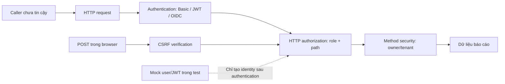
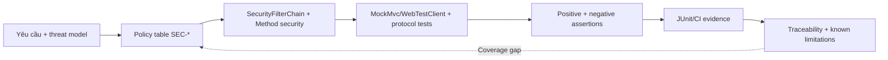

# Bài tập tổng hợp từ chính sách bảo mật đến bằng chứng tự động có giới hạn rõ ràng

## 1. Đề bài: chứng minh chính sách, không chỉ làm test trả màu xanh

Một nhóm phát triển xây dựng API quản lý báo cáo nội bộ. Báo cáo thuộc từng người dùng; một số thao tác yêu cầu vai trò biên tập, một số thao tác chỉ dành cho kiểm toán viên. API có cả endpoint công khai và endpoint bắt buộc xác thực. Nhóm cần nộp bằng chứng kiểm thử tự động trước khi phát hành.

Yêu cầu tưởng đơn giản: “Viết test Spring Security để bảo đảm không ai xem hoặc xuất bản báo cáo của người khác”. Tuy nhiên, một ca `GET /api/reports/r-alice` trả HTTP 200 với `@WithMockUser` **không chứng minh** mọi ranh giới bảo mật: có thể thiếu kiểm tra chủ sở hữu, CSRF, xác thực mật khẩu, JWT signature hoặc một request không có credential vẫn được vào do cấu hình matcher sai.

Bài tổng hợp này thuộc chương **Thực hành tổng hợp** của module **SPRING_SECURITY_TESTING**. Phạm vi module là kiểm chứng xác thực, phân quyền và bảo vệ HTTP bằng `spring-security-test` trên Servlet và Reactive, với MockMvc, WebTestClient, `@WithMockUser`, SecurityContext, JWT/OAuth2/OIDC giả lập và những trường hợp được phép hoặc bị từ chối. Trọng tâm riêng của bài là biến **yêu cầu → chính sách → phép thử → bằng chứng → giới hạn kết luận** thành một chuỗi truy vết được.

Sản phẩm mong đợi của bài thực hành gồm:

1. Một bảng yêu cầu bảo mật có mã định danh và giả định rõ ràng.
2. Một ứng dụng Servlet mẫu có `SecurityFilterChain`, `@PreAuthorize`, principal và dữ liệu sở hữu.
3. Các test MockMvc cho anonymous, đúng role, sai role, đúng/sai owner, CSRF và HTTP Basic.
4. Một biến thể test JWT hoặc OAuth2/OIDC nêu rõ phần giả lập và phần cần integration test bằng thành phần thật.
5. Một biến thể WebFlux/WebTestClient kiểm tra cùng tư duy trên Reactor.
6. Bảng traceability chỉ ra yêu cầu nào được test nào chứng minh, mức độ bao phủ và khoảng trống còn lại.
7. Một kế hoạch CI an toàn, dữ liệu tách biệt và bộ tiêu chí hoàn thành có thể kiểm tra được.

> Nguyên tắc xuyên suốt: **“Đã kiểm tra” chỉ được ghi khi có một phép thử thực sự đi qua thành phần cần chứng minh và có assertion phân biệt được đúng/sai.** Các kết luận chưa được hỗ trợ phải được ghi là “chưa kiểm chứng”, không tự suy rộng từ HTTP 200.

## 2. Bước 1 — Chốt phạm vi và giả định trước khi viết code

Ứng dụng mẫu tên **Reports Workshop**. Với phiên bản đầu tiên, chọn **Servlet/MVC + HTTP Basic + session-neutral request fixtures** để nhìn rõ authentication, authorization và CSRF. Sau khi hoàn thành, người học chuyển chính các yêu cầu sang resource server JWT và một ứng dụng Reactive riêng.

### 2.1. Các giả định được phép sử dụng

- Java 17+, Spring Boot 3.x, Spring Security 6.x, JUnit Jupiter và `spring-security-test`. Các ví dụ Boot 4.x phải thay dependency/import test phù hợp phiên bản.
- Dữ liệu test chỉ có hai báo cáo: `r-alice` thuộc `alice`, `r-bob` thuộc `bob`.
- Các role: `READER` được đọc báo cáo thuộc mình; `EDITOR` được đọc và xuất bản báo cáo thuộc mình; `AUDITOR` được xem nhật ký quản trị.
- URL `/public/ping` công khai; các URL `/api/**` liên quan đều có chính sách cụ thể, không mặc định mở.
- POST xuất bản phải có CSRF token hợp lệ trong **ứng dụng Servlet sử dụng credential có thể tự được trình duyệt gửi**; ta giữ CSRF bật trong kịch bản này.
- HTTP Basic dùng user/password dành riêng cho test. Password `{noop}ci-only` chỉ để minh họa và **không** dùng cho production.
- API trả 403 khi request đã được xác thực nhưng sai role hoặc sai owner. Một sản phẩm thực tế có thể chọn 404 để tránh tiết lộ sự tồn tại của tài nguyên; khi đó phải sửa contract và assertion tương ứng.

### 2.2. Những điều nằm ngoài phạm vi ứng dụng mẫu đầu tiên

Để giữ bài tập cô lập, phần Servlet đầu tiên **không gọi IdP thật, không có JWT decoder, không gọi database và không khởi động browser**. Các phần này được kiểm tra bằng bài tập mở rộng hoặc test tích hợp ở mục sau. Không tuyên bố đã test chúng chỉ vì MockMvc nhận 200.

## 3. Bước 2 — Viết chính sách bảo mật thành bảng quyết định

Mỗi dòng nên có **Requirement ID**, actor, tài nguyên, điều kiện và kết quả mong đợi. Bảng là nguồn để thiết kế test, không phải ghi lại kết quả của test sau khi chạy.

| ID | Request | Principal/điều kiện | Kết quả kỳ vọng |
| --- | --- | --- | --- |
| SEC-01 | `GET /public/ping` | Anonymous | 200, body `pong` |
| SEC-02 | `GET /api/reports/r-alice` | Không credential | 401 theo HTTP Basic entry point |
| SEC-03 | `GET /api/reports/r-alice` | Alice có `ROLE_READER` | 200; owner = Alice |
| SEC-04 | `GET /api/reports/r-alice` | Bob có `ROLE_READER` | 403; không nhận dữ liệu Alice |
| SEC-05 | `GET /api/reports/r-alice` | Alice chỉ có `ROLE_GUEST` | 403 |
| SEC-06 | `POST /api/reports/r-alice/publish` | Alice có `ROLE_EDITOR` nhưng thiếu CSRF | 403 |
| SEC-07 | Cùng POST | Alice có `ROLE_EDITOR` và CSRF hợp lệ | 200; body `published:r-alice` |
| SEC-08 | Cùng POST | Bob có `ROLE_EDITOR` và CSRF hợp lệ | 403 do sai owner |
| SEC-09 | `GET /api/admin/audit` | User không có `ROLE_AUDITOR` | 403 |
| SEC-10 | `GET /api/admin/audit` | User có `ROLE_AUDITOR` | 200, body `audit-ready` |
| SEC-11 | `GET /api/reports/r-alice` | Basic Alice/password đúng | 200, dùng authentication filter thật |
| SEC-12 | Cùng GET | Basic Alice/password sai | 401 |

### 3.1. Threat model ngắn để giải thích tại sao có các ca âm tính



Các rủi ro chính:

1. **Anonymous bypass:** endpoint mới không được security matcher bao phủ.
2. **Role bypass:** `READER` gọi nhầm thao tác của `EDITOR` hoặc user thường xem audit.
3. **IDOR/BOLA:** Bob thay path ID để xem/ghi báo cáo của Alice mặc dù Bob đã đăng nhập.
4. **CSRF:** trình duyệt tự gửi cookie/credential đến endpoint thay đổi trạng thái mà thiếu anti-CSRF token.
5. **Sai xác thực:** Basic/password, Bearer/JWT hoặc OAuth2 callback được chấp nhận dù credential không hợp lệ.
6. **Rò trạng thái:** fixture Alice/session/cookie của test trước bị đưa vào test Bob.

Chỉ các rủi ro 1–4 được kiểm tra trực tiếp đầy đủ bằng mô hình Servlet đầu tiên. Rủi ro 5 cần test xác thực riêng; rủi ro 6 cần test isolation và negative controls. Việc phân loại này quyết định giới hạn kết luận ở cuối bài.

## 4. Bước 3 — Chọn cấp độ kiểm thử theo yêu cầu

| Cấp độ | Cách gọi | Phần thực sự chạy | Phần giả lập/bỏ qua |
| --- | --- | --- | --- |
| Policy unit test | Gọi `ReportPolicy` trực tiếp | Điều kiện owner/tenant | HTTP filter, SecurityContext và authentication |
| Method-security test | Spring-managed bean + `@WithMockUser` | `@PreAuthorize` qua proxy, role/owner policy | Login, token/credential verification |
| MockMvc security test | `@SpringBootTest` + `@AutoConfigureMockMvc` + `with(user())` | Servlet security filters, CSRF, path/role, method security | Password validation của user mock |
| Basic integration test | MockMvc + `httpBasic(...)` | Basic authentication filter, `UserDetailsService`/password encoder, authorization | Real TCP/TLS/browser |
| JWT resource server test | Header Bearer compact JWT + `JwtDecoder` thật | Signature, token validators, converter, authorization | Issuer production, JWKS remote nếu không cấu hình |
| WebFlux security test | WebTestClient + `springSecurity()` | Security WebFilters, Reactive authorization | Credential verification khi dùng `mockUser()`/`mockJwt()` |
| Live HTTP/E2E | Random-port server + HTTP client/browser | Embedded server, HTTP/cookie/redirect theo thiết lập | Production IdP/infrastructure nếu vẫn dùng stub |

**Chiến lược:** viết nhiều test role/owner nhanh, một số test authentication protocol thật, và những flow browser/remote tương ứng với tính năng thực tế. Không cần bắt mọi unit test khởi server.

## 5. Bước 4 — Chuẩn bị dependency và tổ chức mã ví dụ

Với Gradle trên Spring Boot 3.x:

```groovy
dependencies {
    implementation 'org.springframework.boot:spring-boot-starter-web'
    implementation 'org.springframework.boot:spring-boot-starter-security'

    testImplementation 'org.springframework.boot:spring-boot-starter-test'
    testImplementation 'org.springframework.security:spring-security-test'
}

tasks.named('test') {
    useJUnitPlatform()
}
```

Các lớp tối thiểu của kịch bản Servlet:

```text
src/test/java/.../workshop/
  SecurityWorkshopApp.java      // Spring Boot test application và beans
  ReportPolicy.java             // Quy tắc chủ sở hữu
  ReportsService.java           // @PreAuthorize, nghiệp vụ
  ReportsController.java        // HTTP routes
  ReportsHttpSecurityIT.java    // MockMvc: role/owner/CSRF
  ReportsBasicLoginIT.java      // Basic: mật khẩu thật của test user
  ReportsMethodSecurityIT.java  // Bean/proxy: method security
```

Đây là một cấu trúc **gợi ý cho bài thực hành**, không phải file cần tạo ngoài tài liệu này. Nếu triển khai vào repository thật, dùng package, plugin và version nhất quán. Trong phần mã dưới đây, các đoạn ở mỗi mục thuộc những class khác nhau; không dán mọi đoạn vào một file Java duy nhất.

## 6. Bước 5 — Viết rule chủ sở hữu và service có method security

### 6.1. Policy không cần phụ thuộc HTTP

```java
import java.util.Map;
import java.util.Objects;
import org.springframework.security.core.Authentication;

final class ReportPolicy {
    private final Map<String, String> owners = Map.of(
        "r-alice", "alice",
        "r-bob", "bob");

    public boolean isOwner(String reportId, Authentication authentication) {
        return authentication != null
            && Objects.equals(owners.get(reportId),
                              authentication.getName());
    }

    String ownerOf(String reportId) {
        return owners.get(reportId);
    }
}
```

Đây là dữ liệu **in-memory test**, không gọi database và không chứa user thật. Việc check owner qua `authentication.getName()` chỉ phù hợp với kịch bản dùng username làm ID ổn định; sản phẩm dùng OIDC thường cần khóa định danh như `issuer + subject` hoặc domain ID được mapping. Không thay display name/email chưa xác minh thành khóa phân quyền production.

### 6.2. Service được bảo vệ ở ranh giới business

```java
import java.util.Map;
import org.springframework.security.access.prepost.PreAuthorize;

class ReportsService {
    private final ReportPolicy policy;

    ReportsService(ReportPolicy policy) {
        this.policy = policy;
    }

    @PreAuthorize("@reportPolicy.isOwner(#p0, authentication)")
    public Map<String, String> read(String id) {
        return Map.of(
            "id", id,
            "owner", policy.ownerOf(id));
    }

    @PreAuthorize("@reportPolicy.isOwner(#p0, authentication)")
    public String publish(String id) {
        return "published:" + id;
    }
}
```

`#p0` là tham chiếu tới tham số đầu tiên của method trong SpEL của Spring method security. Cách viết này không phụ thuộc vào việc Java compiler có giữ tên tham số với cờ `-parameters` hay không.

**Vì sao cần hai tầng?** HTTP policy quyết định role `READER`/`EDITOR`; method policy quyết định **quyền trên bản ghi cụ thể**. Một người có `ROLE_READER` không nên đọc mọi báo cáo chỉ vì đã đăng nhập.

`@PreAuthorize` chỉ được áp dụng khi Spring method-security infrastructure hoạt động và lời gọi đi qua Spring-managed proxy. `new ReportsService(policy).read(...)` không tương đương việc inject bean đã được bảo vệ.

## 7. Bước 6 — Tạo controller và SecurityFilterChain Servlet

### 7.1. Controller cho các endpoint có thật

```java
import java.util.Map;
import org.springframework.web.bind.annotation.GetMapping;
import org.springframework.web.bind.annotation.PathVariable;
import org.springframework.web.bind.annotation.PostMapping;
import org.springframework.web.bind.annotation.RestController;

@RestController
final class ReportsController {
    private final ReportsService service;

    ReportsController(ReportsService service) {
        this.service = service;
    }

    @GetMapping("/public/ping")
    public String ping() {
        return "pong";
    }

    @GetMapping("/api/reports/{id}")
    public Map<String, String> report(@PathVariable String id) {
        return service.read(id);
    }

    @PostMapping("/api/reports/{id}/publish")
    public String publish(@PathVariable String id) {
        return service.publish(id);
    }

    @GetMapping("/api/admin/audit")
    public String audit() {
        return "audit-ready";
    }
}
```

### 7.2. Test application nhỏ, có đầy đủ security

```java
import org.springframework.boot.SpringBootConfiguration;
import org.springframework.boot.autoconfigure.EnableAutoConfiguration;
import org.springframework.context.annotation.Bean;
import org.springframework.http.HttpMethod;
import org.springframework.security.config.Customizer;
import org.springframework.security.config.annotation
    .method.configuration.EnableMethodSecurity;
import org.springframework.security.config.annotation.web.builders.HttpSecurity;
import org.springframework.security.core.userdetails.User;
import org.springframework.security.core.userdetails.UserDetailsService;
import org.springframework.security.provisioning.InMemoryUserDetailsManager;
import org.springframework.security.web.SecurityFilterChain;

@SpringBootConfiguration
@EnableAutoConfiguration
@EnableMethodSecurity
class SecurityWorkshopApp {

    @Bean
    SecurityFilterChain httpSecurity(HttpSecurity http) throws Exception {
        return http
            .authorizeHttpRequests(auth -> auth
                .requestMatchers("/public/ping").permitAll()
                .requestMatchers(HttpMethod.GET, "/api/reports/*")
                    .hasAnyRole("READER", "EDITOR")
                .requestMatchers(HttpMethod.POST,
                    "/api/reports/*/publish")
                    .hasRole("EDITOR")
                .requestMatchers("/api/admin/audit")
                    .hasRole("AUDITOR")
                .anyRequest().denyAll())
            .httpBasic(Customizer.withDefaults())
            // Để CSRF mặc định hoạt động; không disable ở bài này.
            .build();
    }

    @Bean
    UserDetailsService users() {
        return new InMemoryUserDetailsManager(
            User.withUsername("alice")
                .password("{noop}ci-only")
                .roles("READER", "EDITOR")
                .build(),
            User.withUsername("bob")
                .password("{noop}ci-only")
                .roles("READER")
                .build(),
            User.withUsername("auditor")
                .password("{noop}ci-only")
                .roles("AUDITOR")
                .build());
    }

    @Bean("reportPolicy")
    ReportPolicy reportPolicy() {
        return new ReportPolicy();
    }

    @Bean
    ReportsService reportsService(ReportPolicy policy) {
        return new ReportsService(policy);
    }

    @Bean
    ReportsController reportsController(ReportsService service) {
        return new ReportsController(service);
    }
}
```

Các bean được khai báo tường minh, nên bài tập không cần component scan toàn bộ ứng dụng chính. `@EnableMethodSecurity` kích hoạt `@PreAuthorize`; `httpBasic` tạo entry point trả 401 khi endpoint yêu cầu xác thực; CSRF mặc định áp dụng cho POST.

**Lưu ý bảo mật:** `{noop}ci-only` chỉ là shortcut **trong môi trường test**; đừng dùng NoOp password encoding ở production. Cấu hình ví dụ có thể tạo HTTP session theo hành vi mặc định của Spring Security, vì thế đừng gọi nó là ứng dụng “stateless tuyệt đối”. Khi chuyển sang resource server Bearer thuần, xem lại `SessionCreationPolicy` và threat model CSRF.

## 8. Bước 7 — Bộ test MockMvc: positive, negative và đúng owner

Sử dụng `@SpringBootTest` để nạp cả HTTP security, method security và controller. `@AutoConfigureMockMvc` cho phép inject MockMvc được gắn các Servlet filters của application context.

```java
import org.junit.jupiter.api.Test;
import org.springframework.beans.factory.annotation.Autowired;
import org.springframework.boot.test.autoconfigure.web.servlet
    .AutoConfigureMockMvc;
import org.springframework.boot.test.context.SpringBootTest;
import org.springframework.test.web.servlet.MockMvc;

import static org.springframework.security.test.web.servlet.request
    .SecurityMockMvcRequestPostProcessors.csrf;
import static org.springframework.security.test.web.servlet.request
    .SecurityMockMvcRequestPostProcessors.user;
import static org.springframework.test.web.servlet.request
    .MockMvcRequestBuilders.get;
import static org.springframework.test.web.servlet.request
    .MockMvcRequestBuilders.post;
import static org.springframework.test.web.servlet.result
    .MockMvcResultMatchers.*;

@SpringBootTest(classes = SecurityWorkshopApp.class)
@AutoConfigureMockMvc
class ReportsHttpSecurityIT {

    @Autowired MockMvc mvc;

    @Test
    void sec01PublicEndpointAllowsAnonymous() throws Exception {
        mvc.perform(get("/public/ping"))
            .andExpect(status().isOk())
            .andExpect(content().string("pong"));
    }

    @Test
    void sec02ProtectedEndpointRejectsAnonymous()
            throws Exception {
        mvc.perform(get("/api/reports/r-alice"))
            .andExpect(status().isUnauthorized());
    }

    @Test
    void sec03ReaderMayReadOwnReport() throws Exception {
        mvc.perform(get("/api/reports/r-alice")
                .with(user("alice").roles("READER")))
            .andExpect(status().isOk())
            .andExpect(jsonPath("$.id").value("r-alice"))
            .andExpect(jsonPath("$.owner").value("alice"));
    }

    @Test
    void sec04ReaderCannotReadOtherUsersReport()
            throws Exception {
        mvc.perform(get("/api/reports/r-alice")
                .with(user("bob").roles("READER")))
            .andExpect(status().isForbidden());
    }

    @Test
    void sec05GuestCannotReadEvenOwnReport()
            throws Exception {
        mvc.perform(get("/api/reports/r-alice")
                .with(user("alice").roles("GUEST")))
            .andExpect(status().isForbidden());
    }

    @Test
    void sec06EditorWithoutCsrfCannotPublish()
            throws Exception {
        mvc.perform(post("/api/reports/r-alice/publish")
                .with(user("alice").roles("EDITOR")))
            .andExpect(status().isForbidden());
    }

    @Test
    void sec07EditorWithCsrfMayPublishOwnReport()
            throws Exception {
        mvc.perform(post("/api/reports/r-alice/publish")
                .with(user("alice").roles("EDITOR"))
                .with(csrf()))
            .andExpect(status().isOk())
            .andExpect(content().string("published:r-alice"));
    }

    @Test
    void sec08EditorCannotPublishAnotherUsersReport()
            throws Exception {
        mvc.perform(post("/api/reports/r-alice/publish")
                .with(user("bob").roles("EDITOR"))
                .with(csrf()))
            .andExpect(status().isForbidden());
    }

    @Test
    void sec09ReaderCannotAccessAudit() throws Exception {
        mvc.perform(get("/api/admin/audit")
                .with(user("alice").roles("READER")))
            .andExpect(status().isForbidden());
    }

    @Test
    void sec10AuditorCanAccessAudit() throws Exception {
        mvc.perform(get("/api/admin/audit")
                .with(user("auditor").roles("AUDITOR")))
            .andExpect(status().isOk())
            .andExpect(content().string("audit-ready"));
    }
}
```

### 8.1. Vì sao không chỉ assert status?

Ở SEC-03, assertion `$.owner = alice` bảo đảm request đến đúng dữ liệu và đúng danh tính theo fixture. Nếu chỉ `status().isOk()`, một endpoint trả dữ liệu của Bob nhưng có status 200 vẫn được coi là đỗ.

Ở SEC-04/SEC-08, thiếu owner phải bị từ chối **dù role đúng**. Nếu chỉ kiểm tra guest 403, người viết code có thể bỏ quên owner check mà tất cả test role vẫn pass.

Ở SEC-06 và SEC-07, cùng principal và route được dùng để cô lập ảnh hưởng của CSRF token. Nếu CSRF bị tắt sai cách, SEC-06 sẽ phát hiện. Tuy nhiên, `with(csrf())` chỉ cấp token trong **mock request**; nó chưa chứng minh browser cookie/header flow.

### 8.2. Những điều MockMvc test này chưa chứng minh

`with(user(...))` giả lập Authentication; các method trong `ReportsHttpSecurityIT` **không kiểm tra mật khẩu**. Chúng cũng không khởi TCP port, không chạy TLS và không xác minh JWT/OIDC. Vì vậy nên ghi kết luận: “Đã kiểm tra HTTP role, owner và CSRF behavior theo fixtures trong MockMvc”, không ghi “Tất cả phương thức đăng nhập được chứng minh an toàn”.

## 9. Bước 8 — Dùng @WithMockUser và chứng minh method security thật sự được bật

Một vài quy tắc nằm ở tầng method cần test trực tiếp để tìm lỗi riêng trong proxy/interceptor. Ví dụ:

```java
import org.junit.jupiter.api.Test;
import org.springframework.beans.factory.annotation.Autowired;
import org.springframework.boot.test.context.SpringBootTest;
import org.springframework.security.access.AccessDeniedException;
import org.springframework.security.test.context.support.WithMockUser;

import static org.assertj.core.api.Assertions.*;

@SpringBootTest(classes = SecurityWorkshopApp.class)
class ReportsMethodSecurityIT {

    @Autowired ReportsService service;

    @Test
    @WithMockUser(username = "alice", roles = "READER")
    void ownResourceIsAllowedAtServiceBoundary() {
        assertThat(service.read("r-alice"))
            .containsEntry("owner", "alice");
    }

    @Test
    @WithMockUser(username = "bob", roles = "READER")
    void otherUsersResourceIsDeniedAtServiceBoundary() {
        assertThatThrownBy(() -> service.read("r-alice"))
            .isInstanceOf(AccessDeniedException.class);
    }
}
```

`@WithMockUser` tạo test SecurityContext thông qua `WithSecurityContextTestExecutionListener` khi test chạy trong Spring TestContext. `@EnableMethodSecurity` cần hiện diện, và `service` phải là Spring-managed bean/proxy. Nếu test tự tạo `new ReportsService(...)` rồi gọi, `@PreAuthorize` không được áp dụng theo cơ chế proxy.

**Không khẳng định method test tạo ra HTTP 403.** Nó quan sát exception `AccessDeniedException` từ service. HTTP 403 chỉ hình thành khi exception được xử lý trong đường đi HTTP/security tương ứng.

### 9.1. Unit test policy độc lập với Spring context

Có thể test riêng `ReportPolicy.isOwner(...)` bằng `UsernamePasswordAuthenticationToken` của Alice/Bob. Test này xác minh logic so chủ sở hữu rất nhanh, nhưng **không** chứng minh `@PreAuthorize` đã gọi policy. Vì vậy unit test và method test là hai bằng chứng bổ sung.

## 10. Bước 9 — Tách password authentication thật khỏi mock user

SEC-11/SEC-12 phải thực sự đi qua HTTP Basic authentication filter và `UserDetailsService` test; `httpBasic(...)` chỉ tạo Authorization header, khác với `with(user(...))`:

```java
import org.junit.jupiter.api.Test;
import org.springframework.beans.factory.annotation.Autowired;
import org.springframework.boot.test.autoconfigure.web.servlet
    .AutoConfigureMockMvc;
import org.springframework.boot.test.context.SpringBootTest;
import org.springframework.test.web.servlet.MockMvc;

import static org.springframework.security.test.web.servlet.request
    .SecurityMockMvcRequestPostProcessors.httpBasic;
import static org.springframework.test.web.servlet.request
    .MockMvcRequestBuilders.get;
import static org.springframework.test.web.servlet.result
    .MockMvcResultMatchers.*;

@SpringBootTest(classes = SecurityWorkshopApp.class)
@AutoConfigureMockMvc
class ReportsBasicLoginIT {

    @Autowired MockMvc mvc;

    @Test
    void sec11ValidTestPasswordIsAccepted() throws Exception {
        mvc.perform(get("/api/reports/r-alice")
                .with(httpBasic("alice", "ci-only")))
            .andExpect(status().isOk())
            .andExpect(jsonPath("$.owner").value("alice"));
    }

    @Test
    void sec12WrongPasswordIsRejected() throws Exception {
        mvc.perform(get("/api/reports/r-alice")
                .with(httpBasic("alice", "wrong-password")))
            .andExpect(status().isUnauthorized());
    }
}
```

Hai ca này **kiểm tra HTTP Basic, password matching qua user store test và các filter Spring Security**. Chúng vẫn không kiểm tra production LDAP/IdP hoặc live TLS. Nếu production không dùng Basic, đừng coi test Basic là bằng chứng cho form login/OIDC; khi đó phải thay bằng giao thức production thật, dùng local IdP hoặc credential test.

## 11. Bước 10 — Điều tra 401, 403 và CSRF bằng ca đối chứng

Một status có thể xuất hiện vì nhiều nguyên nhân. Hãy giữ một ma trận phân biệt để tránh sửa sai tầng.

| Hiện tượng | Cơ chế trong kịch bản | Cách thử phân biệt |
| --- | --- | --- |
| Anonymous GET 401 | Basic authentication entry point | Gửi Basic đúng vào cùng path để nhận 200 |
| Logged-in user GET 403 | HTTP role thiếu hoặc method owner check từ chối | Thay **một** yếu tố: role hoặc owner |
| Editor POST 403 thiếu token | CSRF filter chặn trước business | Gửi cùng principal, path và body với `with(csrf())` |
| Editor POST 403 dù có CSRF | Có thể sai owner hoặc role | So với cùng principal đúng owner hoặc role |
| GET 302 | Form-login entry point được bật ở cấu hình khác | Assert `Location` và mục tiêu redirect; không gộp với Basic 401 |
| HTTP 200 ở endpoint lẽ ra protected | Security matcher hoặc filters bị bỏ qua | Test anonymous trên URI tồn tại, kiểm tra chain |
| HTTP 404 | URI không khớp handler hoặc policy ẩn tài nguyên | Không lấy 404 đơn thuần làm bằng chứng access denied |

### 11.1. CSRF test chưa đồng nghĩa browser test

`with(csrf())` tạo token hợp lệ cho mock request, hữu ích để kiểm chứng security filter. Nếu muốn xác minh `CookieCsrfTokenRepository` hoặc `HttpSessionCsrfTokenRepository` thực tế, viết một kịch bản lấy token từ response/cookie/session rồi gửi POST với token đó; thử thiếu/sai token theo chính repository dùng trong app.

Đừng vô hiệu hóa `csrf` chỉ để SEC-07 đỗ khi ứng dụng thực sử dụng session/cookie được browser tự gửi. Đối với REST resource server chỉ nhận Bearer header không tự gửi theo browser, chính sách CSRF có thể khác, nhưng phải nêu rõ threat model và tách test context tương ứng.

## 12. Bước 11 — Kiểm thử session, cookie và request isolation

Một test có thể PASS sai nếu session của Alice tồn tại trong client Bob hoặc static fixture. Điều này khác với bug `SecurityContextHolder` trên thread test.

### 12.1. Kiểm tra identity theo request

Với `with(user(...))`, mỗi request tự mô tả principal. Đây là cách phù hợp cho kiểm tra role/owner vì không cần khởi tạo session thực:

```java
mvc.perform(get("/api/reports/r-alice")
        .with(user("alice").roles("READER")))
    .andExpect(status().isOk());

mvc.perform(get("/api/reports/r-alice")
        .with(user("bob").roles("READER")))
    .andExpect(status().isForbidden());
```

Đối với test login/session thực, cần thực hiện **login → lấy session/cookie → gửi request → logout** trong một `@Test`. Không lưu `MockHttpSession` hoặc `JSESSIONID` của ca A trong static field rồi dùng lại ở ca B. Khi security config có `SessionCreationPolicy.STATELESS`, không ép session fixtures vào test.

### 12.2. Kiểm tra không có user từ test trước

Với `@WithMockUser`, listener quản lý test context theo lifecycle. Khi bạn tự gọi `SecurityContextHolder.setContext(...)` hoặc `TestSecurityContextHolder.setContext(...)`, phải dọn trong `finally`/teardown phù hợp. Việc dọn context của test thread **không** tự xóa session server-side hoặc context nằm trên pooled worker thread.

Một negative control độc lập nên gửi anonymous request mới và xác minh được entry point đúng; chạy cả khi đứng một mình lẫn khi đứng sau những ca dùng admin.

## 13. Bước 12 — JWT resource server: hai phép thử, hai kết luận

Chuyển ứng dụng thành resource server JWT trong **một test context cấu hình riêng**, không gắn thêm `JwtDecoder` và `oauth2ResourceServer()` vào toàn bộ bài Servlet Basic/CSRF rồi giả định chúng luôn có cùng behavior.

### 13.1. Authorization với JWT giả lập

Với một `SecurityFilterChain` sử dụng OAuth2 resource server và route yêu cầu `SCOPE_reports.read`:

```java
import static org.springframework.security.test.web.servlet.request
    .SecurityMockMvcRequestPostProcessors.jwt;

mvc.perform(get("/api/reports/r-alice")
        .with(jwt()
            .jwt(token -> token.subject("alice")
                .claim("tenant_id", "tenant-a"))
            .authorities(new SimpleGrantedAuthority(
                "SCOPE_reports.read"))))
    .andExpect(status().isOk());
```

Điều kiện để đoạn code có ý nghĩa: route, resource-server security chain, controller, principal mapping và kiểm tra owner phải được cấu hình phù hợp. `jwt()` tạo Authentication giả; `.authorities(...)` còn đưa thẳng GrantedAuthority theo fixture. Test có thể kiểm tra scope/owner policy sau xác thực, **không kiểm tra signature, issuer, audience, timestamp hay claim converter production**.

### 13.2. Token ký thật và decoder thật

Để chứng minh resource server xác minh token, cần:

1. Tạo cặp RSA test key riêng, **không sử dụng production signing key**.
2. Dùng `NimbusJwtEncoder` ký compact JWT với `sub`, `iss`, `aud`, `exp`, `scope` và `jti` thích hợp.
3. Đưa public key vào `NimbusJwtDecoder` của **test ApplicationContext**.
4. Cấu hình issuer/timestamp validators và audience validator nếu API yêu cầu `aud` cụ thể.
5. Gửi **raw header** `Authorization: Bearer <compact-jwt>` qua MockMvc hoặc live HTTP client.
6. Assert token hợp lệ/đủ quyền 200, token ký sai key/issuer/expiry 401, token hợp lệ/thiếu scope 403.

Ví dụ request thực:

```java
String compactJwt = testJwtIssuer.issueSigned(
    "alice", "reports.read", "reports-api");

mvc.perform(get("/api/reports/r-alice")
        .header(HttpHeaders.AUTHORIZATION,
            "Bearer " + compactJwt))
    .andExpect(status().isOk());
```

`testJwtIssuer` là **fixture người học phải xây** bằng signing key test và `JwtEncoder`; đây không phải API có sẵn của Spring Security. Trong ca này không dùng `with(jwt())` hoặc mock bean `JwtDecoder`, vì chúng bỏ qua thuật toán xác minh cần kiểm chứng.

**Bằng chứng giới hạn:** decoder dùng public key cục bộ chứng minh JWS/validator chạy thật trong ứng dụng test, nhưng chưa chứng minh JWKS discovery, remote key rotation hoặc production IdP. Nếu production dùng `issuer-uri`/`jwk-set-uri`, phải bổ sung integration test với JWKS HTTP stub.

### 13.3. Không lẫn security policy của Basic và JWT

Kịch bản HTTP Basic trong mục 7 dùng `ROLE_READER`/`ROLE_EDITOR`; JWT resource server thường chuyển scope thành `SCOPE_*`. Khi chuyển ứng dụng, phải cập nhật policy rõ ràng thay vì chỉ đổi request post-processor. Một authorization failure do **authority naming khác** không phải bằng chứng decoder hỏng.

## 14. Bước 13 — OAuth2/OIDC: tách hậu đăng nhập khỏi authorization-code flow

Nếu ứng dụng chuyển từ Basic sang OAuth2/OIDC login, MockMvc cho phép test controller sau login:

```java
mvc.perform(get("/profile")
        .with(oidcLogin().idToken(token ->
            token.claim("sub", "alice-subject")
                .claim("preferred_username", "alice"))))
    .andExpect(status().isOk());
```

Đoạn này yêu cầu route `/profile` và application config tương ứng; nó **giả lập `OidcUser` đã đăng nhập**, không chạy redirect, state, authorization code, token endpoint hay ID Token signature.

Để chứng minh giao thức OIDC, cần kịch bản dùng IdP test/stub:

| Bước | Assertion giao thức |
| --- | --- |
| Bắt đầu login | 3xx và `Location` trỏ đến authorization endpoint đúng registration |
| Authorization request | `state` ngẫu nhiên, redirect URI và `nonce` khi áp dụng; PKCE theo cấu hình |
| Callback hợp lệ | `code` + `state` cùng session/repository được chấp nhận |
| Callback giả mạo | Sai/mất `state` hoặc code không hợp lệ bị từ chối |
| Token exchange | Client dùng test credentials, request tới local token endpoint stub |
| ID Token | Signature/issuer/audience/expiry/nonce hợp lệ; các ca sai bị từ chối |
| UserInfo nếu dùng | UserInfo `sub` phù hợp ID Token; principal domain mapping đúng |
| Session sau login/logout | Cookie/session đúng user; logout không còn truy cập được |

Không dùng tài khoản, OAuth2 client secret hoặc refresh token production trong CI. Nếu dự án chỉ cần API resource server không có browser login, không bắt buộc triển khai mọi test OIDC login — chỉ đánh dấu “không áp dụng”.

## 15. Bước 14 — WebFlux/WebTestClient: chuyển tư duy, không sao chép API Servlet

Trên WebFlux, filter là `WebFilter` và security chain là `SecurityWebFilterChain`. Authentication trong request Reactive được truyền qua **Reactor Context**, không dựa vào Servlet `SecurityContextHolder` ThreadLocal.

### 15.1. Một cấu hình Reactive độc lập

```java
import org.springframework.context.annotation.Bean;
import org.springframework.context.annotation.Configuration;
import org.springframework.security.config.Customizer;
import org.springframework.security.config.annotation.web.reactive
    .EnableWebFluxSecurity;
import org.springframework.security.config.web.server.ServerHttpSecurity;
import org.springframework.security.web.server.SecurityWebFilterChain;

@Configuration
@EnableWebFluxSecurity
class ReactiveWorkshopSecurity {

    @Bean
    SecurityWebFilterChain reactiveChain(ServerHttpSecurity http) {
        return http
            .authorizeExchange(auth -> auth
                .pathMatchers("/api/whoami").hasRole("READER")
                .anyExchange().denyAll())
            .httpBasic(Customizer.withDefaults())
            .build();
    }
}
```

Controller WebFlux trả tên principal:

```java
import java.security.Principal;
import org.springframework.web.bind.annotation.GetMapping;
import org.springframework.web.bind.annotation.RestController;
import reactor.core.publisher.Mono;

@RestController
class ReactiveWhoAmIController {
    @GetMapping("/api/whoami")
    Mono<String> whoAmI(Mono<Principal> principal) {
        return principal.map(Principal::getName);
    }
}
```

Hai class này thuộc **một Reactive application context riêng** với Spring WebFlux infrastructure. Không nạp cùng cấu hình Servlet `HttpSecurity`/`SecurityFilterChain` của mục 7 và giả định WebFlux cũng dùng servlet filters.

### 15.2. Test bằng WebTestClient gắn springSecurity()

```java
import static org.springframework.security.test.web.reactive.server
    .SecurityMockServerConfigurers.mockUser;
import static org.springframework.security.test.web.reactive.server
    .SecurityMockServerConfigurers.springSecurity;

WebTestClient base = WebTestClient
    .bindToApplicationContext(applicationContext)
    .apply(springSecurity())
    .configureClient()
    .build();

base.mutateWith(mockUser("alice").roles("READER"))
    .get().uri("/api/whoami")
    .exchange()
    .expectStatus().isOk()
    .expectBody(String.class).isEqualTo("alice");

base.mutateWith(mockUser("bob").roles("GUEST"))
    .get().uri("/api/whoami")
    .exchange()
    .expectStatus().isForbidden();

base.get().uri("/api/whoami")
    .exchange()
    .expectStatus().isUnauthorized();
```

`base` phải được tạo với application context đã nạp `ReactiveWorkshopSecurity` và controller trên. Nếu có form-login entry point thay cho HTTP Basic, anonymous có thể nhận redirect thay vì 401. Mỗi request bắt đầu từ base client chưa được mutate; **đừng tái sử dụng một client đã gắn Alice cho Bob**.

`mockUser()` và `mockJwt()` là fixtures. Để test signature JWT Reactive, dùng `ReactiveJwtDecoder` thật và raw Bearer JWT; để test method Reactive trực tiếp, dùng `StepVerifier` và `ReactorContextTestExecutionListener` hoặc `contextWrite(ReactiveSecurityContextHolder.withAuthentication(...))`.

## 16. Bước 15 — Test âm tính khi cấu hình bị làm sai có chủ đích

Một bộ test đáng tin cậy cần **phát hiện regression** chứ không chỉ xác nhận cấu hình hiện tại. Có thể thử trên một nhánh tạm hoặc qua phương pháp mutation testing:

| Thay đổi sai có chủ đích | Test nào phải thất bại? | Vì sao |
| --- | --- | --- |
| Đổi `/api/reports/*` thành `permitAll()` | SEC-02, SEC-05 và các ca negative | Role/anonymous không còn bị chặn |
| Bỏ `@EnableMethodSecurity` | SEC-04, SEC-08 hoặc method negative test | Bỏ qua owner check |
| Luôn trả `true` từ `ReportPolicy.isOwner` | SEC-04, SEC-08 | Bob đọc/ghi báo cáo Alice |
| Bỏ rule `hasRole("EDITOR")` cho POST | Test reader POST có CSRF (bổ sung) | READER được publish sai quyền |
| Tắt CSRF mà không đổi threat model | SEC-06 | POST thiếu token không còn bị chặn |
| Bỏ hoặc đổi entry point không chủ đích | SEC-02 | Anonymous HTTP contract thay đổi |
| Decoder bỏ issuer validator | JWT wrong-issuer test | Token sai issuer bị chấp nhận |
| Bỏ audience validator | JWT wrong-audience test | Token sai audience bị chấp nhận |
| Chia sẻ session Alice/Bob | Cross-user session regression | Trả nhầm principal |
| Đổi WebTestClient sang bindToController không security | Reactive negative tests | Không chứng minh WebFilters |

**Không giữ thay đổi sai trong mã nguồn chính.** Mục tiêu thí nghiệm là xác nhận test bắt được lỗi, sau đó khôi phục chính sách và chạy lại toàn bộ suite. Nếu một thay đổi quan trọng **không làm test nào thất bại**, hãy ghi đó là **coverage gap** và bổ sung test trước khi công bố yêu cầu đã được chứng minh.

### 16.1. Thêm đối chứng cho “reader có CSRF nhưng không được publish”

```java
@Test
void readerWithValidCsrfStillCannotPublish() throws Exception {
    mvc.perform(post("/api/reports/r-alice/publish")
            .with(user("alice").roles("READER"))
            .with(csrf()))
        .andExpect(status().isForbidden());
}
```

Ca này cô lập authorization khỏi CSRF: token hợp lệ nhưng role vẫn không đủ. Nó cần được đưa vào suite production nếu SEC-07 là ranh giới quan trọng.

## 17. Bước 16 — Tạo bảng truy vết từ requirement đến bằng chứng

Báo cáo test không nên chỉ ghi “12/12 pass”. Hãy nối từng yêu cầu với cách thiết lập danh tính, cấp độ test và giới hạn kết luận.

| Requirement | Test/nhóm test | Bằng chứng trực tiếp | Giới hạn |
| --- | --- | --- | --- |
| SEC-01 | `sec01PublicEndpointAllowsAnonymous` | 200 + `pong` | Không liên quan login |
| SEC-02 | `sec02ProtectedEndpointRejectsAnonymous` | GET anonymous trả 401 | Theo HTTP Basic config của test |
| SEC-03 | `sec03ReaderMayReadOwnReport` | 200 + owner Alice | Authentication được mock |
| SEC-04 | `sec04ReaderCannotReadOtherUsersReport` | Bob có role nhưng 403 | Chưa test owner mapping DB |
| SEC-05 | `sec05GuestCannotReadEvenOwnReport` | Guest 403 | Role naming theo config test |
| SEC-06 | `sec06EditorWithoutCsrfCannotPublish` | POST thiếu CSRF trả 403 | Chưa test browser cookie flow |
| SEC-07 | `sec07EditorWithCsrfMayPublishOwnReport` | POST với CSRF 200 + body | Chưa test persisted publish event |
| SEC-08 | `sec08EditorCannotPublishAnotherUsersReport` | Bob có role + token vẫn 403 | Chưa test distributed tenant DB |
| SEC-09 | `sec09ReaderCannotAccessAudit` | Reader 403 | Không test audit log storage |
| SEC-10 | `sec10AuditorCanAccessAudit` | Auditor 200 + body | Mock principal |
| SEC-11 | `sec11ValidTestPasswordIsAccepted` | Basic test credential → 200 | Không test IdP/LDAP production |
| SEC-12 | `sec12WrongPasswordIsRejected` | Basic sai → 401 | Chỉ kiểm tra user store test |

### 17.1. Phân loại trạng thái requirement

Không có chỉ hai trạng thái PASS/FAIL. Một báo cáo dễ hiểu nên phân biệt:

- **VERIFIED:** test phù hợp thực sự chạy, có assertion, kết quả pass.
- **PARTIALLY_VERIFIED:** đã có bằng chứng cho một nhánh nhưng còn thiếu protocol/storage/transport.
- **NOT_VERIFIED:** chưa có test hoặc chưa chạy được.
- **NOT_APPLICABLE:** tính năng/giao thức không được triển khai, có lý do rõ.
- **BLOCKED:** không thể chạy vì môi trường hoặc dependency; không được ghi PASS.

Chẳng hạn `SEC-11` có thể là **VERIFIED trong phạm vi Basic test user store**, nhưng “xác minh người dùng qua production IdP” vẫn **NOT_VERIFIED hoặc NOT_APPLICABLE**, tùy hệ thống thực sự sử dụng gì.

## 18. Bước 17 — Viết một bản ghi bằng chứng có giới hạn rõ ràng

Mẫu review cho một test:

```text
Requirement: SEC-04 / Ngăn đọc chéo báo cáo giữa các user
Threat: IDOR/BOLA qua thay đổi reportId trong URL
Entry point: MockMvc GET /api/reports/r-alice
Fixture: with(user("bob").roles("READER"))
Real components: SecurityFilterChain, method-security proxy,
                 ReportPolicy, ReportsController
Assertions: HTTP 403; không nhận body dữ liệu của Alice
Result: PASS/FAIL theo lần chạy CI thực tế
Claim supported: Bob đã xác thực nhưng không sở hữu r-alice
                 bị từ chối trong test setup này
Not demonstrated: Chữ ký JWT/OIDC, DB row-level access,
                  reverse proxy, live TCP/TLS, cross-service access
Follow-up: JWT decoder integration; persistence authorization test
```

**Không ghi “PASS” nếu chưa chạy test.** Trong tài liệu này các đoạn mã là **kế hoạch và ví dụ bài thực hành**, chưa phải kết quả thực tế từ Gradle/JUnit. Người học chỉ điền PASS khi runner đã hoàn thành và có test report chứng minh.

Mẫu tương tự cho `jwt()`:

```text
Claim: Scope authorization được kiểm tra với mock JwtAuthenticationToken
Mocked: JWT decoding, signature, issuer, audience, expiry,
        và authority converter nếu đã override authorities
Executed: request authorization / method security theo test context
Missing proof: raw compact JWT đi qua JwtDecoder thật
Next test: valid JWT = 200, wrong signature/issuer = 401,
           valid JWT without scope = 403
```

### 18.1. Tại sao “tự động” không đồng nghĩa “đầy đủ”?

JUnit có thể tự động chạy hàng trăm test, nhưng mỗi test chỉ kiểm tra một tập assertions. Test dùng `@WithMockUser` có thể đánh giá owner rất tốt nhưng bỏ qua password; test dùng JWT ký thật có thể kiểm tra chữ ký nhưng vẫn thiếu CSRF/cookie/tenant. **Phải công bố phạm vi của từng bằng chứng**, không suy rộng qua ranh giới chưa được chạy.

## 19. Bước 18 — Thiết lập CI không gọi production

Bộ kiểm thử nên chạy được trên runner không có tài khoản hoặc khóa production:

- MockMvc/`@WithMockUser` không cần IdP.
- HTTP Basic test dùng `InMemoryUserDetailsManager` với user/password giả.
- JWT test ký bằng RSA key pair test, decoder test tin public key tương ứng.
- OAuth2/OIDC test giao thức dùng local authorization server/JWKS/UserInfo stub và client credentials test.
- Database, Redis, OAuth2 authorized client store, session và cookie jar được cô lập; dữ liệu được cleanup theo test.
- Runner PR không nhận production secrets, không có quyền cloud production, và egress đến production nên bị chặn bởi hạ tầng **ngoài mã PR**.
- Không ghi `Authorization`, `Cookie`, refresh token, client secret hoặc private key vào logs/artifacts.

Ví dụ workflow chỉ chạy test:

```yaml
name: Spring Security workshop

on:
  pull_request:
  push:
    branches: [main]

permissions:
  contents: read

jobs:
  tests:
    runs-on: ubuntu-latest
    timeout-minutes: 20
    env:
      SPRING_PROFILES_ACTIVE: ci
    steps:
      - uses: actions/checkout@v4
      - uses: actions/setup-java@v4
        with:
          distribution: temurin
          java-version: "21"
      - name: Run security tests
        run: ./gradlew --no-daemon test
```

Đây là **khung workflow minh họa**, không tự tạo sandbox mạng hoặc chứng minh egress đã bị chặn. Với yêu cầu supply-chain cao, pin actions theo commit SHA được kiểm duyệt, bảo vệ runner và tránh cấp deploy/production secrets cho mã pull request không tin cậy.

### 19.1. Kết quả CI nên đính kèm những gì?

1. Báo cáo JUnit XML/HTML hoặc dashboard tương đương với số test thực sự chạy.
2. Danh sách requirements và nhóm tests liên quan, phiên bản cấu hình.
3. Những test bị skip/flaky/quarantine, không gộp vào PASS.
4. Thông tin môi trường: stack Servlet/Reactive, Spring Boot/Security version, loại authentication đang được kiểm.
5. Khoảng trống: JWKS remote, OIDC callback, session/cookie browser, TLS/IdP thật, data store quyền sở hữu.
6. Liên kết thay đổi code/rule đã được test và người chịu trách nhiệm phê duyệt.

Một “build xanh” thiếu các thông tin này chưa đủ để kết luận toàn bộ chính sách bảo mật đã được chứng minh.

## 20. Bước 19 — Xử lý lỗi và false positive theo đúng lớp

| Vấn đề | Khả năng nguyên nhân | Hướng xử lý |
| --- | --- | --- |
| `@WithMockUser` không thấy user | Không có Spring TestContext/listener, lifecycle setup sai | Kiểm tra `WithSecurityContextTestExecutionListener`, `@SpringBootTest` |
| MockMvc nhận 200 cả khi anonymous | Filter chain bị bỏ qua, `permitAll` sai hoặc matcher sai | Giữ `@AutoConfigureMockMvc` với filters; negative GET |
| Owner policy không chạy | Thiếu `@EnableMethodSecurity` hoặc gọi raw service | Inject Spring bean; test Bob đọc Alice phải 403 |
| Role đúng nhưng 403 | `ROLE_*`/`SCOPE_*` khác policy hoặc CSRF thiếu | Kiểm tra authorities, request method, CSRF |
| POST có CSRF vẫn 403 | Sai owner/role, route khác hoặc token repo khác | Test thay **một** điều kiện mỗi lần |
| JWT mock vẫn 200 với token expired | `jwt()` bỏ qua decoder | Gửi signed Bearer raw tới decoder thật |
| Test Basic 401 với password đúng | User store/password encoder/chain chưa nạp | Kiểm tra test credential và Basic configuration |
| WebTestClient GET anonymous trả 200 | `springSecurity()` chưa apply hoặc route permitAll | Bind application context + negative test |
| Test chỉ fail khi chạy cả suite | Static session/client, TestContext cache, thread-local leak | Per-test fixtures, cleanup, chạy ngẫu nhiên thứ tự |
| HTTP status khác giữa MockMvc và live | Redirect/CSRF/session/real servlet container | Ghi cụ thể loại test và cấu hình |
| CI thất bại khi IdP production mất mạng | Test không cô lập dependencies | Dùng mock/stub hoặc môi trường integration riêng |

### 20.1. Một nguyên tắc hữu ích khi debug

**Chỉ thay đổi một điều kiện trong mỗi phép thử đối chứng.** Ví dụ:

- Cùng Alice/owner nhưng thiếu rồi thêm CSRF → cô lập CSRF.
- Cùng request/CSRF nhưng đổi `EDITOR` thành `READER` → cô lập role.
- Cùng role nhưng đổi Alice thành Bob → cô lập owner.
- Cùng compact JWT và claims nhưng đổi signing key → cô lập signature.
- Cùng token/signature nhưng đổi `iss` → cô lập issuer validation.

Nếu thay cùng lúc role, path, session và token, status thay đổi sẽ khó giải thích, bằng chứng yếu hơn.

## 21. Bước 20 — Các giới hạn phải được nêu ngay cả khi tất cả test đều pass

Một bộ test hoàn chỉnh theo bài này vẫn phải ghi các giới hạn:

**1. Mock Authentication:** `@WithMockUser`, `with(user())`, `jwt()` và `mockJwt()` không thực hiện credential verification.

**2. Authorization của dữ liệu thật:** `ReportPolicy` dùng `Map` test, chưa kiểm tra database row-level security, caching hoặc multi-tenant store production.

**3. Browser/CSRF:** `with(csrf())` không tự chứng minh browser nhận/trả token cookie đúng, `SameSite`/`Secure`/`HttpOnly` chính xác hoặc session fixation protection.

**4. Protocol OIDC/OAuth2:** mock login không kiểm tra `state`, PKCE, nonce, token endpoint, ID Token signature hoặc UserInfo.

**5. JWT/JWKS:** decoder local-key test không kiểm tra JWKS fetch/cache/rotation hay cấu hình trusted issuers production.

**6. Reactive vs Servlet:** test MockMvc không chứng minh `SecurityWebFilterChain`; test WebTestClient không chứng minh Servlet filter behavior.

**7. Vận hành:** MockMvc không mở socket thật nên không kiểm tra TLS, reverse proxy, CDN, cookie behavior của browser hay production infrastructure.

**8. Test coverage:** dù có đầy đủ test cho các dòng SEC-01 đến SEC-12, những endpoint/chức năng không nằm trong bảng chính sách vẫn chưa được bao phủ. Thêm requirement trước khi tuyên bố “hệ thống an toàn”.

Giới hạn không làm mất giá trị bằng chứng; chúng giúp người đọc hiểu đúng nơi cần tập trung kiểm thử tiếp theo.

## 22. Bài tập mở rộng theo nhóm học viên

### Bài A — Dùng database thật trong môi trường test

Thay `Map` bằng repository truy vấn theo report ID/owner, dùng Testcontainers hoặc database dùng riêng CI. Bổ sung test Alice/Bob cross-owner trên dữ liệu được lưu, test record không tồn tại và transaction/caching. Đảm bảo rollback/cleanup có hiệu lực cho cả request chạy thread khác nếu cần; không giả định `@Transactional` ở test thread tự xóa Redis hay external service.

### Bài B — OAuth2 resource server với JWT thật

Tạo Spring Boot resource-server context riêng, `NimbusJwtEncoder` + `NimbusJwtDecoder` tin cậy key test. Bổ sung ma trận 200/401/403 và audience validator cụ thể. Ghi bằng chứng signature/issuer/expiry nhưng nêu rõ chưa test remote JWKS. Bổ sung JWKS HTTP stub khi muốn kiểm tra `kid` và key rotation.

### Bài C — OAuth2/OIDC login qua IdP stub

Kiểm tra redirect, `state`, nonce, PKCE (nếu áp dụng), token exchange, UserInfo và session. So sánh với `oidcLogin()` chỉ dành cho hậu đăng nhập. Mọi principal, session cookie và OAuth2 authorized client phải được cô lập theo test.

### Bài D — WebFlux đầy đủ phương thức Reactive

Viết service `Mono<Report>` được bảo vệ bằng `@EnableReactiveMethodSecurity` và `@PreAuthorize`. Dùng `@WithMockUser` + `ReactorContextTestExecutionListener` với `StepVerifier` cho người đủ/thiếu quyền; dùng WebTestClient cho HTTP 401/403. Không cache publisher phụ thuộc user ở scope toàn ứng dụng.

### Bài E — Login/session/cookie trình duyệt

Thêm form login hoặc OIDC login tùy sản phẩm. Gửi request đầu lấy session/cookie và CSRF token, hoàn thành login, gọi protected endpoint, logout rồi thử lại cookie cũ. Assert redirect, `Set-Cookie` và các cờ cookie theo policy. Thực hiện tất cả các bước phụ thuộc session trong **một** test độc lập.

### Bài F — Mutation test

Tạm loại owner check hoặc CSRF, chạy suite và ghi test nào fail. Nếu không có test nào phát hiện, sửa ma trận traceability và viết thêm ca negative. Khôi phục code đúng trước khi merge.

## 23. Thang đánh giá và điều kiện hoàn thành

| Tiêu chí | Trọng số gợi ý | Bằng chứng phải nộp |
| --- | ---: | --- |
| Chính sách và threat model | 15% | Bảng SEC-01..SEC-12, giả định và boundary |
| Authentication/authorization Servlet | 25% | MockMvc 200/401/403, đúng role và owner |
| CSRF và negative controls | 15% | POST thiếu/có token; role/owner đối chứng |
| Method security + proxy | 10% | `@PreAuthorize` hoạt động qua Spring bean; wrong owner bị chặn |
| Phân biệt mock vs protocol | 10% | Bản ghi chính xác điều mock và test cần bổ sung |
| Reactive hoặc JWT/OIDC mở rộng | 10% | WebTestClient hoặc signed JWT/IdP stub test theo lựa chọn |
| Traceability, limits và CI | 15% | Requirement→test→evidence→known limitations; test CI cô lập |

### 23.1. Điều kiện tối thiểu để được coi là đạt

- Có **ít nhất một** endpoint anonymous 200 và một endpoint protected anonymous bị từ chối.
- Có cả **allowed** và **denied** cho role; không chỉ test happy path.
- Có ca **same role, different owner** bị từ chối, chứng minh owner check.
- Có POST **thiếu CSRF** bị chặn và POST **có CSRF** được xử lý trong kịch bản Servlet tương ứng.
- Có test authentication không giả password hoặc token **nếu** tuyên bố đã kiểm tra credential verification.
- Có bản ghi phân biệt các bước `spring-security-test` giả lập với protocol test bằng thành phần thật.
- Có bảng mapping requirement với test và kết quả chạy thực tế; không điền PASS từ ví dụ chưa chạy.
- Test độc lập khi chạy riêng hoặc chạy toàn suite; không dùng secrets, accounts hay services production.

**Chưa đạt** nếu chỉ có nhiều test 200, không có ca âm tính; hoặc ghi “đã xác minh JWT/OIDC” khi test chỉ sử dụng `jwt()`/`oidcLogin()`.

## 24. Tổng kết: biến chính sách thành bằng chứng có thể kiểm toán

Toàn bộ bài tập đi theo một chuỗi có thể lặp lại:



Điểm khác biệt giữa “có test” và “có bằng chứng đáng tin” nằm ở **ranh giới kết luận**. Một request MockMvc có mock user có thể chứng minh phân quyền theo owner rất tốt; nó không cần giả vờ xác minh mật khẩu. Một test JWT decoder thật có thể chứng minh chữ ký; nó không cần giả vờ đã test toàn bộ trình duyệt OIDC. Khi mỗi requirement có cả bằng chứng dương tính, đối chứng âm tính và giới hạn rõ ràng, nhóm có thể quyết định chính xác phần nào đủ tin cậy để phát hành và phần nào cần kiểm tra tiếp.

## 25. Tài liệu tham khảo

- [Spring Security — Servlet Testing](https://docs.spring.io/spring-security/reference/servlet/test/index.html): hạ tầng test và các loại security verification.
- [Spring Security — MockMvc Setup](https://docs.spring.io/spring-security/reference/servlet/test/mockmvc/setup.html): `springSecurity()` và liên kết MockMvc với filter chain.
- [Spring Security — MockMvc Authentication](https://docs.spring.io/spring-security/reference/servlet/test/mockmvc/authentication.html): `with(user(...))`, `@WithMockUser` và SecurityContext.
- [Spring Security — MockMvc CSRF](https://docs.spring.io/spring-security/reference/servlet/test/mockmvc/csrf.html): kiểm thử CSRF token trên Servlet.
- [Spring Security — MockMvc HTTP Basic](https://docs.spring.io/spring-security/reference/servlet/test/mockmvc/http-basic.html): tạo Basic credential request để filter xác thực.
- [Spring Security — Method Security](https://docs.spring.io/spring-security/reference/servlet/authorization/method-security.html): `@EnableMethodSecurity`, `@PreAuthorize` và proxy.
- [Spring Security — Testing Method Security](https://docs.spring.io/spring-security/reference/servlet/test/method.html): `@WithMockUser` và test listeners.
- [Spring Security — Testing OAuth2 (Servlet)](https://docs.spring.io/spring-security/reference/servlet/test/mockmvc/oauth2.html): `jwt()`, `oauth2Login()`, `oidcLogin()` và giới hạn fixture.
- [Spring Security — JWT Resource Server](https://docs.spring.io/spring-security/reference/servlet/oauth2/resource-server/jwt.html): `JwtDecoder`, signature, issuer/expiry và authority conversion.
- [Spring Security — OAuth2 Login](https://docs.spring.io/spring-security/reference/servlet/oauth2/login/index.html): giao thức authorization-code, callback và OIDC integration.
- [Spring Security — Testing WebFlux Setup](https://docs.spring.io/spring-security/reference/reactive/test/web/setup.html): `WebTestClient`, `springSecurity()`.
- [Spring Security — Reactive Method Security Testing](https://docs.spring.io/spring-security/reference/reactive/test/method.html): Reactor Context, `@WithMockUser`, `StepVerifier`.
- [Spring Security — Testing Reactive OAuth2](https://docs.spring.io/spring-security/reference/reactive/test/web/oauth2.html): `mockJwt()` và mock OAuth2/OIDC.
- [Spring Boot — Testing Spring Boot Applications](https://docs.spring.io/spring-boot/reference/testing/spring-boot-applications.html): Spring Boot Test, MockMvc, application context và test slices.
- [Spring Framework — TestContext Framework](https://docs.spring.io/spring-framework/reference/testing/testcontext-framework.html): lifecycle, listeners và context reuse.
- [OWASP — API Security Top 10 / Broken Object Level Authorization](https://owasp.org/API-Security/editions/2023/en/0xa1-broken-object-level-authorization/): kiểm tra object ownership/IDOR.
- [Project Reactor — Testing](https://projectreactor.io/docs/core/release/reference/testing.html): `StepVerifier` cho các publisher Reactive.
