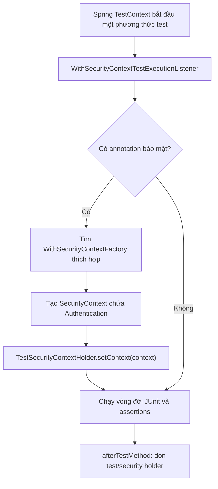

# WithSecurityContextTestExecutionListener thiết lập và dọn ngữ cảnh

Khi viết kiểm thử Spring Security, câu lệnh `@WithMockUser(username = "lan")` trông như một cách đăng nhập rất ngắn gọn. Nhưng ai đọc annotation này, lúc nào đối tượng `Authentication` xuất hiện, và ai bảo đảm danh tính `lan` không còn sót lại sau bài test?

Trong module **SPRING_SECURITY_TESTING**, câu trả lời nằm ở `WithSecurityContextTestExecutionListener` của **`spring-security-test`**. Đây là thành phần kết nối annotation mô phỏng danh tính với vòng đời kiểm thử Spring, đặc biệt quan trọng khi xác minh **xác thực, phân quyền và bảo vệ HTTP** bằng `MockMvc` trên Servlet. Bài học thuộc chương **Ngữ cảnh và vòng đời**; đồng thời chỉ ra ranh giới của cơ chế này khi chuyển sang `WebTestClient`, JWT/OAuth2/OIDC giả lập và ứng dụng Reactive.

Sau bài học, bạn có thể:

- Giải thích vì sao `@WithMockUser` hoạt động mà test không cần tự gọi `SecurityContextHolder.setContext(...)`.
- Phân biệt thời điểm thiết lập ngữ cảnh mặc định với `setupBefore = TEST_EXECUTION`.
- Hiểu cách listener dọn `TestSecurityContextHolder` và `SecurityContextHolder` để giữ các test độc lập.
- Sử dụng `@WithUserDetails` hoặc annotation tùy biến dựa trên `@WithSecurityContext` khi danh tính mặc định chưa đủ.
- Nhận biết khi nào phải cấp danh tính riêng cho HTTP request hoặc reactor pipeline.

## 1. Listener này nằm ở đâu trong cơ chế kiểm thử?

`WithSecurityContextTestExecutionListener` thuộc package:

```java
org.springframework.security.test.context.support.WithSecurityContextTestExecutionListener
```

Nó triển khai cơ chế **`TestExecutionListener` của Spring TestContext Framework**. Không phải JUnit `TestExecutionListener` và cũng không phải servlet `Filter`. Khi Spring TestContext được khởi tạo đúng cách, listener có thể tìm metadata bảo mật trên lớp/phương thức test rồi dựng context thích hợp.

Ba bộ phận phối hợp với nhau:

| Thành phần | Chịu trách nhiệm |
| --- | --- |
| `@WithMockUser`, `@WithAnonymousUser`, `@WithUserDetails` hoặc annotation tùy biến dựa trên `@WithSecurityContext` | **Mô tả** danh tính/điều kiện bảo mật cần có trong bài test |
| `WithSecurityContextTestExecutionListener` | **Đọc annotation, gọi factory, gắn và dọn** context theo các callback của Spring Test |
| `TestSecurityContextHolder` và `SecurityContextHolder` | **Lưu** ngữ cảnh đã tạo để test đọc và, khi tích hợp phù hợp, cung cấp cho request giả lập |

Có thể hình dung đường đi như sau:



Khi gọi `TestSecurityContextHolder.setContext(context)`, Spring Security Test ghi context vào cả `TestSecurityContextHolder` và `SecurityContextHolder` trên luồng hiện tại. Việc lưu trong test holder riêng hữu ích cho những request `MockMvc`: các security filter có thể thay đổi hoặc dọn `SecurityContextHolder` khi kết thúc mỗi request, trong khi test vẫn cần biết danh tính dự kiến để cấp cho request tiếp theo.

**Listener không thực hiện đăng nhập thật.** Với `@WithMockUser`, nó tạo một `Authentication` hợp lệ để mô phỏng người dùng đã được xác thực. Nó không gọi endpoint login, không kiểm tra mật khẩu, không giải mã JWT, không liên hệ OAuth2 Authorization Server và không xác minh ID token OIDC.

## 2. Điều kiện để WithSecurityContextTestExecutionListener hoạt động

Chỉ thêm dependency `spring-security-test` và annotation vào một test JUnit **chưa đủ**. Bài test phải được chạy cùng **Spring TestContext Framework**, ví dụ qua:

- JUnit Jupiter: `@ExtendWith(SpringExtension.class)` hoặc annotation tổng hợp `@SpringJUnitConfig(...)`.
- Spring Boot: `@SpringBootTest`, `@WebMvcTest`, `@WebFluxTest` và các dạng test slice có tích hợp Spring Test.
- JUnit 4 cũ: runner/tích hợp Spring Test tương ứng.

Khi Spring Security Test có trên classpath, listener bảo mật thường được đăng ký trong tập các listener mặc định của Spring TestContext. Bạn không cần khởi tạo trực tiếp lớp listener trong từng phương thức test.

Ví dụ cấu hình tối giản:

```java
import org.junit.jupiter.api.Test;
import org.springframework.context.annotation.Configuration;
import org.springframework.security.core.context.SecurityContextHolder;
import org.springframework.security.test.context.support.WithMockUser;
import org.springframework.test.context.junit.jupiter.SpringJUnitConfig;

import static org.assertj.core.api.Assertions.assertThat;

@SpringJUnitConfig(SimpleListenerTest.Config.class)
class SimpleListenerTest {

    @Test
    @WithMockUser(username = "lan", roles = "READER")
    void nhinThayNguoiDungTrongTest() {
        assertThat(SecurityContextHolder.getContext()
                .getAuthentication().getName())
                .isEqualTo("lan");
    }

    @Configuration
    static class Config {
    }
}
```

`@SpringJUnitConfig` là cách ngắn gọn để bật SpringExtension và cấu hình TestContext. Ở những dự án có context và bean thật, hãy chỉ rõ `classes = ...` hoặc dùng annotation Spring Boot tương ứng để tạo được những thành phần cần test.

Một nguyên nhân khiến `@WithMockUser` không có tác dụng là cấu hình `@TestExecutionListeners(...)` tùy chỉnh đã **thay thế** danh sách listener mặc định. Khi cần thêm listener riêng mà vẫn giữ những listener do Spring cung cấp, sử dụng:

```java
@TestExecutionListeners(
        listeners = MyAuditTestExecutionListener.class,
        mergeMode = TestExecutionListeners.MergeMode.MERGE_WITH_DEFAULTS
)
```

Đây là ví dụ về cách **trộn** listener mới với mặc định; `MyAuditTestExecutionListener` chỉ là tên minh họa cho listener do dự án định nghĩa. Kiểm tra cả dependency `spring-security-test`, tích hợp Spring TestContext và cấu hình listener trước khi kết luận annotation không hoạt động.

## 3. Vòng đời mặc định: tạo trước @BeforeEach, dọn sau @AfterEach

Theo mặc định, `WithSecurityContextTestExecutionListener` xử lý việc chuẩn bị context trong callback `beforeTestMethod` của Spring TestContext. Với JUnit Jupiter dùng `SpringExtension`, trình tự thường là:

```text
Spring TestContext: beforeTestMethod
  └─ WithSecurityContextTestExecutionListener
       └─ tạo và đặt context từ @WithMockUser
JUnit: @BeforeEach
JUnit: @Test
JUnit: @AfterEach
Spring TestContext: afterTestMethod
  └─ WithSecurityContextTestExecutionListener
       └─ TestSecurityContextHolder.clearContext()
            ├─ dọn TestSecurityContextHolder
            └─ dọn SecurityContextHolder
```

Điều này giải thích vì sao `@BeforeEach` có thể đọc danh tính mà `@WithMockUser` tạo ra:

```java
import org.junit.jupiter.api.BeforeEach;
import org.junit.jupiter.api.Test;
import org.springframework.context.annotation.Configuration;
import org.springframework.security.core.Authentication;
import org.springframework.security.core.context.SecurityContextHolder;
import org.springframework.security.test.context.support.WithMockUser;
import org.springframework.test.context.junit.jupiter.SpringJUnitConfig;

import static org.assertj.core.api.Assertions.assertThat;

@SpringJUnitConfig(DefaultSetupTimeTest.Config.class)
class DefaultSetupTimeTest {

    @BeforeEach
    void beforeEach() {
        Authentication authentication =
                SecurityContextHolder.getContext().getAuthentication();

        assertThat(authentication).isNotNull();
        assertThat(authentication.getName()).isEqualTo("lan");
    }

    @Test
    @WithMockUser(username = "lan")
    void daCoAuthenticationKhiTestChay() {
        assertThat(SecurityContextHolder.getContext()
                .getAuthentication().isAuthenticated())
                .isTrue();
    }

    @Configuration
    static class Config {
    }
}
```

Trong ví dụ này chỉ có một phương thức test và người dùng mặc định của phương thức là `lan`. Nếu lớp có những bài test khác với danh tính khác hoặc không có annotation, không được giả định mọi lần chạy `@BeforeEach` đều có `lan`.

**Việc dọn diễn ra cả khi assertion thất bại.** `afterTestMethod` thuộc chu kỳ quản lý của Spring TestContext; khi kiểm thử kết thúc, listener dọn holder để bài khác không vô tình đọc ngữ cảnh cũ. Trong luồng thực thi thông thường, `@AfterEach` được gọi trước `afterTestMethod`, vì vậy mã trong `@AfterEach` vẫn có thể nhìn thấy danh tính test nếu chưa có thành phần khác thay đổi nó. Không nên dựa vào `@AfterAll` để đọc danh tính của test cuối cùng.

## 4. Đổi thời điểm sang TEST_EXECUTION khi cần

Annotation bảo mật hỗ trợ thuộc tính `setupBefore` nhận `TestExecutionEvent`. Hai chế độ cần phân biệt:

| `setupBefore` | Callback đặt context | Hệ quả đối với `@BeforeEach` |
| --- | --- | --- |
| `TestExecutionEvent.TEST_METHOD` (mặc định) | `beforeTestMethod` | `@BeforeEach` có thể thấy authentication của annotation |
| `TestExecutionEvent.TEST_EXECUTION` | `beforeTestExecution` | `@BeforeEach` chạy **trước khi** listener tạo authentication từ annotation |

Ví dụ muốn tạo tài khoản thử nghiệm trong `@BeforeEach`, rồi mới dùng `@WithUserDetails` để nạp tài khoản đó từ `UserDetailsService`:

```java
import org.junit.jupiter.api.BeforeEach;
import org.junit.jupiter.api.Test;
import org.springframework.security.test.context.support.TestExecutionEvent;
import org.springframework.security.test.context.support.WithUserDetails;

class ReportServiceTest {

    // Giả định userRepository, service và UserDetailsService
    // đã được đưa vào Spring TestContext.

    @BeforeEach
    void createUser() {
        // Tạo người dùng "lan" với authority "report:read"
        // trong kho dữ liệu test mà UserDetailsService đọc được.
    }

    @Test
    @WithUserDetails(
            value = "lan",
            setupBefore = TestExecutionEvent.TEST_EXECUTION
    )
    void userDaDuocTaoTruocKhiNapContext() {
        // Lúc @Test chạy, Spring Security Test đã lấy UserDetails "lan"
        // và thiết lập Authentication tương ứng.
    }
}
```

Đây là **sơ đồ luồng** để minh họa thời điểm, không phải một test chạy độc lập: cần có context, repository, `UserDetailsService` và dữ liệu thực của dự án. Nếu để chế độ mặc định `TEST_METHOD` trong tình huống này, listener có thể truy vấn người dùng **trước khi `@BeforeEach` kịp tạo dữ liệu**, dẫn đến test thất bại.

Cũng có thể đặt `setupBefore` cho `@WithMockUser`:

```java
@Test
@WithMockUser(
        username = "lan",
        setupBefore = TestExecutionEvent.TEST_EXECUTION
)
void datContextNgayTruocTest() {
    // Authentication đã được tạo khi phương thức này bắt đầu.
}
```

Điểm cần nhớ: thay đổi `setupBefore` ảnh hưởng **lúc đặt context**, không làm cho authentication tự động truyền sang luồng nền hoặc request chạy qua mạng. Listener vẫn dọn context trong quá trình kết thúc phương thức test.

## 5. Từ annotation đến Authentication: các lựa chọn phổ biến

### 5.1. @WithMockUser

`@WithMockUser` dùng factory sẵn có để tạo `UsernamePasswordAuthenticationToken` giả lập.

```java
@Test
@WithMockUser(username = "lan", roles = "READER")
void roleDuocChuyenThanhGrantedAuthority() {
    Authentication authentication =
            SecurityContextHolder.getContext().getAuthentication();

    assertThat(authentication.getName()).isEqualTo("lan");
    assertThat(authentication.getAuthorities())
            .extracting(GrantedAuthority::getAuthority)
            .containsExactly("ROLE_READER");
}
```

Các import cho đoạn ví dụ là `org.springframework.security.core.Authentication`, `org.springframework.security.core.GrantedAuthority`, `org.springframework.security.core.context.SecurityContextHolder`, `org.springframework.security.test.context.support.WithMockUser` và các assertion của AssertJ.

`roles = "READER"` cho authority `ROLE_READER`. Nếu chính sách của ứng dụng kiểm tra `hasAuthority("report:read")`, hãy dùng `authorities = "report:read"`; không tự thêm tiền tố `ROLE_` cho trường hợp này.

Nếu không cấu hình gì thêm, `@WithMockUser` tạo tên mặc định `user`, mật khẩu mặc định `password` và role mặc định `USER`. Các giá trị này là dữ liệu test, không được gửi qua quy trình xác thực mật khẩu thật.

### 5.2. @WithAnonymousUser

`@WithAnonymousUser` giúp mô phỏng trạng thái vô danh, kể cả khi lớp đã có `@WithMockUser` mặc định:

```java
@WithMockUser(username = "lan", roles = "READER")
class ReportsTest {

    @Test
    void readerCoDanhTinh() {
        // Test chạy với "lan".
    }

    @Test
    @WithAnonymousUser
    void requestVoDanh() {
        // Test chạy với anonymous authentication được mô phỏng.
    }
}
```

Không nên kết luận “vô danh nghĩa là `getAuthentication() == null`”: Spring Security có thể biểu diễn anonymous bằng `AnonymousAuthenticationToken`. Khi xác minh chính sách bảo vệ, ưu tiên kết quả cho phép/từ chối theo rule hơn là chỉ kiểm tra `null`.

### 5.3. @WithUserDetails

`@WithUserDetails` lấy `UserDetails` qua một `UserDetailsService` trong Spring context. Nó hữu ích khi muốn kiểm tra principal tùy chỉnh, thuộc tính người dùng hay authorities như trong cấu hình thật:

```java
@Test
@WithUserDetails(value = "lan", userDetailsServiceBeanName = "appUsers")
void principalDenTuUserDetailsService() {
    Authentication authentication =
            SecurityContextHolder.getContext().getAuthentication();
    // principal là UserDetails được "appUsers" trả về.
}
```

Cấu hình này yêu cầu bean `UserDetailsService` tên `appUsers` và người dùng `lan` tồn tại tại thời điểm listener thiết lập context. `@WithUserDetails` dùng dữ liệu do service trả về, nhưng **không gọi luồng login để kiểm tra password**.

### 5.4. Annotation ở cấp lớp và cấp phương thức

Nếu nhiều test dùng cùng một danh tính, có thể đặt annotation ở cấp lớp:

```java
@WithMockUser(username = "lan", roles = "READER")
@SpringJUnitConfig
class ReportReadTests {

    @Test
    void readAllowed() { /* mặc định "lan" */ }

    @Test
    @WithMockUser(username = "mai", roles = "ADMIN")
    void adminAllowed() { /* riêng phương thức này là "mai" */ }
}
```

Annotation ở cấp phương thức được ưu tiên khi có cả khai báo cấp lớp. Phương án này giúp test ngắn gọn, nhưng có thể che khuất người dùng của từng ca phân quyền nếu các role khác nhau nhiều; khi đó nên ghi rõ identity tại từng phương thức để dễ bảo trì.

## 6. Ví dụ đầy đủ: listener và kiểm thử phân quyền phương thức

Ví dụ JUnit Jupiter dưới đây sử dụng Spring Test, Spring Security Method Security, `spring-security-test` và AssertJ. Quy tắc `@PreAuthorize` chỉ cho phép authority `report:read`. Cả hai bài test đều được listener cấp `Authentication` trước khi gọi dịch vụ.

```java
import org.junit.jupiter.api.Test;
import org.springframework.beans.factory.annotation.Autowired;
import org.springframework.context.annotation.Configuration;
import org.springframework.context.annotation.Import;
import org.springframework.security.access.AccessDeniedException;
import org.springframework.security.access.prepost.PreAuthorize;
import org.springframework.security.config.annotation.method.configuration.EnableMethodSecurity;
import org.springframework.security.core.context.SecurityContextHolder;
import org.springframework.security.test.context.support.WithMockUser;
import org.springframework.test.context.junit.jupiter.SpringJUnitConfig;

import static org.assertj.core.api.Assertions.assertThat;
import static org.assertj.core.api.Assertions.assertThatThrownBy;

@SpringJUnitConfig(SecurityListenerExample.TestConfig.class)
class SecurityListenerExample {

    @Autowired
    ReportService reportService;

    @Test
    @WithMockUser(username = "lan", authorities = "report:read")
    void duocPhepKhiCoDungAuthority() {
        assertThat(reportService.readReport()).isEqualTo("lan");
    }

    @Test
    @WithMockUser(username = "mai", authorities = "report:write")
    void biTuChoiKhiThieuAuthority() {
        assertThatThrownBy(reportService::readReport)
                .isInstanceOf(AccessDeniedException.class);
    }

    @Configuration
    @EnableMethodSecurity
    @Import(ReportService.class)
    static class TestConfig {
    }

    static class ReportService {

        @PreAuthorize("hasAuthority('report:read')")
        public String readReport() {
            return SecurityContextHolder.getContext()
                    .getAuthentication().getName();
        }
    }
}
```

Trong trường hợp cấp quyền, listener tạo authentication của `lan` với authority `report:read`; method security đọc authentication trên luồng gọi dịch vụ và cho phép thực thi. Trường hợp `mai` chỉ có `report:write`, phương thức bị từ chối trước khi chạy nội dung.

Hai ca này kiểm chứng **method security**, không thay thế bài test HTTP qua `SecurityFilterChain`. Nếu muốn kiểm thử mã `401`/`403` của endpoint, cần dùng `MockMvc` hoặc `WebTestClient` với cấu hình web bảo mật tương ứng.

## 7. Tùy biến SecurityContext bằng @WithSecurityContext

`@WithMockUser` có thể không đủ khi ứng dụng dùng custom principal, authority đặc thù hoặc `Authentication` riêng. Spring Security Test cho phép tạo annotation riêng bằng `@WithSecurityContext` và một `WithSecurityContextFactory`.

Ví dụ tạo `@WithMockPermission` với username và danh sách quyền:

**Tệp `WithMockPermission.java`**

```java
import java.lang.annotation.ElementType;
import java.lang.annotation.Retention;
import java.lang.annotation.RetentionPolicy;
import java.lang.annotation.Target;

import org.springframework.security.test.context.support.WithSecurityContext;

@Retention(RetentionPolicy.RUNTIME)
@Target({ElementType.TYPE, ElementType.METHOD})
@WithSecurityContext(factory = WithMockPermissionFactory.class)
public @interface WithMockPermission {
    String username() default "lan";
    String[] authorities() default {"report:read"};
}
```

**Tệp `WithMockPermissionFactory.java`**

```java
import org.springframework.security.authentication.UsernamePasswordAuthenticationToken;
import org.springframework.security.core.Authentication;
import org.springframework.security.core.authority.AuthorityUtils;
import org.springframework.security.core.context.SecurityContext;
import org.springframework.security.core.context.SecurityContextHolder;
import org.springframework.security.test.context.support.WithSecurityContextFactory;

public class WithMockPermissionFactory
        implements WithSecurityContextFactory<WithMockPermission> {

    @Override
    public SecurityContext createSecurityContext(
            WithMockPermission annotation) {

        Authentication authentication =
                new UsernamePasswordAuthenticationToken(
                        annotation.username(),
                        "N/A",
                        AuthorityUtils.createAuthorityList(
                                annotation.authorities()));

        SecurityContext context =
                SecurityContextHolder.createEmptyContext();
        context.setAuthentication(authentication);
        return context;
    }
}
```

**Sử dụng trong test có Spring TestContext**

```java
@Test
@WithMockPermission(
        username = "mai",
        authorities = {"report:read", "report:export"}
)
void canExportReport() {
    Authentication authentication =
            SecurityContextHolder.getContext().getAuthentication();

    assertThat(authentication.getName()).isEqualTo("mai");
    assertThat(authentication.getAuthorities())
            .extracting(GrantedAuthority::getAuthority)
            .contains("report:export");
}
```

Luồng hoạt động là:

1. Listener phát hiện `@WithMockPermission` do nó mang meta-annotation `@WithSecurityContext`.
2. Listener tạo factory phù hợp và gọi `createSecurityContext(annotation)`.
3. Factory trả về một `SecurityContext` chứa `Authentication` được yêu cầu.
4. Listener thiết lập context cho phương thức test và dọn sau khi phương thức hoàn thành.

Trong factory, **nên dùng `SecurityContextHolder.createEmptyContext()` rồi thiết lập authentication trên context mới**. Cách này làm rõ rằng mỗi lần tạo người dùng giả lập nhận một context riêng, tránh sửa nhầm đối tượng đang được chia sẻ. Với yêu cầu phụ thuộc Spring bean, factory có thể được Spring autowire khi TestContext được cấu hình đúng.

Có thể khai báo `setupBefore` trong annotation tùy biến hoặc sử dụng thuộc tính của meta-annotation `@WithSecurityContext` để chọn lúc thiết lập. Dù tạo principal phức tạp đến đâu, factory phải tránh lưu trạng thái người dùng vào biến `static` hoặc singleton có thể bị các test khác dùng lại.

## 8. Dọn context: ai làm và dọn những gì?

`WithSecurityContextTestExecutionListener` gọi `TestSecurityContextHolder.clearContext()` ở giai đoạn kết thúc phương thức test. Lời gọi này dọn cả trạng thái trong `TestSecurityContextHolder` lẫn `SecurityContextHolder` của luồng hiện tại.

Điểm cần phân biệt:

| Thao tác | `SecurityContextHolder` | `TestSecurityContextHolder` |
| --- | --- | --- |
| Listener tạo người dùng từ annotation | Được đặt | Được đặt |
| `TestSecurityContextHolder.setContext(context)` | Được đặt | Được đặt |
| `SecurityContextHolder.setContext(context)` thủ công | Được đặt | **Không tự cập nhật** |
| `SecurityContextHolder.clearContext()` | Được dọn | **Không tự dọn** |
| `TestSecurityContextHolder.clearContext()` | Được dọn | Được dọn |
| Listener kết thúc test thông thường | Được dọn | Được dọn |

Vì thế, đoạn mã sau dễ để sót trạng thái:

```java
TestSecurityContextHolder.setAuthentication(authentication);

// ... thực hiện kiểm thử ...

SecurityContextHolder.clearContext(); // Chưa dọn test holder
```

Nếu tự thiết lập context ở một test thuần hoặc trong một đoạn code không được listener quản lý, hãy dùng `try/finally`:

```java
try {
    TestSecurityContextHolder.setAuthentication(authentication);
    // Gọi mã cần kiểm thử và assert kết quả
} finally {
    TestSecurityContextHolder.clearContext();
}
```

Với bài test đã dùng `@WithMockUser` trong Spring TestContext, listener tự lo dọn sau mỗi phương thức. Không cần thêm `@AfterEach` chỉ để lặp lại công việc đó. Nếu test chủ động đặt authentication khác giữa chừng hoặc sử dụng test holder ngoài vòng đời listener, việc dọn đúng phạm vi vẫn thuộc trách nhiệm của mã test.

**Không dùng `@DirtiesContext` như giải pháp thay thế** cho việc dọn security context: annotation đó ảnh hưởng Spring `ApplicationContext` và thường làm test chạy chậm hơn, không phải công cụ cơ bản để xóa ThreadLocal.

## 9. Vòng đời listener không đồng nghĩa vòng đời HTTP request

Khi kiểm thử Servlet với `MockMvc`, nên phân biệt ba phạm vi:

```text
Spring TestContext / JUnit
└─ WithSecurityContextTestExecutionListener
   └─ TestSecurityContextHolder: danh tính mong muốn của bài test
      └─ MockMvc.perform(...)
         └─ SecurityFilterChain của một request
            ├─ thiết lập SecurityContextHolder cho request
            ├─ áp dụng xác thực, phân quyền, CSRF...
            └─ kết thúc request và dọn context của luồng
```

Để annotation `@WithMockUser` hoặc context từ `TestSecurityContextHolder` thực sự có tác dụng với request giả lập, `MockMvc` phải được tích hợp đúng với Spring Security. Một cách dựng phổ biến là:

```java
mockMvc = MockMvcBuilders.webAppContextSetup(webApplicationContext)
        .apply(springSecurity())
        .build();
```

`springSecurity()` thiết lập các thành phần tích hợp bảo mật của `MockMvc`, bao gồm bộ xử lý giúp lấy context kiểm thử. Khi muốn cấp lại context dự kiến một cách tường minh cho một request:

```java
mockMvc.perform(get("/api/me").with(testSecurityContext()))
        .andExpect(status().isOk());
```

Các lệnh trên cần static imports `SecurityMockMvcConfigurers.springSecurity`, `SecurityMockMvcRequestPostProcessors.testSecurityContext`, `MockMvcRequestBuilders.get` và `MockMvcResultMatchers.status`, cùng một controller `/api/me` tồn tại trong ứng dụng.

Nếu ứng dụng dùng Spring Boot và `@AutoConfigureMockMvc`, các security filter thường được tích hợp tự động theo cấu hình test. Nếu tự dựng `standaloneSetup(...)` thiếu filter, `@WithMockUser` có thể giúp một phép gọi dịch vụ đọc được danh tính nhưng **không chứng minh** luật `authorizeHttpRequests` trên HTTP đã chạy.

Cũng cần phân biệt **kết quả phân quyền** với **kết quả xác thực**:

- `@WithMockUser` hoặc `.with(user("lan"))` tạo người dùng giả lập để test các trường hợp được cấp/bị từ chối.
- `.with(jwt())`, `.with(oauth2Login())` hoặc `.with(oidcLogin())` mô phỏng principal và thông tin tương ứng để kiểm tra authorization.
- Kiểm thử chữ ký JWT, token hết hạn, issuer/audience hoặc quy trình OAuth2/OIDC thực phải dùng đường đi xác thực cần kiểm chứng; những mock trên không chứng minh việc xác minh token.

Khi xử lý request HTTP **thật** trên server chạy cổng riêng (ví dụ `@SpringBootTest(webEnvironment = RANDOM_PORT)`), `@WithMockUser` trên luồng JUnit không tự truyền authentication qua socket. Hãy gửi header, cookie/session hoặc credentials phù hợp trong request.

## 10. Reactive và WebTestClient: đừng áp dụng máy móc ThreadLocal

Trong Servlet, `SecurityContextHolder` mặc định sử dụng `ThreadLocal`. Trong ứng dụng WebFlux, Spring Security Reactive dùng **Reactor Context** để truyền ngữ cảnh bảo mật theo chuỗi xử lý, có thể qua nhiều luồng.

Khi kiểm thử HTTP Reactive, Spring Security Test cung cấp các configurer và mock riêng cho `WebTestClient`:

```java
webTestClient.mutateWith(mockUser("lan").roles("READER"))
        .get().uri("/api/reports")
        .exchange()
        .expectStatus().isOk();
```

Ví dụ trên giả định ứng dụng có endpoint cho phép `ROLE_READER`, `WebTestClient` đã tích hợp Spring Security Reactive và đã import `SecurityMockServerConfigurers.mockUser`. Với `WebTestClient` tự dựng, cần cấu hình `SecurityMockServerConfigurers.springSecurity()` đúng cách.

Đối với **reactive method security**, Spring Security Test có hỗ trợ qua `ReactorContextTestExecutionListener` để đưa danh tính test vào Reactor Context; việc kiểm thử reactive code phải có tích hợp phù hợp. Không đọc `SecurityContextHolder.getContext()` trên một luồng bất kỳ rồi giả định đó là danh tính của toàn bộ Reactor pipeline.

`WithSecurityContextTestExecutionListener` quan trọng cho phương thức test Spring Security, nhưng nó không phải công cụ duy nhất cho mọi giao thức và mô hình thực thi. Chọn cơ chế phù hợp với **Servlet + MockMvc**, **Reactive + WebTestClient** hoặc **HTTP client kết nối server thật**.

## 11. Những tình huống dễ làm test sai

| Triệu chứng | Nguyên nhân cần kiểm tra | Hướng giải quyết |
| --- | --- | --- |
| `@WithMockUser` không đặt authentication | Bài test chỉ dùng JUnit, không có Spring TestContext; listener bị thay thế | Bật `SpringExtension`/Spring Boot test và giữ các listener mặc định |
| `@BeforeEach` thấy authentication `null` | Annotation dùng `setupBefore = TEST_EXECUTION` | Đọc authentication trong `@Test`, hoặc dùng chế độ mặc định |
| `@WithUserDetails` báo không tìm thấy người dùng | Listener tải user trước khi `@BeforeEach` tạo dữ liệu | Dùng `setupBefore = TEST_EXECUTION` và bảo đảm dữ liệu đã có |
| Test với `ROLE_READER` bị từ chối dù tưởng có quyền `report:read` | Nhầm `roles` và `authorities` | Kiểm tra chính xác chuỗi authority mà rule dùng |
| Test sau bất ngờ dùng principal của test trước | Đã đặt context thủ công nhưng không dọn test holder; có lưu trạng thái static | Gọi `TestSecurityContextHolder.clearContext()` trong `finally`, giữ test độc lập |
| Test thread có user nhưng executor worker không có | `SecurityContextHolder` mặc định là ThreadLocal | Truyền context qua executor wrapper/decorator thích hợp |
| `MockMvc` trả `200` dù endpoint đáng lẽ bị bảo vệ | Test không chạy chuỗi security filter | Tích hợp `springSecurity()` hoặc cấu hình test Boot tương ứng |
| Request vô danh nhận `302` thay vì `401` | Cấu hình form login/entry point khác HTTP Basic | Viết kỳ vọng theo security filter chain thật |
| `POST` nhận `403` dù đã giả lập user đủ quyền | Thiếu CSRF token trong test bật CSRF | Dùng `.with(csrf())` ở request hợp lệ; vẫn giữ ca thiếu token |
| Mock JWT thành công nhưng token thật không hợp lệ | Mock bỏ qua bước kiểm chữ ký/claims của decoder | Bổ sung test resource server với decoder/token thích hợp |
| `WebTestClient` không nhận user trong pipeline | Dùng giả định ThreadLocal cho reactive | Dùng `mockUser()`/Reactor Context và tích hợp Spring Security Reactive |

Hai điểm cần đặc biệt lưu ý về tính cô lập:

1. **Đa luồng:** listener dọn ngữ cảnh trên luồng chạy test; nếu test tự sao chép context sang executor, tác vụ phải có cơ chế thiết lập và dọn trên luồng của chính nó. Không đổi `SecurityContextHolder` sang `MODE_GLOBAL` để “chữa” test; đó là trạng thái rộng toàn JVM.
2. **Test song song:** giữ dữ liệu và context theo từng phương thức, không chia sẻ `Authentication` mutable hoặc tự giữ context trong biến tĩnh. Với các test có `@WithMockUser`, để listener quản lý bình thường và tránh thay đổi chiến lược holder toàn cục.

## 12. Bài thực hành

Tạo một `ReportService` có phương thức `readReport()` gắn `@PreAuthorize("hasAuthority('report:read')")`. Bật `@EnableMethodSecurity` trong context kiểm thử, rồi triển khai:

1. **Cho phép:** `@WithMockUser(username = "lan", authorities = "report:read")`, gọi `readReport()` và xác minh phương thức chạy thành công.
2. **Từ chối:** `@WithMockUser(username = "mai", authorities = "report:write")`, xác minh lời gọi bị chặn bởi method security.
3. **Thời điểm:** đặt một assertion đọc authentication trong `@BeforeEach` khi dùng `TEST_METHOD`; sau đó chuyển sang `TEST_EXECUTION` và giải thích vì sao assertion đó không còn đúng.
4. **Dữ liệu động:** tạo user ở `@BeforeEach` rồi dùng `@WithUserDetails(setupBefore = TEST_EXECUTION)` để kiểm tra việc tải user sau bước khởi tạo.
5. **Context tùy biến:** viết một `@WithMockPermission` và factory riêng; xác minh factory tạo đúng `Authentication`.
6. **HTTP:** thêm endpoint gọi service, dùng `MockMvc` có security filter để xác minh role được phép, role bị từ chối và người dùng vô danh.
7. **Tính cô lập:** thử tự đặt `TestSecurityContextHolder` trong một test khác, dọn bằng `try/finally` rồi giải thích vì sao chỉ gọi `SecurityContextHolder.clearContext()` không đầy đủ.

Sau cùng, hãy trả lời được: **listener chuẩn bị context vào callback nào, ai dọn context, và HTTP request nhận context bằng cơ chế nào?** Ba câu trả lời đó là nền tảng để viết ca kiểm thử xác thực, phân quyền và bảo vệ HTTP ổn định.

## Tài liệu tham khảo

- [Spring Security Reference — Testing Method Security](https://docs.spring.io/spring-security/reference/servlet/test/method.html)
- [Spring Security API — WithSecurityContextTestExecutionListener](https://docs.spring.io/spring-security/reference/api/java/org/springframework/security/test/context/support/WithSecurityContextTestExecutionListener.html)
- [Spring Security API — WithSecurityContext](https://docs.spring.io/spring-security/reference/api/java/org/springframework/security/test/context/support/WithSecurityContext.html)
- [Spring Security API — TestSecurityContextHolder](https://docs.spring.io/spring-security/reference/api/java/org/springframework/security/test/context/TestSecurityContextHolder.html)
- [Spring Security Reference — Setting Up MockMvc and Spring Security](https://docs.spring.io/spring-security/reference/servlet/test/mockmvc/setup.html)
- [Spring Security Reference — Reactive Testing](https://docs.spring.io/spring-security/reference/reactive/test/index.html)
