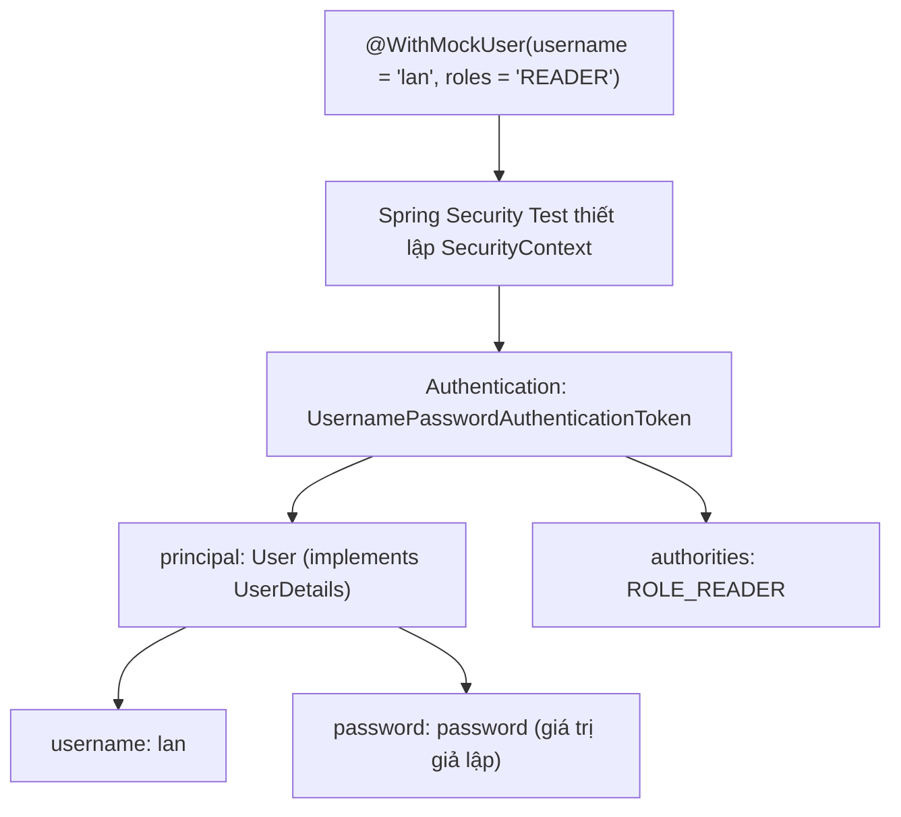

# Tên người dùng, mật khẩu giả lập và kiểu principal mặc định trong `@WithMockUser`

## 1. Vì sao phải hiểu danh tính giả lập?

Khi kiểm thử Spring Security, chúng ta thường muốn biết một người đã được xác thực có đọc được tài nguyên, gọi được endpoint quản trị hay bị trả về `403 Forbidden` hay không. Với thư viện **`spring-security-test`**, annotation `@WithMockUser` tạo sẵn một danh tính cho ca kiểm thử. Bài test có thể thực thi logic phân quyền mà không cần chạy biểu mẫu đăng nhập, truy vấn bảng tài khoản hay nhận JWT từ máy chủ danh tính.

Tuy nhiên, ba chi tiết nhỏ có thể gây ra lỗi khó hiểu: **tên người dùng trong test là gì, mật khẩu được sử dụng theo cách nào và đối tượng `principal` thuộc kiểu nào**. Ví dụ, nếu controller mong đợi một lớp `CustomUserPrincipal` nhưng `@WithMockUser` tạo `org.springframework.security.core.userdetails.User`, việc ép kiểu hoặc lấy principal bằng `@AuthenticationPrincipal` có thể không hoạt động như mong muốn.

Trong module **SPRING_SECURITY_TESTING**, kiến thức này giúp sử dụng `MockMvc`, `WebTestClient` và `SecurityContext` chính xác để kiểm chứng xác thực, phân quyền và bảo vệ HTTP trên cả Servlet lẫn Reactive. Chủ đề của bài thuộc chương **Annotation người dùng**, tập trung vào dữ liệu và kiểu đối tượng mà `@WithMockUser` thực sự tạo ra.

Sau bài học, bạn sẽ biết:

- Xác định các giá trị mặc định của `username`, `password`, `roles` và principal.
- Chọn giữa `value` và `username`, đồng thời hiểu thứ tự ưu tiên nếu khai báo cả hai.
- Đọc `SecurityContext`, `Authentication` và `UserDetails` để kiểm tra người dùng giả lập.
- Viết test kiểm tra nội dung controller và HTTP status, nhận ra giới hạn của mật khẩu giả lập.
- Chọn `@WithUserDetails`, `@WithSecurityContext` hoặc bộ giả lập JWT/OAuth2/OIDC khi principal mặc định không phù hợp.

## 2. `@WithMockUser` tạo gì trong `SecurityContext`?

`@WithMockUser` là annotation của Spring Security Test:

```java
import org.springframework.security.test.context.support.WithMockUser;
```

Trong test sử dụng Spring Test, `WithSecurityContextTestExecutionListener` xử lý annotation và thiết lập một `SecurityContext` chứa `Authentication` đã xác thực. `Authentication` thông thường là `UsernamePasswordAuthenticationToken`; đối tượng trả về từ `authentication.getPrincipal()` là một `org.springframework.security.core.userdetails.User` được tạo cho test.



Đây là **trạng thái đã xác thực được chuẩn bị sẵn**. Spring Security Test không tự gọi `AuthenticationManager`, `AuthenticationProvider`, `PasswordEncoder` hay `UserDetailsService` để chứng minh người dùng có thể đăng nhập thật. Nó cũng không sinh JWT, truy xuất OAuth2 access token hoặc liên hệ nhà cung cấp OpenID Connect.

### Những giá trị mặc định

Nếu viết `@WithMockUser` mà không truyền thuộc tính nào, các giá trị thường gặp là:

| Thành phần | Giá trị mặc định | Ý nghĩa trong test |
| --- | --- | --- |
| `value` | `"user"` | Tên người dùng dự phòng |
| `username` | `""` | Rỗng nên lấy tên từ `value` |
| `password` | `"password"` | Chuỗi mật khẩu giả cho `UserDetails` |
| `roles` | `{"USER"}` | Sinh authority `ROLE_USER` |
| `authorities` | `{}` | Chưa khai báo authority trực tiếp |
| `Authentication` | `UsernamePasswordAuthenticationToken` | Được đánh dấu đã xác thực |
| `principal` | `org.springframework.security.core.userdetails.User` | Đối tượng `UserDetails` của Spring Security |

Không nhầm `user` với tài khoản có thật trong cơ sở dữ liệu, hoặc `password` với mật khẩu đã đi qua cơ chế kiểm tra/giải mã mật khẩu. Đây là các giá trị do bộ công cụ kiểm thử đặt vào ngữ cảnh bảo mật.

## 3. Đặt tên người dùng: `value` và `username`

Có ba cách phổ biến:

```java
@WithMockUser
// authentication.getName() == "user"

@WithMockUser("minh")
// authentication.getName() == "minh"

@WithMockUser(username = "minh")
// authentication.getName() == "minh"
```

`@WithMockUser("minh")` là cú pháp rút gọn cho `value = "minh"`. Thuộc tính `username` diễn đạt rõ hơn ý nghĩa khi khai báo kèm `password`, `roles` hoặc `authorities`:

```java
@Test
@WithMockUser(
    username = "linh",
    password = "test-only-secret",
    roles = "EDITOR"
)
void editorCanModifyDocument() {
    // Người dùng giả lập có tên "linh" và authority ROLE_EDITOR.
}
```

Khi **cả `value` và `username` cùng được khai báo**, `username` không rỗng được ưu tiên:

```java
@Test
@WithMockUser(value = "ten-du-phong", username = "ten-duoc-su-dung")
void usernameOverridesValue() {
    String actualName = SecurityContextHolder.getContext()
            .getAuthentication()
            .getName();

    assertThat(actualName).isEqualTo("ten-duoc-su-dung");
}
```

Ví dụ trên sử dụng `SecurityContextHolder` của Spring Security và `assertThat` của AssertJ. Trong mã kiểm thử thực tế, nên chọn **một trong hai** thuộc tính để tránh gây nhầm lẫn cho người đọc.

Tên người dùng được đặt ở ba nơi dễ quan sát:

1. `authentication.getName()`: chuỗi tên đăng nhập, ví dụ `"linh"`.
2. `((UserDetails) authentication.getPrincipal()).getUsername()`: tên trong đối tượng principal mặc định.
3. `@AuthenticationPrincipal UserDetails user`: controller hoặc phương thức được Spring Security cung cấp principal hiện tại nếu đã tích hợp đúng bảo mật.

Tên này không đến từ request parameter, cookie đăng nhập hay HTTP Basic header của request; bộ công cụ kiểm thử đã thiết lập danh tính cho test trước đó.

## 4. Mật khẩu giả lập có tác dụng gì?

Giả sử khai báo:

```java
@WithMockUser(
    username = "an",
    password = "local-test-password",
    roles = "ADMIN"
)
```

Spring Security Test tạo principal `User` có `getPassword()` trả về `"local-test-password"`. Có thể kiểm tra trực tiếp khi cần xác minh fixture:

```java
Authentication authentication = SecurityContextHolder.getContext()
        .getAuthentication();
UserDetails principal = (UserDetails) authentication.getPrincipal();

assertThat(principal.getUsername()).isEqualTo("an");
assertThat(principal.getPassword()).isEqualTo("local-test-password");
assertThat(authentication.isAuthenticated()).isTrue();
```

Điều này **không có nghĩa Spring Security đã xác minh chuỗi mật khẩu ấy**. Test không cần mật khẩu khớp với bản ghi người dùng, cũng không đòi hỏi mật khẩu phải được băm bằng BCrypt/Argon2. Nếu truyền `password = "sai-mat-khau"` nhưng `@WithMockUser` vẫn được sử dụng, `Authentication` vẫn là trạng thái đã xác thực.

| Điều được kiểm chứng | `@WithMockUser` có kiểm chứng được không? |
| --- | --- |
| Endpoint dành cho `ADMIN` chấp nhận danh tính có `ROLE_ADMIN` | Có, nếu request chạy qua cấu hình bảo mật cần kiểm chứng |
| `UserDetails.getPassword()` chứa giá trị giả đã khai báo | Có, bằng assertion trong test |
| Mật khẩu đầu vào khớp với mật khẩu mã hóa trong cơ sở dữ liệu | Không |
| `PasswordEncoder.matches(...)` được gọi trong quy trình đăng nhập | Không |
| Thất bại khi gửi sai mật khẩu ở form login/HTTP Basic | Không; cần một test cho quá trình đăng nhập thực tế |

**Thực hành an toàn:** chỉ dùng mật khẩu giả vô hại, tránh tái sử dụng bí mật thật. Không trả `getPassword()` qua API hoặc ghi nó vào log chỉ vì test có thể đọc được. Kiểm thử thường chỉ cần xác nhận `username` và `authorities`.

## 5. Principal mặc định là `User`, không phải lớp người dùng của dự án

Spring Security sử dụng từ `principal` để chỉ danh tính gắn với một `Authentication`. Cần phân biệt ba đối tượng:

| Thành phần | Kiểu điển hình với `@WithMockUser` | Nhiệm vụ |
| --- | --- | --- |
| `SecurityContext` | `SecurityContext` | Chứa `Authentication` hiện tại |
| `Authentication` | `UsernamePasswordAuthenticationToken` | Chứa principal, authorities và trạng thái xác thực |
| `Authentication.getPrincipal()` | `org.springframework.security.core.userdetails.User` | Chứa username, password giả, authorities; implements `UserDetails` |

Ví dụ đọc và kiểm tra đầy đủ:

```java
import org.springframework.security.core.Authentication;
import org.springframework.security.core.GrantedAuthority;
import org.springframework.security.core.context.SecurityContextHolder;
import org.springframework.security.core.userdetails.User;
import org.springframework.security.core.userdetails.UserDetails;

Authentication auth = SecurityContextHolder.getContext().getAuthentication();

assertThat(auth.isAuthenticated()).isTrue();
assertThat(auth.getName()).isEqualTo("lan");
assertThat(auth.getPrincipal()).isInstanceOf(User.class);

UserDetails details = (UserDetails) auth.getPrincipal();
assertThat(details.getUsername()).isEqualTo("lan");
assertThat(details.getAuthorities())
        .extracting(GrantedAuthority::getAuthority)
        .contains("ROLE_READER");
```

Đừng nhầm kiểu `User` nói trên với entity JPA `User`, DTO `UserDto` hoặc `AppUserPrincipal` do dự án tự định nghĩa. Chúng có thể có các thuộc tính giống nhau nhưng là những kiểu Java khác nhau.

Nếu controller khai báo:

```java
@GetMapping("/me")
String currentUser(@AuthenticationPrincipal UserDetails principal) {
    return principal.getUsername();
}
```

thì principal mặc định đáp ứng được `UserDetails`. Ngược lại, nếu controller yêu cầu:

```java
@GetMapping("/me")
String currentUser(@AuthenticationPrincipal AppUserPrincipal principal) {
    return principal.getDisplayName();
}
```

thì `@WithMockUser` không tự tạo `AppUserPrincipal`. Với `@AuthenticationPrincipal`, trường hợp kiểu không tương thích thường khiến giá trị được tiêm là `null` (hoặc lỗi chuyển kiểu nếu bật `errorOnInvalidType = true`), nên phương thức có thể ném lỗi khi dùng `principal`. Đây là vấn đề **khác kiểu principal**, không nhất thiết là phân quyền thất bại.

Cần lưu ý cả trường hợp dùng `@AuthenticationPrincipal String username`: principal mặc định là đối tượng `User`, không phải `String`. Muốn lấy username trực tiếp, có thể dùng SpEL:

```java
@GetMapping("/me/name")
String name(@AuthenticationPrincipal(expression = "username") String username) {
    return username;
}
```

Hoặc nhận `Authentication` và gọi `getName()`, tùy cách tổ chức controller.

## 6. Ví dụ hoàn chỉnh: kiểm tra tên người dùng, principal và HTTP status bằng `MockMvc`

Giả sử ứng dụng Spring MVC có endpoint `GET /api/me` cho người đã xác thực và `GET /api/admin` chỉ dành cho quản trị viên. Ta kiểm thử dữ liệu trong principal đồng thời kiểm tra bảo vệ HTTP thực tế.

### 6.1. Phụ thuộc kiểm thử

Đối với dự án Spring Boot dùng Gradle, cần các phụ thuộc tương ứng (phiên bản cụ thể do BOM của dự án quản lý):

```kotlin
dependencies {
    implementation("org.springframework.boot:spring-boot-starter-web")
    implementation("org.springframework.boot:spring-boot-starter-security")
    testImplementation("org.springframework.boot:spring-boot-starter-test")
    testImplementation("org.springframework.security:spring-security-test")
}
```

Với Maven, sử dụng `spring-security-test` cùng `scope=test`. Các ví dụ Java sau giả định Spring Boot, Spring Security 6 trở lên, Java 17 trở lên và các lớp được đặt trong cùng package.

### 6.2. Controller đọc `UserDetails`

```java
// MeController.java
import java.util.List;
import java.util.Map;

import org.springframework.security.core.GrantedAuthority;
import org.springframework.security.core.annotation.AuthenticationPrincipal;
import org.springframework.security.core.userdetails.UserDetails;
import org.springframework.web.bind.annotation.GetMapping;
import org.springframework.web.bind.annotation.RequestMapping;
import org.springframework.web.bind.annotation.RestController;

@RestController
@RequestMapping("/api")
class MeController {

    @GetMapping("/me")
    Map<String, Object> me(@AuthenticationPrincipal UserDetails principal) {
        List<String> authorities = principal.getAuthorities().stream()
                .map(GrantedAuthority::getAuthority)
                .sorted()
                .toList();

        return Map.of(
                "username", principal.getUsername(),
                "principalType", principal.getClass().getSimpleName(),
                "authorities", authorities
        );
    }

    @GetMapping("/admin")
    String admin() {
        return "admin-ok";
    }
}
```

`principalType` được trả về trong ví dụ để dễ quan sát khi học; API sản xuất thường không cần công khai tên lớp nội bộ của principal.

### 6.3. Cấu hình bảo mật

```java
// MeSecurityConfig.java
import org.springframework.context.annotation.Bean;
import org.springframework.context.annotation.Configuration;
import org.springframework.security.config.Customizer;
import org.springframework.security.config.annotation.web.builders.HttpSecurity;
import org.springframework.security.web.SecurityFilterChain;

@Configuration
class MeSecurityConfig {

    @Bean
    SecurityFilterChain filterChain(HttpSecurity http) throws Exception {
        http.authorizeHttpRequests(auth -> auth
                .requestMatchers("/api/admin").hasRole("ADMIN")
                .requestMatchers("/api/me").authenticated()
                .anyRequest().denyAll()
        );
        http.httpBasic(Customizer.withDefaults());
        return http.build();
    }
}
```

Với cấu hình HTTP Basic như trên, khách chưa xác thực khi truy cập endpoint được bảo vệ sẽ nhận `401 Unauthorized`. Người dùng đã xác thực nhưng thiếu role cần thiết sẽ nhận `403 Forbidden`.

### 6.4. Bài test

```java
// MeControllerSecurityTest.java
import org.junit.jupiter.api.Test;
import org.springframework.beans.factory.annotation.Autowired;
import org.springframework.boot.test.autoconfigure.web.servlet.WebMvcTest;
import org.springframework.context.annotation.Import;
import org.springframework.security.core.Authentication;
import org.springframework.security.core.GrantedAuthority;
import org.springframework.security.core.context.SecurityContextHolder;
import org.springframework.security.core.userdetails.User;
import org.springframework.security.core.userdetails.UserDetails;
import org.springframework.security.test.context.support.WithAnonymousUser;
import org.springframework.security.test.context.support.WithMockUser;
import org.springframework.test.web.servlet.MockMvc;

import static org.assertj.core.api.Assertions.assertThat;
import static org.springframework.test.web.servlet.request.MockMvcRequestBuilders.get;
import static org.springframework.test.web.servlet.result.MockMvcResultMatchers.jsonPath;
import static org.springframework.test.web.servlet.result.MockMvcResultMatchers.status;

@WebMvcTest(MeController.class)
@Import(MeSecurityConfig.class)
class MeControllerSecurityTest {

    @Autowired
    MockMvc mockMvc;

    @Test
    @WithMockUser
    void defaultUserHasExpectedNamePasswordAndPrincipalType() throws Exception {
        Authentication auth = SecurityContextHolder.getContext()
                .getAuthentication();
        assertThat(auth.isAuthenticated()).isTrue();
        assertThat(auth.getName()).isEqualTo("user");
        assertThat(auth.getPrincipal()).isInstanceOf(User.class);

        UserDetails principal = (UserDetails) auth.getPrincipal();
        assertThat(principal.getUsername()).isEqualTo("user");
        assertThat(principal.getPassword()).isEqualTo("password");
        assertThat(principal.getAuthorities())
                .extracting(GrantedAuthority::getAuthority)
                .containsExactly("ROLE_USER");

        mockMvc.perform(get("/api/me"))
                .andExpect(status().isOk())
                .andExpect(jsonPath("$.username").value("user"))
                .andExpect(jsonPath("$.principalType").value("User"))
                .andExpect(jsonPath("$.authorities[0]").value("ROLE_USER"));
    }

    @Test
    @WithMockUser(
            username = "trang",
            password = "local-test-password",
            authorities = "reports:read"
    )
    void customUsernamePasswordAndAuthorityAreVisible() throws Exception {
        UserDetails principal = (UserDetails) SecurityContextHolder.getContext()
                .getAuthentication().getPrincipal();
        assertThat(principal.getUsername()).isEqualTo("trang");
        assertThat(principal.getPassword()).isEqualTo("local-test-password");

        mockMvc.perform(get("/api/me"))
                .andExpect(status().isOk())
                .andExpect(jsonPath("$.username").value("trang"))
                .andExpect(jsonPath("$.authorities[0]").value("reports:read"));
    }

    @Test
    @WithMockUser(value = "du-phong", username = "quan-tri", roles = "ADMIN")
    void explicitUsernameHasPriorityAndAdminCanAccess() throws Exception {
        mockMvc.perform(get("/api/me"))
                .andExpect(status().isOk())
                .andExpect(jsonPath("$.username").value("quan-tri"))
                .andExpect(jsonPath("$.authorities[0]").value("ROLE_ADMIN"));

        mockMvc.perform(get("/api/admin"))
                .andExpect(status().isOk());
    }

    @Test
    @WithMockUser(username = "nhan-vien", roles = "READER")
    void readerCannotAccessAdminEndpoint() throws Exception {
        mockMvc.perform(get("/api/admin"))
                .andExpect(status().isForbidden());
    }

    @Test
    @WithAnonymousUser
    void anonymousCannotAccessMeEndpoint() throws Exception {
        mockMvc.perform(get("/api/me"))
                .andExpect(status().isUnauthorized());
    }
}
```

### 6.5. Phân tích kết quả

| Ca test | Principal / danh tính | Điểm kiểm chứng | Kết quả HTTP |
| --- | --- | --- | --- |
| Mặc định | `User(username=user, password=password)` | `ROLE_USER`, principal kiểu `User` | `GET /api/me` → `200` |
| Tùy chỉnh | `User(username=trang, password=local-test-password)` | Authority `reports:read` | `GET /api/me` → `200` |
| Hai thuộc tính tên | `username=quan-tri` được ưu tiên | Role `ADMIN` cho `ROLE_ADMIN` | `GET /api/admin` → `200` |
| Người có role `READER` | `username=nhan-vien` | Không có `ROLE_ADMIN` | `GET /api/admin` → `403` |
| Ẩn danh | Không tạo người dùng xác thực bằng `@WithMockUser` | Endpoint cần xác thực | `GET /api/me` → `401` |

Nhờ `@WebMvcTest` kết hợp `@Import(MeSecurityConfig.class)`, các request được xử lý bằng cấu hình bảo mật đang được kiểm thử. Khi dùng `MockMvc`, hãy kiểm tra rằng Spring Security filter thực sự được tích hợp; nếu bỏ filter hoặc nạp nhầm `SecurityFilterChain`, trạng thái HTTP có thể không đại diện cho chính sách mong muốn.

Lưu ý: hai assertion với `getPassword()` chỉ xác nhận dữ liệu **fixture**, không nói gì về độ an toàn của mật khẩu ngoài thực tế. Sự thành công của `GET /api/me` bắt nguồn từ danh tính đã được giả lập là xác thực.

## 7. Tác động của `roles` và `authorities` đến principal

Tên đăng nhập và mật khẩu không quyết định quyền. Quyền được chứa trong danh sách `GrantedAuthority` của principal:

```java
@WithMockUser(username = "admin01", roles = "ADMIN")
// principal.getAuthorities(): ROLE_ADMIN

@WithMockUser(username = "reader01", authorities = "document:read")
// principal.getAuthorities(): document:read
```

`hasRole("ADMIN")` theo quy ước mặc định cần authority `ROLE_ADMIN`. Nếu dùng `roles = "ADMIN"`, Spring Security Test thêm tiền tố `ROLE_`. Nếu dùng `authorities = "document:read"`, chuỗi được giữ nguyên để dùng với `hasAuthority("document:read")`.

Nên chọn `roles` **hoặc** `authorities` theo cách cấu hình chính sách của ứng dụng. Khi khai báo `authorities` tường minh, danh sách này được dùng thay cho danh sách sinh từ `roles` của `@WithMockUser`; đừng kỳ vọng `ROLE_USER` mặc định được cộng thêm. Việc cố truyền `roles = "ROLE_ADMIN"` cũng sai vì `roles` không nhận tiền tố `ROLE_` do người dùng tự thêm.

## 8. Ở cấp lớp, phương thức và trong ứng dụng Reactive

Ba thuộc tính `username`, `password` và `roles` hoạt động giống nhau khi annotation được đặt trên lớp hay phương thức:

```java
@WithMockUser(username = "mac-dinh", password = "pwd-default", roles = "READER")
class ReportControllerTest {

    @Test
    void usesClassIdentity() {
        // username=mac-dinh, password=pwd-default, ROLE_READER
    }

    @Test
    @WithMockUser(username = "quan-tri", password = "pwd-admin", roles = "ADMIN")
    void methodOverridesClassIdentity() {
        // username=quan-tri, password=pwd-admin, ROLE_ADMIN
        // Không tự cộng ROLE_READER từ annotation trên lớp.
    }
}
```

Annotation ở phương thức **ghi đè** annotation trên lớp đối với bài test đó. SecurityContext do cơ chế Spring Test chuẩn bị và dọn dẹp theo vòng đời test; một phương thức không nên phụ thuộc vào trạng thái xác thực do phương thức khác để lại.

Trong ứng dụng **Reactive** (Spring WebFlux), `@WithMockUser` vẫn có các giá trị username/password/principal tương ứng. Tuy nhiên, Spring Security Reactive lưu thông tin bảo mật trong **Reactor Context** thay vì chỉ đọc `SecurityContextHolder` dạng `ThreadLocal` như code đồng bộ của Servlet. Để kiểm thử HTTP, tích hợp `WebTestClient` với cơ chế security test của WebFlux; Spring Security Test cung cấp `ReactorContextTestExecutionListener` cho trường hợp dùng annotation trong các bài test Reactive.

Ví dụ cấu trúc:

```java
@WebFluxTest(ReactiveProfileController.class)
@Import(ReactiveSecurityConfig.class)
class ReactiveProfileSecurityTest {
    @Autowired WebTestClient webTestClient;

    @Test
    @WithMockUser(username = "lan", roles = "READER")
    void readerCanGetProfile() {
        webTestClient.get().uri("/api/profile")
                .exchange()
                .expectStatus().isOk();
    }
}
```

Đây là ví dụ khung: `ReactiveProfileController` và `ReactiveSecurityConfig` là các lớp WebFlux cần được dự án cung cấp, trong đó cấu hình bảo mật dùng `SecurityWebFilterChain`. Với request được tùy biến riêng, `WebTestClient` cũng hỗ trợ `mutateWith(mockUser("lan"))` khi đã áp dụng cấu hình test của Spring Security. Dù dùng Servlet hay Reactive, **principal mặc định từ `@WithMockUser` vẫn không tự biến thành `Jwt`, `OidcUser` hoặc principal tùy biến**.

## 9. Khi nào không nên dùng principal mặc định?

Nếu hệ thống lưu thêm `tenantId`, `userId`, `displayName` trong principal tùy biến, `@WithMockUser` không thể tự dựng những trường ấy. Tương tự, controller yêu cầu `Jwt` hay `OidcUser` sẽ không nhận được đúng kiểu chỉ nhờ `@WithMockUser`.

| Nhu cầu kiểm thử | Công cụ phù hợp | Giải thích |
| --- | --- | --- |
| Có username, password giả, roles thông dụng | `@WithMockUser` | Tạo nhanh `User` mặc định đã xác thực |
| Muốn `UserDetails` do ứng dụng tải từ `UserDetailsService` | `@WithUserDetails` | Dùng dữ liệu principal từ dịch vụ trong test context; vẫn không kiểm chứng mật khẩu đăng nhập |
| Muốn principal tùy biến hoặc kiểu `Authentication` khác | `@WithSecurityContext` | Tự cung cấp factory tạo `SecurityContext` |
| Muốn gán `UserDetails` cho từng request `MockMvc` | `.with(user(userDetails))` | Giữ quyền kiểm soát danh tính theo request |
| Kiểm tra phân quyền Resource Server JWT | `.with(jwt())` trong `MockMvc`, hoặc `mockJwt()` trong `WebTestClient` | Tạo mô phỏng `Jwt` và authorities phù hợp |
| Kiểm tra principal OAuth2 hoặc OIDC | `.with(oauth2Login())`, `.with(oidcLogin())` và các cơ chế tương ứng | Dùng đúng kiểu người dùng OAuth2/OIDC |
| Kiểm tra đăng nhập thật bằng form, Basic hoặc token thật | Test tích hợp chạy qua điểm xác thực tương ứng | Kiểm chứng mật khẩu, token, lỗi xác thực và cấu hình liên quan |

Ngay cả bộ công cụ `jwt()` hoặc `mockJwt()` cũng chủ yếu tạo **danh tính/token mô phỏng** để kiểm tra bảo mật sau xác thực; nếu cần xác minh chữ ký, issuer, audience hoặc quy trình lấy token, hãy xây dựng test chuyên biệt cho thành phần xác thực thực tế.

## 10. Các lỗi thường gặp

1. **Cho rằng `password` là thông tin đăng nhập đã được xác minh.** `@WithMockUser(password = "...")` chỉ lưu chuỗi mật khẩu giả trong `UserDetails`; test vẫn ở trạng thái đã xác thực.
2. **Ép `getPrincipal()` sang entity của ứng dụng.** Principal mặc định là `org.springframework.security.core.userdetails.User`, vì vậy hãy dùng `UserDetails` hoặc tạo principal tùy biến phù hợp.
3. **Dùng `@AuthenticationPrincipal String username` mà không có expression.** Principal là `User`; hãy dùng `@AuthenticationPrincipal(expression = "username")`, `UserDetails` hoặc `Authentication.getName()`.
4. **Đồng thời đặt `value` và `username` rồi đọc nhầm tên.** Khi `username` không rỗng, nó được ưu tiên.
5. **Nghĩ `roles = "ADMIN"` tạo authority `ADMIN`.** Thực tế tạo `ROLE_ADMIN`; đối chiếu với `hasRole` và `hasAuthority` tương ứng.
6. **Kỳ vọng `@WithMockUser` tải `UserDetailsService`.** Bộ công cụ tự tạo principal; hãy dùng `@WithUserDetails` khi cần loại principal do dịch vụ cung cấp.
7. **Nhầm `403` với lỗi mật khẩu.** Với `@WithMockUser`, `403` thường đến từ chính sách phân quyền (hoặc cơ chế bảo vệ như CSRF trên request ghi), không phải một phép kiểm tra password trong annotation.
8. **Dùng test principal mặc định cho endpoint bắt buộc `Jwt`/`OidcUser`.** Chọn bộ mô phỏng đúng giao thức để kiểm chứng kiểu principal và claim.

## 11. Bài tập thực hành

Cho endpoint `GET /api/orders/me` yêu cầu đã xác thực và `GET /api/orders/admin` yêu cầu role `ADMIN`. Hãy viết một lớp test có các ca sau:

1. Dùng `@WithMockUser` mặc định. Khẳng định `authentication.getName()` bằng `"user"`, principal là `UserDetails`, mật khẩu bằng `"password"` và authority chứa `ROLE_USER`.
2. Dùng `@WithMockUser(username = "mai", password = "fixture-only", roles = "CUSTOMER")`. Xác minh endpoint `/me` nhận tên `mai` và `principal.getPassword()` phản ánh fixture.
3. Dùng `@WithMockUser(value = "ten-a", username = "ten-b", roles = "ADMIN")`. Kiểm tra tên hiệu lực là `ten-b` và endpoint admin trả kết quả được phép.
4. Dùng `@WithMockUser(username = "mai", authorities = "orders:read")`. Giải thích vì sao điều này không tự cấp `ROLE_ADMIN`.
5. Nếu controller đang nhận `@AuthenticationPrincipal AppUserPrincipal`, hãy đề xuất cách thay thế `@WithMockUser` để tạo đúng kiểu principal.

**Câu hỏi tự kiểm tra:** Nếu đặt `@WithMockUser(username = "admin", password = "wrong", roles = "ADMIN")` và ca test truy cập API quản trị thành công, liệu có thể kết luận ứng dụng chấp nhận mật khẩu sai không? **Không.** Test chỉ xác nhận bộ phận phân quyền cho phép `ROLE_ADMIN` trong một ngữ cảnh đã được đánh dấu xác thực; chuỗi password của annotation chưa được đưa qua quy trình đăng nhập.

## 12. Ghi nhớ

`@WithMockUser` mặc định tạo người dùng `user`, mật khẩu giả `password`, authority `ROLE_USER` và principal kiểu `org.springframework.security.core.userdetails.User` (implements `UserDetails`). `username` không rỗng được ưu tiên hơn `value`; `password` chỉ là dữ liệu kiểm thử, không chứng minh bước xác thực thành công. Khi viết test cho `MockMvc` hoặc `WebTestClient`, hãy khớp kiểu principal mà mã ứng dụng sử dụng, đồng thời tách biệt mục tiêu kiểm thử **danh tính/phân quyền** với mục tiêu kiểm thử **quá trình đăng nhập hoặc xác minh token thật**.
