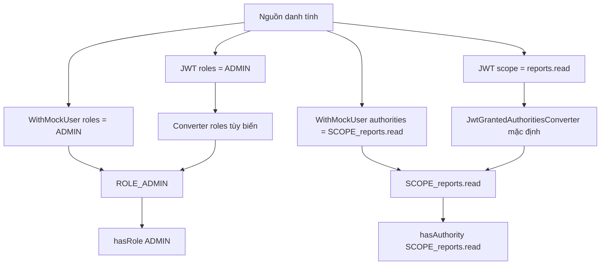

# Phân biệt `ROLE_*` với `SCOPE_*` trong điều kiện phân quyền

## 1. Vì sao cùng là quyền nhưng có hai tiền tố?

Trong Spring Security, một request có thể đã xác thực thành công mà vẫn nhận `403 Forbidden` nếu danh tính không mang đúng quyền. Ví dụ, một người được cấp vai trò quản trị `ADMIN` có thể được gọi API quản trị; một ứng dụng khách được cấp OAuth2 scope `reports.read` có thể được đọc báo cáo. Hai loại quyền đó thường xuất hiện trong `Authentication` dưới dạng các chuỗi:

```text
ROLE_ADMIN
SCOPE_reports.read
```

Điểm cốt lõi: **`ROLE_` và `SCOPE_` đều có thể xuất hiện trong `GrantedAuthority`, nhưng chúng đến từ các quy ước khác nhau**. Spring Security không tự coi `ROLE_ADMIN` tương đương `SCOPE_ADMIN` hay `SCOPE_reports.read`. Phương thức kiểm tra phân quyền sẽ đối chiếu authority thực tế với chuỗi yêu cầu.

Bài thuộc chương **Annotation người dùng** của module **SPRING_SECURITY_TESTING**, nơi người học sử dụng `spring-security-test`, `@WithMockUser`, `SecurityContext`, `MockMvc` và `WebTestClient` để kiểm chứng xác thực, phân quyền và bảo vệ HTTP trên Servlet lẫn Reactive. Chủ đề này cũng là nền tảng để kiểm thử JWT/OAuth2/OIDC giả lập và phân biệt ca được phép với ca bị từ chối.

Sau bài học, bạn có thể:

- Giải thích vì sao `@WithMockUser(roles = "ADMIN")` tạo `ROLE_ADMIN`, còn một JWT có scope `reports.read` thường được ánh xạ thành `SCOPE_reports.read`.
- Sử dụng `hasRole`, `hasAnyRole`, `hasAuthority`, `hasAnyAuthority` đúng với dữ liệu quyền.
- Viết bài test cố ý tạo `ROLE_` và `SCOPE_` khác nhau để phát hiện chính sách cấp quyền sai.
- Hiểu phạm vi của `@WithMockUser`, `jwt()` và `mockJwt()`, đặc biệt khi ứng dụng sử dụng bộ chuyển đổi claim tùy biến.
- Thiết kế test HTTP bao phủ các kết quả `200`, `204`, `401`, `403` và bảo vệ CSRF.

## 2. Nền tảng chung: `GrantedAuthority`

Spring Security biểu diễn quyền đã được cấp bằng giao diện `GrantedAuthority`. Trong trường hợp phổ biến, `SimpleGrantedAuthority` giữ một tên quyền dưới dạng `String`. Các authority nằm trong `Authentication.getAuthorities()`:

```java
Authentication authentication = SecurityContextHolder.getContext()
        .getAuthentication();

for (GrantedAuthority authority : authentication.getAuthorities()) {
    System.out.println(authority.getAuthority());
}
```

Ví dụ kết quả có thể là:

```text
ROLE_ADMIN
SCOPE_reports.read
SCOPE_reports.write
```

Danh sách này là tập quyền mà **quy tắc phân quyền** kiểm tra. Spring Security không yêu cầu mọi authority đều mang một tiền tố cố định; `report:approve` hoặc `invoice:read` cũng là tên hợp lệ nếu ứng dụng định nghĩa như vậy.

| Khái niệm | Ví dụ ở tầng nghiệp vụ hoặc token | Authority điển hình | Điều cần nhớ |
| --- | --- | --- | --- |
| Role | `ADMIN` | `ROLE_ADMIN` | Tiền tố `ROLE_` dùng theo quy ước role mặc định |
| Role | `READER` | `ROLE_READER` | `hasRole("READER")` mặc định yêu cầu `ROLE_READER` |
| OAuth2 scope | `reports.read` | `SCOPE_reports.read` | Bộ chuyển đổi scope mặc định thường thêm `SCOPE_` |
| OAuth2 scope | `reports.write` | `SCOPE_reports.write` | `hasAuthority("SCOPE_reports.write")` so khớp chuỗi đầy đủ |
| Quyền tùy biến | `report:approve` | `report:approve` | Dùng `hasAuthority` với tên chính xác |

Các tên `ADMIN`, `reports.read` ở bảng trên chỉ là ví dụ. Một ứng dụng có thể định nghĩa chính sách hoặc converter khác, vì thế **authority thực tế** luôn là dữ kiện quyết định.

## 3. `ROLE_`: quy ước từ role đến authority

Ở nhiều ứng dụng, role là nhóm quyền mang ý nghĩa nghiệp vụ như `ADMIN`, `MANAGER`, `READER`. Theo mặc định, Spring Security thường kiểm tra role thông qua một authority có tiền tố `ROLE_`:

```java
.requestMatchers("/admin/**").hasRole("ADMIN")
```

Quy tắc này mong đợi người dùng có `ROLE_ADMIN`. Annotation `@WithMockUser` của thư viện `spring-security-test` cũng theo quy ước đó:

```java
@WithMockUser(username = "lan", roles = "ADMIN")
// Authentication.getAuthorities() chứa ROLE_ADMIN.
```

`roles` có thể là mảng:

```java
@WithMockUser(roles = {"ADMIN", "AUDITOR"})
// ROLE_ADMIN, ROLE_AUDITOR
```

Không đặt sẵn tiền tố vào tham số `roles`:

```java
@WithMockUser(roles = "ROLE_ADMIN") // Sai: role đã có ROLE_.
```

Spring Security Test từ chối role mang sẵn `ROLE_` trong thuộc tính `roles`. Hãy dùng `roles = "ADMIN"` hoặc khai báo chính xác `authorities = "ROLE_ADMIN"`.

**Không có quy tắc mặc định** rằng admin sở hữu mọi role khác. Nếu `hasRole("READER")` được yêu cầu, danh tính chỉ có `ROLE_ADMIN` có thể bị từ chối, trừ khi chính sách cho phép admin, có role hierarchy được áp dụng, hoặc người dùng được cấp cả `ROLE_READER`.

## 4. `SCOPE_`: quy ước chuyển đổi OAuth2 scope, thường gặp với JWT

Trong OAuth2, *scope* mô tả phạm vi truy cập được cấp, ví dụ `reports.read` hay `reports.write`. Một JWT access token có thể chứa scope trong claim `scope`:

```json
{
  "sub": "client-42",
  "scope": "reports.read reports.write"
}
```

Hoặc trong claim `scp`, thường là mảng:

```json
{
  "sub": "client-42",
  "scp": ["reports.read", "reports.write"]
}
```

Với cơ chế JWT Resource Server và `JwtGrantedAuthoritiesConverter` mặc định của Spring Security, scope được ánh xạ thành authority có tiền tố **`SCOPE_`**:

```text
JWT claim: scope = "reports.read reports.write"
                          |
                          v
                 JwtGrantedAuthoritiesConverter
                          |
                          v
           SCOPE_reports.read   SCOPE_reports.write
```

Một cấu hình endpoint thường sử dụng:

```java
.requestMatchers(HttpMethod.GET, "/reports/**")
    .hasAuthority("SCOPE_reports.read")
.requestMatchers(HttpMethod.POST, "/reports/**")
    .hasAuthority("SCOPE_reports.write")
```

Lưu ý ba điểm:

1. `SCOPE_` **không phải tiền tố của mọi quyền**. Nó thường là kết quả của *bộ chuyển đổi scope thành authority* ở tầng xác thực OAuth2/JWT.
2. JWT có claim `scope` không có nghĩa mọi cấu hình ứng dụng đều sinh đúng `SCOPE_...`; ứng dụng có thể thay converter, đặt prefix khác hoặc đọc claim khác.
3. `@WithMockUser` không phân tích JWT và không chạy `JwtGrantedAuthoritiesConverter` để suy ra scope. Muốn mô phỏng scope bằng annotation, hãy khai báo **authority đầy đủ**.

Ví dụ:

```java
@WithMockUser(authorities = "SCOPE_reports.read")
// Đúng khi chính sách yêu cầu hasAuthority("SCOPE_reports.read").

@WithMockUser(authorities = "reports.read")
// Không tự trở thành SCOPE_reports.read.

@WithMockUser(roles = "reports.read")
// Tạo ROLE_reports.read, khác SCOPE_reports.read.
```

## 5. So sánh trực tiếp `hasRole` với `hasAuthority`

`hasRole` là dạng kiểm tra theo **quy ước role**; `hasAuthority` kiểm tra **chuỗi authority tường minh**:

| Điều kiện bảo mật | Authority cần có theo mặc định |
| --- | --- |
| `hasRole("ADMIN")` | `ROLE_ADMIN` |
| `hasAnyRole("ADMIN", "READER")` | Ít nhất một trong `ROLE_ADMIN`, `ROLE_READER` |
| `hasAuthority("ROLE_ADMIN")` | `ROLE_ADMIN` |
| `hasAuthority("SCOPE_reports.read")` | `SCOPE_reports.read` |
| `hasAnyAuthority("SCOPE_reports.read", "SCOPE_reports.write")` | Ít nhất một trong hai authority |
| `hasAuthority("reports.read")` | `reports.read` nguyên văn |

Xét các cách chuẩn bị danh tính test:

| `@WithMockUser` | Authority hiệu lực | `hasRole("ADMIN")` | `hasAuthority("SCOPE_reports.read")` |
| --- | --- | --- | --- |
| `roles = "ADMIN"` | `ROLE_ADMIN` | Đạt | Không đạt |
| `authorities = "ROLE_ADMIN"` | `ROLE_ADMIN` | Đạt | Không đạt |
| `authorities = "SCOPE_reports.read"` | `SCOPE_reports.read` | Không đạt | Đạt |
| `authorities = "reports.read"` | `reports.read` | Không đạt | Không đạt |
| `authorities = "SCOPE_ADMIN"` | `SCOPE_ADMIN` | Không đạt | Không đạt |
| `authorities = {"ROLE_ADMIN", "SCOPE_reports.read"}` | Cả hai | Đạt | Đạt |

Hai kiểm tra này không tự liên hệ với nhau. `ROLE_ADMIN` không tự cấp `SCOPE_reports.read`; `SCOPE_reports.read` cũng không tự cấp `ROLE_READER`.

Đôi khi code vô tình viết:

```java
.hasRole("SCOPE_reports.read")
```

Điều đó không có nghĩa kiểm tra OAuth2 scope. Theo quy ước mặc định, nó tìm authority `ROLE_SCOPE_reports.read`, nên khác hoàn toàn `hasAuthority("SCOPE_reports.read")`.

### `roles` và `authorities` cùng xuất hiện

Với `@WithMockUser`, khi `authorities` được khai báo **không rỗng**, nó được sử dụng thay cho các authority tạo từ `roles`:

```java
@WithMockUser(
    roles = "ADMIN",
    authorities = "SCOPE_reports.read"
)
// Chỉ có SCOPE_reports.read; không tự cộng thêm ROLE_ADMIN.
```

Muốn cấp cả hai loại quyền, hãy viết:

```java
@WithMockUser(authorities = {"ROLE_ADMIN", "SCOPE_reports.read"})
```

## 6. Quan sát trực tiếp `SecurityContext` trong test

Để khẳng định danh tính được dựng đúng, kiểm tra `Authentication.getAuthorities()` thay vì suy đoán từ tên annotation:

```java
import org.junit.jupiter.api.Test;
import org.springframework.security.core.Authentication;
import org.springframework.security.core.GrantedAuthority;
import org.springframework.security.core.context.SecurityContextHolder;
import org.springframework.security.test.context.support.WithMockUser;

import static org.assertj.core.api.Assertions.assertThat;

// Phương thức dưới đây đặt trong một lớp test có Spring Test tích hợp.
@Test
@WithMockUser(
    username = "linh",
    authorities = {"ROLE_ADMIN", "SCOPE_reports.read"}
)
void userHasRoleAndScopeAuthorities() {
    Authentication auth = SecurityContextHolder.getContext()
            .getAuthentication();

    assertThat(auth.isAuthenticated()).isTrue();
    assertThat(auth.getName()).isEqualTo("linh");
    assertThat(auth.getAuthorities())
            .extracting(GrantedAuthority::getAuthority)
            .containsExactlyInAnyOrder(
                    "ROLE_ADMIN",
                    "SCOPE_reports.read"
            );
}
```

`@WithMockUser` cần được xử lý bởi hạ tầng Spring Test, ví dụ `SpringExtension` hoặc test slice của Spring Boot. Trong môi trường Servlet, `SecurityContextHolder` thường truy cập context gắn với luồng hiện tại. Với WebFlux, Spring Security mang context qua **Reactor Context**, nên kiểm tra kết quả HTTP bằng `WebTestClient` thường phản ánh chính xác hơn luồng reactive.

## 7. Ví dụ Servlet hoàn chỉnh với `MockMvc`

Ta xây dựng một API nhỏ có ba quy tắc phân quyền:

- `GET /api/admin` yêu cầu `ROLE_ADMIN`.
- `GET /api/reports` yêu cầu `SCOPE_reports.read`.
- `POST /api/reports/publish` yêu cầu `SCOPE_reports.write` và CSRF hợp lệ.

Mục tiêu của ví dụ là cho thấy **vai trò quản trị không tự cấp scope đọc báo cáo** và ngược lại, đồng thời tách biệt lỗi phân quyền khỏi lỗi CSRF.

### 7.1. Phụ thuộc

Với dự án Spring Boot dùng Spring MVC, Spring Security và JUnit 5, khai báo ví dụ Gradle:

```kotlin
dependencies {
    implementation("org.springframework.boot:spring-boot-starter-web")
    implementation("org.springframework.boot:spring-boot-starter-security")
    testImplementation("org.springframework.boot:spring-boot-starter-test")
    testImplementation("org.springframework.security:spring-security-test")
}
```

Đoạn mẫu sau viết theo API thông dụng của Spring Boot 3 / Spring Security 6 và Java 17 trở lên. Các lớp `PermissionController`, `PermissionSecurityConfig` và `PermissionControllerSecurityTest` được giả định nằm trong cùng package.

### 7.2. Controller đơn giản

```java
// PermissionController.java
import org.springframework.http.ResponseEntity;
import org.springframework.web.bind.annotation.GetMapping;
import org.springframework.web.bind.annotation.PostMapping;
import org.springframework.web.bind.annotation.RestController;

@RestController
class PermissionController {

    @GetMapping("/api/admin")
    String adminArea() {
        return "admin-ok";
    }

    @GetMapping("/api/reports")
    String reports() {
        return "reports-ok";
    }

    @PostMapping("/api/reports/publish")
    ResponseEntity<Void> publishReport() {
        return ResponseEntity.noContent().build();
    }
}
```

### 7.3. Quy tắc bảo mật HTTP

```java
// PermissionSecurityConfig.java
import org.springframework.context.annotation.Bean;
import org.springframework.context.annotation.Configuration;
import org.springframework.http.HttpMethod;
import org.springframework.security.config.Customizer;
import org.springframework.security.config.annotation.web.builders.HttpSecurity;
import org.springframework.security.web.SecurityFilterChain;

@Configuration
class PermissionSecurityConfig {

    @Bean
    SecurityFilterChain permissionSecurityFilterChain(HttpSecurity http)
            throws Exception {
        http.authorizeHttpRequests(auth -> auth
                .requestMatchers(HttpMethod.GET, "/api/admin")
                    .hasRole("ADMIN")
                .requestMatchers(HttpMethod.GET, "/api/reports")
                    .hasAuthority("SCOPE_reports.read")
                .requestMatchers(HttpMethod.POST, "/api/reports/publish")
                    .hasAuthority("SCOPE_reports.write")
                .anyRequest().denyAll()
        );
        http.httpBasic(Customizer.withDefaults());
        // Giữ CSRF mặc định để kiểm tra request POST đúng cách.
        return http.build();
    }
}
```

`hasRole("ADMIN")` tìm `ROLE_ADMIN` theo tiền tố mặc định. Hai quy tắc còn lại tìm **chính xác** `SCOPE_reports.read` và `SCOPE_reports.write`. `httpBasic()` thiết lập cơ chế phản hồi `401 Unauthorized` cho khách chưa đăng nhập khi đòi tài nguyên được bảo vệ; nếu dùng form login, kết quả có thể là chuyển hướng.

### 7.4. Kiểm thử quyền và HTTP status

```java
// PermissionControllerSecurityTest.java
import org.junit.jupiter.api.Test;
import org.springframework.beans.factory.annotation.Autowired;
import org.springframework.boot.test.autoconfigure.web.servlet.WebMvcTest;
import org.springframework.context.annotation.Import;
import org.springframework.security.core.Authentication;
import org.springframework.security.core.GrantedAuthority;
import org.springframework.security.core.context.SecurityContextHolder;
import org.springframework.security.test.context.support.WithAnonymousUser;
import org.springframework.security.test.context.support.WithMockUser;
import org.springframework.test.web.servlet.MockMvc;

import static org.assertj.core.api.Assertions.assertThat;
import static org.springframework.security.test.web.servlet.request.SecurityMockMvcRequestPostProcessors.csrf;
import static org.springframework.test.web.servlet.request.MockMvcRequestBuilders.get;
import static org.springframework.test.web.servlet.request.MockMvcRequestBuilders.post;
import static org.springframework.test.web.servlet.result.MockMvcResultMatchers.content;
import static org.springframework.test.web.servlet.result.MockMvcResultMatchers.status;

@WebMvcTest(PermissionController.class)
@Import(PermissionSecurityConfig.class)
class PermissionControllerSecurityTest {

    @Autowired
    MockMvc mockMvc;

    @Test
    @WithMockUser(username = "admin01", roles = "ADMIN")
    void adminRoleAllowsAdminEndpointButNotScopeEndpoint() throws Exception {
        Authentication auth = SecurityContextHolder.getContext()
                .getAuthentication();
        assertThat(auth.getAuthorities())
                .extracting(GrantedAuthority::getAuthority)
                .containsExactly("ROLE_ADMIN");

        mockMvc.perform(get("/api/admin"))
                .andExpect(status().isOk())
                .andExpect(content().string("admin-ok"));

        mockMvc.perform(get("/api/reports"))
                .andExpect(status().isForbidden());
    }

    @Test
    @WithMockUser(username = "reader01", authorities = "SCOPE_reports.read")
    void readScopeAllowsReportButNotAdminEndpoint() throws Exception {
        mockMvc.perform(get("/api/reports"))
                .andExpect(status().isOk())
                .andExpect(content().string("reports-ok"));

        mockMvc.perform(get("/api/admin"))
                .andExpect(status().isForbidden());
    }

    @Test
    @WithMockUser(authorities = "reports.read")
    void bareScopeNameDoesNotMatchScopePrefixedPolicy() throws Exception {
        mockMvc.perform(get("/api/reports"))
                .andExpect(status().isForbidden());
    }

    @Test
    @WithMockUser(authorities = "SCOPE_reports.read")
    void readerCannotPublishEvenWithCsrf() throws Exception {
        mockMvc.perform(post("/api/reports/publish").with(csrf()))
                .andExpect(status().isForbidden());
    }

    @Test
    @WithMockUser(authorities = "SCOPE_reports.write")
    void writerCanPublishWithCsrf() throws Exception {
        mockMvc.perform(post("/api/reports/publish").with(csrf()))
                .andExpect(status().isNoContent());
    }

    @Test
    @WithMockUser(
        authorities = {
            "ROLE_ADMIN", "SCOPE_reports.read", "SCOPE_reports.write"
        }
    )
    void combinedAuthoritiesAllowAllThreeActions() throws Exception {
        mockMvc.perform(get("/api/admin"))
                .andExpect(status().isOk());
        mockMvc.perform(get("/api/reports"))
                .andExpect(status().isOk());
        mockMvc.perform(post("/api/reports/publish").with(csrf()))
                .andExpect(status().isNoContent());
    }

    @Test
    @WithMockUser(roles = "ADMIN", authorities = "SCOPE_reports.read")
    void explicitAuthoritiesReplaceRolesInWithMockUser() throws Exception {
        mockMvc.perform(get("/api/reports"))
                .andExpect(status().isOk());
        mockMvc.perform(get("/api/admin"))
                .andExpect(status().isForbidden());
    }

    @Test
    @WithAnonymousUser
    void anonymousCannotReadReports() throws Exception {
        mockMvc.perform(get("/api/reports"))
                .andExpect(status().isUnauthorized());
    }
}
```

### 7.5. Ma trận kết quả cần quan sát

| Danh tính mô phỏng | Request | Kỳ vọng | Giải thích |
| --- | --- | --- | --- |
| `roles = "ADMIN"` | `GET /api/admin` | `200` | Có `ROLE_ADMIN` |
| `roles = "ADMIN"` | `GET /api/reports` | `403` | Không có `SCOPE_reports.read` |
| `authorities = "SCOPE_reports.read"` | `GET /api/reports` | `200` | Khớp scope authority |
| `authorities = "SCOPE_reports.read"` | `GET /api/admin` | `403` | Không có `ROLE_ADMIN` |
| `authorities = "reports.read"` | `GET /api/reports` | `403` | Thiếu tiền tố theo chính sách |
| `authorities = "SCOPE_reports.read"` | `POST /api/reports/publish` + CSRF | `403` | Không có scope ghi |
| `authorities = "SCOPE_reports.write"` | `POST /api/reports/publish` + CSRF | `204` | Có scope ghi và CSRF hợp lệ |
| `ROLE_ADMIN`, `SCOPE_reports.read`, `SCOPE_reports.write` | Cả ba endpoint | `200`, `200`, `204` | Có đầy đủ quyền |
| Ẩn danh | `GET /api/reports` | `401` | Chưa xác thực, HTTP Basic |

Các ca POST gửi `.with(csrf())` để đáp ứng cơ chế bảo vệ CSRF. Nếu bỏ CSRF, request POST có thể nhận `403` dù người dùng có `SCOPE_reports.write`; khi ấy kết quả **không chứng minh người dùng thiếu scope**. Do đó, hãy cung cấp token CSRF hợp lệ khi cần đo riêng kết quả phân quyền của POST.

Đây là test HTTP ở tầng Spring MVC: bảo đảm `@WebMvcTest` có security filter, `@Import` nạp đúng `SecurityFilterChain`, và các matcher phản ánh chính sách đang cần kiểm chứng. Nếu cố tình bỏ filter, test chỉ gọi được controller và không còn xác minh authorization thực tế.

## 8. Kiểm thử JWT giả lập bằng `MockMvc`

`@WithMockUser(authorities = "SCOPE_reports.read")` phù hợp để **cô lập** quy tắc authorization, nhưng principal nó tạo là `org.springframework.security.core.userdetails.User`. Trong hệ thống JWT Resource Server, principal thường là `Jwt` bên trong `JwtAuthenticationToken`.

Khi muốn mock danh tính theo kiểu JWT trên từng request `MockMvc`, Spring Security Test cung cấp `jwt()`:

```java
import org.springframework.security.core.authority.SimpleGrantedAuthority;
import static org.springframework.security.test.web.servlet.request
        .SecurityMockMvcRequestPostProcessors.jwt;

@Test
void jwtWithExplicitAuthorityCanReadReports() throws Exception {
    mockMvc.perform(get("/api/reports")
            .with(jwt().authorities(
                    new SimpleGrantedAuthority("SCOPE_reports.read")
            )))
            .andExpect(status().isOk());
}
```

Phương thức này tạo một `JwtAuthenticationToken` giả với authority đã chỉ định. Nếu muốn mô phỏng claim `scope` và ánh xạ chuẩn của test helper, có thể dùng:

```java
@Test
void jwtWithScopeClaimCanReadReports() throws Exception {
    mockMvc.perform(get("/api/reports")
            .with(jwt().jwt(jwt -> jwt
                    .claim("scope", "reports.read")
            )))
            .andExpect(status().isOk());
}
```

Trong trường hợp mặc định, `jwt()` dùng chuyển đổi scope của Spring Security Test để tạo `SCOPE_reports.read`. Khi đặt `.authorities(...)` tường minh, bạn kiểm soát chính xác quyền được mô phỏng. Nếu ứng dụng có bộ chuyển đổi claim **tùy biến**, các request post-processor này không mặc nhiên kiểm chứng được logic converter của production.

Các đoạn trên có thể đặt trong lớp `PermissionControllerSecurityTest` sau khi bổ sung các import được nêu; vì endpoint mẫu chỉ kiểm tra authority, chúng minh họa được việc phân quyền trên request JWT giả. Để kiểm chứng **Bearer token filter, `JwtDecoder`, chữ ký, hết hạn, issuer hoặc audience**, cần test tích hợp cấu hình Resource Server thật phù hợp. `jwt()` là mô phỏng danh tính đã xác thực, không thay thế bước giải mã và xác minh token nhận từ HTTP header.

## 9. Method security và biểu thức quyền

Ngoài chính sách theo URL, Spring Security có thể dùng `@PreAuthorize` khi bật method security:

```java
import org.springframework.security.access.prepost.PreAuthorize;

@PreAuthorize("hasRole('ADMIN')")
public void openAdministration() {
    // Yêu cầu ROLE_ADMIN theo quy ước mặc định.
}

@PreAuthorize("hasAuthority('SCOPE_reports.read')")
public void readReport() {
    // Yêu cầu chính xác SCOPE_reports.read.
}

@PreAuthorize("hasRole('ADMIN') and hasAuthority('SCOPE_reports.write')")
public void publishSensitiveReport() {
    // Yêu cầu đồng thời role quản trị và scope ghi.
}
```

Để các annotation trên có hiệu lực, ứng dụng cần bật `@EnableMethodSecurity` và lời gọi phải đi qua proxy/interceptor mà Spring quản lý. Một bài test chỉ gọi phương thức trực tiếp trên đối tượng tự tạo bằng `new` không đủ để chứng minh điều kiện đã được kiểm tra.

`hasAnyRole` và `hasAnyAuthority` là phép **OR**: chỉ cần một quyền trong danh sách. Nếu phải có đồng thời `ROLE_ADMIN` và `SCOPE_reports.write`, sử dụng biểu thức `and` hoặc một quy tắc tương đương.

## 10. WebFlux với `WebTestClient`

Với ứng dụng Reactive, authority `ROLE_ADMIN` và `SCOPE_reports.read` vẫn là các chuỗi quyền được kiểm tra theo cùng ý nghĩa. Khác biệt đáng chú ý là Spring Security truyền ngữ cảnh trong **Reactor Context**, và HTTP được kiểm chứng bằng `WebTestClient`.

Ví dụ khung:

```java
import org.junit.jupiter.api.Test;
import org.springframework.beans.factory.annotation.Autowired;
import org.springframework.boot.test.autoconfigure.web.reactive.WebFluxTest;
import org.springframework.context.annotation.Import;
import org.springframework.security.test.context.support.WithMockUser;
import org.springframework.test.web.reactive.server.WebTestClient;

@WebFluxTest(ReactivePermissionController.class)
@Import(ReactivePermissionSecurityConfig.class)
class ReactivePermissionSecurityTest {

    @Autowired
    WebTestClient webTestClient;

    @Test
    @WithMockUser(roles = "ADMIN")
    void roleAllowsAdminRoute() {
        webTestClient.get().uri("/api/admin")
                .exchange()
                .expectStatus().isOk();
    }

    @Test
    @WithMockUser(authorities = "SCOPE_reports.read")
    void scopeAllowsReportRoute() {
        webTestClient.get().uri("/api/reports")
                .exchange()
                .expectStatus().isOk();
    }
}
```

Đây là ví dụ cấu trúc: dự án cần định nghĩa `ReactivePermissionController`, `ReactivePermissionSecurityConfig` và `SecurityWebFilterChain` phù hợp. Hạ tầng Spring Security Test phải được tích hợp vào client để ngữ cảnh từ annotation có hiệu lực.

Khi cần JWT giả lập theo từng request, dùng `SecurityMockServerConfigurers.mockJwt`:

```java
import org.springframework.security.core.authority.SimpleGrantedAuthority;
import static org.springframework.security.test.web.reactive.server
        .SecurityMockServerConfigurers.mockJwt;

webTestClient
    .mutateWith(mockJwt().authorities(
            new SimpleGrantedAuthority("SCOPE_reports.read")
    ))
    .get()
    .uri("/api/reports")
    .exchange()
    .expectStatus().isOk();
```

Với POST được CSRF bảo vệ, bổ sung `.mutateWith(csrf())` từ cùng `SecurityMockServerConfigurers` để cô lập nguyên nhân bị từ chối:

```java
webTestClient
    .mutateWith(mockJwt().authorities(
            new SimpleGrantedAuthority("SCOPE_reports.write")
    ))
    .mutateWith(csrf())
    .post()
    .uri("/api/reports/publish")
    .exchange()
    .expectStatus().isNoContent();
```

Client phải có cấu hình kiểm thử Spring Security tương thích, ví dụ `springSecurity()` khi tự `bindToApplicationContext`. Bộ mock cho `WebTestClient` khác request post-processor `jwt()` của `MockMvc`; không dùng lẫn các API của hai môi trường.

## 11. Role từ claim JWT và bộ chuyển đổi tùy biến

Không phải mọi JWT đều có claim `scope`. Nhiều nhà cung cấp danh tính đặt role vào claim riêng:

```json
{
  "sub": "user-17",
  "roles": ["ADMIN", "AUDITOR"]
}
```

`JwtGrantedAuthoritiesConverter` mặc định chú trọng các claim scope phổ biến, nên **không nên tự suy luận** rằng mảng `roles` ở trên đã được chuyển thành `ROLE_ADMIN`. Nếu ứng dụng quyết định dùng claim `roles` làm nguồn role, cần cấu hình converter tương ứng.

Ví dụ minh họa:

```java
import org.springframework.security.oauth2.server.resource.authentication
        .JwtAuthenticationConverter;
import org.springframework.security.oauth2.server.resource.authentication
        .JwtGrantedAuthoritiesConverter;

JwtGrantedAuthoritiesConverter roleConverter =
        new JwtGrantedAuthoritiesConverter();
roleConverter.setAuthoritiesClaimName("roles");
roleConverter.setAuthorityPrefix("ROLE_");

JwtAuthenticationConverter authenticationConverter =
        new JwtAuthenticationConverter();
authenticationConverter.setJwtGrantedAuthoritiesConverter(roleConverter);
```

Nếu claim `roles` chứa `ADMIN`, converter trên có thể sinh `ROLE_ADMIN`. **Lưu ý:** cấu hình trên thay thế cách lấy authority từ các scope mặc định; nó không tự gộp thêm `SCOPE_...`. Muốn hỗ trợ đồng thời role và scope trong cùng token, cần tạo một converter kết hợp cả hai nguồn quyền, rồi kiểm thử riêng logic kết hợp đó.

Hình dung các đường đi:



Trong các hệ thống OAuth2 Login hoặc OIDC, kiểu `Authentication`, principal và cách nhà cung cấp cấp authority còn phụ thuộc quy trình đăng nhập và mapping của ứng dụng. Không nên xem `@WithMockUser(roles = "ADMIN")` là chứng minh role đã được lấy đúng từ token ID hoặc access token. Hãy sử dụng công cụ mô phỏng phù hợp như `oauth2Login()`/`oidcLogin()`, hoặc test tích hợp với nguồn danh tính.

## 12. Chiến lược kiểm thử để không bỏ sót lỗi ánh xạ quyền

Một hệ thống dùng JWT nên phân biệt ít nhất ba câu hỏi kiểm thử:

| Câu hỏi | Công cụ điển hình | Điều được chứng minh |
| --- | --- | --- |
| Nếu có `ROLE_ADMIN`, endpoint admin có cho phép không? | `@WithMockUser(roles = "ADMIN")` | Quy tắc phân quyền khi authority đã tồn tại |
| Nếu có `SCOPE_reports.read`, endpoint báo cáo có cho phép không? | `@WithMockUser(authorities = "SCOPE_reports.read")` | Quy tắc phân quyền theo chuỗi scope authority |
| Claim `scope` hoặc `roles` của token thực có sinh đúng authority không? | Test converter với `Jwt` và cấu hình thật | Logic ánh xạ claim thành authority |
| Token gửi qua HTTP bị sai chữ ký hoặc hết hạn có bị từ chối không? | Test tích hợp Resource Server và `JwtDecoder` | Quá trình xác minh token |
| Controller nhận được đúng principal JWT/OIDC không? | `jwt()`, `mockJwt()`, `oauth2Login()`, `oidcLogin()` tùy môi trường | Hành vi ứng dụng với đúng kiểu principal giả lập |

Từng bài test trả lời một câu hỏi. Một ca `@WithMockUser(authorities = "SCOPE_reports.read")` trả `200` không đủ để kết luận token JWT thật đã có scope đúng, bởi annotation này không gọi bộ giải mã token.

Với các hệ thống cho phép cả role quản trị và scope đọc báo cáo, hãy xác định chính sách rõ ràng. Ví dụ:

```java
// Cho phép ADMIN hoặc người có scope đọc:
.access((authentication, context) -> {
    var authorities = authentication.get().getAuthorities();
    boolean allowed = authorities.stream().anyMatch(a ->
            a.getAuthority().equals("ROLE_ADMIN")
            || a.getAuthority().equals("SCOPE_reports.read"));
    return new AuthorizationDecision(allowed);
})
```

Đây là minh họa một quy tắc OR cho `authorizeHttpRequests` trong Spring Security 6 (cần import `AuthorizationDecision`). Trong dự án thật, nên ưu tiên biểu diễn chính sách tập trung, dễ đọc và viết test cho **cả hai nhánh** cùng với ca không có quyền nào; chỉ dùng cách mở rộng này khi yêu cầu nghiệp vụ thật sự cho phép admin đọc mà không có scope.

## 13. Những nhầm lẫn thường gặp

| Hiện tượng | Nguyên nhân | Cách xử lý |
| --- | --- | --- |
| `roles = "ADMIN"` không qua `hasAuthority("SCOPE_reports.read")` | Role sinh `ROLE_ADMIN`, không sinh scope | Cấp đúng authority hoặc điều chỉnh chính sách theo yêu cầu |
| `authorities = "reports.read"` trả `403` | Chính sách tìm `SCOPE_reports.read` | Khai báo chuỗi đầy đủ |
| `roles = "reports.read"` trả `403` | Sinh `ROLE_reports.read`, không phải scope | Dùng `authorities = "SCOPE_reports.read"` |
| `hasRole("SCOPE_reports.read")` không hoạt động | `hasRole` thêm `ROLE_` theo mặc định | Dùng `hasAuthority("SCOPE_reports.read")` |
| `roles = "ROLE_ADMIN"` làm lỗi thiết lập test | Trùng tiền tố trong `roles` | Dùng `roles = "ADMIN"` |
| Khai báo `roles` và `authorities` nhưng mất role | `authorities` không rỗng được ưu tiên | Khai báo cả `ROLE_ADMIN` và `SCOPE_...` trong mảng authorities |
| Test `@WithMockUser` thành công nhưng `@AuthenticationPrincipal Jwt` bị lỗi | Principal mặc định là `User`, không phải `Jwt` | Dùng `jwt()`, `mockJwt()` hoặc cấu hình test phù hợp |
| JWT có `roles: ["ADMIN"]` nhưng thiếu `ROLE_ADMIN` | Chưa có converter cho claim `roles` | Test/cấu hình bộ chuyển đổi role |
| JWT có `scope` nhưng không có `SCOPE_...` | Converter đã đổi prefix hoặc nguồn claim | Kiểm tra bộ chuyển đổi thực tế |
| POST có scope ghi nhưng vẫn `403` | Có thể thiếu CSRF token | Cấp CSRF hợp lệ trước khi kiểm tra authorization |
| Khách ẩn danh nhận `302` thay vì `401` | Cơ chế form login dùng chuyển hướng | Kiểm tra entry point và kỳ vọng theo cấu hình |
| MockMvc test luôn trả `200` dù thiếu authority | Security filter hoặc chain chưa được áp dụng | Kiểm tra cấu hình test và filter |

Khi một test nhận `403`, hãy kiểm tra **authority thực sự của danh tính**, **authority chính sách yêu cầu** và **các lớp bảo vệ request như CSRF**. Đổi ngẫu nhiên `ROLE_` sang `SCOPE_` có thể che giấu lỗi ánh xạ quyền ở production.

## 14. Bài tập vận dụng

Ứng dụng quản lý hóa đơn có các chính sách:

| Endpoint | Chính sách |
| --- | --- |
| `GET /invoices` | `hasAuthority("SCOPE_invoices.read")` |
| `POST /invoices/close` | `hasAuthority("SCOPE_invoices.write")` + CSRF |
| `GET /admin/invoices` | `hasRole("ADMIN")` |

Hãy thực hiện:

1. Viết test `@WithMockUser(roles = "ADMIN")` cho hai endpoint GET. Dự đoán kết quả từng endpoint và kiểm tra `SecurityContext` để chứng minh authority đang là `ROLE_ADMIN`.
2. Viết test `@WithMockUser(authorities = "SCOPE_invoices.read")` cho hai endpoint GET. Giải thích vì sao người có scope đọc vẫn không tự là admin.
3. Viết test với `authorities = "invoices.read"` và so sánh với `SCOPE_invoices.read`.
4. Viết test `POST /invoices/close` với `SCOPE_invoices.read`, sau đó với `SCOPE_invoices.write`. Cả hai request phải có CSRF hợp lệ để phân biệt rõ lỗi phân quyền.
5. Viết test với `authorities = {"ROLE_ADMIN", "SCOPE_invoices.read", "SCOPE_invoices.write"}` và kiểm chứng cả ba endpoint đều được phép.
6. Giả sử JWT có `{"scope": "invoices.read"}`. Mô phỏng bằng `jwt()` hoặc `mockJwt()` và kiểm tra authority `SCOPE_invoices.read` ở tầng HTTP.
7. Giả sử JWT có `{"roles": ["ADMIN"]}`, nhưng không có `scope`. Xác định vì sao converter scope mặc định chưa đủ, rồi thiết kế test riêng cho converter role nếu ứng dụng thực sự sử dụng claim này.
8. Thêm ca `@WithAnonymousUser` và xác minh trạng thái chưa xác thực theo entry point của ứng dụng.

**Tự kiểm tra:** Với `@WithMockUser(authorities = "SCOPE_invoices.read")`, endpoint `hasRole("INVOICE_READER")` có được phép không? **Không, theo mặc định.** Người dùng có `SCOPE_invoices.read` chứ không có `ROLE_INVOICE_READER`. Hai authority chỉ có thể được coi tương đương nếu ứng dụng chủ động thiết kế một quy tắc hoặc bước ánh xạ thể hiện sự tương đương đó.

## 15. Ghi nhớ

`ROLE_ADMIN` và `SCOPE_reports.read` đều là chuỗi `GrantedAuthority`, nhưng đại diện cho **quy ước role** và **quy ước scope** khác nhau. `@WithMockUser(roles = "ADMIN")` tạo `ROLE_ADMIN`; `@WithMockUser(authorities = "SCOPE_reports.read")` giữ nguyên authority tường minh. `hasRole("ADMIN")` mặc định yêu cầu `ROLE_ADMIN`, trong khi `hasAuthority("SCOPE_reports.read")` yêu cầu chính xác tên scope authority.

Trong Spring Security JWT Resource Server, bộ chuyển đổi mặc định thường biến scope `reports.read` thành `SCOPE_reports.read`; converter tùy biến có thể khác. Khi kiểm thử với `MockMvc` hoặc `WebTestClient`, hãy bao phủ ca thành công và thất bại, cung cấp CSRF cho request cần bảo vệ, đồng thời kiểm tra riêng quá trình ánh xạ claim, xác minh token và kiểu principal khi ứng dụng dùng JWT/OAuth2/OIDC thực tế.
