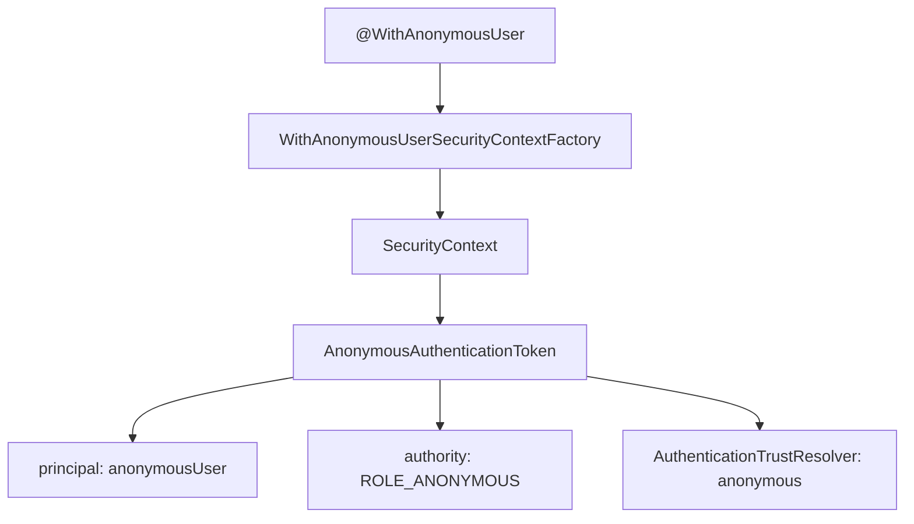

# `@WithAnonymousUser` để thay thế mặc định của lớp

## 1. Tình huống cần kiểm thử

Một lớp kiểm thử Spring Security thường có nhiều phương thức cùng sử dụng một người dùng mặc định. Ví dụ, phần lớn các ca kiểm thử một trang hồ sơ được thực hiện với tài khoản nhân viên:

```java
@WithMockUser(username = "nhan-vien", roles = "USER")
class ProfileControllerSecurityTest {
    // Các phương thức test mặc định chạy với ROLE_USER.
}
```

Nhưng trong cùng lớp đó, ta còn cần kiểm tra khách chưa đăng nhập. Nếu chỉ bỏ `@WithMockUser` khỏi một phương thức, phương thức ấy vẫn có thể nhận cấu hình ở cấp lớp. Cách diễn đạt rõ ràng cho trường hợp này là **`@WithAnonymousUser`**: annotation thiết lập danh tính ẩn danh cho riêng phương thức và thay thế mặc định của lớp.

Bài học thuộc chương **Annotation người dùng** trong module **SPRING_SECURITY_TESTING**. Module hướng dẫn kiểm chứng xác thực, phân quyền và bảo vệ HTTP thực tế bằng `spring-security-test` trên ứng dụng Servlet và Reactive; các công cụ thường dùng gồm `MockMvc`, `WebTestClient`, `SecurityContext` và JWT/OAuth2/OIDC giả lập.

Sau bài này, bạn có thể:

- Giải thích `@WithAnonymousUser` tạo loại `Authentication` nào.
- Dùng annotation trên phương thức để ghi đè `@WithMockUser` đặt ở lớp.
- Phân biệt danh tính ẩn danh với người dùng đã xác thực nhưng thiếu quyền.
- Kiểm thử các endpoint `permitAll`, `authenticated`, `hasRole` và method security.
- Đọc đúng kết quả `200`, `401`, `403` theo entry point và chính sách của ứng dụng.
- Áp dụng ý tưởng tương tự trong test WebFlux với `WebTestClient`.

## 2. `@WithAnonymousUser` tạo danh tính ẩn danh như thế nào?

`@WithAnonymousUser` thuộc package:

```java
import org.springframework.security.test.context.support.WithAnonymousUser;
```

Khi Spring Test xử lý annotation, `WithAnonymousUserSecurityContextFactory` tạo một `SecurityContext` có `AnonymousAuthenticationToken`. Trong cấu hình mặc định của annotation, thông tin thường thấy là:

| Thành phần | Giá trị |
| --- | --- |
| Kiểu `Authentication` | `AnonymousAuthenticationToken` |
| Principal | `"anonymousUser"` |
| Tên từ `Authentication.getName()` | `"anonymousUser"` |
| Authority | `ROLE_ANONYMOUS` |
| Trạng thái kỹ thuật `Authentication.isAuthenticated()` | `true` |
| Ý nghĩa bảo mật | Danh tính ẩn danh, chưa phải người dùng đã đăng nhập |

Sơ đồ ngữ cảnh:



Điểm dễ nhầm: `AnonymousAuthenticationToken.isAuthenticated()` có thể trả về `true`, vì token đã được đánh dấu hợp lệ trong nội bộ Spring Security. Điều đó **không đồng nghĩa người dùng đã đăng nhập**. Các API và biểu thức bảo mật của Spring Security sử dụng `AuthenticationTrustResolver` để nhận diện anonymous authentication.

Vì vậy, không nên viết logic nghiệp vụ như sau:

```java
if (authentication.isAuthenticated()) {
    // Kết luận người dùng đã đăng nhập.
}
```

Đoạn trên có thể phân loại nhầm người dùng ẩn danh. Hãy dùng cơ chế kiểm tra danh tính phù hợp của Spring Security, chẳng hạn `isAnonymous()`, `isAuthenticated()` trong biểu thức bảo mật, hoặc `AuthenticationTrustResolver` khi cần kiểm tra trực tiếp.

## 3. Ghi đè `@WithMockUser` mặc định ở cấp lớp

Đây là cách dùng trọng tâm của bài:

```java
@WithMockUser(username = "nhan-vien", roles = "USER")
class ProfileControllerSecurityTest {

    @Test
    void employeeUsesClassDefault() {
        // Authentication của nhan-vien, authority ROLE_USER.
    }

    @Test
    @WithAnonymousUser
    void guestOverridesClassDefault() {
        // AnonymousAuthenticationToken, không dùng ROLE_USER.
    }
}
```

Quy tắc áp dụng:

1. Nếu lớp có `@WithMockUser` và phương thức không có annotation bảo mật riêng, phương thức sử dụng danh tính của lớp.
2. Nếu phương thức có `@WithAnonymousUser`, danh tính ẩn danh ở phương thức **ghi đè** danh tính mặc định của lớp.
3. Nếu phương thức có `@WithMockUser` khác, danh tính đó cũng ghi đè mặc định của lớp.
4. Các cấu hình không cộng dồn. Phương thức ẩn danh không mang thêm `ROLE_USER` của lớp.

| Annotation trên lớp | Annotation trên phương thức | Danh tính có hiệu lực |
| --- | --- | --- |
| `@WithMockUser(roles = "USER")` | Không có | Người dùng `USER` |
| `@WithMockUser(roles = "USER")` | `@WithAnonymousUser` | Người dùng ẩn danh |
| `@WithMockUser(roles = "USER")` | `@WithMockUser(roles = "ADMIN")` | Người dùng `ADMIN` |
| Không có | `@WithAnonymousUser` | Người dùng ẩn danh |
| `@WithAnonymousUser` | `@WithMockUser(roles = "USER")` | Người dùng `USER` |

Đừng xóa annotation ở phương thức rồi kỳ vọng nó hủy annotation của lớp. **Không có annotation riêng nghĩa là dùng mặc định của lớp**, chứ không phải tự động trở thành khách.

## 4. Khác nhau giữa ẩn danh và context trống

`@WithAnonymousUser` không có nghĩa là xóa `SecurityContext` hoặc đặt `Authentication` thành `null`. Nó tạo một `AnonymousAuthenticationToken` có chủ đích. Đây là cách mô phỏng danh tính ẩn danh rõ ràng và ổn định khi lớp đang có một mặc định đã xác thực.

| Trường hợp | Trạng thái trong test | Ý nghĩa |
| --- | --- | --- |
| `@WithMockUser` | Authentication đã xác thực với principal `User` | Người dùng giả lập đã đăng nhập |
| `@WithAnonymousUser` | Authentication kiểu `AnonymousAuthenticationToken` | Request/ngữ cảnh được nhận diện là ẩn danh |
| Không có annotation | Không được annotation thiết lập danh tính cho test | Hạ tầng ứng dụng/test có thể quyết định context khi xử lý request |
| `@WithMockUser` ở lớp, bỏ annotation ở phương thức | Vẫn kế thừa danh tính ở lớp | Không phải ca ẩn danh |

Trong ứng dụng web, `AnonymousAuthenticationFilter` thường tạo anonymous token khi request chưa có authentication. Vì vậy, khi kiểm thử HTTP, khách chưa đăng nhập có thể được biểu diễn bằng anonymous authentication trong filter chain dù trước khi request chạy không có người dùng nào đăng nhập.

Nếu mục tiêu của bài test là xác minh hành vi của một `SecurityContext` thực sự trống hoặc một cơ chế filter tùy biến, cần thiết kế test riêng cho cơ chế đó. `@WithAnonymousUser` mô phỏng **anonymous authentication**, không mô phỏng việc tắt hoặc loại bỏ hoàn toàn cơ chế anonymous.

## 5. Phân biệt anonymous với người đã đăng nhập nhưng thiếu quyền

Hai tình huống đều có thể không truy cập được tài nguyên, nhưng bản chất khác nhau:

- **Anonymous:** chưa có danh tính đăng nhập được chấp nhận; Spring Security thường chuyển sang authentication entry point.
- **Authenticated nhưng thiếu quyền:** đã có người dùng xác thực, nhưng authority không đáp ứng chính sách; Spring Security thường từ chối bằng access denied handler.

Với cấu hình HTTP Basic, kết quả phổ biến:

| Danh tính | Điều kiện truy cập | Kết quả thường gặp |
| --- | --- | --- |
| Ẩn danh | `.authenticated()` | `401 Unauthorized` |
| Người dùng `ROLE_USER` | `.hasRole("ADMIN")` | `403 Forbidden` |
| Người dùng `ROLE_ADMIN` | `.hasRole("ADMIN")` | Được phép |
| Ẩn danh | `.permitAll()` | Được phép |

Không nên mặc định mọi ứng dụng đều trả `401` cho anonymous. Form login có thể chuyển hướng tới trang đăng nhập; API có thể cấu hình `AuthenticationEntryPoint` khác. Hãy căn cứ vào cơ chế xác thực thực tế trong test.

Một lưu ý khác: `permitAll()` không yêu cầu người dùng phải đăng nhập. Controller vẫn có thể nhận thông tin authentication ẩn danh nếu cần; nhưng không nên diễn giải `anonymousUser` thành một tài khoản thật.

## 6. Ví dụ Servlet hoàn chỉnh với `MockMvc`

Giả sử ứng dụng có ba endpoint:

- `GET /public`: ai cũng xem được.
- `GET /profile`: yêu cầu người dùng đã đăng nhập.
- `GET /admin`: chỉ `ADMIN` được truy cập.

Lớp test dùng `@WithMockUser` cho nhân viên làm mặc định; các phương thức kiểm tra khách ẩn danh dùng `@WithAnonymousUser` để ghi đè.

### 6.1. Phụ thuộc

Với dự án Spring Boot dùng Spring MVC và Spring Security:

```kotlin
dependencies {
    implementation("org.springframework.boot:spring-boot-starter-web")
    implementation("org.springframework.boot:spring-boot-starter-security")
    testImplementation("org.springframework.boot:spring-boot-starter-test")
    testImplementation("org.springframework.security:spring-security-test")
}
```

Ví dụ Java sau hướng tới Spring Boot 3 / Spring Security 6 và JUnit 5. Các lớp minh họa được giả định cùng package.

### 6.2. Controller

```java
// AccessController.java
import org.springframework.security.core.Authentication;
import org.springframework.web.bind.annotation.GetMapping;
import org.springframework.web.bind.annotation.RestController;

@RestController
class AccessController {

    @GetMapping("/public")
    String publicPage() {
        return "public-content";
    }

    @GetMapping("/profile")
    String profile(Authentication authentication) {
        return "hello-" + authentication.getName();
    }

    @GetMapping("/admin")
    String adminPage() {
        return "admin-content";
    }
}
```

### 6.3. Security filter chain

```java
// AccessSecurityConfig.java
import org.springframework.context.annotation.Bean;
import org.springframework.context.annotation.Configuration;
import org.springframework.security.config.Customizer;
import org.springframework.security.config.annotation.web.builders.HttpSecurity;
import org.springframework.security.web.SecurityFilterChain;

@Configuration
class AccessSecurityConfig {

    @Bean
    SecurityFilterChain accessFilterChain(HttpSecurity http) throws Exception {
        http.authorizeHttpRequests(auth -> auth
                .requestMatchers("/public").permitAll()
                .requestMatchers("/admin").hasRole("ADMIN")
                .requestMatchers("/profile").authenticated()
                .anyRequest().denyAll()
        );
        http.httpBasic(Customizer.withDefaults());
        return http.build();
    }
}
```

HTTP Basic được bật để khách ẩn danh nhận `401` khi yêu cầu tài nguyên cần đăng nhập. Người dùng đã xác thực nhưng thiếu role nhận `403`.

### 6.4. Kiểm thử

```java
// AccessControllerSecurityTest.java
import org.junit.jupiter.api.Test;
import org.springframework.beans.factory.annotation.Autowired;
import org.springframework.boot.test.autoconfigure.web.servlet.WebMvcTest;
import org.springframework.context.annotation.Import;
import org.springframework.security.authentication.AnonymousAuthenticationToken;
import org.springframework.security.core.Authentication;
import org.springframework.security.core.GrantedAuthority;
import org.springframework.security.core.context.SecurityContextHolder;
import org.springframework.security.test.context.support.WithAnonymousUser;
import org.springframework.security.test.context.support.WithMockUser;
import org.springframework.test.web.servlet.MockMvc;

import static org.assertj.core.api.Assertions.assertThat;
import static org.springframework.test.web.servlet.request.MockMvcRequestBuilders.get;
import static org.springframework.test.web.servlet.result.MockMvcResultMatchers.content;
import static org.springframework.test.web.servlet.result.MockMvcResultMatchers.status;

@WebMvcTest(AccessController.class)
@Import(AccessSecurityConfig.class)
@WithMockUser(username = "nhan-vien", roles = "USER")
class AccessControllerSecurityTest {

    @Autowired
    MockMvc mockMvc;

    @Test
    void classDefaultCanAccessProfile() throws Exception {
        mockMvc.perform(get("/profile"))
                .andExpect(status().isOk())
                .andExpect(content().string("hello-nhan-vien"));
    }

    @Test
    @WithAnonymousUser
    void anonymousOverridesClassDefaultOnProfile() throws Exception {
        Authentication authentication = SecurityContextHolder.getContext()
                .getAuthentication();

        assertThat(authentication)
                .isInstanceOf(AnonymousAuthenticationToken.class);
        assertThat(authentication.getName()).isEqualTo("anonymousUser");
        assertThat(authentication.getAuthorities())
                .extracting(GrantedAuthority::getAuthority)
                .containsExactly("ROLE_ANONYMOUS");

        mockMvc.perform(get("/profile"))
                .andExpect(status().isUnauthorized());
    }

    @Test
    @WithAnonymousUser
    void anonymousCanAccessPublicEndpoint() throws Exception {
        mockMvc.perform(get("/public"))
                .andExpect(status().isOk())
                .andExpect(content().string("public-content"));
    }

    @Test
    @WithAnonymousUser
    void anonymousCannotAccessAdminEndpoint() throws Exception {
        mockMvc.perform(get("/admin"))
                .andExpect(status().isUnauthorized());
    }

    @Test
    void classDefaultUserCannotAccessAdminEndpoint() throws Exception {
        mockMvc.perform(get("/admin"))
                .andExpect(status().isForbidden());
    }

    @Test
    @WithMockUser(username = "quan-tri", roles = "ADMIN")
    void methodMockUserAlsoOverridesClassDefault() throws Exception {
        mockMvc.perform(get("/admin"))
                .andExpect(status().isOk())
                .andExpect(content().string("admin-content"));
    }
}
```

Trong ví dụ, hai phương thức đầu tiên sử dụng cùng một lớp test nhưng có danh tính khác nhau. `classDefaultCanAccessProfile` dùng `nhan-vien` từ annotation cấp lớp; `anonymousOverridesClassDefaultOnProfile` dùng anonymous token từ annotation cấp phương thức. Test `classDefaultUserCannotAccessAdminEndpoint` trả `403` vì nhân viên đã xác thực nhưng thiếu `ROLE_ADMIN`, trong khi ca anonymous trả `401` do HTTP Basic entry point.

### 6.5. Kết quả mong đợi

| Phương thức | Danh tính có hiệu lực | Request | Kết quả |
| --- | --- | --- | --- |
| `classDefaultCanAccessProfile` | `nhan-vien / ROLE_USER` | `GET /profile` | `200 OK` |
| `anonymousOverridesClassDefaultOnProfile` | `anonymousUser / ROLE_ANONYMOUS` | `GET /profile` | `401 Unauthorized` |
| `anonymousCanAccessPublicEndpoint` | Ẩn danh | `GET /public` | `200 OK` |
| `anonymousCannotAccessAdminEndpoint` | Ẩn danh | `GET /admin` | `401 Unauthorized` |
| `classDefaultUserCannotAccessAdminEndpoint` | `nhan-vien / ROLE_USER` | `GET /admin` | `403 Forbidden` |
| `methodMockUserAlsoOverridesClassDefault` | `quan-tri / ROLE_ADMIN` | `GET /admin` | `200 OK` |

Các status trên dựa trên cấu hình HTTP Basic trong ví dụ. Nếu đổi sang form login, entry point có thể trả `302` tới trang đăng nhập. Khi ấy hãy cập nhật assertion theo chính sách phản hồi của ứng dụng.

## 7. Kiểm tra anonymous trong method security

Ngoài bảo vệ theo URL, ứng dụng có thể kiểm tra danh tính trong method security:

```java
import org.springframework.security.access.prepost.PreAuthorize;

@PreAuthorize("isAnonymous()")
public String guestPreview() {
    return "guest-preview";
}

@PreAuthorize("isAuthenticated()")
public String privateContent() {
    return "private-content";
}

@PreAuthorize("hasRole('ADMIN')")
public String adminContent() {
    return "admin-content";
}
```

Để các biểu thức này có hiệu lực, ứng dụng cần bật `@EnableMethodSecurity` và lời gọi phải đi qua proxy Spring. `isAnonymous()` và `isAuthenticated()` dùng cách phân loại của Spring Security, không chỉ đọc cờ `Authentication.isAuthenticated()`. Vì anonymous token có thể trả `true` cho cờ kỹ thuật đó, biểu thức `isAuthenticated()` vẫn phân biệt đúng anonymous với người dùng đã đăng nhập.

Có thể kiểm thử hai nhánh bằng cách đặt `@WithAnonymousUser` và `@WithMockUser` trên các phương thức khác nhau. Một test method-security tốt cần gọi bean qua Spring context, không tự khởi tạo đối tượng bằng `new` rồi kết luận interceptor đã chạy.

## 8. Dùng `@WithAnonymousUser` trong ứng dụng Reactive

Với Spring WebFlux, ý nghĩa của anonymous authentication vẫn tương tự: danh tính ẩn danh được thiết lập cho test và Spring Security Reactive đánh giá request dựa trên Reactor Context. `@WithAnonymousUser` có thể dùng trong test reactive khi đã tích hợp hạ tầng Spring Security Test tương ứng.

Ví dụ khung với `WebTestClient`:

```java
import org.junit.jupiter.api.Test;
import org.springframework.beans.factory.annotation.Autowired;
import org.springframework.boot.test.autoconfigure.web.reactive.WebFluxTest;
import org.springframework.context.annotation.Import;
import org.springframework.security.test.context.support.WithAnonymousUser;
import org.springframework.security.test.context.support.WithMockUser;
import org.springframework.test.web.reactive.server.WebTestClient;

@WebFluxTest(ReactiveProfileController.class)
@Import(ReactiveProfileSecurityConfig.class)
@WithMockUser(username = "nhan-vien", roles = "USER")
class ReactiveProfileSecurityTest {

    @Autowired
    WebTestClient webTestClient;

    @Test
    void employeeCanReadProfile() {
        webTestClient.get().uri("/profile")
                .exchange()
                .expectStatus().isOk();
    }

    @Test
    @WithAnonymousUser
    void anonymousIsDeniedFromProfile() {
        webTestClient.get().uri("/profile")
                .exchange()
                .expectStatus().isUnauthorized();
    }
}
```

Đây là khung minh họa: dự án cần cung cấp `ReactiveProfileController` và `ReactiveProfileSecurityConfig` với `SecurityWebFilterChain` có chính sách tương ứng. Client phải được cấu hình với Spring Security; nếu tự tạo `WebTestClient`, hãy tích hợp các configurer bảo mật thích hợp. Kết quả `401` giả định entry point của ứng dụng được cấu hình theo API/HTTP Basic; form login hoặc entry point khác có thể trả phản hồi khác.

Trong test reactive, tránh đọc `SecurityContextHolder` như thể context luôn nằm trên thread hiện tại. Hãy kiểm tra kết quả qua `WebTestClient` hoặc truy cập context bằng cơ chế Reactor Context của Spring Security.

## 9. Khi nào nên dùng annotation khác?

Không phải mọi tình huống "không có tài khoản đăng nhập" đều cần `@WithAnonymousUser`. Hãy chọn công cụ dựa trên đối tượng muốn kiểm chứng:

| Mục tiêu | Công cụ phù hợp | Ý nghĩa |
| --- | --- | --- |
| Phần lớn test cần một người dùng mặc định | `@WithMockUser` ở lớp | Cấp danh tính chung |
| Một vài test cần chuyển sang khách trong lớp có mặc định đã đăng nhập | `@WithAnonymousUser` ở phương thức | Ghi đè bằng anonymous token |
| Test cần một người dùng khác | `@WithMockUser` ở phương thức | Ghi đè danh tính của lớp |
| Cần tải `UserDetails` từ dịch vụ của ứng dụng | `@WithUserDetails` | Sử dụng principal do `UserDetailsService` cung cấp |
| Cần principal hoặc `Authentication` tùy biến | `@WithSecurityContext` | Tạo context qua factory tùy chỉnh |
| Cần JWT giả lập | `jwt()` / `mockJwt()` | Dùng principal/token JWT trong test |
| Cần OAuth2 Login hoặc OIDC Login giả lập | `oauth2Login()` / `oidcLogin()` | Dùng principal tương ứng với luồng đăng nhập |
| Cần kiểm chứng thật sự không gửi thông tin xác thực qua HTTP | Gửi request không có credential qua test tích hợp | Kiểm chứng entry point, filter và cấu hình HTTP thực tế |

`@WithAnonymousUser` là một cách thiết lập **ngữ cảnh anonymous cho phương thức test**. Nếu mục tiêu là chứng minh không có header Basic, cookie phiên hoặc bearer token nào được gửi trong request, cần kiểm soát chính request HTTP và không chỉ dựa vào annotation. Annotation giúp kiểm tra phân quyền sau khi Spring Security đã nhận diện danh tính ẩn danh.

## 10. Thời điểm thiết lập SecurityContext

Giống các annotation thuộc nhóm `@WithSecurityContext`, `@WithAnonymousUser` hỗ trợ thuộc tính `setupBefore`. Mặc định, context được thiết lập trước khi phương thức test chạy trong vòng đời Spring Test. Khi fixture trong `@BeforeEach` cần thực hiện trước lúc anonymous context xuất hiện, có thể chọn `TestExecutionEvent.TEST_EXECUTION`:

```java
import org.springframework.security.test.context.support.TestExecutionEvent;

@Test
@WithAnonymousUser(setupBefore = TestExecutionEvent.TEST_EXECUTION)
void anonymousContextIsSetJustBeforeTestMethod() {
    // SecurityContext ẩn danh được thiết lập sau giai đoạn @BeforeEach.
}
```

Chỉ đổi thời điểm khi có lý do cụ thể. Với phần lớn test, mặc định là đủ và giúp các phương thức chuẩn bị fixture nhìn thấy cùng danh tính mà thân test sẽ sử dụng.

## 11. Lỗi thường gặp

| Hiện tượng | Nguyên nhân | Cách xử lý |
| --- | --- | --- |
| Phương thức không annotation vẫn có `ROLE_USER` | Kế thừa `@WithMockUser` trên lớp | Thêm `@WithAnonymousUser` để ghi đè |
| Anonymous test vẫn được truy cập endpoint private | Endpoint dùng `permitAll`, matcher chưa áp dụng hoặc filter bị bỏ | Kiểm tra `SecurityFilterChain` và request matcher |
| Anonymous test nhận `302` thay vì `401` | Form login hoặc entry point chuyển hướng | Điều chỉnh kỳ vọng theo cấu hình |
| Người dùng `ROLE_USER` nhận `403`, khách nhận `401` | Một người đã xác thực nhưng thiếu quyền; người kia anonymous | Đây là hai hành vi bảo mật khác nhau |
| `Authentication.isAuthenticated()` là `true` trong anonymous test | Anonymous token được đánh dấu authenticated về mặt kỹ thuật | Dùng `AuthenticationTrustResolver` hoặc biểu thức `isAnonymous()` |
| Controller trả `anonymousUser` dù mong đợi null | Anonymous filter/context cung cấp anonymous token | Xử lý anonymous rõ ràng, không giả định principal null |
| Test WebFlux không thấy danh tính annotation | Thiếu tích hợp reactive security test hoặc client config | Kiểm tra Reactor context và cấu hình `WebTestClient` |
| Test lớp có `@WithMockUser` không trở thành anonymous | Bỏ annotation ở phương thức chỉ kế thừa cấu hình lớp | Gắn `@WithAnonymousUser` tại phương thức |
| Test admin nhận `401` thay vì `403` | Test đang chạy dưới danh tính anonymous hoặc entry point được gọi | Xác minh Authentication thực tế trước khi đánh giá role |

Khi test có kết quả bất ngờ, hãy kiểm tra ba yếu tố: **annotation nào đang có hiệu lực**, **loại Authentication trong SecurityContext**, và **entry point/access denied handler của ứng dụng**. Cách này giúp xác định lỗi nằm ở fixture, matcher hay cách ứng dụng phản hồi.

## 12. Bài tập vận dụng

Cho một lớp test có mặc định:

```java
@WithMockUser(username = "nhan-vien", roles = "USER")
class OrderControllerSecurityTest {
    // ...
}
```

API có các chính sách:

- `GET /orders/public`: `permitAll()`.
- `GET /orders/mine`: `authenticated()`.
- `GET /orders/admin`: `hasRole("ADMIN")`.

Hãy viết các test:

1. Không đặt annotation ở phương thức và gọi `/orders/mine`; xác nhận người dùng mặc định truy cập được.
2. Đặt `@WithAnonymousUser` và gọi `/orders/mine`; xác nhận khách bị từ chối theo entry point đã cấu hình.
3. Đặt `@WithAnonymousUser` và gọi `/orders/public`; xác nhận khách vẫn xem được.
4. Đặt `@WithAnonymousUser` và gọi `/orders/admin`; xác nhận khách không được phép.
5. Không đặt annotation riêng và gọi `/orders/admin`; giải thích vì sao `ROLE_USER` đã xác thực thường nhận `403`, khác với khách ở câu 4.
6. Đặt `@WithMockUser(roles = "ADMIN")` ở phương thức; xác nhận annotation phương thức ghi đè mặc định lớp.
7. Trong ca anonymous, kiểm tra `Authentication` là `AnonymousAuthenticationToken`, tên là `anonymousUser` và có authority `ROLE_ANONYMOUS`.

**Câu hỏi tự kiểm tra:** Nếu `Authentication.isAuthenticated()` trả về `true` trong ca `@WithAnonymousUser`, có thể kết luận người dùng đã đăng nhập không? **Không.** Cần nhận diện loại authentication bằng cơ chế trust resolver hoặc các biểu thức bảo mật của Spring Security.

## 13. Ghi nhớ

`@WithAnonymousUser` tạo `AnonymousAuthenticationToken` cho test và thường có principal `anonymousUser` cùng authority `ROLE_ANONYMOUS`. Khi lớp có `@WithMockUser`, đặt `@WithAnonymousUser` ở phương thức để **ghi đè** mặc định đã xác thực; bỏ annotation ở phương thức không làm mất cấu hình của lớp. Anonymous khác với người đã đăng nhập nhưng thiếu quyền: với HTTP Basic, trường hợp đầu thường nhận `401`, trường hợp sau thường nhận `403`. Hãy xác minh status theo entry point thực tế và dùng `MockMvc` hoặc `WebTestClient` để kiểm chứng request đi qua security chain.
