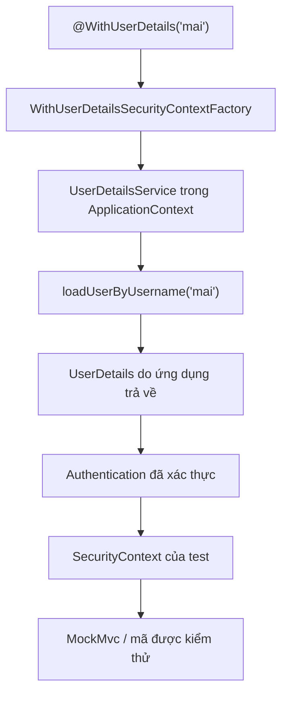

# `@WithUserDetails` và `UserDetailsService` thật trong context kiểm thử

## 1. Khi nào cần `@WithUserDetails`?

`@WithMockUser` rất tiện khi bài test chỉ cần một username và một tập quyền giả lập. Tuy nhiên, nó tạo principal mặc định kiểu `org.springframework.security.core.userdetails.User`; dữ liệu người dùng không được tải từ kho tài khoản hoặc dịch vụ của ứng dụng. Nếu controller yêu cầu principal tùy biến, hoặc bạn muốn dùng đúng authorities do `UserDetailsService` của dự án cung cấp, `@WithMockUser` có thể không phản ánh đầy đủ tình huống.

Spring Security Test cung cấp **`@WithUserDetails`** để lấy `UserDetails` bằng cách gọi một bean `UserDetailsService` trong ApplicationContext của bài test. Bạn chỉ định tên người dùng; factory của annotation gọi `loadUserByUsername`, sau đó tạo `SecurityContext` với principal được trả về.

Bài thuộc chương **Annotation người dùng** trong module **SPRING_SECURITY_TESTING**. Module hướng dẫn kiểm chứng xác thực, phân quyền và bảo vệ HTTP bằng `spring-security-test` trên ứng dụng Servlet và Reactive, sử dụng `MockMvc`, `WebTestClient`, `SecurityContext` và các danh tính JWT/OAuth2/OIDC giả lập.

Sau bài học, bạn có thể:

- Giải thích cách `@WithUserDetails` tìm người dùng qua `UserDetailsService`.
- Chỉ định username và bean service khi ApplicationContext có nhiều dịch vụ người dùng.
- Chuẩn bị dữ liệu kiểm thử đúng thời điểm để `loadUserByUsername` tìm thấy tài khoản.
- Dùng principal và authorities thật do service trả về trong test MVC.
- Phân biệt tải `UserDetails` với xác thực mật khẩu hoặc kiểm tra luồng đăng nhập.
- Chọn công cụ phù hợp khi dự án dùng `ReactiveUserDetailsService`, JWT, OAuth2 hoặc OIDC.

## 2. Cơ chế hoạt động

Annotation nằm trong package:

```java
import org.springframework.security.test.context.support.WithUserDetails;
```

Ví dụ tối giản:

```java
@Test
@WithUserDetails("mai")
void userDetailsIsLoadedFromService() {
    // Spring gọi UserDetailsService.loadUserByUsername("mai").
}
```

Khi Spring Test xử lý annotation, `WithUserDetailsSecurityContextFactory` lấy bean `UserDetailsService` từ ApplicationContext, gọi `loadUserByUsername(username)`, rồi tạo `SecurityContext` có `Authentication` đã xác thực. Principal là chính đối tượng `UserDetails` mà service trả về; authorities cũng được lấy từ đối tượng đó.



Điểm khác biệt chính:

| Thành phần | `@WithMockUser` | `@WithUserDetails` |
| --- | --- | --- |
| Nguồn username | Thuộc tính annotation | Đối số truyền cho `loadUserByUsername` |
| Nguồn principal | Principal `User` mặc định do Spring Security Test tạo | Đối tượng `UserDetails` do service trả về |
| Nguồn authorities | `roles` hoặc `authorities` của annotation | `UserDetails.getAuthorities()` |
| Cần bean `UserDetailsService` | Không | Có |
| Có thể dùng principal tùy biến | Không trực tiếp | Có, nếu service trả về kiểu `UserDetails` tùy biến |
| Kiểm tra mật khẩu đăng nhập | Không | Không |

### Các thuộc tính của annotation

| Thuộc tính | Mục đích |
| --- | --- |
| `value` | Username cần tải; mặc định là `"user"` |
| `userDetailsServiceBeanName` | Tên bean `UserDetailsService` cần dùng; mặc định là chuỗi rỗng để Spring tìm bean phù hợp |
| `setupBefore` | Chọn thời điểm tạo `SecurityContext`; mặc định là `TestExecutionEvent.TEST_METHOD` |

Các cách viết tương đương về username:

```java
@WithUserDetails("mai")
@WithUserDetails(value = "mai")
```

`@WithUserDetails` dùng thuộc tính `value` để chỉ username; không nhầm nó với `username` của `@WithMockUser`. Nếu không chỉ định `userDetailsServiceBeanName`, ApplicationContext cần có một bean `UserDetailsService` phù hợp và không gây mơ hồ khi inject. Nếu có nhiều service, hãy chỉ rõ tên bean.

## 3. Điều kiện để service hoạt động trong context kiểm thử

Để annotation tải được người dùng, các điều kiện sau phải thỏa mãn:

1. Test chạy với Spring Test và ApplicationContext đã được khởi tạo.
2. ApplicationContext có bean triển khai `UserDetailsService`.
3. Bean được chọn có thể truy cập dữ liệu người dùng ở thời điểm annotation được xử lý.
4. `loadUserByUsername(username)` trả về một `UserDetails` hợp lệ.
5. Các authority trả về đúng với chính sách phân quyền của endpoint.

Nếu service không tồn tại, không thể được phân giải hoặc không tìm thấy username, lỗi xảy ra khi Spring thiết lập security context **trước khi thân phương thức test chạy**. Đây là lỗi fixture/khởi tạo test, không phải phản hồi HTTP `401` của endpoint.

### Chọn đúng bean khi có nhiều UserDetailsService

Giả sử dự án có hai dịch vụ:

```java
@Service("employeeDetailsService")
class EmployeeDetailsService implements UserDetailsService {
    // Tải người dùng nội bộ.
}

@Service("partnerDetailsService")
class PartnerDetailsService implements UserDetailsService {
    // Tải tài khoản đối tác.
}
```

Khi đó nên chỉ rõ bean:

```java
@Test
@WithUserDetails(
    value = "mai",
    userDetailsServiceBeanName = "employeeDetailsService"
)
void employeeIsLoadedFromEmployeeDirectory() {
    // Dùng employeeDetailsService, không nhầm sang partnerDetailsService.
}
```

Tên truyền vào phải đúng với tên bean được đăng ký trong Spring. Nếu service được khai báo qua `@Bean`, tên mặc định thường là tên phương thức `@Bean`; nếu dùng `@Service("...")`, hãy dùng chính tên đã chỉ định.

## 4. Ví dụ UserDetailsService tải tài khoản từ repository

Giả sử ứng dụng quản lý báo cáo có bảng tài khoản. Một tài khoản lưu username, mật khẩu đã mã hóa, trạng thái hoạt động và các authority.

### 4.1. Repository và mô hình dữ liệu

```java
// Account.java (mô hình minh họa)
import jakarta.persistence.CollectionTable;
import jakarta.persistence.Column;
import jakarta.persistence.ElementCollection;
import jakarta.persistence.Entity;
import jakarta.persistence.GeneratedValue;
import jakarta.persistence.GenerationType;
import jakarta.persistence.Id;
import jakarta.persistence.JoinColumn;
import jakarta.persistence.Table;
import java.util.HashSet;
import java.util.Set;

@Entity
@Table(name = "accounts")
class Account {

    @Id
    @GeneratedValue(strategy = GenerationType.IDENTITY)
    private Long id;

    @Column(nullable = false, unique = true)
    private String username;

    @Column(nullable = false)
    private String passwordHash;

    @Column(nullable = false)
    private boolean enabled;

    @ElementCollection
    @CollectionTable(
        name = "account_authorities",
        joinColumns = @JoinColumn(name = "account_id")
    )
    @Column(name = "authority")
    private Set<String> authorities = new HashSet<>();

    protected Account() {}

    Account(String username, String passwordHash,
            boolean enabled, Set<String> authorities) {
        this.username = username;
        this.passwordHash = passwordHash;
        this.enabled = enabled;
        this.authorities = new HashSet<>(authorities);
    }

    String getUsername() { return username; }
    String getPasswordHash() { return passwordHash; }
    boolean isEnabled() { return enabled; }
    Set<String> getAuthorities() { return authorities; }
}
```

```java
// AccountRepository.java
import java.util.Optional;
import org.springframework.data.jpa.repository.JpaRepository;

interface AccountRepository extends JpaRepository<Account, Long> {
    Optional<Account> findByUsername(String username);
}
```

Mô hình trên chỉ là ví dụ để minh họa việc service truy vấn dữ liệu. Dự án thực tế có thể dùng schema, quan hệ role hoặc repository khác; điều quan trọng là service trả về đúng `UserDetails`.

### 4.2. Triển khai UserDetailsService

```java
// AccountDetailsService.java
import org.springframework.security.core.userdetails.User;
import org.springframework.security.core.userdetails.UserDetails;
import org.springframework.security.core.userdetails.UserDetailsService;
import org.springframework.security.core.userdetails.UsernameNotFoundException;
import org.springframework.stereotype.Service;

@Service("accountDetailsService")
class AccountDetailsService implements UserDetailsService {

    private final AccountRepository accountRepository;

    AccountDetailsService(AccountRepository accountRepository) {
        this.accountRepository = accountRepository;
    }

    @Override
    public UserDetails loadUserByUsername(String username) {
        Account account = accountRepository.findByUsername(username)
                .orElseThrow(() ->
                        new UsernameNotFoundException("Account not found"));

        return User.withUsername(account.getUsername())
                .password(account.getPasswordHash())
                .authorities(account.getAuthorities().toArray(String[]::new))
                .disabled(!account.isEnabled())
                .build();
    }
}
```

Service này là một bean thật trong Spring context và thực sự gọi repository. Nó trả về `UserDetails` của Spring Security; nếu dự án có principal riêng như `AccountPrincipal`, service có thể trả về kiểu đó miễn là triển khai `UserDetails`.

Ví dụ trên giả định dữ liệu đã chứa các chuỗi authority đầy đủ như `report:read`, `report:approve` hoặc `ROLE_ADMIN`. Nếu cơ sở dữ liệu chỉ lưu role `ADMIN`, service phải ánh xạ role sang `ROLE_ADMIN` nhất quán với chính sách bảo mật. `@WithUserDetails` không tự thêm tiền tố cho dữ liệu service trả về.

## 5. Ví dụ Spring Boot test với repository thật

Đây là tình huống phù hợp nhất khi muốn xác nhận service tải được tài khoản từ dữ liệu trong context kiểm thử. Ta sử dụng `@SpringBootTest` để nạp cấu hình ứng dụng, `@AutoConfigureMockMvc` để kiểm tra HTTP, và `@Transactional` để dữ liệu fixture được hoàn tác khi test kết thúc.

### 5.1. Controller và chính sách

```java
// ReportController.java
import java.util.Map;
import org.springframework.security.core.annotation.AuthenticationPrincipal;
import org.springframework.security.core.userdetails.UserDetails;
import org.springframework.web.bind.annotation.GetMapping;
import org.springframework.web.bind.annotation.RestController;

@RestController
class ReportController {

    @GetMapping("/reports")
    Map<String, String> reports(
            @AuthenticationPrincipal UserDetails principal) {
        return Map.of("username", principal.getUsername());
    }
}
```

```java
// SecurityConfig.java
import org.springframework.context.annotation.Bean;
import org.springframework.context.annotation.Configuration;
import org.springframework.http.HttpMethod;
import org.springframework.security.config.Customizer;
import org.springframework.security.config.annotation.web.builders.HttpSecurity;
import org.springframework.security.web.SecurityFilterChain;

@Configuration
class SecurityConfig {

    @Bean
    SecurityFilterChain applicationFilterChain(HttpSecurity http)
            throws Exception {
        http.authorizeHttpRequests(auth -> auth
                .requestMatchers(HttpMethod.GET, "/reports")
                    .hasAuthority("report:read")
                .anyRequest().denyAll()
        );
        http.httpBasic(Customizer.withDefaults());
        return http.build();
    }
}
```

### 5.2. Bài kiểm thử

```java
// ReportAccessIntegrationTest.java
import java.util.Set;
import org.junit.jupiter.api.BeforeEach;
import org.junit.jupiter.api.Test;
import org.springframework.beans.factory.annotation.Autowired;
import org.springframework.boot.test.autoconfigure.web.servlet.AutoConfigureMockMvc;
import org.springframework.boot.test.context.SpringBootTest;
import org.springframework.security.core.Authentication;
import org.springframework.security.core.GrantedAuthority;
import org.springframework.security.core.context.SecurityContextHolder;
import org.springframework.security.core.userdetails.UserDetails;
import org.springframework.security.test.context.support.TestExecutionEvent;
import org.springframework.security.test.context.support.WithMockUser;
import org.springframework.security.test.context.support.WithUserDetails;
import org.springframework.test.web.servlet.MockMvc;
import org.springframework.transaction.annotation.Transactional;

import static org.assertj.core.api.Assertions.assertThat;
import static org.springframework.test.web.servlet.request.MockMvcRequestBuilders.get;
import static org.springframework.test.web.servlet.result.MockMvcResultMatchers.jsonPath;
import static org.springframework.test.web.servlet.result.MockMvcResultMatchers.status;

@SpringBootTest
@AutoConfigureMockMvc
@Transactional
@WithMockUser(username = "default-user", roles = "USER")
class ReportAccessIntegrationTest {

    @Autowired
    AccountRepository accountRepository;

    @Autowired
    MockMvc mockMvc;

    @BeforeEach
    void createUsers() {
        accountRepository.saveAndFlush(new Account(
                "mai",
                "{noop}fixture-password",
                true,
                Set.of("report:read")
        ));
        accountRepository.saveAndFlush(new Account(
                "khoa",
                "{noop}fixture-password",
                true,
                Set.of("report:write")
        ));
    }

    @Test
    @WithUserDetails(
        value = "mai",
        userDetailsServiceBeanName = "accountDetailsService",
        setupBefore = TestExecutionEvent.TEST_EXECUTION
    )
    void accountDetailsServiceLoadsReaderFromRepository() throws Exception {
        Authentication authentication = SecurityContextHolder.getContext()
                .getAuthentication();

        assertThat(authentication.getName()).isEqualTo("mai");
        assertThat(authentication.getPrincipal())
                .isInstanceOf(UserDetails.class);
        assertThat(authentication.getAuthorities())
                .extracting(GrantedAuthority::getAuthority)
                .containsExactly("report:read");

        mockMvc.perform(get("/reports"))
                .andExpect(status().isOk())
                .andExpect(jsonPath("$.username").value("mai"));
    }

    @Test
    @WithUserDetails(
        value = "khoa",
        userDetailsServiceBeanName = "accountDetailsService",
        setupBefore = TestExecutionEvent.TEST_EXECUTION
    )
    void loadedUserWithoutReadAuthorityIsForbidden() throws Exception {
        mockMvc.perform(get("/reports"))
                .andExpect(status().isForbidden());
    }
}
```

Trong ví dụ, `@WithMockUser` trên lớp tạo mặc định cho các phương thức không có annotation riêng. Hai phương thức test dùng `@WithUserDetails` nên **ghi đè** mặc định đó bằng principal được tải từ `AccountDetailsService`.

### 5.3. Vì sao đặt `setupBefore = TEST_EXECUTION`?

Mặc định, `@WithUserDetails` thiết lập context ở sự kiện `TEST_METHOD`, tức trước giai đoạn JUnit chạy `@BeforeEach`. Nhưng ví dụ tạo tài khoản bằng `@BeforeEach`; nếu dùng mặc định, service có thể tìm username trước khi fixture được lưu.

Đặt:

```java
setupBefore = TestExecutionEvent.TEST_EXECUTION
```

thì Spring thiết lập `SecurityContext` sau `@BeforeEach`, ngay trước khi thân phương thức test thực thi. Khi đó `AccountDetailsService.loadUserByUsername` nhìn thấy tài khoản vừa được tạo trong transaction test.

Một cách khác là chuẩn bị dữ liệu trước sự kiện `TEST_METHOD`, ví dụ bằng script SQL được cấu hình đúng thời điểm hoặc dữ liệu khởi tạo đã tồn tại. Khi dùng `@Sql`, hãy kiểm tra thứ tự listener và transaction của dự án; đừng mặc định rằng mọi fixture đều được tạo trước lúc `@WithUserDetails` chạy.

Với `@Transactional` trên test, dữ liệu fixture thường được rollback khi test kết thúc. `saveAndFlush` giúp đẩy dữ liệu xuống database trước khi service truy vấn. Nếu test dùng transaction manager, database hoặc luồng xử lý khác, hãy điều chỉnh cách seed dữ liệu để service thực sự nhìn thấy tài khoản.

## 6. Principal tùy biến được giữ nguyên

Một lợi ích quan trọng của `@WithUserDetails` là service có thể trả về principal riêng thay vì `org.springframework.security.core.userdetails.User`. Ví dụ:

```java
public final class AccountPrincipal implements UserDetails {

    private final Long accountId;
    private final String username;
    private final String password;
    private final Collection<? extends GrantedAuthority> authorities;

    public AccountPrincipal(
            Long accountId,
            String username,
            String password,
            Collection<? extends GrantedAuthority> authorities) {
        this.accountId = accountId;
        this.username = username;
        this.password = password;
        this.authorities = authorities;
    }

    public Long getAccountId() {
        return accountId;
    }

    @Override public String getUsername() { return username; }
    @Override public String getPassword() { return password; }
    @Override public Collection<? extends GrantedAuthority> getAuthorities() {
        return authorities;
    }
    @Override public boolean isAccountNonExpired() { return true; }
    @Override public boolean isAccountNonLocked() { return true; }
    @Override public boolean isCredentialsNonExpired() { return true; }
    @Override public boolean isEnabled() { return true; }
}
```

Nếu `AccountDetailsService.loadUserByUsername` trả về `AccountPrincipal`, test có thể kiểm tra:

```java
@Test
@WithUserDetails(
    value = "mai",
    userDetailsServiceBeanName = "accountDetailsService",
    setupBefore = TestExecutionEvent.TEST_EXECUTION
)
void customPrincipalIsAvailable() {
    Object principal = SecurityContextHolder.getContext()
            .getAuthentication()
            .getPrincipal();

    assertThat(principal).isInstanceOf(AccountPrincipal.class);
    AccountPrincipal account = (AccountPrincipal) principal;
    assertThat(account.getAccountId()).isNotNull();
    assertThat(account.getUsername()).isEqualTo("mai");
}
```

Đây là trường hợp phù hợp nếu controller dùng:

```java
@GetMapping("/my-account")
String myAccount(@AuthenticationPrincipal AccountPrincipal principal) {
    return principal.getAccountId().toString();
}
```

Với `@WithMockUser`, principal mặc định không phải `AccountPrincipal`; ép kiểu có thể lỗi hoặc `@AuthenticationPrincipal` không nhận được kiểu mong muốn. `@WithUserDetails` giúp test dùng chính kiểu principal mà service của ứng dụng cung cấp.

## 7. Những gì @WithUserDetails không kiểm tra

`@WithUserDetails` gọi `UserDetailsService`, nhưng **không thực hiện quy trình xác thực** qua `AuthenticationManager`. Nó không gọi `AuthenticationProvider` để kiểm tra mật khẩu, không kiểm tra mật khẩu người dùng nhập có khớp hash hay không, và không chứng minh HTTP Basic/form login hoạt động.

| Nội dung | `@WithUserDetails` kiểm tra? | Cách kiểm thử phù hợp |
| --- | --- | --- |
| Service tìm được username | Có | `@WithUserDetails` |
| Service trả principal đúng kiểu | Có | Assertion trên `Authentication.getPrincipal()` |
| Authorities do service trả về | Có | Assertion trên `getAuthorities()` và request HTTP |
| Controller sử dụng principal tùy biến | Có | `@WithUserDetails` + `MockMvc` |
| Mật khẩu được xác minh qua `PasswordEncoder` | Không | Gọi quy trình xác thực hoặc test đăng nhập |
| Tài khoản disabled bị từ chối trong luồng đăng nhập | Không đủ | Test `AuthenticationManager`/provider thực tế |
| JWT được giải mã và kiểm tra chữ ký | Không | Test Resource Server/JwtDecoder |
| OAuth2/OIDC thực hiện authorization code flow | Không | Test tích hợp hoặc mô phỏng OAuth2/OIDC chuyên biệt |

Mặc dù `UserDetails` có thể chứa password hash và trạng thái enabled, việc annotation tạo một authentication từ đối tượng đó không tương đương quá trình đăng nhập. Nếu cần kiểm tra tài khoản disabled hoặc locked bị từ chối, hãy chạy qua authentication provider thực tế và xác nhận kết quả của quá trình đó.

## 8. Khi username không tồn tại hoặc service lỗi

Nếu `loadUserByUsername` ném `UsernameNotFoundException`, việc thiết lập security context thất bại trước khi phương thức test chạy. Ví dụ:

```java
@Test
@WithUserDetails("username-khong-ton-tai")
void missingUser() {
    // Thân test thường không được thực thi vì setup annotation thất bại.
}
```

Không nên dùng mẫu này như một cách assertion thông thường để kiểm tra HTTP `401`. Lỗi tìm người dùng ở giai đoạn setup không phải request HTTP gửi tới endpoint. Nếu muốn kiểm tra endpoint khi danh tính không tồn tại hoặc đăng nhập sai, hãy gửi request qua cơ chế xác thực và kiểm tra phản hồi HTTP.

Các nguyên nhân khác khiến setup thất bại:

- Không có bean `UserDetailsService` trong test context.
- Có nhiều bean phù hợp nhưng không chỉ định `userDetailsServiceBeanName`.
- Bean có tên không khớp với annotation.
- Repository chưa được seed dữ liệu trước thời điểm setup.
- Service phụ thuộc một thành phần không được cấu hình trong test context.
- Service trả `null` hoặc dữ liệu `UserDetails` không hợp lệ.

Khi gặp lỗi, hãy đọc stack trace ở giai đoạn `beforeTestMethod` hoặc `beforeTestExecution` và xác định lỗi nằm ở việc phân giải bean, truy vấn user hay tạo authentication.

## 9. Dùng trong @WebMvcTest và test slice

`@WebMvcTest` chỉ nạp một phần ApplicationContext để kiểm thử MVC. Nó không tự động nạp mọi service, repository và cấu hình dữ liệu như `@SpringBootTest`. Do đó, `@WithUserDetails` có thể không tìm thấy `UserDetailsService` nếu bean này không nằm trong slice.

Có một số cách xử lý tùy mục tiêu:

| Cách | Khi phù hợp |
| --- | --- |
| Dùng `@SpringBootTest` | Muốn nạp service, repository và cấu hình bảo mật thật cùng nhau |
| `@Import(AccountDetailsService.class)` | Muốn nạp service cụ thể vào MVC slice |
| Mock repository phụ thuộc của service | Muốn kiểm thử service thật nhưng không cần database thật |
| Cấu hình `@TestConfiguration` cung cấp UserDetailsService | Muốn kiểm soát dữ liệu principal cho một slice test |

Ví dụ, nếu muốn giữ `AccountDetailsService` thật nhưng không dùng database, có thể import service và cung cấp repository mock:

```java
@WebMvcTest(ReportController.class)
@Import({ReportSecurityConfig.class, AccountDetailsService.class})
class ReportControllerSliceTest {
    @MockBean
    AccountRepository accountRepository;

    // Stub accountRepository.findByUsername("mai") trả về fixture Account.
}
```

Trong trường hợp đó, `UserDetailsService` vẫn là implementation thật; repository được thay bằng mock. Cần bảo đảm bean service được đăng ký với tên `accountDetailsService` để annotation có thể chọn đúng.

Nếu mục tiêu là xác minh truy vấn repository thật, mapping entity và authorities từ database, dùng `@SpringBootTest` với database kiểm thử thường phù hợp hơn.

## 10. Ở cấp lớp và cấp phương thức

`@WithUserDetails` có thể đặt trên lớp để nhiều test dùng chung một người dùng:

```java
@SpringBootTest
@WithUserDetails(
    value = "mai",
    userDetailsServiceBeanName = "accountDetailsService"
)
class ReportServiceSecurityTest {

    @Test
    void defaultUserCanRead() {
        // Sử dụng principal mai từ service.
    }

    @Test
    @WithMockUser(username = "admin", roles = "ADMIN")
    void methodOverridesWithMockUser() {
        // Dùng principal User mặc định từ @WithMockUser.
    }

    @Test
    @WithUserDetails(
        value = "khoa",
        userDetailsServiceBeanName = "accountDetailsService"
    )
    void methodOverridesWithAnotherUser() {
        // Tải principal khoa từ service.
    }
}
```

Annotation ở phương thức ghi đè annotation ở lớp. Nếu lớp dùng `@WithUserDetails("mai")` nhưng phương thức dùng `@WithMockUser`, phương thức đó không gọi service để tải `mai`; nó dùng principal mock. Tương tự, `@WithAnonymousUser` ở phương thức có thể ghi đè danh tính của lớp.

Nếu fixture chỉ được tạo trong `@BeforeEach`, hãy cân nhắc `setupBefore = TestExecutionEvent.TEST_EXECUTION` ở annotation cấp lớp để dữ liệu sẵn sàng trước khi service được gọi. Nếu fixture đã tồn tại từ trước, mặc định `TEST_METHOD` thường phù hợp.

## 11. Thời điểm thiết lập context

`setupBefore` cho phép chọn thời điểm factory chạy:

```java
import org.springframework.security.test.context.support.TestExecutionEvent;

@Test
@WithUserDetails(
    value = "mai",
    userDetailsServiceBeanName = "accountDetailsService",
    setupBefore = TestExecutionEvent.TEST_EXECUTION
)
void userIsLoadedAfterBeforeEach() {
    // @BeforeEach đã chuẩn bị dữ liệu trước khi loadUserByUsername chạy.
}
```

| Giá trị | Thời điểm | Khi nào dùng |
| --- | --- | --- |
| `TEST_METHOD` | Trước giai đoạn `@BeforeEach` của JUnit | Người dùng đã có sẵn trong database/context |
| `TEST_EXECUTION` | Sau `@BeforeEach`, ngay trước thân test | Fixture được tạo trong `@BeforeEach` |

Đổi thời điểm không làm thay đổi nguồn principal hoặc quyền; nó chỉ thay đổi **khi nào** service được gọi. Nếu service đọc dữ liệu từ transaction, hãy bảo đảm transaction và fixture đã được thiết lập theo thứ tự mong muốn.

## 12. Reactive và giới hạn của UserDetailsService đồng bộ

Trong WebFlux, Spring Security dùng Reactor Context để truyền `SecurityContext`; Spring Security Test có listener hỗ trợ các annotation bảo mật trong test reactive. Tuy nhiên, `@WithUserDetails` được thiết kế quanh interface đồng bộ **`UserDetailsService`**, có phương thức trả về `UserDetails` trực tiếp.

Nếu ứng dụng chỉ có `ReactiveUserDetailsService` (trả về `Mono<UserDetails>`) và không có bean `UserDetailsService` đồng bộ, `@WithUserDetails` không thể tự gọi reactive service đó. Không nên tạo một adapter đồng bộ bằng cách block một luồng reactive chỉ để làm annotation hoạt động.

Với WebFlux, có thể chọn:

- Dùng `@WithMockUser` khi chỉ cần danh tính và authority đơn giản; listener reactive sẽ đưa context vào Reactor Context.
- Dùng `WebTestClient` với `SecurityMockServerConfigurers.mockUser(...)` để đặt `UserDetails`/authority cho request.
- Dùng `mockJwt()` khi endpoint cần principal JWT.
- Viết fixture hoặc helper kiểm thử Reactive riêng để tạo `SecurityContext` dựa trên `ReactiveUserDetailsService` nếu mục tiêu là kiểm tra service reactive thật.

Ví dụ khung `WebTestClient`:

```java
@WebFluxTest(ReactiveReportController.class)
@Import(ReactiveReportSecurityConfig.class)
class ReactiveReportSecurityTest {

    @Autowired
    WebTestClient webTestClient;

    @Test
    void readerCanAccessWithMockUserConfigurer() {
        webTestClient
            .mutateWith(mockUser("mai").authorities(
                    new SimpleGrantedAuthority("report:read")
            ))
            .get()
            .uri("/reports")
            .exchange()
            .expectStatus().isOk();
    }
}
```

Đây là khung minh họa: controller, security chain và tích hợp client cần được dự án cung cấp. Nó mô phỏng user cho request; để kiểm thử việc tải user từ reactive repository, hãy test riêng `ReactiveUserDetailsService` và cách ứng dụng xây dựng reactive authentication.

## 13. Lỗi thường gặp và cách xử lý

| Hiện tượng | Nguyên nhân | Cách xử lý |
| --- | --- | --- |
| Test lỗi trước khi vào thân phương thức | Service không tìm thấy username hoặc bean | Kiểm tra stack trace, bean và fixture |
| `NoUniqueBeanDefinitionException` | Có nhiều `UserDetailsService` phù hợp | Chỉ rõ `userDetailsServiceBeanName` |
| Không tìm thấy bean service trong `@WebMvcTest` | MVC slice không nạp service | Import service hoặc dùng `@SpringBootTest` |
| Username có trong database nhưng test vẫn không tìm thấy | Fixture được tạo sau thời điểm annotation chạy | Dùng `TEST_EXECUTION` nếu tạo trong `@BeforeEach` |
| Authority trong test không giống database | Service ánh xạ role/permission khác mong đợi | Assert `getAuthorities()` sau khi load |
| Controller không nhận custom principal | Service trả về kiểu khác với kiểu controller yêu cầu | Cho service trả đúng `UserDetails` tùy biến hoặc đổi controller |
| Nghĩ annotation đã kiểm tra password | Factory tạo authentication từ UserDetails trực tiếp | Test riêng AuthenticationManager/provider |
| Người dùng disabled vẫn xuất hiện trong test | Annotation không chạy quy trình xác thực đầy đủ | Test đăng nhập và trạng thái tài khoản qua provider |
| Dùng `@WithUserDetails` với reactive-only service | Annotation cần `UserDetailsService` đồng bộ | Dùng reactive test helper hoặc fixture riêng |
| Phương thức vẫn dùng người mặc định của lớp | Annotation phương thức không được gắn hoặc không được Spring Test xử lý | Kiểm tra annotation và SpringExtension |

Khi debug, hãy phân biệt ba giai đoạn: **Spring tìm bean**, **service tải UserDetails**, và **HTTP filter chain đánh giá authority**. Lỗi ở hai giai đoạn đầu xảy ra trong lúc chuẩn bị test; lỗi ở giai đoạn cuối thường thể hiện qua HTTP status.

## 14. Bài tập vận dụng

Cho một ứng dụng quản lý tài liệu:

- `AccountDetailsService` tải người dùng từ `AccountRepository`.
- `GET /documents` yêu cầu `document:read`.
- `POST /documents/publish` yêu cầu `document:publish` và CSRF.
- Controller nhận principal kiểu `AccountPrincipal` có thêm `accountId`.

Hãy hoàn thành:

1. Viết `@Service("accountDetailsService")` triển khai `UserDetailsService`, tải username và authority từ repository.
2. Dùng `@SpringBootTest`, `@AutoConfigureMockMvc` và `@WithUserDetails(value = "mai", userDetailsServiceBeanName = "accountDetailsService")` để xác nhận principal thực sự là `AccountPrincipal`.
3. Nếu dữ liệu `mai` được tạo trong `@BeforeEach`, thay đổi `setupBefore` thành `TEST_EXECUTION` và giải thích thứ tự listener.
4. Tạo người dùng `khoa` chỉ có `document:publish`; kiểm tra đọc tài liệu bị từ chối nhưng publish có CSRF được phép.
5. Thêm một phương thức có `@WithMockUser` trong lớp đang dùng `@WithUserDetails`; xác nhận annotation phương thức ghi đè principal được tải từ service.
6. Tạo test với username không tồn tại và quan sát lỗi xảy ra ở giai đoạn thiết lập context; phân biệt với HTTP `401`.
7. Viết test đăng nhập riêng để kiểm chứng mật khẩu sai hoặc tài khoản disabled bị từ chối qua AuthenticationManager/provider.

**Câu hỏi tự kiểm tra:** Nếu `@WithUserDetails("mai")` chạy thành công, có thể kết luận mật khẩu của `mai` là đúng không? **Không.** Kết quả chỉ chứng minh service tải được `UserDetails` cho username đó và Spring Test đã tạo security context từ đối tượng trả về. Việc xác minh mật khẩu thuộc luồng xác thực riêng.

## 15. Ghi nhớ

`@WithUserDetails` gọi `UserDetailsService.loadUserByUsername` trong ApplicationContext kiểm thử để lấy principal và authorities thật do service trả về. Chỉ định `userDetailsServiceBeanName` khi có nhiều service; dùng `setupBefore = TEST_EXECUTION` khi fixture được tạo trong `@BeforeEach`. Annotation phù hợp để kiểm tra mapping principal và quyền trong `MockMvc`, nhưng **không xác minh mật khẩu hoặc chạy AuthenticationManager**. Với ứng dụng chỉ có `ReactiveUserDetailsService`, hãy sử dụng cơ chế kiểm thử Reactive phù hợp thay vì kỳ vọng annotation đồng bộ tự gọi service reactive.
