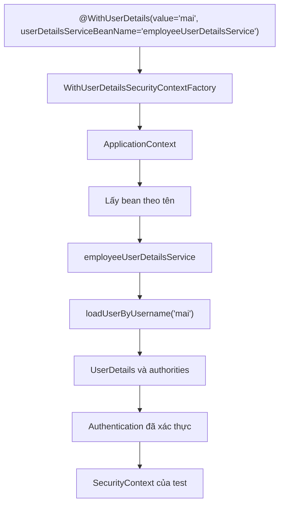

# Chọn `UserDetailsService` theo tên bean khi có nhiều bean

## 1. Bài toán: ứng dụng có nhiều nguồn tài khoản

Một ứng dụng lớn có thể quản lý nhiều nhóm danh tính: nhân viên nội bộ, đối tác, khách hàng hoặc tài khoản vận hành. Mỗi nhóm có thể dùng một triển khai `UserDetailsService` riêng để tải người dùng và authorities. Khi kiểm thử bằng `@WithUserDetails`, chỉ truyền username đôi khi chưa đủ để xác định service nào cần được gọi.

Ví dụ, ứng dụng có hai bean cùng triển khai `UserDetailsService`:

- `employeeUserDetailsService`: tải tài khoản nhân viên.
- `partnerUserDetailsService`: tải tài khoản đối tác.

Nếu test viết `@WithUserDetails("mai")` mà ApplicationContext có cả hai bean, Spring không thể tự biết cần tìm `mai` trong kho nhân viên hay kho đối tác. Thuộc tính **`userDetailsServiceBeanName`** cho phép chỉ rõ tên bean cần dùng.

Bài học thuộc chương **Annotation người dùng** của module **SPRING_SECURITY_TESTING**. Module tập trung kiểm chứng xác thực, phân quyền và bảo vệ HTTP thực tế bằng `spring-security-test` trên Servlet và Reactive, sử dụng `MockMvc`, `WebTestClient`, `SecurityContext` và các danh tính JWT/OAuth2/OIDC giả lập.

Sau bài này, bạn có thể:

- Giải thích cách `@WithUserDetails` phân giải bean `UserDetailsService`.
- Chọn đúng service qua `userDetailsServiceBeanName` khi có nhiều bean.
- Đặt tên bean bằng `@Service` hoặc `@Bean` và dùng tên đó trong annotation.
- Phân biệt lựa chọn bean theo tên với phân giải theo kiểu và `@Primary`.
- Chuẩn bị test context và dữ liệu để service được gọi đúng thời điểm.
- Xử lý lỗi bean không tồn tại, bean trùng loại, username không tìm thấy hoặc test slice thiếu service.

## 2. Cơ chế phân giải service của `@WithUserDetails`

`@WithUserDetails` nằm trong package:

```java
import org.springframework.security.test.context.support.WithUserDetails;
```

Ví dụ chỉ định tên bean:

```java
@Test
@WithUserDetails(
    value = "mai",
    userDetailsServiceBeanName = "employeeUserDetailsService"
)
void loadsEmployeeFromSelectedService() {
    // Tải mai qua employeeUserDetailsService.
}
```

Spring Security Test sử dụng `WithUserDetailsSecurityContextFactory` để tạo context. Factory nhận ApplicationContext, phân giải một bean `UserDetailsService`, gọi `loadUserByUsername(value)`, rồi tạo `SecurityContext` với principal chính là `UserDetails` vừa tải. Danh sách authorities được lấy từ đối tượng đó.



Hai cách phân giải:

| Cách khai báo | Cách chọn service |
| --- | --- |
| Không truyền `userDetailsServiceBeanName` | Phân giải bean theo kiểu `UserDetailsService` trong ApplicationContext |
| Truyền `userDetailsServiceBeanName = "employeeUserDetailsService"` | Lấy bean theo tên đã chỉ định, bean đó phải triển khai `UserDetailsService` |

Nếu chỉ có một bean phù hợp, có thể không cần chỉ định tên. Khi có nhiều bean, chỉ rõ tên giúp ý định của test rõ ràng và tránh phụ thuộc vào lựa chọn mặc định.

Các thuộc tính đáng chú ý:

| Thuộc tính | Mặc định | Ý nghĩa |
| --- | --- | --- |
| `value` | `"user"` | Username được truyền vào `loadUserByUsername` |
| `userDetailsServiceBeanName` | `""` | Rỗng nghĩa là phân giải service theo kiểu; có giá trị thì lấy bean theo tên |
| `setupBefore` | `TestExecutionEvent.TEST_METHOD` | Thiết lập context trước giai đoạn `@BeforeEach` |

## 3. Đặt tên bean để annotation sử dụng

### 3.1. Dùng `@Service("...")`

Có thể gán tên bean tường minh ngay trên implementation:

```java
import org.springframework.security.core.userdetails.UserDetailsService;
import org.springframework.stereotype.Service;

@Service("employeeUserDetailsService")
class EmployeeUserDetailsService implements UserDetailsService {

    @Override
    public UserDetails loadUserByUsername(String username) {
        // Tìm nhân viên trong kho dữ liệu nội bộ.
        // Trả về UserDetails hoặc ném UsernameNotFoundException.
    }
}
```

Một service khác có thể dùng tên riêng:

```java
@Service("partnerUserDetailsService")
class PartnerUserDetailsService implements UserDetailsService {

    @Override
    public UserDetails loadUserByUsername(String username) {
        // Tìm tài khoản đối tác trong nguồn dữ liệu riêng.
    }
}
```

Test chọn đúng implementation:

```java
@Test
@WithUserDetails(
    value = "mai",
    userDetailsServiceBeanName = "employeeUserDetailsService"
)
void loadsEmployeeAccount() {
    // ...
}

@Test
@WithUserDetails(
    value = "mai",
    userDetailsServiceBeanName = "partnerUserDetailsService"
)
void loadsPartnerAccount() {
    // ...
}
```

Hai service có thể cùng nhận username `mai` nhưng trả về principal và quyền khác nhau. Tên bean giúp test chỉ rõ nguồn danh tính mà nó muốn kiểm chứng.

### 3.2. Dùng `@Bean`

Nếu đăng ký service bằng Java configuration, tên phương thức `@Bean` mặc định là tên bean:

```java
@Configuration
class UserDetailsConfiguration {

    @Bean
    UserDetailsService employeeUserDetailsService(
            EmployeeRepository repository) {
        return username -> repository.findByUsername(username)
                .map(EmployeePrincipal::from)
                .orElseThrow(() ->
                        new UsernameNotFoundException("Employee not found"));
    }

    @Bean(name = "partnerUserDetailsService")
    UserDetailsService partnerService(PartnerRepository repository) {
        return username -> repository.findByUsername(username)
                .map(PartnerPrincipal::from)
                .orElseThrow(() ->
                        new UsernameNotFoundException("Partner not found"));
    }
}
```

Trong ví dụ, bean thứ nhất có tên `employeeUserDetailsService` theo tên phương thức; bean thứ hai có tên `partnerUserDetailsService` do thuộc tính `name` chỉ định. Có thể tham chiếu chúng trong `@WithUserDetails` bằng đúng các tên đó.

Khi có alias, Spring cho phép phân giải qua tên alias đã đăng ký. Tuy nhiên, trong test nên ưu tiên tên bean chính thức, rõ nghĩa và ổn định, tránh dựa vào tên tự sinh từ class hoặc refactor tên phương thức `@Bean`.

## 4. Chọn bean theo tên và phân giải theo kiểu khác nhau thế nào?

Khi không truyền tên bean, factory cần lấy một bean `UserDetailsService` từ ApplicationContext. Nếu chỉ có một implementation, việc phân giải theo kiểu là rõ ràng. Nếu có nhiều implementation, Spring có thể báo `NoUniqueBeanDefinitionException` trừ khi cấu hình có một ứng viên ưu tiên như `@Primary`.

| Cấu hình ApplicationContext | Annotation không chỉ định tên | Annotation chỉ định tên |
| --- | --- | --- |
| Một `UserDetailsService` | Có thể phân giải duy nhất | Có thể dùng tên bean đó |
| Hai service, không có `@Primary` | Mơ hồ, thường lỗi khi phân giải theo kiểu | Chọn đúng bean được nêu |
| Hai service, một bean `@Primary` | Có thể lấy bean primary | Vẫn chọn bean theo tên được chỉ định |
| Không có service trong context | Không thể phân giải | Không thể tìm tên bean được nêu |
| Tên bean không tồn tại | Không áp dụng | Lỗi không tìm thấy bean |

### Khi nào dùng `@Primary`?

Nếu ứng dụng thực sự có một service mặc định cho phần lớn luồng xác thực, có thể đánh dấu nó:

```java
@Primary
@Service("employeeUserDetailsService")
class EmployeeUserDetailsService implements UserDetailsService {
    // ...
}
```

Khi đó, phân giải theo kiểu `UserDetailsService` có thể chọn bean primary. Tuy vậy, test cần kiểm tra một nguồn tài khoản cụ thể vẫn nên ghi rõ `userDetailsServiceBeanName`. `@Primary` mô tả ứng viên mặc định của ApplicationContext; nó không thay thế ý định của một ca test cần kiểm chứng service khác.

### `@Qualifier` có tự chọn service cho annotation không?

`@Qualifier` hữu ích khi Spring inject một dependency vào constructor hoặc field:

```java
@Service
class AccountFacade {
    AccountFacade(
            @Qualifier("employeeUserDetailsService")
            UserDetailsService userDetailsService) {
        // ...
    }
}
```

Nhưng `@WithUserDetails` không đọc qualifier trên constructor hoặc field của lớp test để quyết định bean. Nếu annotation cần một implementation cụ thể, hãy chỉ định trực tiếp:

```java
@WithUserDetails(
    value = "mai",
    userDetailsServiceBeanName = "employeeUserDetailsService"
)
```

## 5. Ví dụ đầy đủ: hai UserDetailsService trong cùng context

Giả sử ứng dụng quản lý cả nhân viên và đối tác. Hai kho dữ liệu có thể có cùng username nhưng quyền truy cập khác nhau:

| Nguồn tài khoản | Username | Principal | Authority |
| --- | --- | --- | --- |
| Nhân viên | `mai` | `EmployeePrincipal` | `report:read`, `ROLE_EMPLOYEE` |
| Đối tác | `mai` | `PartnerPrincipal` | `partner:read` |

### 5.1. Hai service

```java
@Service("employeeUserDetailsService")
class EmployeeUserDetailsService implements UserDetailsService {

    private final EmployeeRepository repository;

    EmployeeUserDetailsService(EmployeeRepository repository) {
        this.repository = repository;
    }

    @Override
    public UserDetails loadUserByUsername(String username) {
        Employee employee = repository.findByUsername(username)
                .orElseThrow(() ->
                        new UsernameNotFoundException("Employee not found"));

        return EmployeePrincipal.from(employee);
    }
}
```

```java
@Service("partnerUserDetailsService")
class PartnerUserDetailsService implements UserDetailsService {

    private final PartnerRepository repository;

    PartnerUserDetailsService(PartnerRepository repository) {
        this.repository = repository;
    }

    @Override
    public UserDetails loadUserByUsername(String username) {
        Partner partner = repository.findByUsername(username)
                .orElseThrow(() ->
                        new UsernameNotFoundException("Partner not found"));

        return PartnerPrincipal.from(partner);
    }
}
```

Các lớp `EmployeePrincipal` và `PartnerPrincipal` là những kiểu triển khai `UserDetails` của ứng dụng. Ví dụ giả định mỗi repository trả về `Optional` và factory `from` ánh xạ entity sang principal có authorities tương ứng.

### 5.2. Test chọn từng service

```java
@SpringBootTest
class MultipleUserDetailsServiceTest {

    @Test
    @WithUserDetails(
        value = "mai",
        userDetailsServiceBeanName = "employeeUserDetailsService"
    )
    void loadsEmployeePrincipal() {
        Object principal = SecurityContextHolder.getContext()
                .getAuthentication()
                .getPrincipal();

        assertThat(principal).isInstanceOf(EmployeePrincipal.class);
        assertThat(((EmployeePrincipal) principal).getUsername())
                .isEqualTo("mai");
    }

    @Test
    @WithUserDetails(
        value = "mai",
        userDetailsServiceBeanName = "partnerUserDetailsService"
    )
    void loadsPartnerPrincipal() {
        Object principal = SecurityContextHolder.getContext()
                .getAuthentication()
                .getPrincipal();

        assertThat(principal).isInstanceOf(PartnerPrincipal.class);
        assertThat(((PartnerPrincipal) principal).getUsername())
                .isEqualTo("mai");
    }
}
```

Đây là ví dụ tập trung vào cơ chế chọn bean; trong dự án thực tế, `@SpringBootTest` phải nạp cả hai service, repository và dữ liệu có username `mai` trong cả hai nguồn. Nếu fixture được tạo trong `@BeforeEach`, cần chọn thời điểm thiết lập context phù hợp như phần 7.

## 6. Tích hợp với MockMvc: chứng minh chọn nhầm service sẽ đổi quyền

Ta có thể kiểm chứng không chỉ kiểu principal mà còn cả quyền truy cập HTTP. Giả sử endpoint báo cáo yêu cầu `report:read`, trong khi endpoint đối tác yêu cầu `partner:read`.

```java
@RestController
class DirectoryController {

    @GetMapping("/employee/reports")
    String employeeReports() {
        return "employee-reports";
    }

    @GetMapping("/partner/records")
    String partnerRecords() {
        return "partner-records";
    }
}
```

```java
@Configuration
class DirectorySecurityConfig {

    @Bean
    SecurityFilterChain directoryFilterChain(HttpSecurity http)
            throws Exception {
        http.authorizeHttpRequests(auth -> auth
                .requestMatchers("/employee/reports")
                    .hasAuthority("report:read")
                .requestMatchers("/partner/records")
                    .hasAuthority("partner:read")
                .anyRequest().denyAll()
        );
        http.httpBasic(Customizer.withDefaults());
        return http.build();
    }
}
```

Test:

```java
@SpringBootTest
@AutoConfigureMockMvc
class DirectoryControllerSecurityTest {

    @Autowired
    MockMvc mockMvc;

    @Test
    @WithUserDetails(
        value = "mai",
        userDetailsServiceBeanName = "employeeUserDetailsService"
    )
    void employeeCanReadReportsButNotPartnerRecords() throws Exception {
        mockMvc.perform(get("/employee/reports"))
                .andExpect(status().isOk());

        mockMvc.perform(get("/partner/records"))
                .andExpect(status().isForbidden());
    }

    @Test
    @WithUserDetails(
        value = "mai",
        userDetailsServiceBeanName = "partnerUserDetailsService"
    )
    void partnerCanReadRecordsButNotEmployeeReports() throws Exception {
        mockMvc.perform(get("/partner/records"))
                .andExpect(status().isOk());

        mockMvc.perform(get("/employee/reports"))
                .andExpect(status().isForbidden());
    }
}
```

Hai test dùng cùng username nhưng chọn hai bean khác nhau. Điều này thể hiện lý do tên bean quan trọng: **username không nhất thiết xác định duy nhất nguồn danh tính trong một hệ thống nhiều miền người dùng**.

## 7. Thời điểm gọi service và dữ liệu test

`@WithUserDetails` cần gọi `loadUserByUsername` trong quá trình chuẩn bị test. Thuộc tính `setupBefore` quyết định thời điểm này:

| Giá trị | Thời điểm thiết lập context |
| --- | --- |
| `TestExecutionEvent.TEST_METHOD` | Mặc định; trước giai đoạn `@BeforeEach` của JUnit |
| `TestExecutionEvent.TEST_EXECUTION` | Sau `@BeforeEach`, ngay trước thân phương thức test |

Nếu tài khoản đã tồn tại sẵn trong database test, dùng mặc định thường phù hợp. Nếu test tạo dữ liệu trong `@BeforeEach`, hãy chọn `TEST_EXECUTION`:

```java
@Test
@WithUserDetails(
    value = "mai",
    userDetailsServiceBeanName = "employeeUserDetailsService",
    setupBefore = TestExecutionEvent.TEST_EXECUTION
)
void loadsUserAfterFixtureIsPrepared() {
    // Fixture từ @BeforeEach đã được tạo trước khi service được gọi.
}
```

Ví dụ seed dữ liệu:

```java
@BeforeEach
void setUp() {
    employeeRepository.save(new Employee(
            "mai",
            "{noop}test-only-password",
            Set.of("report:read")
    ));
}
```

Đây chỉ là dữ liệu kiểm thử. Chuỗi `{noop}...` không phải cách lưu mật khẩu cho production. Nếu service chỉ cần tải `UserDetails`, mật khẩu trong fixture không được đưa qua `PasswordEncoder` để xác thực; hãy dùng giá trị giả an toàn và không tái sử dụng bí mật thật.

### Lưu ý về transaction

Nếu test dùng `@Transactional`, fixture có thể được rollback sau mỗi test. Hãy bảo đảm repository đã flush hoặc transaction có thể đọc được dữ liệu do `@BeforeEach` tạo. Với `TEST_METHOD`, factory chạy trước `@BeforeEach`, vì thế dữ liệu chỉ được seed trong `@BeforeEach` sẽ chưa tồn tại khi service được gọi.

Nếu seed bằng `@Sql`, script dữ liệu phải chạy trước thời điểm `@WithUserDetails` thiết lập context. Hãy kiểm tra thứ tự listener và cấu hình transaction của dự án; không giả định mọi script đều chạy trước mọi test execution listener.

## 8. Tên bean trong các loại test context

Tên bean chỉ có thể được phân giải nếu bean hiện diện trong **ApplicationContext đang chạy test**. Việc bean có trong ứng dụng production không có nghĩa mọi loại test đều nạp bean đó.

| Loại test | Tình huống thường gặp | Cách xử lý |
| --- | --- | --- |
| `@SpringBootTest` | Nạp context ứng dụng rộng hơn, gồm service/repository theo cấu hình | Thích hợp để kiểm tra service thật cùng dữ liệu |
| `@WebMvcTest` | Chỉ nạp MVC slice; service người dùng có thể không được tự động nạp | Dùng `@Import` để nạp service và dependency phù hợp, hoặc dùng test context riêng |
| `@DataJpaTest` | Tập trung repository/JPA, không tự cấu hình đầy đủ web security | Phù hợp kiểm tra repository; nếu dùng annotation cần bảo đảm service bean có mặt |
| `@ContextConfiguration` tùy chỉnh | Chỉ các cấu hình được khai báo mới được nạp | Đưa bean đúng tên vào context test |

Ví dụ khi dùng MVC slice:

```java
@WebMvcTest(DirectoryController.class)
@Import({
    DirectorySecurityConfig.class,
    EmployeeUserDetailsService.class,
    PartnerUserDetailsService.class
})
class DirectoryControllerSliceTest {
    // Cần cung cấp/mock EmployeeRepository và PartnerRepository.
}
```

Trong dự án dùng Spring Boot 3.4 trở lên, có thể dùng `@MockitoBean` để thay dependency repository bằng mock; các phiên bản cũ thường sử dụng `@MockBean`. Điều quan trọng là service được chọn phải thực sự là bean trong slice và có dependency khả dụng. Nếu mục tiêu là truy vấn database thật, dùng `@SpringBootTest` với database test sẽ phù hợp hơn.

### Ứng dụng Reactive

`@WithUserDetails` được thiết kế để gọi interface đồng bộ `UserDetailsService`. Nếu ứng dụng WebFlux vẫn có bean `UserDetailsService` đồng bộ, annotation có thể được dùng trong test Reactive khi Spring Security Test đã tích hợp listener chuyển security context vào Reactor Context. Tuy nhiên, nếu ứng dụng chỉ cung cấp `ReactiveUserDetailsService` (trả về `Mono<UserDetails>`), factory của `@WithUserDetails` không thể tự gọi bean đó.

Với trường hợp reactive-only, hãy dùng `WebTestClient` cùng `SecurityMockServerConfigurers.mockUser(...)` để mô phỏng danh tính khi kiểm tra authorization, hoặc viết fixture/test chuyên biệt cho `ReactiveUserDetailsService` và `ReactiveAuthenticationManager` nếu muốn kiểm tra việc tải và xác thực người dùng thực sự. Không nên chặn một luồng reactive bằng `block()` chỉ để đáp ứng annotation đồng bộ.

## 9. Phân biệt tên bean với tên class và qualifier

Ba khái niệm thường bị nhầm:

| Khái niệm | Ví dụ | Có dùng trực tiếp trong `userDetailsServiceBeanName`? |
| --- | --- | --- |
| Tên bean | `employeeUserDetailsService` | Có |
| Tên class | `EmployeeUserDetailsService` | Không, trừ khi vô tình trùng tên bean |
| Tên interface | `UserDetailsService` | Không; đây là kiểu để phân giải theo type |
| Qualifier trên dependency injection | `@Qualifier("employeeUserDetailsService")` | Không; annotation cần tên bean riêng |

Khi dùng `@Service` không truyền tên, Spring thường tạo tên bean theo quy tắc đặt tên component, ví dụ `employeeUserDetailsService`. Tuy nhiên, refactor class có thể làm tên tự sinh đổi theo. Đối với test quan trọng, tên bean tường minh giúp ổn định hơn:

```java
@Service("employeeUserDetailsService")
class EmployeeUserDetailsService implements UserDetailsService {
    // ...
}
```

Sau đó dùng chính chuỗi:

```java
@WithUserDetails(
    value = "mai",
    userDetailsServiceBeanName = "employeeUserDetailsService"
)
```

Không truyền tên class hoặc tên package vào thuộc tính này.

## 10. Giới hạn: @WithUserDetails không chạy luồng xác thực

Dù gọi `UserDetailsService` thật, `@WithUserDetails` **không** gọi `AuthenticationManager` hay `AuthenticationProvider` để kiểm tra mật khẩu. Factory lấy `UserDetails` rồi tạo authentication cho test. Vì vậy:

| Nội dung | `@WithUserDetails` có kiểm chứng? |
| --- | --- |
| Chọn đúng bean `UserDetailsService` | Có |
| Gọi `loadUserByUsername` với username đã khai báo | Có |
| Principal tùy biến và authorities service trả về | Có |
| Endpoint được phép/từ chối với authorities đó | Có, nếu security chain thật được áp dụng |
| Mật khẩu đầu vào khớp password hash | Không |
| `PasswordEncoder.matches` được gọi | Không |
| Authentication provider xử lý tài khoản disabled/locked | Không |
| JWT signature, issuer, audience hoặc expiry được xác minh | Không |

Nếu cần kiểm chứng đăng nhập, hãy gửi credential qua endpoint hoặc gọi luồng xác thực thực tế trong test tích hợp. Nếu cần kiểm tra JWT, dùng mock JWT cho authorization và test riêng `JwtDecoder`/converter hoặc cấu hình Resource Server để xác minh token.

## 11. Lỗi thường gặp và cách chẩn đoán

| Lỗi | Nguyên nhân | Cách xử lý |
| --- | --- | --- |
| `NoUniqueBeanDefinitionException` | Nhiều `UserDetailsService` và không có ứng viên mặc định duy nhất | Truyền `userDetailsServiceBeanName` |
| `NoSuchBeanDefinitionException` | Tên bean sai hoặc bean không nằm trong test context | Kiểm tra tên `@Service`/`@Bean` và cấu hình test |
| `UsernameNotFoundException` | Service được chọn không tìm thấy username trong nguồn dữ liệu đó | Kiểm tra dữ liệu và đúng miền tài khoản |
| Test lỗi trước khi chạy thân phương thức | Factory không tạo được SecurityContext | Đọc stack trace ở giai đoạn setup, không coi là HTTP 401 |
| Lấy nhầm principal cùng username | Chọn nhầm service bean | Chỉ rõ bean name và assertion kiểu principal |
| `@Qualifier` không giải quyết lỗi mơ hồ của annotation | Factory không lấy qualifier từ field/constructor test | Dùng `userDetailsServiceBeanName` |
| Bean có trong production nhưng không có trong `@WebMvcTest` | MVC slice không nạp service | Import bean và cung cấp dependency |
| Fixture trong `@BeforeEach` chưa tồn tại khi service chạy | Dùng mặc định `TEST_METHOD` | Chọn `TEST_EXECUTION` |
| Authorities không đúng mong đợi | Service ánh xạ quyền từ dữ liệu khác quy ước | Assert `getAuthorities()` sau khi tải |
| Nghĩ mật khẩu đã được xác minh | Nhầm tải principal với AuthenticationManager | Viết test riêng cho quy trình đăng nhập |

Khi debug, đi theo thứ tự: **tên bean có phân giải được không → service nào được gọi → username có tồn tại trong nguồn đó không → principal và authorities trả về là gì → request có đi qua security chain cần kiểm tra không**. Trình tự này thường xác định được nguyên nhân nhanh hơn việc thay đổi annotation ngẫu nhiên.

## 12. Bài tập thực hành

Một ứng dụng có hai miền người dùng:

- Nhân viên: bean `employeeUserDetailsService`, username `linh`, authority `report:read`.
- Đối tác: bean `partnerUserDetailsService`, username `linh`, authority `partner:read`.

Các endpoint:

- `GET /employee/reports` yêu cầu `report:read`.
- `GET /partner/records` yêu cầu `partner:read`.

Hãy thực hiện:

1. Khai báo hai bean `UserDetailsService` có tên tường minh.
2. Viết test `@WithUserDetails(value = "linh", userDetailsServiceBeanName = "employeeUserDetailsService")`; kiểm tra principal nhân viên và endpoint báo cáo.
3. Viết test chọn `partnerUserDetailsService`; xác nhận cùng username nhưng principal/authority thuộc miền đối tác.
4. Bỏ thuộc tính bean name khi context có hai service và quan sát lỗi phân giải; sau đó thêm `@Primary` cho service mặc định và so sánh.
5. Đặt `@WithUserDetails` trên lớp, rồi ghi đè ở một phương thức bằng bean còn lại.
6. Seed dữ liệu trong `@BeforeEach`, so sánh `TEST_METHOD` với `TEST_EXECUTION`.
7. Tạo username chỉ tồn tại trong kho nhân viên nhưng chọn service đối tác; giải thích vì sao lỗi xảy ra khi thiết lập context thay vì trả HTTP 401.
8. Viết test đăng nhập riêng để kiểm chứng mật khẩu sai; không dùng `@WithUserDetails` làm bằng chứng cho bước kiểm tra mật khẩu.

**Câu hỏi tự kiểm tra:** Nếu hai bean đều tìm được username `linh`, `@WithUserDetails("linh")` có bảo đảm lấy đúng principal nhân viên không? **Không.** Khi có nhiều bean cùng kiểu, cần chỉ định bean bằng `userDetailsServiceBeanName` hoặc cấu hình một bean mặc định duy nhất theo cơ chế phân giải của Spring.

## 13. Ghi nhớ

`@WithUserDetails` dùng `UserDetailsService` trong ApplicationContext để tải principal và authorities theo username. Khi có nhiều implementation, hãy đặt tên bean rõ ràng bằng `@Service("...")` hoặc `@Bean(name = "...")`, sau đó chỉ định `userDetailsServiceBeanName` trong annotation. Không nhầm tên bean với tên class hoặc `@Qualifier`; nếu fixture được tạo trong `@BeforeEach`, cân nhắc `setupBefore = TEST_EXECUTION`. Cơ chế này kiểm chứng việc tải người dùng và phân quyền sau khi context được tạo, nhưng không thay thế test xác thực mật khẩu, AuthenticationManager hay JWT decoder.
