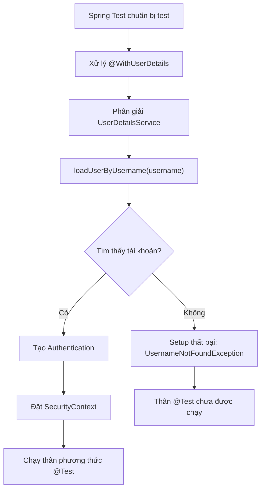

# Điều kiện tồn tại người dùng trước khi annotation được xử lý

## 1. Vì sao người dùng phải tồn tại đúng thời điểm?

Khi dùng `@WithUserDetails`, Spring Security Test cần gọi `UserDetailsService.loadUserByUsername(username)` để lấy principal. Vì vậy, tài khoản được yêu cầu phải có thể truy vấn được **trước khi annotation thiết lập SecurityContext**. Nếu dữ liệu chỉ được tạo sau thời điểm đó, test có thể thất bại ngay trong giai đoạn chuẩn bị, trước khi thân phương thức `@Test` chạy.

Tình huống thường gặp là lớp kiểm thử tạo tài khoản trong `@BeforeEach`, nhưng `@WithUserDetails` mặc định được xử lý trước `@BeforeEach`. Khi đó service tìm người dùng quá sớm và ném `UsernameNotFoundException`. Cách xử lý là hiểu vòng đời test và chọn đúng thời điểm bằng `setupBefore`, hoặc chuẩn bị dữ liệu sớm hơn.

Bài học thuộc chương **Annotation người dùng** của module **SPRING_SECURITY_TESTING**. Module giúp kiểm chứng xác thực, phân quyền và bảo vệ HTTP thực tế bằng `spring-security-test` trên ứng dụng Servlet và Reactive, sử dụng `MockMvc`, `WebTestClient`, `SecurityContext` và các danh tính JWT/OAuth2/OIDC giả lập.

Sau bài học, bạn có thể:

- Giải thích tại sao dữ liệu tài khoản phải sẵn sàng trước khi `@WithUserDetails` được xử lý.
- Phân biệt hai thời điểm `TEST_METHOD` và `TEST_EXECUTION`.
- Chọn giữa seed dữ liệu trước test, `@Sql`, `@BeforeEach` hoặc dữ liệu khởi tạo sẵn.
- Hiểu transaction, rollback và khả năng nhìn thấy dữ liệu của `UserDetailsService`.
- Phân biệt lỗi chuẩn bị `SecurityContext` với HTTP `401` của endpoint.
- Chẩn đoán lỗi khi test slice thiếu service hoặc fixture chưa được tạo.

## 2. Điều kiện cốt lõi của @WithUserDetails

Annotation:

```java
@WithUserDetails(
    value = "mai",
    userDetailsServiceBeanName = "accountDetailsService"
)
```

được xử lý bởi `WithUserDetailsSecurityContextFactory`. Factory lấy bean `UserDetailsService` trong ApplicationContext, gọi:

```java
UserDetails user = userDetailsService.loadUserByUsername("mai");
```

Sau khi nhận được `UserDetails`, factory tạo `Authentication` đã xác thực và đặt vào `SecurityContext` cho test. Điều này có nghĩa:

1. Bean `accountDetailsService` phải tồn tại trong context.
2. Bean phải là implementation `UserDetailsService` phù hợp.
3. Username `mai` phải được service tìm thấy tại thời điểm gọi.
4. Repository, database hoặc nguồn dữ liệu mà service phụ thuộc phải sẵn sàng.
5. Service phải trả về một `UserDetails` hợp lệ, không phải `null`.



Khác với `@WithMockUser`, annotation này không tự tạo người dùng từ username và roles truyền vào. `@WithMockUser` không cần tài khoản trong database; `@WithUserDetails` phụ thuộc vào dữ liệu thật mà service tải được.

## 3. Thứ tự vòng đời: TEST_METHOD và TEST_EXECUTION

Thuộc tính `setupBefore` của `@WithUserDetails` quyết định sự kiện Spring Test dùng để thiết lập context. Giá trị mặc định là `TestExecutionEvent.TEST_METHOD`.

Trong JUnit 5 tích hợp Spring Test, thứ tự quan trọng được đơn giản hóa như sau:

```text
Spring Test beforeTestMethod
    |
    +-- setupBefore = TEST_METHOD (mặc định)
    |       |
    |       +-- @WithUserDetails gọi loadUserByUsername(...)
    |
JUnit 5 @BeforeEach
    |
Spring Test beforeTestExecution
    |
    +-- setupBefore = TEST_EXECUTION
    |       |
    |       +-- @WithUserDetails gọi loadUserByUsername(...)
    |
Thân phương thức @Test
    |
@AfterEach
    |
Spring Test afterTestMethod / dọn SecurityContext
```

| Giá trị | Thời điểm | Dữ liệu tạo trong `@BeforeEach` đã có chưa? |
| --- | --- | --- |
| `TEST_METHOD` (mặc định) | Trước `@BeforeEach` | Chưa |
| `TEST_EXECUTION` | Sau `@BeforeEach`, trước thân `@Test` | Có, nếu `@BeforeEach` đã lưu thành công |

Đây là điểm quyết định khi fixture được tạo trong từng test:

```java
@Test
@WithUserDetails("mai")
void loadsMai() {
    // Nếu mai chỉ được tạo trong @BeforeEach,
    // factory mặc định có thể chạy trước lúc mai tồn tại.
}
```

Nếu muốn giữ fixture trong `@BeforeEach`, hãy đổi thời điểm:

```java
@Test
@WithUserDetails(
    value = "mai",
    setupBefore = TestExecutionEvent.TEST_EXECUTION
)
void loadsMaiAfterFixture() {
    // @BeforeEach đã chạy và tạo mai trước khi thân test bắt đầu.
}
```

Import:

```java
import org.springframework.security.test.context.support.TestExecutionEvent;
import org.springframework.security.test.context.support.WithUserDetails;
```

Đổi `setupBefore` chỉ thay đổi **thời điểm gọi service**. Nó không thay đổi cách service tìm người dùng, không bỏ qua yêu cầu bean phải tồn tại và cũng không tự tạo dữ liệu.

## 4. Ví dụ lỗi khi tạo người dùng trong @BeforeEach

Giả sử repository lưu tài khoản và `AccountDetailsService` dùng repository để tải người dùng:

```java
@Service("accountDetailsService")
class AccountDetailsService implements UserDetailsService {

    private final AccountRepository repository;

    AccountDetailsService(AccountRepository repository) {
        this.repository = repository;
    }

    @Override
    public UserDetails loadUserByUsername(String username) {
        Account account = repository.findByUsername(username)
                .orElseThrow(() ->
                        new UsernameNotFoundException("Account not found"));

        return User.withUsername(account.getUsername())
                .password(account.getPasswordHash())
                .authorities(account.getAuthorities().toArray(String[]::new))
                .build();
    }
}
```

Test dưới đây có vấn đề về thứ tự:

```java
@SpringBootTest
@Transactional
class AccountSecurityTest {

    @Autowired
    AccountRepository accountRepository;

    @BeforeEach
    void setUp() {
        accountRepository.save(new Account(
                "mai",
                "{noop}test-password",
                Set.of("account:read")
        ));
    }

    @Test
    @WithUserDetails(
        value = "mai",
        userDetailsServiceBeanName = "accountDetailsService"
    )
    void userCanBeLoaded() {
        // Có thể không chạy tới đây:
        // @WithUserDetails mặc định chạy trước @BeforeEach.
    }
}
```

Vì `@WithUserDetails` mặc định thiết lập context ở `TEST_METHOD`, factory tìm `mai` trước khi JUnit gọi `setUp()`. Nếu tài khoản chưa có từ trước, test thất bại trong giai đoạn setup.

Sửa bằng cách chọn `TEST_EXECUTION`:

```java
@Test
@WithUserDetails(
    value = "mai",
    userDetailsServiceBeanName = "accountDetailsService",
    setupBefore = TestExecutionEvent.TEST_EXECUTION
)
void userCanBeLoadedAfterFixture() {
    Authentication authentication = SecurityContextHolder.getContext()
            .getAuthentication();

    assertThat(authentication.getName()).isEqualTo("mai");
    assertThat(authentication.getAuthorities())
            .extracting(GrantedAuthority::getAuthority)
            .contains("account:read");
}
```

Trong ví dụ, `@BeforeEach` tạo và lưu `mai`; sau đó listener thiết lập context ở `beforeTestExecution`, service mới truy vấn tài khoản. Khi test dùng transaction quản lý bởi Spring, thao tác ghi và đọc trong cùng transaction thường nhìn thấy dữ liệu vừa lưu. Nếu repository hoặc service chạy qua transaction/connection khác, cần kiểm tra isolation và khả năng commit/visibility.

## 5. Chuẩn bị người dùng sớm hơn bằng @Sql

Nếu fixture là dữ liệu cố định, có thể seed bằng script SQL trước mỗi test:

```sql
-- src/test/resources/sql/insert-account-mai.sql
INSERT INTO accounts (username, password_hash, enabled)
VALUES ('mai', '{noop}test-password', TRUE);

INSERT INTO account_authorities (account_id, authority)
SELECT id, 'account:read'
FROM accounts
WHERE username = 'mai';
```

Sử dụng:

```java
@SpringBootTest
@AutoConfigureMockMvc
@Sql("/sql/insert-account-mai.sql")
@WithUserDetails(
    value = "mai",
    userDetailsServiceBeanName = "accountDetailsService"
)
class AccountSqlSecurityTest {

    @Autowired
    MockMvc mockMvc;

    @Test
    void seededUserCanReadAccount() throws Exception {
        mockMvc.perform(get("/account"))
                .andExpect(status().isOk());
    }
}
```

`@Sql` mặc định chạy script ở pha `BEFORE_TEST_METHOD`. Trong cấu hình Spring Test chuẩn, script được thực thi trước khi thân test chạy; listener SQL được sắp thứ tự để fixture có thể sẵn sàng cho listener thiết lập security context. Nếu dự án tùy biến TestExecutionListener hoặc transaction, hãy xác minh thứ tự thực tế. Có thể chỉ rõ pha:

```java
@Sql(
    scripts = "/sql/insert-account-mai.sql",
    executionPhase = Sql.ExecutionPhase.BEFORE_TEST_METHOD
)
```

Nếu cần xóa dữ liệu sau test, dùng script cleanup ở `AFTER_TEST_METHOD` hoặc transaction rollback phù hợp:

```java
@Sql(
    scripts = "/sql/delete-account-mai.sql",
    executionPhase = Sql.ExecutionPhase.AFTER_TEST_METHOD
)
```

Không để dữ liệu test tồn tại ngoài ý muốn giữa các ca. Nếu username có ràng buộc unique, seed lặp lại có thể gây lỗi duplicate key. Có thể dùng script dọn trước khi insert, database riêng cho test hoặc transaction rollback để bảo đảm tính cô lập.

## 6. Fixture từ @BeforeAll hoặc dữ liệu khởi tạo sẵn

Một lựa chọn khác là chuẩn bị tài khoản trước khi từng phương thức test bắt đầu, chẳng hạn:

- Dữ liệu khởi tạo trong migration hoặc script của test database.
- Fixture được tạo ở giai đoạn khởi tạo context.
- `@BeforeAll` khi dùng JUnit 5 và cấu hình phù hợp.

Ví dụ với `@BeforeAll` và lifecycle `PER_CLASS`:

```java
@SpringBootTest
@TestInstance(TestInstance.Lifecycle.PER_CLASS)
class SharedAccountSecurityTest {

    @Autowired
    AccountRepository accountRepository;

    @BeforeAll
    void seedSharedAccount() {
        if (!accountRepository.existsByUsername("mai")) {
            accountRepository.save(new Account(
                    "mai",
                    "{noop}test-password",
                    Set.of("account:read")
            ));
        }
    }

    @Test
    @WithUserDetails("mai")
    void firstTestCanLoadAccount() {
        // mai đã tồn tại trước các test method.
    }
}
```

Vì dữ liệu đã có trước từng `beforeTestMethod`, `TEST_METHOD` mặc định có thể sử dụng. Tuy nhiên, fixture dùng chung làm các test phụ thuộc trạng thái chung và cần cleanup rõ ràng. Hãy cân nhắc transaction, thứ tự chạy, test song song và khả năng nhiều lớp cùng seed username. Với dữ liệu riêng từng test, `@BeforeEach` kết hợp `TEST_EXECUTION` thường dễ cô lập hơn.

## 7. Transaction, flush, rollback và visibility

Người dùng có thể đã được tạo trong test nhưng service vẫn không tìm thấy nếu hai thao tác không nhìn thấy cùng dữ liệu. Hãy phân biệt các trường hợp:

| Tình huống | Hành vi cần kiểm tra |
| --- | --- |
| Repository save và service đọc trong cùng test transaction | Thường nhìn thấy dữ liệu trong transaction đó |
| Dùng JPA và truy vấn cần dữ liệu đã đẩy xuống DB | `saveAndFlush` có thể giúp flush SQL trước khi đọc |
| Service đọc qua transaction khác hoặc thread khác | Dữ liệu chưa commit có thể chưa nhìn thấy tùy isolation/connection |
| Test transaction rollback sau phương thức | Fixture được hoàn tác, tránh rò rỉ sang test tiếp theo |
| Seed dữ liệu ngoài transaction test | Cần cleanup rõ ràng hoặc database reset |

`flush()` không đồng nghĩa `commit()`. Nếu service truy vấn trong cùng transaction, flush có thể đủ để truy vấn thấy bản ghi; nếu service dùng một transaction khác, bản ghi chưa commit có thể vẫn không hiển thị. Đừng dùng `saveAndFlush` như cách chữa mọi lỗi visibility.

Ví dụ:

```java
@BeforeEach
void setUp() {
    accountRepository.saveAndFlush(
            new Account("mai", "{noop}test-password",
                    Set.of("account:read"))
    );
}
```

Kết hợp với `setupBefore = TEST_EXECUTION`, service tải tài khoản sau fixture. Nếu vẫn không tìm thấy, hãy kiểm tra datasource mà service dùng, transaction propagation, schema, tenant filter và giá trị username đã lưu.

### Cẩn trọng với test song song

Nếu nhiều test cùng insert username `mai` vào một database dùng chung, có thể gặp duplicate key hoặc test đọc dữ liệu của nhau. Hãy dùng username riêng theo test, rollback, schema/database cô lập hoặc fixture seed có tính idempotent. Không dựa vào thứ tự chạy test để dữ liệu của test trước tồn tại cho test sau.

## 8. Tài khoản tồn tại khác với tài khoản được xác thực thành công

`@WithUserDetails` chứng minh service tải được `UserDetails` và Spring Test tạo context từ đối tượng đó. Nó không tự chạy quy trình đăng nhập qua `AuthenticationManager` hoặc `AuthenticationProvider`.

Do đó, cần phân biệt:

| Điều kiện | Ý nghĩa | `@WithUserDetails` tự kiểm tra? |
| --- | --- | --- |
| Username tồn tại trong nguồn dữ liệu | Service tìm được tài khoản | Có |
| Service trả về principal và authorities | Có thể dùng làm authentication test | Có |
| Password nhập vào khớp password hash | Xác minh thông tin đăng nhập | Không |
| `PasswordEncoder.matches` được gọi | Kiểm tra mật khẩu | Không |
| Account disabled/locked bị AuthenticationProvider từ chối | Chính sách xác thực tài khoản | Không đầy đủ |
| JWT có chữ ký, issuer và expiry hợp lệ | Xác thực token | Không |

Một `UserDetails` có thể chứa `isEnabled() == false`, nhưng factory của `@WithUserDetails` không phải là quy trình đăng nhập đầy đủ để kiểm tra account status. Nếu muốn chứng minh tài khoản disabled không thể đăng nhập, hãy test qua authentication provider hoặc endpoint đăng nhập thật.

## 9. Phân biệt lỗi setup với HTTP 401/403

Một trong những sai lầm thường gặp là dùng `@WithUserDetails` với username không tồn tại rồi kỳ vọng endpoint trả `401`. Thực tế, nếu factory không tải được người dùng, lỗi xảy ra **trước khi request HTTP được thực thi**:

```java
@Test
@WithUserDetails("khong-ton-tai")
void missingAccount() {
    // Thân test không chạy nếu loadUserByUsername ném exception.
}
```

| Lỗi | Thời điểm | Ý nghĩa |
| --- | --- | --- |
| `NoSuchBeanDefinitionException` | Khi tạo context test | Không tìm thấy bean service |
| `NoUniqueBeanDefinitionException` | Khi phân giải service | Có nhiều bean phù hợp, không chọn được |
| `UsernameNotFoundException` | Khi factory gọi service | Username không tồn tại trong nguồn được chọn |
| `401 Unauthorized` | Khi request đi qua filter chain | Chưa được xác thực theo cơ chế của ứng dụng |
| `403 Forbidden` | Khi authorization từ chối | Danh tính hiện tại không đủ quyền hoặc request bị chặn bởi bảo vệ khác như CSRF |

Nếu muốn kiểm tra HTTP 401 cho khách, hãy dùng `@WithAnonymousUser` hoặc gửi request không có credential qua filter chain, tùy mục tiêu. Nếu muốn kiểm tra đăng nhập với username không tồn tại, gửi credential qua endpoint xác thực và kiểm tra entry point/response. Đừng dùng lỗi fixture của `@WithUserDetails` để thay thế cho test HTTP.

## 10. Dùng trong @WebMvcTest và test slice

`@WebMvcTest` chỉ nạp một phần ApplicationContext để kiểm thử MVC. Bean `UserDetailsService` và repository có thể không được tự động nạp. Ngay cả khi username có trong database, annotation vẫn thất bại nếu service không hiện diện trong context slice.

Các cách xử lý:

| Cách | Phù hợp khi |
| --- | --- |
| `@SpringBootTest` | Cần service, repository, datasource và security config thật |
| `@Import(AccountDetailsService.class)` | Muốn nạp implementation service vào MVC slice |
| `@MockitoBean` hoặc `@MockBean` cho repository | Muốn test service thật nhưng cô lập persistence |
| `@TestConfiguration` cung cấp UserDetailsService | Muốn tạo một nguồn user kiểm soát được cho test slice |
| `@WithMockUser` | Chỉ cần principal và authorities giả, không cần service thật |

Ví dụ với service thật và repository mock:

```java
@WebMvcTest(AccountController.class)
@Import({AccountSecurityConfig.class, AccountDetailsService.class})
class AccountControllerSliceTest {

    @MockitoBean
    AccountRepository accountRepository;

    @Test
    @WithUserDetails(
        value = "mai",
        userDetailsServiceBeanName = "accountDetailsService",
        setupBefore = TestExecutionEvent.TEST_EXECUTION
    )
    void accountIsLoadedFromStubbedRepository() throws Exception {
        // Stub repository trong @BeforeEach trước khi factory tải mai.
    }
}
```

`@MockitoBean` có trong các phiên bản Spring Framework mới; với dự án Spring Boot cũ có thể gặp `@MockBean`. Cần cấu hình bean service có đúng tên và stub repository trước thời điểm `TEST_EXECUTION`. Nếu mục tiêu là truy vấn database thật, dùng integration test với datasource test sẽ phù hợp hơn.

## 11. Khi có nhiều UserDetailsService

Nếu context có nhiều service, username phải được tìm trong **đúng nguồn**:

```java
@Test
@WithUserDetails(
    value = "mai",
    userDetailsServiceBeanName = "employeeUserDetailsService"
)
void loadsEmployee() {
    // mai phải tồn tại trong nguồn nhân viên.
}

@Test
@WithUserDetails(
    value = "mai",
    userDetailsServiceBeanName = "partnerUserDetailsService"
)
void loadsPartner() {
    // mai phải tồn tại trong nguồn đối tác.
}
```

Hai kho có thể chứa cùng username nhưng một service không nhất thiết tìm thấy dữ liệu của service kia. Nếu chọn nhầm bean, factory có thể ném `UsernameNotFoundException` dù tài khoản có tồn tại ở nguồn khác.

Đặt tên service rõ ràng bằng `@Service("...")` hoặc `@Bean(name = "...")`, rồi truyền đúng tên vào `userDetailsServiceBeanName`. Không nhầm tên bean với tên class hoặc qualifier của một dependency khác.

## 12. Trường hợp Reactive

`@WithUserDetails` được xây dựng quanh interface đồng bộ `UserDetailsService`. Trong WebFlux, Spring Security dùng Reactor Context để truyền `SecurityContext`, và listener reactive của Spring Security Test hỗ trợ các annotation bảo mật khi test được tích hợp đúng.

Nếu ứng dụng vẫn có bean `UserDetailsService` đồng bộ, có thể dùng annotation trong test Reactive khi context và listener cần thiết được nạp. Nhưng nếu ứng dụng chỉ có `ReactiveUserDetailsService` trả về `Mono<UserDetails>`, factory đồng bộ của `@WithUserDetails` không thể tự gọi service này.

Với reactive-only service:

- Dùng `WebTestClient` cùng `SecurityMockServerConfigurers.mockUser(...)` khi chỉ cần mô phỏng user để kiểm tra authorization.
- Dùng `mockJwt()` khi endpoint cần principal JWT.
- Viết fixture/helper Reactive riêng để tạo context dựa trên `ReactiveUserDetailsService` nếu cần kiểm tra việc tải user thật.
- Test riêng `ReactiveAuthenticationManager` nếu cần xác minh luồng xác thực.

Không dùng `block()` để ép một service reactive thành đồng bộ chỉ nhằm làm `@WithUserDetails` hoạt động.

## 13. Quy trình chẩn đoán khi user không tồn tại đúng lúc

Khi test báo không tìm thấy username, kiểm tra theo thứ tự:

1. **Bean:** tên `userDetailsServiceBeanName` có đúng và bean có trong ApplicationContext không?
2. **Nguồn dữ liệu:** service có dùng đúng repository/database/tenant mà fixture đã seed không?
3. **Username:** giá trị có chính xác về chữ hoa/thường, khoảng trắng và quy tắc chuẩn hóa không?
4. **Thời điểm:** fixture được tạo trước `TEST_METHOD`, hay chỉ trong `@BeforeEach` và cần `TEST_EXECUTION`?
5. **Transaction:** dữ liệu đã được flush/commit khi cần chưa, service có đọc trong cùng transaction không?
6. **Test slice:** service và các dependency đã được nạp đầy đủ chưa?
7. **Listener:** dự án có tùy biến thứ tự `TestExecutionListener` hoặc security test listener không?

| Dấu hiệu | Hướng điều tra đầu tiên |
| --- | --- |
| Lỗi ngay trước `@BeforeEach` | Chuyển fixture sang giai đoạn sớm hơn hoặc dùng `TEST_EXECUTION` nếu fixture ở `@BeforeEach` |
| `UsernameNotFoundException` dù đã seed | Kiểm tra đúng bean, datasource, tenant và transaction |
| `NoSuchBeanDefinitionException` | Kiểm tra test slice và tên bean |
| Test chạy độc lập được nhưng chạy cả suite thì lỗi | Kiểm tra dữ liệu dùng chung, cleanup và test song song |
| Service tải được user nhưng HTTP trả `403` | Kiểm tra authorities và chính sách endpoint |
| HTTP trả `401` | Kiểm tra request có đi qua authentication entry point và danh tính nào đang được thiết lập |

## 14. Bài tập thực hành

Cho ứng dụng có:

- `AccountDetailsService` triển khai `UserDetailsService`.
- `AccountRepository.findByUsername(username)` đọc từ database test.
- `GET /accounts/me` yêu cầu `account:read`.
- Test tạo tài khoản `mai` trong `@BeforeEach`.

Hãy thực hiện:

1. Viết test với `@WithUserDetails("mai")` dùng mặc định. Quan sát thời điểm factory chạy và giải thích vì sao tài khoản có thể chưa tồn tại.
2. Thêm `setupBefore = TestExecutionEvent.TEST_EXECUTION`; xác minh service tải được principal sau `@BeforeEach`.
3. Chuyển fixture sang `@Sql(executionPhase = Sql.ExecutionPhase.BEFORE_TEST_METHOD)` và so sánh với cách tạo trong `@BeforeEach`.
4. Bật `@Transactional`, thử `save` và `saveAndFlush`; giải thích khác biệt giữa flush và commit.
5. Đổi bean được chọn sang một `UserDetailsService` khác; tạo trường hợp username chỉ tồn tại ở nguồn đầu tiên.
6. Dùng username không tồn tại và xác định lỗi xuất hiện ở giai đoạn thiết lập context, không phải HTTP 401.
7. Viết một test đăng nhập riêng để kiểm tra password sai qua AuthenticationManager hoặc endpoint xác thực.

**Câu hỏi tự kiểm tra:** Nếu fixture được tạo trong `@BeforeEach`, nên chọn `TEST_METHOD` hay `TEST_EXECUTION` cho `@WithUserDetails`? **Thông thường là `TEST_EXECUTION`**, vì thời điểm này nằm sau `@BeforeEach` và trước thân phương thức test. Nếu dữ liệu đã tồn tại từ script hoặc database trước test method, mặc định `TEST_METHOD` có thể phù hợp.

## 15. Ghi nhớ

`@WithUserDetails` gọi `UserDetailsService.loadUserByUsername` khi Spring Test thiết lập `SecurityContext`; username phải tồn tại trong nguồn dữ liệu mà service được chọn truy cập **trước thời điểm đó**. Mặc định `TEST_METHOD` chạy trước `@BeforeEach`, nên fixture được tạo trong `@BeforeEach` thường cần `setupBefore = TEST_EXECUTION`. Có thể seed sớm bằng `@Sql` hoặc dữ liệu khởi tạo, nhưng phải chú ý transaction, cleanup và test slice. Lỗi không tìm thấy user ở giai đoạn setup không phải HTTP `401`; và việc tải được `UserDetails` cũng không chứng minh mật khẩu đã được xác thực.
