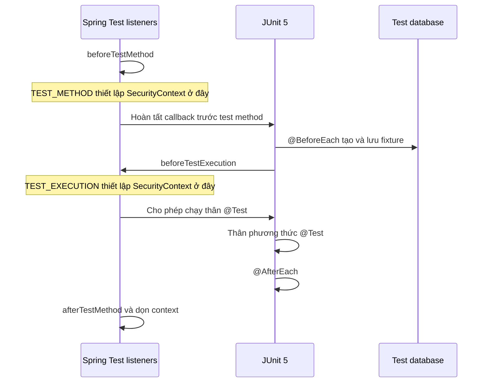

# `setupBefore` khi dữ liệu người dùng được tạo trong bước chuẩn bị

## 1. Vấn đề về thứ tự chuẩn bị dữ liệu

Khi kiểm thử Spring Security, một số annotation tạo `SecurityContext` trước khi thân phương thức `@Test` chạy. Với `@WithUserDetails`, factory cần gọi `UserDetailsService.loadUserByUsername(username)` để tải principal. Nếu tài khoản chỉ được tạo trong `@BeforeEach`, service có thể tìm người dùng **trước khi fixture được lưu** và ném `UsernameNotFoundException`.

Thuộc tính **`setupBefore`** cho phép chọn thời điểm Spring Test thiết lập security context. Mặc định là `TestExecutionEvent.TEST_METHOD`, xảy ra trước `@BeforeEach`. Khi dữ liệu được tạo trong `@BeforeEach`, thường cần chọn `TestExecutionEvent.TEST_EXECUTION`, xảy ra sau `@BeforeEach` và ngay trước thân phương thức test.

Bài học thuộc chương **Annotation người dùng** của module **SPRING_SECURITY_TESTING**. Module hướng dẫn kiểm chứng xác thực, phân quyền và bảo vệ HTTP thực tế bằng `spring-security-test` trên ứng dụng Servlet và Reactive, sử dụng `MockMvc`, `WebTestClient`, `SecurityContext` và các danh tính JWT/OAuth2/OIDC giả lập.

Sau bài học, bạn có thể:

- Mô tả đúng thứ tự giữa listener Spring Test, `@BeforeEach` và thân `@Test`.
- Chọn `TEST_METHOD` hay `TEST_EXECUTION` cho `@WithUserDetails`, `@WithMockUser` và annotation bảo mật tùy chỉnh.
- Seed tài khoản trong `@BeforeEach`, `@BeforeAll` hoặc `@Sql` đúng thời điểm.
- Hiểu ảnh hưởng của transaction, flush, commit và rollback tới khả năng service tìm thấy fixture.
- Nhận biết trường hợp `@BeforeEach` cần authentication và vì sao đổi thời điểm có thể ảnh hưởng chính fixture.
- Phân biệt lỗi tạo `SecurityContext` với HTTP `401`/`403` từ request.

## 2. setupBefore là gì?

Các annotation dựa trên `@WithSecurityContext` có thuộc tính `setupBefore`. Với `@WithUserDetails`:

```java
@Test
@WithUserDetails(
    value = "mai",
    setupBefore = TestExecutionEvent.TEST_EXECUTION
)
void loadsUserAfterPreparation() {
    // SecurityContext được thiết lập sau @BeforeEach.
}
```

Các import:

```java
import org.springframework.security.test.context.support.TestExecutionEvent;
import org.springframework.security.test.context.support.WithUserDetails;
```

Hai giá trị thường dùng:

| Giá trị | Thời điểm thiết lập `SecurityContext` | Phù hợp khi |
| --- | --- | --- |
| `TEST_METHOD` | Trong callback `beforeTestMethod`, trước `@BeforeEach` | Người dùng đã tồn tại trước khi test method bắt đầu |
| `TEST_EXECUTION` | Trong callback `beforeTestExecution`, sau `@BeforeEach`, trước thân `@Test` | Fixture người dùng được tạo trong `@BeforeEach` |

`TEST_METHOD` là giá trị mặc định của `@WithUserDetails`, `@WithMockUser` và `@WithAnonymousUser`. Bạn có thể chỉ định `setupBefore` khi cần thay đổi thời điểm.

## 3. Thứ tự vòng đời của Spring Test và JUnit 5

Trong một test JUnit 5 tích hợp với Spring Test, thứ tự liên quan có thể hình dung như sau:



Thứ tự cần nhớ:

1. Spring Test gọi `beforeTestMethod`.
2. Nếu annotation dùng `TEST_METHOD`, factory tạo security context ở giai đoạn này.
3. JUnit gọi các phương thức `@BeforeEach`.
4. Spring Test gọi `beforeTestExecution`.
5. Nếu annotation dùng `TEST_EXECUTION`, factory tạo security context ở giai đoạn này.
6. Thân phương thức `@Test` được thực thi.
7. JUnit chạy `@AfterEach`; Spring Test thực hiện các callback kết thúc và dọn context theo vòng đời.

Điểm khác biệt không nằm ở cách tạo principal mà ở **thời điểm factory được gọi**. `setupBefore` không seed dữ liệu, không chờ repository tự hoàn tất và không thay đổi cách `UserDetailsService` tìm tài khoản.

## 4. Vì sao TEST_METHOD thất bại với fixture trong @BeforeEach?

Giả sử tài khoản chỉ được tạo trong `@BeforeEach`:

```java
@SpringBootTest
@Transactional
class AccountSecurityTest {

    @Autowired
    AccountRepository accountRepository;

    @BeforeEach
    void setUp() {
        accountRepository.save(new Account(
                "mai",
                "{noop}test-password",
                true,
                Set.of("account:read")
        ));
    }

    @Test
    @WithUserDetails(
        value = "mai",
        userDetailsServiceBeanName = "accountDetailsService"
    )
    void loadsMai() {
        // Factory có thể tìm mai trước khi setUp() chạy.
    }
}
```

Mặc định, `@WithUserDetails` được xử lý ở `TEST_METHOD). Lúc đó `@BeforeEach` chưa chạy, nên bản ghi `mai` chưa được tạo. `AccountDetailsService.loadUserByUsername("mai")` ném `UsernameNotFoundException`; thân test chưa được thực thi.

Sửa bằng `TEST_EXECUTION`:

```java
@Test
@WithUserDetails(
    value = "mai",
    userDetailsServiceBeanName = "accountDetailsService",
    setupBefore = TestExecutionEvent.TEST_EXECUTION
)
void loadsMaiAfterSetUp() {
    Authentication authentication = SecurityContextHolder.getContext()
            .getAuthentication();

    assertThat(authentication.getName()).isEqualTo("mai");
    assertThat(authentication.getAuthorities())
            .extracting(GrantedAuthority::getAuthority)
            .contains("account:read");
}
```

Khi factory chạy ở `TEST_EXECUTION`, `@BeforeEach` đã tạo tài khoản. Service có thể tải principal từ repository rồi Spring Test mới bắt đầu thân test.

## 5. Ví dụ hoàn chỉnh với MockMvc

Ví dụ sau dùng service thật để tải người dùng từ repository, sau đó kiểm tra endpoint cần authority `account:read`.

### 5.1. UserDetailsService

```java
@Service("accountDetailsService")
class AccountDetailsService implements UserDetailsService {

    private final AccountRepository repository;

    AccountDetailsService(AccountRepository repository) {
        this.repository = repository;
    }

    @Override
    public UserDetails loadUserByUsername(String username) {
        Account account = repository.findByUsername(username)
                .orElseThrow(() ->
                        new UsernameNotFoundException("Account not found"));

        return User.withUsername(account.getUsername())
                .password(account.getPasswordHash())
                .authorities(account.getAuthorities().toArray(String[]::new))
                .disabled(!account.isEnabled())
                .build();
    }
}
```

### 5.2. Controller và chính sách

```java
@RestController
class AccountController {

    @GetMapping("/accounts/me")
    Map<String, String> me(
            @AuthenticationPrincipal UserDetails principal) {
        return Map.of("username", principal.getUsername());
    }
}
```

```java
@Configuration
class AccountSecurityConfig {

    @Bean
    SecurityFilterChain accountFilterChain(HttpSecurity http)
            throws Exception {
        http.authorizeHttpRequests(auth -> auth
                .requestMatchers("/accounts/me")
                    .hasAuthority("account:read")
                .anyRequest().denyAll()
        );
        http.httpBasic(Customizer.withDefaults());
        return http.build();
    }
}
```

### 5.3. Test với fixture trong @BeforeEach

```java
@SpringBootTest
@AutoConfigureMockMvc
@Transactional
class AccountControllerSecurityTest {

    @Autowired
    AccountRepository accountRepository;

    @Autowired
    MockMvc mockMvc;

    @BeforeEach
    void prepareAccount() {
        accountRepository.saveAndFlush(new Account(
                "mai",
                "{noop}test-only-password",
                true,
                Set.of("account:read")
        ));
    }

    @Test
    @WithUserDetails(
        value = "mai",
        userDetailsServiceBeanName = "accountDetailsService",
        setupBefore = TestExecutionEvent.TEST_EXECUTION
    )
    void preparedAccountCanReadOwnProfile() throws Exception {
        mockMvc.perform(get("/accounts/me"))
                .andExpect(status().isOk())
                .andExpect(jsonPath("$.username").value("mai"));
    }
}
```

Fixture được lưu trước khi factory tải user. Request `GET /accounts/me` chạy qua security filter chain và được phép vì principal mang authority `account:read`.

Nếu test được đánh dấu `@Transactional`, fixture thường nằm trong transaction của test và được rollback khi kết thúc. `saveAndFlush` đẩy SQL xuống database, nhưng không tự commit transaction. Khi service đọc trong cùng transaction, dữ liệu vừa lưu thường có thể được nhìn thấy; nếu service đọc qua transaction/connection khác, cần xem xét commit và isolation.

## 6. Khi nào vẫn nên dùng TEST_METHOD?

Không phải mọi fixture đều được tạo trong `@BeforeEach`. Nếu user đã tồn tại trước mỗi test method, giá trị mặc định `TEST_METHOD` thường phù hợp:

- Tài khoản được seed bằng migration hoặc dữ liệu khởi tạo của test database.
- Fixture được tạo trong quá trình khởi tạo ApplicationContext.
- Dữ liệu được chuẩn bị bởi script ở pha trước khi security context được thiết lập.
- Test cần principal sẵn sàng ngay trong `@BeforeEach`.

Ví dụ:

```java
@SpringBootTest
@WithUserDetails(
    value = "mai",
    userDetailsServiceBeanName = "accountDetailsService",
    setupBefore = TestExecutionEvent.TEST_METHOD
)
class ExistingAccountSecurityTest {

    @Autowired
    MockMvc mockMvc;

    @Test
    void beforeEachCanSeePreparedAuthentication() {
        // User mai đã được seed từ trước.
    }
}
```

Nếu `@BeforeEach` cần đọc `SecurityContextHolder.getContext().getAuthentication()`, `TEST_METHOD` có thể là lựa chọn đúng vì context đã được thiết lập trước callback đó. Nếu chuyển sang `TEST_EXECUTION`, context do annotation tạo chưa có trong `@BeforeEach`; code chuẩn bị cần authentication có thể thấy context trống hoặc context khác do ứng dụng thiết lập.

Vì vậy, hãy quyết định theo **phụ thuộc của bước chuẩn bị**:

| Nhu cầu của `@BeforeEach` | Lựa chọn phù hợp |
| --- | --- |
| Tạo user mà không cần authentication; annotation phải tải user sau đó | `TEST_EXECUTION` |
| Cần sử dụng authentication do annotation tạo trong `@BeforeEach` | `TEST_METHOD` |
| User đã tồn tại từ trước; không cần seed theo từng test | Thường dùng `TEST_METHOD` |
| Fixture được tạo trong một giai đoạn sớm hơn `beforeTestMethod` | `TEST_METHOD` có thể dùng được |

## 7. Chuẩn bị dữ liệu bằng @BeforeAll hoặc @Sql

### 7.1. @BeforeAll

Nếu dữ liệu dùng chung cho nhiều test và có thể được tạo trước từng test method, `@BeforeAll` là một lựa chọn. Với JUnit 5, phương thức `@BeforeAll` mặc định phải static; có thể dùng lifecycle `PER_CLASS` để viết phương thức instance:

```java
@SpringBootTest
@TestInstance(TestInstance.Lifecycle.PER_CLASS)
class SharedAccountTest {

    @Autowired
    AccountRepository repository;

    @BeforeAll
    void seedAccount() {
        if (!repository.existsByUsername("mai")) {
            repository.save(new Account(
                    "mai",
                    "{noop}test-password",
                    true,
                    Set.of("account:read")
            ));
        }
    }

    @Test
    @WithUserDetails("mai")
    void loadsSeededUser() {
        // mai đã tồn tại trước TEST_METHOD.
    }
}
```

Fixture dùng chung cần cleanup và kiểm soát khi chạy song song. Nếu nhiều lớp test cùng dùng database, tránh dựa vào thứ tự chạy hoặc giả định dữ liệu từ test khác còn tồn tại.

### 7.2. @Sql

Với fixture cố định, có thể seed bằng script:

```java
@SpringBootTest
@Sql(
    scripts = "/sql/insert-account-mai.sql",
    executionPhase = Sql.ExecutionPhase.BEFORE_TEST_METHOD
)
class SqlSeededAccountTest {

    @Test
    @WithUserDetails("mai")
    void loadsSqlSeededUser() {
        // Dữ liệu đã được chuẩn bị bởi script trước test method.
    }
}
```

`@Sql` cho phép chỉ định pha thực thi. Trong cấu hình Spring Test chuẩn, script `BEFORE_TEST_METHOD` là cách thường dùng để chuẩn bị dữ liệu trước ca test; nếu dự án tùy chỉnh `TestExecutionListener`, hãy xác minh thứ tự listener thực tế so với listener tạo `SecurityContext`.

Có thể xóa fixture sau test:

```java
@Sql(
    scripts = "/sql/delete-account-mai.sql",
    executionPhase = Sql.ExecutionPhase.AFTER_TEST_METHOD
)
```

Không dùng cùng username cố định nếu các test có thể chạy đồng thời trên cùng database mà không có cleanup hoặc cách cô lập dữ liệu.

## 8. Khi @BeforeEach cần authentication

Một trường hợp đặc biệt: `@BeforeEach` không chỉ seed database mà còn gọi một service được bảo vệ hoặc đọc principal để tạo fixture theo người dùng hiện tại.

Ví dụ:

```java
@BeforeEach
void prepareUserSpecificFixture() {
    Authentication authentication = SecurityContextHolder.getContext()
            .getAuthentication();

    String username = authentication.getName();
    fixtureService.createFor(username);
}
```

Nếu annotation dùng `TEST_METHOD`, context được thiết lập trước `@BeforeEach`, nên phương thức chuẩn bị có thể đọc authentication từ annotation. Nếu đổi sang `TEST_EXECUTION`, context do annotation chưa được thiết lập khi `@BeforeEach` chạy; đoạn code trên không còn đảm bảo đọc được người dùng dự kiến.

Có ba hướng giải quyết:

1. Giữ `TEST_METHOD` và chuẩn bị dữ liệu mà service tải user cần từ một giai đoạn sớm hơn.
2. Tách việc seed dữ liệu không cần authentication sang `@BeforeEach`, còn thao tác cần user chuyển vào thân test sau khi context được thiết lập.
3. Dùng một fixture builder không phụ thuộc security context để tạo dữ liệu, rồi để request được bảo vệ kiểm tra quyền sau đó.

Không nên đổi sang `TEST_EXECUTION` một cách máy móc. Hãy kiểm tra xem chính bước chuẩn bị có phụ thuộc vào authentication được annotation tạo hay không.

## 9. Transaction, flush, commit và rollback

Thời điểm listener chỉ là một phần của bài toán. Service có thể được gọi sau `@BeforeEach` nhưng vẫn không thấy dữ liệu nếu fixture và truy vấn không chia sẻ transaction hoặc nguồn dữ liệu.

| Tình huống | Cần hiểu |
| --- | --- |
| `save` trong cùng transaction test | Entity được quản lý; truy vấn trong transaction thường nhìn thấy dữ liệu |
| `saveAndFlush` | Đẩy SQL xuống database, không tự commit |
| Service truy vấn trong transaction khác | Có thể không thấy dữ liệu chưa commit tùy isolation và connection |
| Test transaction rollback | Fixture được hoàn tác khi test kết thúc |
| Seed bằng script ngoài transaction test | Cần cleanup hoặc reset database |

`flush()` không đồng nghĩa `commit()`. Nếu dùng JPA, `saveAndFlush` có thể giúp đảm bảo SQL đã được gửi trước khi service truy vấn, nhưng không làm bản ghi hiển thị cho một transaction khác nếu transaction chứa nó chưa commit.

Khi username vẫn không được tìm thấy, kiểm tra:

- Service dùng đúng datasource và schema không?
- Username có được chuẩn hóa giống nhau khi lưu và tìm kiếm không?
- Có tenant filter hoặc soft-delete condition làm bản ghi bị ẩn không?
- Repository và service có tham gia cùng transaction không?
- Fixture có bị rollback hoặc cleanup trước khi service truy vấn không?

## 10. setupBefore với @WithMockUser và annotation tùy chỉnh

`setupBefore` không chỉ dành cho `@WithUserDetails`. `@WithMockUser`, `@WithAnonymousUser` và annotation tùy chỉnh dùng `@WithSecurityContext` cũng có thể chọn thời điểm thiết lập context.

Ví dụ `@WithMockUser`:

```java
@Test
@WithMockUser(
    username = "mai",
    roles = "ADMIN",
    setupBefore = TestExecutionEvent.TEST_EXECUTION
)
void mockUserIsInstalledAfterBeforeEach() {
    // @BeforeEach chạy trước khi context này được thiết lập.
}
```

Với annotation tùy chỉnh:

```java
@Retention(RetentionPolicy.RUNTIME)
@Target({ElementType.METHOD, ElementType.TYPE})
@WithSecurityContext(
    factory = WithAppUserSecurityContextFactory.class,
    setupBefore = TestExecutionEvent.TEST_EXECUTION
)
public @interface WithAppUser {
    long accountId();
    String username();
}
```

Factory vẫn tạo principal và authentication theo logic riêng; `setupBefore` chỉ điều khiển thời điểm Spring Test gọi factory.

## 11. Ghi đè annotation cấp lớp

Nếu lớp có annotation mặc định, annotation ở phương thức có thể thay thế danh tính cho riêng test đó:

```java
@SpringBootTest
@WithMockUser(username = "default-user", roles = "USER")
class AccountSecurityTest {

    @Test
    void usesClassDefault() {
        // default-user / ROLE_USER
    }

    @Test
    @WithUserDetails(
        value = "mai",
        userDetailsServiceBeanName = "accountDetailsService",
        setupBefore = TestExecutionEvent.TEST_EXECUTION
    )
    void loadsPreparedAccount() {
        // Dùng principal mai do service tải.
    }

    @Test
    @WithAnonymousUser
    void usesAnonymousContext() {
        // AnonymousAuthenticationToken thay thế người dùng mặc định.
    }
}
```

Annotation ở phương thức thay thế annotation ở lớp, không cộng dồn authorities hoặc principal. Nếu phương thức dùng `@WithUserDetails`, tài khoản vẫn phải tồn tại đúng thời điểm factory chạy.

## 12. Phân biệt lỗi setup với HTTP 401 và 403

Nếu `@WithUserDetails` không tìm thấy username, lỗi xảy ra trong lúc Spring Test tạo context, trước khi thân test và request HTTP chạy:

```java
@Test
@WithUserDetails("missing-user")
void userDoesNotExist() {
    // Thân test không chạy nếu factory ném UsernameNotFoundException.
}
```

Không diễn giải lỗi này thành HTTP `401`. Hai nhóm kết quả khác nhau:

| Kết quả | Giai đoạn | Ý nghĩa |
| --- | --- | --- |
| `UsernameNotFoundException` | Chuẩn bị SecurityContext | Service không tải được username |
| `NoSuchBeanDefinitionException` | Phân giải bean | Test context không có service được yêu cầu |
| `401 Unauthorized` | Request đi qua authentication entry point | Request chưa được xác thực theo cấu hình ứng dụng |
| `403 Forbidden` | Authorization hoặc filter từ chối | Đã có danh tính nhưng thiếu quyền, hoặc request bị chặn như CSRF |
| `200 OK` | Request được xử lý thành công | Security chain cho phép và controller trả thành công |

Muốn kiểm tra khách chưa đăng nhập, dùng `@WithAnonymousUser` hoặc gửi request không có credential qua filter chain. Muốn kiểm tra đăng nhập sai mật khẩu, gửi credential qua endpoint hoặc gọi AuthenticationManager thực tế.

## 13. Những lỗi thường gặp

| Hiện tượng | Nguyên nhân | Cách xử lý |
| --- | --- | --- |
| `UsernameNotFoundException` trước `@BeforeEach` | Factory chạy ở `TEST_METHOD`, fixture chưa được tạo | Dùng `TEST_EXECUTION` hoặc seed sớm hơn |
| Đổi sang `TEST_EXECUTION` nhưng `@BeforeEach` lỗi | Setup method cần authentication do annotation cung cấp | Giữ `TEST_METHOD` hoặc tách fixture |
| Service vẫn không tìm thấy sau `@BeforeEach` | Sai datasource, tenant, username hoặc transaction | Kiểm tra nguồn dữ liệu và khả năng nhìn thấy fixture |
| `saveAndFlush` nhưng transaction khác vẫn không thấy | Flush không phải commit | Kiểm tra transaction boundary/isolation |
| `@Sql` seed nhưng annotation vẫn lỗi | Script chưa chạy trước listener thiết lập context hoặc script sai schema | Xác minh listener order, pha SQL và dữ liệu |
| `@WebMvcTest` không tìm thấy UserDetailsService | Slice không nạp bean | Import service và dependency hoặc dùng `@SpringBootTest` |
| Test chạy riêng được nhưng chạy suite thất bại | Dữ liệu dùng chung, duplicate username hoặc test song song | Cô lập fixture và cleanup |
| Test mong HTTP 401 nhưng nhận exception lúc setup | Lỗi tạo SecurityContext bị nhầm với request | Dùng danh tính anonymous hoặc gửi credential qua HTTP |
| WebFlux không thấy context | Thiếu tích hợp reactive test hoặc dùng sai cơ chế context | Cấu hình WebTestClient và Reactor Context |

## 14. Bài tập thực hành

Một ứng dụng quản lý tài khoản có:

- `AccountDetailsService` tải `UserDetails` từ `AccountRepository`.
- `GET /accounts/me` yêu cầu `account:read`.
- Test tạo tài khoản `mai` trong `@BeforeEach`.
- Một phương thức `@BeforeEach` khác đọc username hiện tại từ `SecurityContextHolder` để tạo dữ liệu riêng.

Hãy thực hiện:

1. Dùng `@WithUserDetails("mai")` với mặc định và giải thích vì sao service có thể chạy trước fixture.
2. Chuyển sang `setupBefore = TEST_EXECUTION`; xác nhận service tải được user sau bước seed.
3. Xem xét phương thức `@BeforeEach` thứ hai: vì sao nó không thể dựa vào authentication do annotation thiết lập ở `TEST_EXECUTION`?
4. Đề xuất cách tách bước seed không cần authentication khỏi bước chuẩn bị phụ thuộc người dùng.
5. Chuyển fixture sang `@Sql(BEFORE_TEST_METHOD)` hoặc dữ liệu khởi tạo sẵn và so sánh với `@BeforeEach`.
6. Thử `save` và `saveAndFlush` trong test transaction; giải thích tại sao flush không đồng nghĩa commit.
7. Tạo username không tồn tại; xác định lỗi xảy ra trong setup chứ không phải HTTP 401.
8. Viết thêm test HTTP với `@WithAnonymousUser` để kiểm tra endpoint được bảo vệ.

**Câu hỏi tự kiểm tra:** Nếu `@BeforeEach` vừa tạo user vừa cần đọc `Authentication` do annotation cung cấp, có nên chuyển toàn bộ test sang `TEST_EXECUTION` không? **Không.** Khi đó context do annotation chưa được thiết lập trong `@BeforeEach`. Hãy giữ thời điểm sớm cho test cần authentication ở bước chuẩn bị, hoặc tách fixture thành các giai đoạn phù hợp.

## 15. Ghi nhớ

`setupBefore` quyết định khi nào Spring Test tạo `SecurityContext`. `TEST_METHOD` mặc định chạy trước `@BeforeEach`; `TEST_EXECUTION` chạy sau `@BeforeEach` và trước thân `@Test`. Khi `@WithUserDetails` cần tải tài khoản được tạo trong `@BeforeEach`, thường chọn `TEST_EXECUTION`. Nhưng nếu chính `@BeforeEach` cần authentication từ annotation, giữ `TEST_METHOD` hoặc tách bước chuẩn bị. Luôn xem xét transaction, SQL fixture và test context; lỗi tải user trong setup không phải HTTP `401` hay `403`.
