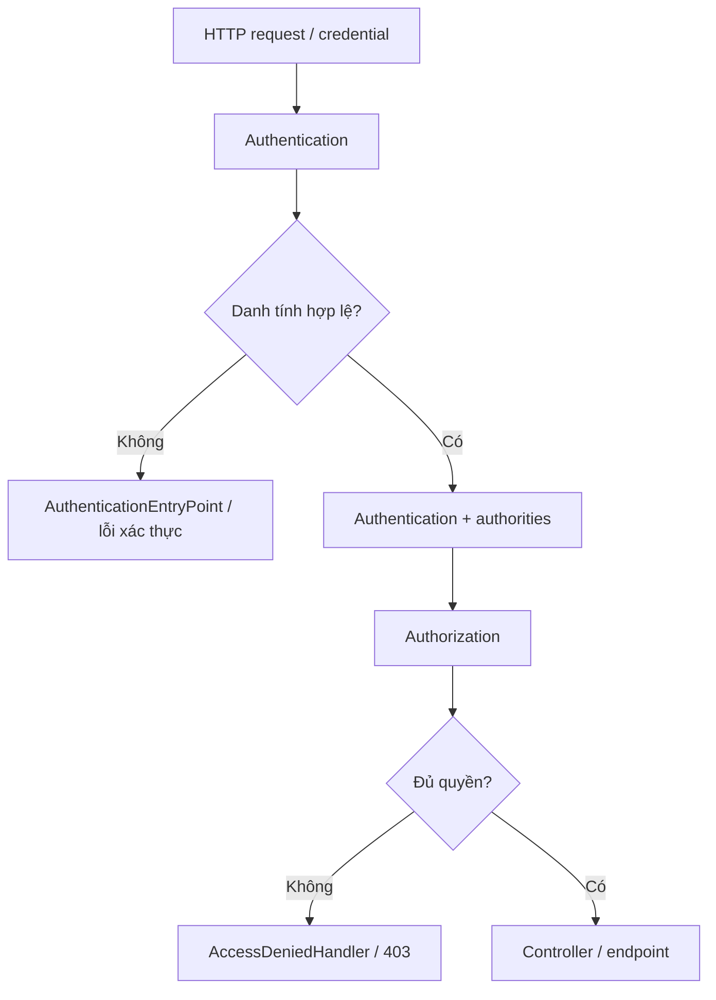

# Giới hạn của annotation người dùng đối với đăng nhập, mật khẩu và token thật

## 1. Annotation người dùng kiểm tra được điều gì?

Trong kiểm thử Spring Security, các annotation như `@WithMockUser`, `@WithUserDetails`, `@WithAnonymousUser` và annotation tùy chỉnh dựa trên `@WithSecurityContext` giúp chuẩn bị một danh tính để kiểm tra quy tắc phân quyền. Chúng rất hữu ích khi cần trả lời câu hỏi: **nếu request đang mang danh tính và authorities này, endpoint có cho phép truy cập không?**

Tuy nhiên, dựng sẵn một `SecurityContext` không đồng nghĩa với việc đã kiểm tra quy trình đăng nhập. Annotation không tự gửi mật khẩu qua HTTP, không gọi `AuthenticationManager` để xác minh mật khẩu và không xác minh chữ ký của access token JWT. Nếu chỉ dùng annotation mà kết luận đăng nhập, mật khẩu hoặc token thật hoạt động chính xác, phạm vi kiểm thử đã bị hiểu rộng hơn những gì test thực sự chứng minh.

Bài học thuộc chương **Annotation người dùng** của module **SPRING_SECURITY_TESTING**. Module hướng dẫn kiểm chứng xác thực, phân quyền và bảo vệ HTTP thực tế bằng `spring-security-test` trên ứng dụng Servlet và Reactive. Người học sử dụng `MockMvc`, `WebTestClient`, `@WithMockUser`, `SecurityContext`, JWT/OAuth2/OIDC giả lập và các ca được phép hoặc bị từ chối.

Sau bài này, bạn có thể:

- Phân biệt kiểm thử authentication (xác thực) với authorization (phân quyền).
- Nêu chính xác giới hạn của `@WithMockUser`, `@WithUserDetails` và `@WithSecurityContext`.
- Chọn cách gửi credential qua HTTP để kiểm tra `AuthenticationManager`, `AuthenticationProvider` và `PasswordEncoder`.
- Hiểu vì sao `jwt()`, `mockJwt()`, `oauth2Login()` và `oidcLogin()` không chứng minh token hoặc luồng đăng nhập thật đã được xác minh.
- Thiết kế test riêng cho CSRF, HTTP Basic, form login, JWT Resource Server và OAuth2/OIDC.
- Áp dụng cách phân chia phạm vi tương tự trên `MockMvc` và `WebTestClient`.

## 2. Authentication và authorization là hai câu hỏi khác nhau

**Authentication** xác định danh tính của bên gửi request. Ví dụ:

- Username và password có hợp lệ không?
- Tài khoản có bị khóa hoặc vô hiệu hóa không?
- JWT có chữ ký, issuer, audience và thời hạn hợp lệ không?
- OAuth2/OIDC authorization response có được xử lý đúng không?

**Authorization** quyết định danh tính đã được xác lập có được phép thực hiện hành động hay không:

- Người có `ROLE_ADMIN` có được truy cập `/admin` không?
- Người có `SCOPE_reports.read` có được đọc báo cáo không?
- Người dùng của tenant A có được xem dữ liệu tenant B không?

Sơ đồ tổng quát:



Các annotation người dùng thường đặt test ở giữa hai bước: chúng tạo sẵn `Authentication` và authorities để test tập trung vào authorization. Khi đó test có thể bỏ qua cơ chế xác thực credential đầu vào.

| Câu hỏi | Loại kiểm thử |
| --- | --- |
| Mật khẩu sai có bị từ chối không? | Authentication |
| Password hash được kiểm tra bằng đúng `PasswordEncoder` không? | Authentication |
| Token hết hạn có bị từ chối không? | Authentication/token validation |
| Người có `ROLE_ADMIN` được phép gọi endpoint không? | Authorization |
| Người có `SCOPE_reports.read` bị từ chối khi gọi API ghi không? | Authorization |
| Anonymous nhận phản hồi theo entry point nào? | Authentication entry point và HTTP security integration |

Một test có thể kiểm tra cả hai giai đoạn, nhưng cần biết fixture của test có tạo sẵn danh tính hay gửi credential/token để hệ thống tự xác thực.

## 3. Giới hạn của từng annotation người dùng

### 3.1. `@WithMockUser`

`@WithMockUser` yêu cầu Spring Security Test tạo một `SecurityContext` có `UsernamePasswordAuthenticationToken` đã xác thực và principal mặc định kiểu `org.springframework.security.core.userdetails.User`.

```java
@Test
@WithMockUser(username = "mai", roles = "ADMIN")
void adminCanReadAdminEndpoint() throws Exception {
    mockMvc.perform(get("/admin"))
            .andExpect(status().isOk());
}
```

Test này chứng minh rằng danh tính giả lập `mai` với authority `ROLE_ADMIN` được phép qua chính sách endpoint đang được áp dụng. Nó **không** chứng minh:

- Người dùng `mai` tồn tại trong database.
- Mật khẩu người dùng là đúng.
- `PasswordEncoder` được gọi hoặc so khớp thành công.
- Form login hoặc HTTP Basic filter xử lý credential đúng.
- Tài khoản disabled/locked được kiểm tra đúng qua authentication provider.
- Token hoặc cookie phiên thật được phát hành.

Thuộc tính `password` của `@WithMockUser` chỉ là dữ liệu của principal giả lập; nó không phải mật khẩu được gửi đến `AuthenticationManager`.

### 3.2. `@WithUserDetails`

`@WithUserDetails` gọi `UserDetailsService.loadUserByUsername(username)` để lấy đối tượng `UserDetails` từ ApplicationContext:

```java
@Test
@WithUserDetails(
    value = "mai",
    userDetailsServiceBeanName = "accountDetailsService"
)
void loadedUserCanReadAccount() {
    // Dùng principal và authorities do service trả về.
}
```

Nó có thể kiểm tra:

- Bean `UserDetailsService` được phân giải đúng.
- Username được tải từ nguồn dữ liệu mà service sử dụng.
- Principal tùy chỉnh và authorities được ánh xạ đúng.
- Quy tắc authorization cho danh tính đã tải.

Nhưng factory tạo security context trực tiếp từ `UserDetails`; nó không thực hiện đăng nhập qua `AuthenticationManager` hoặc `AuthenticationProvider`. Vì vậy, test không chứng minh mật khẩu được xác minh, `PasswordEncoder.matches` chạy, hay các trạng thái locked/disabled bị từ chối như trong luồng đăng nhập.

### 3.3. `@WithAnonymousUser`

`@WithAnonymousUser` tạo một `AnonymousAuthenticationToken` để kiểm tra hành vi của danh tính ẩn danh. Nó hữu ích khi test một phương thức trong lớp đang có `@WithMockUser` mặc định.

Tuy nhiên, annotation này vẫn dựng một authentication giả. Nó không chứng minh request HTTP thực sự không có cookie phiên, Basic credentials hoặc Bearer token. Muốn kiểm tra entry point khi không gửi credential, cần gửi request không có credential qua filter chain thực tế.

### 3.4. `@WithSecurityContext` và annotation tổng hợp

Factory tùy chỉnh thường tạo `Authentication` và đặt vào `SecurityContext`:

```java
SecurityContext context = SecurityContextHolder.createEmptyContext();
context.setAuthentication(authentication);
return context;
```

Đây là cách kiểm soát principal, authorities hoặc token giả lập. Nó không tự chạy quy trình xác thực. Annotation tổng hợp từ `@WithMockUser` hoặc `@WithUserDetails` cũng giữ nguyên giới hạn của annotation nền mà nó bao bọc.

## 4. Bảng so sánh phạm vi kiểm thử

| Công cụ | Tạo hoặc nạp danh tính | Có kiểm tra credential/token thật? | Mục tiêu chính |
| --- | --- | --- | --- |
| `@WithMockUser` | Tạo principal `User` giả | Không | Authorization |
| `@WithAnonymousUser` | Tạo anonymous token | Không | Anonymous authorization/entry point trong context test |
| `@WithUserDetails` | Gọi `UserDetailsService` | Không kiểm tra password | Principal, authorities và authorization |
| `@WithSecurityContext` | Factory tạo authentication tùy chỉnh | Không, trừ khi factory chủ động tích hợp một cơ chế khác | Context tùy chỉnh |
| `user(customUserDetails)` của MockMvc | Gắn `UserDetails` vào request test | Không | Authorization với principal cụ thể |
| `jwt()` / `mockJwt()` | Tạo JWT authentication giả | Không xác minh chữ ký JWT | Authorization với principal JWT |
| `oauth2Login()` / `oidcLogin()` | Tạo OAuth2/OIDC authentication giả | Không chạy authorization code flow thật | Authorization với OAuth2/OIDC principal |
| HTTP Basic header qua filter chain | Gửi username/password | Có, nếu cấu hình provider thật | Authentication và authorization |
| Form login request qua filter chain | Gửi username/password tới login endpoint | Có, nếu cấu hình provider thật | Authentication và authorization |
| Bearer token với JwtDecoder thật | Gửi JWT để Resource Server xử lý | Có | Token validation và authorization |

Chọn công cụ theo câu hỏi cần trả lời. Một test authorization không cần lặp lại toàn bộ luồng đăng nhập ở mọi phương thức; nhưng module cũng cần test riêng cho authentication để tránh bỏ sót lỗi ở provider hoặc token decoder.

## 5. Kiểm tra mật khẩu thật bằng HTTP Basic và MockMvc

Để xác minh password, request phải đi qua authentication filter và provider sử dụng `PasswordEncoder`. Ví dụ dưới đây cấu hình một người dùng trong bộ nhớ với BCrypt; request HTTP Basic gửi username/password qua header.

### 5.1. Cấu hình xác thực

```java
@Configuration
class BasicAuthTestConfig {

    @Bean
    PasswordEncoder passwordEncoder() {
        return new BCryptPasswordEncoder();
    }

    @Bean
    UserDetailsService userDetailsService(PasswordEncoder encoder) {
        UserDetails mai = User.withUsername("mai")
                .password(encoder.encode("correct-password"))
                .roles("USER")
                .build();
        return new InMemoryUserDetailsManager(mai);
    }

    @Bean
    AuthenticationProvider authenticationProvider(
            UserDetailsService userDetailsService,
            PasswordEncoder encoder) {
        DaoAuthenticationProvider provider = new DaoAuthenticationProvider();
        provider.setUserDetailsService(userDetailsService);
        provider.setPasswordEncoder(encoder);
        return provider;
    }

    @Bean
    SecurityFilterChain securityFilterChain(
            HttpSecurity http,
            AuthenticationProvider authenticationProvider) throws Exception {
        http.authenticationProvider(authenticationProvider);
        http.authorizeHttpRequests(auth -> auth
                .requestMatchers("/public").permitAll()
                .anyRequest().authenticated()
        );
        http.httpBasic(Customizer.withDefaults());
        return http.build();
    }
}
```

### 5.2. Endpoint và test

```java
@RestController
class PrivateController {

    @GetMapping("/private")
    String privatePage(Authentication authentication) {
        return "hello-" + authentication.getName();
    }
}
```

```java
@SpringBootTest
@AutoConfigureMockMvc
@Import(BasicAuthTestConfig.class)
class HttpBasicAuthenticationTest {

    @Autowired
    MockMvc mockMvc;

    @Test
    void validPasswordAuthenticatesUser() throws Exception {
        mockMvc.perform(get("/private")
                .with(httpBasic("mai", "correct-password")))
                .andExpect(status().isOk())
                .andExpect(authenticated().withUsername("mai"));
    }

    @Test
    void wrongPasswordIsRejected() throws Exception {
        mockMvc.perform(get("/private")
                .with(httpBasic("mai", "wrong-password")))
                .andExpect(status().isUnauthorized())
                .andExpect(unauthenticated());
    }

    @Test
    void missingCredentialsIsRejected() throws Exception {
        mockMvc.perform(get("/private"))
                .andExpect(status().isUnauthorized())
                .andExpect(unauthenticated());
    }
}
```

Các static import chính:

```java
import static org.springframework.security.test.web.servlet.request
        .SecurityMockMvcRequestPostProcessors.httpBasic;
import static org.springframework.security.test.web.servlet.result
        .SecurityMockMvcResultMatchers.authenticated;
import static org.springframework.security.test.web.servlet.result
        .SecurityMockMvcResultMatchers.unauthenticated;
```

Test dùng `httpBasic("mai", "correct-password")` để gửi credential qua HTTP Basic filter. Khi request được xử lý, `DaoAuthenticationProvider` tải người dùng và so khớp password bằng `BCryptPasswordEncoder`. Test sai mật khẩu phải bị từ chối. Đây là phạm vi kiểm thử authentication mà `@WithMockUser` không bao phủ.

Ví dụ sử dụng user in-memory để minh họa. Trong ứng dụng thực tế, hãy nạp `UserDetailsService`, `PasswordEncoder` và provider đúng như cấu hình production vào test context; không đưa mật khẩu production hoặc bí mật dùng chung vào mã kiểm thử.

## 6. Kiểm tra form login bằng MockMvc

Nếu ứng dụng sử dụng form login, Spring Security Test cung cấp request builder `formLogin()`. Request này gửi dữ liệu đăng nhập qua endpoint xử lý form login và đi qua cấu hình authentication của ứng dụng:

```java
@Test
void validFormCredentialsAuthenticate() throws Exception {
    mockMvc.perform(formLogin()
            .user("mai")
            .password("correct-password"))
            .andExpect(status().is3xxRedirection())
            .andExpect(authenticated().withUsername("mai"));
}

@Test
void invalidFormPasswordDoesNotAuthenticate() throws Exception {
    mockMvc.perform(formLogin()
            .user("mai")
            .password("wrong-password"))
            .andExpect(status().is3xxRedirection())
            .andExpect(unauthenticated());
}
```

Static import:

```java
import static org.springframework.security.test.web.servlet.request
        .SecurityMockMvcRequestBuilders.formLogin;
```

`formLogin()` mặc định dùng URL và tham số phổ biến của Spring Security form login. Nếu ứng dụng đổi login processing URL hoặc tên trường username/password, cần cấu hình builder cho khớp. Kết quả redirect phụ thuộc success/failure handler; hãy kiểm tra cả redirect URL nếu đó là hành vi quan trọng.

Nếu ứng dụng có endpoint đăng nhập JSON tùy chỉnh, dùng `MockMvc` gửi đúng HTTP method, content type và payload mà endpoint yêu cầu. Điều quan trọng là request phải đi qua chính authentication flow đang được ứng dụng sử dụng.

## 7. Vì sao @WithUserDetails không kiểm tra mật khẩu?

`@WithUserDetails` gọi:

```java
UserDetails user = userDetailsService.loadUserByUsername("mai");
```

Sau đó factory tạo authentication đã xác thực từ đối tượng trả về. Nó không có password đầu vào của request để so khớp, cũng không gọi `AuthenticationManager.authenticate(...)`. Do đó, kể cả `UserDetails` chứa password hash, test không chứng minh hash đó hợp lệ.

| Trường hợp | `@WithUserDetails` | HTTP Basic/form login qua provider |
| --- | --- | --- |
| Tải username từ UserDetailsService | Có | Có |
| Sử dụng authorities từ UserDetails | Có | Có |
| Kiểm tra password đầu vào | Không | Có |
| Gọi PasswordEncoder để so khớp | Không | Có, nếu provider được cấu hình |
| Kiểm tra account locked/disabled trong luồng authentication | Không đầy đủ | Có, theo provider và cấu hình |
| Tạo authentication để test authorization | Có | Có, sau khi xác thực thành công |

Nếu muốn kiểm tra password hash được lưu đúng, có thể viết unit test cho mapper/service hoặc test authentication qua provider. Không cần kiểm tra mật khẩu thật ở mọi test controller; hãy đặt test ở đúng tầng để tránh lặp lại và giữ test dễ bảo trì.

## 8. Giới hạn của JWT helper

Với Resource Server, helper `jwt()` của MockMvc và `mockJwt()` của WebTestClient tạo một JWT authentication giả lập. Ví dụ:

```java
mockMvc.perform(get("/api/reports")
        .with(jwt().jwt(jwt -> jwt
                .subject("client-42")
                .claim("scope", "reports.read")
        )))
    .andExpect(status().isOk());
```

Helper có thể tạo principal `Jwt` và authorities theo converter của test helper hoặc authority được chỉ định. Nó giúp kiểm tra:

- Controller nhận principal JWT đúng kiểu.
- Quy tắc `hasAuthority("SCOPE_reports.read")` cho phép hoặc từ chối.
- Mapping claim được ứng dụng sử dụng ở tầng authorization (nếu test chủ động tích hợp converter tương ứng).

Nhưng request post-processor `jwt()` **không chứng minh Bearer token thật đã được giải mã và xác minh**. Nó không kiểm tra chữ ký token nhận từ header, issuer, audience, thời hạn, key rotation hoặc lỗi từ nhà cung cấp khóa.

### Phân biệt mock JWT với token được xác minh

| Mục tiêu | Cách kiểm thử |
| --- | --- |
| Quy tắc authorization với một JWT đã được xem là hợp lệ | `jwt()` / `mockJwt()` |
| Bộ chuyển đổi claim thành authority | Test converter trực tiếp với `Jwt` fixture |
| Chữ ký JWT hợp lệ/không hợp lệ | Test `JwtDecoder` với token đã ký và khóa kiểm thử |
| Issuer, audience, expiry, not-before | Test validator/decoder và Resource Server |
| Bearer header đi qua filter chain | Integration test gửi header `Authorization: Bearer ...` với decoder thật |

Để kiểm tra decoder, hãy tạo token ký bằng khóa test, cấu hình decoder và validators như production, rồi gửi token qua request. Token giả lập từ `jwt()` không đi qua cùng quá trình xác minh.

## 9. Giới hạn của OAuth2 Login và OIDC helper

`oauth2Login()` và `oidcLogin()` tạo authentication/principal giả lập để kiểm tra phần ứng dụng sử dụng OAuth2 hoặc OIDC user:

```java
mockMvc.perform(get("/profile")
        .with(oidcLogin()
                .idToken(token -> token
                        .subject("user-123")
                        .claim("email", "mai@example.test")
                )))
    .andExpect(status().isOk());
```

Các helper này hữu ích để kiểm tra:

- Controller đọc đúng `OAuth2User` hoặc `OidcUser`.
- Mapping authorities và claims được sử dụng đúng.
- Quy tắc authorization cho danh tính OAuth2/OIDC.

Chúng **không** thực hiện authorization code flow với Identity Provider thật. Chúng không chứng minh redirect URI, state, nonce, code exchange, client secret, token endpoint, ID token signature hoặc issuer validation hoạt động.

| Phạm vi | Helper | Test bổ sung khi cần xác minh thật |
| --- | --- | --- |
| Controller dùng OAuth2 principal | `oauth2Login()` | Test controller/security policy |
| Controller dùng OIDC principal | `oidcLogin()` | Test controller/security policy |
| Redirect tới Identity Provider | Integration test với mock/test IdP | Kiểm tra redirect URI, state và authorization request |
| Trao đổi authorization code | Test OAuth2 client với token endpoint giả lập hoặc test IdP | Kiểm tra request token và xử lý lỗi |
| Xác minh ID token | Test decoder/validator hoặc IdP test | Chữ ký, issuer, audience, expiry, nonce |

Khi hệ thống cần bảo đảm tích hợp với nhà cung cấp danh tính, cần một lớp kiểm thử tích hợp riêng. Không gửi thông tin đăng nhập production tới test; sử dụng IdP sandbox hoặc máy chủ giả lập có dữ liệu và khóa riêng cho test.

## 10. Anonymous và request không có credential

`@WithAnonymousUser` tạo anonymous token trong test context. Nó hữu ích để kiểm tra authorization dành cho khách, nhưng không giống hoàn toàn với request HTTP không có credential:

```java
@Test
@WithAnonymousUser
void anonymousCannotAccessPrivateEndpoint() throws Exception {
    mockMvc.perform(get("/private"))
            .andExpect(status().isUnauthorized());
}
```

Muốn xác minh authentication entry point xử lý request thiếu credential, có thể gửi request không gắn annotation:

```java
@Test
void requestWithoutAuthorizationHeaderIsRejected() throws Exception {
    mockMvc.perform(get("/private"))
            .andExpect(status().isUnauthorized());
}
```

Trong cấu hình HTTP Basic, request không có header tới endpoint cần đăng nhập thường nhận `401`. Với form login, ứng dụng có thể chuyển hướng `302`. Một anonymous token được thiết lập bởi annotation có thể được nạp vào context test, nên không nên dùng annotation để khẳng định không có header, cookie hoặc credential nào được gửi.

## 11. CSRF cũng có phạm vi riêng

`@WithMockUser` chỉ chuẩn bị danh tính; nó không tạo CSRF token cho request thay đổi trạng thái. Với MockMvc, helper `csrf()` tạo token hợp lệ để test tập trung vào authorization:

```java
mockMvc.perform(post("/transfer")
        .with(user("mai").roles("USER"))
        .with(csrf()))
    .andExpect(status().isOk());
```

Có thể kiểm tra request thiếu hoặc sai token:

```java
mockMvc.perform(post("/transfer")
        .with(user("mai").roles("USER")))
    .andExpect(status().isForbidden());

mockMvc.perform(post("/transfer")
        .with(user("mai").roles("USER"))
        .with(csrf().useInvalidToken()))
    .andExpect(status().isForbidden());
```

Các ca này kiểm tra CSRF filter chấp nhận hoặc từ chối token được test helper cung cấp. Nếu muốn kiểm tra toàn bộ cách ứng dụng phát hành, lưu và gửi CSRF token (ví dụ cookie/header), cần mô phỏng cả chu trình request lấy token và request gửi token như client thật.

Với WebFlux, dùng `SecurityMockServerConfigurers.csrf()` và cấu hình `WebTestClient` tương ứng. Không dùng nhầm request post-processor của MockMvc.

## 12. WebFlux: mô phỏng user khác với HTTP Basic thật

Trong ứng dụng Reactive, `mockUser()` hoặc `mockJwt()` của `WebTestClient` thiết lập authentication giả lập để kiểm tra authorization:

```java
webTestClient
    .mutateWith(mockUser().roles("ADMIN"))
    .get()
    .uri("/admin")
    .exchange()
    .expectStatus().isOk();
```

Đây không phải là kiểm tra password. Muốn kiểm tra HTTP Basic thực, gửi header Basic vào request để Reactive authentication manager xử lý:

```java
webTestClient.get()
    .uri("/private")
    .headers(headers -> headers.setBasicAuth(
            "mai", "correct-password"
    ))
    .exchange()
    .expectStatus().isOk();
```

Test này cần cấu hình `ReactiveUserDetailsService` hoặc nguồn user tương ứng, `ReactiveAuthenticationManager`/provider và `PasswordEncoder` thật của test context. Request sai mật khẩu phải bị từ chối theo entry point của ứng dụng.

Nếu ứng dụng chỉ dùng `ReactiveUserDetailsService`, không thể dùng `@WithUserDetails` đồng bộ để chứng minh reactive lookup. Hãy test service reactive và luồng authentication Reactive riêng. Dù dùng helper hay gửi header thật, kiểm tra qua `WebTestClient` để bảo đảm ngữ cảnh được truyền đúng trong Reactor Context.

## 13. Ma trận chọn công cụ theo mục tiêu

| Mục tiêu | Công cụ phù hợp | Tránh kết luận sai |
| --- | --- | --- |
| Quyền của user đã xác thực | `@WithMockUser` | Không kết luận password đúng |
| Authorities/principal từ UserDetailsService | `@WithUserDetails` | Không kết luận AuthenticationProvider đã chạy |
| Khách ẩn danh trong context | `@WithAnonymousUser` | Không kết luận request không có credential |
| Principal đặc thù | `@WithSecurityContext` hoặc request user post-processor | Không kết luận cơ chế tạo principal production hoạt động |
| Password/HTTP Basic | `httpBasic(...)` qua MockMvc hoặc Basic header qua WebTestClient | Không dùng annotation để thay credential |
| Form login | `formLogin()` qua MockMvc hoặc request login thực tế | Không chỉ kiểm tra controller sau khi đã mock user |
| JWT authorization | `jwt()` / `mockJwt()` | Không kết luận chữ ký/issuer/audience đã được xác minh |
| JWT validation | Decoder/validator thật với token ký test | Không chỉ dùng token mock |
| OAuth2/OIDC principal | `oauth2Login()` / `oidcLogin()` | Không kết luận authorization code flow đã chạy |
| CSRF | `csrf()`, invalid/missing token và chu trình token thực tế | Không nhầm lỗi CSRF với thiếu authority |
| Reactive authorization | `mockUser()`, `mockJwt()` + WebTestClient | Không kết luận reactive authentication manager đã kiểm tra credential |

## 14. Lỗi thường gặp khi diễn giải kết quả test

| Nhận định sai | Vì sao sai | Cách diễn giải đúng |
| --- | --- | --- |
| Test `@WithMockUser` trả 200 nghĩa là đăng nhập thành công | Authentication được tạo sẵn, không kiểm tra credential | Test chứng minh quyền của danh tính giả lập |
| `@WithUserDetails` chứng minh mật khẩu đúng | Factory chỉ gọi `loadUserByUsername` | Test chứng minh user được tải và authorities được dùng |
| JWT helper chứng minh token hợp lệ | Helper tạo `JwtAuthenticationToken` giả | Test chỉ kiểm tra authorization với JWT giả |
| `oidcLogin()` chứng minh IdP hoạt động | Không chạy authorization code flow | Test principal/claims; cần IdP test cho flow |
| `@WithAnonymousUser` tương đương request trống | Annotation tạo anonymous token | Gửi request không credential để kiểm tra entry point |
| POST bị 403 nghĩa là thiếu role | Có thể bị CSRF filter chặn trước | Gửi CSRF hợp lệ khi đo riêng authorization |
| UserDetails có `enabled=false` mà annotation vẫn tạo context là provider hoạt động sai | Annotation không chạy toàn bộ authentication checks | Test trạng thái tài khoản qua AuthenticationProvider |
| Test helper làm token hợp lệ nhưng production decoder lỗi là mâu thuẫn | Hai test đi qua đường xử lý khác nhau | Bổ sung test decoder và Resource Server integration |

Một test tốt cần nêu rõ **đường đi của danh tính**: danh tính được annotation tạo, service tải, request post-processor gắn vào request, hay credential/token đi qua filter và provider. Đây là căn cứ để xác định test đang bảo vệ phần nào của hệ thống.

## 15. Gợi ý tổ chức bộ kiểm thử nhiều tầng

Một bộ kiểm thử Spring Security cân bằng thường chia thành các nhóm:

1. **Authorization tests:** dùng `@WithMockUser`, `@WithUserDetails`, `@WithAnonymousUser` để bao phủ ma trận role, authority, tenant và các endpoint được phép/bị từ chối.
2. **Authentication tests:** gửi HTTP Basic hoặc form login qua `MockMvc`/request HTTP để kiểm tra password, account status, provider và entry point.
3. **Token tests:** kiểm tra JWT decoder, claim converter, issuer/audience/expiry và Bearer filter với token ký bằng khóa test.
4. **OAuth2/OIDC integration tests:** dùng IdP sandbox hoặc mock server để kiểm tra redirect, state, nonce, code exchange và ID token validation.
5. **CSRF tests:** kiểm tra token thiếu, sai và hợp lệ; nếu cần, kiểm tra cách client lấy và gửi token.
6. **Reactive tests:** kiểm tra cả authorization qua configurer lẫn authentication manager/service reactive bằng request HTTP thực.

Không cần lặp lại mọi kiểm tra ở mọi endpoint. Hãy kiểm tra authentication mechanism ở tầng phù hợp, rồi dùng annotation để bao phủ ma trận authorization rộng hơn. Điều này giúp test chạy nhanh mà vẫn bảo vệ được các ranh giới quan trọng.

## 16. Bài tập thực hành

Một ứng dụng báo cáo có:

- HTTP Basic cho API nội bộ.
- `GET /reports` yêu cầu `SCOPE_reports.read`.
- `POST /reports/publish` yêu cầu `SCOPE_reports.write` và CSRF.
- Resource Server nhận JWT với claim `scope`.

Hãy viết các test sau:

1. Dùng `@WithMockUser(authorities = "SCOPE_reports.read")` xác minh GET được phép; giải thích vì sao test không kiểm tra token.
2. Dùng `@WithMockUser(authorities = "SCOPE_reports.read")` gọi POST với CSRF hợp lệ; xác nhận bị từ chối vì thiếu scope ghi.
3. Dùng `httpBasic("mai", "correct-password")` qua MockMvc cho endpoint cần đăng nhập; thêm ca password sai.
4. Viết ca `formLogin()` nếu ứng dụng dùng form login và xác minh success/failure handler.
5. Dùng `jwt()` để test authority từ scope; sau đó viết test riêng cho converter claim.
6. Tạo token ký bằng khóa kiểm thử và gửi Bearer header qua Resource Server có decoder thật; kiểm tra token sai chữ ký hoặc hết hạn bị từ chối.
7. Dùng `oidcLogin()` để kiểm tra controller đọc claim; ghi rõ test này không thực hiện authorization code flow.
8. Viết request không có Authorization header và phân biệt phản hồi của HTTP Basic với form login.
9. Trên WebFlux, dùng `mockUser()` cho authorization và gửi Basic header thật cho authentication; so sánh hai đường đi.

**Câu hỏi tự kiểm tra:** Nếu test `@WithMockUser(username = "mai", password = "wrong")` vẫn trả `200`, có phải PasswordEncoder chấp nhận mật khẩu sai không? **Không.** Password trong annotation không được gửi tới provider để xác minh. Muốn kiểm tra mật khẩu sai, hãy gửi credential sai qua HTTP Basic hoặc form login được cấu hình trong ứng dụng.

## 17. Ghi nhớ

Các annotation người dùng chủ yếu **dựng sẵn danh tính và SecurityContext để kiểm tra authorization**. `@WithMockUser` không kiểm tra mật khẩu; `@WithUserDetails` tải `UserDetails` nhưng không gọi AuthenticationManager; `@WithAnonymousUser` tạo anonymous token; `@WithSecurityContext` dùng factory tự tạo context. JWT/OAuth2/OIDC helpers cũng mô phỏng authentication/principal chứ không thay thế việc xác minh chữ ký, issuer, audience, nonce hay authorization code flow.

Khi cần kiểm tra đăng nhập, mật khẩu hoặc token thật, hãy gửi credential/token qua filter chain và dùng provider, password encoder, decoder hoặc IdP test tương ứng. Khi cần kiểm tra quyền trên danh tính đã được xác lập, annotation là công cụ phù hợp. Phân biệt rõ hai phạm vi này giúp kết quả test có ý nghĩa và không tạo cảm giác an toàn sai.
