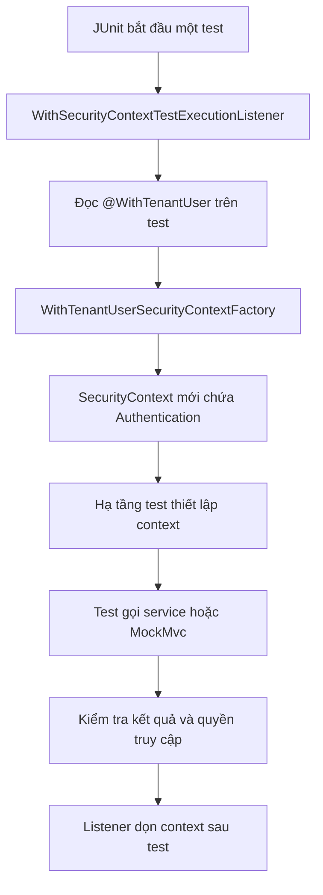

# `@WithSecurityContext` và hợp đồng của `WithSecurityContextFactory`

## 1. Bài toán: vì sao cần SecurityContext tùy biến?

Trong kiểm thử Spring Security, `@WithMockUser` tạo sẵn một người dùng thử nghiệm với tên, role và authority cơ bản. Cách này đủ cho những quy tắc như `hasRole('ADMIN')`, nhưng nhiều ứng dụng còn phụ thuộc vào **kiểu của principal** và dữ liệu nghiệp vụ gắn với danh tính: `tenantId`, `userId`, đơn vị, loại tài khoản, trạng thái tài khoản hoặc tập quyền riêng. Khi controller, service hoặc biểu thức `@PreAuthorize` cần đọc những dữ liệu ấy, principal mặc định của `@WithMockUser` không còn đại diện đúng cho bối cảnh kiểm thử.

`@WithSecurityContext` cho phép tạo **annotation kiểm thử mang ý nghĩa nghiệp vụ**; một `WithSecurityContextFactory` sẽ đọc tham số của annotation, dựng `Authentication` và trả về `SecurityContext` cho hạ tầng `spring-security-test`. Nhờ vậy, một ca kiểm thử có thể nói rõ *ai đang thực hiện hành động, thuộc phạm vi nào, có quyền gì* mà không phải lặp lại đoạn khởi tạo security ở mọi phương thức test.

Sau bài này, người học có thể:

- Thiết kế annotation thử nghiệm như `@WithTenantUser` với principal và authorities xác định được.
- Thực hiện đúng hợp đồng `WithSecurityContextFactory<A>` và hiểu ai chịu trách nhiệm cài/giải phóng context.
- Kiểm chứng trường hợp được phép, thiếu quyền, sai tenant và chưa đăng nhập qua method security hoặc `MockMvc`.
- Phân biệt context gắn vào test với xác thực một yêu cầu HTTP thực sự; biết khi nào dùng `WebTestClient`, JWT/OAuth2/OIDC test support.

### Chọn công cụ theo mục đích

| Công cụ | Phù hợp khi | Giới hạn quan trọng |
| --- | --- | --- |
| `@WithMockUser` | Cần username, `ROLE_*` hay authority đơn giản | Principal mặc định không phải kiểu nghiệp vụ riêng của ứng dụng |
| `@WithUserDetails` | Có `UserDetailsService` và muốn nạp người dùng thử nghiệm từ dịch vụ đó | Người dùng cần tồn tại trong nguồn dữ liệu mà service sử dụng |
| `@WithSecurityContext` + factory | Muốn biểu diễn principal, kiểu `Authentication`, tenant hoặc quyền tùy biến một cách tường minh | Tự chịu trách nhiệm tạo đúng mô hình bảo mật; không tự kiểm tra quy trình đăng nhập/token |
| `user()`, `authentication()`, `jwt()`, `oidcLogin()` của `MockMvc` | Muốn thiết lập danh tính **cho từng request** Servlet | Request post-processor phục vụ request hiện tại, không thay thế toàn bộ xác thực end-to-end |
| `mockUser()`, `mockAuthentication()`, `mockJwt()`, `mockOidcLogin()` của `WebTestClient` | Muốn kiểm thử request trên ứng dụng Reactive/WebFlux | Dùng Reactor Context và `ServerWebExchange`, không dựa vào ThreadLocal của test |

## 2. Cơ chế hoạt động và hợp đồng của factory

Sơ đồ luồng khi Spring Test và Spring Security Test được tích hợp:



Hợp đồng trọng tâm là:

```java
public interface WithSecurityContextFactory<A extends Annotation> {
    SecurityContext createSecurityContext(A annotation);
}
```

Trong đó `A` là **loại annotation tùy biến**. Với `WithSecurityContextFactory<WithTenantUser>`, Spring Security Test truyền chính instance của `@WithTenantUser` đang áp dụng vào `createSecurityContext`. Kết quả phải là một `SecurityContext` chứa `Authentication` phù hợp với ca kiểm thử.

Các trách nhiệm cần tách rõ:

1. **Annotation** mô tả dữ liệu đầu vào của kịch bản: người dùng, tenant, permissions, v.v. Annotation phải được giữ ở runtime (`@Retention(RUNTIME)`) và khai báo factory bằng `@WithSecurityContext(factory = ...)`.
2. **Factory** chuyển dữ liệu đó thành principal, authorities, kiểu `Authentication` và một `SecurityContext` mới. Factory trả về context; **không** tự gọi `SecurityContextHolder.setContext(...)`.
3. **`WithSecurityContextTestExecutionListener`** nhận context từ factory và chuẩn bị nó cho test. Hạ tầng test cũng dọn trạng thái sau khi chạy, tránh user của test trước lọt sang test sau.
4. **Ứng dụng được kiểm thử** vẫn áp dụng quy tắc phân quyền đang cấu hình. Một factory cấp authority nào thì test phải kiểm tra đúng quyền đó, không tự mặc định mọi request sẽ được phép.

Nên tạo context bằng `SecurityContextHolder.createEmptyContext()` mỗi lần gọi, rồi dùng `context.setAuthentication(authentication)`. Không dùng một `SecurityContext` static tái sử dụng giữa các test; không sửa trực tiếp context của test đang chạy trong factory. Một `Authentication` được đánh dấu `authenticated` phục vụ mô phỏng người dùng **đã xác thực**, chứ không chứng minh password, JWT signature, issuer hoặc authorization server đã được kiểm tra.

## 3. Ví dụ xuyên suốt: người dùng thuộc tenant và có quyền đọc tài liệu

Giả sử ứng dụng quản lý tài liệu cho nhiều tenant. API `/api/documents/{tenantId}` chỉ chấp nhận người dùng đã đăng nhập, có authority `document:read` **và** thuộc chính tenant trên đường dẫn. Ta tạo một annotation để mô tả chính xác chủ thể đó trong test.

### Bước 1 — Kiểu principal mà ứng dụng sử dụng

Đây là kiểu của mã **ứng dụng** (`src/main/java`), vì cả endpoint và test đều cần biết kiểu này. Ví dụ dùng Java 17 trở lên:

```java
package com.example.security;

import java.security.Principal;

public record TenantPrincipal(String userId, String tenantId)
        implements Principal {

    @Override
    public String getName() {
        return userId;
    }
}
```

Việc thực hiện `Principal#getName()` bảo đảm `authentication.getName()` trả về `userId`. Nếu dùng một record/POJO không thực hiện `Principal` hay `UserDetails`, tên authentication có thể không phải định danh mà code nghiệp vụ mong đợi.

### Bước 2 — Tạo annotation cho test

Đặt `WithTenantUser.java` trong `src/test/java`:

```java
package com.example.security;

import java.lang.annotation.Documented;
import java.lang.annotation.ElementType;
import java.lang.annotation.Inherited;
import java.lang.annotation.Retention;
import java.lang.annotation.RetentionPolicy;
import java.lang.annotation.Target;

import org.springframework.security.test.context.support.WithSecurityContext;

@Target({ ElementType.METHOD, ElementType.TYPE })
@Retention(RetentionPolicy.RUNTIME)
@Inherited
@Documented
@WithSecurityContext(factory = WithTenantUserSecurityContextFactory.class)
public @interface WithTenantUser {

    String userId() default "u-001";

    String tenantId() default "acme";

    String[] permissions() default { "document:read" };
}
```

`METHOD` cho phép viết kịch bản ngay tại phương thức, `TYPE` cho phép áp dụng mặc định ở lớp test; `@Inherited` hỗ trợ thừa kế annotation trên lớp test con. `@Retention(RUNTIME)` là thiết yếu vì listener đọc annotation lúc thực thi. Không cần thêm annotation này vào mã production.

### Bước 3 — Hiện thực factory

Đặt `WithTenantUserSecurityContextFactory.java` trong `src/test/java`:

```java
package com.example.security;

import java.util.Arrays;
import java.util.List;

import org.springframework.security.authentication.UsernamePasswordAuthenticationToken;
import org.springframework.security.core.Authentication;
import org.springframework.security.core.authority.SimpleGrantedAuthority;
import org.springframework.security.core.context.SecurityContext;
import org.springframework.security.core.context.SecurityContextHolder;
import org.springframework.security.test.context.support.WithSecurityContextFactory;

public final class WithTenantUserSecurityContextFactory
        implements WithSecurityContextFactory<WithTenantUser> {

    @Override
    public SecurityContext createSecurityContext(WithTenantUser marker) {
        if (marker.userId().isBlank() || marker.tenantId().isBlank()) {
            throw new IllegalArgumentException("userId và tenantId không được rỗng");
        }

        TenantPrincipal principal =
                new TenantPrincipal(marker.userId(), marker.tenantId());

        List<SimpleGrantedAuthority> authorities = Arrays
                .stream(marker.permissions())
                .map(SimpleGrantedAuthority::new)
                .toList();

        Authentication authentication =
                UsernamePasswordAuthenticationToken.authenticated(
                        principal, null, authorities);

        SecurityContext context = SecurityContextHolder.createEmptyContext();
        context.setAuthentication(authentication);
        return context;
    }
}
```

Đoạn này thể hiện đủ các phần của hợp đồng:

- `WithSecurityContextFactory<WithTenantUser>` bảo đảm loại annotation và tham số method khớp nhau.
- `marker` là nguồn dữ liệu duy nhất để dựng danh tính và quyền trong ví dụ, nên hai lần gọi với hai annotation khác nhau sinh ra hai bối cảnh độc lập.
- Mỗi phần tử của `permissions()` được đưa vào `SimpleGrantedAuthority` **nguyên văn**. Chẳng hạn `document:read` tương ứng với `hasAuthority('document:read')`; Spring Security không tự thêm tiền tố `ROLE_` ở đây.
- `UsernamePasswordAuthenticationToken.authenticated(...)` tạo token đã được xác thực phục vụ test; `null` credentials tránh giữ mật khẩu giả không cần thiết.
- `createEmptyContext()` + `setAuthentication(...)` tạo context mới rồi **trả về** cho listener.

Trong tình huống principal thực sự là `JwtAuthenticationToken`, `OAuth2AuthenticationToken`, `BearerTokenAuthentication` hoặc một loại `Authentication` nghiệp vụ, factory có thể tạo đúng loại đó thay vì dùng `UsernamePasswordAuthenticationToken`. Hãy chọn theo API mà code dưới test thực sự đọc.

### Bước 4 — Một endpoint có hai điều kiện phân quyền

Ví dụ controller tối giản trong `src/main/java`:

```java
package com.example.security;

import java.util.Map;

import org.springframework.security.access.prepost.PreAuthorize;
import org.springframework.security.core.annotation.AuthenticationPrincipal;
import org.springframework.security.core.parameters.P;
import org.springframework.web.bind.annotation.GetMapping;
import org.springframework.web.bind.annotation.PathVariable;
import org.springframework.web.bind.annotation.RequestMapping;
import org.springframework.web.bind.annotation.RestController;

@RestController
@RequestMapping("/api/documents")
public class DocumentController {

    @GetMapping("/{tenantId}")
    @PreAuthorize("hasAuthority('document:read') "
            + "and principal.tenantId() == #tenantId")
    public Map<String, String> documents(
            @PathVariable("tenantId") @P("tenantId") String tenantId,
            @AuthenticationPrincipal TenantPrincipal principal) {
        return Map.of("tenantId", tenantId, "userId", principal.userId());
    }
}
```

`@P("tenantId")` giúp Spring Security ánh xạ tham số method vào `#tenantId` trong SpEL mà không phụ thuộc vào compiler flag `-parameters`. Điều kiện `principal.tenantId()` dùng chính object `TenantPrincipal` mà factory tạo. Ví dụ này yêu cầu bật `@EnableMethodSecurity` và cho security filter chain xử lý request trong ứng dụng. Với bộ lọc yêu cầu xác thực mọi endpoint và bật HTTP Basic, người dùng ẩn danh nhận `401`; người dùng đã xác thực nhưng thiếu quyền hoặc sai tenant nhận `403`.

### Bước 5 — Kiểm chứng bằng `MockMvc`

Phụ thuộc cần có trong test (khi dùng Spring Boot Gradle):

```gradle
dependencies {
    testImplementation("org.springframework.boot:spring-boot-starter-test")
    testImplementation("org.springframework.security:spring-security-test")
}
```

Giả sử ứng dụng đã có `SecurityFilterChain` với `anyRequest().authenticated()`, HTTP Basic và đã bật `@EnableMethodSecurity`. Với Spring Boot, `@SpringBootTest` và `@AutoConfigureMockMvc` tạo `MockMvc` tích hợp security filters:

```java
package com.example.security;

import org.junit.jupiter.api.Test;
import org.springframework.beans.factory.annotation.Autowired;
import org.springframework.boot.test.autoconfigure.web.servlet.AutoConfigureMockMvc;
import org.springframework.boot.test.context.SpringBootTest;
import org.springframework.test.web.servlet.MockMvc;

import static org.springframework.test.web.servlet.request.MockMvcRequestBuilders.get;
import static org.springframework.test.web.servlet.result.MockMvcResultMatchers.jsonPath;
import static org.springframework.test.web.servlet.result.MockMvcResultMatchers.status;

@SpringBootTest
@AutoConfigureMockMvc
class DocumentSecurityTests {

    @Autowired
    MockMvc mvc;

    @Test
    @WithTenantUser(userId = "reader-7", tenantId = "acme",
            permissions = { "document:read" })
    void dungQuyenDungTenantDuocPhep() throws Exception {
        mvc.perform(get("/api/documents/acme"))
                .andExpect(status().isOk())
                .andExpect(jsonPath("$.userId").value("reader-7"))
                .andExpect(jsonPath("$.tenantId").value("acme"));
    }

    @Test
    @WithTenantUser(permissions = {})
    void thieuQuyenBiTuChoi() throws Exception {
        mvc.perform(get("/api/documents/acme"))
                .andExpect(status().isForbidden());
    }

    @Test
    @WithTenantUser(tenantId = "other-tenant")
    void khacTenantBiTuChoi() throws Exception {
        mvc.perform(get("/api/documents/acme"))
                .andExpect(status().isForbidden());
    }

    @Test
    void chuaDangNhapBiTuChoi() throws Exception {
        mvc.perform(get("/api/documents/acme"))
                .andExpect(status().isUnauthorized());
    }
}
```

Đây là bộ test **có cả ca được phép và ca bị từ chối**. Nếu thiếu `@EnableMethodSecurity`, hai kiểm thử thiếu quyền/sai tenant có thể trả `200` do `@PreAuthorize` chưa được thực thi. Nếu security filter chain không yêu cầu đăng nhập hoặc không có HTTP Basic, mã trạng thái của ca ẩn danh cần điều chỉnh theo cấu hình thực tế. Không kết luận factory lỗi chỉ dựa vào một mã HTTP khác kỳ vọng.

Để kiểm tra trực tiếp factory tạo đúng principal, có thể thêm một test trong môi trường Spring Test:

```java
@Test
@WithTenantUser(userId = "reader-7", tenantId = "acme",
        permissions = { "document:read" })
void factoryTaoDungContext() {
    Authentication auth =
            SecurityContextHolder.getContext().getAuthentication();

    assertThat(auth.isAuthenticated()).isTrue();
    assertThat(auth.getPrincipal()).isInstanceOf(TenantPrincipal.class);
    TenantPrincipal principal = (TenantPrincipal) auth.getPrincipal();
    assertThat(principal.userId()).isEqualTo("reader-7");
    assertThat(principal.tenantId()).isEqualTo("acme");
    assertThat(auth.getAuthorities())
            .extracting(GrantedAuthority::getAuthority)
            .containsExactly("document:read");
}
```

Đoạn test trên cần static import `org.assertj.core.api.Assertions.assertThat` và import `Authentication`, `GrantedAuthority`, `SecurityContextHolder` từ Spring Security. Nó giúp khoanh vùng lỗi: principal/authorities có thể được dựng đúng nhưng một filter, cấu hình method security hoặc endpoint vẫn khiến kết quả HTTP không như mong đợi.

## 4. Vòng đời test: `setupBefore` và listener

`@WithSecurityContext` có tham số `setupBefore` điều khiển **thời điểm** tạo context:

| `setupBefore` | Thời điểm listener chuẩn bị context | Khi nào dùng |
| --- | --- | --- |
| `TestExecutionEvent.TEST_METHOD` (mặc định) | Trong `beforeTestMethod`, trước `@BeforeEach` của JUnit 5 | Mã chuẩn bị test cần đọc người dùng hiện tại |
| `TestExecutionEvent.TEST_EXECUTION` | Trong `beforeTestExecution`, sau `@BeforeEach` và trước thân `@Test` | Muốn `@BeforeEach` chạy trước khi mock context được cài đặt |

Ví dụ thay đổi thời điểm ở annotation tùy biến:

```java
@WithSecurityContext(
    factory = WithTenantUserSecurityContextFactory.class,
    setupBefore = TestExecutionEvent.TEST_EXECUTION
)
```

Trong snippet này cần import `org.springframework.security.test.context.support.TestExecutionEvent`. Khi chọn `TEST_EXECUTION`, **đừng** mong `@BeforeEach` đọc được mock authentication từ annotation. Một số `@BeforeEach` tự gán context cũng có thể tạo thứ tự khó hiểu; tốt nhất chọn một cách chuẩn bị bối cảnh nhất quán cho từng bộ test.

Spring Security Test sử dụng `WithSecurityContextTestExecutionListener` trong Spring Test lifecycle. Nếu tự cấu hình `@TestExecutionListeners`, hãy giữ các listener cần thiết (ví dụ dùng `mergeMode = MERGE_WITH_DEFAULTS`) để tránh vô tình loại bỏ hỗ trợ security. Với reactive method security, còn có `ReactorContextTestExecutionListener` giúp chuẩn bị Reactor Context. Listener và cơ chế cleanup là lý do annotation an toàn hơn cách tự đặt `SecurityContextHolder.setContext(...)` rải rác trong nhiều test.

`@WithTenantUser` có thể đặt trên lớp làm mặc định; tại phương thức, đặt một annotation mô phỏng phù hợp để thay đổi bối cảnh riêng ca đó. Tránh đặt đồng thời nhiều annotation `@WithSecurityContext` khác nhau lên cùng một phần tử rồi dựa vào thứ tự lựa chọn không rõ ràng. Mỗi test nên có một chủ thể được định nghĩa rõ.

## 5. Factory có thể nhận bean từ Spring

Một factory không bắt buộc phải khởi tạo principal thủ công. Nếu cần lấy `UserDetails`, ánh xạ quyền hoặc policy từ service, có thể dùng dependency injection. Ví dụ **phác thảo của một factory thay thế** (giả sử annotation `@WithExistingUser` và bean `UserDetailsService` đã được định nghĩa):

```java
public final class WithExistingUserFactory
        implements WithSecurityContextFactory<WithExistingUser> {

    private final UserDetailsService userDetailsService;

    @Autowired
    public WithExistingUserFactory(UserDetailsService userDetailsService) {
        this.userDetailsService = userDetailsService;
    }

    @Override
    public SecurityContext createSecurityContext(WithExistingUser marker) {
        UserDetails user = userDetailsService.loadUserByUsername(marker.value());
        Authentication auth = UsernamePasswordAuthenticationToken.authenticated(
                user, null, user.getAuthorities());
        SecurityContext context = SecurityContextHolder.createEmptyContext();
        context.setAuthentication(auth);
        return context;
    }
}
```

Spring Security Test hỗ trợ inject dependency vào factory bằng Spring annotations. Tuy nhiên, nếu nhu cầu chỉ là nạp một người dùng từ `UserDetailsService`, **ưu tiên `@WithUserDetails` có sẵn**. Custom factory phát huy giá trị khi phải kết hợp thêm tenant, loại authentication hoặc những thuộc tính đặc thù không diễn đạt được bằng các annotation chuẩn.

Khi phụ thuộc dữ liệu thật, seed dữ liệu test cố định và đảm bảo `UserDetailsService` tìm thấy người dùng. Khi muốn test thật gọn và độc lập, một principal in-memory từ giá trị annotation như `WithTenantUserSecurityContextFactory` thường dễ kiểm soát hơn.

## 6. Kết nối với HTTP Servlet, Reactive và OAuth2/JWT/OIDC

### Servlet: context của test và context của request

Với `MockMvc`, security filters cần được gắn đúng. Nếu tự dựng `MockMvcBuilders.webAppContextSetup(context)`, hãy thêm `.apply(springSecurity())`; thao tác này liên kết `FilterChainProxy` và hỗ trợ đưa authentication từ Spring Security Test vào request. `@AutoConfigureMockMvc` thường làm sẵn việc tích hợp filter trong test Spring Boot.

Khi cần một danh tính khác **cho riêng một request**, có thể dùng `RequestPostProcessor`:

```java
mvc.perform(get("/api/documents/acme")
        .with(authentication(customAuthentication)))
    .andExpect(status().isOk());
```

Ở đây `customAuthentication` phải được tạo với principal và quyền phù hợp; ví dụ này minh họa API `.with(authentication(...))`, không ngầm xác định giá trị của biến. Nếu request chỉ cần JWT mock, có thể dùng `.with(jwt().authorities(new SimpleGrantedAuthority("SCOPE_documents.read")))`; với OAuth2 login có `oauth2Login()`, còn OIDC login có `oidcLogin()`.

**Giới hạn rất quan trọng:** Annotation `@WithSecurityContext` chuẩn bị context của **luồng thực thi test**. Với `@SpringBootTest(webEnvironment = RANDOM_PORT)` hoặc khi gọi một server đang chạy thật bằng HTTP client, request được xử lý ở luồng/process khác; annotation không tự truyền danh tính qua mạng. Trong kiểu test đó, hãy gửi header `Authorization` hoặc cookie/session theo giao thức thật, và mock những thành phần xác thực bên ngoài nếu mục tiêu chỉ là thử phân quyền.

### Reactive: authentication sống trong Reactor Context

Trong WebFlux, bảo mật reactive sử dụng `ReactiveSecurityContextHolder` và Reactor Context; việc set `SecurityContextHolder` dạng ThreadLocal không đủ để đại diện danh tính đi qua một reactive pipeline. Có thể dùng annotation trên reactive method tests nếu Spring Test đã tích hợp `ReactorContextTestExecutionListener`, nhưng để thiết lập authentication **theo request** bằng `WebTestClient`, dùng `mutateWith`:

```java
Authentication auth = UsernamePasswordAuthenticationToken.authenticated(
        new TenantPrincipal("reader-7", "acme"),
        null,
        List.of(new SimpleGrantedAuthority("document:read")));

webTestClient.mutateWith(mockAuthentication(auth))
        .get().uri("/api/reactive-documents/acme")
        .exchange()
        .expectStatus().isOk();
```

Snippet giả định ứng dụng WebFlux có route `/api/reactive-documents/acme` và policy tương ứng; static import `mockAuthentication` từ `SecurityMockServerConfigurers`. Nếu tự tạo `WebTestClient.bindToApplicationContext(context)`, tích hợp `.apply(springSecurity())` trước khi `.build()`. Reactive Resource Server có `mockJwt()`, OIDC có `mockOidcLogin()` và OAuth2 login có `mockOAuth2Login()`.

Tương tự Servlet, các helper trên tạo bối cảnh **giả lập đã xác thực** để thử authorization, xử lý claims/principal và response. Chúng không chứng minh chữ ký JWT, thời hạn token hay luồng OIDC thực đã đi qua nhà cung cấp danh tính.

### Quyết định kiểm thử điều gì

| Muốn chứng minh | Kỹ thuật phù hợp | Khẳng định cần quan sát |
| --- | --- | --- |
| Service có `@PreAuthorize` nhận đúng principal tùy biến | `@WithTenantUser` + gọi service trong Spring Test | Kết quả cho phép hoặc `AccessDeniedException` theo quyền/tenant |
| Endpoint Servlet chặn người thiếu quyền | `@WithTenantUser` + `MockMvc` đã tích hợp security filters | `200` ở ca hợp lệ; `403` ở ca đã xác thực nhưng không có quyền |
| Endpoint WebFlux nhận authentication tùy biến | `WebTestClient.mutateWith(mockAuthentication(...))` | Status/body theo policy reactive |
| Authorization dựa vào JWT scopes hoặc claims | `jwt()` / `mockJwt()` với claims, authorities phù hợp | `SCOPE_*` và claim mà code thực sự đọc |
| Controller phụ thuộc `OidcUser` hay `OAuth2User` | `oidcLogin()` / `oauth2Login()` hoặc mutator reactive tương ứng | `@AuthenticationPrincipal` có đúng kiểu và attributes |
| Filter thực sự xác minh chữ ký, issuer, audience của JWT | Request có bearer token và bộ xác thực/token decoder được kiểm thử riêng | Chấp nhận token hợp lệ, từ chối token không hợp lệ |

## 7. Các lỗi thường gặp và cách tìm nguyên nhân

| Hiện tượng | Nguyên nhân thường gặp | Cách kiểm tra / sửa |
| --- | --- | --- |
| Principal trong test là `null` | Thiếu tích hợp Spring Test listener, annotation thiếu `@Retention(RUNTIME)` hoặc factory không được gọi | Kiểm tra `@SpringBootTest`/`SpringExtension`, `@WithSecurityContext` và `@TestExecutionListeners` |
| `ClassCastException` khi đọc principal | Factory tạo loại principal khác code ứng dụng mong đợi | Assert `authentication.getPrincipal().getClass()` và dùng đúng kiểu nghiệp vụ |
| Có authority nhưng vẫn bị `403` | Sai cú pháp `ROLE_`/`SCOPE_`, thiếu tenant hoặc một điều kiện security khác | Assert `getAuthorities()`, xem biểu thức `@PreAuthorize`, policy HTTP và dữ liệu tenant |
| Thiếu quyền nhưng request vẫn `200` | Method security chưa bật, security filter chưa gắn vào `MockMvc`, endpoint không có policy | Kiểm tra `@EnableMethodSecurity`, `SecurityFilterChain`, `.apply(springSecurity())` |
| Anonymous trả `403` thay vì `401` | Entry point và cách cấu hình xác thực của ứng dụng khác giả định HTTP Basic | Kiểm tra `AuthenticationEntryPoint` và loại request; không ép mọi ứng dụng phải trả cùng status |
| `@BeforeEach` không thấy user giả lập | Annotation chọn `setupBefore = TEST_EXECUTION` | Dùng `TEST_METHOD` nếu khâu chuẩn bị cần context |
| Test Reactive bị mất authentication giữa các toán tử | Đang dựa vào ThreadLocal thay vì Reactor Context | Dùng listener reactive, `ReactiveSecurityContextHolder` hoặc `mutateWith` của `WebTestClient` |
| Test cổng HTTP thật không nhận user từ `@WithTenantUser` | Context trong test không truyền sang server thật | Gắn thông tin xác thực vào chính HTTP request |
| Test mock JWT vượt qua nhưng production từ chối token | Mock đã bỏ qua một phần quá trình giải mã/xác minh JWT | Bổ sung test dành riêng cho decoder, filter và validator |

Hai điểm dễ nhầm nhất là **role so với authority** và **xác thực so với phân quyền**. `hasRole('ADMIN')` thường kiểm tra authority `ROLE_ADMIN`; còn `hasAuthority('document:read')` khớp chuỗi `document:read` nguyên dạng. Một token đã được mock là authenticated chưa có nghĩa mọi endpoint đều phải trả `200`: policy vẫn có thể từ chối dựa vào quyền, tenant, trạng thái tài khoản hoặc các điều kiện khác.

## 8. Bài thực hành tự kiểm chứng

Hãy mở rộng ví dụ bằng một quyền `document:write` và endpoint `POST /api/documents/{tenantId}`. Đề xuất các ca kiểm thử:

1. `@WithTenantUser(permissions = {"document:read", "document:write"})`, đúng tenant, có CSRF token với `MockMvc` → tạo tài liệu thành công.
2. Cùng người dùng nhưng thiếu `document:write` → `403`.
3. Có `document:write` nhưng thuộc tenant khác → `403`.
4. Chưa đăng nhập → bị từ chối theo entry point được cấu hình.
5. Có quyền nhưng không có CSRF token khi CSRF protection đang bật → `403` ở tầng CSRF, để phân biệt với từ chối vì thiếu authority.

Với kiểm thử POST Servlet, `spring-security-test` cung cấp `.with(csrf())`. Mục tiêu là chứng minh **cả authentication, authorization và cơ chế bảo vệ HTTP** đang hoạt động đúng trong phạm vi test; đừng vô tình bỏ qua CSRF khiến một ca bị từ chối bị gán nhầm cho thiếu quyền.

### Tự đánh giá

- Vì sao `WithSecurityContextFactory` phải trả về một `SecurityContext` mới thay vì gọi `SecurityContextHolder.setContext()`?
- Khi nào `@WithUserDetails` là lựa chọn đơn giản hơn custom factory?
- Kết quả giữa `TEST_METHOD` và `TEST_EXECUTION` khác nhau như thế nào nếu `@BeforeEach` đọc `SecurityContextHolder`?
- Vì sao `@WithTenantUser` có thể hữu ích cho `MockMvc` nhưng không tự xác thực được request gửi đến server qua cổng HTTP thực?
- Khi endpoint dùng `JwtAuthenticationToken` hoặc `OidcUser`, nên dùng principal/token kiểu nào để kiểm tra đúng hành vi?

## Tài liệu tham khảo

- [Spring Security — Testing Method Security (`@WithSecurityContext`)](https://docs.spring.io/spring-security/reference/servlet/test/method.html)
- [Spring Security — Setting Up MockMvc and Spring Security](https://docs.spring.io/spring-security/reference/servlet/test/mockmvc/setup.html)
- [Spring Security — Testing OAuth 2.0 (Servlet)](https://docs.spring.io/spring-security/reference/servlet/test/mockmvc/oauth2.html)
- [Spring Security — Testing Authentication (Reactive)](https://docs.spring.io/spring-security/reference/reactive/test/web/authentication.html)
- [Spring Security — Testing OAuth 2.0 (Reactive)](https://docs.spring.io/spring-security/reference/reactive/test/web/oauth2.html)

`@WithSecurityContext` là công cụ tạo **ngữ cảnh kiểm thử có chủ đích**: annotation mô tả kịch bản, factory tạo principal và `Authentication` đúng kiểu, còn Spring Security Test quản lý vòng đời context. Khi kết hợp với kiểm thử được phép/bị từ chối, cấu hình security thực của ứng dụng và các test HTTP phù hợp, ta kiểm chứng được những quy tắc bảo vệ phụ thuộc danh tính nghiệp vụ thay vì chỉ kiểm tra một username hoặc role chung chung.
