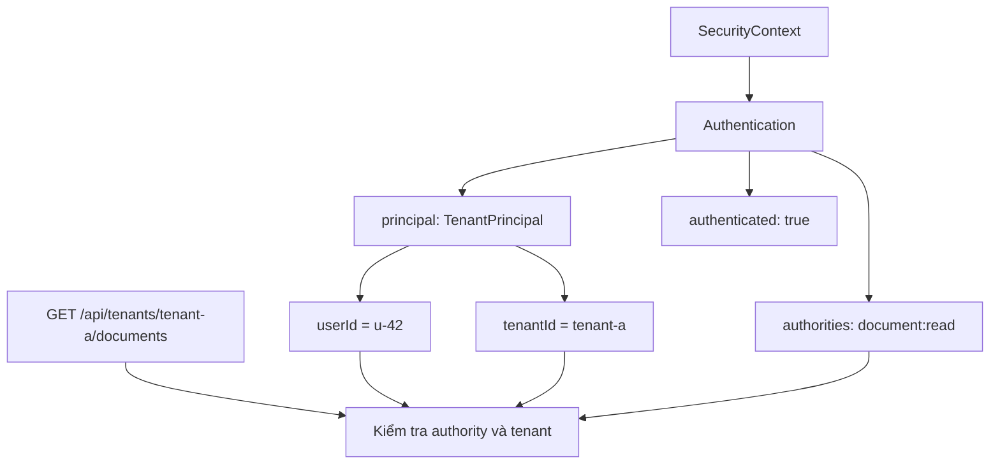

# Tạo principal có trường miền như `userId` hoặc `tenantId`

## 1. Khi tên đăng nhập và role không đủ để kiểm thử bảo mật

Một ứng dụng thường cần biết **người gọi là ai** và **người đó được phép thao tác trên dữ liệu nào**. Ví dụ, hệ thống quản lý tài liệu đa khách hàng (*multi-tenant*) nhận yêu cầu `GET /api/tenants/tenant-a/documents`. Người dùng phải có quyền `document:read`, nhưng như vậy vẫn chưa đủ: một người có quyền đọc tài liệu của `tenant-b` không được đọc tài liệu của `tenant-a`.

`@WithMockUser(username = "alice", roles = "USER")` rất hữu ích khi chỉ kiểm tra username/authority. Tuy nhiên, nếu mã ứng dụng yêu cầu `userId`, `tenantId`, `organizationId` hay `accountType` được lấy trực tiếp từ người dùng đã xác thực, principal mặc định của `@WithMockUser` không thể hiện những trường đó. Cách giải quyết là định nghĩa **principal miền** (*domain principal*) có cấu trúc ổn định và tạo `Authentication` chứa principal này trong các kịch bản kiểm thử.

Trong phạm vi **Spring Security Testing**, bài học tập trung vào mô hình danh tính tùy biến, cách đọc nó từ `SecurityContext` và cách chứng minh phân quyền đúng/sai qua `MockMvc` hoặc `WebTestClient`. Các ví dụ mô phỏng danh tính đã xác thực nhằm kiểm tra hành vi bảo mật; phần xác minh mật khẩu, chữ ký JWT và đăng nhập OIDC cần các bài kiểm thử xác thực riêng.

Sau bài này, người học có thể:

1. Phân biệt `principal`, `Authentication`, `SecurityContext` và dữ liệu tenant xuất hiện trong URL.
2. Thiết kế một principal bất biến có `userId`, `tenantId`, tránh nhầm username với mã định danh nghiệp vụ.
3. Gắn principal vào authentication giả lập và truy cập an toàn qua `@AuthenticationPrincipal` hoặc `SecurityContextHolder`.
4. Kiểm tra quyền đọc và giới hạn tenant bằng các ca được phép/bị từ chối, gồm trường hợp principal không đúng kiểu.
5. Nhận biết khác biệt giữa test Servlet/`MockMvc`, Reactive/`WebTestClient` và test JWT/OAuth2/OIDC.

## 2. Principal nằm ở đâu trong mô hình Spring Security?

`SecurityContext` nắm giữ `Authentication`; `Authentication` mang danh tính (`principal`), thông tin xác thực (`credentials`, tùy loại) và các quyền (`GrantedAuthority`). **Principal** biểu diễn chủ thể đã đăng nhập; nó không đồng nghĩa với tập quyền và cũng không đồng nghĩa với một bản ghi người dùng đầy đủ trong cơ sở dữ liệu.



| Thành phần | Có ý nghĩa gì? | Ví dụ |
| --- | --- | --- |
| `principal` | Danh tính của người gọi trong ứng dụng | `TenantPrincipal("u-42", "tenant-a")` |
| `Authentication#getAuthorities()` | Những quyền đã được cấp sau xác thực | `document:read`, `document:write` |
| `Authentication#isAuthenticated()` | Đối tượng authentication được xem là đã xác thực hay chưa | `true` ở kịch bản mock đã đăng nhập |
| `SecurityContext` | Vật chứa authentication trong ngữ cảnh thực thi hiện tại | Context của test hoặc request |
| `tenantId` trên URL | Đối tượng/phạm vi dữ liệu mà client đang yêu cầu | `tenant-a` |

Điểm cốt lõi: `tenantId` trên URL là **đầu vào từ client**. Nó chỉ xác định tài nguyên được yêu cầu, không chứng minh người gọi thuộc tenant đó. Việc cho phép truy cập phải dựa vào danh tính đã được xác thực và chính sách của máy chủ.

### `username`, `userId` và `tenantId` khác nhau

- `username` hoặc email là tên dùng để đăng nhập/hiển thị, có thể thay đổi theo chính sách sản phẩm.
- `userId` thường là định danh nội bộ ổn định của chủ thể, thích hợp cho audit và liên kết dữ liệu.
- `tenantId` là phạm vi tổ chức/khách hàng mà request được phép hoạt động; nó không phải quyền `ROLE_USER` hay `ROLE_ADMIN`.
- Một người có thể là thành viên của **nhiều tenant**. Trong trường hợp đó, `tenantId` của principal có thể biểu diễn **tenant đang hoạt động**; ứng dụng vẫn phải xác minh người dùng là thành viên hợp lệ của tenant đã chọn. Không tự coi một tenant ID do client gửi là bằng chứng thành viên.

## 3. Thiết kế principal miền bất biến

Giả sử ứng dụng dùng Java 17 trở lên và cần hai trường `userId`, `tenantId`. Tạo kiểu sau ở mã ứng dụng, chẳng hạn `src/main/java/com/example/security/TenantPrincipal.java`:

```java
package com.example.security;

import java.security.Principal;

public record TenantPrincipal(String userId, String tenantId)
        implements Principal {

    public TenantPrincipal {
        if (userId == null || userId.isBlank()) {
            throw new IllegalArgumentException("userId phải có giá trị");
        }
        if (tenantId == null || tenantId.isBlank()) {
            throw new IllegalArgumentException("tenantId phải có giá trị");
        }
    }

    @Override
    public String getName() {
        return userId;
    }
}
```

`record` giúp trường dữ liệu không bị thay đổi sau khi tạo; constructor kiểm tra giá trị bắt buộc, nhờ vậy test không vô tình tạo ra người dùng có tenant rỗng. `Principal#getName()` trả về `userId`, giúp các nơi đọc `authentication.getName()` có giá trị ổn định. Nếu chỉ dùng record không thực hiện `Principal`, tên authentication có thể được lấy qua quy tắc fallback của kiểu `Authentication` đang dùng, chẳng hạn `toString()` của object.

Đây là một mô hình tối giản để học. Ở hệ thống thực, có thể dùng kiểu định danh mạnh như `UUID`, thiết kế đối tượng `TenantMembership`, hoặc thêm thông tin thực sự cần cho quyết định phân quyền. Tránh đưa password, access token, refresh token, dữ liệu bí mật hay toàn bộ entity JPA vào principal. Dữ liệu trong principal nên nhỏ, dễ hiểu và có vòng đời phù hợp với phiên xác thực.

**Không đưa authorities vào principal chỉ để tiện truy cập.** Trong thiết kế này, principal giữ thuộc tính danh tính; các quyền nằm tại `Authentication#getAuthorities()`. Điều đó giúp kiểm thử rõ ràng hai trục khác nhau: *đúng tenant nhưng thiếu quyền* và *đủ quyền nhưng sai tenant*.

### Điều gì xảy ra khi đăng nhập thật?

Spring Security không tự động biết cách xây `TenantPrincipal`. Sau khi thông tin xác thực đã được kiểm chứng bằng cơ chế tương ứng (password, session, JWT, OIDC...), tầng authentication của ứng dụng cần tạo hoặc ánh xạ danh tính hợp lệ thành object được sử dụng trong authorization.

Ví dụ dưới đây chỉ là **hàm chuyển đổi sau xác thực**, không phải một cơ chế đăng nhập:

```java
// Chỉ gọi sau khi userId, tenantId và authorities đã được xác minh.
Authentication authenticatedUser(
        String verifiedUserId,
        String verifiedTenantId,
        Collection<? extends GrantedAuthority> verifiedAuthorities) {

    TenantPrincipal principal =
            new TenantPrincipal(verifiedUserId, verifiedTenantId);

    return UsernamePasswordAuthenticationToken.authenticated(
            principal, null, verifiedAuthorities);
}
```

Trong production, các tham số `verified*` phải đến từ nguồn đã được máy chủ xác thực/ủy quyền, chẳng hạn `AuthenticationProvider`, dịch vụ kiểm tra thành viên tenant, hoặc claims của JWT đã qua xác minh và ánh xạ phù hợp. Không gọi hàm với `tenantId` lấy tùy ý từ query parameter hoặc header do client cung cấp.

## 4. Tạo `SecurityContext` chứa principal cho test

Trong một unit test nhỏ, ta có thể tự tạo authentication để hiểu cấu trúc:

```java
import java.util.List;

import org.springframework.security.authentication.UsernamePasswordAuthenticationToken;
import org.springframework.security.core.Authentication;
import org.springframework.security.core.authority.SimpleGrantedAuthority;
import org.springframework.security.core.context.SecurityContext;
import org.springframework.security.core.context.SecurityContextHolder;

TenantPrincipal principal = new TenantPrincipal("u-42", "tenant-a");

Authentication authentication =
        UsernamePasswordAuthenticationToken.authenticated(
                principal,
                null,
                List.of(new SimpleGrantedAuthority("document:read")));

SecurityContext context = SecurityContextHolder.createEmptyContext();
context.setAuthentication(authentication);
```

Ở đây, `authentication.getPrincipal()` là `TenantPrincipal`; `authentication.getName()` là `u-42`; `authentication.getAuthorities()` chứa `document:read`. Dùng `hasAuthority('document:read')` khi kiểm tra quyền này. Ngược lại, `hasRole('ADMIN')` thông thường sẽ tìm authority `ROLE_ADMIN`, nên đừng nhầm role prefix với quyền tùy biến.

Trong test sử dụng Spring Test, nên để `@WithSecurityContext` và listener chịu trách nhiệm cài đặt/dọn context thay vì tự gọi `SecurityContextHolder.setContext(...)` trong nhiều test. Cách trực tiếp chỉ thích hợp cho test cô lập có setup/cleanup rõ ràng; nếu tự set context, hãy `SecurityContextHolder.clearContext()` sau test để tránh rò rỉ danh tính giữa các ca kiểm thử.

### Annotation riêng `@WithTenantPrincipal`

Đặt annotation dưới `src/test/java/com/example/security/WithTenantPrincipal.java`:

```java
package com.example.security;

import java.lang.annotation.ElementType;
import java.lang.annotation.Retention;
import java.lang.annotation.RetentionPolicy;
import java.lang.annotation.Target;

import org.springframework.security.test.context.support.WithSecurityContext;

@Target({ ElementType.METHOD, ElementType.TYPE })
@Retention(RetentionPolicy.RUNTIME)
@WithSecurityContext(factory = WithTenantPrincipalFactory.class)
public @interface WithTenantPrincipal {

    String userId() default "u-42";

    String tenantId() default "tenant-a";

    String[] authorities() default { "document:read" };
}
```

Annotation mô tả dữ liệu cho mỗi kịch bản. Có thể thay đổi user, tenant và quyền ngay tại tên test mà không viết lại code tạo principal.

Tạo factory tương ứng trong `src/test/java/com/example/security/WithTenantPrincipalFactory.java`:

```java
package com.example.security;

import java.util.Arrays;

import org.springframework.security.authentication.UsernamePasswordAuthenticationToken;
import org.springframework.security.core.Authentication;
import org.springframework.security.core.authority.SimpleGrantedAuthority;
import org.springframework.security.core.context.SecurityContext;
import org.springframework.security.core.context.SecurityContextHolder;
import org.springframework.security.test.context.support.WithSecurityContextFactory;

public final class WithTenantPrincipalFactory
        implements WithSecurityContextFactory<WithTenantPrincipal> {

    @Override
    public SecurityContext createSecurityContext(WithTenantPrincipal marker) {
        TenantPrincipal principal =
                new TenantPrincipal(marker.userId(), marker.tenantId());

        var authorities = Arrays.stream(marker.authorities())
                .map(SimpleGrantedAuthority::new)
                .toList();

        Authentication authentication =
                UsernamePasswordAuthenticationToken.authenticated(
                        principal, null, authorities);

        SecurityContext context = SecurityContextHolder.createEmptyContext();
        context.setAuthentication(authentication);
        return context;
    }
}
```

Mỗi lần gọi, factory dựng một `SecurityContext` mới. `WithSecurityContextFactory<WithTenantPrincipal>` được Spring Security Test gọi thông qua `WithSecurityContextTestExecutionListener`; factory **trả về** context và không tự cài nó vào `SecurityContextHolder`. Listener thiết lập và dọn bối cảnh tại các mốc của vòng đời test.

> `UsernamePasswordAuthenticationToken.authenticated(...)` ở đây chỉ biểu diễn người dùng **đã được mock xác thực**. Không có thao tác kiểm tra mật khẩu, xác minh JWT, đánh giá `issuer` hay gọi nhà cung cấp OIDC trong factory.

## 5. Kiểm tra principal bằng một ca test trực tiếp

Khi chạy với Spring Test (`@SpringBootTest` hoặc `@ExtendWith(SpringExtension.class)` cùng cấu hình thích hợp), có thể kiểm chứng annotation tạo đúng object và quyền:

```java
package com.example.security;

import org.junit.jupiter.api.Test;
import org.springframework.boot.test.context.SpringBootTest;
import org.springframework.security.core.Authentication;
import org.springframework.security.core.GrantedAuthority;
import org.springframework.security.core.context.SecurityContextHolder;

import static org.assertj.core.api.Assertions.assertThat;

@SpringBootTest
class TenantPrincipalContextTest {

    @Test
    @WithTenantPrincipal(userId = "u-42", tenantId = "tenant-a",
            authorities = { "document:read" })
    void principalCoDungTruongMien() {
        Authentication auth =
                SecurityContextHolder.getContext().getAuthentication();

        assertThat(auth).isNotNull();
        assertThat(auth.isAuthenticated()).isTrue();
        assertThat(auth.getName()).isEqualTo("u-42");
        assertThat(auth.getPrincipal()).isInstanceOf(TenantPrincipal.class);

        TenantPrincipal principal = (TenantPrincipal) auth.getPrincipal();
        assertThat(principal.userId()).isEqualTo("u-42");
        assertThat(principal.tenantId()).isEqualTo("tenant-a");

        assertThat(auth.getAuthorities())
                .extracting(GrantedAuthority::getAuthority)
                .containsExactly("document:read");
    }
}
```

Test này xác minh **hợp đồng dữ liệu** của principal, không kết luận endpoint sẽ trả `200`. Để kiểm chứng bảo vệ HTTP thực tế cần chạy request qua security filter chain và kiểm tra cả quyền lẫn ranh giới tenant.

## 6. Phân quyền theo principal miền trong Servlet

Tạo một bean chuyên kiểm tra tenant, đặt trong `src/main/java`:

```java
package com.example.security;

import org.springframework.security.core.Authentication;
import org.springframework.stereotype.Component;

@Component("tenantAccess")
public class TenantAccess {

    public boolean matches(Authentication auth, String requestedTenantId) {
        return auth != null
                && auth.isAuthenticated()
                && auth.getPrincipal() instanceof TenantPrincipal principal
                && principal.tenantId().equals(requestedTenantId);
    }
}
```

Việc kiểm tra `instanceof` rất quan trọng: không phải loại authentication nào cũng mang `TenantPrincipal`. Với `@WithMockUser`, principal thường là một `UserDetails` mặc định; với JWT Resource Server, principal mặc định thường là `Jwt`. Trong những trường hợp này, guard trả `false` thay vì ép kiểu gây lỗi.

Một controller sử dụng guard và kiểm tra authority:

```java
package com.example.security;

import java.util.Map;

import org.springframework.security.access.prepost.PreAuthorize;
import org.springframework.security.core.annotation.AuthenticationPrincipal;
import org.springframework.security.core.parameters.P;
import org.springframework.web.bind.annotation.GetMapping;
import org.springframework.web.bind.annotation.PathVariable;
import org.springframework.web.bind.annotation.RequestMapping;
import org.springframework.web.bind.annotation.RestController;

@RestController
@RequestMapping("/api/tenants")
public class TenantDocumentController {

    @GetMapping("/{tenantId}/documents")
    @PreAuthorize("hasAuthority('document:read') "
            + "and @tenantAccess.matches(authentication, #tenantId)")
    public Map<String, String> documents(
            @PathVariable("tenantId") @P("tenantId") String tenantId,
            @AuthenticationPrincipal(errorOnInvalidType = true)
            TenantPrincipal principal) {

        return Map.of("tenantId", tenantId, "userId", principal.userId());
    }
}
```

`@P("tenantId")` giúp Spring Security nhận biết `#tenantId` trong SpEL ngay cả khi lớp Java không được biên dịch với `-parameters`. `@AuthenticationPrincipal` yêu cầu principal thuộc đúng kiểu; `errorOnInvalidType = true` làm sai khác kiểu nổi rõ khi phương thức thực sự được gọi. Quy tắc kiểm tra cả `document:read` **và** tenant khớp danh tính đã xác thực. Nếu ứng dụng dùng các điều kiện nghiệp vụ phức tạp hơn, đặt chúng vào service/authorization component để test độc lập.

Để phương thức trên được bảo vệ, ứng dụng cần bật method security và có `SecurityFilterChain`. Cấu hình tối giản có thể là:

```java
package com.example.security;

import org.springframework.context.annotation.Bean;
import org.springframework.context.annotation.Configuration;
import org.springframework.security.config.Customizer;
import org.springframework.security.config.annotation.method.configuration.EnableMethodSecurity;
import org.springframework.security.config.annotation.web.builders.HttpSecurity;
import org.springframework.security.web.SecurityFilterChain;

@Configuration
@EnableMethodSecurity
public class SecurityConfig {

    @Bean
    SecurityFilterChain securityFilterChain(HttpSecurity http) throws Exception {
        return http
                .authorizeHttpRequests(authorize -> authorize
                        .anyRequest().authenticated())
                .httpBasic(Customizer.withDefaults())
                .build();
    }
}
```

Đây là cấu hình dành cho ví dụ kiểm thử GET. Với HTTP Basic mặc định, request chưa đăng nhập được xử lý qua authentication entry point và thường nhận `401`; request có authentication nhưng không đạt `@PreAuthorize` nhận `403`. Cấu hình đăng nhập thật của ứng dụng vẫn cần tạo đúng `TenantPrincipal` sau khi xác thực; chỉ khai báo `httpBasic()` **không tự chuyển** người dùng Basic mặc định thành principal miền.

### Kiểm thử endpoint bằng `MockMvc`

Trong dự án Spring Boot, khai báo `spring-security-test` và bộ thư viện test phù hợp, ví dụ Gradle:

```gradle
dependencies {
    testImplementation("org.springframework.boot:spring-boot-starter-test")
    testImplementation("org.springframework.security:spring-security-test")
}
```

Các test sau giả định ứng dụng đã chứa `TenantPrincipal`, `TenantAccess`, `TenantDocumentController`, `SecurityConfig`, và `MockMvc` tích hợp security filters:

```java
package com.example.security;

import org.junit.jupiter.api.Test;
import org.springframework.beans.factory.annotation.Autowired;
import org.springframework.boot.test.autoconfigure.web.servlet.AutoConfigureMockMvc;
import org.springframework.boot.test.context.SpringBootTest;
import org.springframework.test.web.servlet.MockMvc;

import static org.springframework.test.web.servlet.request.MockMvcRequestBuilders.get;
import static org.springframework.test.web.servlet.result.MockMvcResultMatchers.jsonPath;
import static org.springframework.test.web.servlet.result.MockMvcResultMatchers.status;

@SpringBootTest
@AutoConfigureMockMvc
class TenantDocumentHttpTest {

    @Autowired
    MockMvc mvc;

    @Test
    @WithTenantPrincipal(userId = "u-42", tenantId = "tenant-a",
            authorities = { "document:read" })
    void dungNguoiDungDungTenantDungQuyen() throws Exception {
        mvc.perform(get("/api/tenants/tenant-a/documents"))
                .andExpect(status().isOk())
                .andExpect(jsonPath("$.userId").value("u-42"))
                .andExpect(jsonPath("$.tenantId").value("tenant-a"));
    }

    @Test
    @WithTenantPrincipal(tenantId = "tenant-a", authorities = {})
    void dungTenantNhungThieuQuyen() throws Exception {
        mvc.perform(get("/api/tenants/tenant-a/documents"))
                .andExpect(status().isForbidden());
    }

    @Test
    @WithTenantPrincipal(tenantId = "tenant-b",
            authorities = { "document:read" })
    void duQuyenNhungSaiTenant() throws Exception {
        mvc.perform(get("/api/tenants/tenant-a/documents"))
                .andExpect(status().isForbidden());
    }

    @Test
    void khongXacThuc() throws Exception {
        mvc.perform(get("/api/tenants/tenant-a/documents"))
                .andExpect(status().isUnauthorized());
    }
}
```

Ma trận kiểm chứng:

| Principal | Quyền `document:read` | Tenant trên URL | Kỳ vọng với cấu hình trên |
| --- | --- | --- | --- |
| `TenantPrincipal("u-42", "tenant-a")` | Có | `tenant-a` | `200 OK` |
| `TenantPrincipal("u-42", "tenant-a")` | Không | `tenant-a` | `403 Forbidden` |
| `TenantPrincipal("u-42", "tenant-b")` | Có | `tenant-a` | `403 Forbidden` |
| Chưa đăng nhập | Không có | `tenant-a` | `401 Unauthorized` với HTTP Basic |

Nên kiểm tra thêm một ca `@WithMockUser(authorities = "document:read")` để xác nhận bean `TenantAccess` từ chối principal không phải `TenantPrincipal` (`403`). Điều này giúp phát hiện ứng dụng vô tình chỉ kiểm tra quyền mà bỏ qua giới hạn tenant.

`@AutoConfigureMockMvc` trong Spring Boot thường cấu hình security filters cho `MockMvc`. Nếu dựng thủ công bằng `MockMvcBuilders.webAppContextSetup(context)`, cần `.apply(springSecurity())` của Spring Security Test; nếu không, kết quả có thể không phản ánh security filter chain. Các test trên không gửi HTTP thật qua cổng mạng mà chạy request giả lập trong ngữ cảnh Spring Test.

## 7. Đọc principal an toàn ở các tầng ứng dụng

Trong MVC controller, `@AuthenticationPrincipal TenantPrincipal principal` là cách ngắn gọn. Ở service hoặc code cấp thấp, có thể đọc:

```java
Authentication authentication =
        SecurityContextHolder.getContext().getAuthentication();

if (authentication == null
        || !(authentication.getPrincipal() instanceof TenantPrincipal principal)) {
    throw new IllegalStateException("Không có TenantPrincipal hợp lệ");
}

String userId = principal.userId();
String tenantId = principal.tenantId();
```

Đoạn kiểm tra `instanceof` bảo vệ khỏi trường hợp authentication chưa tồn tại hoặc principal có kiểu khác. Tuy nhiên, nếu code này là logic phân quyền production, cần xử lý ngoại lệ phù hợp với chính sách security và kiến trúc ứng dụng; `IllegalStateException` ở trên chỉ minh họa cách lấy dữ liệu, không phải quy ước trả HTTP `401/403`.

| Cách truy cập | Dùng khi | Lưu ý |
| --- | --- | --- |
| `@AuthenticationPrincipal TenantPrincipal` | Controller Servlet | Có thể trả `null` khi type không khớp nếu không bật `errorOnInvalidType` |
| `Authentication` truyền vào method | Dùng các thuộc tính danh tính lẫn authorities | Có thể kiểm tra `getPrincipal()`, `getAuthorities()` trực tiếp |
| `SecurityContextHolder` | Mã Servlet đồng bộ cần truy cập context hiện hành | Context thường gắn với thread, cần xử lý khi thực thi bất đồng bộ |
| `ReactiveSecurityContextHolder` | Luồng Reactive/WebFlux | SecurityContext theo Reactor Context, không giả định giữ nguyên thread |

Hạn chế truyền `TenantPrincipal` sâu khắp mọi lớp chỉ để đọc `tenantId`. Ứng dụng lớn có thể định nghĩa `CurrentUser`/`CurrentTenant` abstraction ở boundary để policy rõ ràng, dễ mock và giảm phụ thuộc trực tiếp vào Spring Security trong domain layer.

## 8. Kiểm thử principal trong ứng dụng Reactive/WebFlux

Ở WebFlux, authentication lan truyền theo **Reactor Context**, không dựa vào ThreadLocal như cách sử dụng `SecurityContextHolder` thông thường trong Servlet. Để mô phỏng một request đã xác thực, `spring-security-test` cung cấp mutator `mockAuthentication(...)` cho `WebTestClient`:

```java
import java.util.List;

import org.springframework.security.core.Authentication;
import org.springframework.security.authentication.UsernamePasswordAuthenticationToken;
import org.springframework.security.core.authority.SimpleGrantedAuthority;

import static org.springframework.security.test.web.reactive.server.SecurityMockServerConfigurers.mockAuthentication;

Authentication authentication =
        UsernamePasswordAuthenticationToken.authenticated(
                new TenantPrincipal("u-42", "tenant-a"),
                null,
                List.of(new SimpleGrantedAuthority("document:read")));

webTestClient.mutateWith(mockAuthentication(authentication))
        .get().uri("/api/tenants/tenant-a/documents")
        .exchange()
        .expectStatus().isOk();
```

Ví dụ giả định có **endpoint WebFlux tương ứng** và đã cấu hình `WebTestClient` cùng Spring Security. Với client tạo từ application context, cần áp dụng `SecurityMockServerConfigurers.springSecurity()` trong quá trình dựng client. Phải kiểm chứng thêm kịch bản `tenant-b` truy cập URL của `tenant-a` trả `403` và trường hợp thiếu authority trả `403`; trong ứng dụng Reactive, policy dùng `@EnableReactiveMethodSecurity` hoặc cơ chế authorization reactive phù hợp.

Nếu kiểm thử **reactive method security** bằng annotation `@WithSecurityContext`, cần tích hợp listener `ReactorContextTestExecutionListener` của Spring Security Test để chuẩn bị danh tính trong Reactor Context. Đừng coi một lần gọi `SecurityContextHolder.setContext(...)` ở thread của test là đủ cho toàn bộ reactive pipeline.

## 9. Principal tùy biến trong bài toán JWT/OAuth2/OIDC

Không phải cơ chế xác thực nào cũng tạo cùng một loại principal:

| Cơ chế | Principal thường gặp | Hướng kiểm thử phù hợp |
| --- | --- | --- |
| Username/password qua `UserDetailsService` | `UserDetails` của ứng dụng hoặc Spring Security | `@WithUserDetails` nếu cần nạp người dùng test thực, hoặc custom factory nếu cần trường miền |
| Custom `AuthenticationProvider` | Loại principal mà provider tự tạo | `@WithSecurityContext` hoặc `authentication()` với đúng kiểu |
| JWT Resource Server mặc định | `Jwt` trong `JwtAuthenticationToken` | `MockMvc` `jwt()` hoặc WebFlux `mockJwt()` để thử claims và authorities |
| OAuth2 login | `OAuth2User` | `oauth2Login()` / `mockOAuth2Login()` |
| OIDC login | `OidcUser` | `oidcLogin()` / `mockOidcLogin()` |

Ví dụ, nếu policy production đọc `tenant_id` từ **JWT đã xác minh**, một test dùng `@WithTenantPrincipal` có thể không kiểm tra đúng đường đi của claim. Khi đó dùng `jwt()`/`mockJwt()` với claim `tenant_id` và scopes phù hợp, rồi kiểm tra logic chuyển claim thành quyền/tenant. Ngược lại, nếu authentication converter của ứng dụng chủ động trả về `TenantPrincipal` làm principal, test cần kiểm chứng converter đó và sau đó có thể dùng custom factory để cô lập các quy tắc phân quyền.

Các helper test JWT/OAuth2/OIDC thường **giả lập** một người dùng/token hợp lệ. Chúng hữu ích để kiểm tra controller, security rules và ánh xạ danh tính; chúng không tự xác minh signature JWT, issuer, audience, thời hạn token hoặc toàn bộ luồng đăng nhập. Những điều đó cần kiểm thử ở tầng decoder, validator, filter hoặc integration test riêng.

## 10. Những lỗi phổ biến và cách xử lý

| Hiện tượng | Nguyên nhân có thể xảy ra | Cách kiểm tra |
| --- | --- | --- |
| Ép kiểu `authentication.getPrincipal()` bị lỗi | Authentication thực tế mang `UserDetails`, `Jwt` hoặc chuỗi anonymous | Assert type; dùng `instanceof`, mapping đúng kiểu hoặc test helper phù hợp |
| `@AuthenticationPrincipal` nhận `null` | Principal không khớp kiểu; chưa xác thực | Kiểm tra filter, type thực tế, cân nhắc `errorOnInvalidType = true` |
| Có quyền nhưng request sai tenant vẫn trả `200` | Policy chỉ kiểm tra `hasAuthority` | Thêm kiểm tra principal tenant so với tenant tài nguyên |
| Sai tenant bị `500` | Policy ép principal hoặc gọi accessor không tồn tại | Dùng guard kiểm tra type và null trước khi đọc thuộc tính |
| `@WithTenantPrincipal` không hoạt động | Thiếu Spring Test listener hoặc annotation chưa có runtime retention | Kiểm tra `@WithSecurityContext`, `@Retention(RUNTIME)`, tích hợp Spring Test |
| Test `MockMvc` không thực thi filter | Dựng `MockMvc` mà không gắn Spring Security | Dùng `@AutoConfigureMockMvc` hoặc `.apply(springSecurity())` |
| `@PreAuthorize` không có tác dụng | Chưa bật method security | Kiểm tra `@EnableMethodSecurity` / `@EnableReactiveMethodSecurity` |
| Request thật đến server không có principal từ annotation | Annotation chỉ thiết lập context test, không truyền qua mạng | Gửi credential/token thật trong HTTP request; kiểm thử xác thực ở server |
| WebFlux mất context sau operator bất đồng bộ | Dùng ThreadLocal thay cho Reactor Context | Sử dụng reactive security context và `WebTestClient.mutateWith(...)` |
| Test mock JWT thành công nhưng production báo token không hợp lệ | Mock bỏ qua xác minh token | Kiểm thử decoder/validator, issuer, audience và chữ ký riêng |

Một rủi ro đặc biệt ở mô hình đa tenant là **IDOR/cross-tenant access**: có thể đọc hoặc sửa tài nguyên của tenant khác chỉ bằng cách thay ID trên URL. Kiểm soát `hasRole('USER')` hay `isAuthenticated()` không đủ để ngăn tình huống này. Hãy kiểm tra quyền sở hữu/phạm vi dữ liệu tại điểm truy cập; khi truy vấn cơ sở dữ liệu, nên ràng buộc truy vấn bằng tenant đã được xác minh để giảm nguy cơ lộ dữ liệu.

## 11. Bài thực hành: thay đổi tenant và quyền

Mở rộng ví dụ với endpoint `POST /api/tenants/{tenantId}/documents` và authority `document:write`. Thử viết các ca sau:

1. Principal `u-42`, tenant `tenant-a`, có `document:write` → tạo tài liệu thành công khi request hợp lệ.
2. Cùng tenant nhưng chỉ có `document:read` → `403` vì thiếu quyền ghi.
3. Có `document:write` nhưng principal mang tenant `tenant-b` → `403` khi ghi vào `tenant-a`.
4. Người chưa đăng nhập → bị từ chối theo authentication entry point của ứng dụng.
5. Test POST Servlet có quyền nhưng thiếu CSRF token khi CSRF đang bật → `403` do bảo vệ CSRF; thêm `.with(csrf())` để cô lập phép kiểm tra authorization.
6. Nếu một người thuộc hai tenant, hãy định nghĩa rõ cơ chế **chuyển tenant hoạt động** và kiểm thử trường hợp tenant yêu cầu không thuộc danh sách được xác minh.

Trong `MockMvc`, có thể thêm `.with(csrf())` từ `SecurityMockMvcRequestPostProcessors` cho request thay đổi trạng thái. Ở WebFlux, dùng `mockAuthentication` cho danh tính theo request và các tiện ích CSRF tương ứng khi ứng dụng bật bảo vệ CSRF.

### Câu hỏi tự đánh giá

- Vì sao `tenantId` trên URL không thể dùng làm nguồn duy nhất để xác định tenant của principal?
- `authentication.getName()` lấy từ đâu khi principal là record thực hiện `java.security.Principal`?
- Tại sao cần cả `document:read` và kiểm tra tenant trong cùng một policy?
- `@WithMockUser` khác gì `@WithTenantPrincipal` khi controller dùng `@AuthenticationPrincipal TenantPrincipal`?
- Vì sao mock principal trong `@WithSecurityContext` không đủ để kiểm tra chữ ký JWT hoặc xác thực qua một server HTTP thật?
- Khi chuyển từ Servlet sang Reactive, cần thay đổi cách lấy và truyền security context như thế nào?

## Tài liệu tham khảo

- [Spring Security — Testing Method Security](https://docs.spring.io/spring-security/reference/servlet/test/method.html)
- [Spring Security — Servlet Authentication Architecture](https://docs.spring.io/spring-security/reference/servlet/authentication/architecture.html)
- [Spring Security — Testing MockMvc Requests](https://docs.spring.io/spring-security/reference/servlet/test/mockmvc/index.html)
- [Spring Security — Reactive Web Security Testing](https://docs.spring.io/spring-security/reference/reactive/test/web/index.html)
- [Spring Security — Testing OAuth 2.0 in Servlet Applications](https://docs.spring.io/spring-security/reference/servlet/test/mockmvc/oauth2.html)

Một principal miền đúng đắn thể hiện danh tính đã được xác minh bằng những trường ứng dụng cần, như `userId` và `tenantId`, đồng thời để `Authentication` nắm giữ các authorities. Khi kiểm thử với `@WithSecurityContext`, `MockMvc` và `WebTestClient`, hãy luôn kết hợp ca **được phép** với những ca **thiếu quyền, sai tenant và chưa xác thực**. Chính các ca từ chối này xác nhận ứng dụng không vô tình biến một ID do client gửi thành quyền truy cập dữ liệu.
