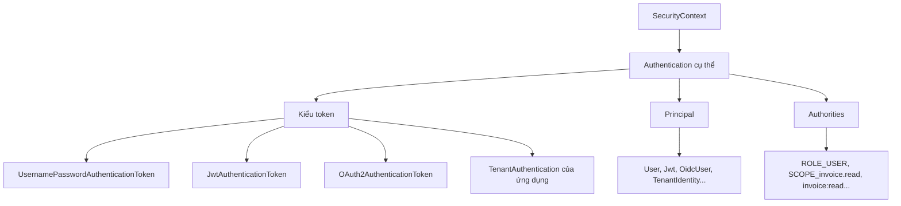

# Tạo `Authentication` đúng loại mà ứng dụng mong đợi

## 1. Vì sao cùng là người dùng đã đăng nhập nhưng test vẫn thất bại?

Trong Spring Security, `Authentication` không đơn thuần là một cờ `authenticated = true`. Đó là một **đối tượng có kiểu cụ thể** mang principal, credentials (nếu có), authorities và đôi khi cả token, claims, thông tin client hoặc phiên đăng nhập. Ứng dụng có thể phụ thuộc vào kiểu của đối tượng ấy khi thực hiện phân quyền.

Ví dụ, một endpoint yêu cầu `JwtAuthenticationToken` để đọc claim `tenant_id`. Nếu test chỉ đặt `@WithMockUser(username = "alice", authorities = "SCOPE_invoice.read")`, người dùng mock có quyền đúng nhưng `Authentication` được tạo ra lại là `UsernamePasswordAuthenticationToken`; principal thông thường là `User`, không phải `Jwt`. Kết quả có thể là `403`, `ClassCastException`, hoặc dữ liệu `null` khi controller đọc principal theo kiểu JWT.

Điều này cũng xảy ra khi ứng dụng sử dụng kiểu nghiệp vụ như `TenantAuthentication`, nhưng test chỉ truyền một `TenantPrincipal` vào loại token khác. **Đúng principal chưa chắc đã đúng `Authentication`.** Kiểu, trạng thái và dữ liệu mà ứng dụng thực sự đọc phải khớp nhau.

Trong module **SPRING_SECURITY_TESTING**, mục tiêu là kiểm chứng xác thực, phân quyền và bảo vệ HTTP bằng `spring-security-test` trên Servlet và Reactive: `MockMvc`, `WebTestClient`, `@WithMockUser`, `SecurityContext`, cùng các hình thức JWT/OAuth2/OIDC giả lập. Bài này tập trung vào kỹ thuật chọn và tạo **đúng loại `Authentication` cho ca kiểm thử**, sau đó quan sát cả request được phép lẫn request bị từ chối.

Sau bài học, bạn có thể:

1. Nhìn vào code production để xác định kiểu `Authentication` mà policy/controller/service cần.
2. Tạo một custom `Authentication` có principal và authorities phù hợp, rồi đưa nó vào test bằng `@WithSecurityContext`.
3. Phân biệt `UsernamePasswordAuthenticationToken`, `JwtAuthenticationToken`, `OAuth2AuthenticationToken` và principal `OidcUser`.
4. Dùng `authentication()`/`jwt()` cho `MockMvc`, `mockAuthentication()`/`mockJwt()` cho `WebTestClient` đúng phạm vi request.
5. Kiểm chứng `200`, `401`, `403` trong các trường hợp đúng quyền, thiếu quyền, sai tenant và sai kiểu authentication.

## 2. Xác định chính xác hợp đồng xác thực trước khi viết test

Mỗi `SecurityContext` giữ một `Authentication`; mỗi authentication có ít nhất principal, authorities và trạng thái `isAuthenticated()`:



| Code ứng dụng cần | Kiểu authentication nên có trong test | Principal thường gặp | Công cụ test phù hợp |
| --- | --- | --- | --- |
| `Authentication` với `ROLE_USER`, không phụ thuộc subtype | `UsernamePasswordAuthenticationToken` là đủ | `User`/`UserDetails` | `@WithMockUser`, `user()` |
| `UserDetails` từ nguồn của ứng dụng | Thường là `UsernamePasswordAuthenticationToken` | `UserDetails` riêng | `@WithUserDetails` |
| `TenantAuthentication` hoặc token nghiệp vụ riêng | **Chính** subtype ứng dụng sử dụng | `TenantIdentity` hoặc principal miền | `@WithSecurityContext` + factory, `authentication()` |
| `JwtAuthenticationToken` hoặc `@AuthenticationPrincipal Jwt` | `JwtAuthenticationToken` | `Jwt` chứa claims | `jwt()`/`mockJwt()`, custom factory nếu cần |
| OAuth2 login với `OAuth2User` | `OAuth2AuthenticationToken` | `OAuth2User` | `oauth2Login()`/`mockOAuth2Login()` |
| OIDC login với `OidcUser` | Thường là `OAuth2AuthenticationToken` | `OidcUser` | `oidcLogin()`/`mockOidcLogin()` |

**Phân biệt ba câu hỏi khi thiết kế ca test:**

- *Kiểu*: `authentication instanceof JwtAuthenticationToken` hay `TenantAuthentication` có đúng không?
- *Danh tính và quyền*: `getPrincipal()`, `getName()`, `getAuthorities()` có chứa dữ liệu production cần không?
- *Quy trình xác thực*: ca test muốn giả lập một danh tính đã được chứng thực hay muốn kiểm tra password/token thực sự có được xác minh?

`spring-security-test` chủ yếu giúp dựng bối cảnh **đã xác thực** để thử authorization và xử lý request. Test dùng token giả lập không tự chứng minh chữ ký JWT, issuer, audience, hạn dùng hay luồng OIDC với identity provider. Nếu cần những điều đó, phải có kiểm thử decoder/validator/filter hoặc integration test qua giao thức xác thực thực tế.

## 3. Ví dụ chính: ứng dụng yêu cầu `TenantAuthentication`

Giả sử hệ thống hóa đơn đa tenant có endpoint `GET /api/tenants/{tenantId}/invoices`. Để được phép đọc, người gọi phải:

1. Đã đăng nhập với `TenantAuthentication` do cơ chế xác thực của ứng dụng tạo.
2. Có authority `invoice:read`.
3. Có `tenantId` của principal trùng tenant được yêu cầu trên đường dẫn.

Ta xây dựng một ví dụ Servlet hoàn chỉnh theo ý tưởng này. Các lớp production đặt dưới `src/main/java/com/example/security`, các annotation/factory/test dưới `src/test/java/com/example/security`. Ví dụ dùng Java 17+ và Spring Security với method security.

### 3.1. Principal chỉ mang danh tính nghiệp vụ

File `TenantIdentity.java`:

```java
package com.example.security;

import java.security.Principal;

public record TenantIdentity(String userId, String tenantId)
        implements Principal {

    public TenantIdentity {
        if (userId == null || userId.isBlank()) {
            throw new IllegalArgumentException("userId bắt buộc");
        }
        if (tenantId == null || tenantId.isBlank()) {
            throw new IllegalArgumentException("tenantId bắt buộc");
        }
    }

    @Override
    public String getName() {
        return userId;
    }
}
```

`userId` là định danh người dùng; `tenantId` là phạm vi nghiệp vụ đã xác minh. Implement `Principal` để `Authentication#getName()` có thể trả về `userId`. Không lưu password, refresh token hoặc entity JPA đầy đủ trong principal.

### 3.2. Định nghĩa subtype `Authentication` của ứng dụng

File `TenantAuthentication.java`:

```java
package com.example.security;

import java.util.Collection;
import java.util.Objects;

import org.springframework.security.authentication.AbstractAuthenticationToken;
import org.springframework.security.core.GrantedAuthority;

public final class TenantAuthentication extends AbstractAuthenticationToken {

    private final TenantIdentity principal;

    // Chỉ gọi constructor này sau khi danh tính/quyền đã được xác minh,
    // hoặc trong factory kiểm thử đang chủ động mock người đã đăng nhập.
    public TenantAuthentication(
            TenantIdentity principal,
            Collection<? extends GrantedAuthority> authorities) {
        super(authorities);
        this.principal = Objects.requireNonNull(principal);
        super.setAuthenticated(true);
    }

    @Override
    public TenantIdentity getPrincipal() {
        return principal;
    }

    @Override
    public Object getCredentials() {
        return null;
    }
}
```

`TenantAuthentication` là **loại đối tượng cụ thể**. Nó kế thừa `AbstractAuthenticationToken`, giữ authorities qua lớp cha, trả về `TenantIdentity` từ `getPrincipal()`, và không lưu credentials trong token đã xác thực. `super.setAuthenticated(true)` biểu diễn kết quả xác thực đã hoàn tất. Trong production, chỉ tầng xác thực đáng tin cậy sau khi kiểm tra danh tính/quyền mới nên phát hành một đối tượng có trạng thái này; constructor trong ví dụ cũng được dùng cho test giả lập.

Điểm phân biệt quan trọng:

```java
TenantIdentity principal = new TenantIdentity("u-42", "tenant-a");

// A. Có principal đúng, nhưng Authentication là loại KHÁC:
Authentication ordinary = UsernamePasswordAuthenticationToken.authenticated(
        principal, null, List.of(new SimpleGrantedAuthority("invoice:read")));

// B. Có cùng principal, nhưng Authentication đúng subtype của ứng dụng:
Authentication domain = new TenantAuthentication(
        principal, List.of(new SimpleGrantedAuthority("invoice:read")));

assert ordinary instanceof UsernamePasswordAuthenticationToken;
assert !(ordinary instanceof TenantAuthentication);
assert domain instanceof TenantAuthentication;
```

Snippet minh họa cần import `java.util.List`, `Authentication`, `UsernamePasswordAuthenticationToken`, `SimpleGrantedAuthority`. Cả A lẫn B đều có thể được đánh dấu authenticated và cùng authority, nhưng điều kiện `instanceof TenantAuthentication` chỉ đúng với B. Do đó chỉ so sánh `getPrincipal()` hoặc danh sách quyền chưa đủ khi production phụ thuộc subtype.

### 3.3. Quy tắc phân quyền kiểm tra cả subtype và tenant

File `TenantInvoicePolicy.java`:

```java
package com.example.security;

import org.springframework.security.core.Authentication;
import org.springframework.stereotype.Component;

@Component("tenantInvoicePolicy")
public final class TenantInvoicePolicy {

    public boolean belongsToTenant(
            Authentication authentication, String requestedTenantId) {
        return authentication instanceof TenantAuthentication token
                && token.isAuthenticated()
                && token.getPrincipal().tenantId().equals(requestedTenantId);
    }
}
```

Việc dùng `instanceof` với pattern variable giúp trả về `false` khi test cấp `UsernamePasswordAuthenticationToken`, `JwtAuthenticationToken` hay anonymous authentication thay vì ném `ClassCastException`. Code kiểm tra `tenantId` từ danh tính đã xác thực, không tin vào một header/URL do client tự khai báo.

File `TenantInvoiceController.java`:

```java
package com.example.security;

import java.util.Map;

import org.springframework.security.access.prepost.PreAuthorize;
import org.springframework.security.core.annotation.AuthenticationPrincipal;
import org.springframework.security.core.parameters.P;
import org.springframework.web.bind.annotation.GetMapping;
import org.springframework.web.bind.annotation.PathVariable;
import org.springframework.web.bind.annotation.RequestMapping;
import org.springframework.web.bind.annotation.RestController;

@RestController
@RequestMapping("/api/tenants")
public final class TenantInvoiceController {

    @GetMapping("/{tenantId}/invoices")
    @PreAuthorize("hasAuthority('invoice:read') and "
            + "@tenantInvoicePolicy.belongsToTenant(authentication, #tenantId)")
    public Map<String, String> readInvoices(
            @PathVariable("tenantId") @P("tenantId") String tenantId,
            @AuthenticationPrincipal(errorOnInvalidType = true)
            TenantIdentity identity) {
        return Map.of("tenantId", tenantId, "userId", identity.userId());
    }
}
```

`@P("tenantId")` giúp Spring Security đưa tham số method vào biến SpEL `#tenantId` ngay cả khi compiler không giữ tên tham số. `@AuthenticationPrincipal` lấy principal từ **authentication hiện hành**, còn `@PreAuthorize` đảm bảo nó đến từ `TenantAuthentication` có đúng quyền và tenant trước khi chạy thân phương thức. Không phải annotation nào cũng tự kích hoạt method security; cần `@EnableMethodSecurity`.

Một cấu hình minh họa để test GET với HTTP Basic entry point là:

```java
package com.example.security;

import org.springframework.context.annotation.Bean;
import org.springframework.context.annotation.Configuration;
import org.springframework.security.config.Customizer;
import org.springframework.security.config.annotation.method.configuration.EnableMethodSecurity;
import org.springframework.security.config.annotation.web.builders.HttpSecurity;
import org.springframework.security.web.SecurityFilterChain;

@Configuration
@EnableMethodSecurity
public class SecurityConfiguration {

    @Bean
    SecurityFilterChain filterChain(HttpSecurity http) throws Exception {
        return http
                .authorizeHttpRequests(authorize -> authorize
                        .anyRequest().authenticated())
                .httpBasic(Customizer.withDefaults())
                .build();
    }
}
```

Cấu hình này dùng HTTP Basic để có quy tắc chặn request chưa đăng nhập, nên ví dụ bên dưới có thể kỳ vọng `401` ở ca anonymous và `403` ở ca đã xác thực nhưng thiếu quyền. **HTTP Basic mặc định không tự tạo `TenantAuthentication`**: sản phẩm thực tế cần một `AuthenticationProvider`/converter riêng để sinh đúng subtype sau khi xác minh credentials. Các test ở đây chủ động cấp token giả lập nhằm kiểm chứng logic phân quyền mà không đi qua quá trình đăng nhập đó.

## 4. Tạo đúng `TenantAuthentication` bằng `@WithSecurityContext`

Nếu nhiều test cùng cần loại authentication này, ta tạo annotation mô tả danh tính và factory trả về `SecurityContext`. Phần này nằm trong `src/test/java`.

### 4.1. Annotation của kịch bản

File `WithTenantAuthentication.java`:

```java
package com.example.security;

import java.lang.annotation.ElementType;
import java.lang.annotation.Retention;
import java.lang.annotation.RetentionPolicy;
import java.lang.annotation.Target;

import org.springframework.security.test.context.support.WithSecurityContext;

@Target({ ElementType.METHOD, ElementType.TYPE })
@Retention(RetentionPolicy.RUNTIME)
@WithSecurityContext(factory = WithTenantAuthenticationFactory.class)
public @interface WithTenantAuthentication {

    String userId() default "u-42";

    String tenantId() default "tenant-a";

    String[] permissions() default { "invoice:read" };
}
```

`@Retention(RUNTIME)` cho phép listener đọc annotation lúc chạy. `@WithSecurityContext(factory = ...)` chỉ rõ ai xây dựng context. Các thuộc tính `userId`, `tenantId`, `permissions` tạo ra ngôn ngữ kịch bản ngắn gọn như `@WithTenantAuthentication(tenantId = "tenant-b")`.

### 4.2. Factory dựng token **đúng subtype**

File `WithTenantAuthenticationFactory.java`:

```java
package com.example.security;

import java.util.Arrays;

import org.springframework.security.core.authority.SimpleGrantedAuthority;
import org.springframework.security.core.context.SecurityContext;
import org.springframework.security.core.context.SecurityContextHolder;
import org.springframework.security.test.context.support.WithSecurityContextFactory;

public final class WithTenantAuthenticationFactory
        implements WithSecurityContextFactory<WithTenantAuthentication> {

    @Override
    public SecurityContext createSecurityContext(
            WithTenantAuthentication marker) {

        TenantIdentity identity =
                new TenantIdentity(marker.userId(), marker.tenantId());

        var authorities = Arrays.stream(marker.permissions())
                .map(SimpleGrantedAuthority::new)
                .toList();

        TenantAuthentication authentication =
                new TenantAuthentication(identity, authorities);

        SecurityContext context = SecurityContextHolder.createEmptyContext();
        context.setAuthentication(authentication);
        return context;
    }
}
```

Factory phải trả về một **context mới** ở mỗi lần gọi, với authentication là `TenantAuthentication`. Không gọi `SecurityContextHolder.setContext()` bên trong factory: `WithSecurityContextTestExecutionListener` của Spring Security Test đảm nhiệm việc cài đặt và dọn bối cảnh theo vòng đời test. Các giá trị marker là dữ liệu giả lập nên chỉ có ý nghĩa trong kiểm thử.

Tại sao điều này tốt hơn việc dùng `@WithMockUser` rồi ép principal sang `TenantIdentity`? Vì `@WithMockUser` sinh authentication theo mặc định của nó; đổi riêng principal mà quên đổi subtype có thể khiến guard hoặc service vẫn coi người gọi là sai loại. Factory trên đảm bảo bộ ba **token subtype — principal subtype — authorities** khớp cùng một kịch bản.

## 5. Kiểm chứng bằng `MockMvc`: được phép, thiếu quyền, sai tenant và sai loại

Với Spring Boot, thêm thư viện kiểm thử Spring Security và starter test trong Gradle:

```gradle
dependencies {
    testImplementation("org.springframework.boot:spring-boot-starter-test")
    testImplementation("org.springframework.security:spring-security-test")
}
```

Test sau giả định các lớp đã định nghĩa ở mục 3, 4 có trong ứng dụng; `@SpringBootTest` nạp cấu hình và `@AutoConfigureMockMvc` tích hợp security filters:

```java
package com.example.security;

import org.junit.jupiter.api.Test;
import org.springframework.beans.factory.annotation.Autowired;
import org.springframework.boot.test.autoconfigure.web.servlet.AutoConfigureMockMvc;
import org.springframework.boot.test.context.SpringBootTest;
import org.springframework.security.test.context.support.WithMockUser;
import org.springframework.test.web.servlet.MockMvc;

import static org.springframework.test.web.servlet.request.MockMvcRequestBuilders.get;
import static org.springframework.test.web.servlet.result.MockMvcResultMatchers.jsonPath;
import static org.springframework.test.web.servlet.result.MockMvcResultMatchers.status;

@SpringBootTest
@AutoConfigureMockMvc
class TenantInvoiceSecurityTest {

    @Autowired
    MockMvc mvc;

    @Test
    @WithTenantAuthentication(
            userId = "u-42", tenantId = "tenant-a",
            permissions = { "invoice:read" })
    void dungSubtypeDungQuyenDungTenant() throws Exception {
        mvc.perform(get("/api/tenants/tenant-a/invoices"))
                .andExpect(status().isOk())
                .andExpect(jsonPath("$.userId").value("u-42"))
                .andExpect(jsonPath("$.tenantId").value("tenant-a"));
    }

    @Test
    @WithTenantAuthentication(permissions = {})
    void dungSubtypeNhungThieuQuyen() throws Exception {
        mvc.perform(get("/api/tenants/tenant-a/invoices"))
                .andExpect(status().isForbidden());
    }

    @Test
    @WithTenantAuthentication(tenantId = "tenant-b")
    void duQuyenNhungSaiTenant() throws Exception {
        mvc.perform(get("/api/tenants/tenant-a/invoices"))
                .andExpect(status().isForbidden());
    }

    @Test
    @WithMockUser(authorities = "invoice:read")
    void duQuyenNhungSaiSubtype() throws Exception {
        mvc.perform(get("/api/tenants/tenant-a/invoices"))
                .andExpect(status().isForbidden());
    }

    @Test
    void chuaDangNhap() throws Exception {
        mvc.perform(get("/api/tenants/tenant-a/invoices"))
                .andExpect(status().isUnauthorized());
    }
}
```

Điểm đáng chú ý ở test `duQuyenNhungSaiSubtype()`: `@WithMockUser` có đúng chuỗi authority `invoice:read`, nhưng `authentication instanceof TenantAuthentication` trả về `false`. Nhờ có ca này, ta kiểm chứng ứng dụng thực sự yêu cầu **hợp đồng loại authentication**, thay vì chỉ kiểm tra chuỗi quyền.

| Chủ thể được cấp trong test | Authority | Tenant trong token | Kết quả với cấu hình ví dụ |
| --- | --- | --- | --- |
| `TenantAuthentication` | `invoice:read` | `tenant-a` | `200 OK` |
| `TenantAuthentication` | Không có | `tenant-a` | `403 Forbidden` |
| `TenantAuthentication` | `invoice:read` | `tenant-b` | `403 Forbidden` |
| `UsernamePasswordAuthenticationToken` từ `@WithMockUser` | `invoice:read` | Không có `TenantIdentity` | `403 Forbidden` |
| Anonymous | Không có | Không có | `401 Unauthorized` với HTTP Basic entry point |

Đây là mã trạng thái kỳ vọng **theo cấu hình minh họa**. Một ứng dụng dùng form login, bearer entry point hoặc handler riêng có thể phản hồi khác ở ca chưa xác thực. Nếu test cho `200` dù thiếu quyền, kiểm tra `@EnableMethodSecurity` và việc security filters được gắn vào `MockMvc` trước khi nghi ngờ factory.

### Khẳng định subtype ngay trong test

Để phân biệt lỗi dựng context với lỗi cấu hình HTTP, có thể viết một kiểm thử nhỏ dùng Spring Test:

```java
@Test
@WithTenantAuthentication(userId = "u-42", tenantId = "tenant-a")
void contextCoDungAuthentication() {
    Authentication authentication =
            SecurityContextHolder.getContext().getAuthentication();

    assertThat(authentication).isInstanceOf(TenantAuthentication.class);
    assertThat(authentication.isAuthenticated()).isTrue();
    assertThat(authentication.getName()).isEqualTo("u-42");
    assertThat(authentication.getAuthorities())
            .extracting(GrantedAuthority::getAuthority)
            .containsExactly("invoice:read");

    TenantAuthentication typed = (TenantAuthentication) authentication;
    assertThat(typed.getPrincipal().tenantId()).isEqualTo("tenant-a");
}
```

Snippet trên là một phương thức bổ sung vào lớp test đã có Spring Test; cần static import `org.assertj.core.api.Assertions.assertThat` và import `Authentication`, `GrantedAuthority`, `SecurityContextHolder`. Nếu kiểm tra này PASS nhưng HTTP trả `403`, tìm nguyên nhân trong policy, filter, method security hoặc đường dẫn được kiểm thử.

### Khi chỉ một request cần authentication đặc biệt

Nếu muốn một test gửi hai request với hai danh tính khác nhau, dùng `SecurityMockMvcRequestPostProcessors.authentication(...)` theo từng request. Giả sử biến `mvc` là `MockMvc` có gắn Spring Security:

```java
TenantAuthentication token = new TenantAuthentication(
        new TenantIdentity("u-88", "tenant-a"),
        List.of(new SimpleGrantedAuthority("invoice:read")));

mvc.perform(get("/api/tenants/tenant-a/invoices")
        .with(authentication(token)))
    .andExpect(status().isOk());
```

Đoạn này sử dụng static import `SecurityMockMvcRequestPostProcessors.authentication`, cùng các import `List`, `SimpleGrantedAuthority`, `get`, `status`. `authentication(token)` điều chỉnh context cho request hiện tại; `@WithTenantAuthentication` đặt trên method/lớp được listener chuẩn bị cho vòng đời test. Hai cách phục vụ hai mức phạm vi khác nhau.

Nếu tự dựng `MockMvc` bằng `MockMvcBuilders.webAppContextSetup(context)`, cần `.apply(springSecurity())` để tích hợp Spring Security filter chain và các request post-processors. Đừng suy ra từ test vượt qua rằng request HTTP đến một server đang chạy thật cũng đã nhận được context: annotation và post-processor của `MockMvc` không tự chuyển credentials qua mạng.

## 6. Đổi mô hình sang JWT: phải tạo `JwtAuthenticationToken`

Một Resource Server có thể dựa vào `JwtAuthenticationToken`, nơi `getToken()` trả về `Jwt` chứa claims; principal của token thường cũng là `Jwt`. Nếu code dưới test gọi:

```java
if (authentication instanceof JwtAuthenticationToken jwtAuth) {
    String tenantId = jwtAuth.getToken().getClaimAsString("tenant_id");
    String subject = jwtAuth.getToken().getSubject();
}
```

thì cấp `TenantAuthentication` từ ví dụ trước sẽ **không khớp subtype**. Test cũng cần đưa claim `tenant_id` vào `Jwt`, đồng thời tạo authorities tương ứng với chính sách (`SCOPE_invoice.read` nếu dùng scope `invoice.read` theo converter mặc định của Resource Server).

### 6.1. Với `MockMvc`, ưu tiên helper `jwt()` cho từng request

Giả sử endpoint `/api/jwt-invoices/tenant-a` được bảo vệ bằng `JwtAuthenticationToken`, claim `tenant_id` và authority `SCOPE_invoice.read`. Có thể thiết lập:

```java
import static org.springframework.security.test.web.servlet.request.SecurityMockMvcRequestPostProcessors.jwt;

mvc.perform(get("/api/jwt-invoices/tenant-a")
        .with(jwt()
                .jwt(builder -> builder
                        .subject("u-42")
                        .claim("tenant_id", "tenant-a"))
                .authorities(new SimpleGrantedAuthority("SCOPE_invoice.read"))))
    .andExpect(status().isOk());
```

Đây là ví dụ cho **endpoint JWT tương ứng**, không phải endpoint `TenantInvoiceController` của mục 3: controller mục 3 chủ động yêu cầu `TenantAuthentication` và sẽ từ chối `JwtAuthenticationToken` dù JWT có claim/authority hợp lệ. Cần có `SimpleGrantedAuthority`, `get`, `status` và security filters trong imports/cấu hình test.

Điểm dễ bỏ sót là mapping giữa scope và authority. Trong Resource Server mặc định, scope `invoice.read` thường ánh xạ thành authority `SCOPE_invoice.read`; `hasAuthority('invoice:read')` sẽ không tự khớp `SCOPE_invoice.read`. Khi test helper tự chỉ định authorities, bạn phải phản ánh đúng converter và chính sách của ứng dụng.

### 6.2. Với test gắn annotation, tạo factory sinh đúng JWT subtype

Nếu nhiều test cùng cần JWT có một cấu trúc claims cố định, custom `@WithSecurityContext` cũng có thể tạo `JwtAuthenticationToken`. Đặt hai kiểu sau dưới `src/test/java`:

```java
package com.example.security;

import java.lang.annotation.ElementType;
import java.lang.annotation.Retention;
import java.lang.annotation.RetentionPolicy;
import java.lang.annotation.Target;

import org.springframework.security.test.context.support.WithSecurityContext;

@Target({ ElementType.METHOD, ElementType.TYPE })
@Retention(RetentionPolicy.RUNTIME)
@WithSecurityContext(factory = WithJwtTenantFactory.class)
public @interface WithJwtTenant {

    String subject() default "u-42";

    String tenantId() default "tenant-a";

    String[] authorities() default { "SCOPE_invoice.read" };
}
```

File `WithJwtTenantFactory.java`:

```java
package com.example.security;

import java.time.Instant;
import java.util.Arrays;

import org.springframework.security.core.authority.SimpleGrantedAuthority;
import org.springframework.security.core.context.SecurityContext;
import org.springframework.security.core.context.SecurityContextHolder;
import org.springframework.security.oauth2.jwt.Jwt;
import org.springframework.security.oauth2.server.resource.authentication.JwtAuthenticationToken;
import org.springframework.security.test.context.support.WithSecurityContextFactory;

public final class WithJwtTenantFactory
        implements WithSecurityContextFactory<WithJwtTenant> {

    @Override
    public SecurityContext createSecurityContext(WithJwtTenant marker) {
        Instant now = Instant.now();
        Jwt jwt = Jwt.withTokenValue("jwt-for-test-only")
                .header("alg", "none")
                .subject(marker.subject())
                .claim("tenant_id", marker.tenantId())
                .issuedAt(now)
                .expiresAt(now.plusSeconds(600))
                .build();

        var authorities = Arrays.stream(marker.authorities())
                .map(SimpleGrantedAuthority::new)
                .toList();

        JwtAuthenticationToken authentication =
                new JwtAuthenticationToken(jwt, authorities, marker.subject());

        SecurityContext context = SecurityContextHolder.createEmptyContext();
        context.setAuthentication(authentication);
        return context;
    }
}
```

`Jwt` ở đây chỉ là **đối tượng dữ liệu giả lập trong test**. Header `alg: none` và chuỗi token giả không phải access token production có thể sử dụng qua mạng; factory không gọi `JwtDecoder`. Điều được kiểm chứng là ứng dụng nhận `JwtAuthenticationToken`, đọc `sub`/`tenant_id`, nhận authorities và áp dụng authorization. Nếu Resource Server khởi tạo context yêu cầu bean `JwtDecoder`, bộ test Spring cần có cấu hình/bean decoder phù hợp, ngay cả khi các request mock không thực hiện giải mã token.

### 6.3. Khi nào cần kiểm thử decoder thật?

Một bộ test dùng `jwt()` hoặc `@WithJwtTenant` có thể PASS dù production đang cấu hình sai issuer, audience hoặc khóa công khai. Những ca đó thuộc **quá trình xác thực token**. Để kiểm chứng chúng, gửi bearer token hợp lệ/không hợp lệ qua lớp resource-server authentication và để decoder/validator xử lý, thay vì tiêm sẵn `JwtAuthenticationToken` vào context.

## 7. OAuth2 login và OIDC: authentication type và principal type khác nhau

JWT Resource Server và OAuth2/OIDC login thường bị gộp nhầm vì đều xuất hiện token hoặc claim, nhưng loại authentication và principal có thể khác:

| Trường hợp | `Authentication` phổ biến | `getPrincipal()` | Dùng trong `MockMvc` |
| --- | --- | --- | --- |
| OAuth2 login | `OAuth2AuthenticationToken` | `OAuth2User` | `.with(oauth2Login())` |
| OIDC login | `OAuth2AuthenticationToken` | `OidcUser` | `.with(oidcLogin())` |
| JWT Resource Server | `JwtAuthenticationToken` | `Jwt` | `.with(jwt())` |
| Ứng dụng tự ánh xạ OAuth2/OIDC thành domain token | Subtype do ứng dụng quy định | Principal miền tùy thiết kế | `authentication(...)` hoặc custom factory |

Nếu controller lấy `@AuthenticationPrincipal OidcUser user`, chỉ cấp `@WithMockUser` là thiếu. `@WithMockUser` không tạo `OidcUser` và không có ID token của OpenID Connect. Test request với OIDC login có thể viết:

```java
mvc.perform(get("/profile")
        .with(oidcLogin()
                .idToken(token -> token
                        .subject("u-42")
                        .claim("tenant_id", "tenant-a"))))
    .andExpect(status().isOk());
```

Đoạn này giả định `/profile` là endpoint OIDC và dùng static import `SecurityMockMvcRequestPostProcessors.oidcLogin`; nếu endpoint kiểm tra authorities, cần cấu hình authorities tương ứng trong helper. `oidcLogin()` cung cấp principal dạng `OidcUser`, còn authentication thường vẫn là `OAuth2AuthenticationToken`. Đừng suy luận rằng cứ có `OidcUser` thì authentication là `JwtAuthenticationToken`: ID token trong phiên OIDC login và bearer token của Resource Server phục vụ các luồng khác nhau.

Tương tự, `oauth2Login()` tạo `OAuth2User`; test controller kỳ vọng JWT bằng `oauth2Login()` dễ dẫn đến sai subtype. Nếu production tùy biến ánh xạ OIDC user thành một `Authentication` nghiệp vụ, hãy lấy kiểu thực tế của authentication converter/provider đó làm hợp đồng cho test.

## 8. Reactive/WebFlux: tạo đúng token và đặt đúng chỗ

Trong Servlet, `SecurityContextHolder` thường lưu context theo thread. Với WebFlux, Spring Security sử dụng **Reactor Context**, vì luồng xử lý có thể chuyển thread. Việc dựng đúng `TenantAuthentication` nhưng chỉ gọi `SecurityContextHolder.setContext(...)` ở thread của test chưa bảo đảm endpoint reactive nhận được nó.

Đối với `WebTestClient`, dùng `mockAuthentication(...)` cho từng request:

```java
import java.util.List;

import org.springframework.security.core.Authentication;
import org.springframework.security.core.authority.SimpleGrantedAuthority;

import static org.springframework.security.test.web.reactive.server.SecurityMockServerConfigurers.mockAuthentication;

Authentication token = new TenantAuthentication(
        new TenantIdentity("u-42", "tenant-a"),
        List.of(new SimpleGrantedAuthority("invoice:read")));

webTestClient.mutateWith(mockAuthentication(token))
        .get().uri("/api/reactive/tenants/tenant-a/invoices")
        .exchange()
        .expectStatus().isOk();
```

Ví dụ giả định ứng dụng **Reactive riêng** có route `/api/reactive/tenants/tenant-a/invoices` và policy kiểm tra `TenantAuthentication`; nó không chạy trực tiếp trên controller MVC ở mục 3. Nếu tạo `WebTestClient` từ application context, hãy áp dụng `SecurityMockServerConfigurers.springSecurity()` trong khi dựng client. Cần bật `@EnableReactiveMethodSecurity` nếu policy sử dụng method security trên reactive service.

Khi ứng dụng Reactive mong đợi JWT, đổi sang `mockJwt()` thay vì `mockAuthentication()` với `TenantAuthentication`:

```java
webTestClient.mutateWith(mockJwt()
        .jwt(builder -> builder
                .subject("u-42")
                .claim("tenant_id", "tenant-a"))
        .authorities(new SimpleGrantedAuthority("SCOPE_invoice.read")))
        .get().uri("/api/reactive/jwt-invoices/tenant-a")
        .exchange()
        .expectStatus().isOk();
```

Snippet sử dụng static import `SecurityMockServerConfigurers.mockJwt` và giả định endpoint JWT tương ứng. WebFlux cũng có `mockOAuth2Login()` và `mockOidcLogin()`. Với test **reactive method security** có sử dụng `@WithSecurityContext`, listener `ReactorContextTestExecutionListener` của Spring Security Test phải được tích hợp để danh tính xuất hiện trong Reactor Context; đừng chỉ tin một `SecurityContextHolder` ThreadLocal.

## 9. Vòng đời và các giới hạn dễ bị hiểu nhầm

`WithSecurityContextTestExecutionListener` đọc annotation và gọi factory để lấy `SecurityContext` trước test. Mặc định listener chuẩn bị context trước `@BeforeEach` (`TestExecutionEvent.TEST_METHOD`). Có thể thay thời điểm bằng `setupBefore = TestExecutionEvent.TEST_EXECUTION`, khi ấy context được chuẩn bị sau `@BeforeEach` và trước thân test. Nếu setup code cần đọc principal, chọn thời điểm cho phù hợp.

Factory nên **tạo mới** context/token cho từng test, không dùng singleton mutable context, không tự set vào `SecurityContextHolder`. Listener dọn trạng thái sau test; việc tự set context trong helper khác mà không clear có thể làm rò rỉ user giữa các test. Khi tùy biến `@TestExecutionListeners`, tránh vô tình loại bỏ listener của Spring Security Test.

Một số giới hạn thường gặp:

- `@WithSecurityContext` chủ yếu ảnh hưởng context trong quá trình chạy Spring Test; nó không tự thêm `Authorization` header vào HTTP request được gửi sang server qua cổng thật (`RANDOM_PORT`).
- `MockMvc` cần gắn security filter chain, chẳng hạn `@AutoConfigureMockMvc` của Spring Boot hoặc `.apply(springSecurity())` với builder thủ công.
- Một request đã authenticated vẫn có thể bị `403` do thiếu authority, sai tenant, sai subtype hoặc những rule khác.
- Với `POST`, `PUT`, `DELETE` trong Servlet khi CSRF protection đang bật, request có đúng authentication vẫn có thể bị `403` nếu thiếu CSRF token. Dùng `.with(csrf())` để kiểm tra riêng authorization.
- Custom `Authentication` trong test không chứng minh production `AuthenticationProvider` thật sự phát hành cùng subtype; cần test riêng quá trình ánh xạ/xác thực ở production nếu đó là yêu cầu.

## 10. Chẩn đoán lỗi theo thứ tự nhanh nhất

| Triệu chứng | Giả thuyết trước tiên | Cách xác minh |
| --- | --- | --- |
| `ClassCastException` khi cast `Authentication` | Token mock khác subtype production mong đợi | Assert `authentication.getClass()`; đổi factory/helper |
| `@AuthenticationPrincipal` trả `null` | Principal sai kiểu dù token có quyền | Assert `getPrincipal().getClass()`; dùng helper JWT/OIDC/custom đúng loại |
| Có authority mà vẫn `403` | Sai subtype, tenant, method security hoặc policy khác | Kiểm tra `instanceof`, tenant claim, danh sách authorities và biểu thức phân quyền |
| Sai subtype nhưng lại `200` | Policy chỉ kiểm tra authority và bỏ qua hợp đồng token | Thêm ca test sai subtype và guard `instanceof` nếu đó là yêu cầu nghiệp vụ |
| Mock JWT có `scope` nhưng `hasAuthority` không khớp | Prefix `SCOPE_` hoặc converter khác quy ước | Assert authorities sau conversion; dùng đúng giá trị trong `jwt()` |
| OIDC controller không đọc được claims | Đang dùng `@WithMockUser` hoặc `jwt()` thay vì `OidcUser` | Dùng `oidcLogin()`/`mockOidcLogin()` hoặc custom converter phù hợp |
| Test trực tiếp service PASS nhưng `MockMvc` bypass bảo mật | Thiếu security filters, cấu hình method security | Kiểm tra `springSecurity()`, `SecurityFilterChain`, `@EnableMethodSecurity` |
| Request đến server thật trả `401` dù có `@WithSecurityContext` | Context mock không đi qua mạng | Gửi bearer token/session/cookie theo cách server xác thực |
| WebFlux bị mất danh tính giữa các operator | Đang dựa vào ThreadLocal | Dùng Reactor Context hoặc `WebTestClient.mutateWith(...)` |
| JWT mock PASS nhưng token thật bị từ chối | Helper không xác minh signature/issuer/audience | Test decoder/validator và luồng authentication riêng |

Một phép kiểm tra hữu ích là quan sát **cả bốn thông tin** trong một test Spring Test: `authentication.getClass()`, `authentication.getPrincipal().getClass()`, `authentication.getAuthorities()` và dữ liệu miền (như `tenantId` hoặc JWT claims). Với môi trường thực, tránh ghi nguyên credentials, access token hoặc thông tin nhạy cảm vào log khi chẩn đoán.

## 11. Bài thực hành

Hãy bổ sung API `POST /api/tenants/{tenantId}/invoices` yêu cầu `invoice:write` và `TenantAuthentication`. Viết các ca sau:

1. `TenantAuthentication` có `invoice:write`, đúng tenant và CSRF token (với Servlet) → được phép tạo hóa đơn.
2. Cùng tenant nhưng chỉ có `invoice:read` → `403`.
3. Có `invoice:write` nhưng tenant khác → `403`.
4. `@WithMockUser(authorities = "invoice:write")` → `403` vì sai subtype.
5. Không đăng nhập → phản hồi theo entry point đã cấu hình (ví dụ `401` với HTTP Basic).
6. Viết thêm một endpoint **JWT riêng**, đòi `SCOPE_invoice.write` và claim `tenant_id`; dùng `jwt()`/`mockJwt()` và chứng minh thay `tenant_id` khiến test bị từ chối.

Để củng cố hiểu biết, trả lời:

- Vì sao hai object cùng principal và authorities nhưng khác lớp `Authentication` có thể cho kết quả phân quyền khác nhau?
- Khi nào `@WithMockUser` đủ dùng, khi nào cần `@WithSecurityContext`?
- `JwtAuthenticationToken#getPrincipal()` thường mang kiểu gì; nó khác principal của OIDC login ra sao?
- Vì sao `.with(jwt())` và `.with(oidcLogin())` không thể dùng thay nhau cho cùng một endpoint?
- Một ca test trả `403` chứng minh điều gì, và vì sao cần thêm ca `200` tương ứng?
- Với server HTTP thật và WebFlux, cần thay đổi cách truyền danh tính so với một test Servlet dùng `SecurityContextHolder` thế nào?

## Tài liệu tham khảo

- [Spring Security — Testing Method Security (`@WithSecurityContext`)](https://docs.spring.io/spring-security/reference/servlet/test/method.html)
- [Spring Security — MockMvc Setup](https://docs.spring.io/spring-security/reference/servlet/test/mockmvc/setup.html)
- [Spring Security — MockMvc Request Post Processors](https://docs.spring.io/spring-security/reference/servlet/test/mockmvc/request-post-processors.html)
- [Spring Security — Testing OAuth 2.0 (Servlet)](https://docs.spring.io/spring-security/reference/servlet/test/mockmvc/oauth2.html)
- [Spring Security — Reactive Web Testing](https://docs.spring.io/spring-security/reference/reactive/test/web/index.html)
- [Spring Security — `Authentication` Architecture](https://docs.spring.io/spring-security/reference/servlet/authentication/architecture.html)

Khi thiết kế kiểm thử Spring Security, hãy xuất phát từ **hợp đồng authentication mà ứng dụng tiêu thụ**. Một `SecurityContext` đúng phải chứa token đúng subtype, principal đúng kiểu và dữ liệu đúng quyền/phạm vi. Sau đó dùng các ca `200`, `401`, `403` để chứng minh hệ thống cho phép đúng chủ thể và từ chối cả thiếu quyền, sai tenant, sai kiểu xác thực.
