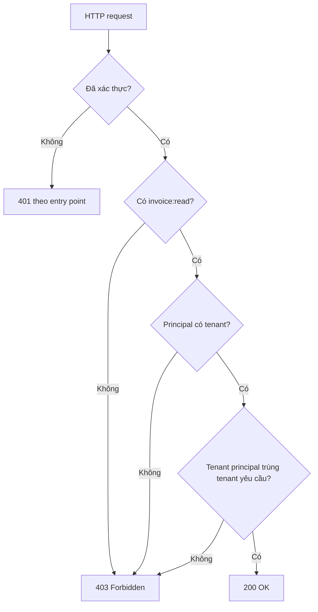

# Gán authorities rõ ràng theo chính sách kiểm thử

## 1. Kiểm thử quyền phải bắt đầu từ chính sách của ứng dụng

Một người dùng đã đăng nhập chưa chắc được phép thực hiện mọi hành động. Trong hệ thống hóa đơn, người đọc có thể xem hóa đơn nhưng không được phát hành hóa đơn; nhân viên tài chính có thể ghi nhận thanh toán nhưng không được quản lý người dùng. Nếu một test chỉ tạo `@WithMockUser` với role mặc định rồi xác nhận endpoint trả `200`, test có thể vô tình cấp nhiều quyền hơn kịch bản thực tế và bỏ sót lỗ hổng phân quyền.

Spring Security biểu diễn quyền thông qua `GrantedAuthority`. Một `Authentication` có thể mang nhiều authority; các biểu thức như `hasAuthority`, `hasAnyAuthority`, `hasRole` và `hasAnyRole` sử dụng chúng để quyết định cho phép hay từ chối. Khi kiểm thử, ta cần gán **đúng tập quyền tối thiểu cho từng kịch bản**, rồi kiểm tra cả hành động được phép và hành động phải bị từ chối.

Trong module **SPRING_SECURITY_TESTING**, nội dung này kết nối `SecurityContext` tùy biến với kiểm chứng xác thực, phân quyền và bảo vệ HTTP bằng `spring-security-test` trên Servlet và Reactive. Bài học tập trung vào cách biến chính sách nghiệp vụ thành authorities rõ ràng trong test, phân biệt role/scope/authority, và xác minh rằng quyền không bị cấp thừa.

Sau bài học, bạn có thể:

- Đọc policy của ứng dụng và xác định authority cần có cho mỗi hành động.
- Phân biệt role có tiền tố `ROLE_`, authority tùy biến và scope OAuth2/JWT có tiền tố `SCOPE_`.
- Tạo annotation/factory kiểm thử nhận danh sách authorities tường minh, mặc định không cấp quyền.
- Kiểm tra ma trận được phép/bị từ chối bằng `MockMvc` hoặc `WebTestClient`.
- Nhận diện lỗi do sai chuỗi authority, sai role prefix, mapping scope hoặc cấu hình security chưa được áp dụng.

## 2. Role, authority, permission và scope

Các khái niệm này liên quan nhưng không đồng nghĩa:

| Khái niệm | Ý nghĩa | Ví dụ | Cách kiểm tra phổ biến |
| --- | --- | --- | --- |
| Role | Nhóm vai trò, thường gom nhiều trách nhiệm | `FINANCE`, `SUPPORT` | `hasRole('FINANCE')` |
| Authority | Quyền mà Spring Security so sánh trực tiếp | `invoice:read`, `invoice:issue` | `hasAuthority('invoice:read')` |
| Permission | Quyền nghiệp vụ theo cách gọi của ứng dụng; thường được ánh xạ thành authority | `invoice:read` hoặc `document:approve` | Thường là `hasAuthority(...)` hoặc policy service |
| OAuth2 scope | Phạm vi được cấp cho access token | `invoice.read` | Resource Server thường ánh xạ thành `SCOPE_invoice.read` |

`GrantedAuthority` là hợp đồng mà Spring Security dùng để biểu diễn một quyền. `SimpleGrantedAuthority` là triển khai đơn giản lưu một chuỗi authority. Các chuỗi được so sánh chính xác; `invoice:read`, `INVOICE:READ` và `invoice.read` là ba giá trị khác nhau.

### 2.1. `hasRole` và `hasAuthority` không thay thế tùy ý cho nhau

Theo cấu hình mặc định, `hasRole('FINANCE')` kiểm tra authority `ROLE_FINANCE`. Ta không truyền tiền tố `ROLE_` vào đối số của `hasRole`:

```java
@PreAuthorize("hasRole('FINANCE')")
public void issueInvoice() {
    // ...
}
```

Ngược lại, `hasAuthority` so sánh nguyên văn chuỗi được truyền:

```java
@PreAuthorize("hasAuthority('invoice:issue')")
public void issueInvoice() {
    // ...
}
```

Với test:

```java
@WithMockUser(roles = "FINANCE")
void financeRole() { /* authority là ROLE_FINANCE */ }

@WithMockUser(authorities = "invoice:issue")
void invoiceIssuePermission() { /* authority là invoice:issue */ }
```

Trong `@WithMockUser`, chọn `roles` hoặc `authorities` theo policy. `roles` được Spring thêm tiền tố role mặc định; `authorities` được dùng nguyên văn. Không dùng cả hai thuộc tính trong cùng một annotation. Nếu ứng dụng cấu hình role prefix khác bằng `GrantedAuthorityDefaults`, hãy để test phản ánh đúng cấu hình đó.

### 2.2. Scope của JWT không tự đồng nghĩa với permission của ứng dụng

Với OAuth2 Resource Server, `JwtGrantedAuthoritiesConverter` mặc định đọc các scope trong claim `scope` hoặc `scp` và tạo authority có tiền tố `SCOPE_`. Ví dụ scope `invoice.read` thường thành `SCOPE_invoice.read`. Do đó:

- `hasAuthority('SCOPE_invoice.read')` kiểm tra authority theo mapping mặc định.
- `hasAuthority('invoice:read')` kiểm tra một quyền ứng dụng khác, cần converter hoặc mapping riêng nếu được ánh xạ từ claim.
- `hasRole('FINANCE')` không tự khớp với scope `invoice.read`.

Không nên tự đổi tên scope thành permission chỉ trong test để làm cho test xanh. Test phải phản ánh chính sách và converter đang chạy trong ứng dụng.

## 3. Chuyển chính sách thành ma trận kiểm thử

Giả sử ứng dụng quản lý hóa đơn cho nhiều tenant. Chính sách đọc hóa đơn như sau:

1. Request phải có người dùng đã xác thực.
2. Authentication phải mang principal có `tenantId`.
3. Người dùng phải có authority `invoice:read`.
4. Tenant trong principal phải trùng tenant được yêu cầu.

Chính sách phát hành hóa đơn yêu cầu `invoice:issue` và tenant phải khớp. Không có role mặc định nào được coi là đủ quyền nếu policy không nói như vậy.

Trước khi viết test, lập ma trận:

| Ca | Authorities được cấp | Tenant trong principal | Hành động | Kỳ vọng |
| --- | --- | --- | --- | --- |
| Người đọc đúng tenant | `invoice:read` | `tenant-a` | Đọc `tenant-a` | Cho phép |
| Người chỉ có quyền phát hành | `invoice:issue` | `tenant-a` | Đọc `tenant-a` | Từ chối |
| Người không có quyền | Rỗng | `tenant-a` | Đọc `tenant-a` | Từ chối |
| Có quyền nhưng sai tenant | `invoice:read` | `tenant-b` | Đọc `tenant-a` | Từ chối |
| Có role tổng quát nhưng thiếu permission | `ROLE_FINANCE` | `tenant-a` | Đọc `tenant-a` | Từ chối nếu policy không ánh xạ role này |
| Chưa xác thực | Không có | Không có | Đọc `tenant-a` | Từ chối tại authentication entry point |

Ma trận buộc ta kiểm tra cả **điều kiện đủ** và **điều kiện cần**. Nếu chỉ có ca người đọc đúng tenant trả `200`, test chưa chứng minh người thiếu quyền hoặc thuộc tenant khác bị chặn.



## 4. Định nghĩa danh tính và policy cho ví dụ

Để minh họa, principal chỉ giữ định danh người dùng và tenant. Đặt `InvoicePrincipal.java` trong `src/main/java/com/example/security`:

```java
package com.example.security;

import java.security.Principal;

public record InvoicePrincipal(String userId, String tenantId)
        implements Principal {

    public InvoicePrincipal {
        if (userId == null || userId.isBlank()) {
            throw new IllegalArgumentException("userId bắt buộc");
        }
        if (tenantId == null || tenantId.isBlank()) {
            throw new IllegalArgumentException("tenantId bắt buộc");
        }
    }

    @Override
    public String getName() {
        return userId;
    }
}
```

Định nghĩa tên authority dùng trong ứng dụng ở `InvoiceAuthorities.java`:

```java
package com.example.security;

public final class InvoiceAuthorities {

    public static final String READ = "invoice:read";
    public static final String ISSUE = "invoice:issue";
    public static final String REFUND = "invoice:refund";

    private InvoiceAuthorities() {
    }
}
```

Việc gom tên quyền vào một nơi giảm lỗi đánh máy trong code Java. Các biểu thức SpEL như `hasAuthority('invoice:read')` vẫn phải dùng đúng chuỗi tương ứng. Nếu muốn tránh chuỗi lặp trong SpEL, có thể tham chiếu hằng số Java bằng biểu thức `T(com.example.security.InvoiceAuthorities).READ`, miễn là package và class có thể được SpEL truy cập trong ứng dụng.

Tạo component kiểm tra tenant trong `InvoiceTenantPolicy.java`:

```java
package com.example.security;

import org.springframework.security.core.Authentication;
import org.springframework.stereotype.Component;

@Component("invoiceTenantPolicy")
public class InvoiceTenantPolicy {

    public boolean matches(Authentication authentication, String requestedTenant) {
        return authentication != null
                && authentication.isAuthenticated()
                && authentication.getPrincipal() instanceof InvoicePrincipal principal
                && principal.tenantId().equals(requestedTenant);
    }
}
```

Component này chỉ kiểm tra principal và tenant. Authority `invoice:read` được kiểm tra riêng bằng `hasAuthority`, giúp test xác định rõ nguyên nhân từ chối là thiếu quyền hay sai tenant.

Controller minh họa:

```java
package com.example.security;

import java.util.Map;

import org.springframework.security.access.prepost.PreAuthorize;
import org.springframework.security.core.annotation.AuthenticationPrincipal;
import org.springframework.security.core.parameters.P;
import org.springframework.web.bind.annotation.GetMapping;
import org.springframework.web.bind.annotation.PathVariable;
import org.springframework.web.bind.annotation.RequestMapping;
import org.springframework.web.bind.annotation.RestController;

@RestController
@RequestMapping("/api/tenants")
public class InvoiceController {

    @GetMapping("/{tenantId}/invoices")
    @PreAuthorize("hasAuthority('invoice:read') and "
            + "@invoiceTenantPolicy.matches(authentication, #tenantId)")
    public Map<String, String> readInvoices(
            @PathVariable("tenantId") @P("tenantId") String tenantId,
            @AuthenticationPrincipal(errorOnInvalidType = true)
            InvoicePrincipal principal) {
        return Map.of("tenantId", tenantId, "userId", principal.userId());
    }
}
```

`@P("tenantId")` cung cấp tên tham số cho biểu thức SpEL. Bật method security bằng `@EnableMethodSecurity`; nếu không, `@PreAuthorize` có thể không được thực thi. Ứng dụng cũng cần `SecurityFilterChain` bảo vệ request chưa xác thực. Với HTTP Basic entry point mặc định, request anonymous thường nhận `401`; người đã xác thực nhưng thiếu quyền hoặc sai tenant nhận `403`.

## 5. Tạo annotation/factory gán authorities tường minh

`@WithMockUser` phù hợp nếu chỉ cần username và authority đơn giản. Khi test cần principal có tenant hoặc thuộc tính miền, tạo annotation riêng để tập quyền của từng kịch bản được khai báo trực tiếp.

### 5.1. Annotation chỉ cấp quyền khi test yêu cầu

Đặt `WithInvoiceUser.java` trong `src/test/java/com/example/security`:

```java
package com.example.security;

import java.lang.annotation.ElementType;
import java.lang.annotation.Retention;
import java.lang.annotation.RetentionPolicy;
import java.lang.annotation.Target;

import org.springframework.security.test.context.support.WithSecurityContext;

@Target({ ElementType.METHOD, ElementType.TYPE })
@Retention(RetentionPolicy.RUNTIME)
@WithSecurityContext(factory = WithInvoiceUserFactory.class)
public @interface WithInvoiceUser {

    String userId() default "u-42";

    String tenantId() default "tenant-a";

    // Không cấp quyền mặc định: mỗi test phải nêu rõ quyền cần có.
    String[] authorities() default {};
}
```

Đặt mặc định `authorities = {}` có chủ đích. Khi một test quên khai báo quyền, người dùng được tạo ra không có authority và test sẽ không vô tình vượt qua policy nhờ quyền mặc định. Đây là cách áp dụng nguyên tắc **least privilege** ngay trong fixture kiểm thử.

### 5.2. Factory chuyển chuỗi thành `GrantedAuthority`

Đặt `WithInvoiceUserFactory.java`:

```java
package com.example.security;

import java.util.Arrays;

import org.springframework.security.authentication.UsernamePasswordAuthenticationToken;
import org.springframework.security.core.Authentication;
import org.springframework.security.core.authority.SimpleGrantedAuthority;
import org.springframework.security.core.context.SecurityContext;
import org.springframework.security.core.context.SecurityContextHolder;
import org.springframework.security.test.context.support.WithSecurityContextFactory;

public final class WithInvoiceUserFactory
        implements WithSecurityContextFactory<WithInvoiceUser> {

    @Override
    public SecurityContext createSecurityContext(WithInvoiceUser marker) {
        InvoicePrincipal principal =
                new InvoicePrincipal(marker.userId(), marker.tenantId());

        var authorities = Arrays.stream(marker.authorities())
                .map(String::trim)
                .filter(value -> !value.isEmpty())
                .distinct()
                .map(SimpleGrantedAuthority::new)
                .toList();

        Authentication authentication =
                UsernamePasswordAuthenticationToken.authenticated(
                        principal, null, authorities);

        SecurityContext context = SecurityContextHolder.createEmptyContext();
        context.setAuthentication(authentication);
        return context;
    }
}
```

Factory tạo một `SecurityContext` mới, một principal và đúng danh sách authorities được khai báo trên annotation. `SimpleGrantedAuthority` giữ nguyên chuỗi sau khi loại bỏ khoảng trắng đầu/cuối; `distinct()` tránh lặp quyền. Trong dự án thực, có thể chọn từ chối chuỗi rỗng thay vì lọc nếu muốn fixture sai cấu hình thất bại ngay. Dù chọn cách nào, không tự thêm `ROLE_` hoặc `SCOPE_` vào permission tùy biến.

`UsernamePasswordAuthenticationToken.authenticated(...)` tạo authentication đã xác thực cho mục đích kiểm thử. Nếu production yêu cầu một subtype khác như `JwtAuthenticationToken` hay custom token, factory phải tạo đúng subtype đó; bài này giả định controller chỉ cần `Authentication` chuẩn cùng `InvoicePrincipal`.

### 5.3. Cách khai báo tập quyền ngay trên test

```java
@Test
@WithInvoiceUser(authorities = { "invoice:read" })
void readerCanRead() { /* ... */ }

@Test
@WithInvoiceUser(authorities = { "invoice:issue" })
void issuerDoesNotAutomaticallyRead() { /* ... */ }

@Test
@WithInvoiceUser(authorities = {})
void userWithoutPermissionIsDenied() { /* ... */ }
```

Tên test diễn đạt policy; danh sách quyền cho biết chính xác người dùng được cấp gì. Quyền `invoice:issue` không tự bao hàm `invoice:read`, trừ khi ứng dụng cấu hình role hierarchy hoặc policy mapping để quan hệ đó tồn tại. Test nên mô tả đúng quan hệ quyền thực tế thay vì tự giả định quyền kế thừa.

## 6. Kiểm chứng policy bằng `MockMvc`

Thêm các dependency test phù hợp, ví dụ với Gradle và Spring Boot:

```gradle
dependencies {
    testImplementation("org.springframework.boot:spring-boot-starter-test")
    testImplementation("org.springframework.security:spring-security-test")
}
```

Ví dụ test dưới đây giả định có controller, policy, annotation và factory ở trên; Spring Boot cấu hình `MockMvc` cùng security filters:

```java
package com.example.security;

import org.junit.jupiter.api.Test;
import org.springframework.beans.factory.annotation.Autowired;
import org.springframework.boot.test.autoconfigure.web.servlet.AutoConfigureMockMvc;
import org.springframework.boot.test.context.SpringBootTest;
import org.springframework.test.web.servlet.MockMvc;

import static org.springframework.test.web.servlet.request.MockMvcRequestBuilders.get;
import static org.springframework.test.web.servlet.result.MockMvcResultMatchers.jsonPath;
import static org.springframework.test.web.servlet.result.MockMvcResultMatchers.status;

@SpringBootTest
@AutoConfigureMockMvc
class InvoiceAuthorityTests {

    @Autowired
    MockMvc mvc;

    @Test
    @WithInvoiceUser(userId = "reader-1", tenantId = "tenant-a",
            authorities = { "invoice:read" })
    void readerDungTenantDuocPhep() throws Exception {
        mvc.perform(get("/api/tenants/tenant-a/invoices"))
                .andExpect(status().isOk())
                .andExpect(jsonPath("$.userId").value("reader-1"));
    }

    @Test
    @WithInvoiceUser(tenantId = "tenant-a", authorities = { "invoice:issue" })
    void issuerKhongMacDinhCoQuyenRead() throws Exception {
        mvc.perform(get("/api/tenants/tenant-a/invoices"))
                .andExpect(status().isForbidden());
    }

    @Test
    @WithInvoiceUser(tenantId = "tenant-a", authorities = {})
    void khongCoAuthorityBiTuChoi() throws Exception {
        mvc.perform(get("/api/tenants/tenant-a/invoices"))
                .andExpect(status().isForbidden());
    }

    @Test
    @WithInvoiceUser(tenantId = "tenant-b", authorities = { "invoice:read" })
    void coQuyenNhungSaiTenantBiTuChoi() throws Exception {
        mvc.perform(get("/api/tenants/tenant-a/invoices"))
                .andExpect(status().isForbidden());
    }

    @Test
    void anonymousBiTuChoi() throws Exception {
        mvc.perform(get("/api/tenants/tenant-a/invoices"))
                .andExpect(status().isUnauthorized());
    }
}
```

Các kết quả trên dựa trên HTTP Basic entry point và method security của cấu hình ví dụ. Nếu ứng dụng dùng login page hoặc custom `AuthenticationEntryPoint`, status của anonymous có thể là redirect hoặc phản hồi riêng. Không gán nhầm `401` với `403`: `401` là chưa có authentication hợp lệ; `403` là request đã được xác thực nhưng không được phép theo policy.

### 6.1. Kiểm tra authority thực tế được factory tạo

Khi test trả status không như mong đợi, hãy xác minh context trước:

```java
@Test
@WithInvoiceUser(userId = "reader-1", tenantId = "tenant-a",
        authorities = { "invoice:read" })
void factoryGanDungAuthorities() {
    Authentication authentication =
            SecurityContextHolder.getContext().getAuthentication();

    assertThat(authentication.isAuthenticated()).isTrue();
    assertThat(authentication.getPrincipal())
            .isInstanceOf(InvoicePrincipal.class);
    assertThat(authentication.getAuthorities())
            .extracting(GrantedAuthority::getAuthority)
            .containsExactly("invoice:read");
}
```

Phương thức này nằm trong test có Spring Test; cần static import `assertThat` từ AssertJ và import `Authentication`, `GrantedAuthority`, `SecurityContextHolder`. Nó xác minh dữ liệu được cấp, không thay thế test HTTP: filter chain, method security và policy tenant vẫn cần được kiểm chứng ở các ca request.

### 6.2. Request-scoped authority với `MockMvc`

Nếu chỉ một request cần authority riêng và không cần principal miền, dùng request post-processor:

```java
mvc.perform(get("/api/public-report")
        .with(user("auditor").authorities(
                new SimpleGrantedAuthority("report:read"))))
    .andExpect(status().isOk());
```

Đoạn này cần static import `SecurityMockMvcRequestPostProcessors.user`. `user()` tạo người dùng mock theo request; `.authorities(...)` gán authority nguyên văn. Khi endpoint cần `InvoicePrincipal`, hãy dùng `authentication(...)` với token có principal đúng hoặc annotation/factory riêng ở trên. Nếu dựng `MockMvc` thủ công, áp dụng `.apply(springSecurity())` để gắn Spring Security filter chain.

## 7. Quyền theo role và role hierarchy

Một số hệ thống muốn quản lý role ở mức nhóm và ánh xạ chúng thành quyền chi tiết. Ví dụ `ROLE_FINANCE_MANAGER` có thể bao gồm `invoice:read` và `invoice:issue`. Spring Security hỗ trợ `RoleHierarchy`; tuy nhiên, việc hierarchy có hiệu lực còn phụ thuộc cách ứng dụng cấu hình và nơi kiểm tra quyền.

Hai chiến lược thường gặp:

| Chiến lược | Cách biểu diễn | Điều test cần chứng minh |
| --- | --- | --- |
| Cấp quyền chi tiết trực tiếp | Authentication chứa `invoice:read`, `invoice:issue` | Mỗi test chỉ nhận đúng quyền của hành động đang xét |
| Cấp role rồi suy ra quyền qua hierarchy/mapping | Authentication chứa `ROLE_FINANCE_MANAGER` | Cấu hình hierarchy thực sự suy ra các quyền mong muốn; role không được tự động cấp thêm quyền ngoài policy |

Nếu production có role hierarchy, viết test tích hợp để kiểm tra quan hệ kế thừa. Một unit test chỉ tạo `SimpleGrantedAuthority("ROLE_FINANCE_MANAGER")` không tự chứng minh `invoice:read` đã được suy ra. Nếu test policy trực tiếp, có thể cấp authority hiệu lực đã được chuyển đổi; nếu test cấu hình hierarchy, phải chạy qua thành phần hierarchy đang dùng.

Đừng gán đồng thời cả `ROLE_ADMIN` và mọi permission vào fixture nếu policy production chỉ cấp role rồi ánh xạ. Fixture quá rộng có thể che giấu lỗi mapping hoặc khiến một endpoint vượt qua nhờ quyền thừa.

## 8. JWT scope và authority trong kiểm thử Resource Server

Khi endpoint được bảo vệ bằng JWT, cần xác định policy mong đợi **scope authority** hay **permission tùy biến**. Ví dụ endpoint dùng:

```java
@PreAuthorize("hasAuthority('SCOPE_invoice.read')")
```

thì test phải cung cấp đúng `SCOPE_invoice.read`. Với `MockMvc`, helper `jwt()` cho phép dựng request có `JwtAuthenticationToken`:

```java
mvc.perform(get("/api/jwt/invoices")
        .with(jwt()
                .jwt(token -> token
                        .subject("u-42")
                        .claim("scope", "invoice.read"))
                .authorities(new SimpleGrantedAuthority("SCOPE_invoice.read"))))
    .andExpect(status().isOk());
```

Đây là ví dụ cho endpoint Resource Server dùng JWT. Cần static import `SecurityMockMvcRequestPostProcessors.jwt`, import `SimpleGrantedAuthority` và bảo đảm `MockMvc` có security filters. Khi truyền `.authorities(...)` một cách tường minh, test đang kiểm tra policy với authority đã cấp; nó **không chứng minh** claim `scope` đã được converter ánh xạ đúng.

Muốn kiểm tra converter mặc định, có thể kiểm tra riêng kết quả của `JwtGrantedAuthoritiesConverter`:

```java
Jwt jwt = Jwt.withTokenValue("test-token")
        .header("alg", "none")
        .claim("scope", "invoice.read profile")
        .build();

JwtGrantedAuthoritiesConverter converter = new JwtGrantedAuthoritiesConverter();
Collection<GrantedAuthority> authorities = converter.convert(jwt);

assertThat(authorities)
        .extracting(GrantedAuthority::getAuthority)
        .contains("SCOPE_invoice.read", "SCOPE_profile");
```

Đây là test ánh xạ claim sang authority; cần import `Jwt`, `JwtGrantedAuthoritiesConverter`, `Collection`, `GrantedAuthority` và AssertJ. Nếu ứng dụng cài converter tùy chỉnh, hãy test bean/converter thực tế thay vì khởi tạo converter mặc định trong test. Mock JWT cũng không xác minh chữ ký, issuer hoặc audience; những kiểm tra xác thực token cần test riêng.

## 9. Reactive: gán authorities cho từng request `WebTestClient`

Trong WebFlux, context bảo mật được truyền qua Reactor Context. Dùng `WebTestClient` cùng Spring Security Test để gắn authentication và authorities cho request.

Nếu chỉ cần một người dùng mock có authority đơn giản:

```java
webTestClient.mutateWith(mockUser()
        .authorities(new SimpleGrantedAuthority("invoice:read")))
        .get().uri("/api/reactive/invoices")
        .exchange()
        .expectStatus().isOk();
```

Nếu endpoint cần principal miền, tạo authentication với principal và authorities tương ứng rồi dùng `mockAuthentication`:

```java
Authentication authentication = UsernamePasswordAuthenticationToken.authenticated(
        new InvoicePrincipal("u-42", "tenant-a"),
        null,
        List.of(new SimpleGrantedAuthority("invoice:read")));

webTestClient.mutateWith(mockAuthentication(authentication))
        .get().uri("/api/reactive/tenants/tenant-a/invoices")
        .exchange()
        .expectStatus().isOk();
```

Hai ví dụ giả định route Reactive và policy tương ứng tồn tại. Cần static import `mockUser`/`mockAuthentication` từ `SecurityMockServerConfigurers`. Khi tạo client từ application context, áp dụng `springSecurity()` trong lúc dựng `WebTestClient`. Với reactive method security, bật `@EnableReactiveMethodSecurity`; nếu dùng `@WithSecurityContext` cho reactive test, bảo đảm `ReactorContextTestExecutionListener` được tích hợp. Không dựa vào ThreadLocal của `SecurityContextHolder` để truyền danh tính qua reactive pipeline.

## 10. Lỗi thường gặp khi gán authorities

| Hiện tượng | Nguyên nhân thường gặp | Cách kiểm tra |
| --- | --- | --- |
| `hasAuthority('invoice:read')` bị từ chối dù test có `roles = "FINANCE"` | Role sinh `ROLE_FINANCE`, không tự tương đương `invoice:read` | Xác định mapping role-permission trong ứng dụng; cấp authority đúng hoặc test hierarchy |
| `hasRole('FINANCE')` bị từ chối với `authorities = "FINANCE"` | `hasRole` mặc định tìm `ROLE_FINANCE` | Dùng `roles = "FINANCE"` hoặc cấp nguyên văn `ROLE_FINANCE` cho authorities |
| JWT có scope nhưng policy không nhận | Authority thực tế là `SCOPE_invoice.read`, policy lại tìm `invoice:read` | Kiểm tra converter và thống nhất policy |
| Test luôn được phép dù bỏ quyền | Fixture cấp authority mặc định quá rộng hoặc có role hierarchy | Đặt mặc định authority rỗng, assert danh sách quyền thực tế |
| Test thất bại vì khoảng trắng hoặc sai chữ hoa/thường | Authority được so sánh theo chuỗi chính xác | Dùng hằng số, tránh nhập tay và kiểm tra output của factory |
| Request thiếu quyền trả `200` | Method security chưa bật hoặc filter chain không được gắn | Kiểm tra `@EnableMethodSecurity`, `@AutoConfigureMockMvc`, `.apply(springSecurity())` |
| Anonymous trả `403` thay vì `401` | Entry point/access-denied handler hoặc cơ chế xác thực của app khác ví dụ | Kiểm tra `AuthenticationEntryPoint` và cấu hình HTTP |
| POST có quyền vẫn trả `403` | Thiếu CSRF token trong ứng dụng bật CSRF | Dùng `.with(csrf())` để kiểm tra riêng authorization |
| Test WebFlux không nhận authority | Authentication chưa được đặt trong Reactor Context hoặc client thiếu security configurer | Dùng `mutateWith(...)`, `springSecurity()` và cấu hình reactive phù hợp |

Một quy tắc thực hành hữu ích là luôn assert danh sách authority trong fixture quan trọng. Nếu policy yêu cầu `invoice:read`, assert chính xác rằng authentication có `invoice:read`; không chỉ assert `isAuthenticated() == true`.

## 11. Bài thực hành

Mở rộng ứng dụng hóa đơn với hai endpoint:

- `GET /api/tenants/{tenantId}/invoices` yêu cầu `invoice:read`.
- `POST /api/tenants/{tenantId}/invoices` yêu cầu `invoice:issue` và CSRF hợp lệ nếu CSRF đang bật.

Viết tối thiểu các ca sau bằng `MockMvc`:

1. Người dùng chỉ có `invoice:read` đọc được hóa đơn đúng tenant.
2. Người dùng chỉ có `invoice:read` không phát hành được hóa đơn.
3. Người dùng chỉ có `invoice:issue` phát hành được nhưng không mặc định đọc được.
4. Người dùng có đủ authority nhưng tenant sai bị từ chối.
5. Người dùng không có authority bị từ chối ở cả hai endpoint.
6. Người dùng anonymous bị chặn ở authentication entry point.
7. Một test riêng kiểm tra role hierarchy nếu ứng dụng quy định `ROLE_FINANCE_MANAGER` bao gồm hai quyền trên.
8. Một test POST có authority nhưng thiếu CSRF token bị từ chối vì CSRF; thêm `.with(csrf())` để xác nhận ca authorization thành công.

Sau đó chuyển một endpoint sang WebFlux và lặp lại ít nhất một ca được phép, một ca thiếu quyền và một ca sai tenant với `WebTestClient`.

### Câu hỏi tự đánh giá

- Vì sao `roles = "FINANCE"` không tự thỏa mãn `hasAuthority('invoice:read')`?
- Tại sao annotation kiểm thử nên mặc định `authorities = {}`?
- Nếu `jwt()` test truyền `.authorities(...)` tường minh, điều gì đã được kiểm tra và điều gì chưa được kiểm tra về claim `scope`?
- Khi nào nên cấp role, khi nào nên cấp permission trực tiếp trong test?
- Vì sao test cần cả ca `200` và `403` thay vì chỉ kiểm tra endpoint từ chối?
- Một request `POST` bị `403` có thể do thiếu authority hoặc thiếu CSRF; làm thế nào phân biệt hai nguyên nhân?

## Tài liệu tham khảo

- [Spring Security — Testing Method Security](https://docs.spring.io/spring-security/reference/servlet/test/method.html)
- [Spring Security — `@WithMockUser` and `@WithSecurityContext`](https://docs.spring.io/spring-security/reference/servlet/test/method.html)
- [Spring Security — MockMvc Request Post Processors](https://docs.spring.io/spring-security/reference/servlet/test/mockmvc/request-post-processors.html)
- [Spring Security — OAuth 2.0 Resource Server JWT](https://docs.spring.io/spring-security/reference/servlet/oauth2/resource-server/jwt.html)
- [Spring Security — Reactive Web Testing](https://docs.spring.io/spring-security/reference/reactive/test/web/index.html)
- [Spring Security — Authorization Architecture](https://docs.spring.io/spring-security/reference/servlet/authorization/architecture.html)

Một ca kiểm thử phân quyền có giá trị khi authority được cấp xuất phát từ chính sách, tập quyền trong fixture được xác định rõ, và các tình huống thiếu quyền hoặc sai phạm vi đều bị từ chối. Hãy xem `Authentication` như một tập quyền cụ thể gắn với một danh tính đã xác thực; kiểm tra quyền và tenant độc lập để phát hiện cả lỗi cấp quyền thừa lẫn lỗi truy cập chéo tenant.
