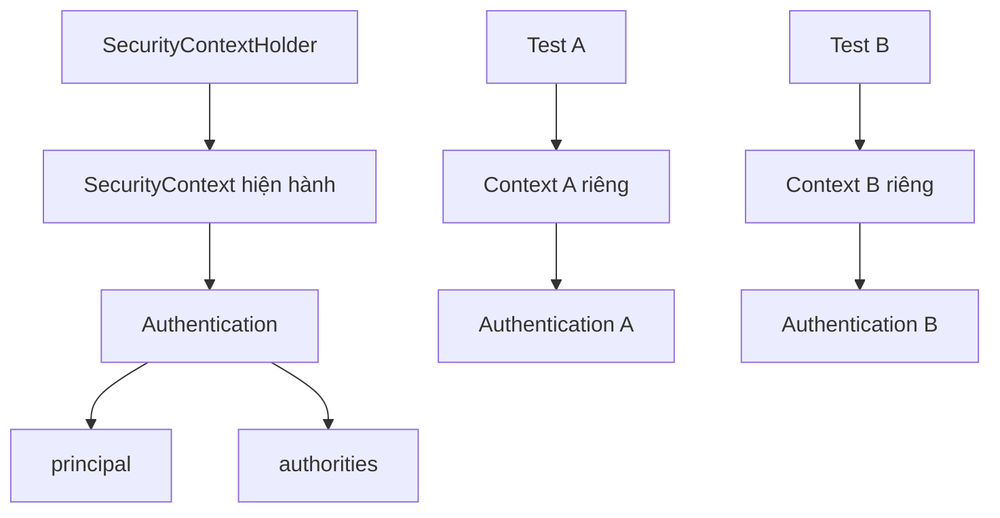

# Tạo `SecurityContext` mới cho từng ca thay vì sửa đối tượng dùng chung

## 1. Vì sao mỗi test cần một ngữ cảnh bảo mật riêng?

`SecurityContext` là đối tượng mutable chứa `Authentication` hiện hành. Khi một test gọi `SecurityContextHolder.getContext().setAuthentication(...)`, nó đang sửa chính đối tượng context mà holder trả về trên luồng hiện tại. Nếu nhiều test, request hoặc tác vụ bất đồng bộ cùng giữ tham chiếu đến một `SecurityContext` dùng chung, danh tính có thể bị ghi đè, quyền của test này lọt sang test khác hoặc kết quả phụ thuộc thứ tự thực thi.

Ví dụ, test A thiết lập người dùng `alice` thuộc `tenant-a`; test B đổi authentication thành `bob` thuộc `tenant-b`. Nếu cả hai cùng sửa một context static, test A có thể bất ngờ quan sát `bob` trong lúc kiểm tra. Lỗi kiểu này đặc biệt khó tái hiện khi bật chạy test song song.

Trong module **SPRING_SECURITY_TESTING**, ta kiểm chứng xác thực, phân quyền và bảo vệ HTTP bằng `spring-security-test` trên ứng dụng Servlet và Reactive. Với custom security context, nguyên tắc nền tảng là: **mỗi lần chạy test tạo một `SecurityContext` mới, gắn authentication của riêng kịch bản đó và để lifecycle test dọn trạng thái sau khi hoàn tất**.

Sau bài học, bạn có thể:

- Nhận diện việc tái sử dụng context mutable và các biến static gây rò rỉ danh tính.
- Tạo context độc lập bằng `SecurityContextHolder.createEmptyContext()`.
- Thiết kế `WithSecurityContextFactory` không lưu context hoặc authentication vào state dùng chung.
- Thiết lập và dọn context an toàn trong test thủ công bằng `try/finally`.
- Hiểu giới hạn của `ThreadLocal`, truyền context sang executor và sử dụng Reactor Context trong WebFlux.
- Kiểm tra sự cô lập giữa các ca được phép và bị từ chối, kể cả khi test chạy song song.

## 2. `SecurityContextHolder` giữ tham chiếu đến context như thế nào?

Mô hình cơ bản:



`SecurityContextHolder` là facade truy cập context thông qua một `SecurityContextHolderStrategy`. Với cấu hình phổ biến của ứng dụng Servlet, strategy mặc định sử dụng `ThreadLocal`: mỗi thread có một tham chiếu context hiện hành riêng. Tuy nhiên, `ThreadLocal` **không tự nhân bản đối tượng**. Nếu code chủ động đặt cùng một instance `SecurityContext` vào nhiều thread hoặc giữ nó trong một biến static, các thread vẫn có thể cùng sửa một object.

Phân biệt hai thao tác:

```java
// Lấy context hiện hành rồi sửa object đó:
SecurityContextHolder.getContext().setAuthentication(authentication);

// Tạo object context mới, gắn authentication, rồi đặt làm context hiện hành:
SecurityContext context = SecurityContextHolder.createEmptyContext();
context.setAuthentication(authentication);
SecurityContextHolder.setContext(context);
```

Đoạn thứ hai tạo ranh giới ownership rõ ràng hơn: context mới thuộc test hiện tại. `createEmptyContext()` yêu cầu strategy hiện hành tạo một context rỗng phù hợp; không nên tự giả định mọi ứng dụng đều dùng một implementation cụ thể như `SecurityContextImpl`.

### Những thứ không nên chia sẻ giữa các test

- Một `SecurityContext` mutable lưu trong `static` field hoặc singleton fixture.
- Một `Authentication` có thể bị thay đổi details, trạng thái hoặc credentials, nếu các test dùng chung và có thao tác sửa.
- Một principal mutable chứa tenant, role hoặc trạng thái tài khoản rồi thay đổi giữa các test.
- Một `Collection<GrantedAuthority>` mutable mà fixture tiếp tục chỉnh sửa sau khi đã gắn vào authentication.

Ngay cả khi `Authentication` hoặc principal cụ thể có vẻ bất biến, tạo mới context và dữ liệu danh tính theo từng ca vẫn giúp ownership dễ hiểu và tránh phụ thuộc vào chi tiết implementation. Với danh sách authority, ưu tiên collection không bị sửa sau khi khởi tạo, ví dụ `List.of(...)`.

## 3. Anti-pattern: dùng chung một context rồi thay authentication

Ví dụ dưới đây không an toàn nếu nhiều test cùng sử dụng context static:

```java
class SharedContextFixture {

    static final SecurityContext SHARED =
            SecurityContextHolder.createEmptyContext();

    static void loginAs(String username) {
        SHARED.setAuthentication(
                UsernamePasswordAuthenticationToken.authenticated(
                        username,
                        null,
                        List.of(new SimpleGrantedAuthority("invoice:read"))));
        SecurityContextHolder.setContext(SHARED);
    }
}
```

Giả sử hai test gọi `loginAs("alice")` và `loginAs("bob")`. Dù holder của mỗi thread có thể trỏ đến context theo thread, cả hai holder lại trỏ đến **cùng instance `SHARED`**. Khi test B sửa `SHARED.authentication`, test A cũng nhìn thấy thay đổi. `ThreadLocal` không cứu được một object mutable đã bị chia sẻ tường minh.

Một biến thể cũng dễ mắc phải là lấy context một lần rồi thay authentication trong mỗi test:

```java
private static final SecurityContext CONTEXT =
        SecurityContextHolder.createEmptyContext();

@BeforeEach
void setUp() {
    CONTEXT.setAuthentication(authenticationForCurrentTest());
    SecurityContextHolder.setContext(CONTEXT);
}
```

Đặt lại authentication trước từng test không biến context static thành object riêng. Nếu một test giữ reference cũ, chạy bất đồng bộ hoặc song song, việc thay đổi vẫn có thể tác động lẫn nhau. Cần bỏ state dùng chung và tạo context mới tại mỗi lần setup.

## 4. Cách đúng: một factory tạo context mới cho mỗi lần gọi

Ví dụ principal tối giản trong mã ứng dụng:

```java
package com.example.security;

import java.security.Principal;

public record TestUserPrincipal(String userId, String tenantId)
        implements Principal {

    @Override
    public String getName() {
        return userId;
    }
}
```

Annotation dùng trong test:

```java
package com.example.security;

import java.lang.annotation.ElementType;
import java.lang.annotation.Retention;
import java.lang.annotation.RetentionPolicy;
import java.lang.annotation.Target;

import org.springframework.security.test.context.support.WithSecurityContext;

@Target({ ElementType.METHOD, ElementType.TYPE })
@Retention(RetentionPolicy.RUNTIME)
@WithSecurityContext(factory = WithTestUserFactory.class)
public @interface WithTestUser {

    String userId() default "u-100";

    String tenantId() default "tenant-a";

    String[] authorities() default {};
}
```

Factory:

```java
package com.example.security;

import java.util.Arrays;

import org.springframework.security.authentication.UsernamePasswordAuthenticationToken;
import org.springframework.security.core.Authentication;
import org.springframework.security.core.authority.SimpleGrantedAuthority;
import org.springframework.security.core.context.SecurityContext;
import org.springframework.security.core.context.SecurityContextHolder;
import org.springframework.security.test.context.support.WithSecurityContextFactory;

public final class WithTestUserFactory
        implements WithSecurityContextFactory<WithTestUser> {

    @Override
    public SecurityContext createSecurityContext(WithTestUser marker) {
        TestUserPrincipal principal =
                new TestUserPrincipal(marker.userId(), marker.tenantId());

        var authorities = Arrays.stream(marker.authorities())
                .map(SimpleGrantedAuthority::new)
                .toList();

        Authentication authentication =
                UsernamePasswordAuthenticationToken.authenticated(
                        principal, null, authorities);

        // Mỗi lần factory được gọi đều tạo context mới.
        SecurityContext context = SecurityContextHolder.createEmptyContext();
        context.setAuthentication(authentication);
        return context;
    }
}
```

Factory không có field static hoặc instance để giữ context, authentication hay principal của lần gọi trước. Mỗi invocation tạo principal, authority collection, authentication và context mới. Đây là hợp đồng cần duy trì khi mở rộng factory: không cache context theo username, không trả về một context singleton và không gọi `SecurityContextHolder.setContext()` từ bên trong factory.

Spring Security Test gọi factory qua `WithSecurityContextTestExecutionListener`. Listener chuẩn bị context theo vòng đời Spring Test và dọn context sau test. Vì vậy, annotation là cách phù hợp khi test cần cùng một danh tính trong toàn bộ phương thức test. Nếu cần hai danh tính cho hai request khác nhau trong cùng một phương thức, hãy dùng request post-processor của `MockMvc` hoặc mutator của `WebTestClient` để đặt danh tính theo từng request.

### 4.1. Cấu hình mỗi ca chỉ nhận quyền cần thiết

```java
@Test
@WithTestUser(userId = "reader-1", tenantId = "tenant-a",
        authorities = { "invoice:read" })
void readerCanRead() {
    // ...
}

@Test
@WithTestUser(userId = "writer-1", tenantId = "tenant-a",
        authorities = { "invoice:issue" })
void writerDoesNotAutomaticallyRead() {
    // ...
}

@Test
@WithTestUser(userId = "guest-1", tenantId = "tenant-a")
void noAuthorityIsDenied() {
    // ...
}
```

Các test khai báo chủ thể và quyền riêng. Factory không giữ trạng thái của `reader-1` để dùng cho `writer-1`; quyền rỗng của `guest-1` cũng không bị bổ sung quyền từ test trước.

## 5. Setup thủ công: tạo mới, đặt vào holder và luôn dọn

Không phải test nào cũng cần annotation. Với test cô lập hoặc một đoạn kiểm thử cần thay context có chủ đích, tạo context mới rồi đặt vào holder:

```java
@Test
void manualContextIsClearedAfterUse() {
    SecurityContext context = SecurityContextHolder.createEmptyContext();
    Authentication authentication =
            UsernamePasswordAuthenticationToken.authenticated(
                    new TestUserPrincipal("u-200", "tenant-b"),
                    null,
                    List.of(new SimpleGrantedAuthority("invoice:read")));
    context.setAuthentication(authentication);

    try {
        SecurityContextHolder.setContext(context);

        assertThat(SecurityContextHolder.getContext().getAuthentication())
                .isSameAs(authentication);
        // Gọi service đồng bộ cần kiểm tra với người dùng u-200.
    } finally {
        SecurityContextHolder.clearContext();
    }
}
```

`clearContext()` xóa context khỏi strategy hiện hành trên thread đang chạy. Đặt trong `finally` để cleanup vẫn diễn ra khi assertion hoặc code được kiểm thử ném exception. Đừng chỉ gọi `setContext(newContext)` ở đầu test mà quên cleanup nếu bạn tự quản lý holder.

Nếu test cần khôi phục một context trước đó thay vì xóa hoàn toàn, có thể lưu lại context cũ trước khi thay, rồi khôi phục trong `finally`. Chỉ làm điều này khi có chủ đích lồng các scope; không dùng nó để che giấu việc test đang chia sẻ một context mutable. Với phần lớn test độc lập, `clearContext()` là cách cleanup rõ ràng.

### 5.1. Helper dùng được trong nhiều test

Tách việc dựng context thành hàm thuần trả về object mới:

```java
static SecurityContext newContext(
        String userId,
        String tenantId,
        String... authorityNames) {

    var authorities = Arrays.stream(authorityNames)
            .map(SimpleGrantedAuthority::new)
            .toList();

    Authentication authentication =
            UsernamePasswordAuthenticationToken.authenticated(
                    new TestUserPrincipal(userId, tenantId),
                    null,
                    authorities);

    SecurityContext context = SecurityContextHolder.createEmptyContext();
    context.setAuthentication(authentication);
    return context;
}
```

Hàm này không đặt context vào holder và không giữ state; caller quyết định thời điểm sử dụng và cleanup. Mỗi lần gọi tạo object mới. Có thể viết test kiểm tra tính độc lập của helper:

```java
@Test
void moiLanTaoLaMotContextKhacNhau() {
    SecurityContext first = newContext("alice", "tenant-a", "invoice:read");
    SecurityContext second = newContext("bob", "tenant-b", "invoice:issue");

    assertThat(first).isNotSameAs(second);
    assertThat(first.getAuthentication()).isNotSameAs(second.getAuthentication());
    assertThat(first.getAuthentication().getName()).isEqualTo("alice");
    assertThat(second.getAuthentication().getName()).isEqualTo("bob");
}
```

Test này kiểm tra helper tạo context và authentication riêng; nó không thay thế việc kiểm tra lifecycle listener hoặc security filter chain trong test tích hợp.

## 6. Vòng đời context trong Spring Test và `MockMvc`

Với `@WithSecurityContext`, `WithSecurityContextTestExecutionListener` gọi factory và cài context theo mốc cấu hình. Mặc định là `TestExecutionEvent.TEST_METHOD`, nghĩa là context được chuẩn bị trong `beforeTestMethod`, trước `@BeforeEach` của JUnit Jupiter. Nếu dùng `setupBefore = TestExecutionEvent.TEST_EXECUTION`, context được chuẩn bị muộn hơn, sau `@BeforeEach` và trước thân phương thức test.

```java
@WithSecurityContext(
        factory = WithTestUserFactory.class,
        setupBefore = TestExecutionEvent.TEST_EXECUTION
)
```

Chọn thời điểm dựa trên nhu cầu của fixture. Nếu `@BeforeEach` đọc `SecurityContextHolder`, dùng mặc định `TEST_METHOD`; nếu `@BeforeEach` cần chạy trước khi context mock xuất hiện, chọn `TEST_EXECUTION`. Không tự cài thêm một authentication khác trong `@BeforeEach` rồi giả định listener sẽ giữ nguyên thứ tự mong muốn.

Trong test Servlet với `MockMvc`, `@WithTestUser` thiết lập context cho phương thức test; Spring Security Test kết nối bối cảnh test với request mock thông qua integration của filter chain. Với Spring Boot, `@AutoConfigureMockMvc` thường cấu hình các filter. Nếu tự dựng `MockMvc` bằng `MockMvcBuilders.webAppContextSetup(context)`, áp dụng `.apply(springSecurity())`.

Ví dụ ca được phép và bị từ chối:

```java
@SpringBootTest
@AutoConfigureMockMvc
class InvoiceContextIsolationTests {

    @Autowired
    MockMvc mvc;

    @Test
    @WithTestUser(userId = "reader", tenantId = "tenant-a",
            authorities = { "invoice:read" })
    void readerReadsOwnTenant() throws Exception {
        mvc.perform(get("/api/tenants/tenant-a/invoices"))
                .andExpect(status().isOk());
    }

    @Test
    @WithTestUser(userId = "other-tenant-reader", tenantId = "tenant-b",
            authorities = { "invoice:read" })
    void readerCannotReadAnotherTenant() throws Exception {
        mvc.perform(get("/api/tenants/tenant-a/invoices"))
                .andExpect(status().isForbidden());
    }

    @Test
    @WithTestUser(userId = "no-permission", tenantId = "tenant-a")
    void authenticatedWithoutAuthorityIsDenied() throws Exception {
        mvc.perform(get("/api/tenants/tenant-a/invoices"))
                .andExpect(status().isForbidden());
    }

    @Test
    void anonymousIsRejected() throws Exception {
        mvc.perform(get("/api/tenants/tenant-a/invoices"))
                .andExpect(status().isUnauthorized());
    }
}
```

Các status ở đây giả định HTTP Basic hoặc entry point trả `401`, method security kiểm tra quyền và tenant, và filter chain đã được gắn. Một ứng dụng dùng form login có thể redirect thay vì trả `401`. Mục đích của test là xác minh bối cảnh của mỗi ca độc lập và policy được thực thi; status cần khớp cấu hình ứng dụng thực tế.

### 6.1. Đặt authentication theo từng request

Khi một phương thức test cần nhiều người dùng trong cùng một test, annotation ở cấp method không tiện vì nó đại diện một context cho cả test. Dùng `authentication(...)` hoặc `user(...)` cho từng request:

```java
Authentication reader = UsernamePasswordAuthenticationToken.authenticated(
        new TestUserPrincipal("reader", "tenant-a"), null,
        List.of(new SimpleGrantedAuthority("invoice:read")));

Authentication writer = UsernamePasswordAuthenticationToken.authenticated(
        new TestUserPrincipal("writer", "tenant-a"), null,
        List.of(new SimpleGrantedAuthority("invoice:issue")));

mvc.perform(get("/api/tenants/tenant-a/invoices")
        .with(authentication(reader)))
    .andExpect(status().isOk());

mvc.perform(get("/api/tenants/tenant-a/invoices")
        .with(authentication(writer)))
    .andExpect(status().isForbidden());
```

Ví dụ cần static import `SecurityMockMvcRequestPostProcessors.authentication`, `get` và `status`. Mỗi request được cấp authentication riêng. Không sửa một token/context đang được request trước sử dụng để tái dùng cho request sau.

## 7. Chạy test song song và ranh giới của `ThreadLocal`

JUnit Jupiter có thể chạy test song song khi được cấu hình bật parallel execution. Với `ThreadLocal` strategy, mỗi thread có một context holder riêng; điều đó giúp tách biệt các context được tạo riêng trên từng thread. Tuy nhiên, các test vẫn có thể chia sẻ object thông qua static field, singleton hoặc closure. Nếu hai thread cùng giữ một tham chiếu `SecurityContext`, thay đổi authentication ở một thread vẫn có thể được thread kia quan sát.

Để an toàn khi test chạy song song:

1. Tạo context và authentication mới trong từng invocation của factory/helper.
2. Không cache context hoặc principal mutable trong static field.
3. Để listener quản lý context khi dùng `@WithSecurityContext`; nếu tự quản lý holder, luôn cleanup trong `finally`.
4. Không thay đổi danh sách authorities hoặc principal sau khi đã gắn vào context.
5. Tránh đổi `SecurityContextHolder` strategy toàn cục trong từng test; việc đổi strategy ảnh hưởng các test khác đang chạy.

### 7.1. Vì sao không nên tùy tiện dùng `MODE_INHERITABLETHREADLOCAL`?

`MODE_INHERITABLETHREADLOCAL` có thể khiến thread con thừa hưởng tham chiếu context khi được tạo. Nhưng thread pool thường tái sử dụng worker thread; thời điểm tạo thread và thời điểm submit task không giống nhau. Vì vậy, inheritable thread local không phải cơ chế truyền security context đáng tin cậy cho executor. Nó còn có nguy cơ giữ context cũ lâu hơn dự kiến.

Khi cần truyền context sang tác vụ bất đồng bộ, hãy dùng wrapper/decorator của Spring Security như `DelegatingSecurityContextRunnable`, `DelegatingSecurityContextCallable` hoặc `DelegatingSecurityContextExecutor`. Chúng thiết lập context phù hợp quanh tác vụ và dọn/restores context theo lifecycle wrapper. Hãy kiểm tra rằng executor được cấu hình để capture context đúng thời điểm submit và không chia sẻ một context mutable giữa các tác vụ.

Ví dụ dùng executor được bọc:

```java
import java.util.List;
import java.util.concurrent.CompletableFuture;
import java.util.concurrent.Executor;
import java.util.concurrent.ExecutorService;
import java.util.concurrent.Executors;

import org.springframework.security.authentication.UsernamePasswordAuthenticationToken;
import org.springframework.security.core.Authentication;
import org.springframework.security.core.authority.SimpleGrantedAuthority;
import org.springframework.security.core.context.SecurityContext;
import org.springframework.security.core.context.SecurityContextHolder;
import org.springframework.security.concurrent.DelegatingSecurityContextExecutor;

ExecutorService delegate = Executors.newSingleThreadExecutor();
Executor secured = new DelegatingSecurityContextExecutor(delegate);

SecurityContext context = SecurityContextHolder.createEmptyContext();
Authentication alice = UsernamePasswordAuthenticationToken.authenticated(
        "alice", null, List.of(new SimpleGrantedAuthority("invoice:read")));
context.setAuthentication(alice);

try {
    SecurityContextHolder.setContext(context);
    CompletableFuture.runAsync(() -> {
        Authentication current =
                SecurityContextHolder.getContext().getAuthentication();
        assertThat(current.getName()).isEqualTo("alice");
    }, secured).join();
} finally {
    SecurityContextHolder.clearContext();
    delegate.shutdownNow();
}
```

Đây là minh họa cho việc truyền context từ thread submit sang executor; `DelegatingSecurityContextExecutor` bọc task bằng context tại thời điểm submit. `join()` chờ task hoàn tất và chuyển lỗi assertion về test thread; executor do test tạo cũng được đóng trong `finally`. Đừng để assertion chạy sau khi test đã kết thúc.

## 8. Reactive: mỗi pipeline có Reactor Context riêng

WebFlux không dựa vào `ThreadLocal` của `SecurityContextHolder` để truyền security context qua reactive pipeline. Spring Security dùng Reactor Context; vì thế, tạo một context mới vẫn quan trọng nhưng phải đặt nó vào đúng pipeline.

Với `WebTestClient`, Spring Security Test cung cấp mutator để cấp authentication theo request:

```java
Authentication authentication = UsernamePasswordAuthenticationToken.authenticated(
        new TestUserPrincipal("reader", "tenant-a"),
        null,
        List.of(new SimpleGrantedAuthority("invoice:read")));

webTestClient.mutateWith(mockAuthentication(authentication))
        .get().uri("/api/reactive/tenants/tenant-a/invoices")
        .exchange()
        .expectStatus().isOk();
```

Đoạn này giả định route Reactive có policy phù hợp; cần static import `SecurityMockServerConfigurers.mockAuthentication`. Nếu client được dựng từ application context, áp dụng `springSecurity()` trong lúc build `WebTestClient`. Dùng một authentication mới cho mỗi request cần danh tính riêng; không sửa token đang được pipeline khác tham chiếu.

Nếu cần thiết lập context trực tiếp trong một pipeline, `ReactiveSecurityContextHolder.withSecurityContext(...)` trả về một `Context` operator để ghi security context vào Reactor Context:

```java
SecurityContext securityContext = SecurityContextHolder.createEmptyContext();
securityContext.setAuthentication(authenticationFor("reader"));

Mono<String> result = Mono.deferContextual(view ->
        ReactiveSecurityContextHolder.getContext()
                .map(context -> context.getAuthentication().getName()))
    .contextWrite(ReactiveSecurityContextHolder.withSecurityContext(
            Mono.just(securityContext)));
```

Trong ví dụ này, `securityContext` được tạo mới cho pipeline hiện tại; không lưu nó trong static field để nhiều pipeline cùng sửa. Với test reactive method security sử dụng `@WithSecurityContext`, tích hợp `ReactorContextTestExecutionListener` để listener đưa context vào Reactor Context. Đừng giả định rằng `SecurityContextHolder.setContext(...)` trên thread JUnit tự động truyền vào pipeline WebFlux.

## 9. Kiểm tra isolation: context mới, authentication mới và cleanup

Một bộ kiểm tra isolation nên xác nhận ba điều:

| Điều cần xác nhận | Cách kiểm tra | Lỗi được phát hiện |
| --- | --- | --- |
| Factory trả context khác nhau mỗi lần | So sánh identity của hai kết quả `createSecurityContext` hoặc helper | Context singleton/static bị tái sử dụng |
| Authentication/principal khác nhau theo kịch bản | Assert username, tenant và authorities của từng context | Dữ liệu người dùng trước lọt vào test sau |
| Holder được dọn sau test thủ công | Sau `finally`, kiểm tra `SecurityContextHolder.getContext().getAuthentication()` không còn authentication cũ | Context rò rỉ sang test kế tiếp trên cùng thread |

Ví dụ kiểm tra cleanup trong test quản lý context thủ công:

```java
@Test
void manualSetupAlwaysClearsHolder() {
    SecurityContext context = newContext("alice", "tenant-a", "invoice:read");

    try {
        SecurityContextHolder.setContext(context);
        assertThat(SecurityContextHolder.getContext().getAuthentication())
                .isNotNull();
    } finally {
        SecurityContextHolder.clearContext();
    }

    assertThat(SecurityContextHolder.getContext().getAuthentication()).isNull();
}
```

Lưu ý: gọi `getContext()` sau `clearContext()` có thể khiến strategy tạo một context rỗng mới. Điều cần xác nhận là authentication cũ không còn hiện diện, không phải holder trả về `null` context.

Khi dùng `@WithSecurityContext`, ưu tiên để listener dọn context thay vì thêm `clearContext()` thủ công trong `@AfterEach`; cleanup thủ công có thể làm thay đổi thứ tự lifecycle hoặc che giấu cấu hình listener sai. Nếu tự đăng ký `@TestExecutionListeners`, dùng merge với listener mặc định khi phù hợp để không vô tình bỏ `WithSecurityContextTestExecutionListener`.

## 10. Lỗi thường gặp và cách xử lý

| Hiện tượng | Nguyên nhân | Cách xử lý |
| --- | --- | --- |
| Test song song đọc nhầm user | Nhiều test dùng chung context mutable hoặc principal mutable | Tạo context/principal mới cho mỗi invocation; bỏ static state |
| Test chạy riêng thì pass, chạy cả suite thì fail | Context thủ công không được clear hoặc listener bị thay thế | Cleanup bằng `finally`; kiểm tra `@TestExecutionListeners` |
| Đã `setContext` nhưng thread khác không thấy user | Holder dùng ThreadLocal, context không tự truyền qua executor | Dùng `DelegatingSecurityContextExecutor` hoặc wrapper tương ứng |
| Task trong thread pool thấy user cũ | Dựa vào `MODE_INHERITABLETHREADLOCAL` hoặc tự giữ context trên worker | Dùng delegating wrapper và bảo đảm lifecycle task hoàn tất |
| `@WithSecurityContext` không có tác dụng | Thiếu Spring Test integration/listener hoặc annotation sai retention | Kiểm tra `@Retention(RUNTIME)`, `@WithSecurityContext`, Spring Test setup |
| `@BeforeEach` chưa thấy principal | Chọn `setupBefore = TEST_EXECUTION` | Chọn `TEST_METHOD` nếu setup cần context sớm hơn |
| WebFlux không nhận context | Đặt context trong ThreadLocal thay vì Reactor Context | Dùng `WebTestClient` mutator hoặc `ReactiveSecurityContextHolder` |
| Test request thật qua cổng HTTP không có user mock | Context của test không được truyền qua mạng | Gửi credential/token/session trong HTTP request |
| Test sau bị ảnh hưởng bởi test trước | Static principal/authority collection hoặc cleanup thiếu | Tạo dữ liệu độc lập và kiểm tra identity của object |

## 11. Bài thực hành

Hãy tạo hai kịch bản test cho endpoint đọc hóa đơn:

1. `reader-a` thuộc `tenant-a`, có `invoice:read` → đọc hóa đơn `tenant-a` thành công.
2. `reader-b` thuộc `tenant-b`, có cùng authority → đọc hóa đơn `tenant-a` bị từ chối.

Sau đó thực hiện các bước:

- Viết một factory `WithSecurityContextFactory` luôn gọi `SecurityContextHolder.createEmptyContext()` trong mỗi lần `createSecurityContext`.
- Tạo helper `newContext(...)` không dùng biến static và kiểm tra hai lần gọi trả hai instance context/authentication khác nhau.
- Viết một test setup thủ công có `try/finally` và chứng minh authentication cũ không còn sau `clearContext()`.
- Chạy test song song (nếu dự án cho phép) và kiểm tra không có danh tính hoặc authority rò rỉ giữa hai kịch bản.
- Nếu service submit task sang executor, bọc executor bằng `DelegatingSecurityContextExecutor` và xác minh task nhận đúng người gọi.
- Với WebFlux, chuyển một test sang `WebTestClient.mutateWith(mockAuthentication(...))` và không dùng ThreadLocal để truyền context.

### Câu hỏi tự đánh giá

- Vì sao `ThreadLocal` không bảo vệ được một `SecurityContext` static được chia sẻ tường minh giữa nhiều thread?
- Khác biệt giữa `SecurityContextHolder.getContext().setAuthentication(...)` và `createEmptyContext()` rồi `setContext(...)` là gì?
- Vì sao factory không nên giữ `SecurityContext` trong field hoặc cache theo username?
- Khi nào nên dùng `@WithSecurityContext`, khi nào nên dùng request post-processor của `MockMvc`?
- Vì sao `MODE_INHERITABLETHREADLOCAL` không phải giải pháp phù hợp cho mọi thread pool?
- WebFlux truyền security context bằng cơ chế nào và vì sao không thể dựa vào ThreadLocal?

## Tài liệu tham khảo

- [Spring Security — SecurityContextHolder](https://docs.spring.io/spring-security/reference/servlet/authentication/architecture.html)
- [Spring Security — Testing Method Security and `@WithSecurityContext`](https://docs.spring.io/spring-security/reference/servlet/test/method.html)
- [Spring Security — MockMvc Setup](https://docs.spring.io/spring-security/reference/servlet/test/mockmvc/setup.html)
- [Spring Security — Concurrency Support](https://docs.spring.io/spring-security/reference/servlet/integrations/concurrency.html)
- [Spring Security — Reactive Security Context](https://docs.spring.io/spring-security/reference/reactive/authorization/method.html)
- [Spring Security — Reactive Web Testing](https://docs.spring.io/spring-security/reference/reactive/test/web/index.html)

Một test isolation tốt không chỉ cấp đúng người dùng mà còn sở hữu context riêng và kết thúc với trạng thái sạch. Hãy tạo context mới ở mỗi lần chạy, không sửa object dùng chung, truyền context qua executor bằng cơ chế hỗ trợ của Spring Security và dùng Reactor Context cho WebFlux. Như vậy, kết quả kiểm thử phản ánh chính sách của từng danh tính thay vì phụ thuộc thứ tự hoặc lịch chạy test.
