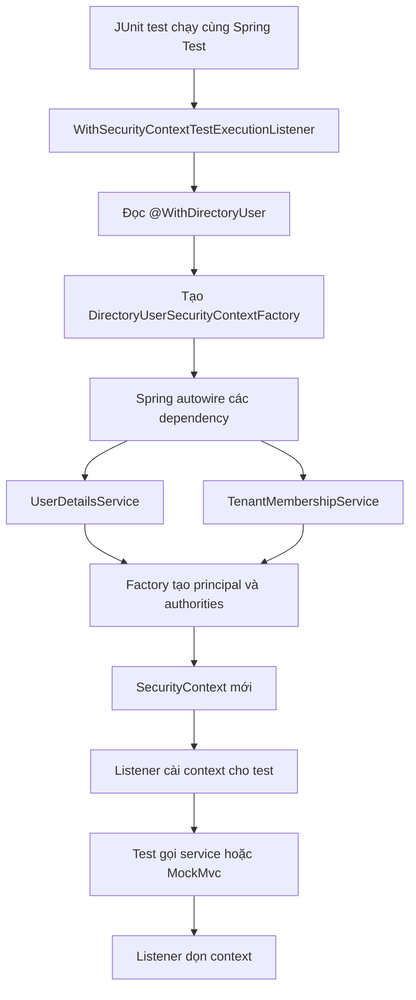

# Tiêm bean cần thiết vào factory thông qua Spring

## 1. Khi factory cần dữ liệu và dịch vụ của ứng dụng

Một `WithSecurityContextFactory` có thể dựng principal và authorities hoàn toàn từ thuộc tính của annotation. Cách đó phù hợp với test đơn giản, nhưng nhiều kịch bản cần dữ liệu đã được quản lý bởi ứng dụng: người dùng phải tồn tại trong `UserDetailsService`, tài khoản phải đang hoạt động, người dùng phải là thành viên của tenant, hoặc quyền phải được ánh xạ qua một service dùng chung.

Nếu factory tự `new` các dependency, tự tạo repository giả hoặc chép lại logic ánh xạ quyền, fixture có thể khác hành vi production. Spring Security Test cho phép factory nhận bean từ `ApplicationContext` thông qua cơ chế dependency injection của Spring. Vì vậy, factory có thể sử dụng chính `UserDetailsService`, service membership, mapper hoặc bean cấu hình mà ứng dụng đã đăng ký.

Trong module **SPRING_SECURITY_TESTING**, mục tiêu là kiểm chứng xác thực, phân quyền và bảo vệ HTTP bằng `spring-security-test` trên Servlet và Reactive. Bài này tập trung vào cách đưa bean cần thiết vào factory để tạo một `SecurityContext` sát với mô hình danh tính của ứng dụng, đồng thời giữ ranh giới rõ giữa **dựng bối cảnh đã xác thực cho test** và **kiểm thử quy trình xác thực thật**.

Sau bài học, bạn có thể:

- Giải thích vì sao factory cần bean từ Spring và điều kiện để injection hoạt động.
- Tiêm `UserDetailsService` hoặc service nghiệp vụ vào `WithSecurityContextFactory`.
- Dùng dữ liệu người dùng và membership đã được seed để tạo principal/authorities phù hợp.
- Chọn `setupBefore` đúng khi fixture dữ liệu được tạo trong `@BeforeEach`.
- Xử lý test slice thiếu bean, bean trùng loại và lỗi dữ liệu khi factory được gọi.
- Biết khi nào `@WithUserDetails` đã đủ và khi nào cần custom factory.

## 2. Spring tạo factory và tiêm dependency như thế nào?

Khi test sử dụng một annotation được đánh dấu `@WithSecurityContext`, `WithSecurityContextTestExecutionListener` của Spring Security Test đọc annotation, tạo factory được khai báo trong thuộc tính `factory`, rồi sử dụng Spring Test context để chuẩn bị các dependency được đánh dấu injection. Factory thực hiện `createSecurityContext(annotation)` và trả về context cho listener cài đặt trong vòng đời test.



Factory không cần tự gọi `new UserDetailsServiceImpl(...)` và cũng không cần được khởi tạo thủ công trong test. Nó chỉ khai báo dependency qua Spring, còn Spring Test chịu trách nhiệm cung cấp bean. Để việc này hoạt động, test phải chạy trong Spring Test context, ví dụ `@SpringBootTest`, `@ContextConfiguration` hoặc một test slice có `SpringExtension` và đủ bean cần thiết.

Một factory thường là class riêng được tham chiếu từ `@WithSecurityContext(factory = ...)`. Không cần tự đăng ký factory như một singleton `@Component` chỉ để listener tìm thấy nó; factory được tạo từ class được annotation chỉ định và được Spring autowire. Đừng gọi `new DirectoryUserSecurityContextFactory()` trong test vì object tự tạo bên ngoài lifecycle này sẽ không nhận dependency injection.

## 3. Ví dụ: nạp người dùng và tenant membership qua bean

Giả sử API hóa đơn cần người dùng đang hoạt động, có membership còn hiệu lực trong tenant và được cấp authority `invoice:read`. Ta dùng hai bean:

- `UserDetailsService` tải tài khoản và các authority toàn cục.
- `TenantMembershipService` xác minh người dùng thuộc tenant được yêu cầu và trả về các authority có phạm vi tenant.

### 3.1. Principal và membership model

Principal ứng dụng trong `src/main/java/com/example/security/TenantPrincipal.java`:

```java
package com.example.security;

import java.security.Principal;

public record TenantPrincipal(
        String userId,
        String username,
        String tenantId) implements Principal {

    @Override
    public String getName() {
        return username;
    }
}
```

Membership mà service trả về:

```java
package com.example.security;

import java.util.Collection;

import org.springframework.security.core.GrantedAuthority;

public record TenantMembership(
        String userId,
        String tenantId,
        Collection<? extends GrantedAuthority> authorities) {
}
```

Hợp đồng service:

```java
package com.example.security;

public interface TenantMembershipService {

    /**
     * Trả về membership đang hoạt động của username trong tenant.
     * Ném exception nghiệp vụ nếu user không thuộc tenant hoặc membership bị khóa.
     */
    TenantMembership requireActiveMembership(String username, String tenantId);
}
```

`TenantMembershipService` là bean của ứng dụng. Implementation có thể đọc database, cache hoặc dịch vụ tổ chức; factory không cần biết chi tiết lưu trữ. Nó chỉ yêu cầu membership hợp lệ và dùng kết quả service trả về.

### 3.2. Annotation chỉ mô tả dữ liệu cần tra cứu

Đặt `WithDirectoryUser.java` trong `src/test/java/com/example/security`:

```java
package com.example.security;

import java.lang.annotation.ElementType;
import java.lang.annotation.Retention;
import java.lang.annotation.RetentionPolicy;
import java.lang.annotation.Target;

import org.springframework.security.test.context.support.TestExecutionEvent;
import org.springframework.security.test.context.support.WithSecurityContext;

@Target({ ElementType.METHOD, ElementType.TYPE })
@Retention(RetentionPolicy.RUNTIME)
@WithSecurityContext(
        factory = DirectoryUserSecurityContextFactory.class,
        setupBefore = TestExecutionEvent.TEST_EXECUTION)
public @interface WithDirectoryUser {

    String username();

    String tenantId();
}
```

Ở đây chọn `TEST_EXECUTION` để cho phép `@BeforeEach` chuẩn bị user và membership trước khi factory truy vấn chúng. Nếu dữ liệu đã được seed trước đó (chẳng hạn bằng migration/test dataset hoặc `@Sql`), có thể giữ mặc định `TEST_METHOD`. Lựa chọn thời điểm phải phù hợp với thứ tự tạo dữ liệu của test.

### 3.3. Tiêm bean vào factory

Đặt `DirectoryUserSecurityContextFactory.java` trong `src/test/java/com/example/security`:

```java
package com.example.security;

import java.util.stream.Stream;

import org.springframework.beans.factory.annotation.Autowired;
import org.springframework.security.authentication.UsernamePasswordAuthenticationToken;
import org.springframework.security.core.Authentication;
import org.springframework.security.core.GrantedAuthority;
import org.springframework.security.core.userdetails.UserDetails;
import org.springframework.security.core.userdetails.UserDetailsService;
import org.springframework.security.core.context.SecurityContext;
import org.springframework.security.core.context.SecurityContextHolder;
import org.springframework.security.test.context.support.WithSecurityContextFactory;

public final class DirectoryUserSecurityContextFactory
        implements WithSecurityContextFactory<WithDirectoryUser> {

    @Autowired
    private UserDetailsService userDetailsService;

    @Autowired
    private TenantMembershipService tenantMembershipService;

    @Override
    public SecurityContext createSecurityContext(WithDirectoryUser marker) {
        UserDetails account =
                userDetailsService.loadUserByUsername(marker.username());

        if (!account.isEnabled()
                || !account.isAccountNonLocked()
                || !account.isAccountNonExpired()
                || !account.isCredentialsNonExpired()) {
            throw new IllegalStateException(
                    "Test fixture yêu cầu tài khoản đang hoạt động: "
                            + marker.username());
        }

        TenantMembership membership = tenantMembershipService
                .requireActiveMembership(account.getUsername(), marker.tenantId());

        TenantPrincipal principal = new TenantPrincipal(
                membership.userId(), account.getUsername(), membership.tenantId());

        var authorities = Stream.concat(
                        account.getAuthorities().stream(),
                        membership.authorities().stream())
                .distinct()
                .toList();

        Authentication authentication =
                UsernamePasswordAuthenticationToken.authenticated(
                        principal, null, authorities);

        SecurityContext context = SecurityContextHolder.createEmptyContext();
        context.setAuthentication(authentication);
        return context;
    }
}
```

Các dependency được đánh dấu `@Autowired` được Spring cung cấp khi factory được tạo trong test context. `UserDetailsService` tải tài khoản và cung cấp trạng thái cùng quyền toàn cục; `TenantMembershipService` xác minh quan hệ tenant và cung cấp quyền theo membership. Factory kết hợp hai nguồn quyền, loại bỏ trùng lặp, rồi tạo một `Authentication` đã xác thực cho test.

Factory tạo `SecurityContext` mới mỗi lần gọi. Nó không lưu account, membership, authentication hay context vào field để tái sử dụng giữa test. Nếu username không tồn tại hoặc membership không hợp lệ, service ném exception và quá trình chuẩn bị test thất bại ngay; điều đó giúp phân biệt lỗi fixture với một request hợp lệ bị policy từ chối.

**Lưu ý về phạm vi ví dụ:** `UsernamePasswordAuthenticationToken.authenticated(...)` ở đây mô phỏng một người đã đăng nhập để kiểm tra authorization. Factory không kiểm tra mật khẩu và không chạy `AuthenticationManager`. Nếu cần kiểm chứng password encoder, authentication provider hoặc lockout flow, hãy gửi credential qua luồng xác thực thật trong một integration test riêng.

## 4. Dữ liệu test phải tồn tại trước thời điểm factory chạy

Vì factory gọi `UserDetailsService` và `TenantMembershipService`, dữ liệu được truy vấn phải sẵn sàng khi `createSecurityContext(...)` được gọi. Có hai tình huống thường gặp:

| Cách chuẩn bị dữ liệu | `setupBefore` phù hợp | Lý do |
| --- | --- | --- |
| Dữ liệu đã seed trước khi test bắt đầu (`@Sql` ở giai đoạn trước, migration hoặc dataset cố định) | `TEST_METHOD` mặc định | Listener có thể dựng context ngay trước `@BeforeEach` |
| `@BeforeEach` tạo user/membership cho test hiện tại | `TEST_EXECUTION` | Factory chạy sau `@BeforeEach`, nên có thể đọc fixture vừa tạo |
| `@BeforeEach` cần đọc authentication để chuẩn bị service | Thường là `TEST_METHOD` | Context phải được cài trước `@BeforeEach`; hãy seed dữ liệu ở bước sớm hơn |

Ví dụ test dùng fixture service để seed dữ liệu:

```java
@SpringBootTest
@AutoConfigureMockMvc
class DirectoryUserSecurityTests {

    @Autowired
    TestAccountFixture fixture;

    @Autowired
    MockMvc mvc;

    @BeforeEach
    void seedAccountAndMembership() {
        fixture.ensureActiveAccount("alice", "u-42");
        fixture.ensureMembership(
                "alice", "tenant-a", List.of("invoice:read"));
    }

    @Test
    @WithDirectoryUser(username = "alice", tenantId = "tenant-a")
    void activeMemberCanReadInvoices() throws Exception {
        mvc.perform(get("/api/tenants/tenant-a/invoices"))
                .andExpect(status().isOk());
    }
}
```

`TestAccountFixture` ở đây là bean hỗ trợ test do dự án định nghĩa; các phương thức `ensureActiveAccount` và `ensureMembership` minh họa cách chuẩn bị dữ liệu, không phải API có sẵn của Spring. Vì annotation đặt `setupBefore = TEST_EXECUTION`, listener dựng authentication sau khi `seedAccountAndMembership()` hoàn tất. Nếu dùng transaction test, cần bảo đảm service được gọi trong cùng transaction hoặc dữ liệu đã commit/được nhìn thấy theo transaction isolation của môi trường.

Khi test dùng `@Sql`, kiểm tra thứ tự listener và transaction thực tế của dự án. Không đổi `setupBefore` chỉ để che lỗi seed data: trước tiên xác định thời điểm dữ liệu được ghi và thời điểm factory truy vấn.

## 5. Khi test slice không có đủ bean

`@SpringBootTest` thường nạp application context rộng, nên các bean như `UserDetailsService` và `TenantMembershipService` có thể đã tồn tại. Các test slice như `@WebMvcTest` chỉ nạp một phần ứng dụng; nếu factory cần service không nằm trong slice, injection sẽ thất bại.

Có một số cách xử lý:

1. Import cấu hình test chứa bean cần thiết bằng `@Import(...)`.
2. Cung cấp bean giả lập trong `@TestConfiguration` nếu mục tiêu là test policy/controller với dữ liệu cố định.
3. Dùng `@MockitoBean` hoặc cơ chế mock bean tương ứng với phiên bản Spring Boot/Spring Framework của dự án để thay dependency trong context.
4. Chuyển test sang `@SpringBootTest` nếu mục tiêu thực sự cần kiểm tra tích hợp giữa nhiều bean và repository.

Ví dụ khai báo service stub cho test slice:

```java
@TestConfiguration
static class SecurityTestBeans {

    @Bean
    TenantMembershipService tenantMembershipService() {
        return (username, tenantId) -> {
            if (!username.equals("alice") || !tenantId.equals("tenant-a")) {
                throw new UsernameNotFoundException("Membership không tồn tại");
            }
            return new TenantMembership(
                    "u-42", "tenant-a",
                    List.of(new SimpleGrantedAuthority("invoice:read")));
        };
    }
}
```

Đây là stub có chủ đích, chỉ trả membership cho `alice` trong `tenant-a`. Để chạy được cần import `@Bean`, `@TestConfiguration`, `UsernameNotFoundException`, `List` và `SimpleGrantedAuthority`. Bean `UserDetailsService` cũng phải có sẵn trong slice hoặc được cung cấp tương tự. Không đăng ký nhiều bean cùng kiểu mà không có `@Primary` hoặc `@Qualifier`, vì khi đó Spring không biết chọn dependency nào để tiêm.

### 5.1. Chẩn đoán lỗi injection

| Lỗi | Nguyên nhân thường gặp | Hướng xử lý |
| --- | --- | --- |
| `UnsatisfiedDependencyException` khi chuẩn bị test | Context không có bean đúng kiểu | Import cấu hình hoặc cung cấp bean test |
| `NoUniqueBeanDefinitionException` | Có nhiều bean cùng kiểu | Dùng `@Qualifier`, `@Primary` hoặc inject đúng abstraction |
| Factory dependency `null` | Factory bị tự tạo bằng `new`, hoặc không chạy trong Spring Test lifecycle | Dùng `@WithSecurityContext` và Spring Test extension; không tự khởi tạo factory |
| `UsernameNotFoundException` | Dữ liệu user chưa được seed hoặc username sai | Kiểm tra fixture và `setupBefore` |
| Membership lookup thất bại | User chưa thuộc tenant, membership bị khóa hoặc sai tenant ID | Chuẩn bị membership hợp lệ cho ca được phép; dùng test riêng cho ca bị từ chối |
| Test slice thiếu repository/service | Slice không nạp toàn bộ application beans | Import bean cần thiết hoặc chọn test context phù hợp |
| Test chạy được riêng nhưng suite thất bại | Dữ liệu fixture dùng chung hoặc bị test khác sửa | Tạo dữ liệu cô lập theo test và transaction/cleanup rõ ràng |

## 6. Khi nào nên dùng `@WithUserDetails` thay custom factory?

Spring Security Test đã có `@WithUserDetails` để nạp người dùng từ `UserDetailsService`. Nếu test chỉ cần một `UserDetails` tồn tại trong service và không phải kết hợp thêm dữ liệu miền, annotation dựng sẵn thường đơn giản hơn.

| Nhu cầu | Lựa chọn nên cân nhắc | Vì sao |
| --- | --- | --- |
| Cần username, role/authority đơn giản, không gọi bean | `@WithMockUser` | Fixture gọn, không cần application lookup |
| Cần `UserDetails` đã được nạp từ `UserDetailsService` | `@WithUserDetails` | Spring cung cấp sẵn việc tải người dùng |
| Cần ghép `UserDetails` với tenant membership, organization, policy hoặc principal tùy biến | `@WithSecurityContext` + factory có injection | Factory điều phối nhiều bean và dựng đúng authentication/principal |
| Cần một token JWT/OIDC mock theo từng HTTP request | `jwt()`, `oidcLogin()`, `mockJwt()`, `mockOidcLogin()` | Request post-processor/mutator biểu diễn đúng loại authentication |
| Cần kiểm tra password/token thực sự được xác minh | Gửi request qua authentication flow của ứng dụng | Context mock bỏ qua bước xác minh credentials/token |

Không tạo custom factory chỉ để thay đổi username của `@WithMockUser`. Hãy dùng factory khi nó biểu diễn một yêu cầu nghiệp vụ hoặc cấu trúc authentication mà các annotation chuẩn không đáp ứng.

## 7. Factory có thể tiêm những loại bean nào?

Factory có thể nhận bất kỳ bean nào được Spring quản lý và có mặt trong test context, miễn là dependency phù hợp với nhiệm vụ tạo security context. Ví dụ:

| Bean | Mục đích trong factory | Cần lưu ý |
| --- | --- | --- |
| `UserDetailsService` | Tải account và authorities | User phải tồn tại trước thời điểm factory chạy |
| Tenant/organization membership service | Xác minh người dùng thuộc phạm vi dữ liệu | Không lấy tenant chỉ từ input client chưa xác minh |
| `GrantedAuthoritiesMapper` | Ánh xạ role/authority theo cùng quy tắc ứng dụng | Test nên xác nhận mapping không cấp quyền thừa |
| `Clock` | Tạo claim hoặc trạng thái phụ thuộc thời gian | Dùng clock cố định trong test để tránh phụ thuộc thời gian thực |
| Policy/configuration bean | Chọn quyền theo loại tài khoản hoặc feature | Không biến factory thành nơi thực hiện toàn bộ business workflow |
| Repository | Truy vấn fixture trực tiếp | Ưu tiên service abstraction để tránh lặp logic truy cập dữ liệu |

Factory nên làm nhiệm vụ **lắp ráp danh tính đã được test chọn**. Không nên gọi API bên ngoài, gửi email, tạo giao dịch nghiệp vụ hoặc thực hiện side effect khó rollback khi Spring chuẩn bị context. Các thao tác ấy làm test chậm và khó đoán; nếu cần, hãy chuẩn bị dữ liệu bằng fixture service riêng.

### 7.1. Tiêm mapper để giữ đúng quy tắc authority

Nếu ứng dụng có `GrantedAuthoritiesMapper`, factory có thể dùng cùng bean đó để ánh xạ quyền thay vì tự viết một bảng role-to-permission riêng:

```java
@Autowired
private GrantedAuthoritiesMapper authoritiesMapper;

// Sau khi đã tải UserDetails account:
Collection<? extends GrantedAuthority> mapped =
        authoritiesMapper.mapAuthorities(account.getAuthorities());

Authentication authentication = UsernamePasswordAuthenticationToken.authenticated(
        principal, null, mapped);
```

Đoạn này là phần thay thế cho bước dựng authorities trong factory; cần import `GrantedAuthoritiesMapper` và `Collection`. Nếu factory kết hợp thêm tenant authorities, hãy kết hợp chúng theo đúng quy tắc production rồi mới tạo token. Không gọi mapper và đồng thời tự thêm các quyền suy diễn lần nữa nếu điều đó tạo quyền trùng hoặc vượt policy.

## 8. Giới hạn Servlet, Reactive và xác thực thật

### Servlet và `MockMvc`

Factory có thể được gọi trước test để đặt context cho method security hoặc request mock. `MockMvc` cần security filter chain được tích hợp. Với Spring Boot, `@AutoConfigureMockMvc` thường làm việc này; với builder thủ công, áp dụng `springSecurity()`. Request post-processor `authentication(...)` có thể thay đổi authentication riêng cho từng request.

Nếu test chạy server thật với `@SpringBootTest(webEnvironment = RANDOM_PORT)`, factory không tự gửi authentication qua socket đến server. Hãy gửi HTTP Basic credentials, bearer token hoặc cookie/session phù hợp để server chạy quy trình xác thực của nó.

### Reactive và `WebTestClient`

Reactive security sử dụng Reactor Context. Với HTTP request mock, `WebTestClient` cung cấp `mockAuthentication`, `mockUser`, `mockJwt`, `mockOAuth2Login` và `mockOidcLogin` tùy kiểu authentication cần thử. Nếu dùng `@WithSecurityContext` cho reactive method test, tích hợp `ReactorContextTestExecutionListener` để context được đưa vào Reactor Context. Việc inject bean vào factory vẫn dựa trên Spring Test context, nhưng việc truyền security context vào reactive pipeline phải tuân theo cơ chế reactive.

### Factory không thay thế `AuthenticationManager`

Một factory thường tạo một authentication **đã xác thực** trực tiếp để test authorization. Nó không chứng minh:

- Password có được encoder/decoder kiểm tra đúng không.
- Account lockout, expired credentials hoặc MFA flow có hoạt động không.
- JWT signature, issuer, audience, expiration có được validator kiểm tra không.
- OAuth2 authorization code hoặc OIDC ID token có được provider xác minh không.

Nếu mục tiêu là xác thực thật, gửi credential/token qua filter/provider/decoder trong integration test. Có thể vẫn dùng bean từ Spring trong factory để tạo fixture, nhưng không nên nhầm fixture đó với quy trình đăng nhập đang được kiểm chứng.

## 9. Bài thực hành

Mở rộng ví dụ với `InvoiceMembershipService` và dữ liệu test trong tenant:

1. Seed user `alice` đang hoạt động, có authority toàn cục `ROLE_FINANCE`.
2. Seed membership của `alice` trong `tenant-a`, có authority `invoice:read`.
3. Dùng `@WithDirectoryUser(username = "alice", tenantId = "tenant-a")`; factory phải inject `UserDetailsService` và `TenantMembershipService`, sau đó tạo `TenantPrincipal` cùng tập authorities kết hợp.
4. Kiểm tra `GET /api/tenants/tenant-a/invoices` được phép.
5. Dùng một user có membership trong `tenant-b` và yêu cầu `tenant-a`; request phải bị từ chối.
6. Xóa authority `invoice:read` khỏi membership nhưng giữ account active; request phải nhận `403`.
7. Chuyển seed data vào `@BeforeEach` và xác minh `setupBefore = TEST_EXECUTION` giúp factory đọc được dữ liệu sau khi seed.
8. Thử chạy cùng test với `@WebMvcTest`; import hoặc cung cấp các bean còn thiếu để hiểu ranh giới của test slice.

### Câu hỏi tự đánh giá

- Spring tiêm dependency vào `WithSecurityContextFactory` ở thời điểm nào trong lifecycle test?
- Vì sao gọi `new DirectoryUserSecurityContextFactory()` trong test không đảm bảo nhận được các bean `@Autowired`?
- Khi dữ liệu người dùng được seed trong `@BeforeEach`, vì sao `TEST_EXECUTION` có thể phù hợp hơn `TEST_METHOD`?
- Khi nào `@WithUserDetails` đủ dùng và khi nào cần custom factory?
- Vì sao factory tạo authentication đã xác thực không chứng minh password hoặc JWT được kiểm tra đúng?
- Một test slice không có `TenantMembershipService` nên được bổ sung bean thế nào?

## Tài liệu tham khảo

- [Spring Security — Testing Method Security and `@WithSecurityContext`](https://docs.spring.io/spring-security/reference/servlet/test/method.html)
- [Spring Security — `@WithUserDetails`](https://docs.spring.io/spring-security/reference/servlet/test/method.html)
- [Spring Framework — TestContext Framework](https://docs.spring.io/spring-framework/reference/testing/testcontext-framework.html)
- [Spring Security — MockMvc Setup](https://docs.spring.io/spring-security/reference/servlet/test/mockmvc/setup.html)
- [Spring Security — Reactive Web Testing](https://docs.spring.io/spring-security/reference/reactive/test/web/index.html)

Tiêm bean vào custom factory giúp test sử dụng cùng nguồn dữ liệu và quy tắc ánh xạ mà ứng dụng đang dùng. Hãy để annotation mô tả danh tính, để factory điều phối các bean cần thiết, tạo một `SecurityContext` mới và giao lifecycle cho Spring Security Test. Nhờ đó, ca test có thể mô phỏng đúng người dùng, tenant và authorities để kiểm tra cả quyền được cấp lẫn quyền bị từ chối.
