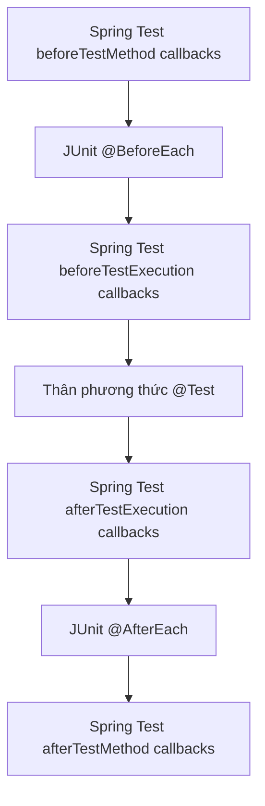

# Chọn thời điểm thiết lập context phù hợp dữ liệu kiểm thử

## 1. Thời điểm tạo `SecurityContext` quyết định test có đọc được fixture hay không

Một custom `WithSecurityContextFactory` có thể cần truy vấn `UserDetailsService`, repository hoặc service membership để dựng principal. Nhưng dữ liệu mà factory cần có thể được tạo ở nhiều thời điểm: từ migration trước khi test chạy, từ `@Sql`, trong `@BeforeEach`, hoặc từ fixture do test tự chuẩn bị. Nếu factory chạy trước khi dữ liệu tồn tại, test sẽ thất bại khi nạp người dùng hoặc membership. Nếu factory chạy quá muộn, phần setup của test có thể không có authentication để sử dụng.

Spring Security Test cho phép chọn thời điểm bằng thuộc tính `setupBefore` của `@WithSecurityContext`:

- `TestExecutionEvent.TEST_METHOD`: chuẩn bị context trong callback `beforeTestMethod`, trước `@BeforeEach` của JUnit Jupiter. Đây là mặc định.
- `TestExecutionEvent.TEST_EXECUTION`: chuẩn bị context trong callback `beforeTestExecution`, sau `@BeforeEach` và trước thân phương thức `@Test`.

Trong module **SPRING_SECURITY_TESTING**, lựa chọn này giúp kiểm chứng xác thực và phân quyền thực tế bằng `spring-security-test` trên Servlet và Reactive. Bài học tập trung vào việc phối hợp vòng đời Spring Test với dữ liệu fixture, để mỗi ca có đúng người dùng, tenant và authorities tại đúng thời điểm.

Sau bài này, bạn có thể:

1. Mô tả thứ tự callback chính giữa Spring Test và JUnit Jupiter.
2. Chọn `TEST_METHOD` hoặc `TEST_EXECUTION` theo nơi dữ liệu được tạo và nơi cần đọc authentication.
3. Dùng `@BeforeEach`, `@Sql` và test transaction mà không tạo race condition với factory.
4. Nhận biết khi setup vừa cần authentication vừa phải tạo dữ liệu mà factory sẽ truy vấn.
5. Chọn annotation ở cấp lớp/phương thức hoặc request-scoped post-processor cho dữ liệu động.
6. Áp dụng đúng cơ chế trong Servlet `MockMvc` và Reactive `WebTestClient`.

## 2. Thứ tự lifecycle cần nhớ

Với JUnit Jupiter tích hợp Spring Test, các mốc quan trọng được diễn ra theo thứ tự khái quát sau:



`WithSecurityContextTestExecutionListener` sử dụng hai callback đầu vào tương ứng với giá trị `setupBefore`. Khi chọn `TEST_METHOD`, factory được gọi ở bước A; khi chọn `TEST_EXECUTION`, factory được gọi ở bước C. Vì thế:

- Với `TEST_METHOD`, `@BeforeEach` có thể đọc authentication đã được tạo từ annotation.
- Với `TEST_EXECUTION`, `@BeforeEach` chạy trước khi context từ annotation được cài đặt; factory có thể đọc dữ liệu mà `@BeforeEach` vừa chuẩn bị.

Listener cũng quản lý việc dọn context theo lifecycle của Spring Test. Khi tự đăng ký `@TestExecutionListeners`, cần giữ listener bảo mật mặc định hoặc merge với default listeners phù hợp; nếu vô tình loại bỏ `WithSecurityContextTestExecutionListener`, annotation có thể không tạo context.

## 3. Hai mốc `setupBefore` và cách chọn

| Nguồn dữ liệu factory cần | Thời điểm factory nên chạy | Lý do |
| --- | --- | --- |
| Dữ liệu đã tồn tại trước khi test bắt đầu, chẳng hạn dataset được khởi tạo từ migration hoặc fixture dùng chung đã commit | Thường dùng `TEST_METHOD` mặc định | Factory có thể nạp principal trước `@BeforeEach` |
| Dữ liệu được tạo trong `@BeforeEach` của chính test | `TEST_EXECUTION` | Factory chạy sau `@BeforeEach`, nên đọc được user/membership vừa tạo |
| `@BeforeEach` cần đọc người dùng hiện tại để chuẩn bị hành động | `TEST_METHOD` | Authentication có sẵn trước `@BeforeEach` |
| Dữ liệu được nạp bằng `@Sql` trong callback `BEFORE_TEST_METHOD` | Có thể dùng `TEST_METHOD` nếu listener SQL chạy trước listener security; nếu không chắc thứ tự, dùng `TEST_EXECUTION` | `TEST_EXECUTION` chạy sau toàn bộ callback `beforeTestMethod` |
| Cùng một test vừa cần authentication trong `@BeforeEach`, vừa tạo dữ liệu mà factory phải truy vấn | Cần thay đổi cách tổ chức setup | Hai nhu cầu đòi hỏi factory chạy ở hai thời điểm khác nhau; một giá trị `setupBefore` không thể đáp ứng cả hai |

Không chọn thời điểm chỉ theo thói quen. Hãy xác định **factory đọc dữ liệu nào**, **dữ liệu được tạo ở callback nào**, và **đoạn setup nào cần authentication**. Sau đó chọn mốc bảo đảm các điều kiện ấy đúng.

## 4. Trường hợp dữ liệu được tạo trong `@BeforeEach`: dùng `TEST_EXECUTION`

Giả sử test tạo user và membership trong database trước mỗi phương thức. Factory gọi `UserDetailsService` và `TenantMembershipService` để dựng principal, vì vậy factory phải chạy sau khi `@BeforeEach` hoàn tất.

### 4.1. Annotation chọn mốc muộn

```java
package com.example.security;

import java.lang.annotation.ElementType;
import java.lang.annotation.Retention;
import java.lang.annotation.RetentionPolicy;
import java.lang.annotation.Target;

import org.springframework.security.test.context.support.TestExecutionEvent;
import org.springframework.security.test.context.support.WithSecurityContext;

@Target({ ElementType.METHOD, ElementType.TYPE })
@Retention(RetentionPolicy.RUNTIME)
@WithSecurityContext(
        factory = DirectoryUserFactory.class,
        setupBefore = TestExecutionEvent.TEST_EXECUTION)
public @interface WithDirectoryUser {

    String username();

    String tenantId();
}
```

Thuộc tính `setupBefore` được khai báo trên `@WithSecurityContext` của annotation tùy biến. Người viết test chỉ cần chỉ định username và tenant; Spring Security Test sẽ gọi factory ở mốc `beforeTestExecution`.

### 4.2. Factory truy vấn dữ liệu đã seed

Ví dụ factory dưới đây giả định ứng dụng có các bean `UserDetailsService` và `TenantMembershipService`.

Principal mà factory tạo:

```java
package com.example.security;

import java.security.Principal;

public record TenantPrincipal(String userId, String username, String tenantId)
        implements Principal {

    @Override
    public String getName() {
        return username;
    }
}
```

Membership trong `TenantMembership.java`:

```java
package com.example.security;

import java.util.Collection;

import org.springframework.security.core.GrantedAuthority;

public record TenantMembership(
        String userId,
        String tenantId,
        Collection<? extends GrantedAuthority> authorities) {
}
```

Hợp đồng service trong `TenantMembershipService.java`:

```java
package com.example.security;

public interface TenantMembershipService {

    TenantMembership requireActiveMembership(String username, String tenantId);
}
```

```java
package com.example.security;

import java.util.stream.Stream;

import org.springframework.beans.factory.annotation.Autowired;
import org.springframework.security.authentication.UsernamePasswordAuthenticationToken;
import org.springframework.security.core.Authentication;
import org.springframework.security.core.context.SecurityContext;
import org.springframework.security.core.context.SecurityContextHolder;
import org.springframework.security.core.userdetails.UserDetails;
import org.springframework.security.core.userdetails.UserDetailsService;
import org.springframework.security.test.context.support.WithSecurityContextFactory;

public final class DirectoryUserFactory
        implements WithSecurityContextFactory<WithDirectoryUser> {

    @Autowired
    private UserDetailsService userDetailsService;

    @Autowired
    private TenantMembershipService membershipService;

    @Override
    public SecurityContext createSecurityContext(WithDirectoryUser marker) {
        UserDetails user =
                userDetailsService.loadUserByUsername(marker.username());

        TenantMembership membership = membershipService
                .requireActiveMembership(user.getUsername(), marker.tenantId());

        TenantPrincipal principal = new TenantPrincipal(
                membership.userId(), user.getUsername(), membership.tenantId());

        var authorities = Stream.concat(
                        user.getAuthorities().stream(),
                        membership.authorities().stream())
                .distinct()
                .toList();

        Authentication authentication =
                UsernamePasswordAuthenticationToken.authenticated(
                        principal, null, authorities);

        SecurityContext context = SecurityContextHolder.createEmptyContext();
        context.setAuthentication(authentication);
        return context;
    }
}
```

Factory được Spring autowire khi listener tạo nó. Mỗi lần chạy, factory nạp user và membership từ dữ liệu hiện có rồi tạo một `SecurityContext` mới. Nếu user chưa được seed hoặc không thuộc tenant, factory thất bại ở giai đoạn chuẩn bị test; đây là lỗi fixture, không phải response `403` của endpoint.

### 4.3. Chuẩn bị fixture trong `@BeforeEach`

```java
@SpringBootTest
@AutoConfigureMockMvc
class DirectoryUserHttpTests {

    @Autowired
    TestAccountFixture fixture;

    @Autowired
    MockMvc mvc;

    @BeforeEach
    void createUserAndMembership() {
        fixture.ensureActiveUser("alice", "u-42");
        fixture.ensureMembership(
                "alice", "tenant-a", List.of("invoice:read"));
    }

    @Test
    @WithDirectoryUser(username = "alice", tenantId = "tenant-a")
    void activeTenantMemberCanRead() throws Exception {
        mvc.perform(get("/api/tenants/tenant-a/invoices"))
                .andExpect(status().isOk());
    }
}
```

`TestAccountFixture` là bean hỗ trợ test của ứng dụng; `ensureActiveUser` và `ensureMembership` là API minh họa, không phải lớp có sẵn của Spring. Vì `@BeforeEach` chạy trước `beforeTestExecution`, factory có thể đọc dữ liệu vừa tạo. Nếu các thao tác fixture cần transaction, bảo đảm dữ liệu được nhìn thấy trong transaction mà factory sử dụng.

## 5. Trường hợp `@BeforeEach` cần authentication: dùng `TEST_METHOD`

Một số test có `@BeforeEach` cần gọi service dưới danh tính hiện tại, ví dụ tạo tài liệu với người tạo được lấy từ principal. Trong trường hợp đó, context phải tồn tại trước `@BeforeEach`:

```java
@Target({ ElementType.METHOD, ElementType.TYPE })
@Retention(RetentionPolicy.RUNTIME)
@WithSecurityContext(
        factory = TestUserFactory.class,
        setupBefore = TestExecutionEvent.TEST_METHOD)
public @interface WithTestUser {
    String userId() default "u-42";
    String tenantId() default "tenant-a";
}
```

Vì `TEST_METHOD` cũng là mặc định, có thể bỏ thuộc tính `setupBefore` nếu không cần làm rõ ý định:

```java
@WithSecurityContext(factory = TestUserFactory.class)
```

Test có thể đọc principal trong setup:

```java
@BeforeEach
void createDraftForCurrentUser() {
    Authentication authentication =
            SecurityContextHolder.getContext().getAuthentication();
    TenantPrincipal principal = (TenantPrincipal) authentication.getPrincipal();
    draftService.createDraft(principal.userId(), principal.tenantId());
}
```

Với lựa chọn này, factory phải tìm thấy dữ liệu cần thiết **trước khi `@BeforeEach` chạy**. Nếu `@BeforeEach` cũng có nhiệm vụ tạo chính user/membership mà factory cần truy vấn, hãy chuyển phần seed đó sang bước sớm hơn, chẳng hạn SQL fixture trước test hoặc một cơ chế chuẩn bị dữ liệu không phụ thuộc authentication. Đừng chuyển sang `TEST_EXECUTION` rồi mong `@BeforeEach` vẫn đọc được context do annotation tạo.

## 6. Khi cả setup dữ liệu và setup authentication cùng cần chạy

Đây là trường hợp dễ tạo vòng phụ thuộc:

- Factory cần user/membership từ database.
- `@BeforeEach` cần authentication để gọi service tạo user/membership.
- `TEST_METHOD` đáp ứng nhu cầu authentication của `@BeforeEach`, nhưng factory chạy trước khi dữ liệu được tạo.
- `TEST_EXECUTION` đáp ứng nhu cầu dữ liệu của factory, nhưng `@BeforeEach` chưa có authentication từ annotation.

Không có một giá trị `setupBefore` nào giải quyết cả hai yêu cầu nếu chúng phụ thuộc vòng tròn. Hãy tách setup thành hai giai đoạn:

1. Seed danh tính và membership bằng `@Sql`, migration, fixture service không cần security context hoặc một bước setup chạy trước callback tạo context.
2. Để `TEST_METHOD` tạo context trước `@BeforeEach`; phần `@BeforeEach` còn lại có thể dùng principal để tạo draft hoặc dữ liệu nghiệp vụ.

Ví dụ dùng SQL fixture (đường dẫn script chỉ mang tính minh họa):

```java
@SpringBootTest
@AutoConfigureMockMvc
@Sql(scripts = "/sql/active-alice-tenant-a.sql",
        executionPhase = Sql.ExecutionPhase.BEFORE_TEST_METHOD)
class InvoiceSetupWithAuthenticationTests {

    @Autowired
    DraftService draftService;

    @BeforeEach
    void createDraftForCurrentUser() {
        TenantPrincipal principal = (TenantPrincipal)
                SecurityContextHolder.getContext()
                        .getAuthentication().getPrincipal();
        draftService.createDraft(principal.userId(), principal.tenantId());
    }

    @Test
    @WithDirectoryUser(username = "alice", tenantId = "tenant-a")
    void draftIsOwnedByAuthenticatedUser() {
        // Assertion trên draft được tạo trong @BeforeEach.
    }
}
```

Đoạn trên cần import `org.springframework.test.context.jdbc.Sql`. Với lớp này, dùng biến thể `@WithDirectoryUser` được cấu hình `setupBefore = TEST_METHOD` (hoặc mặc định); đây là cấu hình thay thế cho annotation `TEST_EXECUTION` ở mục 4.1, không phải hai định nghĩa cùng tồn tại. `@Sql` chạy trong giai đoạn `beforeTestMethod`; hãy bảo đảm script được thực thi trước listener dựng security context trong cấu hình listener của dự án. Nếu thứ tự listener tùy biến khiến điều đó không được bảo đảm, dùng dataset đã seed trước test hoặc điều chỉnh listener/fixture để tránh phụ thuộc thứ tự ngầm.

Một phương án khác là tách test: một test chuẩn bị dữ liệu, test khác dùng danh tính đã tồn tại. Tuy nhiên, không nên dựa vào thứ tự hai test để chia sẻ dữ liệu vì JUnit có thể chạy test theo thứ tự khác hoặc song song. Mỗi test cần fixture độc lập hoặc dataset được quản lý rõ ràng.

## 7. `@Sql`, transaction test và khả năng nhìn thấy dữ liệu

`@Sql` có thể chạy ở các phase khác nhau, chẳng hạn `BEFORE_TEST_METHOD`, `BEFORE_TEST_EXECUTION` hoặc phase sau test. Việc chọn phase cần khớp với `setupBefore` và transaction test:

| Cách seed | Factory đọc dữ liệu khi nào? | Điểm cần xác minh |
| --- | --- | --- |
| Migration hoặc dataset đã commit trước test | `TEST_METHOD` hoặc `TEST_EXECUTION` | Dữ liệu đã có và đúng với marker annotation |
| `@Sql(BEFORE_TEST_METHOD)` | Sau callback SQL nếu listener order phù hợp; chắc chắn trước `TEST_EXECUTION` | Kiểm tra listener order khi factory dùng `TEST_METHOD` |
| `@Sql(BEFORE_TEST_EXECUTION)` | Cùng giai đoạn callback với listener security nếu dùng `TEST_EXECUTION` | Không giả định thứ tự giữa các listener cùng phase; xác minh order hoặc chuyển seed sớm hơn |
| `@BeforeEach` | `TEST_EXECUTION` | Factory chạy sau JUnit setup |
| `@AfterEach` hoặc `@Sql(AFTER_TEST_METHOD)` | Không phù hợp để tạo dữ liệu cho factory của test hiện tại | Đây là bước cleanup sau phần test |

Nếu test được đánh dấu `@Transactional`, Spring Test thường mở test-managed transaction trước `@BeforeEach`. Dữ liệu tạo trong `@BeforeEach` có thể được factory đọc ở `TEST_EXECUTION` trong cùng luồng và transaction. Nếu service tạo dữ liệu dùng `REQUIRES_NEW`, executor khác hoặc một connection/transaction khác, khả năng nhìn thấy dữ liệu có thể thay đổi; hãy kiểm tra propagation và isolation thay vì giả định dữ liệu đã commit.

Test-managed transaction thường được rollback sau test. Vì thế, nếu factory hoặc request chạy trong cùng transaction, dữ liệu fixture có thể biến mất sau khi test kết thúc; đây thường là hành vi mong muốn. Nếu dùng `@Sql` với transaction mode khác hoặc seed qua connection độc lập, cần xác định rõ ai commit và ai cleanup để không để dữ liệu rò rỉ giữa các test.

## 8. Annotation cấp lớp, cấp phương thức và test tham số hóa

### Cấp lớp và cấp phương thức

Có thể đặt annotation tùy biến ở cấp lớp làm mặc định cho các test cùng danh tính:

```java
@SpringBootTest
@WithDirectoryUser(username = "alice", tenantId = "tenant-a")
class TenantAInvoiceTests {

    @Test
    void defaultUserCanRead() {
        // Dùng bối cảnh khai báo trên lớp.
    }

    @Test
    @WithDirectoryUser(username = "bob", tenantId = "tenant-b")
    void methodUsesAnotherIdentity() {
        // Dùng bối cảnh được khai báo cho phương thức này.
    }
}
```

Nếu factory cần dữ liệu do `@BeforeEach` tạo, annotation ở cấp lớp cũng phải chọn `TEST_EXECUTION`; thuộc tính `setupBefore` nằm trong meta-annotation của custom annotation, không được chọn lại tùy ý trên từng lần sử dụng. Nếu các test có nguồn dữ liệu/lifecycle khác nhau, tạo hai annotation tùy biến với hai mốc setup khác nhau hoặc tách lớp test để ý định rõ ràng.

### Test tham số hóa và dữ liệu động

Các thuộc tính annotation Java là hằng compile-time; chúng không thể nhận trực tiếp giá trị từ từng hàng `@MethodSource` khi test chạy. Nếu test tham số hóa cần mỗi invocation có username hoặc tenant khác nhau, có thể:

- Dùng `MockMvc` request post-processor `authentication(...)` để cấp một authentication mới theo tham số.
- Dùng helper tạo context và đặt/clear trong `try/finally` nếu đang kiểm thử service đồng bộ.
- Dùng `WebTestClient.mutateWith(mockAuthentication(...))` cho từng request Reactive.
- Tách các kịch bản thành test method riêng nếu muốn tiếp tục dùng annotation declarative.

Không dùng một field mutable cập nhật trước mỗi invocation rồi để factory đọc nó nếu test có thể chạy song song; đó lại là state dùng chung và có nguy cơ lẫn danh tính.

## 9. Servlet `MockMvc` và Reactive `WebTestClient`

### Servlet

Với `MockMvc`, `@WithSecurityContext` thiết lập context theo lifecycle của test. Khi dựng `MockMvc` thủ công từ `WebApplicationContext`, áp dụng `.apply(springSecurity())`; với Spring Boot, `@AutoConfigureMockMvc` thường tích hợp filter chain. Request post-processor `user(...)` hoặc `authentication(...)` hữu ích khi muốn thiết lập danh tính theo từng request thay vì một context chung cho toàn phương thức.

Nếu test chạy server thật bằng `@SpringBootTest(webEnvironment = RANDOM_PORT)`, annotation chỉ chuẩn bị context trong luồng test. Nó không truyền authentication qua HTTP tới server; phải gửi credential, bearer token hoặc session/cookie qua request.

### Reactive

Reactive security sử dụng Reactor Context thay cho việc dựa vào ThreadLocal. Với request mock, dùng `WebTestClient.mutateWith(mockAuthentication(...))`, `mockUser()`, `mockJwt()` hoặc mutator OAuth2/OIDC tương ứng. Nếu dùng `@WithSecurityContext` để test reactive method security, bảo đảm `ReactorContextTestExecutionListener` được tích hợp để context test được chuyển vào Reactor Context. `setupBefore` vẫn quyết định thời điểm factory chạy trong Spring Test lifecycle; nó không thay đổi nguyên tắc truyền context của Reactor.

## 10. Chẩn đoán lỗi do chọn sai thời điểm

| Hiện tượng | Nguyên nhân thường gặp | Cách xử lý |
| --- | --- | --- |
| Factory ném `UsernameNotFoundException` nhưng `@BeforeEach` tạo user | Factory chạy ở `TEST_METHOD`, trước `@BeforeEach` | Chọn `TEST_EXECUTION` hoặc seed user sớm hơn |
| `@BeforeEach` không thấy authentication từ annotation | Đang dùng `TEST_EXECUTION` | Chọn `TEST_METHOD` nếu setup cần context; chuyển dữ liệu seed ra bước sớm hơn |
| User có nhưng membership không có | Factory chạy trước khi membership được tạo hoặc marker tenant sai | Kiểm tra fixture, transaction và `tenantId` |
| Dữ liệu được seed trong `@Sql` nhưng factory không tìm thấy | Script chạy sau factory hoặc transaction/connection không nhìn thấy dữ liệu | Kiểm tra `executionPhase`, listener order, transaction mode và commit visibility |
| Factory chạy được trong `@SpringBootTest` nhưng fail ở `@WebMvcTest` | Slice không nạp bean cần thiết | Import hoặc mock dependency cần thiết trong test slice |
| Test chạy riêng pass nhưng suite fail | Dữ liệu dùng chung bị sửa, cleanup không đầy đủ hoặc test order phụ thuộc | Tạo fixture độc lập, rollback/cleanup rõ ràng, không dựa vào thứ tự test |
| Reactive method test không nhận context | Thiếu reactive listener hoặc đang dùng ThreadLocal | Tích hợp `ReactorContextTestExecutionListener` hoặc dùng WebTestClient mutator |
| Test HTTP thật không có người dùng mock | Context trong test không được truyền qua socket | Gửi credentials/token/session trong HTTP request |

Khi debug, có thể ghi log tạm thời tại factory về username, tenant và thời điểm gọi; tránh ghi credentials, password hoặc raw token. Một test nhỏ có thể ghi nhận thứ tự `@BeforeEach` và factory để xác nhận giả định lifecycle. Sau khi xác định nguyên nhân, giữ assertion có ý nghĩa thay vì để log debug trong bộ test.

## 11. Bài thực hành

Tạo test cho endpoint đọc hóa đơn đa tenant, với factory cần `UserDetailsService` và `TenantMembershipService`:

1. Dùng `TEST_EXECUTION` và tạo account/membership trong `@BeforeEach`; xác nhận factory đọc được dữ liệu.
2. Đổi sang `TEST_METHOD`; quan sát factory chạy trước `@BeforeEach` và giải thích vì sao dữ liệu chưa tồn tại.
3. Seed account/membership bằng `@Sql(BEFORE_TEST_METHOD)` và xác minh thứ tự listener phù hợp nếu dùng `TEST_METHOD`.
4. Tạo một `@BeforeEach` gọi `DraftService` dưới danh tính hiện tại; chọn `TEST_METHOD` và chuyển seed user ra giai đoạn sớm hơn.
5. Bật `@Transactional`, xác nhận dữ liệu được tạo trong setup nhìn thấy từ factory/request và được rollback sau test.
6. Viết một test tham số hóa với hai tenant; dùng request post-processor tạo authentication riêng cho từng invocation.
7. Chuyển một ca sang WebFlux, sử dụng `WebTestClient` và xác minh context được truyền qua Reactor Context.

### Câu hỏi tự đánh giá

- `TEST_METHOD` và `TEST_EXECUTION` khác nhau ở vị trí nào so với `@BeforeEach`?
- Vì sao factory không thể đọc dữ liệu được tạo trong `@BeforeEach` nếu dùng mặc định `TEST_METHOD`?
- Nếu `@BeforeEach` cần principal để tạo dữ liệu mà factory cũng cần đọc dữ liệu đó, nên tổ chức lại setup thế nào?
- `@Sql(BEFORE_TEST_METHOD)` và `@Sql(BEFORE_TEST_EXECUTION)` có thể ảnh hưởng việc chọn `setupBefore` ra sao?
- Vì sao test tham số hóa không thể lấy trực tiếp từng tham số runtime làm thuộc tính của annotation?
- `setupBefore` có thay đổi cơ chế truyền security context trong WebFlux không?

## Tài liệu tham khảo

- [Spring Security — Testing Method Security and `@WithSecurityContext`](https://docs.spring.io/spring-security/reference/servlet/test/method.html)
- [Spring Framework — TestContext Framework and TestExecutionListener](https://docs.spring.io/spring-framework/reference/testing/testcontext-framework.html)
- [Spring Framework — Executing SQL Scripts with `@Sql`](https://docs.spring.io/spring-framework/reference/testing/testcontext-framework/executing-sql.html)
- [Spring Security — MockMvc Setup](https://docs.spring.io/spring-security/reference/servlet/test/mockmvc/setup.html)
- [Spring Security — Reactive Web Testing](https://docs.spring.io/spring-security/reference/reactive/test/web/index.html)

Chọn đúng thời điểm thiết lập `SecurityContext` là chọn đúng điểm giao nhau giữa dữ liệu test và nhu cầu xác thực của setup. Dùng `TEST_METHOD` khi context phải có trước `@BeforeEach`; dùng `TEST_EXECUTION` khi factory cần dữ liệu mà `@BeforeEach` vừa tạo. Nếu cả hai nhu cầu cùng tồn tại, tách seed data khỏi setup phụ thuộc authentication để tránh vòng phụ thuộc và giữ từng ca kiểm thử có thể tái lập.
