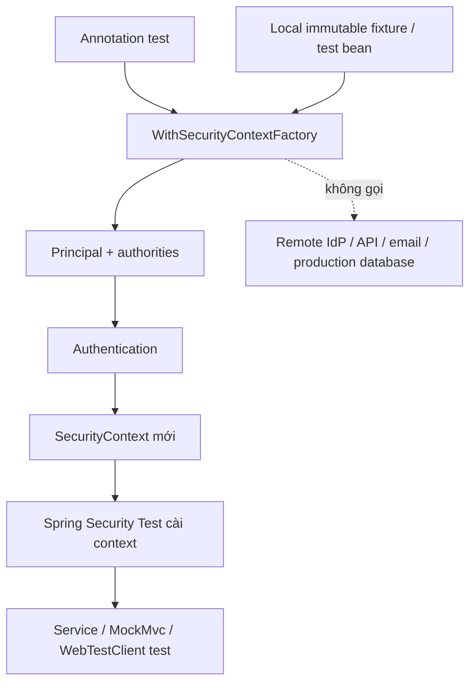

# Giữ factory đơn giản và tránh truy cập hệ thống bên ngoài ngoài ý muốn

## 1. Factory chỉ nên lắp ráp danh tính cho test

Một `WithSecurityContextFactory` thường được gọi trong quá trình Spring Test chuẩn bị context, trước khi thân phương thức `@Test` chạy. Nếu factory gọi API identity provider, lấy access token thật, tạo tài khoản trên hệ thống dùng chung, gửi email hoặc ghi dữ liệu nghiệp vụ vào một dịch vụ bên ngoài, mỗi lần chạy test có thể tạo side effect khó kiểm soát. Test cũng có thể phụ thuộc mạng, credential môi trường, trạng thái hệ thống bên ngoài hoặc thứ tự chạy.

Factory nên có một nhiệm vụ nhỏ: đọc tham số annotation và/hoặc fixture cục bộ, tạo principal cùng authorities, rồi trả về một `SecurityContext` mới. Nó không nên trở thành nơi chạy quy trình đăng nhập thật hay khởi tạo toàn bộ dữ liệu nghiệp vụ.

Trong module **SPRING_SECURITY_TESTING**, ta dùng `spring-security-test` để mô phỏng danh tính và kiểm chứng phân quyền trên Servlet hoặc Reactive. Bài này hướng dẫn cách giữ custom factory đơn giản, tất định và an toàn cho test; khi cần xác minh hệ thống xác thực bên ngoài, ta chuyển trách nhiệm đó sang một integration test được thiết kế riêng.

Sau bài học, bạn có thể:

- Phân biệt việc tạo security context giả lập với quy trình xác thực thật.
- Nhận diện side effect và phụ thuộc môi trường không nên đặt trong factory.
- Chọn giữa annotation tự mô tả, fixture in-memory, test bean hoặc service cục bộ.
- Thiết kế factory nhỏ, không ghi dữ liệu, không gọi mạng và tạo context mới mỗi lần.
- Kiểm tra lỗi fixture rõ ràng và giữ test được phép/bị từ chối có thể tái lập.
- Tách test authorization khỏi integration test xác minh password, JWT, OAuth2/OIDC hoặc identity provider.

## 2. Ranh giới trách nhiệm của factory

Một factory thường thực hiện các bước sau:

1. Đọc các giá trị đã khai báo trên annotation.
2. Lấy fixture từ nguồn cục bộ, xác định principal và tập authorities.
3. Tạo `Authentication` phù hợp với hợp đồng của ứng dụng.
4. Tạo `SecurityContext` mới, gắn authentication và trả về.



| Nên làm trong factory | Nên đặt ở nơi khác |
| --- | --- |
| Chuyển `userId`, `tenantId` từ annotation thành principal | Tạo tài khoản thật trên identity provider |
| Ánh xạ role/permission thành `GrantedAuthority` | Gửi password qua `AuthenticationManager` để test đăng nhập thật |
| Đọc fixture in-memory bất biến | Gọi API bên ngoài để lấy access token |
| Dùng bean mapper/policy thuần để tạo authorities | Gửi email, tạo hóa đơn, thanh toán hoặc ghi dữ liệu nghiệp vụ |
| Tạo JWT/OIDC object giả lập trong test nếu mục tiêu là authorization | Xác minh chữ ký JWT, issuer, audience hoặc OIDC flow thật |
| Ném lỗi rõ ràng khi annotation tham chiếu fixture không tồn tại | Tự tạo hoặc sửa dữ liệu trên hệ thống dùng chung |

Factory có thể được Spring tiêm bean qua test context, nhưng khả năng inject không có nghĩa mọi service đều nên được gọi ở đây. Chỉ đưa dependency vào khi nó giúp dựng đúng danh tính và có hành vi cục bộ, dễ kiểm soát.

## 3. Ví dụ: annotation và factory chỉ dùng fixture cục bộ

Giả sử API hóa đơn yêu cầu principal có `userId`, `tenantId` và quyền `invoice:read`. Ta định nghĩa principal ở mã ứng dụng:

```java
package com.example.security;

import java.security.Principal;

public record TenantPrincipal(String userId, String username, String tenantId)
        implements Principal {

    @Override
    public String getName() {
        return username;
    }
}
```

Annotation trong `src/test/java` chỉ định danh tính cần dùng:

```java
package com.example.security;

import java.lang.annotation.ElementType;
import java.lang.annotation.Retention;
import java.lang.annotation.RetentionPolicy;
import java.lang.annotation.Target;

import org.springframework.security.test.context.support.WithSecurityContext;

@Target({ ElementType.METHOD, ElementType.TYPE })
@Retention(RetentionPolicy.RUNTIME)
@WithSecurityContext(factory = LocalIdentityFactory.class)
public @interface WithLocalIdentity {

    String username();

    String tenantId();
}
```

### 3.1. Định nghĩa fixture in-memory

Tạo một abstraction nhỏ chỉ phục vụ việc tìm fixture:

```java
package com.example.security;

import java.util.Collection;
import org.springframework.security.core.GrantedAuthority;

public record TestIdentity(
        String userId,
        String username,
        String tenantId,
        Collection<? extends GrantedAuthority> authorities) {
}
```

```java
package com.example.security;

import java.util.Optional;

public interface TestIdentityCatalog {

    Optional<TestIdentity> find(String username, String tenantId);
}
```

Trong test context, cung cấp một bean in-memory với dữ liệu cố định:

```java
package com.example.security;

import java.util.List;
import java.util.Map;
import java.util.Optional;

import org.springframework.boot.test.context.TestConfiguration;
import org.springframework.context.annotation.Bean;
import org.springframework.security.core.authority.SimpleGrantedAuthority;

@TestConfiguration
public class LocalIdentityTestConfiguration {

    private record IdentityKey(String username, String tenantId) {
    }

    @Bean
    TestIdentityCatalog testIdentityCatalog() {
        Map<IdentityKey, TestIdentity> identities = Map.of(
                new IdentityKey("alice", "tenant-a"),
                new TestIdentity("u-42", "alice", "tenant-a", List.of(
                        new SimpleGrantedAuthority("invoice:read"))),
                new IdentityKey("bob", "tenant-b"),
                new TestIdentity("u-77", "bob", "tenant-b", List.of(
                        new SimpleGrantedAuthority("invoice:read"))));

        return (username, tenantId) -> Optional.ofNullable(
                identities.get(new IdentityKey(username, tenantId)));
    }
}
```

Map fixture được tạo một lần trong test context và không bị sửa. `find` chỉ đọc map, không truy cập database, mạng hoặc dịch vụ bên ngoài. Nếu fixture không có cặp username/tenant được yêu cầu, catalog trả `Optional.empty()` để factory báo lỗi rõ ràng.

### 3.2. Factory nhỏ, không có side effect

```java
package com.example.security;

import org.springframework.beans.factory.annotation.Autowired;
import org.springframework.security.authentication.UsernamePasswordAuthenticationToken;
import org.springframework.security.core.Authentication;
import org.springframework.security.core.context.SecurityContext;
import org.springframework.security.core.context.SecurityContextHolder;
import org.springframework.security.test.context.support.WithSecurityContextFactory;

public final class LocalIdentityFactory
        implements WithSecurityContextFactory<WithLocalIdentity> {

    @Autowired
    private TestIdentityCatalog identityCatalog;

    @Override
    public SecurityContext createSecurityContext(WithLocalIdentity marker) {
        TestIdentity identity = identityCatalog
                .find(marker.username(), marker.tenantId())
                .orElseThrow(() -> new IllegalArgumentException(
                        "Không có test identity: " + marker.username()
                                + " trong " + marker.tenantId()));

        TenantPrincipal principal = new TenantPrincipal(
                identity.userId(), identity.username(), identity.tenantId());

        Authentication authentication =
                UsernamePasswordAuthenticationToken.authenticated(
                        principal, null, identity.authorities());

        SecurityContext context = SecurityContextHolder.createEmptyContext();
        context.setAuthentication(authentication);
        return context;
    }
}
```

Factory chỉ tra cứu fixture, lắp ráp principal và authentication, rồi trả context mới. Nó không giữ state mutable, không tự tạo bean, không ghi dữ liệu và không gọi API. Nếu fixture sai, test thất bại ngay khi chuẩn bị security context với thông báo có username và tenant để người viết test sửa.

### 3.3. Dùng fixture trong `MockMvc`

```java
@SpringBootTest
@AutoConfigureMockMvc
@Import(LocalIdentityTestConfiguration.class)
class InvoiceAuthorizationTests {

    @Autowired
    MockMvc mvc;

    @Test
    @WithLocalIdentity(username = "alice", tenantId = "tenant-a")
    void aliceCanReadOwnTenant() throws Exception {
        mvc.perform(get("/api/tenants/tenant-a/invoices"))
                .andExpect(status().isOk());
    }

    @Test
    @WithLocalIdentity(username = "bob", tenantId = "tenant-b")
    void bobCannotReadAnotherTenant() throws Exception {
        mvc.perform(get("/api/tenants/tenant-a/invoices"))
                .andExpect(status().isForbidden());
    }
}
```

Ví dụ giả định endpoint kiểm tra `invoice:read` và so sánh tenant trong `TenantPrincipal`. Cần import `@Import`, `@Autowired`, `@SpringBootTest`, `@AutoConfigureMockMvc`, `MockMvc`, các request builder/matcher và `@Test`. `@Import` đưa test configuration vào application context; Spring Security Test tạo context cho từng test method.

Nếu không cần lookup theo username/tenant, có thể làm factory còn đơn giản hơn bằng cách lấy trực tiếp `userId`, `tenantId` và `permissions` từ annotation rồi tạo principal. Chỉ dùng catalog khi fixture tập trung giúp quản lý dữ liệu dễ hơn hoặc cần nhiều test dùng chung một tập identity đã định nghĩa.

## 4. Những side effect nên tránh

### 4.1. Không gọi identity provider để lấy token trong factory

Anti-pattern:

```java
@Override
public SecurityContext createSecurityContext(WithExternalUser marker) {
    String accessToken = identityProviderClient.login(
            marker.username(), marker.password());
    // Parse token rồi tạo Authentication...
}
```

Factory trên phụ thuộc mạng, credential, trạng thái identity provider và thời gian phản hồi. Khi nhà cung cấp gián đoạn, test authorization cũng thất bại dù policy trong ứng dụng không thay đổi. Nó còn có thể tạo session hoặc token thật không được thu hồi.

Nếu mục tiêu chỉ là kiểm tra controller có đọc claim và áp dụng quyền đúng không, tạo `Jwt`/`JwtAuthenticationToken` giả lập bằng `jwt()` hoặc factory cục bộ. Nếu mục tiêu là xác minh login/token thật, viết integration test riêng gửi request qua filter/provider/decoder; test đó nên quản lý credential, môi trường và cleanup rõ ràng.

### 4.2. Không ghi dữ liệu nghiệp vụ khi dựng context

Tránh để factory tạo user, tạo tenant, phát hành hóa đơn, gửi email hoặc cập nhật trạng thái tài khoản. Các thao tác này làm việc chuẩn bị authentication có side effect ngoài phạm vi của nó. Nếu test cần dữ liệu nghiệp vụ, seed bằng `@Sql`, repository fixture, factory dữ liệu hoặc service test chuyên biệt trước khi test chạy.

Nếu factory cần đọc dữ liệu từ local database để xác định membership, hãy giữ thao tác read-only, dùng test database cô lập và chọn `setupBefore` phù hợp với thời điểm seed. Không gọi production database hoặc một hệ thống dùng chung chỉ để tạo principal cho test.

### 4.3. Không dùng thời gian hoặc random không kiểm soát

Một factory tạo claim `exp`, nonce hoặc user ID ngẫu nhiên theo thời gian có thể làm test khó tái lập. Nếu claim cần thời gian, inject một `Clock` cố định trong test configuration hoặc dùng giá trị thời gian cố định. Nếu cần ID giả, dùng giá trị xác định trong annotation/fixture. Đừng gọi random service hoặc sinh dữ liệu mới không có lý do cho mỗi lần test.

Ví dụ clock cố định:

```java
@TestConfiguration
class FixedClockConfiguration {

    @Bean
    Clock testClock() {
        return Clock.fixed(
                Instant.parse("2026-01-15T10:00:00Z"), ZoneOffset.UTC);
    }
}
```

Factory có thể dùng `testClock.instant()` khi dựng claims có thời hạn. Cần import `Clock`, `Instant`, `ZoneOffset` và `@Bean`. Test sẽ ổn định qua các lần chạy vì không phụ thuộc đồng hồ máy.

## 5. Khi nào được phép dùng bean hoặc database?

Không phải mọi dependency đều bị cấm. Điều quan trọng là factory có tạo side effect hoặc phụ thuộc không cần thiết hay không.

| Dependency | Có thể dùng? | Điều kiện |
| --- | --- | --- |
| Fixture in-memory bất biến | Rất phù hợp | Dữ liệu nhỏ, xác định và chỉ đọc |
| Mapper thuần ánh xạ role/permission | Phù hợp | Không gọi mạng hoặc sửa trạng thái |
| `Clock` được cố định trong test | Phù hợp | Cùng một test cho kết quả xác định |
| Mockito stub hoặc bean test local | Phù hợp | Hành vi được khai báo rõ và không có side effect |
| Repository trên test database | Có thể | Chỉ đọc trong factory; dữ liệu được seed và cô lập đúng lifecycle |
| Local service có transaction/side effect | Cân nhắc | Ưu tiên chuyển setup sang fixture trước khi factory chạy |
| Remote REST/gRPC client | Tránh trong factory | Chỉ dùng trong integration test chuyên biệt nếu mục tiêu yêu cầu |
| Identity provider/token endpoint thật | Không dùng để dựng context mock | Kiểm tra trong test xác thực end-to-end riêng |
| Email, payment, message broker production | Không | Dùng stub/container/test double nếu cần kiểm thử tích hợp |

Nếu test cần chứng minh membership service thực sự từ chối user không thuộc tenant, có thể viết test riêng cho service hoặc integration test với test database. Đừng biến mọi test controller thành một cuộc gọi tới database hoặc remote directory chỉ vì factory có thể inject bean.

## 6. Giữ lỗi fixture rõ ràng, không biến thành lỗi authorization

Hai tình huống cần phân biệt:

- **Fixture không hợp lệ:** annotation yêu cầu user không tồn tại trong catalog, factory không thể tạo context. Test nên thất bại ngay với lỗi setup có thông tin cụ thể.
- **Fixture hợp lệ nhưng không đủ quyền:** factory tạo authentication thành công, request được xử lý và policy trả `403`.

Ví dụ ma trận:

| Kịch bản | Catalog | Authorities | Kết quả mong đợi |
| --- | --- | --- | --- |
| `alice` thuộc `tenant-a` | Có | `invoice:read` | Request đúng tenant được phép |
| `bob` thuộc `tenant-b` | Có | `invoice:read` | Request đến `tenant-a` bị `403` |
| `carol` thuộc `tenant-a` | Có | Rỗng | Request bị `403` vì thiếu quyền |
| `ghost` thuộc `tenant-a` | Không có | Không tạo được | Factory thất bại khi chuẩn bị test |

Không dùng `403` để che giấu việc factory không tìm thấy fixture. Ngược lại, cũng không bắt factory ném exception chỉ vì người dùng hợp lệ thiếu authority; trường hợp đó phải đi qua policy để kiểm tra hành vi từ chối.

### 6.1. Kiểm tra factory riêng nếu cần

Có thể test catalog và mapper như unit test thuần, không khởi động server:

```java
@Test
void catalogReturnsOnlyMatchingTenant() {
    Optional<TestIdentity> alice = catalog.find("alice", "tenant-a");
    Optional<TestIdentity> wrongTenant = catalog.find("alice", "tenant-b");

    assertThat(alice).isPresent();
    assertThat(wrongTenant).isEmpty();
}
```

Đây là kiểm tra fixture lookup; cần import `Optional` và AssertJ. Nếu muốn test trực tiếp factory có field `@Autowired`, chạy factory trong Spring test context hoặc thiết kế phần ánh xạ thành một hàm/helper thuần có thể kiểm thử độc lập. Không tự `new` factory rồi mong Spring tự inject các field.

## 7. Tách authorization test và authentication integration test

Hai loại test trả lời hai câu hỏi khác nhau:

| Mục tiêu | Kỹ thuật | Điều được xác minh |
| --- | --- | --- |
| Endpoint cho phép người có đúng quyền và tenant | `@WithSecurityContext`, `MockMvc` | Authorization và xử lý request sau khi đã có authentication |
| Controller đọc đúng claim JWT | `jwt()`/`mockJwt()` hoặc `JwtAuthenticationToken` giả | Logic xử lý principal/claims và policy |
| Controller nhận đúng `OidcUser` | `oidcLogin()`/`mockOidcLogin()` | Mapping principal OIDC và authorization |
| Password được xác minh đúng | Gửi credentials qua authentication filter/provider | Password encoder, provider và entry point |
| JWT signature, issuer, audience, expiration được xác minh | Request bearer token qua Resource Server decoder/validator | Quy trình xác thực access token |
| OAuth2 authorization code/OIDC login hoạt động | Integration test với authorization server test hoặc môi trường chuyên dụng | Redirect, code exchange, token validation và user info |

Một test dùng `@WithSecurityContext` có thể kiểm tra sâu authorization nhưng không chứng minh đăng nhập thật. Một integration test xác thực có thể tốn thời gian và phụ thuộc môi trường; không cần dùng nó cho mọi ca kiểm tra `hasAuthority`. Tách hai lớp giúp test nhanh, ổn định và vẫn có coverage cho quy trình xác thực ở nơi thích hợp.

## 8. Servlet, Reactive và request-scoped authentication

### Servlet `MockMvc`

`@WithSecurityContext` phù hợp khi toàn bộ test method dùng một identity. Nếu một test cần nhiều identity, dùng `.with(authentication(...))` cho từng request. `@AutoConfigureMockMvc` thường tích hợp security filter chain; nếu tự dựng `MockMvc`, áp dụng `.apply(springSecurity())`.

Ví dụ request-scoped auth:

```java
Authentication authentication = UsernamePasswordAuthenticationToken.authenticated(
        new TenantPrincipal("u-42", "alice", "tenant-a"), null,
        List.of(new SimpleGrantedAuthority("invoice:read")));

mvc.perform(get("/api/tenants/tenant-a/invoices")
        .with(authentication(authentication)))
    .andExpect(status().isOk());
```

Đoạn này tạo token giả lập cho request hiện tại; nó không gọi factory, không ghi dữ liệu và không đi qua password authentication. Cần static import `SecurityMockMvcRequestPostProcessors.authentication` cùng request builder/matcher.

### Reactive `WebTestClient`

WebFlux sử dụng Reactor Context. Dùng `mockAuthentication(...)` để cấp authentication cho pipeline request:

```java
webTestClient.mutateWith(mockAuthentication(authentication))
        .get().uri("/api/reactive/tenants/tenant-a/invoices")
        .exchange()
        .expectStatus().isOk();
```

Đoạn này giả định route Reactive và policy tương ứng; dùng static import `SecurityMockServerConfigurers.mockAuthentication`. Khi tạo client từ application context, tích hợp `springSecurity()` trong lúc build `WebTestClient`. Không dùng ThreadLocal để truyền security context qua reactive pipeline.

## 9. Checklist thiết kế factory

Trước khi thêm dependency vào factory, hãy tự kiểm tra:

- [ ] Factory có thực sự cần bean này để tạo principal hoặc authorities không?
- [ ] Dependency có hành vi xác định, cục bộ và chỉ đọc không?
- [ ] Factory có tránh gọi network, identity provider, email hoặc payment không?
- [ ] Dữ liệu fixture có được khai báo rõ và cô lập giữa các test không?
- [ ] Factory có tạo `SecurityContext` mới ở mỗi invocation không?
- [ ] Lỗi fixture thiếu user/tenant có thông báo rõ ràng không?
- [ ] Test authorization có phân biệt fixture lỗi với request hợp lệ bị `403` không?
- [ ] Quy trình password/JWT/OIDC thật đã có integration test riêng nếu đó là mục tiêu cần xác minh chưa?

## 10. Bài thực hành

Hãy hoàn thiện fixture cho API hóa đơn đa tenant:

1. Định nghĩa `TestIdentityCatalog` chỉ đọc, với `alice` thuộc `tenant-a` có `invoice:read` và `bob` thuộc `tenant-b` có `invoice:read`.
2. Viết `@WithLocalIdentity` và factory chỉ đọc catalog, tạo principal/authentication/context mới.
3. Kiểm tra `alice` đọc được `tenant-a`, còn `bob` bị từ chối khi yêu cầu `tenant-a`.
4. Thêm fixture `carol` có authority rỗng; request phải trả `403`.
5. Tham chiếu một user không có trong catalog; xác nhận lỗi xảy ra ở bước setup và thông báo chỉ rõ username/tenant.
6. Đảm bảo factory không gọi API, không tạo tài khoản, không gửi email và không ghi dữ liệu.
7. Nếu cần kiểm tra JWT thật, viết một integration test riêng qua Resource Server decoder; giữ các test authorization dùng JWT mock.
8. Chuyển một ca request sang WebFlux và dùng `WebTestClient.mutateWith(mockAuthentication(...))`.

### Câu hỏi tự đánh giá

- Vì sao factory tạo security context không nên đăng nhập vào identity provider thật?
- Một fixture thiếu user nên thất bại ở bước factory hay trả `403` từ endpoint? Vì sao?
- Khi nào factory có thể đọc test database và cần điều kiện gì để test ổn định?
- Vì sao việc tiêm được một bean không có nghĩa factory nên gọi bean đó?
- Những khẳng định nào được kiểm chứng bởi `jwt()` và những khẳng định nào cần Resource Server decoder thật?
- Làm thế nào cấp hai danh tính khác nhau cho hai request trong cùng một test mà không sửa context dùng chung?

## Tài liệu tham khảo

- [Spring Security — Testing Method Security and `@WithSecurityContext`](https://docs.spring.io/spring-security/reference/servlet/test/method.html)
- [Spring Security — MockMvc Request Post Processors](https://docs.spring.io/spring-security/reference/servlet/test/mockmvc/request-post-processors.html)
- [Spring Security — OAuth 2.0 Resource Server JWT Testing](https://docs.spring.io/spring-security/reference/servlet/test/mockmvc/oauth2.html)
- [Spring Security — Reactive Web Testing](https://docs.spring.io/spring-security/reference/reactive/test/web/index.html)
- [Spring Framework — TestContext Framework](https://docs.spring.io/spring-framework/reference/testing/testcontext-framework.html)

Một custom factory tốt tạo ra security context xác định từ annotation và fixture cục bộ, không thực hiện quy trình đăng nhập hoặc side effect nghiệp vụ. Giữ factory nhỏ và dễ dự đoán giúp các test authorization chạy nhanh, độc lập và tái lập; dành việc gọi hệ thống bên ngoài cho integration test có mục tiêu xác thực rõ ràng.
