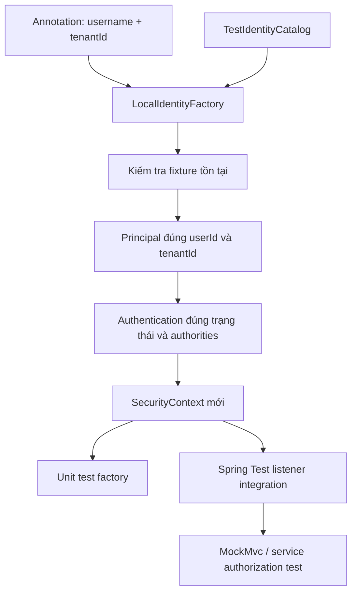

# Kiểm thử chính factory để tránh danh tính giả lập không hợp lệ

## 1. Vì sao cần kiểm thử factory riêng?

Một custom `WithSecurityContextFactory` là nơi chuyển tham số annotation hoặc fixture thành `Authentication` và `SecurityContext`. Nếu factory ánh xạ sai `userId`, `tenantId`, principal, authorities hoặc trạng thái authentication, mọi test dùng annotation đó có thể cho kết quả sai. Test HTTP có thể trả `403` dù policy đúng, hoặc nguy hiểm hơn, trả `200` vì fixture vô tình cấp thêm quyền.

Khi chỉ kiểm tra endpoint, khó biết lỗi đến từ factory, method security, filter chain hay policy nghiệp vụ. Vì vậy nên kiểm thử factory như một thành phần riêng: xác minh đầu vào được chuyển thành đúng danh tính, đúng quyền, đúng kiểu authentication và một context độc lập. Sau đó, một test tích hợp nhỏ xác minh Spring Security Test thực sự gọi factory và cài context trong lifecycle.

Trong module **SPRING_SECURITY_TESTING**, bài học này giúp người học kiểm chứng xác thực, phân quyền và bảo vệ HTTP thực tế bằng `spring-security-test` trên Servlet và Reactive. Ta sẽ xây dựng test cho factory, fixture hợp lệ/không hợp lệ và các ca HTTP được phép hoặc bị từ chối để tránh dùng danh tính giả lập sai.

Sau bài này, bạn có thể:

- Xác định hợp đồng cần kiểm tra của factory: principal, authentication type, authorities và trạng thái.
- Viết unit test trực tiếp cho `createSecurityContext(...)` với fixture kiểm soát được.
- Kiểm tra trường hợp user/tenant không tồn tại và bảo đảm factory thất bại rõ ràng.
- Chứng minh mỗi lần gọi tạo `SecurityContext` và `Authentication` mới.
- Viết integration test xác nhận `WithSecurityContextTestExecutionListener` inject factory và cài context.
- Tách lỗi fixture khỏi lỗi authorization, rồi kiểm tra request `200`, `401`, `403`.

## 2. Hợp đồng của factory cần được xác minh

Giả sử annotation `@WithLocalIdentity` mô tả username và tenant. Factory phải tạo một `TenantPrincipal`, giữ đúng authorities trong fixture và trả về context mới.



Các điều kiện nên kiểm tra:

| Thành phần | Assertion cần có | Vì sao |
| --- | --- | --- |
| Context | Không `null`; khác instance context được tạo ở lần gọi khác | Tránh cache context dùng chung |
| Authentication | Đúng subtype mà ứng dụng mong đợi; `isAuthenticated()` đúng | Tránh fixture chỉ có username nhưng sai loại token |
| Principal | Đúng class, `userId`, `username`, `tenantId` | Tránh ánh xạ nhầm danh tính/phạm vi |
| Authorities | Chính xác tập quyền, không thiếu và không thừa | Tránh false positive hoặc false negative trong authorization |
| Credentials | Không giữ mật khẩu/token nếu không cần | Hạn chế lưu dữ liệu nhạy cảm trong context test |
| Fixture không tồn tại | Lỗi setup rõ ràng | Không biến lỗi cấu hình test thành response `403` |
| Nhiều lần gọi | Context và authentication độc lập | Tránh state của test trước lọt sang test sau |

Một test factory trực tiếp không thay thế integration test. Unit test xác minh logic chuyển đổi; integration test xác minh annotation, Spring Test context và listener thực sự kết nối đúng.

## 3. Chuẩn bị mô hình fixture tối giản

Ví dụ dùng principal trong `src/main/java/com/example/security/TenantPrincipal.java`:

```java
package com.example.security;

import java.security.Principal;

public record TenantPrincipal(String userId, String username, String tenantId)
        implements Principal {

    @Override
    public String getName() {
        return username;
    }
}
```

Fixture test gồm `TestIdentity.java`:

```java
package com.example.security;

import java.util.Collection;
import org.springframework.security.core.GrantedAuthority;

public record TestIdentity(
        String userId,
        String username,
        String tenantId,
        Collection<? extends GrantedAuthority> authorities) {
}
```

Và `TestIdentityCatalog.java`:

```java
package com.example.security;

import java.util.Optional;

public interface TestIdentityCatalog {

    Optional<TestIdentity> find(String username, String tenantId);
}
```

Catalog chỉ đọc fixture. Trong unit test, ta sẽ mock catalog để kiểm soát dữ liệu trả về; trong integration test, có thể cung cấp một bean in-memory.

Annotation `WithLocalIdentity.java`:

```java
package com.example.security;

import java.lang.annotation.ElementType;
import java.lang.annotation.Retention;
import java.lang.annotation.RetentionPolicy;
import java.lang.annotation.Target;

import org.springframework.security.test.context.support.WithSecurityContext;

@Target({ ElementType.METHOD, ElementType.TYPE })
@Retention(RetentionPolicy.RUNTIME)
@WithSecurityContext(factory = LocalIdentityFactory.class)
public @interface WithLocalIdentity {

    String username();

    String tenantId();
}
```

## 4. Factory cần có hành vi rõ ràng và dễ kiểm thử

Đặt `LocalIdentityFactory.java` trong `src/test/java/com/example/security`:

```java
package com.example.security;

import org.springframework.beans.factory.annotation.Autowired;
import org.springframework.security.authentication.UsernamePasswordAuthenticationToken;
import org.springframework.security.core.Authentication;
import org.springframework.security.core.context.SecurityContext;
import org.springframework.security.core.context.SecurityContextHolder;
import org.springframework.security.test.context.support.WithSecurityContextFactory;

public final class LocalIdentityFactory
        implements WithSecurityContextFactory<WithLocalIdentity> {

    @Autowired
    private TestIdentityCatalog identityCatalog;

    @Override
    public SecurityContext createSecurityContext(WithLocalIdentity marker) {
        TestIdentity identity = identityCatalog
                .find(marker.username(), marker.tenantId())
                .orElseThrow(() -> new IllegalArgumentException(
                        "Không có test identity: " + marker.username()
                                + " trong " + marker.tenantId()));

        TenantPrincipal principal = new TenantPrincipal(
                identity.userId(), identity.username(), identity.tenantId());

        Authentication authentication =
                UsernamePasswordAuthenticationToken.authenticated(
                        principal, null, identity.authorities());

        SecurityContext context = SecurityContextHolder.createEmptyContext();
        context.setAuthentication(authentication);
        return context;
    }
}
```

Factory có một dependency duy nhất và không thực hiện side effect. Khi catalog không tìm thấy cặp username/tenant, factory ném `IllegalArgumentException` với thông tin đủ để sửa annotation. Khi tìm thấy, factory tạo principal mới, authentication mới và context mới.

Lưu ý: factory được Spring Security Test khởi tạo và autowire trong test context khi listener xử lý annotation. Trong unit test trực tiếp, ta có thể dùng Mockito `@InjectMocks` để đưa mock catalog vào field. Không tự `new LocalIdentityFactory()` rồi gọi method khi chưa thiết lập dependency.

## 5. Unit test trực tiếp `createSecurityContext(...)`

Unit test dưới đây kiểm tra contract của factory mà không cần khởi động server. Dùng `spring-boot-starter-test` (JUnit Jupiter, Mockito, AssertJ) và `spring-security-test` trong test dependencies.

```java
package com.example.security;

import java.lang.reflect.Method;
import java.util.List;
import java.util.Optional;

import org.junit.jupiter.api.Test;
import org.junit.jupiter.api.extension.ExtendWith;
import org.mockito.InjectMocks;
import org.mockito.Mock;
import org.mockito.junit.jupiter.MockitoExtension;
import org.springframework.security.core.Authentication;
import org.springframework.security.core.GrantedAuthority;
import org.springframework.security.core.authority.SimpleGrantedAuthority;
import org.springframework.security.core.context.SecurityContext;

import static org.assertj.core.api.Assertions.assertThat;
import static org.assertj.core.api.Assertions.assertThatThrownBy;
import static org.mockito.Mockito.times;
import static org.mockito.Mockito.verify;
import static org.mockito.Mockito.when;

@ExtendWith(MockitoExtension.class)
class LocalIdentityFactoryTests {

    @Mock
    TestIdentityCatalog identityCatalog;

    @InjectMocks
    LocalIdentityFactory factory;

    @Test
    @WithLocalIdentity(username = "alice", tenantId = "tenant-a")
    void createsExpectedContext() throws Exception {
        TestIdentity identity = new TestIdentity(
                "u-42", "alice", "tenant-a",
                List.of(new SimpleGrantedAuthority("invoice:read"),
                        new SimpleGrantedAuthority("invoice:issue")));
        when(identityCatalog.find("alice", "tenant-a"))
                .thenReturn(Optional.of(identity));

        WithLocalIdentity marker = markerFor("createsExpectedContext");
        SecurityContext context = factory.createSecurityContext(marker);

        assertThat(context).isNotNull();
        Authentication authentication = context.getAuthentication();
        assertThat(authentication).isNotNull();
        assertThat(authentication.isAuthenticated()).isTrue();
        assertThat(authentication.getPrincipal()).isInstanceOf(TenantPrincipal.class);
        assertThat(authentication.getCredentials()).isNull();

        TenantPrincipal principal = (TenantPrincipal) authentication.getPrincipal();
        assertThat(principal.userId()).isEqualTo("u-42");
        assertThat(principal.username()).isEqualTo("alice");
        assertThat(principal.tenantId()).isEqualTo("tenant-a");
        assertThat(authentication.getName()).isEqualTo("alice");

        assertThat(authentication.getAuthorities())
                .extracting(GrantedAuthority::getAuthority)
                .containsExactly("invoice:read", "invoice:issue");

        verify(identityCatalog).find("alice", "tenant-a");
    }

    private WithLocalIdentity markerFor(String methodName) throws Exception {
        Method method = getClass().getDeclaredMethod(methodName);
        return method.getAnnotation(WithLocalIdentity.class);
    }
}
```

Phương thức test tự đọc annotation của chính nó bằng reflection rồi truyền vào factory. Vì lớp này chỉ dùng `MockitoExtension`, annotation `@WithLocalIdentity` không được Spring Security Test listener xử lý tự động; nó đóng vai trò dữ liệu đầu vào cho unit test trực tiếp. Cách này kiểm tra factory độc lập với lifecycle.

Assertion `containsExactly` có chủ đích: ngoài việc xác nhận quyền cần có, nó còn phát hiện quyền thừa. Nếu chỉ dùng `contains("invoice:read")`, fixture có thể vô tình cấp thêm `invoice:delete` mà test vẫn xanh.

### 5.1. Kiểm tra fixture không tồn tại

```java
@Test
@WithLocalIdentity(username = "ghost", tenantId = "tenant-a")
void missingIdentityFailsDuringSetup() throws Exception {
    when(identityCatalog.find("ghost", "tenant-a"))
            .thenReturn(Optional.empty());

    WithLocalIdentity marker = markerFor("missingIdentityFailsDuringSetup");

    assertThatThrownBy(() -> factory.createSecurityContext(marker))
            .isInstanceOf(IllegalArgumentException.class)
            .hasMessageContaining("ghost")
            .hasMessageContaining("tenant-a");

    verify(identityCatalog).find("ghost", "tenant-a");
}
```

Ca này xác nhận fixture không tồn tại khiến factory thất bại trong giai đoạn setup. Không nên biến lỗi này thành `403` của controller: chưa có authentication hợp lệ để request đi vào policy. Một test `403` cần một fixture tồn tại và authentication được tạo thành công, nhưng không đủ quyền hoặc không đúng tenant.

### 5.2. Kiểm tra mỗi lần gọi tạo object mới

```java
@Test
@WithLocalIdentity(username = "alice", tenantId = "tenant-a")
void everyInvocationCreatesIndependentObjects() throws Exception {
    TestIdentity identity = new TestIdentity(
            "u-42", "alice", "tenant-a",
            List.of(new SimpleGrantedAuthority("invoice:read")));
    when(identityCatalog.find("alice", "tenant-a"))
            .thenReturn(Optional.of(identity));

    WithLocalIdentity marker = markerFor("everyInvocationCreatesIndependentObjects");
    SecurityContext first = factory.createSecurityContext(marker);
    SecurityContext second = factory.createSecurityContext(marker);

    assertThat(first).isNotSameAs(second);
    assertThat(first.getAuthentication()).isNotSameAs(second.getAuthentication());
    assertThat(first.getAuthentication().getPrincipal())
            .isNotSameAs(second.getAuthentication().getPrincipal());
    verify(identityCatalog, times(2)).find("alice", "tenant-a");
}
```

Factory có thể dùng lại fixture bất biến, nhưng không dùng lại `SecurityContext`, `Authentication` hoặc principal mutable giữa các lần gọi. Test này bảo vệ ranh giới đó.

## 6. Integration test xác minh Spring Security Test gọi factory

Unit test trực tiếp không xác nhận listener đã tạo factory và inject bean đúng cách. Ta cần ít nhất một test tích hợp nhỏ chạy trong Spring Test context, dùng chính annotation `@WithLocalIdentity` trên phương thức.

Ví dụ test configuration cung cấp catalog in-memory:

```java
package com.example.security;

import java.util.List;
import java.util.Map;
import java.util.Optional;

import org.springframework.boot.test.context.TestConfiguration;
import org.springframework.context.annotation.Bean;
import org.springframework.security.core.authority.SimpleGrantedAuthority;

@TestConfiguration
public class IdentityFactoryTestConfiguration {

    private record Key(String username, String tenantId) {
    }

    @Bean
    TestIdentityCatalog testIdentityCatalog() {
        Map<Key, TestIdentity> identities = Map.of(
                new Key("alice", "tenant-a"),
                new TestIdentity("u-42", "alice", "tenant-a", List.of(
                        new SimpleGrantedAuthority("invoice:read"))),
                new Key("carol", "tenant-a"),
                new TestIdentity("u-91", "carol", "tenant-a", List.of()));

        return (username, tenantId) -> Optional.ofNullable(
                identities.get(new Key(username, tenantId)));
    }
}
```

Test kiểm tra listener và dependency injection:

```java
package com.example.security;

import org.junit.jupiter.api.Test;
import org.springframework.boot.test.context.SpringBootTest;
import org.springframework.context.annotation.Import;
import org.springframework.security.core.Authentication;
import org.springframework.security.core.GrantedAuthority;
import org.springframework.security.core.context.SecurityContextHolder;

import static org.assertj.core.api.Assertions.assertThat;

@SpringBootTest
@Import(IdentityFactoryTestConfiguration.class)
class LocalIdentityFactoryIntegrationTests {

    @Test
    @WithLocalIdentity(username = "alice", tenantId = "tenant-a")
    void listenerInstallsFactoryResult() {
        Authentication authentication =
                SecurityContextHolder.getContext().getAuthentication();

        assertThat(authentication).isNotNull();
        assertThat(authentication.getPrincipal()).isInstanceOf(TenantPrincipal.class);
        TenantPrincipal principal = (TenantPrincipal) authentication.getPrincipal();
        assertThat(principal.userId()).isEqualTo("u-42");
        assertThat(principal.tenantId()).isEqualTo("tenant-a");
        assertThat(authentication.getAuthorities())
                .extracting(GrantedAuthority::getAuthority)
                .containsExactly("invoice:read");
    }

    @Test
    void contextIsNotCarriedIntoAnotherTestMethod() {
        assertThat(SecurityContextHolder.getContext().getAuthentication()).isNull();
    }
}
```

Test này dùng `@SpringBootTest` để kích hoạt Spring Test integration và `WithSecurityContextTestExecutionListener`. Bean catalog được import; listener tạo factory, inject bean, gọi `createSecurityContext` và cài kết quả trước thân test. Phương thức thứ hai xác minh authentication của test trước không rò rỉ sang test method khác; không phụ thuộc thứ tự vì mỗi phương thức được listener chuẩn bị/cleanup riêng.

Nếu ứng dụng có nhiều bean `TestIdentityCatalog`, hãy chỉ định `@Primary` hoặc `@Qualifier` phù hợp trong test context. Nếu dùng `@WebMvcTest`, nhớ import test configuration vì slice có thể không nạp bean này.

## 7. Kiểm thử request được phép và bị từ chối

Sau khi factory contract đã được kiểm tra, dùng `MockMvc` để xác minh authentication do factory tạo hoạt động với policy thực. Giả sử endpoint yêu cầu `invoice:read` và tenant khớp principal; method security và security filter chain đã được bật.

```java
import org.junit.jupiter.api.Test;
import org.springframework.beans.factory.annotation.Autowired;
import org.springframework.boot.test.autoconfigure.web.servlet.AutoConfigureMockMvc;
import org.springframework.boot.test.context.SpringBootTest;
import org.springframework.context.annotation.Import;
import org.springframework.test.web.servlet.MockMvc;

import static org.springframework.test.web.servlet.request.MockMvcRequestBuilders.get;
import static org.springframework.test.web.servlet.result.MockMvcResultMatchers.status;

@SpringBootTest
@AutoConfigureMockMvc
@Import(IdentityFactoryTestConfiguration.class)
class InvoiceFactoryAuthorizationTests {

    @Autowired
    MockMvc mvc;

    @Test
    @WithLocalIdentity(username = "alice", tenantId = "tenant-a")
    void validIdentityCanReadOwnTenant() throws Exception {
        mvc.perform(get("/api/tenants/tenant-a/invoices"))
                .andExpect(status().isOk());
    }

    @Test
    @WithLocalIdentity(username = "alice", tenantId = "tenant-a")
    void validIdentityCannotReadAnotherTenant() throws Exception {
        mvc.perform(get("/api/tenants/tenant-b/invoices"))
                .andExpect(status().isForbidden());
    }

    @Test
    @WithLocalIdentity(username = "carol", tenantId = "tenant-a")
    void existingIdentityWithoutPermissionIsDenied() throws Exception {
        mvc.perform(get("/api/tenants/tenant-a/invoices"))
                .andExpect(status().isForbidden());
    }
}
```

Hai request đầu dùng cùng một identity hợp lệ, nhưng tenant yêu cầu khác nhau. Ca đầu chứng minh fixture có thể đi qua policy; ca thứ hai chứng minh policy kiểm tra phạm vi. Ca thứ ba dùng `carol`, một fixture tồn tại nhưng không có authority nào, nên request được xác thực nhưng bị policy từ chối với `403`.

Với anonymous request, không gắn `@WithLocalIdentity`; status thường là `401` nếu dùng HTTP Basic/Bearer entry point, nhưng có thể là redirect với form login. Hãy kỳ vọng theo cấu hình thật của ứng dụng.

## 8. Lỗi thường gặp khi kiểm thử factory

| Hiện tượng | Nguyên nhân thường gặp | Cách xử lý |
| --- | --- | --- |
| `NullPointerException` ở catalog | Factory được tự tạo bằng `new` hoặc Mockito chưa inject mock | Dùng `@InjectMocks` cho unit test hoặc Spring listener integration |
| Unit test pass nhưng annotation integration fail | Factory không được Spring autowire hoặc test context thiếu bean | Kiểm tra `@SpringBootTest`, `@Import`, `@WithSecurityContext` và listener mặc định |
| Request trả `403` dù fixture được cho là hợp lệ | Sai principal, tenant, authority hoặc method security | Assert factory output trước; sau đó kiểm tra policy và filter chain |
| Request trả `200` khi thiếu quyền | Fixture cấp quyền thừa hoặc policy chưa được bật | Dùng assertion authorities chính xác và kiểm tra `@EnableMethodSecurity` |
| Fixture không tồn tại nhưng test mong `403` | Factory thất bại trước khi request được thực thi | Dùng fixture tồn tại nhưng thiếu quyền để kiểm tra `403` |
| Principal đúng nhưng controller ép kiểu lỗi | Factory tạo sai authentication/principal subtype | Assert class của `Authentication` và `getPrincipal()` |
| Test sau thấy authentication của test trước | Context bị cache/chia sẻ hoặc cleanup bị thay thế | Tạo context mới và giữ `WithSecurityContextTestExecutionListener` |
| Test chỉ fail khi chạy suite | Fixture static bị sửa hoặc test phụ thuộc thứ tự | Dùng fixture bất biến, tạo context mới, bỏ shared mutable state |

Một cách debug hiệu quả là kiểm tra theo thứ tự: (1) factory trả gì, (2) listener có cài kết quả vào context không, (3) request có đi qua filter chain không, (4) policy có đánh giá đúng authority và tenant không. Trình tự này giúp khoanh vùng lỗi mà không cần thêm log hoặc sửa policy theo phỏng đoán.

## 9. Factory cho JWT/OAuth2/OIDC cũng cần test hợp đồng riêng

Nếu factory tạo `JwtAuthenticationToken`, `OAuth2AuthenticationToken` hoặc một subtype riêng, unit test cần kiểm tra đúng kiểu đó và dữ liệu tương ứng:

| Loại authentication | Các assertion nên có |
| --- | --- |
| `JwtAuthenticationToken` | Token type, subject, claims như `tenant_id`, authorities đã ánh xạ |
| `OAuth2AuthenticationToken` | Principal `OAuth2User`, registration ID, authorities |
| OIDC login | Principal `OidcUser`, subject, ID token claims và authorities |
| Custom domain token | Subtype cụ thể, principal miền, authorities và trạng thái authenticated |

Một JWT mock được tạo trong factory không kiểm tra chữ ký, issuer, audience hoặc thời hạn access token. Nếu mục tiêu là kiểm tra converter từ JWT sang authorities, test converter riêng; nếu mục tiêu là xác minh token thật, gửi bearer token qua Resource Server decoder/validator trong integration test. Không để factory gọi authorization server để lấy token chỉ nhằm dựng bối cảnh cho test policy.

## 10. Reactive và `WebTestClient`

Với WebFlux, `SecurityContext` được truyền qua Reactor Context. Unit test cho factory vẫn có thể gọi `createSecurityContext(...)` trực tiếp và kiểm tra object trả về; integration test reactive cần xác nhận context xuất hiện trong pipeline theo cơ chế reactive.

Khi kiểm tra endpoint, `WebTestClient` có thể nhận authentication theo request:

```java
Authentication authentication = UsernamePasswordAuthenticationToken.authenticated(
        new TenantPrincipal("u-42", "alice", "tenant-a"), null,
        List.of(new SimpleGrantedAuthority("invoice:read")));

webTestClient.mutateWith(mockAuthentication(authentication))
        .get().uri("/api/reactive/tenants/tenant-a/invoices")
        .exchange()
        .expectStatus().isOk();
```

Ví dụ giả định route Reactive và policy tương ứng; dùng static import `SecurityMockServerConfigurers.mockAuthentication`. Nếu test reactive method security dùng `@WithSecurityContext`, tích hợp `ReactorContextTestExecutionListener`. Đừng chỉ assert `SecurityContextHolder` ThreadLocal rồi kết luận authentication đã được truyền vào reactive request.

## 11. Bài thực hành

Hãy hoàn thiện bộ kiểm thử cho `LocalIdentityFactory`:

1. Unit test danh tính `alice` trong `tenant-a`, xác nhận principal và `invoice:read` chính xác.
2. Unit test fixture không tồn tại; xác nhận factory ném lỗi setup có username và tenant trong thông báo.
3. Unit test hai lần gọi factory; xác nhận context, authentication và principal là các instance riêng.
4. Integration test dùng `@WithLocalIdentity` để xác minh Spring listener inject catalog và cài context.
5. Kiểm tra test method tiếp theo không nhận authentication cũ.
6. Kiểm thử endpoint cho phép tenant đúng và từ chối tenant khác bằng `MockMvc`.
7. Thêm fixture tồn tại nhưng thiếu permission để phân biệt `403` với lỗi fixture.
8. Nếu ứng dụng dùng JWT hoặc OIDC, viết assertion tương ứng cho subtype, claims và authorities; giữ xác minh chữ ký/token thật trong integration test xác thực riêng.

### Câu hỏi tự đánh giá

- Vì sao nên test `WithSecurityContextFactory` trực tiếp trước khi debug một test HTTP trả `403`?
- Assertion `containsExactly` authorities phát hiện lỗi nào mà `contains` có thể bỏ qua?
- Vì sao fixture không tồn tại nên gây lỗi setup thay vì trả `403`?
- Unit test trực tiếp factory có chứng minh Spring đã inject bean và listener đã cài context không?
- Cần thêm test nào để chứng minh `WithSecurityContextTestExecutionListener` hoạt động?
- Khi factory tạo `JwtAuthenticationToken`, những phần nào cần test riêng để xác minh chữ ký JWT thật?

## Tài liệu tham khảo

- [Spring Security — Testing Method Security and `@WithSecurityContext`](https://docs.spring.io/spring-security/reference/servlet/test/method.html)
- [Spring Security — MockMvc Setup](https://docs.spring.io/spring-security/reference/servlet/test/mockmvc/setup.html)
- [Spring Security — MockMvc Request Post Processors](https://docs.spring.io/spring-security/reference/servlet/test/mockmvc/request-post-processors.html)
- [Spring Security — Reactive Web Testing](https://docs.spring.io/spring-security/reference/reactive/test/web/index.html)
- [Spring Framework — TestContext Framework](https://docs.spring.io/spring-framework/reference/testing/testcontext-framework.html)

Kiểm thử chính factory giúp bảo đảm danh tính giả lập phản ánh đúng người dùng, tenant, kiểu authentication và tập quyền mà ứng dụng mong đợi. Kết hợp unit test cho factory với integration test cho listener và request test cho policy sẽ phân biệt được lỗi fixture, lỗi thiết lập context và lỗi phân quyền; nhờ vậy các kết quả được phép hoặc bị từ chối có ý nghĩa rõ ràng.
