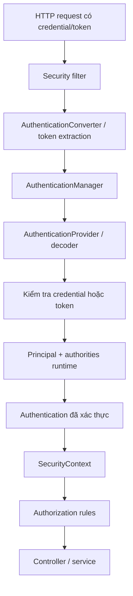

# Phân biệt danh tính được giả lập với bước chuyển đổi danh tính ở runtime

## 1. Một principal đúng trong test chưa chứng minh luồng xác thực tạo ra principal đó

Trong Spring Security, một test có thể đặt sẵn `Authentication` vào `SecurityContext` rồi gọi service hoặc gửi request bằng `MockMvc`. Cách này rất hữu ích để kiểm tra authorization: người dùng có quyền `invoice:read` được đọc hóa đơn của tenant mình, còn người thiếu quyền hoặc sai tenant bị từ chối.

Tuy nhiên, ứng dụng chạy thật phải **chuyển thông tin xác thực đầu vào thành danh tính mà authorization sử dụng**. Ví dụ:

- `AuthenticationProvider` kiểm tra username/password và tạo `Authentication` đã xác thực.
- Resource Server giải mã JWT, xác minh token rồi chuyển claims/scopes thành principal và authorities.
- OAuth2/OIDC login lấy thông tin người dùng qua `OAuth2UserService`/`OidcUserService` và ánh xạ authorities.
- Cơ chế xác thực riêng chuyển credential đã kiểm tra thành custom `Authentication` hoặc domain principal.

`@WithSecurityContext` thường tạo thẳng một authentication đã xác thực để test. Nó không tự chạy các bước chuyển đổi nói trên. Vì vậy, một test authorization dùng principal giả lập có thể xanh ngay cả khi converter production đang ánh xạ sai `tenant_id`, bỏ sót permission hoặc tạo nhầm loại principal.

Trong module **SPRING_SECURITY_TESTING**, bài học này giúp phân biệt rõ hai mục tiêu: **giả lập danh tính để kiểm tra authorization** và **kiểm tra quá trình ứng dụng chuyển thông tin xác thực thành danh tính runtime**. Cả hai đều cần thiết, nhưng chúng trả lời hai câu hỏi khác nhau.

Sau bài này, bạn có thể:

1. Mô tả luồng từ credential/token đến `Authentication` đã xác thực và `SecurityContext`.
2. Nhận biết `@WithSecurityContext`, `authentication()` và `jwt()` đang bỏ qua phần nào của runtime authentication flow.
3. Kiểm thử riêng converter ánh xạ JWT claims/scopes thành authorities.
4. Kiểm thử `AuthenticationProvider`, `OAuth2UserService`, `OidcUserService` hoặc `GrantedAuthoritiesMapper` tại đúng ranh giới.
5. Viết integration test qua filter chain với decoder/provider test double để xác nhận converter được gọi.
6. Chọn test phù hợp cho authorization, token validation và OAuth2/OIDC login hoàn chỉnh.

## 2. Hai đường đi khác nhau: dựng sẵn context và xác thực ở runtime

### 2.1. Đường đi của test giả lập

Với `@WithSecurityContext`, listener gọi factory và cài kết quả vào context của test:

```mermaid
flowchart TD
    A[@WithSecurityContext annotation] --> B[WithSecurityContextFactory]
    B --> C[Principal + authorities giả lập]
    C --> D[Authentication đã xác thực]
    D --> E[SecurityContext]
    E --> F[Test service / MockMvc / method security]
    F --> G[Kiểm tra authorization]
```

Đường đi này bắt đầu từ danh tính mà test đã chọn. Nó hữu ích khi câu hỏi là: *nếu người gọi đã có principal và quyền như thế này, ứng dụng có cho phép hành động không?*

### 2.2. Đường đi runtime của một request xác thực thật

Với request mang credential hoặc bearer token, filter trích xuất thông tin xác thực, giao cho cơ chế xác thực, rồi đặt kết quả đã xác thực vào security context:



Đường đi runtime trả lời câu hỏi khác: *credential/token đầu vào có được xác minh không, và dữ liệu đã xác minh được chuyển thành principal/authorities như thế nào?*

| Khía cạnh | Test cài sẵn context | Runtime authentication |
| --- | --- | --- |
| Điểm bắt đầu | Annotation hoặc authentication do test tạo | Credential/token trong request |
| Ai tạo principal | Factory hoặc test helper | Provider, converter, user service hoặc code xác thực của ứng dụng |
| Kiểm tra password/chữ ký token | Thường bị bỏ qua | Được thực hiện bởi provider/decoder tương ứng |
| Ánh xạ claims/roles/permissions | Test có thể đặt sẵn authorities | Converter/mapper production chịu trách nhiệm |
| Câu hỏi chính | Authorization có đúng với danh tính này không? | Danh tính runtime có được tạo đúng từ đầu vào không? |
| Công cụ thường dùng | `@WithSecurityContext`, `@WithMockUser`, `authentication()`, `jwt()` | `AuthenticationManager`, filter chain, decoder/provider và integration test |

Một đối tượng `Authentication` có `isAuthenticated() == true` chỉ cho biết đối tượng đó đang được đánh dấu đã xác thực. Nếu test tự tạo đối tượng này, cờ đó không chứng minh password hay chữ ký token từng được kiểm tra.

## 3. Những helper kiểm thử nào bỏ qua runtime conversion?

| Helper | Điều nó giúp kiểm tra | Điều không thể kết luận chỉ từ helper |
| --- | --- | --- |
| `@WithMockUser` | Authorization với username/role/authority đơn giản | `UserDetailsService`, password encoder hoặc provider đã chạy đúng |
| `@WithSecurityContext` | Principal, authentication type và authorities do factory tạo | Runtime converter/provider có tạo cùng danh tính đó không |
| `MockMvc` `.with(authentication(auth))` | Một request cụ thể với authentication đã tạo sẵn | Filter có thể xác thực credential/token thật hay không |
| `MockMvc` `.with(jwt())` | Endpoint xử lý JWT principal/claims/authorities trong request mock | JWT decoder/validator production đã xác minh chữ ký/issuer/audience hay custom converter đã chạy như mong đợi |
| `WebTestClient` `mockAuthentication(...)` | Authorization trong pipeline Reactive với authentication đã cấp | Luồng xác thực bearer token thật hoặc custom provider |
| `oauth2Login()` / `oidcLogin()` | Controller và policy nhận `OAuth2User`/`OidcUser` phù hợp | Authorization code exchange, token endpoint hoặc OIDC provider đã hoạt động |

Nếu helper cho phép truyền authorities tường minh, các authorities ấy là đầu vào của test. Test không chứng minh converter production đã tạo chúng. Để kiểm tra converter, hãy gọi converter trực tiếp hoặc gửi request qua filter/provider được cấu hình dùng converter đó.

## 4. Ví dụ xuyên suốt: ánh xạ JWT thành quyền đọc hóa đơn

Giả sử Resource Server nhận access token JWT với các claims:

```json
{
  "sub": "u-42",
  "tenant_id": "tenant-a",
  "scope": "profile",
  "permissions": ["invoice:read"]
}
```

Ứng dụng cần tạo `JwtAuthenticationToken` với authority `SCOPE_profile` từ scope và `invoice:read` từ claim permission. Endpoint sau đó kiểm tra cả quyền và tenant. Phần quan trọng cần kiểm chứng là converter đọc đúng claim và tạo authority đúng chuỗi.

### 4.1. Cấu hình converter trong ứng dụng

```java
package com.example.security;

import java.util.ArrayList;
import java.util.Collection;

import org.springframework.core.convert.converter.Converter;
import org.springframework.security.authentication.AbstractAuthenticationToken;
import org.springframework.security.core.GrantedAuthority;
import org.springframework.security.core.authority.SimpleGrantedAuthority;
import org.springframework.security.oauth2.jwt.Jwt;
import org.springframework.security.oauth2.server.resource.authentication.JwtGrantedAuthoritiesConverter;
import org.springframework.security.oauth2.server.resource.authentication.JwtAuthenticationToken;

public final class InvoiceJwtAuthenticationConverter
        implements Converter<Jwt, AbstractAuthenticationToken> {

    private final JwtGrantedAuthoritiesConverter scopeConverter =
            new JwtGrantedAuthoritiesConverter();

    @Override
    public AbstractAuthenticationToken convert(Jwt jwt) {
        Collection<GrantedAuthority> authorities = new ArrayList<>(
                scopeConverter.convert(jwt));

        Collection<String> permissions = jwt.getClaimAsStringList("permissions");
        if (permissions != null) {
            permissions.stream()
                    .map(SimpleGrantedAuthority::new)
                    .forEach(authorities::add);
        }

        return new JwtAuthenticationToken(jwt, authorities, jwt.getSubject());
    }
}
```

`JwtGrantedAuthoritiesConverter` xử lý scope theo quy ước mặc định, thường chuyển `profile` thành `SCOPE_profile`; phần còn lại ánh xạ permission trong claim thành authority nguyên văn. `JwtAuthenticationToken` vẫn giữ `Jwt` làm token/principal JWT; `getToken()` là nơi đọc claim `tenant_id`.

Đăng ký converter trong `SecurityFilterChain`:

```java
@Bean
SecurityFilterChain apiSecurity(
        HttpSecurity http,
        InvoiceJwtAuthenticationConverter jwtConverter) throws Exception {

    return http
            .authorizeHttpRequests(authorize -> authorize
                    .requestMatchers("/api/**").authenticated()
                    .anyRequest().permitAll())
            .oauth2ResourceServer(resourceServer -> resourceServer
                    .jwt(jwt -> jwt.jwtAuthenticationConverter(jwtConverter)))
            .build();
}
```

Đây là cấu hình Servlet Resource Server minh họa. Ứng dụng còn cần cấu hình `JwtDecoder` hợp lệ (ví dụ issuer/JWK set hoặc decoder bean). Không chỉ đăng ký converter mà quên gắn nó vào `oauth2ResourceServer().jwt(...)`; nếu filter chain không dùng converter, test converter riêng có thể pass nhưng request runtime vẫn dùng converter mặc định.

## 5. Kiểm thử converter trực tiếp

Unit test converter là cách nhanh nhất để xác minh mapping claim sang authority mà không cần khởi động server hoặc giải mã token qua mạng.

```java
package com.example.security;

import java.time.Instant;

import org.junit.jupiter.api.Test;
import org.springframework.security.core.GrantedAuthority;
import org.springframework.security.oauth2.jwt.Jwt;
import org.springframework.security.oauth2.server.resource.authentication.JwtAuthenticationToken;

import static org.assertj.core.api.Assertions.assertThat;

class InvoiceJwtAuthenticationConverterTests {

    private final InvoiceJwtAuthenticationConverter converter =
            new InvoiceJwtAuthenticationConverter();

    @Test
    void mapsScopePermissionAndSubject() {
        Instant now = Instant.parse("2026-01-15T10:00:00Z");
        Jwt jwt = Jwt.withTokenValue("test-token")
                .header("alg", "none")
                .subject("u-42")
                .claim("tenant_id", "tenant-a")
                .claim("scope", "profile")
                .claim("permissions", java.util.List.of("invoice:read"))
                .issuedAt(now)
                .expiresAt(now.plusSeconds(600))
                .build();

        JwtAuthenticationToken authentication =
                (JwtAuthenticationToken) converter.convert(jwt);

        assertThat(authentication).isNotNull();
        assertThat(authentication.getName()).isEqualTo("u-42");
        assertThat(authentication.getToken().getClaimAsString("tenant_id"))
                .isEqualTo("tenant-a");
        assertThat(authentication.getAuthorities())
                .extracting(GrantedAuthority::getAuthority)
                .containsExactlyInAnyOrder("SCOPE_profile", "invoice:read");
        assertThat(authentication.isAuthenticated()).isTrue();
    }
}
```

Test này chứng minh converter ánh xạ `scope`, `permissions`, `sub` và claim tenant như mong đợi. Nó không chứng minh JWT được ký hợp lệ, `iss`/`aud` đúng hoặc decoder production có thể xác minh token. `Jwt.withTokenValue(...)` chỉ tạo đối tượng JWT cho test.

Nên thêm các ca âm cho converter: không có claim `permissions`, claim rỗng, scope không liên quan và permission không được policy cho phép. Nếu converter được thiết kế từ chối claim sai kiểu hoặc dữ liệu không hợp lệ, kiểm tra exception/behavior tương ứng. Không tự cấp quyền mặc định khi claim bị thiếu.

## 6. Kiểm tra converter được gọi trong runtime filter chain

Unit test converter không chứng minh `SecurityFilterChain` đã đăng ký đúng converter. Có thể viết một integration test dùng request bearer token, nhưng thay `JwtDecoder` bằng test bean trả về JWT cố định. Khi đó filter, `JwtAuthenticationProvider` và converter đã đăng ký vẫn chạy; bước xác minh chữ ký được thay bằng decoder test double.

Ví dụ test decoder cục bộ:

```java
@TestConfiguration
class JwtDecoderTestConfiguration {

    @Bean
    JwtDecoder jwtDecoder() {
        return token -> Jwt.withTokenValue(token)
                .header("alg", "none")
                .subject("u-42")
                .claim("tenant_id", "tenant-a")
                .claim("scope", "profile")
                .claim("permissions", List.of("invoice:read"))
                .issuedAt(Instant.parse("2026-01-15T10:00:00Z"))
                .expiresAt(Instant.parse("2026-01-15T10:10:00Z"))
                .build();
    }
}
```

Test gửi bearer token qua filter chain:

```java
@SpringBootTest
@AutoConfigureMockMvc
@Import(JwtDecoderTestConfiguration.class)
class JwtRuntimeConversionTests {

    @Autowired
    MockMvc mvc;

    @Test
    void bearerRequestUsesConfiguredConverter() throws Exception {
        mvc.perform(get("/api/tenants/tenant-a/invoices")
                .header(HttpHeaders.AUTHORIZATION, "Bearer test-token"))
                .andExpect(status().isOk());
    }

    @Test
    void bearerRequestCannotCrossTenant() throws Exception {
        mvc.perform(get("/api/tenants/tenant-b/invoices")
                .header(HttpHeaders.AUTHORIZATION, "Bearer test-token"))
                .andExpect(status().isForbidden());
    }
}
```

Đoạn test cần import `JwtDecoder`, `Jwt`, `List`, `Instant`, `HttpHeaders`, `@TestConfiguration`, `@Bean`, `@Import`, `MockMvc` và các matcher/request builder. Cấu hình ứng dụng phải dùng `InvoiceJwtAuthenticationConverter` trong filter chain và endpoint phải kiểm tra `invoice:read` cùng tenant trong JWT. Hai request đi qua bearer token filter và decoder test double, do đó kiểm tra được việc converter được kết nối vào runtime path.

Giới hạn: decoder test double trả về JWT đã dựng sẵn, nên test này **không** xác minh chữ ký hoặc issuer/audience thật. Để kiểm tra xác minh token, thêm integration test với `JwtDecoder` thực và khóa ký test cố định hoặc JWK test server. Không dùng khóa/credential production trong test.

## 7. Username/password: giả lập principal và kiểm thử `AuthenticationProvider`

`@WithUserDetails` hoặc custom `@WithSecurityContext` có thể tạo authentication chứa `UserDetails`, nhưng chúng không tự gọi `AuthenticationManager.authenticate(...)`. Nếu cần kiểm tra password encoder, account disabled/locked hoặc cách provider tạo principal, kiểm thử provider/manager riêng.

Ví dụ kiểm tra provider theo hợp đồng:

```java
@Test
void providerAuthenticatesValidCredentials() {
    Authentication request =
            UsernamePasswordAuthenticationToken.unauthenticated("alice", "secret");

    Authentication result = authenticationProvider.authenticate(request);

    assertThat(result.isAuthenticated()).isTrue();
    assertThat(result.getPrincipal()).isInstanceOf(AppUserPrincipal.class);
    assertThat(result.getName()).isEqualTo("alice");
    assertThat(result.getCredentials()).isNull();
    assertThat(result.getAuthorities())
            .extracting(GrantedAuthority::getAuthority)
            .contains("invoice:read");
}
```

Test này gọi provider thật với dependency cục bộ hoặc mock được kiểm soát. Cần bổ sung ca password sai, user không tồn tại, tài khoản bị khóa/disabled và authorities được ánh xạ sai. Không log password hoặc credentials trong assertion message.

Nếu cần xác minh toàn bộ request login qua filter chain, gửi username/password đến endpoint login hoặc dùng cơ chế authentication tương ứng của ứng dụng rồi kiểm tra response/session. Một test gọi trực tiếp provider chưa chứng minh filter trích xuất request đúng hoặc session được tạo đúng.

## 8. OAuth2/OIDC: kiểm tra user service và mapper thay vì chỉ cài principal

Với OAuth2 login, `oauth2Login()` tạo bối cảnh có `OAuth2User`; `oidcLogin()` tạo bối cảnh có `OidcUser`. Chúng rất phù hợp để kiểm tra controller, method security và mapping sau khi principal đã có sẵn.

Nhưng runtime login còn có các bước khác:

- `OAuth2LoginAuthenticationFilter` xử lý callback authorization response.
- `OAuth2UserService` tải user attributes từ UserInfo endpoint nếu cấu hình sử dụng.
- OIDC flow dùng `OidcUserService` và ID token/UserInfo tương ứng.
- `GrantedAuthoritiesMapper` có thể chuyển authorities từ provider thành quyền ứng dụng.
- `OAuth2AuthenticationToken` giữ principal và authorities sau quá trình xác thực.

Vì vậy, nếu ứng dụng ánh xạ `groups = ["finance"]` thành `ROLE_FINANCE`, hãy test mapper trực tiếp với input groups và assert chính xác authorities đầu ra. Nếu custom `OAuth2UserService` thêm `tenantId` hoặc `userId`, test service đó với OAuth2 user request/token response giả lập. Chỉ dùng `oidcLogin()` rồi assert controller không chứng minh custom `OidcUserService` hoặc authorization code exchange đã chạy.

| Mục tiêu | Test phù hợp |
| --- | --- |
| Controller đọc đúng `OidcUser` | `oidcLogin()` / `mockOidcLogin()` |
| Controller đọc đúng `OAuth2User` | `oauth2Login()` / `mockOAuth2Login()` |
| Nhóm IdP được ánh xạ thành role ứng dụng | Unit test `GrantedAuthoritiesMapper` |
| Custom user service bổ sung tenant hoặc thuộc tính | Unit test `OAuth2UserService`/`OidcUserService` với response giả lập |
| Callback, code exchange và token validation | Integration test với authorization server test hoặc provider chuyên dụng |

Không coi access token, ID token và JWT Resource Server là cùng một đối tượng. OIDC login thường tạo `OAuth2AuthenticationToken` với `OidcUser` làm principal; Resource Server bearer token thường tạo `JwtAuthenticationToken` với `Jwt` làm token/principal. Test phải dùng đúng loại mà code production tiêu thụ.

## 9. Ma trận chọn loại test

| Điều cần chứng minh | Kỹ thuật | Kết quả cần quan sát |
| --- | --- | --- |
| Quyền đọc hóa đơn cho user đã có danh tính | `@WithSecurityContext` + method/HTTP test | `200` khi đủ quyền và đúng tenant; `403` khi thiếu quyền/sai tenant |
| Custom factory tạo đúng principal | Unit test `createSecurityContext` | Class và fields của principal, authorities chính xác |
| JWT claims được chuyển thành authorities đúng | Unit test `JwtAuthenticationConverter` | `SCOPE_*`, permissions và subject theo quy tắc |
| Converter JWT thực sự được gắn vào filter chain | Request bearer token với test `JwtDecoder` | Request đi qua filter/provider và policy nhận authorities do converter tạo |
| Chữ ký/issuer/audience/expiration JWT được xác minh | Integration test decoder thật với token ký bằng key test | Token hợp lệ được chấp nhận; token sai bị từ chối |
| Password/provider tạo principal đúng | Unit test provider hoặc AuthenticationManager | Principal, credentials đã xóa, authorities và exception phù hợp |
| OAuth2/OIDC principal/authorities được ánh xạ đúng | Test user service/mapper; integration flow khi cần | `OAuth2User`/`OidcUser` và authorities đầu ra |
| Authorization code/OIDC login end-to-end | Integration test với authorization server test | Redirect, callback, code exchange và token validation |

Một bộ test cân bằng thường có ba lớp: unit test cho converter/provider/mapper, authorization test nhanh với danh tính giả lập, và một số integration test xác minh filter chain/decoder/login flow. Không cần chạy toàn bộ quy trình identity provider cho mọi ca `hasAuthority`.

## 10. Lỗi thường gặp và cách chẩn đoán

| Hiện tượng | Nguyên nhân thường gặp | Cách xử lý |
| --- | --- | --- |
| `@WithSecurityContext` test pass nhưng bearer request fail | Runtime converter/provider tạo principal hoặc authority khác fixture | Assert output converter/provider, sau đó test qua filter chain |
| `jwt()` test pass dù claim permission sai | Test đã cấp authorities tường minh, bỏ qua mapping production | Test converter trực tiếp và dùng bearer request với decoder test double |
| Claim `tenant_id` có trong JWT nhưng policy thấy tenant rỗng | Converter hoặc policy đọc sai claim name/type | Assert `getToken().getClaimAsString("tenant_id")` và test mapping |
| Scope tồn tại nhưng policy không nhận | Authority thực tế có tiền tố `SCOPE_` hoặc converter tùy chỉnh | Assert danh sách authorities đầu ra; dùng đúng chuỗi trong policy |
| `oidcLogin()` pass nhưng login thật fail | Test helper không chạy authorization code exchange/UserInfo/token validation | Bổ sung integration test với authorization server test |
| Principal runtime khác principal mock | Production dùng converter/provider riêng nhưng factory tạo object khác | Tạo factory theo contract thực hoặc test authorization bằng token đúng subtype |
| Request bearer bị `401` trước khi tới controller | Decoder từ chối token hoặc không có bearer token converter | Kiểm tra header, decoder, issuer/JWK và log bảo mật đã được làm sạch |
| Test bearer trả `403` | Authentication thành công nhưng authority/tenant không thỏa policy | Kiểm tra converter và policy; phân biệt với `401` xác thực thất bại |

Khi chẩn đoán, đi theo thứ tự: request có mang credential/token không; filter có trích xuất đúng không; provider/decoder có xác minh không; converter tạo principal/authorities nào; authorization policy đánh giá gì. Đừng sửa fixture để cấp thêm quyền chỉ nhằm làm một test runtime pass.

## 11. Bài thực hành

Với API đọc hóa đơn đa tenant, hoàn thành các bước:

1. Viết một authorization test bằng `@WithSecurityContext` với principal `u-42`, tenant `tenant-a`, authority `invoice:read`; xác nhận đọc đúng tenant được phép và sai tenant bị từ chối.
2. Viết unit test cho `InvoiceJwtAuthenticationConverter`; xác nhận `scope` và `permissions` được ánh xạ chính xác.
3. Thêm test khi claim `permissions` không tồn tại; không tự cấp `invoice:read`.
4. Dùng test `JwtDecoder` trả về JWT cố định và gửi header `Authorization: Bearer ...` qua `MockMvc`; xác nhận converter runtime được gọi.
5. Tạo một test decoder/validator riêng với JWT ký bằng khóa test để kiểm tra token hợp lệ và token sai chữ ký.
6. Nếu dùng username/password, test `AuthenticationProvider` với password đúng, sai và tài khoản bị khóa.
7. Nếu dùng OIDC, test `GrantedAuthoritiesMapper` hoặc `OidcUserService` trước; chỉ viết flow end-to-end khi cần xác minh callback/provider.

### Câu hỏi tự đánh giá

- Vì sao `isAuthenticated() == true` trong factory không chứng minh credential đã được xác minh?
- Một test `jwt()` với authorities truyền tường minh bỏ qua bước nào của runtime Resource Server?
- Làm thế nào chứng minh custom `JwtAuthenticationConverter` được cấu hình trong filter chain thực sự chạy?
- Vì sao cần tách test converter khỏi test chữ ký JWT?
- `oidcLogin()` xác minh được điều gì và không xác minh được điều gì về authorization code flow?
- Khi request trả `403`, cần kiểm tra converter và policy thế nào để phân biệt thiếu quyền với lỗi xác thực?

## Tài liệu tham khảo

- [Spring Security — Testing Method Security and `@WithSecurityContext`](https://docs.spring.io/spring-security/reference/servlet/test/method.html)
- [Spring Security — OAuth 2.0 Resource Server JWT](https://docs.spring.io/spring-security/reference/servlet/oauth2/resource-server/jwt.html)
- [Spring Security — JWT Authentication Converter](https://docs.spring.io/spring-security/reference/servlet/oauth2/resource-server/jwt.html)
- [Spring Security — Testing OAuth 2.0 Login](https://docs.spring.io/spring-security/reference/servlet/test/mockmvc/oauth2.html)
- [Spring Security — Reactive Web Testing](https://docs.spring.io/spring-security/reference/reactive/test/web/index.html)
- [Spring Security — Authentication Architecture](https://docs.spring.io/spring-security/reference/servlet/authentication/architecture.html)

Danh tính giả lập giúp kiểm tra authorization một cách nhanh và có kiểm soát. Bước chuyển đổi danh tính ở runtime cần được kiểm tra riêng tại converter, provider, user service hoặc filter chain thực tế. Khi tách hai mục tiêu này, test vừa xác nhận policy cho phép đúng người dùng, vừa phát hiện lỗi ánh xạ claims, roles, permissions hoặc principal trước khi chúng ảnh hưởng request thật.
