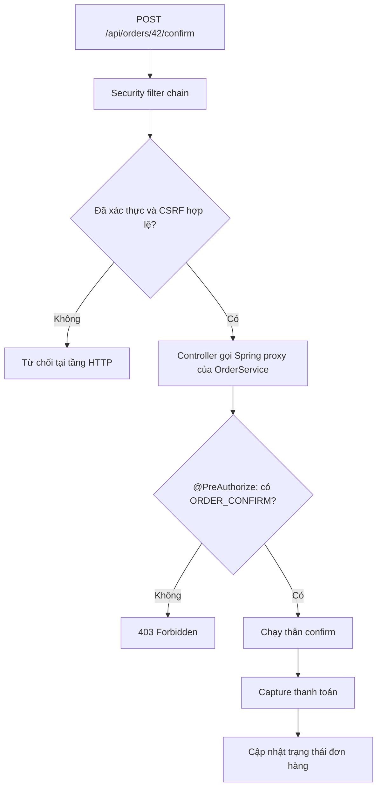

# Xác minh nghiệp vụ chưa được thực hiện khi kiểm tra trước bị từ chối

Trong ứng dụng Spring Security, một phản hồi **403 Forbidden** cho biết yêu cầu bị từ chối, nhưng chưa đủ chứng minh thao tác nghiệp vụ đã được ngăn chặn trước khi chạy. Với các thao tác nhạy cảm như xác nhận đơn hàng, trừ tiền hoặc phát sự kiện, bài kiểm thử cần xác nhận đồng thời hai điều: người dùng thiếu quyền nhận kết quả bị từ chối, và **các lời gọi gây tác dụng phụ không xảy ra**.

Bài học tập trung vào `@PreAuthorize` của **method security** và cách kiểm chứng bằng `spring-security-test`, `MockMvc`, `@WithMockUser` và Mockito. Cuối bài có cách áp dụng cùng nguyên tắc cho `WebTestClient` trong ứng dụng Reactive.

## 1. Tại sao chỉ kiểm tra mã HTTP là chưa đủ?

Giả sử một API xác nhận đơn hàng gọi cổng thanh toán, sau đó cập nhật trạng thái trong cơ sở dữ liệu. Quy tắc nghiệp vụ là chỉ người có authority `ORDER_CONFIRM` mới được phép thực hiện.

Một bài kiểm thử như sau mới kiểm tra được **kết quả HTTP**:

```java
mockMvc.perform(post("/api/orders/42/confirm").with(csrf()))
        .andExpect(status().isForbidden());
```

Nó chưa chứng minh `paymentGateway.capture("42")` hoặc `orderRepository.markConfirmed("42")` không được gọi. Thậm chí phản hồi 403 có thể đến từ cơ chế khác, chẳng hạn thiếu CSRF token, URL authorization hoặc một bộ lọc tùy chỉnh, trong khi bài kiểm thử chưa thực sự đi đến `@PreAuthorize`.

Với **kiểm tra trước** (`@PreAuthorize`), điều cần chứng minh là authorization được đánh giá trước khi thực thi thân phương thức được bảo vệ. Nếu bị từ chối, thân phương thức không chạy, do đó những lời gọi nằm hoàn toàn trong thân phương thức cũng không chạy.



> Điểm cần phân biệt: Với việc chặn ở **method security**, controller có thể đã bắt đầu xử lý và gọi phương thức qua proxy. Điều bị ngăn là **thân phương thức được `@PreAuthorize` bảo vệ**, không nhất thiết là toàn bộ quá trình xử lý HTTP.

## 2. Dựng tình huống kiểm thử rõ ràng

Ví dụ sử dụng ứng dụng Spring Boot Servlet với `spring-boot-starter-security`, `spring-boot-starter-test` và `spring-security-test` thuộc bộ dependencies kiểm thử. Để sử dụng `@MockitoBean` trong ví dụ, cần Spring Framework **6.2+** (thường đi cùng Spring Boot **3.4+**). Với phiên bản cũ hơn, thay bằng cơ chế mock bean tương ứng của dự án.

**Cấu hình security:** mọi lời gọi `/api/orders/**` phải được xác thực ở tầng HTTP; quyền `ORDER_CONFIRM` được kiểm tra **riêng tại phương thức nghiệp vụ**. Cấu hình tách biệt này giúp bài test xác định nguyên nhân từ chối là `@PreAuthorize`.

```java
import org.springframework.context.annotation.Bean;
import org.springframework.context.annotation.Configuration;
import org.springframework.security.config.Customizer;
import org.springframework.security.config.annotation.method.configuration.EnableMethodSecurity;
import org.springframework.security.config.annotation.web.builders.HttpSecurity;
import org.springframework.security.web.SecurityFilterChain;

@Configuration
@EnableMethodSecurity
class SecurityConfig {
    @Bean
    SecurityFilterChain securityFilterChain(HttpSecurity http) throws Exception {
        return http
                .authorizeHttpRequests(auth -> auth
                        .requestMatchers("/api/orders/**").authenticated()
                        .anyRequest().permitAll())
                .httpBasic(Customizer.withDefaults())
                .build();
    }
}
```

`@EnableMethodSecurity` kích hoạt khả năng xử lý `@PreAuthorize`. Cấu hình mặc định ở đây vẫn bật CSRF cho yêu cầu thay đổi dữ liệu, vì vậy test `POST` cần gửi CSRF token giả lập hợp lệ với `.with(csrf())`.

**Nghiệp vụ và cộng tác viên:**

```java
import org.springframework.security.access.prepost.PreAuthorize;
import org.springframework.stereotype.Service;

interface PaymentGateway {
    void capture(String orderId);
}

interface OrderRepository {
    void markConfirmed(String orderId);
}

@Service
class OrderService {
    private final PaymentGateway paymentGateway;
    private final OrderRepository orderRepository;

    OrderService(PaymentGateway paymentGateway,
                 OrderRepository orderRepository) {
        this.paymentGateway = paymentGateway;
        this.orderRepository = orderRepository;
    }

    @PreAuthorize("hasAuthority('ORDER_CONFIRM')")
    public void confirm(String orderId) {
        paymentGateway.capture(orderId);
        orderRepository.markConfirmed(orderId);
    }
}
```

Hai interface trên biểu diễn các cổng tới hệ thống ngoài và cơ sở dữ liệu. Trong bài kiểm thử, chúng được thay bằng Mockito mock; `OrderService` vẫn phải là **bean thật do Spring quản lý** để method-security interceptor có cơ hội chạy.

**HTTP controller:**

```java
import org.springframework.http.ResponseEntity;
import org.springframework.web.bind.annotation.PathVariable;
import org.springframework.web.bind.annotation.PostMapping;
import org.springframework.web.bind.annotation.RequestMapping;
import org.springframework.web.bind.annotation.RestController;

@RestController
@RequestMapping("/api/orders")
class OrderController {
    private final OrderService orderService;

    OrderController(OrderService orderService) {
        this.orderService = orderService;
    }

    @PostMapping("/{id}/confirm")
    ResponseEntity<Void> confirm(@PathVariable String id) {
        orderService.confirm(id);
        return ResponseEntity.noContent().build();
    }
}
```

Khi thiếu authority, Spring Security chặn ở proxy của `OrderService` và đưa ra `AccessDeniedException` để tầng HTTP chuyển thành 403 theo cấu hình này. Khi đủ quyền, hai hành động nghiệp vụ chạy và endpoint trả **204 No Content**.

## 3. Kiểm thử 403 đi kèm xác minh không có tác dụng phụ

Kiểm thử tích hợp với `@SpringBootTest` và `@AutoConfigureMockMvc` giữ nguyên wiring thực tế của controller, filter chain, service và method security. Chúng ta mock **chỉ các dependency tạo tác dụng phụ**.

```java
import org.junit.jupiter.api.Test;
import org.springframework.beans.factory.annotation.Autowired;
import org.springframework.boot.test.autoconfigure.web.servlet.AutoConfigureMockMvc;
import org.springframework.boot.test.context.SpringBootTest;
import org.springframework.test.context.bean.override.mockito.MockitoBean;
import org.springframework.security.test.context.support.WithMockUser;
import org.springframework.test.web.servlet.MockMvc;
import org.mockito.InOrder;

import static org.mockito.Mockito.inOrder;
import static org.mockito.Mockito.verifyNoInteractions;
import static org.mockito.Mockito.verifyNoMoreInteractions;
import static org.springframework.security.test.web.servlet.request.SecurityMockMvcRequestPostProcessors.csrf;
import static org.springframework.test.web.servlet.request.MockMvcRequestBuilders.post;
import static org.springframework.test.web.servlet.result.MockMvcResultMatchers.status;

@SpringBootTest
@AutoConfigureMockMvc
class OrderMethodSecurityTest {
    @Autowired
    MockMvc mockMvc;

    @MockitoBean
    PaymentGateway paymentGateway;

    @MockitoBean
    OrderRepository orderRepository;

    @Test
    @WithMockUser(username = "reader", authorities = "ORDER_READ")
    void deniedBeforeMethodBody_doesNotPerformBusiness() throws Exception {
        mockMvc.perform(post("/api/orders/{id}/confirm", "42")
                        .with(csrf()))
                .andExpect(status().isForbidden());

        verifyNoInteractions(paymentGateway, orderRepository);
    }

    @Test
    @WithMockUser(username = "operator", authorities = "ORDER_CONFIRM")
    void allowed_executesBusinessExactlyOnce() throws Exception {
        mockMvc.perform(post("/api/orders/{id}/confirm", "42")
                        .with(csrf()))
                .andExpect(status().isNoContent());

        InOrder calls = inOrder(paymentGateway, orderRepository);
        calls.verify(paymentGateway).capture("42");
        calls.verify(orderRepository).markConfirmed("42");
        verifyNoMoreInteractions(paymentGateway, orderRepository);
    }

    @Test
    void unauthenticated_isRejectedBeforeBusiness() throws Exception {
        mockMvc.perform(post("/api/orders/{id}/confirm", "42")
                        .with(csrf()))
                .andExpect(status().isUnauthorized());

        verifyNoInteractions(paymentGateway, orderRepository);
    }
}
```

Các assertion có mục đích khác nhau:

| Assertion | Điều được chứng minh |
|---|---|
| `status().isForbidden()` | Người dùng đã đăng nhập nhưng thiếu `ORDER_CONFIRM` bị từ chối. |
| `verifyNoInteractions(paymentGateway, orderRepository)` | Hai dependency gây tác dụng phụ không nhận bất kỳ lời gọi nào trong ca bị từ chối. |
| `status().isNoContent()` | Người dùng đủ quyền đi tới nhánh thành công. |
| `InOrder.verify(...)` | Các lời gọi nghiệp vụ dự kiến thực sự chạy và theo thứ tự mong muốn. |
| `status().isUnauthorized()` | Người dùng chưa xác thực nhận 401 với HTTP Basic entry point của ví dụ. |

Việc chạy **cả nhánh bị từ chối và nhánh được phép** là thiết yếu: nếu service vô tình không được gọi ở cả hai nhánh, bài test chỉ kiểm tra `verifyNoInteractions` vẫn có thể cho cảm giác an toàn giả. Nhánh thành công giúp chứng minh wiring HTTP → controller → service hoạt động.

Đừng mock `OrderService` trong chính bài test này. Nếu dùng `@MockitoBean OrderService`, mock có thể thay thế bean mang `@PreAuthorize`, khiến phép kiểm tra không còn đại diện cho method security thực.

## 4. Phân biệt 401, 403 và nguyên nhân chặn

Các cơ chế bảo vệ có thể trả mã lỗi tương tự nhưng chứng minh các điều khác nhau:

| Tình huống | Kỳ vọng ở ví dụ | Vì sao chưa hoặc đã vào thân phương thức? |
|---|---|---|
| Chưa đăng nhập, CSRF hợp lệ | `401` | Bị chặn bởi yêu cầu `.authenticated()` và HTTP Basic entry point. |
| Đăng nhập, thiếu `ORDER_CONFIRM`, CSRF hợp lệ | `403` | Đi qua kiểm tra HTTP, bị `@PreAuthorize` từ chối trước thân `confirm`. |
| Đăng nhập, đủ `ORDER_CONFIRM`, CSRF hợp lệ | `204` | Được vào thân phương thức và chạy nghiệp vụ. |
| Đăng nhập, đủ quyền nhưng thiếu CSRF token | `403` | Có thể bị chặn bởi CSRF filter trước khi tới controller và `@PreAuthorize`. |

Trong các ứng dụng có entry point, exception handler hoặc cấu hình xác thực khác, mã HTTP cụ thể có thể khác. Điều quyết định để chứng minh **method security** là test phải chủ động đáp ứng các điều kiện ở tầng filter (đăng nhập và CSRF), đồng thời thay đổi **riêng authority** của người gọi.

`@WithMockUser(authorities = "ORDER_CONFIRM")` cấp authority đúng chuỗi. Cú pháp `@WithMockUser(roles = "ADMIN")` thường sinh authority `ROLE_ADMIN`; nó không tự biến thành `ORDER_CONFIRM`. Hãy viết test theo biểu thức chính xác trong `@PreAuthorize` (`hasRole` hay `hasAuthority`) thay vì suy đoán quyền tương đương.

## 5. Kiểm tra lớp service trực tiếp khi cần khoanh vùng lỗi

`MockMvc` xác minh đầy đủ luồng HTTP. Khi muốn chẩn đoán riêng method security, có thể inject **bean service thật từ ApplicationContext** rồi kiểm tra exception và tương tác:

```java
@Autowired
OrderService orderService; // Bean do Spring quản lý, qua method-security proxy

@Test
@WithMockUser(authorities = "ORDER_READ")
void directServiceCall_isDeniedBeforeSideEffects() {
    assertThatThrownBy(() -> orderService.confirm("42"))
            .isInstanceOf(AccessDeniedException.class);

    verifyNoInteractions(paymentGateway, orderRepository);
}
```

Đoạn này dùng `assertThatThrownBy` từ AssertJ và `AccessDeniedException` của Spring Security. Nó là **một phương thức kiểm thử bổ sung** trong lớp có cùng mock và context như trên, không thay thế cho kiểm thử HTTP. Nếu trực tiếp tạo `new OrderService(...)`, lời gọi không đi qua proxy của Spring; `@PreAuthorize` không được áp dụng và phép thử sẽ sai mục đích.

## 6. Áp dụng cho JWT/OAuth2 và Reactive

Trong ứng dụng OAuth2 Resource Server, nguyên tắc vẫn là **giả lập một Authentication với authority thiếu quyền**, gửi yêu cầu qua security chain và xác minh nghiệp vụ không chạy. Trên Servlet, `spring-security-test` cung cấp `.with(jwt())`:

```java
import static org.springframework.security.test.web.servlet.request.SecurityMockMvcRequestPostProcessors.jwt;
import org.springframework.security.core.authority.SimpleGrantedAuthority;

mockMvc.perform(post("/api/orders/{id}/confirm", "42")
                .with(jwt().authorities(
                        new SimpleGrantedAuthority("ORDER_READ")))
                .with(csrf()))
        .andExpect(status().isForbidden());

verifyNoInteractions(paymentGateway, orderRepository);
```

Ở đây `jwt()` dựng authentication giả lập cho test; nó **không chứng minh** việc giải mã JWT thật, kiểm tra chữ ký, issuer, audience hay ánh xạ claims của cấu hình production. Nếu biểu thức quyền yêu cầu `SCOPE_orders.confirm`, test phải cấp hoặc thiếu chính authority đó; nếu cần kiểm thử việc ánh xạ scope, phải dùng test riêng cho converter hoặc luồng resource server thực.

Với **WebFlux**, cấu hình thường dùng `@EnableReactiveMethodSecurity` và `WebTestClient`. Thân phương thức nghiệp vụ nên trả về `Mono`/`Flux`, để side effect chỉ xảy ra khi publisher được subscribe:

```java
@Service
class ReactiveOrderService {
    private final ReactivePaymentGateway paymentGateway;
    private final ReactiveOrderRepository orderRepository;

    ReactiveOrderService(ReactivePaymentGateway paymentGateway,
                         ReactiveOrderRepository orderRepository) {
        this.paymentGateway = paymentGateway;
        this.orderRepository = orderRepository;
    }

    @PreAuthorize("hasAuthority('ORDER_CONFIRM')")
    public Mono<Void> confirm(String id) {
        return Mono.defer(() -> paymentGateway.capture(id))
                .then(Mono.defer(() -> orderRepository.markConfirmed(id)));
    }
}

interface ReactivePaymentGateway {
    Mono<Void> capture(String id);
}

interface ReactiveOrderRepository {
    Mono<Void> markConfirmed(String id);
}
```

Ví dụ trên giả định `@EnableReactiveMethodSecurity` đã được bật, service được gọi qua Spring proxy và endpoint WebFlux trả publisher từ `confirm`. Trong một bài test `WebTestClient` đã bind với Spring Security, có thể kiểm tra:

```java
webTestClient
        .mutateWith(mockUser("reader").authorities(
                new SimpleGrantedAuthority("ORDER_READ")))
        .mutateWith(csrf())
        .post()
        .uri("/api/orders/42/confirm")
        .exchange()
        .expectStatus().isForbidden();

verifyNoInteractions(paymentGateway, orderRepository);
```

Trong đoạn WebFlux, `mockUser` và `csrf` là các hàm từ `SecurityMockServerConfigurers`, còn `paymentGateway` và `orderRepository` là mock reactive. Khi kiểm thử nhánh được phép, stub các phương thức mock trả về `Mono.empty()` rồi xác minh chúng đã được gọi; nếu để mock trả `null`, phép thử có thể thất bại do publisher không hợp lệ thay vì do phân quyền.

Đặc biệt với Reactive, không đặt tác dụng phụ **eager** bên ngoài `Mono.defer(...)` hoặc tương đương rồi cho rằng method security luôn bảo đảm chúng chưa xảy ra. Publisher và thời điểm chạy là một phần cần kiểm chứng.

## 7. Những sai lầm khiến bài test báo xanh nhưng không chứng minh được yêu cầu

1. **Chỉ assert 403:** Có thể lỗi đến từ CSRF, URL rule hoặc exception handler. Đảm bảo test đi qua tầng trước và `verifyNoInteractions` đúng các dependency.
2. **Mock cả service được bảo vệ:** Test có thể bỏ qua method-security proxy. Giữ service thật, chỉ mock cổng bên ngoài.
3. **Gọi `new OrderService(...)` hoặc self-invocation `this.confirm(...)`:** Cả hai có thể không đi qua proxy Spring. Gọi từ controller/bean khác qua bean được inject.
4. **Chỉ test nhánh bị từ chối:** Nên có một nhánh hợp lệ chứng minh nghiệp vụ thực sự chạy với cùng luồng.
5. **Kiểm tra nhầm `@PostAuthorize`:** Kiểm tra sau (`@PostAuthorize`) diễn ra sau khi phương thức thực thi; không thể suy ra nghiệp vụ chưa chạy từ một lần từ chối sau.
6. **Nhầm zero interactions với zero dữ liệu thay đổi:** Mockito chỉ đo tương tác trên những mock mà nó theo dõi. Với code ghi cơ sở dữ liệu trực tiếp, gửi message bất đồng bộ hoặc phát sự kiện ở nơi khác, cần thêm integration test kiểm tra trạng thái thực tế, event/outbox và ranh giới giao dịch.
7. **Không phân biệt kiểm tra quyền và tác dụng phụ khi đánh giá quyền:** Biểu thức `@PreAuthorize` có thể gọi permission evaluator hoặc bean tra cứu dữ liệu để quyết định quyền. Khi đó không nên `verifyNoInteractions` một dependency phục vụ *đánh giá quyền*; hãy kiểm tra `never()` trên chính các lời gọi *ghi/capture/publish* cần ngăn.

### Chọn assertion phù hợp

Nếu một dependency được dùng cả để **đọc chính sách** lẫn **ghi dữ liệu**, tránh khẳng định không có tương tác nào. Thay bằng assertion nhắm đúng hành động:

```java
verify(orderRepository, never()).markConfirmed("42");
verify(paymentGateway, never()).capture("42");
```

`never()` là cách viết rõ ràng cho lời gọi phải bằng 0. Có thể kết hợp `verifyNoMoreInteractions` sau khi đã xác nhận các lượt đọc hợp lệ. Đối với kiểm thử trạng thái thực, nên chuẩn bị dữ liệu ban đầu, gọi request với người dùng thiếu quyền, sau đó truy vấn lại trạng thái đơn hàng và các bản ghi tác dụng phụ. Đừng chỉ dựa vào việc một transaction trong test tự rollback, vì rollback không chứng minh thân phương thức chưa chạy.

## 8. Checklist hoàn thành bài kiểm thử

- [ ] `@EnableMethodSecurity` hoặc `@EnableReactiveMethodSecurity` có hiệu lực; endpoint gọi service qua Spring-managed proxy.
- [ ] Với ca method security bị từ chối, người dùng đã xác thực và CSRF hợp lệ; authority thiếu đúng quyền trong `@PreAuthorize`.
- [ ] Kết quả HTTP là 403 (theo cấu hình đang test) và các dependency tạo tác dụng phụ được kiểm tra bằng Mockito.
- [ ] Nhánh đủ quyền trả kết quả thành công và thực sự thực hiện các lời gọi nghiệp vụ dự kiến.
- [ ] Có phân biệt giữa thiếu đăng nhập, thiếu quyền, thiếu CSRF và những điều kiện filter khác.
- [ ] Nếu có cơ sở dữ liệu, message broker, sự kiện hoặc công việc async ngoài mock, đã bổ sung assertion về trạng thái thật tương ứng.

**Ghi nhớ:** Đối với kiểm tra trước, mệnh đề cần bảo vệ là **“người dùng không đủ quyền thì thân phương thức nghiệp vụ không thực thi”**. Một phép kiểm tra tốt kết hợp việc quan sát phản hồi bảo mật với bằng chứng không có các lời gọi hoặc thay đổi trạng thái nghiệp vụ ngoài ý muốn.
