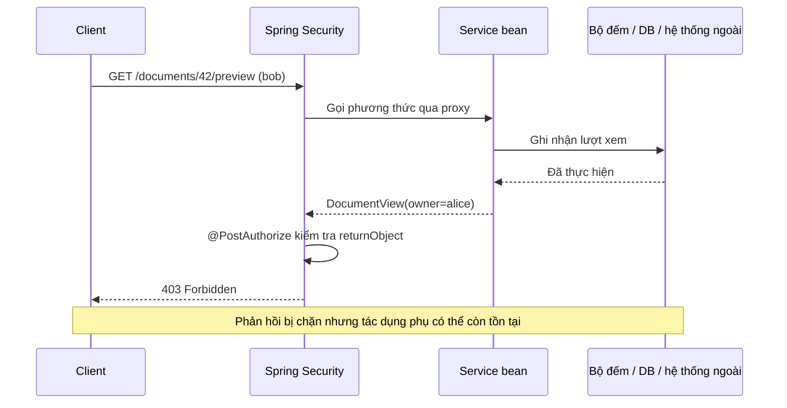

# Kiểm tra tác dụng phụ có thể đã xảy ra trước khi @PostAuthorize từ chối

Trong Spring Security Method Security, `@PostAuthorize` ra quyết định **sau khi phương thức đích đã thực thi và tạo ra kết quả**. Khi biểu thức không thỏa mãn, Spring Security có thể chặn kết quả và trả HTTP `403 Forbidden`, nhưng câu lệnh ghi cơ sở dữ liệu, gửi thông điệp hoặc gọi hệ thống ngoài **có thể đã chạy trước đó**. Kiểm thử chỉ khẳng định `403` là chưa đủ để chứng minh thao tác bị từ chối không gây tác dụng phụ.

Bài học này tập trung vào ứng dụng Servlet sử dụng `MockMvc` và `spring-security-test`, đồng thời mở rộng cách kiểm chứng sang Reactive với `WebTestClient`. Mục tiêu là phân biệt **quyền nhận kết quả** với **quyền thực hiện hành động**, viết phép kiểm thử đo cả HTTP lẫn trạng thái sau lời gọi, và chọn đúng vị trí kiểm tra quyền trước các thao tác có tác dụng phụ.

## 1. @PostAuthorize thực sự kiểm tra ở thời điểm nào?

Sau khi kích hoạt `@EnableMethodSecurity`, Spring Security dùng Spring AOP để áp dụng các interceptor phân quyền lên phương thức của Spring bean. Hai annotation thường gặp có ý nghĩa khác nhau:

- `@PreAuthorize`: kiểm tra trước khi cho phép gọi thân phương thức; nếu bị từ chối, thân phương thức không được chạy.
- `@PostAuthorize`: kiểm tra giá trị trả về thông qua `returnObject` **sau khi thân phương thức đã chạy**; nếu bị từ chối, kết quả không đến được caller theo luồng thông thường.

Ví dụ:

```java
@PostAuthorize("returnObject.owner().equals(authentication.name)")
public DocumentView preview(long documentId) {
    recordView(documentId);               // Đã chạy trước khi kiểm tra quyền
    return new DocumentView(documentId, "alice");
}
```

Khi người dùng `bob` gọi `preview` cho tài liệu thuộc `alice`, biểu thức sau phương thức trả về `false`. Trong một HTTP request Servlet được bảo vệ bởi Spring Security, lỗi phân quyền thường được chuyển thành `403`. Tuy vậy, `recordView` đã được gọi.



**Điểm cần ghi nhớ:** phản hồi `403` chứng minh caller không được nhận kết quả ở ranh giới HTTP đang kiểm thử; nó **không chứng minh** mọi thay đổi bên trong phương thức đã được hoàn tác.

### Những loại tác dụng phụ cần xem xét

| Tác dụng phụ trước khi trả kết quả | Khi @PostAuthorize từ chối |
| --- | --- |
| Tăng `AtomicInteger` hoặc thay đổi biến trong bộ nhớ | Vẫn thay đổi; transaction của DB không hoàn tác trạng thái Java |
| Ghi DB qua repository/JDBC/JPA | Có thể đã commit, còn đang trong transaction hoặc được rollback; phải xét ranh giới transaction thực tế |
| Gửi email, gọi REST API, phát Kafka/RabbitMQ | Tác động bên ngoài thường không tự hoàn tác khi Java ném lỗi phân quyền |
| Tạo outbox/event trong DB | Phụ thuộc transaction chứa thao tác ghi và thời điểm publisher đọc outbox |
| Ghi audit/metric/tracing | Có thể là dấu vết được chủ ý giữ lại; cần xác định rõ chính sách nào được chấp nhận |
| Tạo file, cập nhật cache, gọi `REQUIRES_NEW` | Có thể độc lập với rollback của giao dịch bao ngoài |

Không phải tác dụng phụ nào cũng là lỗi. Ví dụ, audit về **lần truy cập bị từ chối** có thể là yêu cầu bảo mật. Câu hỏi cần kiểm chứng là: *tác dụng phụ nghiệp vụ nào tuyệt đối không được xảy ra khi người dùng không có quyền?*

## 2. Mô hình Servlet tối thiểu để nhìn thấy lỗi

Ví dụ dùng Spring Boot 3.x, Java 17+, Spring MVC, Spring Security và JUnit 5. Các dependency kiểm thử cần có `spring-boot-starter-test` và `spring-security-test`; ví dụ sau lược bỏ phần `package` và `import` để nhấn mạnh luồng xử lý. Cấu hình test phải nạp **Spring bean thật qua proxy Method Security**, không thay toàn bộ service bằng mock.

Bật phân quyền phương thức và yêu cầu request được xác thực:

```java
@Configuration
@EnableMethodSecurity
class SecurityConfig {

    @Bean
    SecurityFilterChain securityFilterChain(HttpSecurity http) throws Exception {
        return http
            .authorizeHttpRequests(auth -> auth
                .requestMatchers("/documents/**").authenticated()
                .anyRequest().denyAll())
            .build();
    }
}
```

Tạo kết quả trả về và một bộ đo tác dụng phụ. `AtomicInteger` giúp quan sát được thứ tự xử lý mà không cần giả định về DB:

```java
record DocumentView(long id, String owner) {}

@Component
class ViewProbe {
    private final AtomicInteger recordedViews = new AtomicInteger();

    void recordView() {
        recordedViews.incrementAndGet();
    }

    int count() {
        return recordedViews.get();
    }

    void reset() {
        recordedViews.set(0);
    }
}
```

Service minh họa **cách viết có rủi ro**: chỉ kiểm tra ownership sau khi tăng bộ đếm.

```java
@Service
class DocumentService {
    private final ViewProbe probe;

    DocumentService(ViewProbe probe) {
        this.probe = probe;
    }

    @PostAuthorize("returnObject.owner().equals(authentication.name)")
    public DocumentView preview(long id) {
        probe.recordView();                 // Side effect xảy ra trước
        return new DocumentView(id, "alice");
    }
}
```

Controller gọi service bằng một bean được inject, bảo đảm lời gọi đi qua proxy của Spring Security:

```java
@RestController
@RequestMapping("/documents")
class DocumentController {
    private final DocumentService service;

    DocumentController(DocumentService service) {
        this.service = service;
    }

    @GetMapping("/{id}/preview")
    DocumentView preview(@PathVariable long id) {
        return service.preview(id);
    }
}
```

Dùng `GET` ở đây để minh họa việc ghi nhận lượt truy cập. Trong ứng dụng thật, `GET` nên giữ tính chất an toàn của HTTP; đừng dùng nó cho thay đổi nghiệp vụ có ý nghĩa như thanh toán hoặc chuyển quyền sở hữu.

## 3. MockMvc phải kiểm tra cả HTTP và tác dụng phụ

`@WithMockUser` chuẩn bị một `Authentication` giả trong `SecurityContext`. Nó phù hợp với bài kiểm thử authorization của service, không xác thực mật khẩu thật hoặc chữ ký JWT. `@SpringBootTest` + `@AutoConfigureMockMvc` giúp đi qua filter chain và controller trong Spring context thực.

```java
@SpringBootTest
@AutoConfigureMockMvc
class PostAuthorizeSideEffectMvcTest {

    @Autowired MockMvc mvc;
    @Autowired ViewProbe probe;

    @BeforeEach
    void resetProbe() {
        probe.reset();
    }

    @Test
    @WithMockUser(username = "bob")
    void deniedResultButBodyAlreadyRecordedView() throws Exception {
        mvc.perform(get("/documents/42/preview"))
            .andExpect(status().isForbidden());

        // Đây là hành vi hiện có của thiết kế chỉ dùng @PostAuthorize.
        assertThat(probe.count()).isEqualTo(1);
    }

    @Test
    @WithMockUser(username = "alice")
    void allowedResultAlsoRecordsView() throws Exception {
        mvc.perform(get("/documents/42/preview"))
            .andExpect(status().isOk())
            .andExpect(jsonPath("$.id").value(42))
            .andExpect(jsonPath("$.owner").value("alice"));

        assertThat(probe.count()).isEqualTo(1);
    }
}
```

Ca đầu tiên cố ý **chứng minh một lỗ hổng thiết kế**, nên khẳng định bộ đếm bằng `1`. Không được nhầm bài kiểm thử mô tả hành vi này với tiêu chí an toàn cần đạt.

Một kiểm thử yêu cầu **không ghi nhận tác dụng phụ cho người không có quyền** sẽ là:

```java
@Test
@WithMockUser(username = "bob")
void deniedRequestMustNotCauseBusinessSideEffect() throws Exception {
    mvc.perform(get("/documents/42/preview"))
        .andExpect(status().isForbidden());

    assertThat(probe.count()).isZero(); // RED với implementation ở mục 2
}
```

Kiểm thử này **phải thất bại** trên service chưa được bảo vệ trước khi chạy thân phương thức. Nó tạo bằng chứng có thể lặp lại cho vấn đề cần sửa.

| Tình huống | HTTP dự kiến | Bộ đếm với @PostAuthorize đơn thuần | Chính sách an toàn mong muốn |
| --- | --- | ---: | ---: |
| `alice` xem dữ liệu của mình | `200` | 1 | 1 |
| `bob` xem dữ liệu của `alice` | `403` | 1 | 0 |
| Chưa xác thực | `401` hoặc chuyển tới trang login tùy entry point | 0 nếu request bị chặn ở HTTP | 0 |
| Có quyền nhưng service lỗi trước khi ghi | Phụ thuộc exception mapping | 0 | 0 |

**Lưu ý kiểm thử:** dùng `@WithMockUser(username = "bob")` để tách riêng lý do “đã xác thực nhưng không có quyền” khỏi lỗi xác thực. Kiểm thử anonymous/`401` cần cấu hình entry point riêng để có HTTP status xác định, bởi ứng dụng form login có thể redirect.

## 4. Sửa thiết kế: kiểm tra quyền trước khi chạm tới trạng thái

Nếu quyền sở hữu có thể xác định từ tham số `id`, hãy chuyển điều kiện cần thiết sang `@PreAuthorize`. `@PostAuthorize` vẫn có thể được giữ làm kiểm tra bổ sung cho kết quả trả về.

Ví dụ policy đơn giản cho dữ liệu minh họa:

```java
@Component("documentPermission")
class DocumentPermission {

    public boolean canPreview(long documentId, Authentication auth) {
        return documentId == 42L && "alice".equals(auth.getName());
    }
}
```

Trong hệ thống thật, policy này phải truy vấn metadata/ACL từ repository đáng tin cậy theo `documentId` và tài khoản hiện tại; giá trị `42` và `alice` chỉ giúp đoạn minh họa tự chứa.

Thay annotation của service thành:

```java
@PreAuthorize("@documentPermission.canPreview(#p0, authentication)")
@PostAuthorize("returnObject.owner().equals(authentication.name)")
public DocumentView preview(long id) {
    probe.recordView();
    return new DocumentView(id, "alice");
}
```

`#p0` chỉ đối số đầu tiên, không phụ thuộc cấu hình giữ tên tham số Java khi biên dịch. Bây giờ interceptor trước phương thức từ chối `bob` **trước khi** gọi `recordView()`, nên kiểm thử `deniedRequestMustNotCauseBusinessSideEffect` chuyển sang PASS.

Không nên chỉ dựa vào `@PreAuthorize("isAuthenticated()")` vì nó không kiểm tra quyền trên tài nguyên cụ thể. Mặt khác, nếu quyền có thể thay đổi giữa lúc truy vấn ACL và lúc ghi, cần kiểm soát sự nhất quán bằng transaction/lock/điều kiện cập nhật phù hợp. `@PostAuthorize` phát hiện kết quả không còn hợp lệ, nhưng không tự đảo ngược tác dụng phụ của một cuộc đua trạng thái.

### Khi chỉ xác định được chủ sở hữu sau khi đọc dữ liệu

Có trường hợp phải tải tài nguyên mới biết owner. Hãy **đọc và kiểm tra quyền trước**, sau đó mới gọi service có tác dụng phụ. Phải đi qua hai Spring bean khác nhau để interceptor có hiệu lực.

```java
@Service
class AuthorizedDocumentReader {
    @PostAuthorize("returnObject.owner().equals(authentication.name)")
    public DocumentView load(long id) {
        // Trong thực tế: đọc từ repository, không thực hiện side effect nghiệp vụ.
        return new DocumentView(id, "alice");
    }
}

@Service
class DocumentActionService {
    private final AuthorizedDocumentReader reader;
    private final NotificationPort notifications;

    DocumentActionService(AuthorizedDocumentReader reader,
                          NotificationPort notifications) {
        this.reader = reader;
        this.notifications = notifications;
    }

    public void notifyOwner(long id) {
        DocumentView document = reader.load(id); // Có thể bị deny tại đây.
        notifications.send(document);            // Chỉ gọi khi đã qua check.
    }
}
```

`NotificationPort` là interface adapter gửi thông báo của ứng dụng. Trong test, có thể dùng mock port và `verifyNoInteractions(notifications)` khi `bob` bị từ chối; không cần gửi email hoặc thông điệp thật. Nếu đặt `load` và `notifyOwner` trong cùng một bean rồi gọi bằng `this.load(id)`, **self-invocation** thông thường sẽ bỏ qua proxy AOP; đó là một lý do phổ biến khiến `@PostAuthorize` không được thực thi.

Với nghiệp vụ ghi phức tạp, cách rõ ràng hơn là xác thực quyền và kiểm soát thay đổi ngay trong transaction nghiệp vụ, trước câu lệnh ghi hoặc gửi sự kiện; response-level authorization chỉ đóng vai trò phòng vệ bổ sung.

## 5. @Transactional không bảo đảm rollback sau @PostAuthorize

Đây là điểm nguy hiểm nhất khi side effect là thay đổi dữ liệu lâu dài. `@Transactional` và `@PostAuthorize` đều dựa vào advisor/interceptor. **Thứ tự interceptor quyết định** liệu lời từ chối xảy ra trước hay sau điểm commit của transaction.

Hai chuỗi có kết quả khác nhau:

```text
Trường hợp A - kiểm tra hậu phương thức nằm ngoài transaction:
@PostAuthorize [
    @Transactional [ begin -> ghi DB -> commit ]
    -> kiểm tra returnObject -> DENY
]
Kết quả: có thể HTTP 403 nhưng bản ghi đã commit.

Trường hợp B - transaction bao cả kiểm tra hậu phương thức:
@Transactional [ begin ->
    method ghi DB -> @PostAuthorize DENY -> rollback
]
Kết quả: thay đổi DB trong cùng transaction có thể được rollback.
```

Không được suy ra trường hợp B chỉ từ việc nhìn thấy hai annotation đặt cạnh nhau:

```java
@Transactional
@PostAuthorize("returnObject.owner().equals(authentication.name)")
public DocumentView updateAndReturn(...) {
    // database update
    // ...
}
```

Tài liệu Spring Security khuyến cáo tránh `@PostAuthorize` cho phương thức ghi DB vì thay đổi thường đã diễn ra trước khi kiểm tra. Khi bắt buộc phải dùng transaction để hoàn tác, cần cấu hình **thứ tự transaction advice** để nó bao được after-method authorization, bảo đảm exception dẫn tới rollback và xác nhận bằng integration test trên DB thật. Trong cùng tình huống, một transaction `REQUIRES_NEW` đã commit ở service phụ vẫn có thể tồn tại, và các lời gọi email/HTTP/MQ sẽ không tự rollback.

Cần đặc biệt kiểm tra:

1. Thứ tự Spring AOP advisors của đúng phiên bản/framework và cấu hình `@EnableTransactionManagement` đang dùng.
2. Transaction nào thực sự chứa thao tác ghi; có `REQUIRES_NEW`, `@Async` hoặc publisher chạy ngoài transaction không.
3. Lỗi phân quyền có đi xuyên qua transaction boundary hay bị một handler bắt và chuyển thành kết quả khác.
4. Trạng thái **đã commit** sau request, không chỉ entity nằm trong persistence context hoặc transaction của test.

Vì vậy, ưu tiên **authorize trước thao tác ghi**. Cấu hình rollback thích hợp là một cơ chế bổ sung, không thay thế bước kiểm tra quyền trước hành động nghiệp vụ.

## 6. Kiểm chứng DB và hệ thống ngoài thay vì chỉ dùng bộ đếm

`AtomicInteger` rất tốt để chứng minh thân phương thức đã chạy, nhưng không chứng minh bản ghi đã commit. Với các tác vụ thực tế, nên viết thêm integration test quan sát ranh giới persistence.

Ví dụ giả định ứng dụng có bảng `document_access_log` và hành vi mong muốn là không tạo log nghiệp vụ khi bị deny:

```java
@SpringBootTest
@AutoConfigureMockMvc
class DocumentPersistenceSecurityTest {
    @Autowired MockMvc mvc;
    @Autowired JdbcTemplate jdbc;

    @Test
    @WithMockUser(username = "bob")
    void deniedRequestMustNotPersistAccessLog() throws Exception {
        long id = 42L;

        int before = jdbc.queryForObject(
            "select count(*) from document_access_log where document_id = ?",
            Integer.class, id);

        mvc.perform(get("/documents/{id}/preview", id))
            .andExpect(status().isForbidden());

        int after = jdbc.queryForObject(
            "select count(*) from document_access_log where document_id = ?",
            Integer.class, id);

        assertThat(after).isEqualTo(before);
    }
}
```

Đoạn này là **mẫu khung cho ứng dụng có DB**, không chạy trực tiếp với service dùng `AtomicInteger` ở mục 2. Cần thêm schema, repository và logic ghi thực tế. Nên tạo fixture cố định hoặc dùng database/container test được cô lập để các test không ảnh hưởng nhau; đừng phụ thuộc giá trị bộ đếm toàn cục của môi trường khác.

Tránh đánh dấu toàn bộ integration test bằng `@Transactional` nếu mục tiêu là kiểm tra thay đổi đã commit sau HTTP request: transaction do test quản lý và rollback cuối test có thể che mất vấn đề. Hãy thực hiện request, rồi kiểm tra DB qua kết nối/giao dịch đọc độc lập theo cách phù hợp với ứng dụng. Với luồng bất đồng bộ, kiểm tra cả outbox, queue, consumer hoặc dùng mock/fake adapter để quan sát sự kiện đã được yêu cầu phát.

Đối với email hoặc HTTP outbound:

```java
@Test
@WithMockUser(username = "bob")
void rejectedCommandMustNotSendNotification() {
    assertThatThrownBy(() -> documentActionService.notifyOwner(42L))
        .isInstanceOf(AccessDeniedException.class);

    verifyNoInteractions(notificationPort);
}
```

Kiểm thử này đòi hỏi `documentActionService` và `notificationPort` được inject từ Spring test context, trong đó `notificationPort` được thay bằng test double; bean reader vẫn phải là bean áp dụng method security. Không nên mock cả service có annotation rồi kết luận rằng annotation đã được kiểm thử.

## 7. Reactive: kiểm tra trên giá trị được emit, quan sát side effect sau subscribe

Trong WebFlux, dùng `@EnableReactiveMethodSecurity` và trả về `Mono`/`Flux` để interceptor làm việc với Reactor Context. Với `Mono<DocumentView>`, kiểm tra hậu phương thức áp dụng lên kết quả khi Publisher phát ra giá trị. Việc tạo `Mono` không đồng nghĩa thao tác bên trong đã thực thi; cần quan sát **thời điểm subscribe**.

```java
@Configuration
@EnableReactiveMethodSecurity
class ReactiveSecurityConfig {}

@Service
class ReactiveDocumentService {
    private final ViewProbe probe;

    ReactiveDocumentService(ViewProbe probe) {
        this.probe = probe;
    }

    @PostAuthorize("returnObject.owner().equals(authentication.name)")
    public Mono<DocumentView> preview(long id) {
        return Mono.fromSupplier(() -> {
            probe.recordView();  // Chạy khi Mono được subscribe.
            return new DocumentView(id, "alice");
        });
    }
}

@RestController
class ReactiveDocumentController {
    private final ReactiveDocumentService service;

    ReactiveDocumentController(ReactiveDocumentService service) {
        this.service = service;
    }

    @GetMapping("/reactive/documents/{id}/preview")
    Mono<DocumentView> preview(@PathVariable long id) {
        return service.preview(id);
    }
}
```

Trong một **ứng dụng WebFlux riêng** (không trộn cấu hình Servlet ở các mục trước), gắn `WebTestClient` vào Spring `ApplicationContext` và áp dụng cấu hình security test. Thử với `mockUser("bob")`:

```java
@SpringBootTest
class ReactivePostAuthorizeSideEffectTest {
    @Autowired ApplicationContext context;
    @Autowired ViewProbe probe;

    WebTestClient client;

    @BeforeEach
    void setUp() {
        probe.reset();
        client = WebTestClient.bindToApplicationContext(context)
            .apply(springSecurity())
            .configureClient()
            .build();
    }

    @Test
    void deniedReactiveResultStillTriggeredSideEffect() {
        client.mutateWith(mockUser("bob"))
            .get().uri("/reactive/documents/42/preview")
            .exchange()
            .expectStatus().isForbidden();

        assertThat(probe.count()).isEqualTo(1);
    }
}
```

`springSecurity()` và `mockUser` ở đây là các helper thuộc `org.springframework.security.test.web.reactive.server.SecurityMockServerConfigurers`. Cấu hình `SecurityWebFilterChain` của ứng dụng phải cho người dùng xác thực đi đến controller để kiểm tra từ chối của method security. Dùng `Mono.fromSupplier` giúp ví dụ không ghi nhận side effect ngay lúc tạo Publisher.

Đối với luồng cần bảo đảm không có tác dụng phụ trước khi quyền được chấp nhận, kiểm tra quyền **trước khi tạo hoặc subscribe vào pipeline có ghi**, chẳng hạn `@PreAuthorize` với policy reactive phù hợp hoặc chuỗi `load → authorize → mutate` có thứ tự rõ ràng. Khi dùng database reactive, phải kiểm tra cả điểm commit của `TransactionalOperator`/reactive transaction và hoạt động của hệ thống ngoài.

## 8. Ma trận kiểm thử nên có

Một bộ test method security đủ giá trị không chỉ kiểm tra “được phép/bị từ chối”, mà còn chứng minh **trạng thái sau request**.

| Ca kiểm thử | Identity | Kết quả | Khẳng định side effect |
| --- | --- | --- | --- |
| Truy cập hợp lệ | Owner hoặc role/scope phù hợp | `200` hoặc kết quả business mong đợi | Có đúng số thao tác được phép |
| Truy cập khác owner | User đã xác thực nhưng không có quyền | `403`/`AccessDeniedException` | Không có side effect nghiệp vụ bị cấm |
| Không xác thực | Anonymous | `401`/redirect tùy cấu hình | Không vào business method |
| Thiếu authority | User có identity, thiếu scope/role | `403` | Không ghi và không gửi outbound |
| Kết quả không đúng owner sau khi đọc | Quyền kiểm tra từ return value | `403` | Chỉ chấp nhận các thao tác đọc/telemetry đã được quy định |
| Xung đột dữ liệu/transaction | Ownership thay đổi giữa check và write | Từ chối hoặc conflict theo nghiệp vụ | Không commit thay đổi trái quyền |
| Exception sau khi đã ghi | Caller hợp lệ nhưng service thất bại | Status đã map phù hợp | Rollback/compensation đúng kỳ vọng |
| Đường Reactive | `mockUser` hoặc `mockJwt` | `403` cho unauthorized | Không có sự kiện/DB write sau subscription khi policy chặn |

Với endpoint dùng JWT/OAuth2, có thể thay `@WithMockUser` bằng `jwt()` của `spring-security-test` trong `MockMvc`, hoặc `mockJwt()` trong `WebTestClient` để kiểm thử mapping claim → authority/principal mà không phải ký token thật. Đừng coi các test helper này là phép thử xác minh chữ ký JWT hoặc OIDC login end-to-end; cần test riêng security filter/decoder/provider khi đó là mục tiêu.

Một số lỗi làm kết quả test mất giá trị:

- Chỉ `andExpect(status().isForbidden())` rồi kết luận không có thay đổi.
- Mock hoặc gọi `new DocumentService(...)` thay vì gọi Spring proxy, khiến interceptor không được chạy.
- Gọi nội bộ `this.methodAnnotated()` trên cùng bean, bỏ qua AOP.
- Chỉ kiểm tra lời gọi repository mock rồi giả định transaction đã rollback; cần đọc DB ở ranh giới đã commit.
- Cho phép test chạy song song trên cùng state mà không cô lập fixture hoặc bộ đo.
- Dùng `@WithMockUser` nhưng policy sản xuất lại dựa trên claim JWT đặc biệt; test identity phải phản ánh đúng principal/authorities cần kiểm chứng.
- Nhầm việc ghi audit bảo mật được phép với side effect nghiệp vụ phải chặn.

## 9. Bài thực hành tự kiểm chứng

1. Chạy service ở mục 2 và hai test đầu ở mục 3. Quan sát request của `bob` trả `403` **nhưng** `probe.count() == 1`.
2. Thêm test mong muốn `probe.count() == 0` cho `bob`. Xác nhận test thất bại với phiên bản chỉ có `@PostAuthorize`.
3. Thêm policy và `@PreAuthorize` ở mục 4. Chạy lại test: `bob` bị chặn trước phương thức, `alice` vẫn nhận `200`.
4. Thay `ViewProbe` bằng một adapter ghi DB, chạy integration test không được bao bởi transaction của test, đối chiếu bản ghi sau request.
5. Thêm adapter outbound giả và khẳng định người không có quyền không làm phát sinh lời gọi gửi thông báo.
6. Nếu ứng dụng dùng WebFlux, tạo phiên bản `Mono` trong mục 7 và chứng minh side effect được thực thi trước khi `@PostAuthorize` báo lỗi cho subscriber; sau đó chuyển quyền kiểm tra về trước side effect.

**Tiêu chí hoàn thành:** với một tác vụ **bị cấm tạo side effect**, test phải khẳng định đồng thời (a) caller bị từ chối và (b) dữ liệu, message/outbound action và trạng thái nghiệp vụ sau request vẫn đúng chính sách. `403` chỉ là một nửa bằng chứng.

## Tài liệu tham khảo

- [Spring Security — Method Security (Servlet)](https://docs.spring.io/spring-security/reference/servlet/authorization/method-security.html): vòng đời `@PreAuthorize`/`@PostAuthorize`, lời khuyên tránh `@PostAuthorize` trên phương thức ghi DB.
- [Spring Security — Testing Method Security](https://docs.spring.io/spring-security/reference/servlet/test/method.html): `@WithMockUser` và kiểm thử service.
- [Spring Security — MockMvc Authentication](https://docs.spring.io/spring-security/reference/servlet/test/mockmvc/authentication.html): gắn identity giả với HTTP request.
- [Spring Security — Reactive Method Security](https://docs.spring.io/spring-security/reference/reactive/authorization/method.html): phương thức reactive và authorization interceptor.
- [Spring Security — WebTestClient Authentication](https://docs.spring.io/spring-security/reference/reactive/test/web/authentication.html): `springSecurity()`, `mockUser()` và cách mock authentication trong reactive tests.
