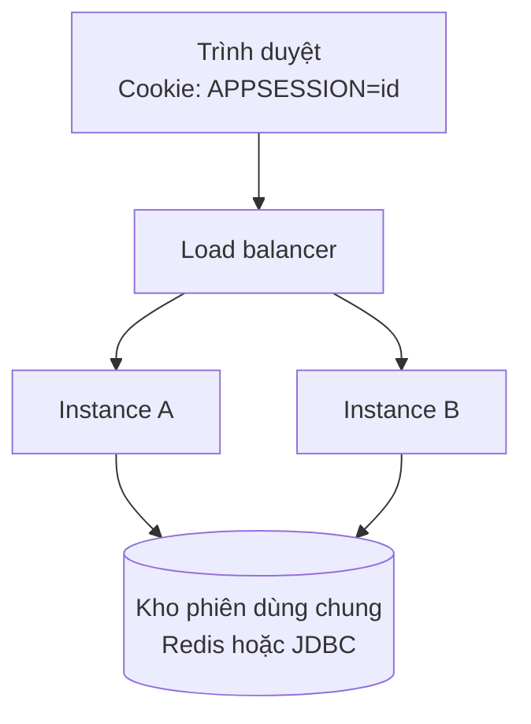

# Cookie chứa định danh phiên và dữ liệu phiên lưu ở phía máy chủ

Trong ứng dụng Servlet dùng Spring Session, trình duyệt thường chỉ giữ một **mã định danh phiên (session ID)** trong cookie. Dữ liệu của phiên, chẳng hạn thông tin giỏ hàng hoặc trạng thái đăng nhập, được lưu ở phía máy chủ trong một kho dữ liệu như Redis hoặc JDBC. Mỗi request mang cookie đến máy chủ; Spring Session dùng mã định danh đó để tìm lại phiên và cung cấp phiên cho ứng dụng thông qua API `HttpSession` quen thuộc.

Đây là điểm cốt lõi giúp nhiều instance của cùng một ứng dụng có thể phục vụ một người dùng: các instance cùng đọc và ghi vào kho phiên dùng chung. Trình duyệt không cần biết phiên đang nằm trên instance nào.

## 1. Phân biệt cookie và dữ liệu phiên

Cookie là một mẩu dữ liệu nhỏ do trình duyệt lưu và gửi lại theo các quy tắc về domain, path, thời hạn, HTTPS và SameSite. Trong mô hình Spring Session phổ biến, cookie chứa một giá trị định danh opaque, ví dụ:

```http
Set-Cookie: APPSESSION=7f3a...; Path=/; HttpOnly; Secure; SameSite=Lax
```

Giá trị `7f3a...` là ví dụ minh họa, không phải dữ liệu người dùng. Trình duyệt gửi lại cặp tên và giá trị trong header của request:

```http
Cookie: APPSESSION=7f3a...
```

Các thuộc tính như `Path`, `HttpOnly`, `Secure` và `SameSite` là chỉ dẫn trình duyệt nhận từ `Set-Cookie`; trình duyệt không gửi lại các thuộc tính đó trong header `Cookie`.

Phía máy chủ lưu dữ liệu gắn với mã định danh này. Ví dụ, một phiên có thể chứa:

| Thành phần | Ví dụ | Nơi lưu |
|---|---|---|
| Mã định danh phiên | `7f3a...` | Cookie của trình duyệt và khóa tra cứu phía máy chủ |
| Thuộc tính phiên | `cartId`, `locale`, một phần trạng thái xác thực | Redis hoặc cơ sở dữ liệu JDBC |
| Thời điểm truy cập gần nhất | Thời điểm request gần nhất sử dụng phiên | Metadata của phiên phía máy chủ |
| Thời gian không hoạt động tối đa | 30 phút | Cấu hình và metadata/TTL phía máy chủ |

Cookie không phải nơi lưu giỏ hàng, hồ sơ người dùng hay toàn bộ đối tượng `HttpSession`. Nhờ đó, dữ liệu phiên không phải gửi qua lại đầy đủ trong mỗi request và ứng dụng có thể thu hồi phiên bằng cách xóa hoặc vô hiệu hóa bản ghi phía máy chủ.

Mã định danh phiên phải được xem như một thông tin xác thực dạng bearer: ai sở hữu mã hợp lệ có thể được máy chủ nhận diện là cùng phiên. Vì vậy, mã cần khó đoán, không nên ghi vào log hoặc URL, và phải được bảo vệ bằng HTTPS cùng các thuộc tính cookie phù hợp.

## 2. Vòng đời của một request có phiên

Spring Session tích hợp với ứng dụng Servlet bằng `SessionRepositoryFilter`. Filter này thay thế cách truy cập phiên mặc định của Servlet container bằng một `HttpSession` được quản lý bởi `SessionRepository`. Trong Spring Boot, filter và repository có thể được cấu hình tự động khi các dependency phù hợp có mặt; ứng dụng cấu hình thủ công có thể bật cấu hình Spring Session tương ứng.

Luồng xử lý cơ bản:

```mermaid
sequenceDiagram
    participant B as Trình duyệt
    participant F as SessionRepositoryFilter
    participant A as Ứng dụng Servlet
    participant R as SessionRepository
    participant S as Redis hoặc JDBC
    B->>F: Request có Cookie: APPSESSION=id
    F->>R: Tìm phiên theo id
    R->>S: Đọc dữ liệu phiên
    S-->>R: Bản ghi phiên và thuộc tính
    R-->>F: Phiên được khôi phục
    F->>A: Cung cấp HttpSession cho request
    A->>A: Đọc hoặc cập nhật thuộc tính phiên
    A-->>F: Kết thúc xử lý request
    F->>R: Lưu thay đổi và cập nhật thời hạn
    R->>S: Ghi dữ liệu phiên
    F-->>B: Response; có thể đặt hoặc cập nhật cookie
```

Một request mới chưa có cookie thường chưa cần tạo phiên. Phiên chỉ được tạo khi ứng dụng hoặc một thành phần như Spring Security yêu cầu, chẳng hạn gọi `request.getSession()` hoặc `request.getSession(true)`. Khi cần kiểm tra phiên mà không muốn tạo mới, dùng `request.getSession(false)`.

Ví dụ Servlet:

```java
@PostMapping("/cart/session")
public void rememberCart(HttpServletRequest request,
                         @RequestParam String cartId) {
    HttpSession session = request.getSession(true);
    session.setAttribute("cartId", cartId);
}

@GetMapping("/cart/session")
public String currentCart(HttpServletRequest request) {
    HttpSession session = request.getSession(false);
    if (session == null) {
        return "no-session";
    }

    Object cartId = session.getAttribute("cartId");
    return cartId == null ? "no-cart" : cartId.toString();
}
```

Ứng dụng tiếp tục dùng `HttpSession` và các phương thức như `setAttribute`, `getAttribute`, `removeAttribute` hoặc `invalidate`. Spring Session đảm nhiệm việc ánh xạ phiên đó vào repository. Không nên tự đọc cookie rồi tự truy vấn Redis trong từng controller; cách đó bỏ qua cơ chế chuẩn hóa phiên, lưu thay đổi và vô hiệu hóa phiên của framework.

## 3. Cấu hình Spring Session với kho dữ liệu dùng chung

### Redis

Với Gradle và Spring Boot dependency management, một ứng dụng có thể khai báo các dependency sau:

```groovy
dependencies {
    implementation("org.springframework.boot:spring-boot-starter-data-redis")
    implementation("org.springframework.session:spring-session-data-redis")
}
```

Spring Boot có thể tự cấu hình repository Redis cho Spring Session tùy phiên bản và điều kiện classpath. Với cấu hình Servlet tường minh, có thể bật Redis repository như sau:

```java
@Configuration
@EnableRedisHttpSession(maxInactiveIntervalInSeconds = 1800)
public class SessionConfiguration {
}
```

Ví dụ này đặt thời gian không hoạt động tối đa mặc định là 1.800 giây, tức 30 phút. Ứng dụng cũng cần có `RedisConnectionFactory` hợp lệ; trong Spring Boot, factory thường được tạo từ cấu hình kết nối Redis của ứng dụng.

Redis phù hợp khi cần truy cập phiên nhanh và chia sẻ trạng thái giữa nhiều instance. Cần cấu hình kết nối, xác thực, TLS nếu hạ tầng yêu cầu, giới hạn connection pool, chính sách bộ nhớ và cơ chế dự phòng cho Redis. Dữ liệu phiên nên nhỏ gọn. Nếu lưu object Java, serializer phải tương thích giữa các instance và giữa các lần triển khai; thay đổi class hoặc phiên bản ứng dụng có thể làm dữ liệu cũ không deserialize được. Ưu tiên lưu các giá trị nhỏ, có cấu trúc ổn định và tránh đặt các object lớn hoặc vòng tham chiếu phức tạp vào session.

### JDBC

Nếu muốn lưu phiên trong cơ sở dữ liệu quan hệ, dùng module Spring Session JDBC cùng `DataSource`:

```groovy
dependencies {
    implementation("org.springframework.boot:spring-boot-starter-jdbc")
    implementation("org.springframework.session:spring-session-jdbc")
}
```

Trong cấu hình thủ công, bật repository JDBC:

```java
@Configuration
@EnableJdbcHttpSession(maxInactiveIntervalInSeconds = 1800)
public class SessionConfiguration {
}
```

Spring Session JDBC sử dụng các bảng lưu phiên và thuộc tính phiên, thường có tên `SPRING_SESSION` và `SPRING_SESSION_ATTRIBUTES` theo schema mặc định. Phải áp dụng schema tương ứng với hệ quản trị cơ sở dữ liệu đang dùng; trong môi trường production, nên quản lý thay đổi schema bằng công cụ migration của dự án. Cần theo dõi index, dung lượng bảng và việc dọn các phiên hết hạn.

Chỉ bật một cơ chế cấu hình repository phù hợp với cách ứng dụng đang dùng. Khi Spring Boot đã tự cấu hình Spring Session, không thêm cấu hình thủ công trùng lặp nếu không có chủ đích rõ ràng. Các instance của cùng một ứng dụng phải dùng chung kho dữ liệu và cấu hình tương thích.

## 4. Cấu hình cookie chứa session ID

Spring Session cung cấp `CookieHttpSessionIdResolver` và `DefaultCookieSerializer` để chuyển mã định danh phiên thành cookie. Cookie mặc định thường có tên `SESSION`; ứng dụng có thể đổi tên và thiết lập thuộc tính cookie bằng một bean `CookieSerializer`:

```java
import org.springframework.context.annotation.Bean;
import org.springframework.context.annotation.Configuration;
import org.springframework.session.web.http.CookieSerializer;
import org.springframework.session.web.http.DefaultCookieSerializer;

@Configuration
public class SessionCookieConfiguration {

    @Bean
    CookieSerializer cookieSerializer() {
        DefaultCookieSerializer serializer = new DefaultCookieSerializer();
        serializer.setCookieName("APPSESSION");
        serializer.setCookiePath("/");
        serializer.setUseHttpOnlyCookie(true);
        serializer.setUseSecureCookie(true);
        serializer.setSameSite("Lax");
        return serializer;
    }
}
```

Các thuộc tính cần lựa chọn theo cách ứng dụng được truy cập:

| Thuộc tính | Tác dụng | Lưu ý cấu hình |
|---|---|---|
| `Name` | Tên cookie chứa session ID | Có thể dùng tên riêng để tránh nhầm với cookie của ứng dụng khác |
| `Path` | Giới hạn đường dẫn mà trình duyệt gửi cookie | `/` phù hợp khi toàn bộ ứng dụng dùng chung phiên |
| `Domain` | Giới hạn host hoặc miền nhận cookie | Chỉ đặt khi thực sự cần chia sẻ giữa các subdomain; tránh mở rộng miền quá mức |
| `HttpOnly` | Ngăn JavaScript phía trình duyệt đọc cookie qua API như `document.cookie` | Nên bật để giảm khả năng mã script đánh cắp session ID |
| `Secure` | Chỉ gửi cookie qua kết nối HTTPS | Bật trong production; nếu bật mà truy cập bằng HTTP, trình duyệt sẽ không gửi cookie |
| `SameSite` | Kiểm soát việc gửi cookie trong ngữ cảnh request cùng site hoặc khác site | `Lax` thường phù hợp với ứng dụng web thông thường; `Strict` chặt hơn; `None` dùng cho một số luồng cross-site và phải đi cùng `Secure` trên trình duyệt hiện đại |

Không nên chọn `SameSite=None` chỉ để xử lý lỗi đăng nhập khi chưa xác định luồng request. Nếu frontend và backend ở các site khác nhau, cần xem xét đồng thời SameSite, HTTPS, CORS, `allowCredentials` và chính sách gửi credentials của trình duyệt.

Nếu ứng dụng chạy sau reverse proxy hoặc load balancer kết thúc TLS, hãy cấu hình proxy và cơ chế forwarded headers để ứng dụng nhận biết đúng request gốc là HTTPS. Nếu ứng dụng hiểu nhầm request là HTTP, việc tạo cookie `Secure` hoặc tạo URL chuyển hướng có thể không đúng như mong đợi.

## 5. Thời hạn cookie và thời hạn phiên là hai việc khác nhau

Có hai đồng hồ cần phân biệt:

1. **Thời hạn cookie ở trình duyệt** được điều khiển bằng `Max-Age` hoặc `Expires`. Nếu không đặt thời hạn, cookie thường là session cookie của trình duyệt và có thể bị xóa khi phiên làm việc của trình duyệt kết thúc.
2. **Thời hạn phiên ở máy chủ** được điều khiển bởi `maxInactiveInterval` của Spring Session hoặc cấu hình tương ứng. Khi phiên không được sử dụng trong khoảng thời gian này, repository có thể hết hạn và loại bỏ dữ liệu phiên.

Ví dụ `@EnableRedisHttpSession(maxInactiveIntervalInSeconds = 1800)` đặt thời hạn không hoạt động của phiên ở phía máy chủ là 30 phút. Một request hợp lệ sử dụng phiên có thể cập nhật thời điểm truy cập và làm mới TTL theo repository. Nếu cookie ở trình duyệt vẫn còn nhưng phiên phía máy chủ đã hết hạn, request tiếp theo không thể khôi phục phiên cũ; ứng dụng thường xem đó là chưa có phiên và có thể tạo phiên mới khi cần.

Ngược lại, khi trình duyệt xóa session cookie, dữ liệu phiên ở Redis hoặc JDBC không nhất thiết bị xóa ngay tại thời điểm đó. Bản ghi sẽ được dọn theo TTL hoặc cơ chế cleanup của repository. Vì vậy, không dùng việc đóng tab hay đóng trình duyệt làm cơ chế đăng xuất bảo đảm.

Nếu muốn cookie tồn tại sau khi đóng trình duyệt, có thể cấu hình cookie max age, nhưng giá trị này phải được cân nhắc cùng thời hạn phiên phía máy chủ. Cookie còn hạn không có nghĩa dữ liệu phiên còn tồn tại. Cũng không nên đặt cookie tồn tại lâu hơn mức cần thiết vì cookie giữ session ID có thể bị lộ hoặc bị dùng lại trên thiết bị khác.

## 6. Vì sao mô hình này hoạt động trên nhiều instance

Giả sử load balancer phân phối request luân phiên đến hai instance:



Instance A nhận session ID, đọc phiên từ kho chung và lưu thay đổi vào đó. Request kế tiếp có thể đến instance B; B nhận cùng cookie, đọc cùng bản ghi phiên và tiếp tục xử lý. Dữ liệu phiên không phụ thuộc bộ nhớ heap của instance A nên không mất chỉ vì load balancer chuyển request sang B hoặc instance A được khởi động lại.

Để luồng này hoạt động ổn định, mọi instance cần thống nhất:

- Cùng kho phiên, cùng database/schema hoặc cùng Redis deployment.
- Cùng cookie name, path, domain và các thuộc tính ảnh hưởng đến việc trình duyệt gửi cookie.
- Cùng cách cấu hình repository, namespace và serializer.
- Các class dùng để deserialize session attribute phải tương thích giữa các phiên bản instance đang chạy đồng thời.
- Đồng hồ hệ thống và cấu hình timeout phải được quản lý nhất quán.

Sticky session ở load balancer có thể được dùng như một tối ưu riêng, nhưng không thay thế kho phiên dùng chung. Nếu mỗi instance lưu phiên trong bộ nhớ cục bộ, việc chuyển request sang instance khác vẫn có thể khiến người dùng bị xem như chưa đăng nhập.

## 7. Đăng nhập, đổi session ID và đăng xuất

Session ID là chìa khóa truy cập phiên. Nếu kẻ tấn công lấy được cookie hợp lệ, họ có thể thử sử dụng phiên đó. Vì vậy:

- Chỉ truyền cookie qua HTTPS trong production và bật `Secure`.
- Bật `HttpOnly`; chọn `SameSite` phù hợp với luồng xác thực.
- Không đưa session ID vào query string, log, analytics hoặc thông báo lỗi.
- Sau khi xác thực người dùng, cần có bảo vệ session fixation: đổi session ID để một ID do phía trước đăng nhập biết không tiếp tục đại diện cho phiên đã xác thực. Spring Security cung cấp cơ chế bảo vệ session fixation trong luồng xác thực; không vô hiệu hóa cơ chế này nếu chưa có lý do và kiểm thử phù hợp.
- Khi đăng xuất, phải vô hiệu hóa phiên phía máy chủ. Với Servlet API, thao tác cơ bản là `session.invalidate()`; nếu dùng Spring Security, nên đi qua logout flow đã cấu hình để xóa `SecurityContext` và thực hiện các logout handler.

Khi dùng cookie tùy chỉnh, hãy kiểm tra response đăng xuất đã làm trình duyệt xóa đúng cookie theo cùng tên, path và domain. Nếu chỉ xóa cookie ở trình duyệt mà không vô hiệu hóa bản ghi phía máy chủ, một bản sao cookie bị đánh cắp vẫn có thể truy cập phiên cho đến khi phiên hết hạn. Ngược lại, nếu chỉ xóa bản ghi mà cookie còn trên trình duyệt, request sau sẽ mang một ID không còn hợp lệ; máy chủ cần xử lý trường hợp này bình thường.

## 8. Sự kiện vòng đời phiên

Spring Session có các sự kiện như `SessionCreatedEvent`, `SessionDeletedEvent` và `SessionExpiredEvent`. Ứng dụng có thể lắng nghe để cập nhật trạng thái phụ trợ, ghi nhận số liệu hoặc thu hồi tài nguyên liên quan:

```java
@Component
public class SessionLifecycleListener {

    @EventListener
    public void onSessionCreated(SessionCreatedEvent event) {
        // Ghi nhận số phiên được tạo; không ghi session ID vào log công khai.
    }

    @EventListener
    public void onSessionExpired(SessionExpiredEvent event) {
        // Dọn tài nguyên phụ trợ gắn với phiên nếu nghiệp vụ yêu cầu.
    }
}
```

Khả năng và thời điểm phát sự kiện phụ thuộc repository. Với Redis, việc nhận biết hết hạn dựa trên cơ chế thông báo hết hạn/keyspace notification của Redis và cấu hình tương ứng. Với JDBC, việc phát hiện và dọn phiên hết hạn gắn với cơ chế cleanup của Spring Session. Không nên xem một event listener là sổ kiểm toán duy nhất hoặc giả định mọi sự kiện luôn được xử lý đúng một lần. Handler nên idempotent, chịu được retry và không làm request chính phụ thuộc vào tác vụ phụ kéo dài.

## 9. Kiểm thử cookie và khả năng chia sẻ phiên

Một bài kiểm thử chỉ gọi controller và xác nhận `HttpSession` có thuộc tính là chưa đủ để chứng minh cấu hình cookie và kho phiên hoạt động đúng. Nên kiểm tra theo từng lớp:

1. **Kiểm tra response tạo phiên:** gửi request tạo phiên và xác nhận response có `Set-Cookie` với đúng tên cookie cùng các thuộc tính bảo mật mong muốn.
2. **Kiểm tra khôi phục phiên:** gửi request tiếp theo kèm cookie nhận được và xác nhận ứng dụng đọc lại được thuộc tính đã lưu.
3. **Kiểm tra lưu phiên qua request:** cập nhật một thuộc tính trong request đầu, đọc nó ở request sau và xác nhận thay đổi đã được lưu.
4. **Kiểm tra hết hạn:** cấu hình TTL ngắn trong môi trường test, chờ phiên hết hạn theo cơ chế đồng bộ phù hợp rồi xác nhận phiên cũ không còn được khôi phục.
5. **Kiểm tra đăng xuất:** đăng xuất, sau đó gửi lại cookie cũ và xác nhận phiên đã bị vô hiệu hóa.
6. **Kiểm tra nhiều instance:** chạy hai ứng dụng hoặc hai application context cùng kết nối một Redis/database; tạo phiên qua instance A rồi dùng đúng cookie đó gọi instance B. B phải đọc được dữ liệu đã lưu.
7. **Kiểm tra đồng thời:** gửi nhiều request cùng sử dụng một phiên để phát hiện cập nhật bị ghi đè hoặc trạng thái nghiệp vụ không nhất quán.

Ví dụ với MockMvc có thể lấy cookie từ response đầu tiên rồi gửi lại trong request kế tiếp:

```java
MvcResult created = mockMvc.perform(post("/cart/session")
        .param("cartId", "cart-123"))
    .andReturn();

Cookie sessionCookie = created.getResponse().getCookie("APPSESSION");

mockMvc.perform(get("/cart/session").cookie(sessionCookie))
    .andExpect(status().isOk())
    .andExpect(content().string("cart-123"));
```

Test này hữu ích để kiểm tra luồng HTTP và cookie trong cấu hình test. Để chứng minh dữ liệu thực sự nằm trong kho chia sẻ, cần integration test dùng Redis hoặc database thật cho test, rồi gửi request qua hai instance có repository dùng chung. `MockHttpSession` tự tạo trong bộ nhớ không chứng minh được khả năng khôi phục phiên giữa các instance.

Với request đồng thời, lưu ý hai request có thể cùng đọc một trạng thái rồi cùng cập nhật. Ví dụ, hai request cùng đọc số lượng giỏ hàng là 2, mỗi request tăng lên 3 và cùng ghi lại; kết quả có thể không phản ánh hai lần tăng. Spring Session lưu trữ phiên, nhưng không biến mọi thao tác read-modify-write trên thuộc tính thành giao dịch nghiệp vụ nguyên tử. Với dữ liệu cần cập nhật chính xác, hãy dùng thao tác nguyên tử hoặc transaction ở tầng lưu trữ nghiệp vụ, khóa phù hợp, hoặc thiết kế cập nhật có kiểm soát phiên bản. Tránh sửa một object mutable lớn trong session từ nhiều request đồng thời.

## 10. Chẩn đoán lỗi thường gặp

| Triệu chứng | Nguyên nhân có thể | Hướng kiểm tra |
|---|---|---|
| Request nào cũng tạo phiên mới | Cookie không được gửi, sai tên/path/domain, cookie `Secure` nhưng đang truy cập HTTP, hoặc SameSite chặn request | Xem `Set-Cookie` và `Cookie` trong Network tab; kiểm tra HTTPS và thuộc tính cookie |
| Cookie được gửi nhưng ứng dụng không khôi phục phiên | ID không còn trong repository, các instance dùng namespace hoặc kho dữ liệu khác nhau, serializer không tương thích | Kiểm tra repository, namespace, TTL, log kết nối và lỗi deserialize |
| Đăng nhập thành công ở instance A nhưng thất bại ở B | Phiên chỉ nằm trong bộ nhớ cục bộ hoặc A và B không dùng cùng Redis/database | Kiểm tra cấu hình kết nối và chạy bài test hai instance |
| Người dùng bị đăng xuất quá sớm | TTL phía máy chủ quá ngắn, cookie bị xóa, request không gửi cookie hoặc cấu hình proxy làm sai nhận diện HTTPS | So sánh thời hạn cookie với `maxInactiveInterval`; kiểm tra request thực tế và proxy headers |
| Đăng xuất xong vẫn còn trạng thái đăng nhập | Phiên chưa bị invalidate, logout handler chưa chạy, hoặc cookie cũ chưa bị xóa đúng path/domain | Kiểm tra bản ghi phiên, logout flow và response xóa cookie |
| Không nhận được sự kiện hết hạn Redis | Keyspace notifications hoặc listener của Spring Session chưa được cấu hình đúng | Kiểm tra cấu hình Redis và tài liệu phiên bản Spring Session đang dùng |
| JDBC báo lỗi bảng hoặc truy vấn chậm | Schema chưa được áp dụng, schema sai hệ quản trị, thiếu index hoặc bảng cleanup tăng quá lớn | Kiểm tra migration, schema, index và số lượng phiên hết hạn |
| Lỗi deserialize sau khi triển khai phiên bản mới | Các instance hoặc phiên còn tồn tại dùng class/serial form không tương thích | Giữ kiểu dữ liệu session ổn định, có kế hoạch chuyển đổi hoặc làm hết hạn phiên cũ khi cần |

Khi điều tra, không sao chép giá trị session ID thật vào ticket hoặc log. Có thể ghi nhận tên cookie, trạng thái có/không có cookie, thời điểm, instance xử lý và mã tương quan request để đối chiếu an toàn.

## 11. Các nguyên tắc cần giữ khi vận hành

- Xem session ID như credential: bảo vệ bằng HTTPS, `HttpOnly`, `Secure` và `SameSite` phù hợp.
- Chỉ lưu lượng dữ liệu cần thiết trong phiên; dữ liệu nghiệp vụ quan trọng vẫn nên thuộc kho dữ liệu nghiệp vụ có transaction và quy tắc nhất quán riêng.
- Đặt TTL phía máy chủ theo yêu cầu bảo mật và trải nghiệm; không nhầm TTL đó với thời hạn cookie.
- Dùng một repository dùng chung cho mọi instance và triển khai cấu hình cookie/serializer đồng nhất.
- Theo dõi số phiên, kích thước dữ liệu, tỷ lệ lỗi đọc/ghi, kết nối Redis/JDBC, thời gian truy vấn và số phiên hết hạn chưa được dọn.
- Thiết kế ứng dụng để xử lý phiên không tồn tại hoặc đã hết hạn: yêu cầu đăng nhập lại hoặc tạo phiên mới theo nghiệp vụ.
- Kiểm thử logout, session fixation, TTL, request đồng thời và chuyển request giữa các instance trước khi đưa cấu hình vào production.

Khi đọc một request có cookie `APPSESSION`, hãy hiểu cookie đó là chìa khóa để tìm phiên. Nội dung phiên được Spring Session khôi phục từ Redis hoặc JDBC, cung cấp cho ứng dụng qua `HttpSession`, rồi lưu lại các thay đổi khi request kết thúc. Cách phân chia này giúp trạng thái phiên tồn tại độc lập với vòng đời của một instance ứng dụng và cho phép nhiều máy chủ cùng phục vụ một người dùng.
