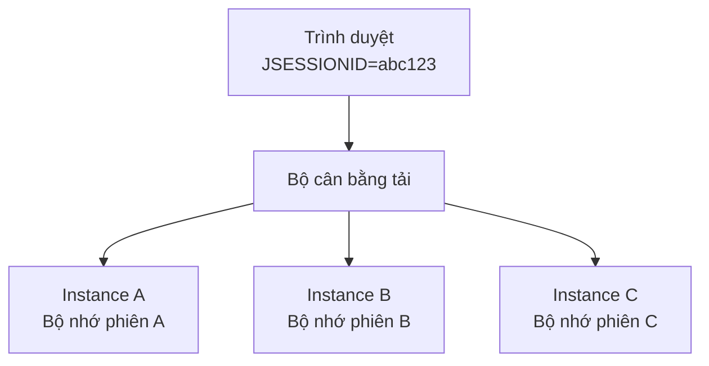
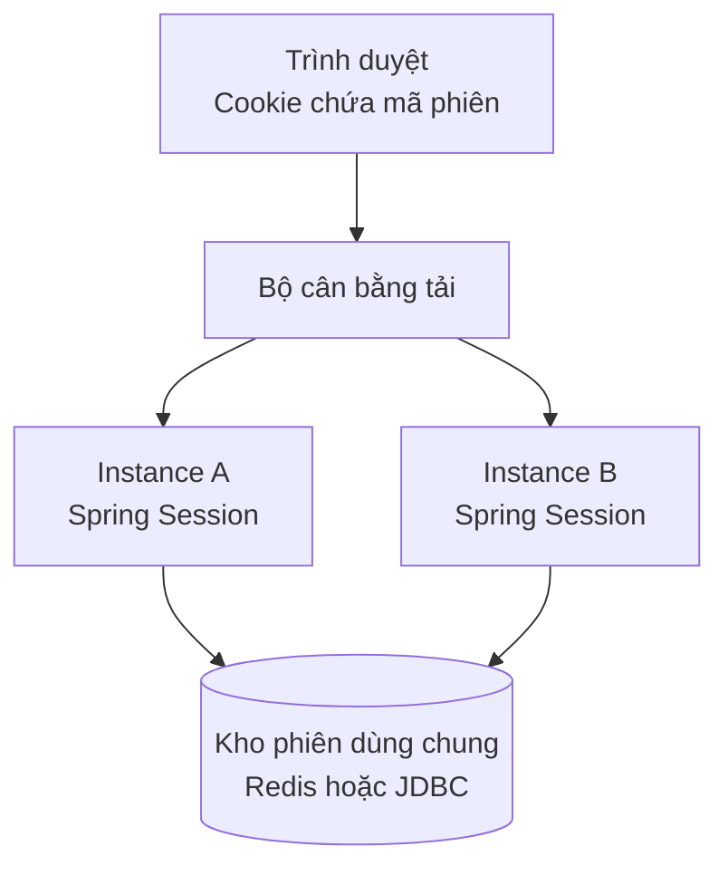

# Giới hạn của phiên trong bộ nhớ khi ứng dụng có nhiều bản chạy

Khi một ứng dụng Spring MVC hoặc Servlet chỉ chạy trên một máy chủ, việc lưu `HttpSession` trong bộ nhớ của tiến trình thường hoạt động tốt. Người dùng gửi cookie chứa mã phiên; máy chủ dùng mã đó để tìm dữ liệu phiên trong bộ nhớ và khôi phục trạng thái đăng nhập, giỏ hàng hoặc các thông tin tạm thời khác.

Vấn đề xuất hiện khi ứng dụng được chạy thành nhiều bản (instance) phía sau bộ cân bằng tải. Mỗi instance là một tiến trình riêng, thường chạy trong một JVM và có vùng nhớ riêng. Phiên được tạo trong bộ nhớ của instance A không tự động xuất hiện trong bộ nhớ của instance B. Đây là giới hạn cốt lõi mà Spring Session giải quyết bằng cách đưa dữ liệu phiên vào một kho lưu trữ có thể được nhiều instance cùng truy cập, chẳng hạn Redis hoặc cơ sở dữ liệu quan hệ.

## 1. `HttpSession` trong một instance

Trong mô hình Servlet thông thường, container như Tomcat quản lý `HttpSession`. Khi ứng dụng gọi `request.getSession()`, container tìm phiên tương ứng với mã phiên trong cookie. Nếu chưa có phiên phù hợp và lời gọi cho phép tạo mới, container tạo một phiên và lưu các thuộc tính của phiên trong bộ nhớ của tiến trình.

Trình duyệt thường chỉ giữ một mã định danh phiên trong cookie, ví dụ `JSESSIONID`. Cookie không mang toàn bộ dữ liệu đăng nhập hay giỏ hàng. Mã phiên giúp máy chủ tìm dữ liệu tương ứng ở phía server.

Với một instance, luồng xử lý có thể hình dung như sau:

```text
Trình duyệt
    |
    | Cookie: JSESSIONID=abc123
    v
Ứng dụng / Tomcat
    |
    | Tra cứu abc123
    v
Bộ nhớ của instance
    |
    +-- userId = 42
    +-- cartId = CART-908
    +-- lastVisited = /checkout
```

Trong phạm vi một tiến trình, container có thể tìm thấy phiên, cập nhật thuộc tính và áp dụng thời gian hết hạn. Cách làm này đơn giản, có độ trễ thấp và không cần một dịch vụ lưu trữ riêng. Tuy nhiên, dữ liệu chỉ tồn tại trong phạm vi instance đang giữ nó.

## 2. Điều gì xảy ra khi có nhiều instance?

Một hệ thống mở rộng ngang thường có bộ cân bằng tải phân phối yêu cầu đến nhiều instance. Mỗi instance có bộ nhớ riêng:



Giả sử người dùng đăng nhập và yêu cầu đầu tiên được chuyển đến instance A. A tạo phiên `abc123` và lưu `userId=42` trong bộ nhớ của nó. Yêu cầu tiếp theo mang cùng cookie nhưng được chuyển đến B. B nhận được mã `abc123`, song bộ nhớ của B không có dữ liệu phiên mà A đã tạo.

| Thời điểm | Instance nhận yêu cầu | Kết quả khi chỉ lưu phiên trong bộ nhớ cục bộ |
|---|---|---|
| Đăng nhập | A | A tạo phiên và lưu `userId=42` |
| Mở trang tài khoản | B | B không tìm thấy phiên của A; ứng dụng có thể xem yêu cầu là chưa đăng nhập hoặc tạo phiên mới |
| Mở giỏ hàng | C | C cũng không có dữ liệu giỏ hàng đã lưu ở A |

Trình duyệt vẫn gửi cùng mã cookie, nhưng mã đó không giúp B hoặc C đọc được vùng nhớ của A. Tùy cách ứng dụng kiểm tra phiên, người dùng có thể bị yêu cầu đăng nhập lại, thấy giỏ hàng trống hoặc mất trạng thái của quy trình đang thực hiện.

Đây không phải lỗi của cookie hay của bộ cân bằng tải. Nguyên nhân là dữ liệu phiên bị gắn với một tiến trình cụ thể trong khi các yêu cầu của cùng người dùng có thể đi đến nhiều tiến trình khác nhau.

## 3. Các giới hạn chính của phiên lưu trong bộ nhớ

### 3.1. Phiên không được chia sẻ giữa các instance

Mỗi instance chỉ biết các phiên mà chính nó đã tạo hoặc nhận được bằng một cơ chế đồng bộ riêng. Nếu không có cơ chế chia sẻ, instance khác không thể tra cứu, cập nhật hoặc xóa phiên đó.

Hệ quả dễ thấy nhất là trạng thái người dùng không ổn định khi bộ cân bằng tải chuyển yêu cầu sang instance khác. Một số yêu cầu có thể thành công, yêu cầu tiếp theo lại bị xem như chưa đăng nhập. Lỗi thường khó tái hiện nếu thử nghiệm chỉ chạy một instance hoặc nếu bộ cân bằng tải tình cờ gửi liên tiếp các yêu cầu đến cùng một máy chủ.

### 3.2. Phụ thuộc vào phiên gắn máy chủ (sticky session)

Một cách khắc phục tạm thời là cấu hình bộ cân bằng tải giữ các yêu cầu của cùng một client trên cùng một instance. Cơ chế này thường được gọi là *sticky session* hoặc *session affinity*.

Sticky session giúp giảm khả năng yêu cầu bị chuyển sang instance không có dữ liệu phiên. Tuy nhiên, nó chỉ duy trì định tuyến; nó không biến bộ nhớ cục bộ thành kho phiên dùng chung.

- Nếu instance đang giữ phiên bị dừng, khởi động lại hoặc gặp sự cố, dữ liệu phiên trong bộ nhớ của nó có thể mất. Yêu cầu được chuyển sang instance khác vẫn không tìm thấy phiên.
- Khi triển khai phiên bản mới, thay đổi số lượng instance hoặc cân bằng lại tải, định tuyến có thể thay đổi và người dùng có thể mất phiên.
- Một instance có nhiều người dùng bị ghim vào có thể chịu tải cao hơn các instance khác, làm giảm hiệu quả phân phối tải.
- Công việc nền hoặc yêu cầu nội bộ chạy trên instance khác vẫn không thể truy cập phiên cục bộ nếu không có cơ chế chia sẻ.

Vì vậy, sticky session có thể phù hợp như một giải pháp chuyển tiếp hoặc cho hệ thống nhỏ có giới hạn vận hành rõ ràng. Nó không thay thế được kho phiên dùng chung khi cần khả năng mở rộng và chịu lỗi.

### 3.3. Mất phiên khi tiến trình hoặc máy chủ dừng

Bộ nhớ của một JVM thường không tồn tại sau khi tiến trình kết thúc. Nếu instance khởi động lại, bị thay thế trong quá trình triển khai hoặc bị hệ thống điều phối container thu hồi, các phiên chỉ nằm trong bộ nhớ của instance đó có thể biến mất.

Điều này làm cho việc triển khai, tự động mở rộng và phục hồi sau sự cố ảnh hưởng trực tiếp đến trải nghiệm người dùng. Nếu hệ thống cần duy trì trạng thái đăng nhập qua những lần thay thế instance, dữ liệu phiên phải được lưu ở nơi tồn tại độc lập với vòng đời của từng instance.

### 3.4. Không có một trạng thái chung cho đăng nhập và đăng xuất

Giả sử người dùng đăng xuất khi yêu cầu được xử lý bởi A. A xóa phiên khỏi bộ nhớ của mình, nhưng B vẫn có thể giữ dữ liệu phiên cũ nếu trước đó B đã nhận một bản sao hoặc có cơ chế lưu cục bộ riêng. Ngược lại, nếu A cập nhật quyền hoặc thông tin phiên, các instance khác không tự động nhận được thay đổi đó.

Khi trạng thái phiên không được chia sẻ hoặc đồng bộ đúng cách, việc thu hồi phiên, buộc đăng nhập lại, vô hiệu hóa phiên khi đổi mật khẩu và xử lý nhiều thiết bị trở nên phức tạp. Mỗi instance có thể đưa ra quyết định dựa trên một trạng thái khác nhau.

### 3.5. Khả năng mở rộng bị giới hạn bởi RAM của từng instance

Các phiên chiếm bộ nhớ heap của ứng dụng. Khi số lượng người dùng đồng thời tăng, tổng dung lượng dành cho phiên cũng tăng. Nếu một instance giữ nhiều phiên hơn các instance khác, áp lực bộ nhớ sẽ phân bố không đều.

Khi heap gần đầy, garbage collection có thể diễn ra thường xuyên hơn, làm tăng độ trễ. Nếu không đủ bộ nhớ, tiến trình có thể gặp `OutOfMemoryError` và dừng. Tăng số lượng instance có thể phân tán tải, nhưng cũng làm dữ liệu phiên bị chia thành nhiều vùng nhớ độc lập hơn.

### 3.6. Khó quản lý thời hạn và vòng đời phiên trên toàn hệ thống

Mỗi instance có thể tự quản lý thời gian không hoạt động và dọn dẹp phiên của nó. Khi không có kho chung, việc quan sát tổng số phiên, tìm phiên của một người dùng, xóa phiên từ một điểm quản trị hoặc áp dụng chính sách hết hạn thống nhất khó hơn.

Các phiên cũ có thể tiếp tục chiếm bộ nhớ nếu cấu hình timeout hoặc quá trình dọn dẹp không phù hợp. Ngược lại, timeout quá ngắn có thể làm người dùng bị đăng xuất khi họ vẫn đang làm việc. Quản lý vòng đời phiên cần được thiết kế như một chính sách chung của ứng dụng.

### 3.7. Khó kiểm thử hành vi thực tế của hệ thống phân tán

Kiểm thử với một instance thường không phát hiện được lỗi chia sẻ phiên. Kiểm thử nhiều instance cần xác nhận rằng cùng một mã phiên được đọc, cập nhật và vô hiệu hóa nhất quán khi các yêu cầu đi qua những instance khác nhau.

Các tình huống cần kiểm tra gồm: đăng nhập ở A rồi truy cập ở B; đăng xuất ở B rồi gửi yêu cầu đến A; khởi động lại một instance; hết hạn phiên; hai yêu cầu đồng thời cập nhật cùng phiên; và kho phiên tạm thời không truy cập được.

## 4. Những cách xử lý và giới hạn của chúng

| Cách xử lý | Tác dụng | Giới hạn cần cân nhắc |
|---|---|---|
| Sticky session | Giữ yêu cầu của client trên một instance | Mất phiên khi instance gặp sự cố; phân phối tải không đều; không chia sẻ trạng thái giữa các node |
| Sao chép phiên ở tầng container | Đồng bộ phiên giữa các máy chủ theo khả năng của container | Cần cấu hình cluster, truyền dữ liệu và tương thích serialization; vận hành phụ thuộc nền tảng |
| Kho phiên dùng chung | Mọi instance đọc và ghi cùng một nguồn dữ liệu phiên | Cần vận hành, bảo mật, giám sát và thiết kế khả năng chịu lỗi cho kho lưu trữ |

Với ứng dụng Spring cần chạy trên nhiều instance, Spring Session cung cấp lớp quản lý phiên dùng chung. Ứng dụng tiếp tục làm việc với API Servlet `HttpSession`, còn dữ liệu phiên được lưu thông qua một repository bên ngoài tiến trình.

## 5. Spring Session giải quyết vấn đề như thế nào?

Spring Session thay thế cách lưu `HttpSession` mặc định của container bằng một lớp lọc Servlet và một kho lưu trữ phiên. `SessionRepositoryFilter` tích hợp vào chuỗi xử lý request/response, cung cấp cho ứng dụng một `HttpSession` được ánh xạ tới repository. Repository chịu trách nhiệm tải, lưu, cập nhật và xóa dữ liệu phiên.

Khi cấu hình nhiều instance dùng chung Redis hoặc JDBC, luồng xử lý có thể hình dung như sau:



Nếu yêu cầu đầu tiên đến A, A đọc hoặc tạo phiên trong kho dùng chung. Khi yêu cầu tiếp theo đến B với cùng mã phiên, B tra cứu cùng kho và lấy được dữ liệu tương ứng. Trạng thái phiên không còn phụ thuộc vào bộ nhớ của instance đã nhận yêu cầu trước đó.

Điểm quan trọng là tất cả instance phải dùng cùng một kho lưu trữ, cùng namespace và cấu hình tương thích. Chỉ thêm thư viện Spring Session mà không cấu hình repository dùng chung thì chưa giải quyết được việc chia sẻ phiên.

### 5.1. Redis

Redis thường được chọn khi cần truy cập phiên với độ trễ thấp và số lượng phiên lớn. Spring Session lưu dữ liệu phiên trong Redis, đồng thời có thể áp dụng thời hạn hết hạn cho từng phiên. Redis phù hợp với dữ liệu trạng thái ngắn hạn và có thể được triển khai theo mô hình riêng để nhiều instance ứng dụng cùng kết nối.

Đổi lại, hệ thống cần quản lý dung lượng bộ nhớ Redis, chính sách hết hạn và eviction, xác thực kết nối, mã hóa đường truyền, sao lưu hoặc khả năng phục hồi, giám sát độ trễ và tình trạng cluster. Nếu Redis không khả dụng, các request cần đọc hoặc ghi phiên có thể thất bại hoặc không thể tiếp tục theo luồng xác thực của ứng dụng.

### 5.2. JDBC

Spring Session cũng có thể lưu phiên trong cơ sở dữ liệu quan hệ. Cách này hữu ích khi tổ chức đã có hạ tầng cơ sở dữ liệu được quản lý tốt và muốn dùng chung nền tảng vận hành. Các instance cùng truy cập bảng phiên, nhờ đó có thể đọc và cập nhật trạng thái phiên qua nhiều máy chủ.

Cần tạo schema theo hướng dẫn của phiên bản Spring Session đang dùng, quản lý chỉ mục và tác vụ dọn dẹp phiên hết hạn. Lưu phiên trong cơ sở dữ liệu có thể làm tăng tải truy vấn và cạnh tranh tài nguyên với dữ liệu nghiệp vụ. Cần theo dõi thời gian truy vấn, số lượng bản ghi và tốc độ xóa dữ liệu hết hạn.

| Tiêu chí | Redis | JDBC |
|---|---|---|
| Đặc điểm thường gặp | Truy cập nhanh, phù hợp dữ liệu phiên ngắn hạn | Dùng hạ tầng cơ sở dữ liệu quan hệ sẵn có |
| Vận hành | Cần quản lý bộ nhớ, TTL, cluster và chính sách phục hồi | Cần quản lý schema, chỉ mục, truy vấn và dọn dẹp |
| Rủi ro tải | Áp lực lên bộ nhớ Redis và mạng | Tăng tải đọc/ghi lên cơ sở dữ liệu |
| Lựa chọn phù hợp | Khi ưu tiên độ trễ thấp và có hạ tầng Redis | Khi ưu tiên tích hợp với nền tảng JDBC hiện có |

## 6. Ví dụ cấu hình Spring Session với Redis

Ví dụ sau minh họa cách bật repository Redis trong một ứng dụng Spring Boot dùng Gradle Kotlin DSL. Hãy dùng phiên bản Spring Session tương thích với phiên bản Spring Boot của dự án; khi dự án dùng dependency management của Spring Boot, không cần tự chọn một phiên bản Spring Session không tương thích.

```kotlin
dependencies {
    implementation("org.springframework.boot:spring-boot-starter-data-redis")
    implementation("org.springframework.session:spring-session-data-redis")
}
```

Có thể bật cấu hình Servlet session bằng annotation:

```java
import org.springframework.context.annotation.Configuration;
import org.springframework.session.data.redis.config.annotation.web.http.EnableRedisHttpSession;

@Configuration
@EnableRedisHttpSession(maxInactiveIntervalInSeconds = 1800)
public class HttpSessionConfiguration {
}
```

Trong ví dụ này, thời gian không hoạt động tối đa của phiên là 30 phút. Cấu hình kết nối Redis có thể được đặt trong `application.yml`:

```yaml
spring:
  data:
    redis:
      host: redis.internal
      port: 6379
      timeout: 2s
```

Tên máy chủ, cổng, thông tin xác thực và cấu hình TLS phải khớp với môi trường triển khai. Mật khẩu hoặc khóa truy cập nên được cấp từ cơ chế quản lý secret của môi trường, không ghi trực tiếp vào mã nguồn. Với phiên bản Spring Boot có hỗ trợ tự cấu hình Spring Session, có thể dùng cơ chế auto-configuration theo tài liệu của phiên bản đó; cần chọn một cách cấu hình nhất quán để tránh khai báo trùng.

Sau khi cấu hình, mã nghiệp vụ vẫn có thể dùng `HttpSession`:

```java
@GetMapping("/profile")
public String profile(HttpSession session) {
    Long userId = (Long) session.getAttribute("userId");
    if (userId == null) {
        return "redirect:/login";
    }
    return "profile";
}
```

Đoạn mã trên minh họa cách đọc thuộc tính phiên. Khi request được xử lý ở instance khác, Spring Session dùng repository chung để lấy phiên có cùng mã định danh. Ứng dụng không cần tự gửi toàn bộ dữ liệu phiên giữa các instance.

## 7. Các vấn đề vẫn cần xử lý khi dùng kho phiên chung

Spring Session loại bỏ sự phụ thuộc vào bộ nhớ cục bộ của từng instance, nhưng không làm cho mọi vấn đề phân tán tự biến mất.

### 7.1. Kho phiên trở thành một thành phần quan trọng của hệ thống

Nếu Redis hoặc cơ sở dữ liệu không truy cập được, các thao tác cần đọc hoặc ghi phiên có thể bị lỗi. Cần cấu hình timeout và connection pool phù hợp, giám sát kết nối, độ trễ, dung lượng và lỗi truy cập. Với hệ thống yêu cầu tính sẵn sàng cao, kho phiên cần có phương án dự phòng và phục hồi phù hợp.

Không nên tự động cho phép mọi request đi tiếp như thể người dùng chưa đăng nhập khi kho phiên gặp lỗi. Hành vi đó có thể làm sai quyết định phân quyền. Ứng dụng cần xác định rõ chính sách lỗi: từ chối request cần phiên, trả lỗi phù hợp và ghi nhận sự cố để vận hành xử lý.

### 7.2. Kiểu dữ liệu lưu trong phiên và serialization

Thuộc tính phiên được lưu qua một ranh giới lưu trữ. Cấu hình serializer quyết định cách chuyển đổi dữ liệu thành dạng có thể lưu và khôi phục. Nếu dùng Java serialization, kiểu dữ liệu cần đáp ứng yêu cầu tương ứng; nếu dùng JSON, cấu trúc và tên kiểu cần ổn định theo cấu hình serializer.

Nên lưu các giá trị nhỏ, rõ ràng và có cấu trúc ổn định như mã người dùng, mã giỏ hàng hoặc một DTO đơn giản. Tránh lưu trực tiếp entity ORM lớn, đối tượng phụ thuộc vào tài nguyên đang mở, hoặc đối tượng chứa nhiều tham chiếu vòng. Khi triển khai phiên bản mới, cần tính đến khả năng đọc các phiên đã được phiên bản cũ ghi trước đó.

### 7.3. Yêu cầu đồng thời có thể cập nhật cùng một phiên

Một trình duyệt có thể gửi nhiều request gần như đồng thời, ví dụ tải trang và gọi API cập nhật thông báo. Hai request có thể cùng đọc trạng thái phiên rồi ghi lại các thay đổi theo thứ tự khác nhau. Không nên giả định rằng toàn bộ thao tác trên `HttpSession` được khóa như một giao dịch duy nhất giữa mọi instance.

Giữ dữ liệu phiên ở mức tối thiểu, tránh dùng nó làm nơi lưu trạng thái nghiệp vụ cần cập nhật đồng thời. Với dữ liệu cần tính nhất quán cao, hãy lưu ở tầng nghiệp vụ và dùng giao dịch, khóa hoặc thao tác nguyên tử phù hợp với kho dữ liệu đó. Khi cập nhật thuộc tính phiên, nên thay giá trị bằng đối tượng mới và gọi `setAttribute` rõ ràng thay vì chỉ sửa sâu một object mutable rồi kỳ vọng mọi cấu hình repository đều nhận biết thay đổi.

### 7.4. Thời hạn phiên và dữ liệu hết hạn

Thời hạn phiên cần thống nhất với yêu cầu bảo mật và trải nghiệm người dùng. TTL quá dài làm tăng thời gian tồn tại của dữ liệu phiên; TTL quá ngắn có thể làm người dùng bị đăng xuất giữa quy trình. Cần kiểm tra thời hạn không hoạt động, thời hạn tối đa nếu ứng dụng có chính sách đó, và hành vi khi phiên hết hạn.

Không nên coi sự kiện hết hạn hoặc xóa phiên là nơi duy nhất để thực hiện nghiệp vụ quan trọng. Sự kiện có thể đến trễ hoặc bị ảnh hưởng khi kho lưu trữ hay mạng gặp sự cố. Những nghiệp vụ như giải phóng tài nguyên hoặc cập nhật trạng thái đơn hàng cần có cơ chế xử lý riêng, an toàn khi chạy lặp lại.

### 7.5. Cookie, mã phiên và bảo mật

Kho phiên chung không thay thế các biện pháp bảo vệ cookie và xác thực. Trong môi trường HTTPS, cookie phiên nên được cấu hình `Secure`, `HttpOnly` và `SameSite` phù hợp với luồng điều hướng của ứng dụng. Không đưa dữ liệu nhạy cảm trực tiếp vào cookie nếu ứng dụng không có thiết kế bảo vệ thích hợp. Mã phiên cần được giữ bí mật như một thông tin xác thực.

Khi tích hợp Spring Security, cần bảo đảm thứ tự filter và chính sách quản lý session phù hợp. Sau khi xác thực, ứng dụng phải áp dụng cơ chế chống session fixation theo cấu hình bảo mật; khi đăng xuất, cần vô hiệu hóa phiên ở repository chung để các instance khác cũng không tiếp tục chấp nhận phiên đó.

## 8. Kiểm thử hành vi nhiều instance

Một kiểm thử quan trọng là chạy ít nhất hai instance ứng dụng cùng trỏ đến một kho Spring Session. Có thể thực hiện kịch bản sau:

1. Gửi request đăng nhập đến instance A và giữ lại cookie phiên do server trả về.
2. Gửi request đọc thông tin tài khoản đến instance B với chính cookie đó. B phải đọc được trạng thái đăng nhập tương ứng.
3. Gửi request đăng xuất đến B.
4. Gửi request cần xác thực đến A với cookie cũ. Request phải bị từ chối hoặc chuyển về đăng nhập theo chính sách ứng dụng.
5. Khởi động lại A rồi gửi request có phiên hợp lệ đến B để xác nhận phiên không phụ thuộc vòng đời của A.
6. Để phiên hết hạn theo TTL rồi kiểm tra rằng các instance đều xem phiên đó là không còn hợp lệ.

Ngoài luồng cơ bản, nên kiểm thử hai request cập nhật cùng phiên, lỗi kết nối đến kho lưu trữ, kho lưu trữ phục hồi sau sự cố và khả năng đọc dữ liệu phiên được ghi bởi phiên bản ứng dụng trước đó. Các bài kiểm thử này giúp phát hiện lỗi serialization, timeout, cập nhật đồng thời và cấu hình không đồng nhất giữa các instance.

## 9. Nguyên tắc thiết kế khi triển khai

- Dùng kho phiên dùng chung khi ứng dụng có nhiều instance và cần giữ trạng thái qua các lần chuyển request giữa instance.
- Chỉ lưu dữ liệu tối thiểu trong session. Dùng mã tham chiếu đến dữ liệu nghiệp vụ thay vì đưa toàn bộ giỏ hàng, đơn hàng hoặc entity vào session.
- Chọn Redis hoặc JDBC theo đặc tính tải, yêu cầu độ trễ và năng lực vận hành của tổ chức.
- Cấu hình TTL, serializer, cookie và quyền truy cập kho lưu trữ rõ ràng; đồng bộ cấu hình giữa tất cả instance.
- Thiết kế kho phiên có giám sát, timeout, bảo mật kết nối và phương án phục hồi.
- Kiểm thử đăng nhập, đọc phiên, cập nhật, đăng xuất và hết hạn khi request đi qua nhiều instance.
- Không dùng session làm nguồn dữ liệu chuẩn cho nghiệp vụ cần giao dịch hoặc cập nhật đồng thời phức tạp.

Phiên trong bộ nhớ phù hợp với ứng dụng đơn giản chạy trên một instance vì dễ triển khai và truy cập nhanh. Khi ứng dụng chạy nhiều instance, dữ liệu phiên cục bộ tạo ra sự phụ thuộc vào định tuyến và vòng đời từng tiến trình. Spring Session kết hợp với một kho lưu trữ dùng chung giúp các instance nhìn thấy cùng trạng thái phiên, đồng thời đặt ra yêu cầu vận hành kho lưu trữ, quản lý dữ liệu và kiểm thử tính nhất quán của hệ thống.
