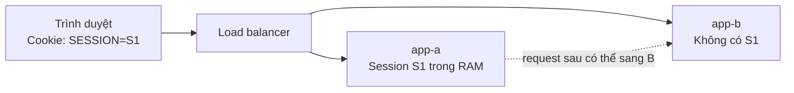
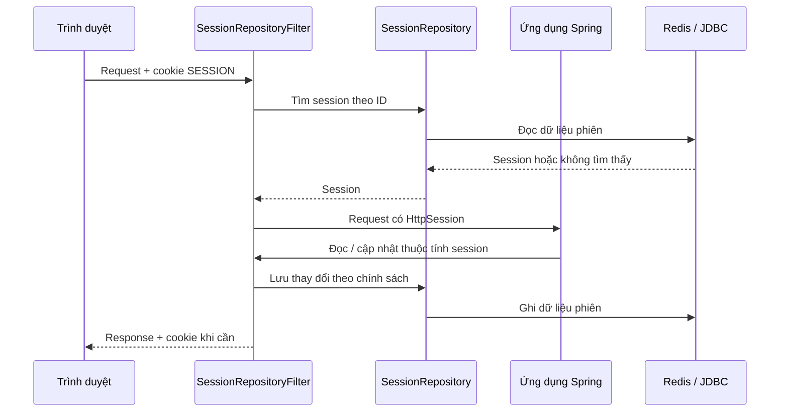
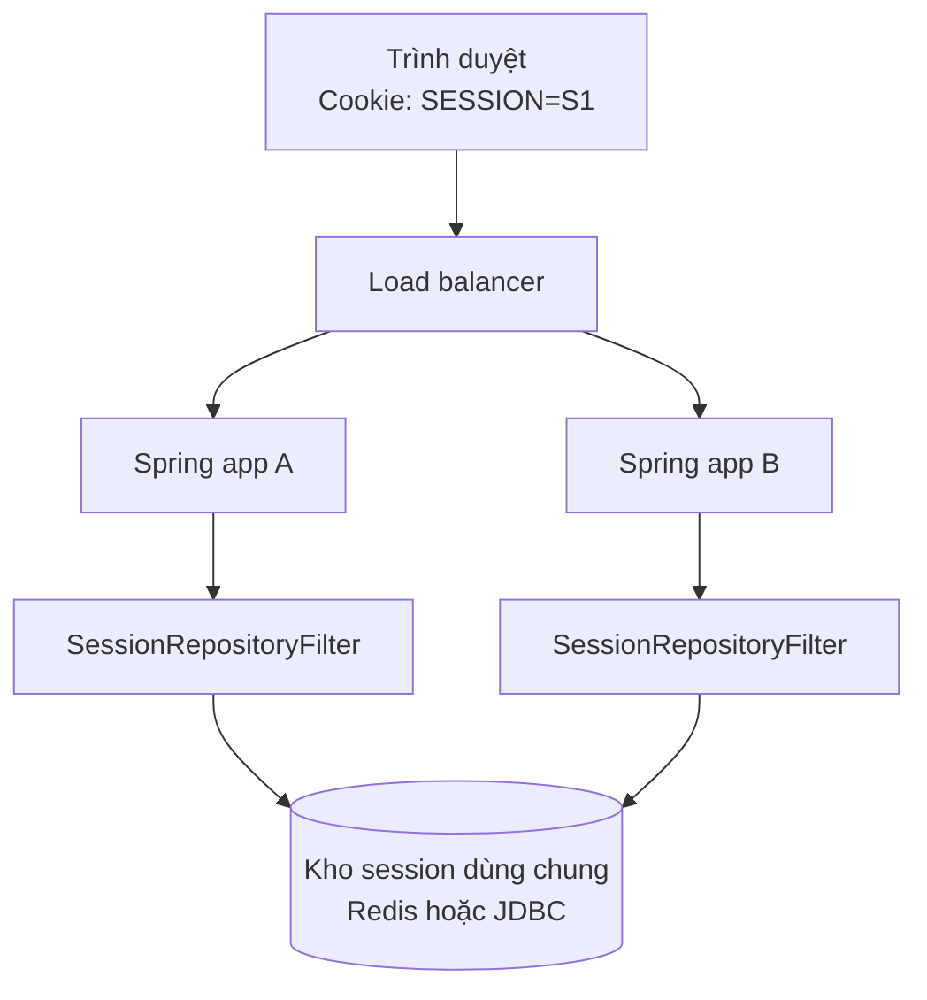

# Spring Session giải quyết bài toán lưu phiên độc lập với bộ chứa ứng dụng

Một ứng dụng web thường cần ghi nhớ trạng thái giữa nhiều HTTP request: người dùng đã đăng nhập hay chưa, giỏ hàng đang có những mặt hàng nào, hoặc một quy trình nhiều bước đang dừng ở đâu. Servlet cung cấp `HttpSession` để thực hiện việc đó. Tuy nhiên, khi ứng dụng chạy trên nhiều instance phía sau load balancer, session nằm trong bộ nhớ của từng instance sẽ trở thành một điểm nghẽn về khả năng mở rộng và tính sẵn sàng.

Spring Session giải quyết vấn đề bằng cách cung cấp một lớp triển khai session có thể lưu dữ liệu vào kho dùng chung, chẳng hạn Redis hoặc cơ sở dữ liệu quan hệ. Mã ứng dụng vẫn làm việc với API quen thuộc như `HttpServletRequest.getSession()` và `HttpSession.setAttribute()`, trong khi dữ liệu phiên được quản lý bên ngoài vòng đời của một máy chủ ứng dụng cụ thể.

Trong phạm vi module này, Spring Session được dùng để quản lý session ứng dụng Spring độc lập với một máy chủ bằng Spring Session và kho dữ liệu chia sẻ như Redis hoặc JDBC. Các phần tiếp theo sẽ giúp làm rõ cấu trúc Servlet, cookie, thời hạn phiên, sự kiện, đăng xuất, kiểm thử đồng thời và các vấn đề vận hành khi có nhiều instance.

## 1. HTTP không tự ghi nhớ trạng thái giữa các request

HTTP về bản chất là giao thức không lưu trạng thái. Mỗi request được xử lý độc lập; máy chủ không tự biết hai request liên tiếp có đến từ cùng một trình duyệt hay không. Trình duyệt có thể gửi cookie hoặc một thông tin định danh khác để máy chủ liên kết các request.

Với ứng dụng Servlet, `HttpSession` cung cấp một vùng dữ liệu gắn với một phiên. Ứng dụng có thể tạo hoặc lấy phiên hiện tại, sau đó lưu các thuộc tính:

```java
HttpSession session = request.getSession();
session.setAttribute("userId", userId);
session.setAttribute("cartId", cartId);
```

Ở request tiếp theo, trình duyệt gửi cookie chứa session ID. Máy chủ dùng ID đó để tìm lại dữ liệu phiên và khôi phục ngữ cảnh cho request. Cookie thường chỉ chứa một mã định danh khó đoán; dữ liệu người dùng, giỏ hàng hoặc trạng thái quy trình được giữ ở phía máy chủ.

Session ID cần được xem như một thông tin xác thực dạng bearer token: ai sở hữu ID hợp lệ có thể được máy chủ xem là đang sử dụng phiên tương ứng. Vì vậy, session ID phải được bảo vệ như thông tin đăng nhập.

## 2. Vì sao session cục bộ của máy chủ ứng dụng gây khó khăn?

Giả sử một ứng dụng Spring MVC được triển khai thành hai instance `app-a` và `app-b`. Load balancer phân phối request đến các instance này.

1. Người dùng đăng nhập. Request được chuyển đến `app-a`; ứng dụng tạo session `S1` và lưu thông tin đăng nhập vào bộ nhớ của `app-a`.
2. Trình duyệt giữ cookie có session ID `S1`.
3. Request kế tiếp được chuyển đến `app-b`. Instance này nhận được `S1` nhưng không có bản ghi tương ứng trong bộ nhớ cục bộ.
4. Người dùng có thể bị xem như chưa đăng nhập, hoặc ứng dụng tạo một session mới không chứa dữ liệu trước đó.

Sự cố tương tự xuất hiện khi một instance khởi động lại, bị thay thế trong đợt triển khai, hoặc bị loại khỏi cụm do lỗi. Những session chỉ tồn tại trong bộ nhớ instance đó sẽ mất theo instance.



Có thể cấu hình session affinity (sticky session) để load balancer cố gắng đưa một người dùng về cùng instance. Cách này giảm khả năng request đi nhầm máy, nhưng không giải quyết được việc instance bị hỏng hoặc cần thay thế. Nó cũng khiến phân phối tải và mở rộng cụm phụ thuộc vào trạng thái định tuyến. Sticky session có thể vẫn được dùng vì lý do vận hành, nhưng không nên là cơ chế duy nhất bảo vệ session.

Vấn đề cốt lõi là dữ liệu phiên đang gắn với một tiến trình cụ thể, trong khi request có thể được xử lý bởi bất kỳ instance nào.

## 3. Spring Session tách API session khỏi nơi lưu trữ

Spring Session cung cấp cách triển khai `HttpSession` dựa trên một kho session. Trong ứng dụng Servlet, thành phần trung tâm là `SessionRepositoryFilter`. Filter này bọc request và response để các thao tác với `HttpSession` được chuyển tiếp đến repository của Spring Session.

Các thành phần chính có vai trò như sau:

| Thành phần | Vai trò |
|---|---|
| `SessionRepository` | Tạo, tìm, lưu và xóa session trong kho dữ liệu |
| `SessionRepositoryFilter` | Chuyển các thao tác Servlet `HttpSession` sang Spring Session |
| `HttpSessionIdResolver` | Đọc session ID từ request và ghi ID vào response |
| `CookieHttpSessionIdResolver` | Cơ chế phổ biến để truyền session ID bằng cookie |
| Redis hoặc JDBC repository | Lưu dữ liệu phiên dùng chung giữa các instance |

Luồng xử lý một request thường diễn ra như sau:

1. Trình duyệt gửi cookie chứa session ID.
2. `SessionRepositoryFilter` lấy ID thông qua `HttpSessionIdResolver`.
3. Filter yêu cầu repository tìm session tương ứng. Nếu session không tồn tại hoặc đã hết hạn, ứng dụng xử lý request như không có phiên hợp lệ; khi cần, một session mới có thể được tạo.
4. Mã ứng dụng tiếp tục dùng API Servlet thông thường, ví dụ `getSession()`, `getAttribute()` và `setAttribute()`.
5. Theo chính sách lưu của repository và vòng đời response, các thay đổi được ghi về kho session. Nếu cần tạo hoặc thay đổi ID, response sẽ gửi cookie tương ứng về trình duyệt.



Điểm quan trọng là mã nghiệp vụ không cần tự gọi Redis hay viết SQL mỗi khi đọc một thuộc tính session. Spring Session đặt lớp tích hợp ở ranh giới Servlet, nhờ đó nhiều instance có thể dùng chung một cách truy cập session.

Filter phải chạy trước những filter hoặc thành phần cần đọc `HttpSession`, đặc biệt là Spring Security. Spring Boot thường tự đăng ký filter khi cấu hình Spring Session phù hợp. Với ứng dụng tự cấu hình Servlet, cần bảo đảm thứ tự filter đúng và chỉ đăng ký một cơ chế quản lý session.

Spring Session cho Servlet làm việc với `HttpSession`. Ứng dụng WebFlux sử dụng mô hình `WebSession` và cấu hình tương ứng; không nên áp dụng nguyên xi ví dụ filter Servlet cho WebFlux.

## 4. Kiến trúc khi có kho session dùng chung

Khi chuyển session ra kho dùng chung, các instance ứng dụng cùng truy cập một repository:



Giờ đây, request mang `S1` có thể đến `app-a` hoặc `app-b`. Cả hai instance đều tra cứu cùng kho dữ liệu nên có thể khôi phục cùng một session, miễn là chúng dùng chung cấu hình repository, namespace, cookie và cách tuần tự hóa dữ liệu tương thích.

| Khía cạnh | Session cục bộ của container | Spring Session với kho dùng chung |
|---|---|---|
| Nơi lưu dữ liệu | Bộ nhớ của một instance | Redis hoặc cơ sở dữ liệu dùng chung |
| Request chuyển instance | Có thể mất ngữ cảnh phiên | Có thể đọc lại cùng session |
| Khởi động lại instance | Session trong RAM bị mất | Session còn nếu kho dữ liệu còn và chưa hết hạn |
| Mở rộng số instance | Cần affinity hoặc cơ chế đồng bộ riêng | Các instance có thể cùng truy cập repository |
| Vận hành | Ít thành phần hạ tầng hơn | Cần vận hành, giám sát và bảo vệ kho session |

Spring Session không tự làm cho toàn bộ ứng dụng trở nên stateless. Nó tách nơi lưu `HttpSession` khỏi instance ứng dụng. Những trạng thái khác nằm trong biến static, bộ nhớ local, cache cục bộ hoặc file trên từng máy vẫn có thể gây lỗi tương tự khi request đổi instance.

## 5. Chọn Redis hay JDBC

Spring Session hỗ trợ nhiều loại repository. Hai lựa chọn thường gặp là Redis và JDBC.

### Redis

Redis thường phù hợp khi session cần được đọc và cập nhật thường xuyên với độ trễ thấp. Redis hỗ trợ thời hạn sống cho key, nhờ đó dữ liệu phiên có thể tự hết hạn theo TTL. Spring Session Data Redis tích hợp với Spring Data Redis để quản lý dữ liệu và vòng đời session.

Ưu điểm:

- Đọc và ghi nhanh, phù hợp với đường xử lý request thường xuyên.
- Có TTL ở tầng Redis, hỗ trợ loại bỏ session hết hạn.
- Dễ chia sẻ dữ liệu phiên giữa nhiều instance ứng dụng.
- Có thể vận hành Redis riêng cho session, tách tải khỏi cơ sở dữ liệu nghiệp vụ.

Điểm cần cân nhắc:

- Redis trở thành một phụ thuộc quan trọng của đường xử lý request cần session.
- Phải quản lý bộ nhớ, chính sách eviction, kết nối, bảo mật mạng và tính sẵn sàng cao.
- Cần kiểm tra tương thích serialization khi triển khai phiên bản ứng dụng mới trong lúc người dùng vẫn đang có session cũ.

### JDBC

Spring Session JDBC lưu session vào các bảng quan hệ, thường là `SPRING_SESSION` và `SPRING_SESSION_ATTRIBUTES`. Lựa chọn này hữu ích khi hệ thống đã có cơ sở dữ liệu quan hệ được vận hành tốt và muốn giảm số loại hạ tầng cần quản lý.

Ưu điểm:

- Dữ liệu phiên được lưu trong cơ sở dữ liệu quen thuộc của hệ thống.
- Có thể tận dụng sao lưu, phân quyền, giám sát và quy trình vận hành database hiện có.
- Không cần triển khai thêm Redis chỉ để lưu session.

Điểm cần cân nhắc:

- Đọc và ghi session làm tăng tải lên database nghiệp vụ nếu dùng chung cụm.
- Cần khởi tạo schema, lập kế hoạch index và dọn các phiên hết hạn.
- Khi lưu lượng request cao, database có thể trở thành nút thắt vì mỗi request truy cập session tạo thêm hoạt động đọc hoặc ghi.

| Tiêu chí | Redis | JDBC |
|---|---|---|
| Độ trễ truy cập | Thường thấp | Phụ thuộc database và tải truy vấn |
| TTL | Có thể dùng TTL của key | Repository và tác vụ dọn dữ liệu quản lý hết hạn |
| Hạ tầng | Cần Redis được vận hành ổn định | Có thể dùng database sẵn có |
| Tải chính | Bộ nhớ và mạng Redis | Kết nối, CPU, I/O và dung lượng database |
| Phù hợp khi | Session có lưu lượng đọc/ghi cao | Hệ thống ưu tiên dùng hạ tầng quan hệ hiện có hoặc tải session vừa phải |

Không có lựa chọn đúng cho mọi hệ thống. Hãy đo số lượng session, kích thước thuộc tính, tần suất truy cập và tải dự kiến. Cũng cần đánh giá yêu cầu khi kho dữ liệu tạm thời không sẵn sàng: hệ thống có chấp nhận người dùng đăng nhập lại hay cần một chiến lược dự phòng khác?

## 6. Cấu hình Spring Session trong Spring Boot

Ví dụ sau minh họa cấu hình Redis cho một ứng dụng Spring Boot Servlet. Phiên bản Spring Boot và Spring Session cần được quản lý bằng dependency management tương thích của dự án.

Thêm dependency Spring Session Data Redis và Spring Data Redis:

```xml
<dependencies>
    <dependency>
        <groupId>org.springframework.boot</groupId>
        <artifactId>spring-boot-starter-data-redis</artifactId>
    </dependency>
    <dependency>
        <groupId>org.springframework.session</groupId>
        <artifactId>spring-session-data-redis</artifactId>
    </dependency>
</dependencies>
```

Khai báo kết nối Redis và chính sách session trong `application.yml`:

```yaml
spring:
  data:
    redis:
      host: ${REDIS_HOST:localhost}
      port: ${REDIS_PORT:6379}
      password: ${REDIS_PASSWORD:}
  session:
    store-type: redis
    timeout: 30m
    redis:
      namespace: orders:session
```

Trong Spring Boot có hỗ trợ auto-configuration cho Spring Session, dependency và cấu hình kết nối phù hợp sẽ cho phép Boot tạo repository và đăng ký filter. Nếu ứng dụng không dùng auto-configuration, có thể bật cấu hình Redis bằng `@EnableRedisHttpSession` và cung cấp `RedisConnectionFactory`:

```java
@Configuration
@EnableRedisHttpSession(maxInactiveIntervalInSeconds = 1800)
public class HttpSessionConfiguration {
}
```

Chọn một đường cấu hình phù hợp với cách khởi tạo ứng dụng. Tránh vừa bật auto-configuration vừa khai báo cấu hình thủ công trùng lặp, vì có thể tạo nhiều bean hoặc filter ngoài dự kiến.

Với JDBC, thêm dependency `spring-session-jdbc`, cấu hình `DataSource` và chọn store:

```yaml
spring:
  session:
    store-type: jdbc
    timeout: 30m
    jdbc:
      initialize-schema: always
```

`initialize-schema: always` tiện cho môi trường phát triển và kiểm thử. Ở production, nên quản lý schema bằng công cụ migration như Flyway hoặc Liquibase, sau khi đã xác nhận script schema tương ứng với phiên bản Spring Session đang dùng. Cơ sở dữ liệu cần có các bảng Spring Session và quyền đọc, ghi, xóa phù hợp.

### Cấu hình cookie

Session ID thường được truyền qua cookie. Cookie cần có thuộc tính bảo mật phù hợp với cách triển khai:

```java
@Bean
public CookieSerializer cookieSerializer() {
    DefaultCookieSerializer serializer = new DefaultCookieSerializer();
    serializer.setCookieName("SESSION");
    serializer.setUseHttpOnlyCookie(true);
    serializer.setUseSecureCookie(true);
    serializer.setSameSite("Lax");
    return serializer;
}
```

`HttpOnly` ngăn JavaScript phía trình duyệt đọc cookie trực tiếp; `Secure` yêu cầu trình duyệt chỉ gửi cookie qua HTTPS; `SameSite` giúp kiểm soát việc gửi cookie trong ngữ cảnh cross-site và hỗ trợ giảm rủi ro CSRF. Nếu ứng dụng cần luồng cross-site, chẳng hạn một số mô hình đăng nhập tập trung hoặc nhúng, cần thiết kế `SameSite=None` cùng `Secure` và biện pháp CSRF phù hợp.

Trong môi trường chỉ dùng HTTP ở máy phát triển, cookie `Secure` có thể không được trình duyệt gửi đi. Cấu hình cookie cần khớp với môi trường thực tế. Hãy cân nhắc `Domain`, `Path`, thời hạn cookie và tên cookie khi nhiều ứng dụng cùng chạy trên một domain.

## 7. Session ID, thời hạn phiên và vòng đời session

Session có hai phần cần phân biệt:

- **Session ID ở phía trình duyệt:** mã định danh được gửi qua cookie. Cookie có thể là cookie phiên của trình duyệt hoặc có thời hạn riêng.
- **Dữ liệu session ở phía máy chủ:** các thuộc tính được lưu trong repository. Dữ liệu này có thời hạn sống do session timeout quy định.

Hai thời hạn trên không nhất thiết giống nhau. Đóng trình duyệt có thể làm mất cookie phiên, nhưng bản ghi ở Redis hoặc JDBC vẫn có thể tồn tại đến khi TTL hoặc tác vụ dọn dữ liệu loại bỏ. Ngược lại, nếu session phía máy chủ đã hết hạn, cookie còn trong trình duyệt cũng không làm phiên sống lại.

`maxInactiveInterval` là khoảng thời gian không hoạt động tối đa của session. Khi người dùng tiếp tục truy cập, thời điểm truy cập cuối và thời hạn hết hạn được cập nhật theo chính sách lưu của repository. Với cấu hình timeout 30 phút, session không hoạt động vượt quá khoảng thời gian đó sẽ hết hạn theo cơ chế của store.

Một số thao tác vòng đời thường gặp:

```java
HttpSession session = request.getSession();

// Lưu một thuộc tính có kích thước nhỏ.
session.setAttribute("userId", userId);

// Đọc thuộc tính.
String currentUserId = (String) session.getAttribute("userId");

// Hủy session hiện tại.
session.invalidate();
```

Không nên tạo session mới một cách vô thức cho mọi request không cần trạng thái. Trong Servlet, `getSession()` tạo session nếu chưa có; `getSession(false)` chỉ lấy session hiện tại và trả về `null` nếu không tồn tại. Lựa chọn đúng giúp tránh tạo nhiều session không cần thiết.

Khi đăng xuất, ứng dụng cần vô hiệu hóa session ở phía máy chủ và xóa cookie session khỏi trình duyệt. Nếu dùng Spring Security, nên để luồng logout được cấu hình thực hiện việc vô hiệu hóa session và xóa cookie phù hợp. Chỉ xóa cookie phía trình duyệt mà không vô hiệu hóa session phía máy chủ có thể để lại một session còn sử dụng được nếu session ID bị lộ.

Khi xác thực người dùng, cần chống session fixation bằng cách thay đổi session ID sau khi đăng nhập thành công. Spring Security có cơ chế bảo vệ session fixation; hãy kiểm tra cấu hình bảo mật đang dùng và tránh tự viết logic giữ nguyên ID cũ qua ranh giới xác thực.

## 8. Sự kiện session và các tác vụ theo vòng đời

Spring Session có thể phát ra các sự kiện liên quan đến session, ví dụ:

- `SessionCreatedEvent`: một session mới được tạo.
- `SessionDeletedEvent`: một session bị xóa hoặc vô hiệu hóa.
- `SessionExpiredEvent`: một session hết hạn.

Ứng dụng có thể lắng nghe sự kiện bằng `@EventListener`:

```java
@Component
public class SessionLifecycleListener {

    @EventListener
    public void onSessionExpired(SessionExpiredEvent event) {
        // Thực hiện xử lý phù hợp với nghiệp vụ.
    }

    @EventListener
    public void onSessionDeleted(SessionDeletedEvent event) {
        // Ghi nhận hoặc giải phóng tài nguyên liên quan nếu cần.
    }
}
```

Khả năng phát hiện sự kiện phụ thuộc repository và cấu hình store. Với Redis, sự kiện hết hạn thường dựa vào keyspace notifications; cần cấu hình Redis và Spring Session phù hợp để ứng dụng nhận được thông báo. Với JDBC, việc nhận biết hết hạn gắn với cách repository kiểm tra và dọn các bản ghi. Không nên giả định mọi loại store phát sự kiện theo cùng thời điểm hoặc cùng độ tin cậy.

Listener nên xử lý nhanh, có tính idempotent và không dùng sự kiện session làm nguồn audit duy nhất. Thông báo hết hạn từ kho dữ liệu có thể đến trễ hoặc không được chuyển tiếp trong một số tình huống vận hành. Nếu nghiệp vụ yêu cầu lịch sử đăng nhập, đăng xuất hoặc thu hồi quyền có thể kiểm toán, hãy ghi sự kiện nghiệp vụ vào hệ thống audit riêng.

## 9. Lưu ý khi có nhiều instance và request đồng thời

Việc dùng chung repository giải quyết bài toán đọc session từ nhiều instance, nhưng không đồng nghĩa mọi thao tác trên cùng session được tuần tự hóa như một giao dịch nghiệp vụ.

Ví dụ, hai request đồng thời cùng đọc thuộc tính `cart`, mỗi request thêm một sản phẩm vào bản sao dữ liệu mà nó đã tải. Nếu cả hai cùng ghi lại thuộc tính đó, một cập nhật có thể ghi đè cập nhật còn lại, tùy cách repository lưu thay đổi và thời điểm các request hoàn tất. Cấu hình chế độ save hoặc flush có thể ảnh hưởng hiệu năng và thời điểm ghi, nhưng không phải cơ chế khóa phân tán cho logic nghiệp vụ.

Để giảm rủi ro:

- Chỉ lưu dữ liệu nhỏ cần thiết cho ngữ cảnh người dùng, chẳng hạn ID người dùng, ID giỏ hàng hoặc lựa chọn giao diện.
- Tránh lưu entity JPA còn gắn với persistence context, đối tượng lớn hoặc dữ liệu nghiệp vụ cần nhất quán cao.
- Với số dư, số lượng tồn kho, bộ đếm hoặc giỏ hàng có cập nhật đồng thời, dùng repository nghiệp vụ và cơ chế transaction, optimistic locking hoặc thao tác nguyên tử phù hợp.
- Nếu bắt buộc cập nhật một thuộc tính session phức tạp từ nhiều request, xác định rõ chính sách xử lý xung đột và kiểm thử nó với repository thật.

Mọi instance trong cùng một cụm cần trỏ đến cùng kho session và cùng namespace của ứng dụng, đồng thời có cấu hình cookie tương thích. Khi triển khai rolling update, cần giữ khả năng đọc dữ liệu session do phiên bản trước ghi ra. Đây là lý do nên ưu tiên DTO đơn giản, ổn định và tránh phụ thuộc serialization vào cấu trúc class dễ thay đổi.

Namespace nên tách theo ứng dụng và môi trường, ví dụ `orders:dev:session` và `orders:prod:session`. Nếu nhiều ứng dụng dùng chung Redis hoặc database mà không tách namespace, chúng có thể đụng dữ liệu hoặc vô tình đọc session của nhau.

## 10. Lỗi vận hành cần dự kiến

Kho session nằm trên đường xử lý request, do đó lỗi của kho có thể ảnh hưởng trực tiếp đến chức năng cần session.

**Redis hoặc database không truy cập được:** request cần đọc hoặc ghi session có thể thất bại, tăng độ trễ hoặc không hoàn tất. Cần cấu hình connection pool, timeout và health check hợp lý; theo dõi lỗi kết nối và độ trễ. Retry phải có giới hạn để tránh làm sự cố quá tải nặng hơn. Không nên âm thầm coi mọi lỗi kho session là người dùng chưa đăng nhập, vì cách đó có thể che giấu lỗi hạ tầng và tạo hành vi bảo mật khó đoán.

**Session biến mất sớm:** Redis có thể loại bỏ key do áp lực bộ nhớ hoặc chính sách eviction; cấu hình TTL không phù hợp cũng có thể làm người dùng bị đăng xuất sớm. Hãy dự trù dung lượng, theo dõi mức dùng bộ nhớ và chọn chính sách eviction phù hợp với dữ liệu session.

**Session tồn tại lâu hơn mong muốn:** cần xác minh timeout đang được cấu hình ở Spring Session, TTL trong Redis hoặc cơ chế cleanup của JDBC. Cookie còn tồn tại không chứng minh session phía máy chủ còn hợp lệ.

**Lỗi tương thích dữ liệu sau triển khai:** nếu phiên bản mới không giải tuần tự hóa được thuộc tính do phiên bản cũ ghi ra, người dùng đang đăng nhập có thể gặp lỗi khi request tiếp theo đọc session. Giữ dữ liệu session đơn giản, có kế hoạch tương thích khi deploy và chỉ thay đổi serializer theo quy trình đã kiểm thử.

**Cookie không được gửi:** kiểm tra HTTPS và thuộc tính `Secure`, `SameSite`, `Domain`, `Path`, tên cookie, cũng như domain thực tế của trình duyệt. Khi nhiều instance chạy sau proxy, cấu hình nhận biết HTTPS từ proxy cũng cần chính xác.

## 11. Kiểm thử đúng điều Spring Session cần bảo đảm

Kiểm thử logic controller với `MockHttpSession` có ích, nhưng chưa chứng minh dữ liệu đã được lưu vào Redis hoặc JDBC. Để kiểm tra tích hợp, cần chạy repository thật hoặc môi trường tương đương production.

Một kịch bản quan trọng là kiểm tra khả năng chia sẻ session giữa hai instance:

1. Khởi động hai application context hoặc hai instance ứng dụng cùng trỏ đến một Redis/database kiểm thử.
2. Gửi request đến instance A để tạo session và lưu một thuộc tính kiểm thử.
3. Lấy cookie session từ response của A.
4. Gửi request đến instance B kèm cookie đó.
5. Xác nhận B đọc được thuộc tính đã lưu từ A.
6. Gửi logout hoặc invalidate qua một instance, sau đó xác nhận request ở instance còn lại không thể tiếp tục sử dụng session cũ.

Nên bổ sung các trường hợp:

- Session hết hạn sau khoảng timeout ngắn trong môi trường kiểm thử.
- Cookie sai, thiếu hoặc chứa ID không tồn tại.
- Hai request đồng thời cập nhật cùng một thuộc tính.
- Redis hoặc database tạm thời mất kết nối.
- Session cũ vẫn được đọc trong lúc rolling update giữa hai phiên bản ứng dụng.
- Sự kiện tạo, xóa và hết hạn được phát hiện theo cấu hình store.

Khi kiểm thử đồng thời, hãy kiểm tra kết quả nghiệp vụ sau khi tất cả request kết thúc, thay vì chỉ xác nhận từng request trả HTTP 200. Một request thành công không chứng minh các cập nhật đồng thời đã được hợp nhất đúng.

## 12. Khi nào nên dùng Spring Session?

Spring Session phù hợp khi ứng dụng Servlet cần giữ `HttpSession` nhưng phải chạy trên nhiều instance, cần thay thế instance mà không làm mất toàn bộ session, hoặc muốn quản lý vòng đời session ở một kho dữ liệu tập trung. Nó cũng hữu ích khi muốn giữ nguyên API Servlet hiện có trong lúc thay đổi nơi lưu session.

Trước khi đưa vào production, hãy xác nhận các điểm sau:

- Tất cả instance cùng sử dụng một repository và namespace phù hợp.
- Timeout và cookie được cấu hình rõ ràng theo môi trường.
- Cookie session được bảo vệ bằng HTTPS, `HttpOnly` và `SameSite` phù hợp.
- Logout vô hiệu hóa session phía máy chủ.
- Dữ liệu session nhỏ, dễ tuần tự hóa và tương thích giữa các phiên bản ứng dụng.
- Redis/database có dung lượng, kết nối, giám sát, sao lưu hoặc phương án sẵn sàng cao phù hợp.
- Các trường hợp request đồng thời, hết hạn, lỗi store và chuyển instance đã được kiểm thử.

Spring Session làm cho `HttpSession` có thể được chia sẻ giữa các máy chủ ứng dụng bằng cách chuyển dữ liệu phiên vào một repository dùng chung. Nhờ đó, load balancer có thể phân phối request đến nhiều instance mà session vẫn được tra cứu theo cùng một ID. Độ tin cậy cuối cùng vẫn phụ thuộc vào cấu hình cookie, chính sách vòng đời, tính sẵn sàng của Redis/JDBC và cách ứng dụng xử lý cập nhật đồng thời.
