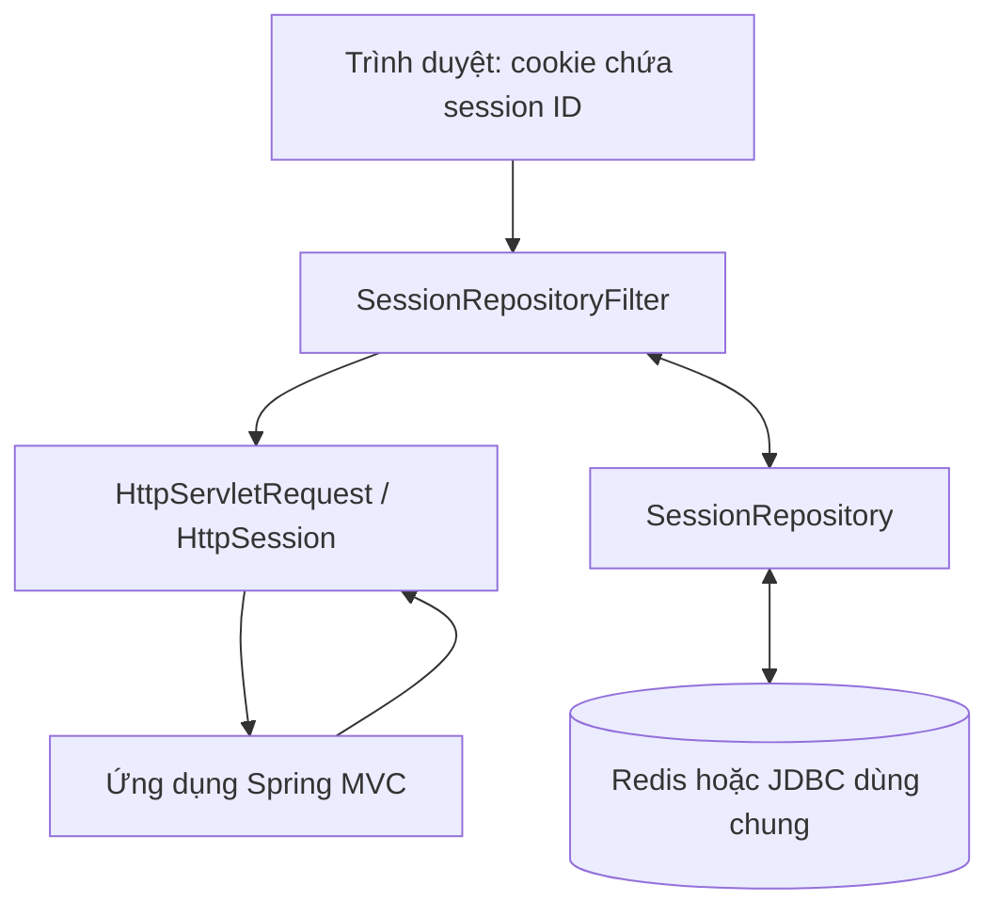
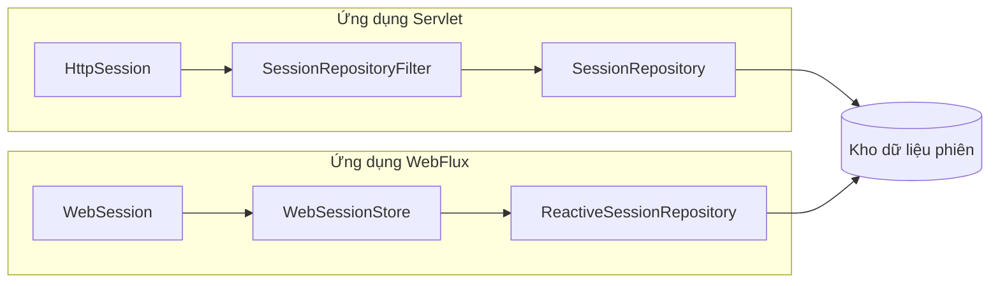

# Mối liên hệ giữa Session, repository, HttpSession và WebSession

HTTP không tự ghi nhớ trạng thái giữa hai request. Trình duyệt gửi một request độc lập cho mỗi lần truy cập, vì vậy ứng dụng cần một cơ chế để nhận ra các request tiếp theo thuộc cùng một phiên làm việc. **Session** là phiên làm việc đó: một tập dữ liệu có thời hạn, được nhận diện bằng một mã phiên (session ID). Trình duyệt thường giữ mã này trong cookie; dữ liệu của phiên được lưu ở phía máy chủ.

Spring Session quản lý vòng đời và nơi lưu dữ liệu phiên. Nó tách phần ứng dụng sử dụng session khỏi cách session được lưu, nhờ vậy nhiều instance Spring có thể đọc và cập nhật cùng một phiên qua Redis, JDBC hoặc một kho lưu trữ được hỗ trợ khác. Để hiểu cách các thành phần phối hợp, cần phân biệt bốn khái niệm: `Session`, repository, `HttpSession` và `WebSession`.

## 1. Session là dữ liệu của một phiên làm việc

Trong Spring Session, `org.springframework.session.Session` là abstraction mô tả một phiên. Một session thường có:

- **ID**: định danh phiên; đây là giá trị mà client gửi lại trong những request tiếp theo.
- **Creation time**: thời điểm phiên được tạo.
- **Last accessed time**: thời điểm phiên được truy cập gần nhất.
- **Max inactive interval**: khoảng thời gian không hoạt động tối đa trước khi phiên hết hạn.
- **Attributes**: các cặp tên–giá trị mà ứng dụng lưu trong phiên, chẳng hạn mã giỏ hàng hoặc một phần trạng thái đăng nhập.

Session là dữ liệu logic của ứng dụng, không đồng nghĩa với cookie hay một kết nối TCP. Cookie thường chỉ mang session ID. Khi nhận được ID, máy chủ dùng nó để tìm dữ liệu phiên trong repository. Nếu client không gửi ID hợp lệ, hoặc phiên đã hết hạn hay bị xóa, ứng dụng có thể tạo một phiên mới khi cần.

Không nên xem session là nơi lưu mọi dữ liệu của người dùng. Dữ liệu hồ sơ, đơn hàng và các thông tin nghiệp vụ lâu dài vẫn nên thuộc về cơ sở dữ liệu phù hợp. Session thích hợp cho trạng thái ngắn hạn gắn với quá trình tương tác, và nên giữ đủ nhỏ để giảm chi phí đọc, ghi, tuần tự hóa và truyền dữ liệu giữa các instance.

## 2. Repository quản lý việc tạo, đọc, lưu và xóa Session

Repository là ranh giới giữa mô hình session và cơ chế lưu trữ. Với ứng dụng Servlet, Spring Session cung cấp abstraction đồng bộ `SessionRepository<S extends Session>`. Các thao tác cốt lõi của nó gồm:

```java
public interface SessionRepository<S extends Session> {
    S createSession();
    void save(S session);
    S findById(String id);
    void deleteById(String id);
}
```

Ứng dụng thường không gọi trực tiếp các phương thức này trong controller. Thành phần tích hợp của Spring Session gọi repository khi cần tạo phiên, khôi phục phiên từ ID, lưu thay đổi hoặc xóa phiên. Repository quyết định cách chuyển đổi session thành dữ liệu lưu trữ và cách tìm lại dữ liệu đó.

Một implementation có thể lưu session trong Redis; implementation khác có thể dùng JDBC. Khi các instance cùng kết nối đến một repository dùng chung, instance A có thể tạo hoặc cập nhật session và instance B có thể tìm lại session đó bằng cùng ID. Điều này giúp trạng thái phiên không phụ thuộc vào bộ nhớ riêng của một tiến trình.

Với ứng dụng reactive, Spring Session có `ReactiveSessionRepository<S extends Session>`. Các thao tác trả về kiểu reactive như `Mono`, để việc truy cập kho dữ liệu không buộc luồng xử lý WebFlux phải chặn (block) một thread:

```java
public interface ReactiveSessionRepository<S extends Session> {
    Mono<S> createSession();
    Mono<Void> save(S session);
    Mono<S> findById(String id);
    Mono<Void> deleteById(String id);
}
```

Vì vậy, repository không phải bản thân session và cũng không phải Redis hay cơ sở dữ liệu. Nó là abstraction cung cấp các thao tác trên session; implementation cụ thể mới kết nối abstraction đó với kho lưu trữ.

## 3. HttpSession là API session của Servlet

`jakarta.servlet.http.HttpSession` (hoặc `javax.servlet.http.HttpSession` ở các thế hệ Servlet cũ) là API mà ứng dụng Servlet và Spring MVC quen thuộc sử dụng. Controller có thể gọi `getAttribute`, `setAttribute`, `removeAttribute`, `invalidate` hoặc `setMaxInactiveInterval` mà không cần biết dữ liệu đang nằm trong bộ nhớ của servlet container hay trong Redis.

Spring Session kết nối API này với repository thông qua `SessionRepositoryFilter`. Filter đặt một request wrapper quanh request Servlet. Khi mã ứng dụng gọi `request.getSession()` hoặc nhận `HttpSession` trong controller, wrapper cung cấp một đối tượng `HttpSession` được Spring Session quản lý. Các thao tác trên `HttpSession` được chuyển thành thao tác trên đối tượng `Session` tương ứng trong repository.

Luồng xử lý điển hình:

1. Trình duyệt gửi request kèm cookie chứa session ID.
2. `SessionRepositoryFilter` dùng `HttpSessionIdResolver` để lấy ID từ request, thường thông qua cookie.
3. Filter tìm session trong repository. Nếu không tìm thấy session còn hiệu lực, một session mới sẽ được tạo khi ứng dụng yêu cầu tạo session.
4. Ứng dụng tiếp tục sử dụng API Servlet quen thuộc là `HttpSession`.
5. Khi thuộc tính hoặc metadata thay đổi, Spring Session ghi nhận thay đổi và lưu session theo cơ chế flush của cấu hình, thường trong quá trình hoàn tất response.
6. Request sau có thể đến một instance khác. Instance đó dùng cùng repository để tải lại session theo ID.



Ví dụ cấu hình Redis cho ứng dụng Servlet:

```java
@Configuration
@EnableRedisHttpSession
class ServletSessionConfiguration {
    // Ứng dụng cần có RedisConnectionFactory được cấu hình.
}
```

`@EnableRedisHttpSession` bật tích hợp Spring Session với Redis và đăng ký filter quản lý `HttpSession`. Trong ứng dụng Spring Boot, `RedisConnectionFactory` thường được cung cấp từ cấu hình kết nối Redis của ứng dụng. Nếu dùng JDBC, hãy chọn cấu hình Spring Session JDBC tương ứng và chuẩn bị `DataSource` cùng schema mà phiên bản đang dùng yêu cầu.

Controller vẫn thao tác qua `HttpSession`:

```java
@GetMapping("/cart")
public String cart(HttpSession session) {
    Integer count = (Integer) session.getAttribute("itemCount");
    session.setAttribute("itemCount", count == null ? 1 : count + 1);
    return "cart";
}
```

Controller không cần biết thuộc tính `itemCount` được lưu trong Redis hay JDBC. Điều kiện quan trọng là `SessionRepositoryFilter` phải được áp dụng trước những filter hoặc thành phần khác có thể truy cập session; nếu một thành phần đọc session trước filter, nó có thể vô tình sử dụng session của servlet container thay vì session do Spring Session quản lý.

## 4. WebSession là API session của Spring WebFlux

Ứng dụng WebFlux không sử dụng `HttpSession` làm API session chính. WebFlux cung cấp `org.springframework.web.server.WebSession`, được truy cập từ `ServerWebExchange`. Việc lấy session là một thao tác reactive: `ServerWebExchange.getSession()` trả về `Mono<WebSession>`.

`WebSession` cung cấp ID, attributes, thời điểm tạo và truy cập gần nhất, thời gian không hoạt động tối đa, cùng các thao tác lưu, vô hiệu hóa và đổi ID. Một `WebSessionStore` chịu trách nhiệm tìm hoặc tạo WebSession cho request. Spring Session tích hợp lớp này với `ReactiveSessionRepository`, nhờ đó dữ liệu WebSession có thể nằm trong một kho dùng chung.

Ví dụ cấu hình Redis cho WebFlux:

```java
@Configuration
@EnableRedisWebSession
class ReactiveSessionConfiguration {
    // Ứng dụng cần có ReactiveRedisConnectionFactory được cấu hình.
}
```

Ví dụ sử dụng session trong một handler WebFlux:

```java
@GetMapping("/cart")
public Mono<String> cart(ServerWebExchange exchange) {
    return exchange.getSession().flatMap(session -> {
        Map<String, Object> attributes = session.getAttributes();
        Integer count = (Integer) attributes.get("itemCount");
        attributes.put("itemCount", count == null ? 1 : count + 1);

        return session.save().thenReturn("Đã cập nhật giỏ hàng");
    });
}
```

Đoạn mã thao tác với `WebSession` bên trong chuỗi reactive và trả về `Mono`. Không gọi `block()` để chờ session trong một request WebFlux thông thường, vì việc đó có thể chặn thread xử lý và làm mất lợi ích của mô hình reactive.

## 5. Bốn khái niệm liên kết với nhau như thế nào?

| Khái niệm | Thuộc lớp nào | Vai trò | Thường xuất hiện ở đâu? |
|---|---|---|---|
| `Session` | Mô hình dữ liệu Spring Session | Đại diện dữ liệu và metadata của một phiên | Bên trong Spring Session và repository |
| `SessionRepository` | Abstraction lưu trữ đồng bộ | Tạo, tìm, lưu và xóa `Session` | Tích hợp Servlet |
| `HttpSession` | API Servlet | Giao diện để mã ứng dụng Servlet thao tác session | Spring MVC và ứng dụng Servlet |
| `WebSession` | API Spring WebFlux | Giao diện reactive để ứng dụng WebFlux thao tác session | WebFlux |

Trong ứng dụng Servlet, `HttpSession` là giao diện mà controller nhìn thấy; `SessionRepositoryFilter` kết nối giao diện đó với `SessionRepository`; repository đọc và ghi đối tượng `Session` trong kho lưu trữ. Trong ứng dụng WebFlux, `WebSession` là giao diện mà handler nhìn thấy; `WebSessionStore` kết nối nó với `ReactiveSessionRepository`; repository reactive lưu và khôi phục dữ liệu session.



Hai nhánh trên mô tả hai cách tích hợp riêng. `HttpSession` và `WebSession` không phải hai tên gọi thay thế cho cùng một interface: chúng thuộc hai mô hình xử lý request khác nhau, có kiểu API và cách quản lý vòng đời khác nhau. Không ép kiểu một đối tượng từ API này sang API kia. Nếu một hệ thống có cả Servlet và WebFlux, việc chia sẻ session giữa hai phần cần được thiết kế rõ ràng về repository, định dạng dữ liệu, namespace, cách phân giải ID và cookie; không nên mặc định rằng chỉ cần trỏ cả hai vào cùng một Redis là mọi chi tiết sẽ tương thích.

## 6. Những điểm cần chú ý khi vận hành

**Session ID là thông tin nhạy cảm.** Ai sở hữu một ID còn hiệu lực có thể có quyền sử dụng phiên tương ứng. Khi dùng cookie, cần bật HTTPS và cấu hình thuộc tính phù hợp như `Secure`, `HttpOnly` và `SameSite`. Không ghi session ID vào log công khai, URL hoặc dữ liệu phân tích không được bảo vệ. `HttpSessionIdResolver` cho phép Spring Session xác định cách nhận và gửi ID; cookie là lựa chọn phổ biến cho trình duyệt, còn header resolver có thể phù hợp với một số client API.

**Thời hạn cookie và thời hạn session là hai việc khác nhau.** Cookie quyết định trình duyệt giữ và gửi ID trong bao lâu; thời gian không hoạt động của session quyết định máy chủ còn chấp nhận dữ liệu phiên trong bao lâu. Với Servlet, `HttpSession.setMaxInactiveInterval` dùng số giây. Với WebFlux, `WebSession.setMaxIdleTime` dùng `Duration`. Cấu hình TTL của kho lưu trữ phải phù hợp với chính sách hết hạn session.

**Kho dùng chung giải quyết trạng thái cục bộ, nhưng không tự giải quyết mọi xung đột đồng thời.** Hai request đồng thời có thể cùng đọc một giá trị, sau đó ghi hai kết quả khác nhau. Cách lưu, flush và xử lý cập nhật phụ thuộc repository cùng cấu hình; không nên giả định mọi thao tác đọc–sửa–ghi đều nguyên tử. Tránh lưu đối tượng mutable lớn hoặc dữ liệu cần giao dịch phức tạp trong session. Với Redis hoặc JDBC, cũng cần kiểm tra chiến lược tuần tự hóa, khả năng tương thích giữa các phiên bản ứng dụng và kích thước attributes.

**Đăng xuất phải vô hiệu hóa session.** Trong Servlet, ứng dụng thường gọi `HttpSession.invalidate()`. Trong WebFlux, gọi `WebSession.invalidate()` và tiếp tục chuỗi reactive mà phương thức trả về. Khi xác thực thành công, cần đổi session ID theo cơ chế phù hợp của stack để giảm nguy cơ session fixation. Việc xóa cookie phía client và xóa dữ liệu phía repository cần phối hợp đúng với resolver và cấu hình đang sử dụng.

Khi kiểm thử triển khai nhiều instance, hãy tạo session qua instance A, gửi lại cùng cookie hoặc ID qua instance B và xác nhận B đọc được dữ liệu vừa lưu. Tiếp tục kiểm tra session hết hạn theo TTL, đăng xuất trên một instance rồi truy cập qua instance khác, đổi ID sau xác thực và các request đồng thời cập nhật cùng một thuộc tính. Các bài kiểm thử này xác nhận cả đường đi từ API đến repository lẫn hành vi thực tế của kho dữ liệu dùng chung.

## 7. Chọn API phù hợp với ứng dụng

- Với Spring MVC hoặc ứng dụng Servlet, dùng `HttpSession` trong mã ứng dụng và cấu hình Spring Session để kết nối nó với `SessionRepository` phù hợp.
- Với Spring WebFlux, dùng `WebSession` và các kiểu reactive; cấu hình `ReactiveSessionRepository` cùng `WebSessionStore` tương ứng.
- Chọn Redis, JDBC hoặc implementation khác theo yêu cầu về độ trễ, độ bền dữ liệu, vận hành và hạ tầng. Thay đổi repository không nên buộc controller phải biết chi tiết lưu trữ.
- Chỉ đưa vào session dữ liệu ngắn hạn cần thiết cho các request tiếp theo; quản lý timeout, serialization, bảo mật ID và hành vi đồng thời như một phần của thiết kế.

Khi nắm rõ các ranh giới này, có thể đọc kiến trúc Spring Session theo một hướng nhất quán: API (`HttpSession` hoặc `WebSession`) là cách ứng dụng tương tác với phiên; repository là nơi quản lý việc lưu và truy xuất; `Session` là dữ liệu phiên mà repository xử lý; kho như Redis hoặc JDBC giữ dữ liệu để các instance cùng truy cập.
