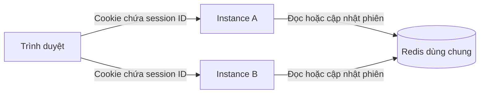
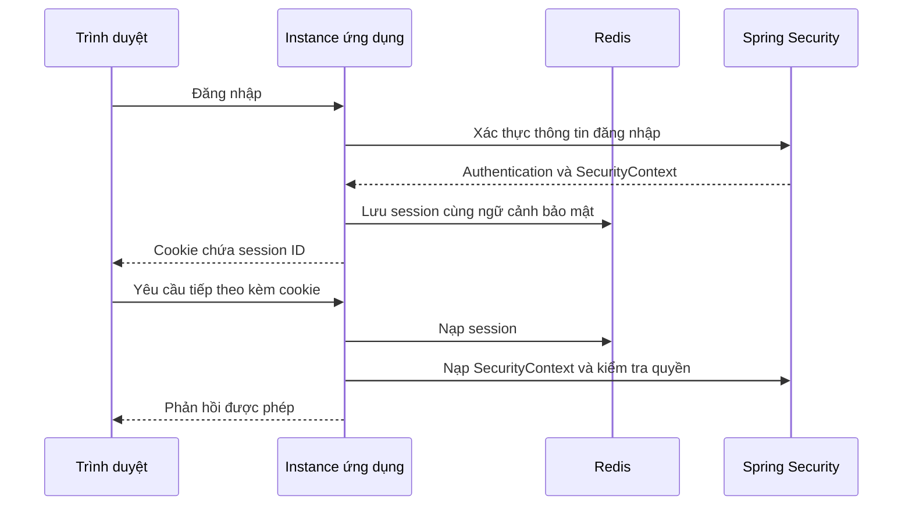
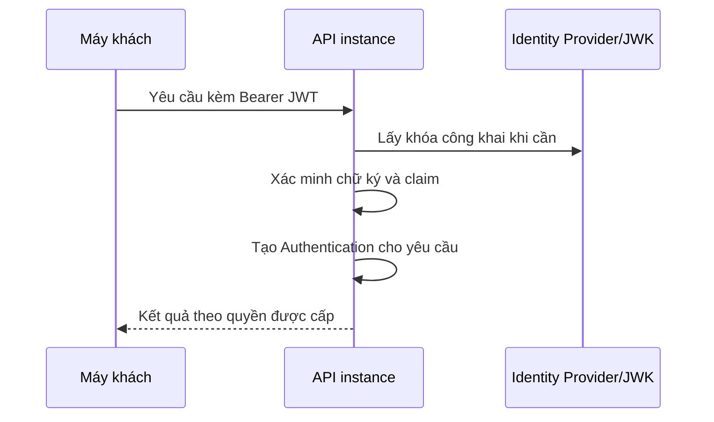

# Spring Session, Spring Security và token JWT có trách nhiệm khác nhau

Khi xây dựng ứng dụng web chạy trên nhiều instance, ba khái niệm Spring Session, Spring Security và JSON Web Token (JWT) thường xuất hiện cùng nhau. Chúng có thể phối hợp trong một hệ thống, nhưng giải quyết ba bài toán khác nhau:

- **Spring Session quản lý vòng đời và nơi lưu trữ HTTP session.** Nó cho phép ứng dụng tiếp tục sử dụng API `HttpSession` trong khi dữ liệu phiên được lưu ở kho dùng chung như Redis hoặc JDBC.
- **Spring Security quản lý bảo mật của ứng dụng.** Nó xác thực người dùng, quyết định quyền truy cập, duy trì `SecurityContext` và áp dụng các biện pháp bảo vệ liên quan đến đăng nhập, phiên và đăng xuất.
- **JWT là một định dạng token.** Token mang các claim về chủ thể và quyền, được ký để bên nhận kiểm tra tính toàn vẹn và nguồn phát hành. JWT thường được dùng làm thông tin xác thực dạng bearer cho API.

Vì vậy, Spring Session không thay thế Spring Security; JWT cũng không phải một phiên bản khác của Spring Session. Muốn chọn đúng giải pháp, trước hết cần xác định ứng dụng cần lưu trạng thái phiên, cần thực thi chính sách bảo mật, hay cần truyền thông tin xác thực giữa các hệ thống.

## 1. Ba thành phần giải quyết ba vấn đề

| Thành phần | Câu hỏi nó trả lời | Dữ liệu hoặc cơ chế chính | Nó không tự đảm nhiệm |
|---|---|---|---|
| Spring Session | Phiên HTTP được lưu ở đâu, tồn tại bao lâu và được chia sẻ giữa các instance thế nào? | `HttpSession`, `SessionRepository`, Redis/JDBC, session ID, thời hạn phiên và sự kiện phiên | Đăng nhập, phân quyền hoặc xác minh chữ ký JWT |
| Spring Security | Ai đang gửi yêu cầu và người đó được phép làm gì? | Security filter chain, `Authentication`, `SecurityContext`, các quy tắc authorization và session management | Cung cấp kho session phân tán độc lập |
| JWT | Làm sao mang thông tin xác thực có thể kiểm tra qua từng yêu cầu hoặc giữa các dịch vụ? | Header và payload chứa claim, chữ ký, thời hạn và quy tắc xác minh token | Lưu phiên phía máy chủ, tự thu hồi token hoặc tự áp dụng quyền trong ứng dụng |

Có thể hình dung mối quan hệ như sau: Spring Security quyết định danh tính và quyền; nếu ứng dụng dùng đăng nhập có trạng thái, Spring Security có thể lưu ngữ cảnh bảo mật vào `HttpSession`; Spring Session quyết định `HttpSession` đó được lưu và chia sẻ bằng cơ chế nào. Nếu ứng dụng dùng JWT theo kiểu stateless, Spring Security xác minh token trên từng yêu cầu và thường không cần lưu `SecurityContext` vào HTTP session.

## 2. Spring Session: quản lý HTTP session

### 2.1. Session ID và dữ liệu phiên

Trong mô hình session truyền thống, máy chủ tạo một phiên khi người dùng truy cập hoặc đăng nhập. Trình duyệt giữ một cookie chứa session ID. Ở những yêu cầu tiếp theo, trình duyệt gửi lại cookie để máy chủ tìm đúng dữ liệu phiên.

Session ID là mã tham chiếu tới dữ liệu được lưu phía máy chủ. Cookie thường không chứa toàn bộ dữ liệu phiên. Tên cookie cụ thể phụ thuộc cấu hình; Spring Session thường dùng cookie `SESSION`, và có thể cấu hình tên cùng các thuộc tính cookie.

Spring Session tích hợp vào Servlet thông qua `SessionRepositoryFilter`. Filter này bọc cơ chế `HttpSession` để mã ứng dụng và các thư viện tiếp tục làm việc với API Servlet quen thuộc, trong khi thao tác đọc, tạo, cập nhật và xóa phiên được chuyển tới `SessionRepository`.

Một ứng dụng dùng Spring Session với Redis có thể chạy nhiều instance như sau:



Nếu yêu cầu đầu tiên được xử lý ở instance A và yêu cầu kế tiếp được chuyển tới instance B, cả hai instance vẫn có thể đọc cùng một phiên từ Redis. Nhờ đó, ứng dụng không phụ thuộc vào dữ liệu phiên chỉ tồn tại trong bộ nhớ của một máy chủ. Cách triển khai này thường giảm nhu cầu cấu hình sticky session ở tầng cân bằng tải.

### 2.2. Kho lưu trữ và thời hạn phiên

Spring Session cung cấp các triển khai repository cho những kho lưu trữ khác nhau. Hai lựa chọn thường gặp là:

- **Redis:** phù hợp khi cần truy cập nhanh và chia sẻ phiên giữa nhiều instance. Cần cấu hình kết nối, namespace hoặc tiền tố khóa, bảo mật truy cập Redis và chính sách sẵn sàng của kho dữ liệu.
- **JDBC:** lưu thông tin phiên trong cơ sở dữ liệu quan hệ. Cách này có thể phù hợp khi hệ thống đã vận hành cơ sở dữ liệu ổn định và muốn quản lý dữ liệu phiên cùng hạ tầng đó. Cần chuẩn bị schema, chỉ mục và chính sách dọn phiên hết hạn.

Thời hạn phiên là một phần quan trọng của cấu hình. Với session có thời hạn không hoạt động 30 phút, mỗi lần truy cập hợp lệ có thể làm mới thời điểm hết hạn tùy repository và cấu hình. Hãy phân biệt:

- **Thời hạn không hoạt động của session:** khoảng thời gian máy chủ cho phép phiên không được sử dụng trước khi hết hạn.
- **Thời hạn cookie:** thời gian trình duyệt giữ cookie. Cookie có thể là cookie phiên của trình duyệt hoặc có `Max-Age`/`Expires` được cấu hình.
- **TTL ở kho lưu trữ:** thời gian bản ghi phiên tồn tại trong Redis hoặc cơ chế dọn dữ liệu của kho JDBC.

Ba mốc này cần được thiết kế nhất quán. Cookie còn tồn tại sau khi dữ liệu phiên đã hết hạn không làm phiên sống lại; ngược lại, xóa cookie ở trình duyệt cũng không nhất thiết xóa bản ghi phiên phía máy chủ.

Ví dụ cấu hình thời gian phiên ở Spring Boot:

```yaml
spring:
  session:
    timeout: 30m
```

Khi thêm starter Spring Session tương ứng với Redis hoặc JDBC, Spring Boot có thể tự cấu hình repository và filter theo phiên bản cùng cấu hình ứng dụng. Tên thuộc tính kết nối Redis, tùy chọn khởi tạo schema JDBC và cách bật repository phụ thuộc phiên bản Spring Boot/Spring Session đang sử dụng; cần đối chiếu tài liệu đúng phiên bản trước khi đưa cấu hình vào môi trường thật.

### 2.3. Cookie và bảo vệ session ID

Cookie chứa session ID là một thông tin nhạy cảm: người lấy được ID có thể thử sử dụng phiên của người khác. Với ứng dụng trình duyệt, cần xem xét các thuộc tính sau:

| Thuộc tính | Mục đích |
|---|---|
| `HttpOnly` | Ngăn JavaScript phía trình duyệt đọc cookie qua API thông thường, giảm khả năng đánh cắp cookie bằng một số dạng XSS. |
| `Secure` | Chỉ gửi cookie qua kết nối HTTPS. |
| `SameSite` | Kiểm soát việc gửi cookie trong yêu cầu cross-site, hỗ trợ giảm rủi ro CSRF. Chọn `Lax`, `Strict` hoặc `None` theo luồng đăng nhập và tích hợp thực tế. |
| `Path` và `Domain` | Giới hạn phạm vi URL hoặc tên miền nhận cookie. |
| `Max-Age` hoặc `Expires` | Điều khiển thời gian cookie được trình duyệt lưu. |

Không nên ghi session ID vào log, URL hoặc thông báo lỗi. Sau khi xác thực thành công, ứng dụng cũng cần chống session fixation bằng cách thay đổi session ID hoặc tạo phiên mới theo cơ chế Spring Security hỗ trợ. Không nên lưu quá nhiều dữ liệu hoặc đối tượng không cần thiết trong session; dữ liệu phiên có thể được tuần tự hóa và truyền qua mạng giữa các instance.

### 2.4. Sự kiện và vòng đời phiên

Spring Session có thể phát các sự kiện liên quan đến việc tạo, xóa và hết hạn phiên, chẳng hạn `SessionCreatedEvent`, `SessionDeletedEvent` và `SessionExpiredEvent`. Ứng dụng có thể dùng listener để cập nhật số liệu, ghi nhận hoạt động hoặc thực hiện công việc dọn dẹp liên quan.

Việc nhận sự kiện phụ thuộc repository và cách cấu hình kho lưu trữ. Đặc biệt với Redis, cơ chế phát hiện hết hạn có liên quan đến cấu hình thông báo hết hạn của Redis và cách Spring Session theo dõi phiên. Vì vậy, không nên coi listener là bảo đảm duy nhất cho một tác vụ nghiệp vụ quan trọng; cần kiểm tra hành vi thực tế của repository, khả năng gửi lại và cách xử lý khi ứng dụng tạm ngừng.

Spring Session quản lý vòng đời dữ liệu phiên. Nó không tự quyết định một người dùng có quyền truy cập chức năng nào. Quyết định đó thuộc Spring Security và lớp nghiệp vụ.

## 3. Spring Security: xác thực, phân quyền và tích hợp với session

### 3.1. Xác thực và phân quyền

Spring Security đặt các filter trong chuỗi xử lý yêu cầu Servlet. Tùy cấu hình, các filter có thể đọc thông tin đăng nhập, xác thực thông tin đó, tạo `Authentication`, đặt nó vào `SecurityContext`, rồi kiểm tra quyền truy cập.

Hai nhiệm vụ cần phân biệt:

- **Authentication (xác thực):** xác định chủ thể gửi yêu cầu là ai và thông tin xác thực có hợp lệ không.
- **Authorization (phân quyền):** xác định chủ thể đã xác thực có được phép thực hiện hành động hoặc truy cập tài nguyên cụ thể không.

Ví dụ, xác thực thành công cho biết yêu cầu thuộc về người dùng `alice`; bước phân quyền tiếp theo mới quyết định `alice` có quyền `REPORT_READ` để đọc báo cáo hay không. Có một session hợp lệ không đồng nghĩa người dùng được phép thực hiện mọi hành động.

### 3.2. Spring Security lưu trạng thái xác thực thế nào?

Với ứng dụng web có trạng thái, Spring Security thường dùng `SecurityContextRepository` để lưu và nạp `SecurityContext`. Một lựa chọn là `HttpSessionSecurityContextRepository`, cho phép lưu ngữ cảnh bảo mật trong `HttpSession`. Khi ứng dụng dùng Spring Session, `HttpSession` được cung cấp bởi Spring Session nên ngữ cảnh bảo mật có thể được chia sẻ qua Redis hoặc JDBC cùng dữ liệu phiên.

Luồng xử lý điển hình:

1. Người dùng đăng nhập bằng cơ chế được ứng dụng cấu hình.
2. Spring Security xác thực thông tin đăng nhập và tạo `Authentication`.
3. `SecurityContext` được lưu theo chính sách bảo mật của ứng dụng; trong cấu hình stateful, ngữ cảnh có thể được lưu vào `HttpSession`.
4. Yêu cầu sau gửi cookie session ID. Spring Session tìm dữ liệu phiên; Spring Security nạp ngữ cảnh bảo mật tương ứng.
5. Spring Security kiểm tra quyền trước khi cho phép yêu cầu đi tiếp.

Đây là điểm tích hợp quan trọng: Spring Session cung cấp phiên dùng chung, còn Spring Security quyết định cách dùng phiên đó cho trạng thái bảo mật. Chỉ cài Spring Session không tự tạo cơ chế đăng nhập hay phân quyền.

### 3.3. Chính sách tạo session

Spring Security cho phép khai báo `SessionCreationPolicy` để mô tả cách chuỗi bảo mật sử dụng HTTP session:

| Chính sách | Ý nghĩa |
|---|---|
| `ALWAYS` | Luôn tạo session HTTP. |
| `IF_REQUIRED` | Tạo session khi cần. Đây là lựa chọn thường gặp cho ứng dụng web stateful. |
| `NEVER` | Không chủ động tạo session, nhưng có thể sử dụng session đã tồn tại. |
| `STATELESS` | Spring Security không tạo `HttpSession` và không dùng `HttpSession` để lấy `SecurityContext`. |

Ví dụ cấu hình ứng dụng đăng nhập bằng form và sử dụng session khi cần:

```java
@Bean
SecurityFilterChain webSecurity(HttpSecurity http) throws Exception {
    http
        .authorizeHttpRequests(auth -> auth
            .requestMatchers("/public/**").permitAll()
            .anyRequest().authenticated())
        .formLogin(Customizer.withDefaults())
        .sessionManagement(session -> session
            .sessionCreationPolicy(SessionCreationPolicy.IF_REQUIRED));

    return http.build();
}
```

Trong ứng dụng này, có thể dùng Spring Session để lưu session vào Redis hoặc JDBC. Cấu hình trên chỉ minh họa chính sách session; ứng dụng thực tế còn cần cấu hình người dùng, cơ chế xác thực, CSRF, cookie, HTTPS và các quy tắc phân quyền phù hợp.

`STATELESS` chỉ mô tả cách Spring Security xử lý session cho bảo mật. Một thành phần khác của ứng dụng vẫn có thể gọi API Servlet để tạo `HttpSession`. Nếu mục tiêu là một API stateless thực sự, cần kiểm tra toàn bộ ứng dụng để chắc chắn không có thành phần nào vô tình phụ thuộc session.

### 3.4. Quản lý đăng xuất và phiên đồng thời

Với xác thực dựa trên session, đăng xuất thường cần xóa `SecurityContext`, vô hiệu hóa `HttpSession` và yêu cầu trình duyệt xóa cookie session. Khi dùng Spring Session, việc vô hiệu hóa phiên được chuyển tới repository để các instance khác cũng không thể tiếp tục dùng phiên đã bị xóa.

Spring Security còn hỗ trợ chính sách giới hạn số phiên đồng thời của một người dùng. Trong triển khai nhiều instance, registry chỉ nằm trong bộ nhớ của từng máy chủ có thể không phản ánh đầy đủ các phiên trên toàn cụm. Khi dùng Spring Session, có thể tích hợp `SpringSessionBackedSessionRegistry` để việc theo dõi phiên dựa trên repository dùng chung. Cần kiểm thử hành vi khi đăng nhập đồng thời, đăng xuất và hết hạn trên nhiều instance.

## 4. JWT: token mang thông tin xác thực

### 4.1. Cấu trúc và cách hoạt động

JWT là một định dạng token gọn, thường có ba phần được phân tách bằng dấu chấm:

```text
header.payload.signature
```

- **Header** mô tả loại token và thuật toán ký.
- **Payload** chứa các claim, ví dụ `iss` (bên phát hành), `sub` (chủ thể), `aud` (đối tượng nhận), `iat` (thời điểm phát hành), `exp` (thời điểm hết hạn), `nbf` (chưa hợp lệ trước thời điểm) và `scope` hoặc claim quyền tùy hệ thống.
- **Signature** giúp bên nhận kiểm tra token có bị sửa đổi hay không và token có được ký bởi khóa đáng tin cậy hay không.

Phần header và payload thường chỉ được mã hóa Base64URL để biểu diễn. Người có token có thể giải mã và đọc payload; chữ ký không làm payload trở thành bí mật. Không đưa mật khẩu, khóa bí mật hoặc dữ liệu nhạy cảm vào claim nếu token không được mã hóa bằng một cơ chế phù hợp.

JWT có chữ ký hợp lệ vẫn phải được kiểm tra đầy đủ. Bên nhận cần xác minh thuật toán được phép, chữ ký, issuer, audience, thời hạn `exp`, điều kiện `nbf` và các quy tắc claim của hệ thống. Không tin claim chỉ vì có thể giải mã payload.

### 4.2. Mô hình API stateless

Trong mô hình phổ biến, máy khách gửi access token trong header:

```http
Authorization: Bearer <access-token>
```

API xác minh token trên mỗi yêu cầu. Nếu token hợp lệ, Spring Security tạo `Authentication` cho yêu cầu hiện tại và áp dụng quy tắc phân quyền. Các instance có thể xác minh token độc lập nếu cùng tin cậy khóa hoặc endpoint JWK của bên phát hành. Không cần tìm một HTTP session dùng chung chỉ để nhận diện người gửi yêu cầu.

Ví dụ cấu hình Spring Security cho API dùng JWT:

```java
@Bean
SecurityFilterChain apiSecurity(HttpSecurity http) throws Exception {
    http
        .authorizeHttpRequests(auth -> auth
            .requestMatchers("/health").permitAll()
            .anyRequest().authenticated())
        .sessionManagement(session -> session
            .sessionCreationPolicy(SessionCreationPolicy.STATELESS))
        .oauth2ResourceServer(resourceServer -> resourceServer
            .jwt(Customizer.withDefaults()));

    return http.build();
}
```

Ví dụ cấu hình địa chỉ issuer:

```yaml
spring:
  security:
    oauth2:
      resourceserver:
        jwt:
          issuer-uri: https://id.example.com
```

Đây là cấu hình minh họa cho một resource server có thể lấy metadata và khóa xác minh từ issuer. Hệ thống cũng có thể cấu hình JWK Set URI hoặc bộ giải mã JWT theo yêu cầu. Khi dùng Spring Security OAuth2 Resource Server, nên để framework thực hiện việc giải mã và xác minh theo cấu hình tin cậy thay vì tự viết bộ phân tích token đơn giản.

### 4.3. Thu hồi token và đăng xuất

JWT access token thường được thiết kế để API xác minh mà không phải tra cứu trạng thái phiên ở máy chủ. Đổi lại, một JWT đã phát hành và còn hạn thường vẫn dùng được cho đến khi hết hạn, ngay cả khi người dùng đã bấm đăng xuất ở một giao diện.

Xóa token khỏi bộ nhớ của máy khách chỉ ngăn máy khách đó tiếp tục gửi token. Nó không làm bản sao token đã bị lấy cắp mất hiệu lực. Nếu cần thu hồi sớm, hệ thống phải bổ sung cơ chế như denylist theo `jti`, phiên bản token hoặc trạng thái thu hồi phía máy chủ, hoặc dùng access token thời hạn ngắn kết hợp refresh token có thể thu hồi và luân chuyển. Những cơ chế tra cứu trạng thái này tạo thêm chi phí lưu trữ và vận hành.

Vì vậy, cần phân biệt đăng xuất khỏi giao diện với thu hồi một bearer token trên toàn hệ thống. Nếu JWT được đặt trong cookie tự động gửi theo yêu cầu trình duyệt, ứng dụng vẫn phải đánh giá rủi ro CSRF và cấu hình cookie phù hợp. Dùng JWT không tự động loại bỏ CSRF trong mọi cách triển khai.

## 5. Các mô hình kết hợp thường gặp

| Trường hợp | Spring Session | Spring Security | JWT |
|---|---|---|---|
| Ứng dụng web đăng nhập bằng form, chạy một instance | Có thể dùng; cũng có thể dùng session mặc định của container | Xác thực, phân quyền và lưu ngữ cảnh vào session | Thường không cần |
| Ứng dụng web stateful chạy nhiều instance | Dùng Redis/JDBC để chia sẻ `HttpSession` | Quản lý đăng nhập, quyền, fixation, đăng xuất và phiên đồng thời | Không bắt buộc |
| REST API stateless | Thường không dùng cho trạng thái xác thực | Xác minh token và áp dụng quyền; cấu hình `STATELESS` | Dùng access token để mang thông tin xác thực |
| BFF phục vụ trình duyệt và nhiều API nội bộ | Có thể giữ session trình duyệt tại BFF | Bảo vệ BFF và các API theo chính sách tương ứng | Có thể dùng token giữa BFF và dịch vụ hoặc giữa các dịch vụ |

### Mô hình A: ứng dụng web stateful trên nhiều instance



Ở mô hình này, Spring Security xử lý danh tính và quyền; Spring Session lưu session ở Redis để các instance chia sẻ. Cookie chỉ mang session ID. Không cần thêm JWT chỉ để giải quyết việc cân bằng tải giữa các instance.

### Mô hình B: API stateless dùng JWT



Ở mô hình này, JWT mang thông tin xác thực; Spring Security xác minh và áp dụng chính sách. Nếu không có nhu cầu session khác, Spring Session không cần tham gia vào luồng xác thực API.

## 6. Chọn giải pháp theo yêu cầu

Hãy bắt đầu từ cách máy khách tương tác với ứng dụng:

1. **Ứng dụng web truyền thống, trình duyệt giữ cookie và máy chủ cần nhớ trạng thái đăng nhập:** dùng Spring Security với session. Nếu cần chia sẻ phiên giữa nhiều instance, bổ sung Spring Session và repository dùng chung.
2. **API nhận bearer token từ ứng dụng di động, SPA hoặc dịch vụ khác:** cân nhắc OAuth 2.0/OIDC và JWT access token. Dùng Spring Security Resource Server để xác minh token; đặt chính sách `STATELESS` nếu API không cần HTTP session cho bảo mật.
3. **Một hệ thống vừa có giao diện web vừa có API:** có thể dùng session cho luồng trình duyệt và JWT cho giao tiếp dịch vụ. Mỗi luồng phải có ranh giới xác thực, cách lưu credential và chính sách CSRF rõ ràng.
4. **Nhu cầu chính chỉ là chạy nhiều instance:** không chọn JWT chỉ vì có nhiều máy chủ. Spring Session với Redis/JDBC giải quyết trực tiếp việc chia sẻ HTTP session. JWT phù hợp khi cần token có thể xác minh độc lập qua nhiều API hoặc dịch vụ.

Một số câu hỏi giúp kiểm tra quyết định:

- Máy chủ có cần chủ động vô hiệu hóa một phiên ngay lập tức không? Session phía máy chủ thường thuận tiện hơn; JWT cần cơ chế thu hồi bổ sung nếu không thể chờ token hết hạn.
- Trình duyệt có tự động gửi credential theo cookie không? Nếu có, cần thiết kế CSRF và thuộc tính cookie.
- Các instance có cần chia sẻ giỏ hàng, trạng thái quy trình hoặc dữ liệu người dùng ngoài `SecurityContext` không? Đó có thể là lý do dùng Spring Session ngay cả khi một API khác dùng JWT.
- Hệ thống có cần giới hạn số phiên đăng nhập đồng thời hoặc buộc đăng xuất từ xa không? Cần xác định nơi lưu trạng thái phiên và registry có hoạt động xuyên cụm hay không.
- Dịch vụ nhận token có thể xác minh issuer, audience, chữ ký và thời hạn một cách đáng tin cậy không? Nếu không, thiết kế phát hành và quản lý khóa cần được hoàn thiện trước khi triển khai JWT.

## 7. Kiểm thử và vận hành trong môi trường nhiều instance

Một cấu hình chạy được trên một máy chưa chứng minh rằng session hoạt động đúng trong cụm. Nên kiểm thử tối thiểu các tình huống sau:

| Tình huống | Cách kiểm tra | Kết quả mong đợi |
|---|---|---|
| Đăng nhập ở instance A, gửi yêu cầu tới instance B | Cố định hoặc quan sát instance xử lý từng yêu cầu; dùng cùng cookie | B đọc được session và `SecurityContext` hợp lệ từ kho dùng chung |
| Session hết hạn do không hoạt động | Chờ quá timeout hoặc giảm timeout trong môi trường kiểm thử | Yêu cầu tiếp theo không còn được xem là đã đăng nhập |
| Đăng xuất ở instance A, tiếp tục gọi instance B | Đăng xuất rồi gửi lại cookie cũ | Phiên đã vô hiệu hóa không được chấp nhận |
| Hai lần đăng nhập cùng tài khoản | Gửi đăng nhập từ hai trình duyệt hoặc hai client | Chính sách số phiên đồng thời được thực thi nhất quán |
| Kho session tạm thời không khả dụng | Làm gián đoạn Redis/JDBC trong môi trường kiểm thử | Ứng dụng xử lý lỗi rõ ràng; không tự chuyển sang tin cậy một session không xác minh được |
| JWT hết hạn hoặc sai audience | Gửi token có claim không hợp lệ | API từ chối yêu cầu; không tạo `Authentication` hợp lệ |
| JWT bị sửa payload hoặc chữ ký | Thay đổi một claim mà không ký lại | API từ chối token |

Khi vận hành, theo dõi số phiên đang hoạt động, số phiên tạo/xóa/hết hạn, lỗi kết nối repository, độ trễ đọc ghi và dung lượng kho lưu trữ. Với Redis, cần theo dõi memory, eviction, replication, persistence và kết nối mạng; với JDBC, cần theo dõi tải truy vấn, chỉ mục, lock và công việc dọn dữ liệu hết hạn.

Các instance phải thống nhất cấu hình cookie, namespace repository, serializer và thời hạn phiên. Nếu nhiều ứng dụng dùng chung Redis, đặt namespace riêng để tránh xung đột khóa. Khi thay đổi cấu trúc dữ liệu được lưu trong session, cần xem xét tương thích giữa các phiên bản ứng dụng đang chạy đồng thời trong quá trình rolling deployment.

Đối với JWT, theo dõi lỗi xác minh theo nguyên nhân như chữ ký không hợp lệ, issuer/audience sai hoặc token hết hạn; quản lý vòng đời khóa ký và khóa công khai; hỗ trợ luân chuyển khóa; đồng bộ thời gian máy chủ để kiểm tra claim thời gian ổn định. Không ghi toàn bộ token vào log hoặc hệ thống theo dõi lỗi.

## 8. Những nhầm lẫn cần tránh

- **“Dùng Spring Session là đã có đăng nhập an toàn.”** Sai. Spring Session lưu và quản lý phiên; Spring Security hoặc cơ chế bảo mật khác mới xác thực và phân quyền.
- **“Spring Security luôn cần Spring Session.”** Sai. Spring Security có thể dùng session HTTP mặc định của Servlet container, hoặc xác thực stateless bằng bearer token. Spring Session hữu ích khi cần repository phiên có thể chia sẻ và quản lý tập trung.
- **“JWT là session không cần máy chủ.”** Không chính xác. JWT là token mang claim. Ứng dụng vẫn có thể lưu trạng thái thu hồi, refresh token hoặc dữ liệu nghiệp vụ phía máy chủ; token còn hạn cũng không tự mất hiệu lực chỉ vì người dùng xóa nó ở trình duyệt.
- **“Chuyển sang JWT thì không cần bảo vệ CSRF.”** Chỉ có thể đúng trong một số cách gửi token mà trình duyệt không tự động đính kèm credential. Nếu JWT nằm trong cookie, cần đánh giá CSRF như các cơ chế cookie khác.
- **“Session lưu ở Redis thì mọi thứ trong ứng dụng đều được chia sẻ.”** Chỉ dữ liệu được lưu trong session repository mới được chia sẻ theo cơ chế đó. Bộ nhớ cục bộ, cache riêng hoặc biến static vẫn thuộc từng instance.
- **“Xóa cookie đồng nghĩa phiên đã bị thu hồi.”** Xóa cookie ở client không đảm bảo bản ghi phía máy chủ bị xóa. Muốn đăng xuất có hiệu lực trên toàn cụm, phải vô hiệu hóa session ở repository và xử lý cookie phía trình duyệt.

## Kết luận

Spring Session giải quyết việc lưu trữ và chia sẻ HTTP session; Spring Security giải quyết xác thực, phân quyền và chính sách bảo mật; JWT cung cấp định dạng token để mang thông tin xác thực có thể được xác minh bằng chữ ký và claim. Một ứng dụng có thể dùng Spring Session cùng Spring Security cho đăng nhập stateful, dùng Spring Security cùng JWT cho API stateless, hoặc kết hợp cả hai mô hình trong các luồng khác nhau. Quyết định đúng phụ thuộc vào cách máy khách gửi thông tin xác thực, nhu cầu thu hồi đăng nhập, dữ liệu cần chia sẻ và yêu cầu vận hành của hệ thống.
