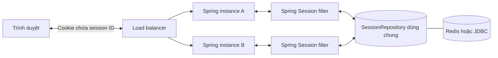

# Lộ trình từ một phiên cục bộ đến quản lý phiên trên nhiều nút

Một ứng dụng Spring MVC thường dùng `HttpSession` để giữ trạng thái giữa nhiều HTTP request: người dùng đã đăng nhập, mã luồng thao tác đang thực hiện, lựa chọn tạm thời hoặc một ít dữ liệu giao diện. Khi ứng dụng chỉ chạy trên một máy chủ, session thường được lưu trong bộ nhớ của servlet container và cách làm này khá đơn giản. Khi triển khai nhiều instance phía sau load balancer, session cục bộ trở thành một vấn đề kiến trúc: request tiếp theo có thể đến instance khác và instance đó không biết session trước đó.

Spring Session giải quyết vấn đề bằng cách thay nơi lưu `HttpSession` bằng một kho session dùng chung. Các instance vẫn làm việc với API Servlet quen thuộc, trong khi dữ liệu phiên được đọc và ghi qua Redis hoặc JDBC. Bài học này đi từ mô hình một instance đến kiến trúc nhiều instance, sau đó trình bày cách chọn kho lưu trữ, cấu hình cookie và thời hạn, xử lý sự kiện và đăng xuất, kiểm thử tính nhất quán cũng như chuẩn bị vận hành.

Sau bài học, bạn có thể giải thích vì sao session cục bộ gặp vấn đề khi scale ngang, mô tả vai trò của Spring Session, chọn Redis hoặc JDBC theo đặc điểm hệ thống, và lập kế hoạch chuyển đổi mà không làm thay đổi cách controller sử dụng `HttpSession`.

## 1. Session bắt đầu từ đâu?

HTTP không tự ghi nhớ request trước đó. Mỗi request là một thông điệp riêng; server cần một cách nhận ra các request thuộc cùng một phiên làm việc. Trong ứng dụng Servlet, `HttpSession` cung cấp giao diện để tạo, đọc, cập nhật và hủy trạng thái phiên.

Ở lần truy cập đầu tiên, server tạo session và gửi một cookie chứa định danh phiên về trình duyệt. Với servlet container mặc định, cookie thường có tên `JSESSIONID`. Trình duyệt gửi lại cookie trong các request tiếp theo. Cookie chỉ mang định danh; dữ liệu như trạng thái đăng nhập hoặc thuộc tính session nằm ở phía server.

Ví dụ, controller có thể lưu một bước hiện tại của quy trình:

```java
@GetMapping("/wizard/next")
public Map<String, Object> nextStep(HttpSession session) {
    Integer current = (Integer) session.getAttribute("wizardStep");
    int next = current == null ? 1 : current + 1;

    session.setAttribute("wizardStep", next);
    return Map.of("step", next);
}
```

Đoạn mã chỉ thể hiện API. Trong ứng dụng thực tế, không nên dùng session làm nơi lưu dữ liệu nghiệp vụ quan trọng, giỏ hàng lớn hoặc dữ liệu cần giao dịch bền vững. Session phù hợp với trạng thái ngắn hạn gắn với một trình duyệt và một luồng tương tác. Dữ liệu nghiệp vụ cần tồn tại độc lập với phiên nên được lưu trong cơ sở dữ liệu hoặc hệ thống chuyên trách.

## 2. Vì sao một session cục bộ không đủ khi có nhiều instance?

Giả sử ứng dụng chạy trên một instance A. Servlet container của A giữ session trong bộ nhớ của chính tiến trình đó. Khi load balancer chuyển request kế tiếp sang instance B, B nhận được cookie chứa session ID nhưng không có dữ liệu tương ứng trong bộ nhớ. Người dùng có thể bị xem như chưa đăng nhập hoặc mất trạng thái đang thao tác.

Có ba giai đoạn triển khai thường gặp:

| Mô hình | Cách xử lý session | Giới hạn chính |
| --- | --- | --- |
| Một instance | Container lưu session trong bộ nhớ của instance | Restart hoặc mất tiến trình làm mất session; khó scale ngang |
| Nhiều instance với sticky session | Load balancer cố gắng đưa một trình duyệt về cùng instance | Phụ thuộc cấu hình load balancer; instance hỏng vẫn làm mất session; tải có thể phân bố lệch |
| Nhiều instance với kho session dùng chung | Mọi instance đọc và ghi session qua Redis hoặc JDBC | Cần vận hành kho dùng chung, quản lý độ trễ, tính sẵn sàng và dữ liệu phiên |

Sticky session có thể là bước chuyển tiếp hữu ích vì không đòi hỏi thay đổi ứng dụng ngay. Tuy nhiên, nó chỉ giữ request ở cùng một instance trong điều kiện bình thường; nó không tự sao chép session sang instance khác. Nếu instance bị thay thế trong lúc deploy, scale-in hoặc gặp sự cố, người dùng vẫn có thể mất phiên. Vì vậy, sticky session không thay thế cho một kho session chia sẻ khi hệ thống cần chịu lỗi và scale ngang ổn định.

## 3. Kiến trúc khi đưa Spring Session vào

Spring Session thay lớp lưu trữ session mặc định bằng một `SessionRepository`. `SessionRepositoryFilter` tích hợp với Servlet API để mã ứng dụng tiếp tục gọi `request.getSession()` hoặc nhận `HttpSession` trong controller. Filter tìm session theo cookie, tải dữ liệu từ repository và lưu thay đổi trở lại repository theo chính sách cấu hình.



Luồng request có thể hiểu theo các bước sau:

1. Trình duyệt gửi cookie session ID cùng request.
2. Spring Session filter đọc ID và hỏi repository để tải session. Nếu chưa có session hợp lệ, ứng dụng có thể tạo một session mới khi cần.
3. Controller và Spring Security sử dụng API session như bình thường.
4. Khi request kết thúc, Spring Session lưu những thay đổi theo `flush-mode` và `save-mode` đã cấu hình.
5. Nếu tạo session mới hoặc cần cập nhật cookie, response gửi cookie tương ứng về trình duyệt.

Do tất cả instance dùng cùng repository và cùng cấu hình namespace, request sau có thể được xử lý bởi bất kỳ instance nào. Session ID giúp tìm đúng dữ liệu; repository dùng chung cung cấp dữ liệu đó cho từng instance. Cơ chế này không có nghĩa toàn bộ trạng thái trong bộ nhớ ứng dụng được chia sẻ: biến instance, cache cục bộ và singleton bean vẫn riêng biệt trên từng tiến trình.

## 4. Chọn kho session: Redis hay JDBC?

Spring Session cung cấp các repository cho nhiều loại kho dữ liệu. Hai lựa chọn phổ biến là Redis và JDBC.

| Tiêu chí | Redis | JDBC |
| --- | --- | --- |
| Đặc điểm | Kho dữ liệu trong bộ nhớ, truy cập nhanh, hỗ trợ TTL | Session nằm trong bảng của cơ sở dữ liệu quan hệ |
| Phù hợp khi | Lưu lượng session lớn, cần truy cập độ trễ thấp, hệ thống đã vận hành Redis | Muốn dùng hạ tầng SQL sẵn có, lưu lượng vừa phải hoặc có yêu cầu quản trị dữ liệu tập trung trong RDBMS |
| Việc cần vận hành | Dung lượng bộ nhớ, replication/failover, eviction, kết nối và keyspace notification | Dung lượng bảng, index, connection pool, truy vấn dọn session hết hạn và tải lên database |
| Rủi ro cần tính | Session có thể mất khi cấu hình persistence/failover không đáp ứng yêu cầu; eviction sai chính sách có thể làm mất phiên | Session tạo thêm tải đọc/ghi và cạnh tranh tài nguyên với giao dịch nghiệp vụ |

Không có lựa chọn đúng cho mọi hệ thống. Redis thường phù hợp với session có tần suất truy cập cao và thời gian sống ngắn. JDBC có thể đơn giản hóa vận hành khi tổ chức đã có database quan hệ được quản trị tốt và lưu lượng session không quá lớn. Hãy đo lưu lượng, độ trễ, yêu cầu sẵn sàng và chi phí vận hành trước khi chọn.

### 4.1. Cấu hình Redis với Spring Boot

Với Gradle, một ứng dụng Spring MVC dùng Redis session thường cần các dependency sau. Để Spring Boot quản lý phiên bản, nên dùng dependency management/BOM của phiên bản Spring Boot dự án đang sử dụng.

```groovy
dependencies {
    implementation("org.springframework.boot:spring-boot-starter-web")
    implementation("org.springframework.boot:spring-boot-starter-data-redis")
    implementation("org.springframework.session:spring-session-data-redis")
}
```

Ví dụ cấu hình `application.yml` cho môi trường phát triển:

```yaml
spring:
  data:
    redis:
      host: localhost
      port: 6379
  session:
    timeout: 30m
    redis:
      namespace: demo:spring-session
      flush-mode: on-save
      save-mode: on-set-attribute
```

Khi dependency và kết nối Redis được cấu hình, Spring Boot có thể tự cấu hình repository phù hợp. Với cấu hình Spring Boot tự động, không cần thêm `@EnableRedisHttpSession` lần nữa. Nếu ứng dụng không dùng auto-configuration và muốn cấu hình thủ công, có thể khai báo `@EnableRedisHttpSession` cùng một `RedisConnectionFactory`; chỉ chọn một cách cấu hình để tránh đăng ký repository/filter trùng lặp.

`namespace` tạo tiền tố riêng cho key session, giúp phân biệt ứng dụng hoặc môi trường dùng chung Redis. Không để các ứng dụng độc lập vô tình dùng chung namespace. `flush-mode` quyết định thời điểm ghi thay đổi xuống kho; `on-save` thường gom việc ghi đến cuối request. `save-mode` quyết định khi nào thuộc tính session được lưu; `on-set-attribute` tập trung vào thuộc tính được đặt qua API session. Cần chọn chế độ phù hợp với cách ứng dụng thay đổi object bên trong session.

Ví dụ: nếu lưu một object mutable rồi sửa trực tiếp field của object mà không gọi lại `session.setAttribute`, repository có thể không nhận ra thuộc tính đã thay đổi, tùy save mode và cách tích hợp. Cách rõ ràng hơn là tạo giá trị mới rồi gọi `setAttribute` sau khi cập nhật, hoặc chọn save mode phù hợp và kiểm thử hành vi thực tế.

### 4.2. Cấu hình JDBC

Với JDBC, thêm Spring Session JDBC, Spring JDBC và driver của database:

```groovy
dependencies {
    implementation("org.springframework.boot:spring-boot-starter-web")
    implementation("org.springframework.boot:spring-boot-starter-jdbc")
    implementation("org.springframework.session:spring-session-jdbc")
    runtimeOnly("org.postgresql:postgresql")
}
```

Ví dụ cấu hình:

```yaml
spring:
  datasource:
    url: jdbc:postgresql://localhost:5432/app
    username: app_user
    password: ${DB_PASSWORD}
  session:
    timeout: 30m
    jdbc:
      initialize-schema: always
```

Spring Session JDBC dùng các bảng session và thuộc tính session, thường có tên `SPRING_SESSION` và `SPRING_SESSION_ATTRIBUTES`. `initialize-schema: always` hữu ích cho môi trường phát triển hoặc thử nghiệm. Trong production, nên quản lý schema bằng công cụ migration của dự án, kiểm tra schema tương ứng với phiên bản Spring Session rồi cấu hình không tự khởi tạo schema khi ứng dụng khởi động.

JDBC giúp session dùng chung qua database, nhưng mỗi request có thể tạo thêm thao tác đọc/ghi. Theo dõi connection pool, thời gian truy vấn và tốc độ tăng của bảng. Việc dọn session hết hạn cũng cần được kiểm tra để bảng không tăng vô hạn.

## 5. Cookie, thời hạn và vòng đời session

Session ID là thông tin nhạy cảm: người có được ID hợp lệ có thể thử sử dụng phiên của người dùng. Cookie nên được cấu hình với `HttpOnly`, `Secure` khi chạy HTTPS và `SameSite` phù hợp với luồng điều hướng của ứng dụng. Không ghi session ID đầy đủ vào log, URL, analytics hoặc thông báo lỗi.

Spring Session dùng cookie riêng thông qua `CookieSerializer`. Ví dụ cấu hình rõ tên cookie và các thuộc tính bảo vệ:

```java
@Configuration
public class SessionCookieConfiguration {

    @Bean
    CookieSerializer cookieSerializer() {
        DefaultCookieSerializer serializer = new DefaultCookieSerializer();
        serializer.setCookieName("APPSESSION");
        serializer.setCookiePath("/");
        serializer.setUseHttpOnlyCookie(true);
        serializer.setUseSecureCookie(true); // Dùng khi ứng dụng được truy cập qua HTTPS.
        serializer.setSameSite("Lax");
        return serializer;
    }
}
```

Đảm bảo cookie domain và path nhất quán với cách người dùng truy cập ứng dụng. Nếu TLS kết thúc ở reverse proxy, cấu hình forwarded headers và cách ứng dụng nhận biết request HTTPS phải chính xác; nếu không, cookie `Secure` hoặc redirect có thể hoạt động sai. Trong môi trường local HTTP, cấu hình `Secure` cần được điều chỉnh theo profile phát triển.

Phân biệt hai khái niệm thời hạn:

- **Session timeout/idle timeout** là khoảng thời gian session không được sử dụng trước khi hết hạn. `spring.session.timeout: 30m` đặt ví dụ thời hạn không hoạt động 30 phút. Repository thường áp dụng TTL tương ứng cho session.
- **Cookie max-age** là thời gian trình duyệt giữ cookie. Cookie session thường bị xóa khi đóng trình duyệt; cookie bền vững có thể tồn tại lâu hơn. Việc cookie còn trong trình duyệt không có nghĩa session phía server vẫn còn hiệu lực.

Idle timeout cũng khác với giới hạn tuyệt đối của phiên đăng nhập. Nếu yêu cầu bảo mật quy định người dùng phải đăng nhập lại sau một khoảng thời gian cố định kể từ lúc xác thực, cần lưu thời điểm xác thực và kiểm tra giới hạn tuyệt đối riêng. Chỉ đặt idle timeout không đảm bảo điều đó, vì hoạt động liên tục có thể kéo dài phiên.

## 6. Sự kiện session và xử lý đăng xuất

Ứng dụng có thể cần biết khi session được tạo, bị xóa chủ động hoặc hết hạn để ghi audit, cập nhật số liệu hoặc dọn tài nguyên phụ. Spring Session phát các sự kiện vòng đời như `SessionCreatedEvent`, `SessionDeletedEvent` và `SessionExpiredEvent` tùy repository và phiên bản. Có thể lắng nghe bằng `@EventListener`:

```java
@Component
public class SessionLifecycleListener {

    @EventListener
    public void onCreated(SessionCreatedEvent event) {
        // Ghi nhận sự kiện tạo phiên; không ghi session ID nhạy cảm vào log.
    }

    @EventListener
    public void onExpired(SessionExpiredEvent event) {
        // Cập nhật số liệu hoặc xử lý công việc phụ có thể chạy lặp an toàn.
    }

    @EventListener
    public void onDeleted(SessionDeletedEvent event) {
        // Xử lý phiên bị xóa chủ động.
    }
}
```

Sự kiện hết hạn phụ thuộc khả năng phát hiện expiration của repository. Với Redis, cần cấu hình và xác minh keyspace notification theo yêu cầu của Spring Session và dịch vụ Redis đang dùng. Một số Redis được quản lý không cho phép ứng dụng thay đổi cấu hình này; khi đó cần dùng cấu hình phù hợp mà nhà cung cấp hỗ trợ. Không xem listener như cơ chế duy nhất để bảo đảm công việc nghiệp vụ quan trọng đã chạy đúng một lần. Handler nên chịu được việc chạy lặp, chậm hoặc không nhận được sự kiện trong một số tình huống lỗi.

Khi không dùng Spring Security, có thể hủy session hiện tại bằng `invalidate()`:

```java
@PostMapping("/logout")
public void logout(HttpServletRequest request) {
    HttpSession session = request.getSession(false);
    if (session != null) {
        session.invalidate();
    }
}
```

Nếu ứng dụng dùng Spring Security, nên dùng logout flow của Spring Security. Ví dụ phần cấu hình có thể yêu cầu hủy session, xóa authentication và xóa cookie mang tên đã chọn:

```java
http.logout(logout -> logout
    .invalidateHttpSession(true)
    .clearAuthentication(true)
    .deleteCookies("APPSESSION"));
```

Đường dẫn logout cần tuân theo phương thức HTTP và cấu hình CSRF của ứng dụng; không nên biến logout thành GET chỉ để dễ gọi từ trình duyệt. Khi session nằm trong repository dùng chung, thao tác invalidate được lưu ở kho chung nên request sau đi đến instance khác cũng không thể tiếp tục dùng session cũ. Cookie cần được xóa với đúng tên, domain và path đã phát hành.

Sau khi xác thực thành công, cần bảo vệ khỏi session fixation. Spring Security có cơ chế bảo vệ session fixation trong cấu hình mặc định; hãy giữ cơ chế đó hoặc cấu hình chiến lược đổi session ID phù hợp. Không tự tái sử dụng session ID trước đăng nhập như một định danh tin cậy sau đăng nhập.

## 7. Kiểm thử nhiều instance và request đồng thời

Một bài kiểm thử chỉ chạy một instance và một repository giả lập chưa chứng minh được cấu hình nhiều nút hoạt động. Nên kiểm tra ít nhất hai ứng dụng Spring chạy ở hai cổng khác nhau, cùng kết nối đến một Redis hoặc database thử nghiệm, cùng namespace và cùng cấu hình cookie.

Quy trình kiểm thử tích hợp:

1. Khởi động kho session dùng chung, sau đó khởi động instance A và B.
2. Gửi request đến A để tạo session hoặc đăng nhập; lưu cookie trong response.
3. Gửi request đến B kèm cookie vừa nhận. Xác minh B đọc được trạng thái cần thiết và nhận ra cùng người dùng.
4. Thay đổi một thuộc tính session qua A, rồi đọc thuộc tính đó qua B để kiểm tra khả năng chia sẻ.
5. Đăng xuất qua A, sau đó gửi lại cookie cũ đến B. Request phải được xử lý như một phiên đã bị hủy.
6. Chờ quá idle timeout trong môi trường kiểm thử, rồi xác minh session hết hạn và không còn được chấp nhận.
7. Gửi các request đồng thời với cùng cookie để quan sát hành vi khi nhiều request đọc và ghi session cùng lúc.

Có thể dùng Testcontainers để khởi chạy Redis hoặc database riêng cho test, tránh phụ thuộc vào dịch vụ dùng chung của máy phát triển. Với kiểm thử hai instance, tạo hai application context hoặc chạy hai tiến trình ứng dụng và đảm bảo cả hai trỏ đến cùng repository. Không dùng cookie của một test khác nếu test đó có thể đã kết thúc hoặc làm thay đổi session.

Spring Session chia sẻ nơi lưu session, nhưng không biến thao tác cập nhật thuộc tính thành giao dịch phân tán. Ví dụ hai request cùng đọc `counter = 4`, mỗi request cộng một rồi ghi lại; kết quả cuối có thể là 5 thay vì 6. Nếu dữ liệu cần cập nhật chính xác khi đồng thời, hãy dùng thao tác nguyên tử của kho dữ liệu, transaction/optimistic locking trong database hoặc một thiết kế nghiệp vụ phù hợp. Chỉ giữ trong session các trạng thái nhỏ mà ứng dụng có thể xử lý khi request đến đồng thời.

## 8. Các điểm cần chuẩn bị khi vận hành

Khi chuyển sang kho dùng chung, session trở thành một phụ thuộc hạ tầng của mọi instance. Cần chuẩn bị các nội dung sau:

- **Tính sẵn sàng:** triển khai Redis hoặc database theo mức sẵn sàng yêu cầu; kiểm tra failover, backup và khả năng phục hồi. Replication bất đồng bộ có thể làm mất một phần thay đổi gần thời điểm sự cố, vì vậy không giả định mọi session write đều được bảo đảm tuyệt đối.
- **Dung lượng và TTL:** ước lượng số session đồng thời, kích thước thuộc tính và thời hạn. Với Redis, theo dõi bộ nhớ, eviction và key hết hạn; tránh để chính sách eviction chung xóa session còn hiệu lực. Với JDBC, theo dõi kích thước bảng, index và tác vụ dọn dữ liệu hết hạn.
- **Kết nối và độ trễ:** cấu hình connection pool, timeout và giới hạn kết nối hợp lý. Theo dõi lỗi kết nối, độ trễ đọc/ghi và tỷ lệ request không tải được session.
- **Bảo mật:** giới hạn quyền truy cập kho session, dùng TLS và thông tin xác thực phù hợp, tách namespace theo ứng dụng/môi trường, bảo vệ cookie và tránh ghi dữ liệu nhạy cảm không cần thiết vào session.
- **Tương thích khi deploy:** các instance chạy song song trong rolling deployment có thể đọc cùng dữ liệu session. Tránh thay đổi class hoặc định dạng serialize đột ngột khiến phiên được ghi bởi phiên bản cũ không đọc được bởi phiên bản mới. Ưu tiên dữ liệu đơn giản, ổn định; có kế hoạch tương thích hoặc hết hạn session trong quá trình nâng cấp.
- **Khả năng quan sát:** theo dõi số session đang hoạt động, session tạo/xóa/hết hạn, lỗi repository, độ trễ và số lần người dùng phải đăng nhập lại bất thường. Không đưa session ID hoặc nội dung bí mật vào metric label hay log.

Nếu kho session tạm thời không truy cập được, request cần tạo/đọc session có thể thất bại. Hãy xác định rõ timeout và cách ứng dụng phản hồi, kiểm tra hành vi khi Redis/database mất kết nối, và tránh retry vô hạn làm tăng tải trong lúc sự cố. Những thao tác nghiệp vụ quan trọng không nên phụ thuộc vào việc session luôn sẵn sàng.

## 9. Lộ trình chuyển đổi thực tế

Có thể triển khai chuyển đổi theo từng bước để dễ kiểm chứng:

1. **Kiểm kê cách dùng session:** tìm nơi tạo session, thuộc tính được lưu, kích thước dữ liệu, thời hạn, cách logout và những phần phụ thuộc vào session ID. Loại bỏ dữ liệu lớn hoặc dữ liệu nghiệp vụ đáng lẽ phải nằm trong database.
2. **Ổn định ứng dụng trên một instance:** xác định cookie name, timeout, các thuộc tính session và luồng đăng nhập/đăng xuất. Viết test cho các luồng quan trọng trước khi thay repository.
3. **Thêm Spring Session và kho dùng chung:** chọn Redis hoặc JDBC, cấu hình repository, namespace, schema/kết nối và TTL. Giữ controller sử dụng `HttpSession` để thay đổi tập trung ở lớp lưu trữ.
4. **Chuẩn hóa cookie và bảo mật:** cấu hình `HttpOnly`, `Secure`, `SameSite`, domain/path; kiểm tra HTTPS, reverse proxy, CSRF và session fixation.
5. **Kiểm thử nhiều instance:** chạy cùng một luồng qua A rồi B, thử logout, hết hạn, request đồng thời và tình huống kho dữ liệu gián đoạn.
6. **Triển khai có quan sát:** theo dõi tỷ lệ đăng nhập lại, lỗi session, độ trễ repository và dung lượng. Mở rộng số instance sau khi đã xác minh kho session dùng chung chịu được tải dự kiến.

Trong lúc chuyển đổi, không nên mặc định session cũ trong bộ nhớ của servlet container sẽ tự xuất hiện trong Redis/JDBC. Các session đã tạo trước khi bật Spring Session thường không được tự di chuyển sang repository mới. Chọn thời điểm triển khai phù hợp, chấp nhận người dùng đăng nhập lại nếu cần, hoặc thiết kế một cơ chế chuyển đổi có kiểm soát nếu yêu cầu sản phẩm không cho phép mất phiên.

## 10. Tự kiểm tra kiến thức

Bạn đã nắm được lộ trình nếu có thể trả lời rõ các câu hỏi sau:

- Vì sao một session lưu trong bộ nhớ của instance A không tự dùng được khi load balancer chuyển request sang B?
- Sticky session cải thiện điều gì và không giải quyết được tình huống nào?
- `SessionRepository` và `SessionRepositoryFilter` đóng vai trò gì trong việc giữ nguyên API `HttpSession`?
- Khi nào Redis hợp lý hơn JDBC, và những chỉ số vận hành nào cần theo dõi cho mỗi lựa chọn?
- Idle timeout khác cookie max-age và giới hạn tuyệt đối của phiên đăng nhập như thế nào?
- Vì sao cần kiểm thử đăng xuất và hết hạn bằng cookie cũ qua một instance khác?
- Vì sao hai request đồng thời có thể ghi đè thay đổi session của nhau, và dữ liệu nào nên được chuyển sang một kho nghiệp vụ có transaction?

Điểm cốt lõi của kiến trúc nhiều nút là mọi instance phải tra cứu cùng một định danh phiên trong cùng một kho dữ liệu, với chính sách bảo mật, thời hạn và vận hành nhất quán. Spring Session làm cho việc chuyển nơi lưu session ít ảnh hưởng đến mã Servlet hiện có, nhưng độ tin cậy cuối cùng vẫn phụ thuộc vào thiết kế dữ liệu phiên, kho dùng chung và cách kiểm thử các tình huống thực tế.
