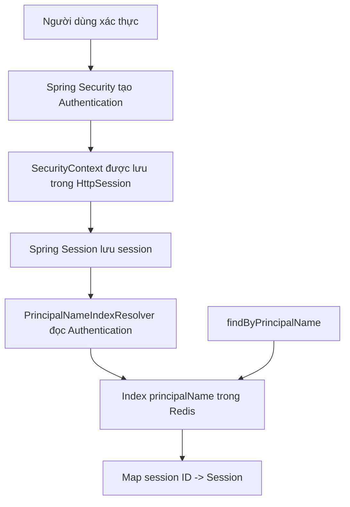

# `FindByIndexNameSessionRepository` và tên chỉ mục principal

Trong ứng dụng có nhiều người dùng và nhiều phiên đăng nhập đồng thời, đôi khi cần tìm tất cả session thuộc về một người dùng. Ví dụ, khi người dùng đổi mật khẩu, đội vận hành muốn thu hồi các phiên cũ; khi giới hạn số thiết bị đăng nhập, ứng dụng cần biết người dùng hiện có bao nhiêu phiên; hoặc trang quản trị cần hiển thị các phiên đang hoạt động. Nếu chỉ có `SessionRepository`, ứng dụng chủ yếu tìm và xóa session theo session ID. `FindByIndexNameSessionRepository` mở rộng khả năng đó bằng cách tìm session theo một chỉ mục.

Với Spring Session Redis, `RedisIndexedSessionRepository` hỗ trợ chỉ mục principal để tìm các phiên theo tên người dùng. Tên chỉ mục chuẩn là `FindByIndexNameSessionRepository.PRINCIPAL_NAME_INDEX_NAME`, có giá trị chuỗi `principalName`. Bài học này trình bày contract của repository, cách principal được lấy từ Spring Security hoặc đặt thủ công, cách truy vấn và thu hồi các phiên, cùng các giới hạn về tính nhất quán, vòng đời index và bảo mật.

## 1. Vì sao cần tìm session theo principal?

Một session có định danh riêng, ví dụ `session-id-...`. Định danh này phù hợp khi trình duyệt hoặc client gửi cookie/header để server khôi phục đúng phiên. Tuy nhiên, một người dùng có thể có nhiều session:

- Đăng nhập trên laptop và điện thoại.
- Mở trình duyệt thường và cửa sổ riêng tư.
- Đăng nhập từ nhiều trình duyệt hoặc thiết bị.
- Duy trì nhiều phiên cho các ứng dụng hoặc client khác nhau.

Nếu ứng dụng chỉ lưu quan hệ người dùng-session ở một bảng nghiệp vụ riêng, nó phải tự đồng bộ quan hệ đó với vòng đời session. Spring Session cung cấp abstraction để repository lập chỉ mục session theo thuộc tính cần tra cứu. Với chỉ mục principal, ứng dụng có thể tìm các session gắn với một tên người dùng mà không cần biết trước session ID.

Các use case thường gặp:

| Use case | Cách dùng principal index |
| --- | --- |
| Giới hạn số phiên đồng thời | Đếm các session đang được tìm thấy cho principal rồi áp dụng chính sách giới hạn |
| Đăng xuất khỏi mọi thiết bị | Tìm các session của principal và xóa từng session theo ID |
| Thu hồi phiên sau khi đổi mật khẩu | Tìm các session còn lại của người dùng và invalidate chúng theo chính sách |
| Điều tra sự cố | Tìm các session liên quan đến tài khoản để hỗ trợ điều tra có phân quyền |
| Trang quản trị phiên | Hiển thị metadata đã chọn, chẳng hạn thời điểm truy cập và thời hạn, không hiển thị session ID cho người dùng cuối |

Principal index là chỉ mục để tìm session. Nó không thay thế cơ chế xác thực, phân quyền hoặc cơ sở dữ liệu người dùng.

## 2. Contract của `FindByIndexNameSessionRepository`

`FindByIndexNameSessionRepository<S extends Session>` mở rộng `SessionRepository<S>`. Ngoài các thao tác tạo, lưu, tìm theo ID và xóa theo ID, interface này bổ sung phương thức tìm session theo tên chỉ mục và giá trị chỉ mục:

```java
Map<String, S> findByIndexNameAndIndexValue(
        String indexName,
        String indexValue);
```

Map kết quả có cấu trúc:

- **Key:** session ID.
- **Value:** đối tượng session tương ứng.

Interface định nghĩa hằng số chuẩn:

```java
String PRINCIPAL_NAME_INDEX_NAME = "principalName";
```

Đồng thời cung cấp phương thức tiện ích:

```java
default Map<String, S> findByPrincipalName(String principalName) {
    return findByIndexNameAndIndexValue(
            PRINCIPAL_NAME_INDEX_NAME, principalName);
}
```

Vì vậy hai lời gọi sau có cùng ý nghĩa đối với principal index:

```java
repository.findByPrincipalName("alice");

repository.findByIndexNameAndIndexValue(
        FindByIndexNameSessionRepository.PRINCIPAL_NAME_INDEX_NAME,
        "alice");
```

Nên dùng `findByPrincipalName` khi mục tiêu là tìm theo tên principal. Dùng phương thức tổng quát khi cần truy vấn một loại index khác mà implementation hỗ trợ.

Không phải mọi implementation của `SessionRepository` đều hỗ trợ tìm theo index. Khi cần chức năng này, phải dùng một bean có kiểu `FindByIndexNameSessionRepository`, chẳng hạn `RedisIndexedSessionRepository`. Nếu ứng dụng chỉ inject `SessionRepository`, compiler không cung cấp phương thức tìm theo index.

## 3. Principal index name có ý nghĩa gì?

`PRINCIPAL_NAME_INDEX_NAME` là tên chỉ mục chuẩn mà repository sử dụng để lưu quan hệ giữa tên principal và các session. Giá trị của hằng số là `principalName`; nên tham chiếu hằng số thay vì tự gõ chuỗi để tránh lỗi chính tả và giúp mã tương thích với API.

Trong một ứng dụng Spring Security, principal thường là người dùng đã xác thực. `Authentication#getName()` trả về tên principal mà ứng dụng đang dùng trong SecurityContext. Ví dụ, nếu người dùng xác thực với username `alice`, giá trị index có thể là `alice`.

Với Redis indexed repository, `PrincipalNameIndexResolver` có thể suy ra principal name từ Spring Security context được lưu trong session. Resolver mặc định tìm thông tin xác thực trong thuộc tính `SPRING_SECURITY_CONTEXT` và lấy tên từ `Authentication`. Nếu ứng dụng không dùng Spring Security hoặc có mô hình principal tùy chỉnh, có thể đặt thuộc tính principal index trực tiếp trong session.

Điều cần giữ nhất quán là giá trị được index phải trùng với giá trị được dùng để truy vấn. Nếu khi lưu dùng `Alice@example.com` nhưng khi tìm dùng `alice@example.com`, kết quả có thể rỗng vì index thường so khớp giá trị chính xác. Nếu tên đăng nhập có thể thay đổi, hãy cân nhắc dùng định danh principal ổn định thay vì một display name có thể chỉnh sửa.

## 4. Để Spring Security cung cấp principal name

Trong ứng dụng dùng Spring Security, sau khi xác thực thành công, SecurityContext thường được lưu vào session dưới thuộc tính `SPRING_SECURITY_CONTEXT`. Principal index resolver mặc định của Spring Session Redis có thể đọc Authentication từ thuộc tính này và lập chỉ mục theo `Authentication#getName()`.

Luồng khái quát:



Ví dụ cấu hình Spring Boot với Redis session:

```yaml
spring:
  data:
    redis:
      host: localhost
      port: 6379
  session:
    redis:
      namespace: account-app:session
    timeout: 30m
```

Khi dự án dùng dependency và cấu hình Redis indexed repository tương thích, Spring Session có thể tự cấu hình repository và principal index resolver mặc định. Tên class repository thực tế phụ thuộc cách bật Redis session và phiên bản Spring Session; hãy xác minh bean runtime khi triển khai. Không cần tự ghi principal attribute nếu resolver đã đọc được SecurityContext đúng cách.

Điều kiện để index hoạt động là SecurityContext thực sự được lưu trong session và repository có thể đọc nó khi lưu/cập nhật session. Nếu ứng dụng dùng stateless authentication, không tạo `HttpSession`, hoặc cấu hình Spring Security không lưu SecurityContext vào session, sẽ không có principal session để index. Trong trường hợp đó, `findByPrincipalName` không thể tìm được session chỉ từ Authentication tồn tại trong request.

## 5. Đặt principal name thủ công trong session

Nếu ứng dụng không dùng Spring Security hoặc cần chỉ rõ principal name, hãy lưu thuộc tính theo tên index chuẩn vào `HttpSession`:

```java
import jakarta.servlet.http.HttpServletRequest;
import jakarta.servlet.http.HttpSession;
import org.springframework.session.FindByIndexNameSessionRepository;
import org.springframework.web.bind.annotation.PostMapping;
import org.springframework.web.bind.annotation.RestController;

@RestController
public class SessionPrincipalController {

    @PostMapping("/session/associate-principal")
    public void associatePrincipal(HttpServletRequest request) {
        HttpSession session = request.getSession();
        String stablePrincipalName = "user-204";

        session.setAttribute(
                FindByIndexNameSessionRepository.PRINCIPAL_NAME_INDEX_NAME,
                stablePrincipalName);
    }
}
```

Trong ứng dụng thật, `stablePrincipalName` phải lấy từ danh tính đã được xác thực ở server. Không nhận principal name tùy ý từ request body hoặc query parameter rồi gắn vào session, vì người gọi có thể tự liên kết session với tài khoản khác. Endpoint ví dụ chỉ minh họa thao tác đặt thuộc tính; endpoint thực tế cần được bảo vệ bằng authentication và authorization.

Khi thuộc tính được đặt, Spring Session lưu thay đổi trong vòng đời request. Với Redis indexed repository, index resolver có thể đọc thuộc tính `principalName` và tạo quan hệ index tương ứng. Nếu principal thay đổi, repository cần cập nhật quan hệ index theo trạng thái session mới; cần kiểm thử cả trường hợp thay đổi principal và xóa session.

Không lưu toàn bộ đối tượng `User`, `Authentication` tùy chỉnh hoặc thông tin cá nhân không cần thiết chỉ để phục vụ index. Một chuỗi định danh ổn định là đủ. Không nên dùng email hoặc số điện thoại nếu chúng có thể thay đổi hoặc có yêu cầu hạn chế lưu trữ dữ liệu cá nhân.

## 6. Truy vấn session theo principal

Có thể inject abstraction `FindByIndexNameSessionRepository` để service truy vấn mà không phụ thuộc trực tiếp vào class Redis:

```java
import java.util.Map;

import org.springframework.session.FindByIndexNameSessionRepository;
import org.springframework.session.Session;
import org.springframework.stereotype.Service;

@Service
public class UserSessionLookupService {

    private final FindByIndexNameSessionRepository<? extends Session> sessions;

    public UserSessionLookupService(
            FindByIndexNameSessionRepository<? extends Session> sessions) {
        this.sessions = sessions;
    }

    public Map<String, ? extends Session> findSessions(String principalName) {
        return sessions.findByPrincipalName(principalName);
    }
}
```

Service trả về map session ID → session. Vì key của map là session ID, không trả nguyên map này trực tiếp qua REST API hoặc ghi nó vào log. Thay vào đó, chuyển thành DTO chỉ chứa thông tin cần thiết và không có secret, ví dụ thời điểm tạo, thời điểm truy cập gần nhất hoặc thời gian không hoạt động tối đa.

Ví dụ sử dụng:

```java
Map<String, ? extends Session> userSessions =
        sessions.findByPrincipalName(authentication.getName());

int activeSessionCount = userSessions.size();
```

Trong controller hoặc service thực tế, lấy principal từ `Authentication` đã được Spring Security xác thực, không nhận một username tùy ý từ client cho thao tác quản trị phiên. Nếu một quản trị viên tra cứu phiên của người khác, endpoint cần kiểm tra quyền quản trị trước khi thực hiện.

## 7. Thu hồi tất cả session của một principal

Một use case phổ biến là đăng xuất khỏi mọi thiết bị sau khi người dùng yêu cầu hoặc khi có sự cố bảo mật. Có thể tìm session theo principal rồi gọi `deleteById` cho từng session:

```java
import java.util.Map;

import org.springframework.session.FindByIndexNameSessionRepository;
import org.springframework.session.Session;
import org.springframework.stereotype.Service;

@Service
public class SessionRevocationService {

    private final FindByIndexNameSessionRepository<? extends Session> sessions;

    public SessionRevocationService(
            FindByIndexNameSessionRepository<? extends Session> sessions) {
        this.sessions = sessions;
    }

    public int revokeAll(String principalName) {
        Map<String, ? extends Session> found =
                sessions.findByPrincipalName(principalName);

        int count = found.size();
        for (String sessionId : found.keySet()) {
            sessions.deleteById(sessionId);
        }
        return count;
    }
}
```

Đây là ví dụ về thao tác ở service; phương thức gọi nó phải xác thực người dùng và kiểm tra quyền. Không công khai session ID hoặc cho phép người dùng truyền session ID tùy ý để xóa. Với yêu cầu đăng xuất toàn bộ, principal phải được lấy từ danh tính đã xác thực hoặc từ một thao tác quản trị có phân quyền.

Nếu ứng dụng cần giữ lại session hiện tại nhưng xóa các phiên khác, lấy session ID hiện tại từ request ở server, bỏ qua ID đó trong vòng lặp và chỉ xóa các phiên còn lại. Không trả ID hiện tại ra response. Cần cân nhắc race condition: một request đăng nhập mới có thể tạo session sau khi danh sách đã được truy vấn. Với yêu cầu thu hồi nghiêm ngặt sau sự cố, có thể cần thêm trạng thái thu hồi theo user hoặc token version ở tầng xác thực để ngăn session mới/cũ tiếp tục hoạt động theo chính sách.

## 8. Giới hạn số phiên đồng thời

Principal index hỗ trợ triển khai chính sách giới hạn session, ví dụ tối đa ba thiết bị cho một tài khoản. Quy trình đơn giản:

1. Lấy principal name từ Authentication.
2. Tìm session theo principal.
3. Áp dụng chính sách khi tạo session mới: từ chối, xóa phiên cũ nhất hoặc yêu cầu người dùng chọn phiên cần kết thúc.
4. Lưu session mới và kiểm tra lại kết quả.

Tuy nhiên, chỉ gọi `findByPrincipalName().size()` rồi so sánh với giới hạn không bảo đảm chính xác khi có nhiều request đăng nhập đồng thời. Hai request có thể cùng đọc số phiên hiện tại là hai, rồi cùng tạo session thứ ba và thứ tư. Principal index không tự cung cấp transaction hoặc khóa phân tán cho chuỗi thao tác đếm-kiểm tra-tạo.

Nếu giới hạn là yêu cầu bắt buộc, cần phối hợp với cơ chế đồng bộ phù hợp, ví dụ distributed lock theo principal, transaction/atomic counter ở kho dữ liệu hoặc cơ chế kiểm soát concurrent session của Spring Security được tích hợp với `SpringSessionBackedSessionRegistry`. Cần thiết kế thời gian giữ lock, xử lý lỗi và phục hồi khi tiến trình chết trong lúc giữ quyền kiểm soát. Không dùng một `synchronized` trong JVM để bảo vệ chính sách cho nhiều instance.

## 9. Index được cập nhật và dọn như thế nào?

Khi session được lưu, repository sử dụng `IndexResolver` để xác định các cặp tên index/giá trị index. Với principal index, cặp điển hình là:

```text
index name  = principalName
index value = user-204
```

Redis indexed repository duy trì dữ liệu session và các cấu trúc index để có thể tìm theo principal. Khi session thay đổi principal hoặc bị xóa, quan hệ index cần được cập nhật hoặc loại bỏ. Khi session hết hạn, việc dọn index phụ thuộc cơ chế expiration event và cleanup của repository.

Không nên phụ thuộc vào tên key Redis nội bộ hoặc tự sửa index bằng lệnh Redis. Cấu trúc lưu trữ có thể thay đổi theo phiên bản; thao tác trực tiếp có thể làm session tồn tại nhưng index thiếu, hoặc index còn trỏ đến session không còn hợp lệ. Dùng API `FindByIndexNameSessionRepository` và để repository quản lý cấu trúc của nó.

Việc dọn session hết hạn và index có thể không diễn ra chính xác ngay thời điểm TTL về 0. Redis expiration event có thể được phát trễ; cấu hình keyspace notification và khả năng của dịch vụ Redis ảnh hưởng đến việc nhận sự kiện. Vì vậy, kết quả truy vấn cần được xem là danh sách session được repository tìm thấy tại thời điểm truy vấn, không phải một cam kết giao dịch về trạng thái đồng thời của tất cả node.

## 10. Bảo mật và quyền riêng tư khi tra cứu principal

Principal index cho phép tìm nhiều session của một tài khoản, nên endpoint sử dụng nó có thể trở thành công cụ chiếm quyền hoặc theo dõi nếu thiếu phân quyền.

- Chỉ cho người dùng xem hoặc thu hồi session của chính họ, trừ khi caller có quyền quản trị rõ ràng.
- Lấy principal từ Authentication đã xác thực, không tin principal name do client gửi.
- Không ghi session ID vào log; map kết quả có key là session ID nên cần xử lý như secret.
- Không trả session ID, cookie hoặc toàn bộ session attributes trong API quản trị.
- Chỉ hiển thị metadata cần thiết, và cân nhắc che địa chỉ IP, user-agent hoặc dữ liệu thiết bị nếu có.
- Không dùng principal index làm bằng chứng rằng một request hiện tại được xác thực; request phải đi qua cơ chế xác thực bình thường.
- Dùng principal identifier ổn định, không chứa thông tin nhạy cảm không cần thiết.

Nếu principal là email, username hoặc mã nhân viên, cần xem xét yêu cầu thay đổi định danh và phân vùng tenant. Hai tenant có thể có cùng username. Trong hệ thống multi-tenant, nên dùng một principal name duy nhất có bao gồm tenant identity hoặc thiết kế index riêng có namespace/giá trị duy nhất. Không dùng một username không đủ phân biệt để thu hồi phiên trên toàn hệ thống.

## 11. Kiểm thử principal index

Nên kiểm tra cả việc tạo index, truy vấn, thay đổi principal và cleanup:

1. Tạo session và đặt `principalName` bằng một giá trị kiểm thử ổn định.
2. Lưu session qua repository.
3. Gọi `findByPrincipalName` với đúng giá trị và xác nhận session xuất hiện.
4. Gọi với giá trị khác chữ hoa/thường hoặc principal khác và xác nhận kết quả theo quy tắc so khớp của implementation.
5. Cập nhật principal attribute, lưu lại và xác nhận quan hệ cũ không còn được trả về, quan hệ mới được tìm thấy.
6. Xóa session và xác nhận truy vấn không còn trả về phiên đã xóa.
7. Để session hết hạn và kiểm tra hành vi index cleanup trong môi trường Redis thử nghiệm.
8. Tạo nhiều session cho cùng principal và xác nhận map trả về tất cả session còn được repository nhận diện.
9. Gửi request đồng thời tạo session để kiểm tra chính sách giới hạn phiên không dựa vào giả định atomic.

Với kiểm thử integration, dùng Redis riêng qua Testcontainers hoặc môi trường test biệt lập. `MapSessionRepository` không chứng minh được hành vi Redis index vì nó không cung cấp cùng cấu trúc index. Nếu kiểm thử Spring Security, đăng nhập bằng luồng xác thực thực tế để xác nhận `SPRING_SECURITY_CONTEXT` được lưu và resolver lấy được `Authentication#getName()`.

## 12. Các lỗi thường gặp

- **Inject `SessionRepository` rồi gọi `findByPrincipalName`:** interface cơ bản không có phương thức này; cần `FindByIndexNameSessionRepository`.
- **Dùng sai index name:** tự gõ chuỗi không đúng `principalName`; dùng `PRINCIPAL_NAME_INDEX_NAME`.
- **Cho rằng mọi session đều có principal:** session chưa xác thực, stateless request hoặc SecurityContext không được lưu có thể không có principal index.
- **Tin rằng Redis index tự biết user:** resolver chỉ có thể index thông tin có trong session hoặc cơ chế được cấu hình; không tự truy vấn database người dùng.
- **Dùng username không ổn định:** đổi username hoặc khác biệt chữ hoa/thường có thể khiến truy vấn không tìm thấy phiên mong đợi.
- **Ghi log map kết quả:** key của map là session ID và phải được bảo vệ như credential.
- **Dùng truy vấn index làm transaction:** index không bảo đảm thao tác đếm và tạo session là nguyên tử giữa nhiều instance.
- **Tự sửa key index Redis:** có thể làm dữ liệu session và index mất đồng bộ; dùng API repository.
- **Bỏ qua phân quyền endpoint:** tra cứu principal của người khác có thể làm lộ metadata phiên hoặc cho phép thu hồi phiên trái phép.

## 13. Checklist triển khai

Trước khi sử dụng principal index trong production, xác nhận:

- [ ] Bean runtime thực sự triển khai `FindByIndexNameSessionRepository`.
- [ ] Index name sử dụng `FindByIndexNameSessionRepository.PRINCIPAL_NAME_INDEX_NAME`.
- [ ] Principal name được lấy từ SecurityContext đã xác thực hoặc được gắn thủ công từ nguồn tin cậy.
- [ ] Giá trị index ổn định, nhất quán và phân biệt tenant nếu cần.
- [ ] Session được lưu vào repository sau khi principal attribute/SecurityContext được thiết lập.
- [ ] Truy vấn `findByPrincipalName` trả về đúng tập session trong integration test với Redis.
- [ ] Xóa session và hết hạn được kiểm tra cùng cleanup index.
- [ ] Không log hoặc trả session ID và session attributes nhạy cảm.
- [ ] Endpoint tra cứu/thu hồi session có authorization phù hợp.
- [ ] Chính sách giới hạn session có xử lý đăng nhập đồng thời và race condition giữa các instance.

## 14. Tự kiểm tra kiến thức

Bạn đã hiểu nội dung nếu có thể trả lời:

- `FindByIndexNameSessionRepository` bổ sung khả năng gì so với `SessionRepository`?
- `PRINCIPAL_NAME_INDEX_NAME` có giá trị nào và tại sao nên dùng hằng số?
- `findByPrincipalName` trả về kiểu dữ liệu nào và map key đại diện cho điều gì?
- Spring Session lấy principal name từ Spring Security context như thế nào?
- Khi nào cần đặt thủ công thuộc tính `principalName` trong session?
- Vì sao principal index không tự cung cấp transaction cho giới hạn số phiên đồng thời?
- Cần bảo vệ những thông tin nào khi hiển thị hoặc thu hồi session của một người dùng?

`FindByIndexNameSessionRepository` giúp ứng dụng tìm các phiên theo một thuộc tính được lập chỉ mục. Với Redis indexed repository, principal index chuẩn cho phép truy vấn các session theo tên người dùng và hỗ trợ các use case quản trị phiên. Để sử dụng đúng, cần bảo đảm principal được lưu trong session theo cách resolver hiểu được, truy vấn bằng đúng index name/value, và xử lý kết quả như dữ liệu nhạy cảm trong mọi thao tác vận hành.
