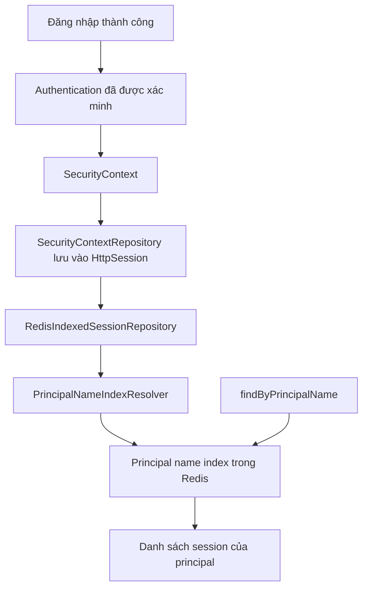

# Nguồn lấy tên principal và yêu cầu nhất quán với cơ chế xác thực

Spring Session Redis có thể lập chỉ mục session theo principal để tìm các phiên đang thuộc về một người dùng. Chức năng này hữu ích khi ứng dụng cần xem người dùng đang đăng nhập trên những thiết bị nào, giới hạn số phiên đồng thời hoặc kết thúc các phiên của một tài khoản. Để truy vấn chính xác, repository phải lấy được một tên principal ổn định từ trạng thái xác thực đã được ứng dụng tin cậy.

Tên principal dùng cho index phải nhất quán với danh tính mà cơ chế xác thực của ứng dụng tạo ra. Nếu lúc ghi session dùng `Authentication.getName()` nhưng lúc truy vấn lại dùng email, display name hoặc user ID khác định dạng, repository có thể không tìm thấy phiên. Nếu ứng dụng có nhiều phương thức đăng nhập, nhiều tenant hoặc hỗ trợ đổi username, cần định nghĩa một quy tắc chuẩn hóa danh tính và áp dụng giống nhau ở mọi instance.

Trong `SPRING_SESSION`, Redis là kho session chia sẻ để các instance Spring độc lập có thể đọc cùng trạng thái. Redis index giúp tìm session theo thuộc tính đã lập chỉ mục; nó không thay thế cơ chế xác thực, không chứng minh người dùng có quyền truy cập tài nguyên và không nên trở thành nguồn dữ liệu chính của tài khoản.

## 1. Principal là ai?

Principal là thực thể mà ứng dụng xem là chủ thể đang thực hiện request. Với một request đã xác thực, principal thường đại diện cho người dùng, dịch vụ hoặc tài khoản đã đăng nhập. Trong Spring Security, `Authentication` chứa principal và phương thức `getName()` cung cấp tên định danh của chủ thể đó.

Không nên nhầm các giá trị sau:

| Giá trị | Ý nghĩa | Có phù hợp làm principal index không? |
|---|---|---|
| `Authentication.getName()` | Tên định danh mà cơ chế xác thực cung cấp | Có, nếu ứng dụng bảo đảm giá trị ổn định và chuẩn hóa |
| Internal user ID | Định danh người dùng trong hệ thống | Thường phù hợp nhất nếu bất biến và duy nhất trong phạm vi cần thiết |
| Username đăng nhập | Tên người dùng dùng để đăng nhập | Có thể dùng nếu không đổi và có quy tắc chữ hoa/thường rõ ràng |
| Email | Địa chỉ email của người dùng | Chỉ phù hợp nếu được bảo đảm duy nhất và không đổi; thường có thể thay đổi |
| Display name | Tên hiển thị trong giao diện | Không nên dùng vì có thể trùng và thay đổi thường xuyên |
| Giá trị do request gửi lên | Dữ liệu client tự khai báo | Không đáng tin cậy để xác định chủ thể đã xác thực |
| `anonymousUser` | Principal giả lập cho request chưa đăng nhập trong một số cấu hình Spring Security | Không nên dùng làm index của tài khoản người dùng |

Một principal tốt cho index cần có tính duy nhất trong phạm vi ứng dụng, ổn định qua thời gian, không phụ thuộc cách trình bày trên giao diện và có cùng biểu diễn ở mọi instance. Nếu một người dùng có thể đăng nhập qua nhiều nhà cung cấp danh tính, chỉ dùng `sub` mà không xét issuer có thể gây trùng; có thể dùng định danh nội bộ sau khi ánh xạ hoặc một khóa tổng hợp từ issuer và subject.

## 2. Redis indexed session repository

Repository Redis thông thường tập trung vào lưu và đọc session theo ID. Khi cần tìm session theo principal, Spring Session cung cấp repository có hỗ trợ index, thường được cấu hình qua `@EnableRedisIndexedHttpSession` trong ứng dụng Servlet.

```java
import org.springframework.context.annotation.Configuration;
import org.springframework.session.data.redis.config.annotation.web.http.EnableRedisIndexedHttpSession;

@Configuration
@EnableRedisIndexedHttpSession
public class IndexedSessionConfiguration {
}
```

Ứng dụng cần có `RedisConnectionFactory` hợp lệ và dependency Spring Session Data Redis tương ứng. Cấu hình indexed repository tạo `RedisIndexedSessionRepository`, có thể duy trì các chỉ mục để tìm session theo những giá trị được `IndexResolver` cung cấp.

API chính cho truy vấn theo index là `FindByIndexNameSessionRepository`. Hằng số `PRINCIPAL_NAME_INDEX_NAME` định danh index principal tiêu chuẩn. Khi repository hỗ trợ index này, ứng dụng có thể tìm các session theo tên principal:

```java
import java.util.Map;

import org.springframework.session.FindByIndexNameSessionRepository;

public class UserSessionLookup {

    private final FindByIndexNameSessionRepository<?> sessions;

    public UserSessionLookup(
            FindByIndexNameSessionRepository<?> sessions) {
        this.sessions = sessions;
    }

    public Map<String, ?> findSessions(String principalName) {
        return sessions.findByPrincipalName(principalName);
    }
}
```

Kết quả là map có session ID làm key và đối tượng session làm value. Một principal có thể có nhiều session, chẳng hạn đăng nhập trên máy tính và điện thoại. Kết quả rỗng nghĩa là index không tìm thấy session tương ứng tại thời điểm truy vấn; không nên suy luận từ đó rằng tài khoản không tồn tại hoặc người dùng chưa từng đăng nhập.

`@EnableRedisHttpSession` và `@EnableRedisIndexedHttpSession` phục vụ hai nhu cầu khác nhau. Nếu cần truy vấn theo principal, hãy dùng cấu hình indexed repository phù hợp thay vì giả định repository không lập chỉ mục có thể thực hiện mọi truy vấn index. Tránh khai báo đồng thời hai cấu hình repository cho cùng một ứng dụng nếu chúng tạo các bean session cạnh tranh.

## 3. PrincipalNameIndexResolver lấy tên từ đâu?

Spring Session cung cấp `PrincipalNameIndexResolver` để xác định tên principal của một session. Trong tích hợp Spring Security thông thường, resolver có thể đọc `SecurityContext` được lưu trong session và lấy tên từ `Authentication`. Đây là cách thuận tiện khi cơ chế xác thực của ứng dụng lưu SecurityContext vào `HttpSession`.

Điều cần phân biệt là `SecurityContextHolder` và dữ liệu được lưu trong session. `SecurityContextHolder` thường giữ context trong phạm vi xử lý request/thread. Redis indexed repository cần dữ liệu có thể đọc từ session khi ghi hoặc cập nhật index. Nếu ứng dụng chỉ đặt `Authentication` vào thread-local mà không lưu SecurityContext vào session, repository không thể dựa vào một giá trị chỉ tồn tại trong thread để lập chỉ mục.

Với cấu hình Spring Security dùng session, SecurityContext thường được lưu qua `SecurityContextRepository` tích hợp với `HttpSession`. Khi request hoàn tất và session được lưu, `PrincipalNameIndexResolver` có thể đọc principal từ SecurityContext trong session. Hành vi cụ thể phụ thuộc cách ứng dụng cấu hình `SecurityContextRepository`, chính sách session và phiên bản Spring Security/Spring Session.



Luồng này chỉ hoạt động khi SecurityContext được lưu trong session và repository dùng resolver phù hợp. Với ứng dụng stateless, custom authentication filter hoặc custom `SecurityContextRepository` không lưu context vào `HttpSession`, cần chủ động cung cấp tên principal cho index theo một cách nhất quán.

## 4. Cung cấp principal name tường minh

Nếu ứng dụng không dùng Spring Security session persistence, hoặc principal cần index khác với tên mà SecurityContext cung cấp, có thể lưu thuộc tính principal name vào session bằng hằng số chuẩn:

`FindByIndexNameSessionRepository.PRINCIPAL_NAME_INDEX_NAME`

Ví dụ sau lấy tên từ `Authentication` đã được xác thực rồi lưu vào session:

```java
import jakarta.servlet.http.HttpServletRequest;
import jakarta.servlet.http.HttpSession;

import org.springframework.security.core.Authentication;
import org.springframework.security.core.context.SecurityContextHolder;
import org.springframework.session.FindByIndexNameSessionRepository;
import org.springframework.web.bind.annotation.PostMapping;
import org.springframework.web.bind.annotation.RestController;

@RestController
public class SessionPrincipalController {

    @PostMapping("/session/register-principal")
    public void registerPrincipal(HttpServletRequest request) {
        Authentication authentication =
                SecurityContextHolder.getContext().getAuthentication();

        if (authentication == null || !authentication.isAuthenticated()
                || "anonymousUser".equals(authentication.getName())) {
            throw new IllegalStateException("Request chưa được xác thực");
        }

        String principalName = authentication.getName();
        HttpSession session = request.getSession(true);
        session.setAttribute(
                FindByIndexNameSessionRepository.PRINCIPAL_NAME_INDEX_NAME,
                principalName
        );
    }
}
```

Đây là ví dụ minh họa cách lưu index attribute; trong ứng dụng thực tế nên tích hợp thao tác này vào authentication success handler hoặc nơi tạo session sau khi xác thực thành công, thay vì yêu cầu client gọi một endpoint riêng. Điều kiện `isAuthenticated()` cần được hiểu cùng với loại `Authentication`: một số cấu hình anonymous có thể trả về trạng thái authenticated nhưng vẫn đại diện cho người dùng ẩn danh. Vì vậy, kiểm tra anonymous phải dựa trên cơ chế Spring Security của ứng dụng, chẳng hạn `AuthenticationTrustResolver`, không chỉ dựa vào chuỗi cố định.

Không nhận `principalName` từ request parameter, header tùy ý hoặc JSON do client gửi lên để ghi vào index. Client có thể tự khai một username khác và khiến session được gắn với tài khoản không phải chủ sở hữu thực. Giá trị index phải được lấy từ principal đã được xác minh hoặc từ ánh xạ nội bộ đáng tin cậy.

Nếu ứng dụng đã dùng `PrincipalNameIndexResolver` tự động đọc SecurityContext, tránh lưu thêm một giá trị khác với `Authentication.getName()`. Hai nguồn mâu thuẫn có thể khiến kết quả index phụ thuộc resolver và thời điểm lưu. Hãy chọn một quy tắc nguồn chính, hoặc cấu hình resolver riêng để luôn tạo cùng một giá trị chuẩn.

## 5. Dùng internal user ID hay Authentication.getName()?

`Authentication.getName()` là điểm tích hợp tự nhiên với Spring Security. Tuy nhiên, giá trị này phụ thuộc implementation của principal:

- Với `UserDetails`, tên thường tương ứng username mà `UserDetails` cung cấp.
- Với một số OAuth2/OIDC principal, tên có thể được lấy từ thuộc tính subject hoặc thuộc tính được provider chọn làm tên.
- Với authentication tùy chỉnh, `getName()` có thể trả về email, mã nhân viên hoặc một chuỗi khác.

Nếu ứng dụng dùng nhiều nhà cung cấp hoặc cho phép đổi username/email, một internal user ID bất biến thường phù hợp hơn. Có thể thực hiện ánh xạ principal bên ngoài thành ID nội bộ trong authentication provider hoặc user service, rồi sử dụng ID đó làm tên chuẩn cho index. Cần bảo đảm mọi instance thực hiện cùng ánh xạ và cùng quy tắc chuẩn hóa.

Ví dụ quy ước định danh:

| Kiểu danh tính | Giá trị index đề xuất | Lưu ý |
|---|---|---|
| Người dùng nội bộ | `user:8f21...` | Dùng ID bất biến, không dùng display name |
| Người dùng OIDC | `oidc:issuer-key:subject` hoặc ID nội bộ đã ánh xạ | Subject chỉ duy nhất trong phạm vi issuer |
| Tài khoản theo tenant | `tenant:acme:user:8f21...` | Tránh trùng user ID giữa tenant |
| Service account | `service:billing-worker` | Tách danh tính máy khỏi danh tính người dùng |

Không cần dùng đúng các tiền tố trong ví dụ; điều quan trọng là định dạng phải rõ ràng, không mơ hồ và được áp dụng nhất quán. Nếu `Authentication.getName()` hiện trả về username nhưng ứng dụng quyết định chuyển sang internal user ID, cần thay đổi resolver và cách gọi `findByPrincipalName` cùng lúc. Trong giai đoạn chuyển đổi, index cũ có thể vẫn tồn tại cho tới khi các session cũ hết hạn hoặc được cập nhật.

## 6. Chuẩn hóa principal name trên mọi instance

Redis index chỉ hữu ích khi giá trị được ghi và giá trị truy vấn giống nhau. Các sai khác tưởng nhỏ có thể làm truy vấn không khớp:

- `Alice` và `alice` khác nhau nếu index so sánh chuỗi có phân biệt chữ hoa/thường.
- Email có thể có khoảng trắng đầu/cuối hoặc cách viết không nhất quán.
- Một instance dùng username, instance khác dùng email.
- Một instance thêm prefix tenant, instance khác bỏ prefix.
- Một provider dùng `sub`, provider khác dùng `preferred_username`.
- Một phiên bản ứng dụng thay đổi cách `Authentication.getName()` trả về giá trị.

Hãy xây dựng một hàm chuẩn hóa duy nhất tại ranh giới xác thực, ví dụ:

```java
public String toPrincipalIndexName(
        String tenantId,
        String immutableUserId) {
    if (tenantId == null || tenantId.isBlank()
            || immutableUserId == null || immutableUserId.isBlank()) {
        throw new IllegalArgumentException("Thiếu định danh principal");
    }

    return "tenant:" + tenantId.trim().toLowerCase(Locale.ROOT)
            + ":user:" + immutableUserId.trim();
}
```

Đây chỉ là ví dụ về quy ước chuỗi; chỉ chuyển chữ hoa/thường với thành phần có quy tắc case-insensitive. Không tự lowercase mọi principal nếu ID có phân biệt chữ hoa/thường. Với ID opaque do hệ thống cấp, nên giữ nguyên đúng biểu diễn chính thức.

Mọi instance cần dùng cùng thuật toán chuẩn hóa, cùng nguồn dữ liệu ánh xạ và cùng phiên bản quy ước. Nếu thay đổi quy tắc, triển khai như thay đổi schema index: lập kế hoạch cho session cũ, cập nhật cách truy vấn và xác minh trong thời gian rolling deployment.

## 7. Truy vấn session theo principal

Sau khi index được tạo, ứng dụng có thể tìm các session của một principal:

```java
Map<String, ?> sessions =
        sessionRepository.findByPrincipalName(principalIndexName);

for (String sessionId : sessions.keySet()) {
    // Có thể hiển thị thông tin phiên đã được lọc an toàn,
    // hoặc chuyển sang luồng kết thúc phiên theo chính sách.
}
```

Các trường hợp sử dụng phổ biến:

- Hiển thị danh sách thiết bị hoặc phiên đăng nhập của chính người dùng.
- Kiểm soát số session đồng thời cho một tài khoản.
- Kết thúc các phiên khác khi người dùng chọn “đăng xuất khỏi mọi thiết bị”.
- Hỗ trợ quản trị viên điều tra phiên theo tài khoản, sau khi kiểm tra quyền quản trị.
- Tìm session để thực hiện quy trình thu hồi sau khi tài khoản bị khóa hoặc có sự cố bảo mật.

Nếu cần kết thúc một session cụ thể, dùng API repository/session phù hợp để xóa session theo ID. Nếu cần kết thúc mọi session của principal, lấy các session từ index rồi xóa theo quy trình có kiểm soát. Không thao tác trực tiếp vào cấu trúc Redis key/index nội bộ vì định dạng và cơ chế cleanup thuộc implementation, có thể thay đổi theo phiên bản.

`findByPrincipalName` là truy vấn index, không phải xác thực người đang gọi endpoint. Ví dụ, người dùng A không được phép gửi tên principal của B để lấy danh sách session B. Ứng dụng phải lấy principal của caller từ SecurityContext đáng tin cậy và kiểm tra quyền trước khi truy vấn hoặc thu hồi session của người khác.

## 8. Trạng thái xác thực thay đổi thì index phải thay đổi theo

Session có thể bắt đầu ở trạng thái chưa đăng nhập rồi được nâng cấp sau khi đăng nhập. Principal index phải phản ánh danh tính đã xác thực, không phải dữ liệu cũ từ trước đăng nhập.

Các tình huống cần chú ý:

1. **Đăng nhập lần đầu:** sau khi xác thực thành công, SecurityContext hoặc principal index attribute phải được lưu vào session để repository lập chỉ mục.
2. **Session fixation protection:** Spring Security có thể đổi session ID khi xác thực. Dùng cơ chế tích hợp chuẩn để session mới giữ trạng thái cần thiết và repository cập nhật index tương ứng.
3. **Đổi tài khoản trong cùng trình duyệt:** khi session chuyển từ user A sang user B, phải xóa trạng thái principal A và thiết lập principal B theo đúng luồng xác thực. Không để index cũ gắn session mới với tài khoản trước đó.
4. **Logout:** invalidate session và để repository loại bỏ index liên quan. Xóa cookie phía client cũng cần được thực hiện.
5. **Khóa hoặc xóa tài khoản:** thu hồi các session đã tìm thấy theo principal chuẩn, đồng thời kiểm tra quyền và trạng thái tài khoản ở các request tiếp theo.
6. **Đổi username/email:** nếu index dùng một thuộc tính có thể đổi, cần cập nhật các session còn sống hoặc chấp nhận chúng được tìm dưới giá trị cũ đến khi hết hạn. Internal ID bất biến giảm vấn đề này.

Không nên để session ẩn danh mang index `anonymousUser`, vì rất nhiều session khách sẽ bị gom vào cùng một giá trị và có thể gây truy vấn lớn, khó phân biệt. Chỉ lập chỉ mục cho principal đã xác thực theo chính sách ứng dụng.

## 9. Custom IndexResolver khi nguồn principal không chuẩn

`IndexResolver<S>` là abstraction cho phép repository xác định các index từ một session. `PrincipalNameIndexResolver` phù hợp khi nguồn principal có thể lấy theo quy ước tích hợp sẵn. Nếu ứng dụng dùng custom authentication hoặc cần index theo internal user ID/tenant, có thể triển khai resolver riêng.

Ví dụ resolver minh họa lấy principal index đã được ứng dụng ghi vào session:

```java
import java.util.Collections;
import java.util.Map;

import org.springframework.session.FindByIndexNameSessionRepository;
import org.springframework.session.IndexResolver;
import org.springframework.session.Session;

public class ApplicationPrincipalIndexResolver
        implements IndexResolver<Session> {

    private static final String APP_PRINCIPAL = "app.principal-index-name";

    @Override
    public Map<String, String> resolveIndexesFor(Session session) {
        String principalName = session.getAttribute(APP_PRINCIPAL);
        if (principalName == null || principalName.isBlank()) {
            return Collections.emptyMap();
        }

        return Map.of(
                FindByIndexNameSessionRepository.PRINCIPAL_NAME_INDEX_NAME,
                principalName
        );
    }
}
```

Đoạn code cho thấy hợp đồng resolver: nhận một session và trả về map tên index sang giá trị index. Ứng dụng cần đăng ký resolver với indexed repository theo API cấu hình của phiên bản Spring Session đang dùng. Hãy bảo đảm mọi session save/update đều nhìn thấy thuộc tính `app.principal-index-name` đã được thiết lập từ danh tính tin cậy.

Khi dùng custom resolver, không đồng thời có hai quy tắc principal khác nhau mà không xác định rõ nguồn nào có quyền quyết định. Nếu resolver đọc `app.principal-index-name` còn nơi khác đọc SecurityContext, hai giá trị có thể lệch nhau. Hãy kiểm thử cả việc index được tạo, thay đổi và xóa khi principal thay đổi.

## 10. Nhất quán khi nhiều instance cùng chia sẻ Redis

Trong hệ thống nhiều instance, index chỉ đúng nếu mọi node cùng hiểu một principal theo một cách. Những cấu hình cần đồng bộ gồm:

- Cùng Redis deployment, database/prefix và repository indexed.
- Cùng phiên bản hoặc phiên bản tương thích của Spring Session và serializer.
- Cùng quy tắc tạo `Authentication.getName()` hoặc cùng ánh xạ sang internal ID.
- Cùng quy tắc chuẩn hóa tenant, issuer, user ID và chữ hoa/thường.
- Cùng chính sách lưu SecurityContext vào session hoặc cùng custom `IndexResolver`.
- Cùng cách xử lý anonymous, logout, đổi tài khoản và session fixation.

Ví dụ: instance A lập index theo email `alice@example.com`, trong khi instance B truy vấn theo user ID `u-1042`. Cả hai cùng truy cập Redis nhưng kết quả vẫn rỗng vì giá trị index không cùng quy ước. Redis không thể tự biết hai chuỗi đó đại diện cùng một người.

Khi triển khai phiên bản mới theo rolling update, có thể tồn tại session được tạo bởi phiên bản cũ và mới cùng lúc. Nếu đổi principal naming scheme, cần:

1. Xác định định dạng cũ và mới.
2. Có thời gian chuyển tiếp mà code có thể đọc hoặc tra cứu cả hai định dạng nếu yêu cầu không gián đoạn.
3. Cập nhật session cũ hoặc chờ chúng hết hạn theo chính sách đã chọn.
4. Chỉ ngừng hỗ trợ định dạng cũ khi không còn session cần nó.
5. Kiểm thử truy vấn qua instance cũ và mới trong giai đoạn rolling deployment.

Không đổi cách tạo principal name ở một node trước khi các node còn lại có thể đọc cùng index. Nếu không thể duy trì tương thích, cần có kế hoạch buộc người dùng đăng nhập lại hoặc chuyển đổi session có kiểm soát.

## 11. Index principal không phải nguồn phân quyền

Principal index là cấu trúc tra cứu để tìm session. Nó không chứng minh rằng người gọi request hiện tại là chủ tài khoản, không thay thế authorization và không nên được dùng để suy ra quyền truy cập tài nguyên.

Ví dụ, kết quả `findByPrincipalName("user:42")` có thể giúp tìm các session của user 42. Nhưng trước khi hiển thị hoặc xóa các session đó, ứng dụng phải xác minh caller có quyền thực hiện hành động. Với thao tác tự phục vụ, lấy principal từ `Authentication` của caller thay vì nhận ID từ client. Với thao tác quản trị, kiểm tra role/permission quản trị và ghi audit log phù hợp.

Index có thể chưa phản ánh ngay một thay đổi nếu session chưa được lưu, có lỗi datastore hoặc quá trình cleanup chưa hoàn tất. Với quyết định bảo mật quan trọng như chặn tài khoản, hãy kiểm tra trạng thái tài khoản ở nguồn dữ liệu chính trong từng request và thu hồi session như một biện pháp bổ sung. Không dựa riêng vào việc index trả về rỗng để kết luận không còn phiên hoạt động.

## 12. Kiểm thử nguồn principal và index

Kiểm thử cần xác minh chuỗi từ authentication tới session rồi tới Redis index. Một số tình huống quan trọng:

| Trường hợp | Cách kiểm tra | Kết quả mong đợi |
|---|---|---|
| Đăng nhập bằng Spring Security session | Xác thực, lưu SecurityContext, truy vấn theo `Authentication.getName()` | Session xuất hiện dưới principal name đúng |
| Custom authentication | Ghi principal index attribute từ danh tính đã xác minh | Repository tạo index theo giá trị chuẩn |
| Request anonymous | Gửi request chưa đăng nhập | Không tạo index người dùng chung cho `anonymousUser` |
| Username khác chữ hoa/thường | Tạo và truy vấn với các biểu diễn khác nhau | Quy tắc chuẩn hóa cho kết quả nhất quán |
| Nhiều tenant | Hai tenant có cùng local user ID | Index phân biệt tenant nếu danh tính chỉ duy nhất trong tenant |
| OAuth2/OIDC | Đăng nhập từ hai issuer hoặc provider | Subject được phân biệt đúng issuer hoặc ánh xạ về internal ID |
| Đổi tài khoản trong cùng session | Đăng nhập user A rồi chuyển sang user B | Session không còn được index nhầm dưới A |
| Logout | Invalidate session và truy vấn lại | Session bị xóa khỏi kết quả index theo cơ chế repository |
| Nhiều session một principal | Đăng nhập từ nhiều client | Kết quả chứa các session còn hiệu lực của principal đó |
| Rolling deployment | Tạo session bằng phiên bản cũ, truy vấn bằng phiên bản mới | Quy tắc index tương thích hoặc migration xử lý rõ ràng |
| Redis tạm thời lỗi | Gây lỗi kết nối trong test tích hợp | Ứng dụng phân biệt lỗi repository với kết quả rỗng |

Unit test cho resolver nên kiểm tra giá trị trả về với session có principal, session không có principal và session có dữ liệu không hợp lệ. Integration test cần dùng Redis thật hoặc môi trường Redis test tương đương để xác nhận index được tạo, cập nhật và xóa. Kiểm thử thêm hai application instance với cùng cấu hình để phát hiện sai khác do cấu hình hoặc serializer.

## 13. Lỗi thường gặp và cách khắc phục

| Triệu chứng | Nguyên nhân có thể | Hướng xử lý |
|---|---|---|
| `findByPrincipalName` trả về map rỗng | SecurityContext không được lưu vào session hoặc resolver không tìm thấy principal | Kiểm tra `SecurityContextRepository`, session attribute và `IndexResolver` |
| Ghi index bằng email nhưng truy vấn bằng username | Nguồn principal không nhất quán | Dùng một canonical principal name ở cả hai nơi |
| Session của nhiều người bị gom vào `anonymousUser` | Đang index anonymous authentication | Bỏ qua principal anonymous và chỉ index người dùng đã xác thực |
| Tìm thấy session ở instance này nhưng không ở instance khác | Các node khác cách chuẩn hóa hoặc dùng Redis/prefix khác nhau | Đồng bộ cấu hình và quy tắc identity |
| Đổi username khiến không tìm được session cũ | Index vẫn mang giá trị principal cũ | Dùng internal ID bất biến hoặc có kế hoạch cập nhật session cũ |
| Session gắn với user A sau khi chuyển sang user B | Principal attribute/SecurityContext cũ chưa được thay thế | Xóa trạng thái cũ, lưu context mới và kiểm thử account switching |
| Custom resolver không tạo index | Resolver chưa được gắn vào repository hoặc attribute chưa có khi save | Kiểm tra wiring và thời điểm đặt thuộc tính |
| Thu hồi phiên người khác qua endpoint tự phục vụ | Tin principalName do client gửi | Lấy principal từ Authentication của caller và kiểm tra authorization |
| Index còn dữ liệu cũ sau khi session hết hạn | Cleanup/expiration handling chưa hoàn tất hoặc có lỗi Redis notification | Kiểm tra cơ chế expiration, event listener và phiên bản repository |

## 14. Quy trình thiết kế principal index

Khi bật Redis indexed session, hãy làm theo thứ tự:

1. Xác định use case cần tìm session theo principal, ví dụ giới hạn phiên đồng thời hoặc logout mọi thiết bị.
2. Chọn định danh chuẩn: ưu tiên internal user ID bất biến hoặc `Authentication.getName()` nếu đã ổn định.
3. Xác định phạm vi duy nhất: có cần ghép tenant, issuer hoặc loại principal không?
4. Chọn nguồn index: SecurityContext được lưu trong session, principal-name attribute tường minh hoặc custom `IndexResolver`.
5. Bảo đảm giá trị chỉ đến từ authentication đã được xác minh; không lấy từ input tùy ý của client.
6. Dùng cùng quy tắc chuẩn hóa trong mọi instance và trong mọi đường truy vấn.
7. Xử lý chuyển trạng thái đăng nhập, session fixation, đổi tài khoản, logout và đổi username.
8. Kiểm thử index creation/update/delete, nhiều session trên một principal và rolling deployment với Redis thật.
9. Dùng index cho tra cứu session; thực hiện authorization và kiểm tra tài khoản ở nguồn dữ liệu chính.

Principal index chỉ đáng tin khi nguồn danh tính, cách biểu diễn và cơ chế xác thực thống nhất. Khi ứng dụng chọn một principal name chuẩn, lưu nó trong session theo đúng tích hợp Spring Security hoặc resolver tùy chỉnh, mọi instance có thể tìm các session của cùng người dùng qua Redis một cách nhất quán. Điều này hỗ trợ quản lý phiên đồng thời và thu hồi phiên, đồng thời giữ ranh giới rõ ràng giữa tra cứu session và quyết định phân quyền.
