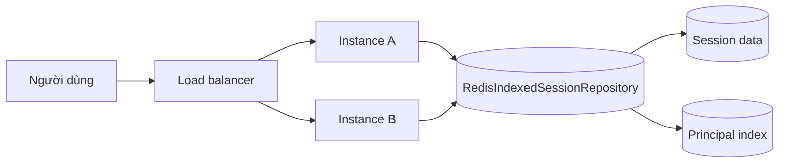

# Tra cứu toàn bộ phiên của một người dùng

Một người dùng có thể đăng nhập trên nhiều trình duyệt, máy tính hoặc thiết bị di động, vì vậy một tài khoản thường có nhiều session đang hoạt động cùng lúc. Với Spring Session lưu session trong Redis, có thể tra cứu các phiên theo tên principal bằng `FindByIndexNameSessionRepository`. Repository có chỉ mục giúp tìm những session gắn với một người dùng mà không phải quét toàn bộ dữ liệu session.

Khả năng này hữu ích cho trang quản lý thiết bị, kiểm soát số phiên đăng nhập đồng thời, hỗ trợ người dùng đăng xuất thiết bị khác và công cụ quản trị bảo mật. Để kết quả chính xác, ứng dụng phải dùng repository hỗ trợ chỉ mục principal name, bảo đảm tên principal được ghi vào chỉ mục và kiểm soát quyền truy vấn. Kết quả truy vấn là ảnh chụp trạng thái tại thời điểm đọc; session vẫn có thể hết hạn hoặc bị thu hồi ngay sau đó.

## 1. Vì sao cần chỉ mục theo principal?

Nếu chỉ dùng `SessionRepository`, ứng dụng có thể tìm session khi đã biết session ID bằng `findById(id)`. Nhưng một tài khoản có thể có nhiều ID khác nhau và ứng dụng không có cách hiệu quả để biết tất cả ID đó nếu không có chỉ mục.

Một cách không phù hợp là duyệt tất cả key session trong Redis rồi đọc từng session để so sánh username. Cách này tốn nhiều thao tác mạng, gây tải lớn khi số session tăng và buộc ứng dụng phụ thuộc vào cấu trúc key nội bộ của Spring Session.

Repository hỗ trợ index giải quyết vấn đề bằng cách duy trì quan hệ giữa principal name và các session ID. Khi cần liệt kê phiên của một tài khoản, ứng dụng truy vấn chỉ mục rồi nhận về các session tương ứng.

```mermaid
flowchart TD
    A[Đăng nhập thành công] --> B[Session chứa principal name]
    B --> C[RedisIndexedSessionRepository]
    C --> D[(Redis: dữ liệu session)]
    C --> E[(Redis: principal index)]
    Q[Ứng dụng cần liệt kê phiên của user] --> F[findByPrincipalName(username)]
    F --> E
    E --> G[Danh sách session ID]
    G --> C
    C --> H[Map session ID -> Session]
```

Chỉ mục không thay thế session repository. Nó là cấu trúc phụ giúp tìm session theo một thuộc tính đã được lập chỉ mục. Cookie của trình duyệt vẫn chỉ mang session ID; principal index nằm phía server trong Redis.

## 2. `FindByIndexNameSessionRepository`

`FindByIndexNameSessionRepository<S extends Session>` mở rộng `SessionRepository` bằng khả năng tìm session theo tên chỉ mục và giá trị chỉ mục. API thường dùng gồm:

| API | Ý nghĩa |
|---|---|
| `findByIndexNameAndIndexValue(indexName, indexValue)` | Tìm các session có giá trị tương ứng với chỉ mục được chỉ định |
| `findByPrincipalName(principalName)` | Phương thức tiện ích để tìm session theo principal name |
| `PRINCIPAL_NAME_INDEX_NAME` | Hằng số tên chỉ mục chuẩn cho principal name |

Kết quả là một `Map` trong đó key là session ID và value là đối tượng `Session`. Vì vậy, một lần truy vấn có thể trả về nhiều session của cùng một người dùng.

Ví dụ cơ bản:

```java
import java.util.Map;

import org.springframework.session.Session;
import org.springframework.session.FindByIndexNameSessionRepository;

class UserSessionLookup {
    private final FindByIndexNameSessionRepository<? extends Session> repository;

    UserSessionLookup(
            FindByIndexNameSessionRepository<? extends Session> repository) {
        this.repository = repository;
    }

    Map<String, ? extends Session> findSessions(String principalName) {
        return repository.findByPrincipalName(principalName);
    }
}
```

`findByPrincipalName` giúp mã ứng dụng không phải tự truyền tên chỉ mục. Nếu cần chỉ mục khác, có thể gọi `findByIndexNameAndIndexValue` với tên và giá trị chỉ mục tương ứng, nhưng chỉ khi repository thực sự hỗ trợ index đó.

## 3. Dùng repository Redis có hỗ trợ index

Trong Spring Session Redis, implementation hỗ trợ truy vấn theo principal name là `RedisIndexedSessionRepository`. Một repository Redis đơn giản không hỗ trợ index không thể đáp ứng truy vấn này chỉ bằng cách gọi cùng API.

Với cấu hình Servlet truyền thống, có thể bật Spring Session Redis như sau:

```java
import org.springframework.context.annotation.Configuration;
import org.springframework.session.data.redis.config.annotation.web.http.EnableRedisHttpSession;

@Configuration
@EnableRedisHttpSession(maxInactiveIntervalInSeconds = 1800)
class RedisSessionConfiguration {
    // RedisConnectionFactory được cấu hình riêng.
}
```

Sau khi cấu hình, cần xác nhận repository thực tế được Spring tạo là implementation hỗ trợ index, thường là `RedisIndexedSessionRepository` trong cấu hình Spring Session Redis tương ứng. Chi tiết lựa chọn repository có thể thay đổi theo phiên bản Spring Session và Spring Boot. Nếu ứng dụng chủ động cấu hình repository đơn giản hoặc thay thế bean mặc định, phải kiểm tra lại khả năng `FindByIndexNameSessionRepository` trước khi xây dựng chức năng liệt kê phiên.

Với Spring Boot, thêm module `spring-session-data-redis`, cấu hình Redis connection và dùng auto-configuration của phiên bản Boot tương ứng. Nếu cần truy vấn principal, hãy kiểm tra repository bean mà auto-configuration tạo ra; không giả định mọi implementation Redis đều có chỉ mục. Các instance của cùng ứng dụng phải dùng cùng Redis, namespace và cấu hình dữ liệu để cùng nhìn thấy một tập session.

## 4. Principal name được đưa vào chỉ mục như thế nào?

Để tìm session theo principal, repository phải biết session đó thuộc người dùng nào. Spring Session sử dụng cơ chế index resolver để trích principal name từ session. Với ứng dụng tích hợp Spring Security theo cách thông thường, Spring Session có thể đọc principal từ `SecurityContext` được lưu trong session và lập chỉ mục theo tên principal.

Hằng số `FindByIndexNameSessionRepository.PRINCIPAL_NAME_INDEX_NAME` biểu diễn tên attribute chuẩn dùng cho principal index. Với cơ chế xác thực tùy chỉnh không lưu `SecurityContext` theo cách Spring Session có thể nhận diện, ứng dụng có thể đặt attribute này tường minh:

```java
import jakarta.servlet.http.HttpSession;
import org.springframework.session.FindByIndexNameSessionRepository;

void associateSessionWithUser(HttpSession session, String principalName) {
    session.setAttribute(
        FindByIndexNameSessionRepository.PRINCIPAL_NAME_INDEX_NAME,
        principalName
    );
}
```

Đoạn mã cần được gọi sau khi ứng dụng xác thực người dùng và đã biết principal name đáng tin cậy. Không lấy giá trị index trực tiếp từ một tham số tùy ý của request; nếu client có thể tự gán principal name, họ có thể khiến session bị gắn nhầm với tài khoản khác.

### Tên principal phải ổn định

Giá trị principal name cần nhất quán giữa lúc tạo/cập nhật chỉ mục và lúc truy vấn. Ví dụ, nếu lúc đăng nhập ghi `alice@example.com` nhưng endpoint tra cứu dùng `Alice@example.com`, kết quả có thể khác do so sánh chuỗi và cách chuẩn hóa của ứng dụng.

Nên dùng định danh ổn định, duy nhất trong phạm vi ứng dụng, chẳng hạn user ID hoặc username đã chuẩn hóa. Nếu nhiều tenant có thể có cùng username, cần tạo principal name có phạm vi tenant rõ ràng, ví dụ `tenant-42:user-1007`, để tránh gộp phiên của hai tài khoản khác nhau.

Nếu người dùng đổi username hoặc email, hãy cân nhắc cách duy trì index. Tên principal cũ có thể còn gắn với session đang tồn tại nếu session không được cập nhật. Với ứng dụng có thay đổi định danh, user ID bất biến thường phù hợp hơn email làm khóa index.

## 5. Tra cứu phiên từ service

Thông thường, service nhận `FindByIndexNameSessionRepository` qua constructor injection. Service có thể chuyển kết quả thành DTO chỉ chứa metadata an toàn để giao diện quản lý thiết bị hiển thị:

```java
import java.util.List;
import java.util.Map;

import org.springframework.session.FindByIndexNameSessionRepository;
import org.springframework.session.Session;
import org.springframework.stereotype.Service;

record UserSessionSummary(java.time.Instant createdAt,
                          java.time.Instant lastAccessedAt) {}

@Service
class UserSessionService {
    private final FindByIndexNameSessionRepository<? extends Session> repository;

    UserSessionService(
            FindByIndexNameSessionRepository<? extends Session> repository) {
        this.repository = repository;
    }

    List<UserSessionSummary> findAllSessions(String principalName) {
        Map<String, ? extends Session> sessions =
                repository.findByPrincipalName(principalName);

        return sessions.values().stream()
                .map(session -> new UserSessionSummary(
                        session.getCreationTime(),
                        session.getLastAccessedTime()))
                .toList();
    }
}
```

Đây là ví dụ cho các phiên bản Spring Session có API thời gian trả về `Instant`. Nếu dự án dùng phiên bản cũ hơn, kiểu thời gian của `Session` có thể khác; điều chỉnh DTO theo API phiên bản đang dùng. DTO không đưa session ID thô ra trình duyệt vì session ID là thông tin mang quyền sử dụng phiên. Nếu giao diện cần cho phép thu hồi một thiết bị, hãy dùng mã tham chiếu ngẫu nhiên do ứng dụng tạo và ánh xạ mã đó sang session ID ở phía server, rồi kiểm tra quyền trước khi xóa.

Nếu chỉ cần đếm số phiên, có thể dùng `sessions.size()` mà không tạo DTO. Nếu cần hiển thị thiết bị, ứng dụng phải lưu metadata thiết bị đã được kiểm tra trong session hoặc kho dữ liệu riêng; không thể suy ra chắc chắn tên thiết bị chỉ từ session ID.

## 6. Tra cứu từ endpoint bảo mật

Người dùng thông thường chỉ nên xem các phiên thuộc chính tài khoản của họ. Endpoint nên lấy principal từ `Authentication` đã được Spring Security xác thực, không nhận username tùy ý từ query parameter rồi truy vấn trực tiếp.

```java
import java.util.List;

import org.springframework.security.core.Authentication;
import org.springframework.web.bind.annotation.GetMapping;
import org.springframework.web.bind.annotation.RestController;

record SessionListResponse(int activeSessionCount,
                           List<UserSessionSummary> sessions) {}

@RestController
class MySessionsController {
    private final UserSessionService userSessionService;

    MySessionsController(UserSessionService userSessionService) {
        this.userSessionService = userSessionService;
    }

    @GetMapping("/api/me/sessions")
    SessionListResponse listMySessions(Authentication authentication) {
        String principalName = authentication.getName();
        List<UserSessionSummary> sessions =
                userSessionService.findAllSessions(principalName);
        return new SessionListResponse(sessions.size(), sessions);
    }
}
```

Ví dụ minh họa cách lấy tên principal đã xác thực. DTO trả về chỉ chứa metadata hiển thị, không có session ID thực. Nếu có chức năng quản trị tra cứu phiên của người khác, endpoint đó cần quyền quản trị rõ ràng, audit log và giới hạn phạm vi tenant. Không để người dùng đoán username của người khác rồi dùng API này để liệt kê phiên.

Không trả toàn bộ session attributes ra client. Attribute có thể chứa `SecurityContext`, thông tin định danh, dữ liệu luồng nghiệp vụ hoặc dữ liệu nhạy cảm. Chỉ trả metadata được phép hiển thị, ví dụ thời điểm đăng nhập, lần truy cập gần nhất và nhãn thiết bị do ứng dụng lưu.

## 7. Tích hợp Spring Security và quản lý phiên đồng thời

Spring Security có thể dùng `SpringSessionBackedSessionRegistry` để quản lý session đồng thời dựa trên `FindByIndexNameSessionRepository`. Cơ chế này cho phép chính sách như giới hạn số phiên đăng nhập của một tài khoản và truy vấn thông tin session qua registry.

Ví dụ cấu hình registry:

```java
import org.springframework.context.annotation.Bean;
import org.springframework.context.annotation.Configuration;
import org.springframework.session.FindByIndexNameSessionRepository;
import org.springframework.session.Session;
import org.springframework.session.security.SpringSessionBackedSessionRegistry;
import org.springframework.security.core.session.SessionRegistry;

@Configuration
class SessionRegistryConfiguration {
    @Bean
    SessionRegistry sessionRegistry(
            FindByIndexNameSessionRepository<? extends Session> repository) {
        return new SpringSessionBackedSessionRegistry<>(repository);
    }
}
```

Registry này dựa trên repository có index. Khi dùng với cấu hình giới hạn session đồng thời của Spring Security, cần bảo đảm principal được index đúng và cấu hình `SessionRegistry` được đưa vào session management. Cú pháp DSL có thể khác giữa các phiên bản Spring Security, vì vậy hãy dùng API tương ứng với phiên bản của dự án.

Việc liệt kê session và việc giới hạn session là hai chức năng khác nhau. API tra cứu cho biết các phiên hiện được index; chính sách `maximumSessions` quyết định cách ứng dụng xử lý khi tài khoản vượt giới hạn. Cần xác định rõ chính sách khi vượt giới hạn: từ chối lần đăng nhập mới hay hết hạn phiên cũ.

## 8. Phân biệt session được index và session chưa được index

Không phải mọi session trong Redis đều nhất thiết xuất hiện trong kết quả tìm theo principal:

- Session của người dùng chưa đăng nhập có thể chưa có principal name.
- Ứng dụng xác thực tùy chỉnh có thể chưa đặt attribute index.
- Session cũ được tạo trước khi bật indexing có thể chưa có dữ liệu chỉ mục.
- Session được tạo bởi một repository không hỗ trợ principal index không thể được tìm qua API này.
- Cấu hình resolver hoặc principal name không nhất quán có thể làm session được gắn với giá trị khác với giá trị truy vấn.

Vì vậy, kết quả `findByPrincipalName(name)` có nghĩa là các session hiện được repository nhận diện theo index value đó, không phải bằng chứng tuyệt đối rằng mọi thiết bị của người dùng đều được liệt kê. Khi triển khai tính năng lần đầu, cần kiểm thử cả session mới và session đang tồn tại trong giai đoạn chuyển đổi.

## 9. Redis index, hết hạn và dữ liệu cũ

Repository Redis có chỉ mục duy trì cấu trúc phụ để ánh xạ principal name với session ID. Khi session được tạo, cập nhật principal hoặc xóa, index cần được cập nhật tương ứng. Khi session hết TTL, dữ liệu session và mục index có thể được dọn thông qua cơ chế expiration event/cleanup của implementation.

Với `RedisIndexedSessionRepository`, xử lý expiration có thể phụ thuộc Redis keyspace notifications. Nếu Redis do dịch vụ bên ngoài quản lý và ứng dụng không được phép thay đổi cấu hình Redis, cần phối hợp cấu hình notification ở phía hạ tầng và sử dụng cơ chế cấu hình Spring Session phù hợp. Nếu notification hoặc cleanup không hoạt động đúng, index có thể cần thời gian để loại bỏ mục cũ; hãy kiểm tra hành vi theo phiên bản và cấu hình repository.

Không tự sửa các key index nội bộ bằng Redis CLI trong logic ứng dụng. Cấu trúc key là chi tiết implementation và có thể thay đổi theo phiên bản. Dùng API Spring Session để truy vấn, xóa session và quan sát sự kiện. Nếu cần kiểm tra vận hành, dùng Redis CLI trong môi trường an toàn, chỉ đọc metadata cần thiết và không in session ID đầy đủ ra log.

## 10. Nhiều instance và nhất quán chỉ mục

Khi ứng dụng chạy nhiều instance, tất cả instance phải kết nối cùng Redis và dùng cùng namespace, repository implementation, cách serialization và cách xác định principal name. Nhờ vậy, request đến instance A có thể tạo session và cập nhật index; request tra cứu ở instance B vẫn nhìn thấy các phiên đó.



Nếu mỗi instance dùng namespace khác nhau, cùng username có thể trả về danh sách khác nhau. Nếu phiên bản ứng dụng mới thay đổi cách chuẩn hóa principal name, một phần session có thể được index bằng giá trị cũ và phần khác bằng giá trị mới. Hãy triển khai thay đổi định danh một cách có kế hoạch, có thể cần buộc người dùng đăng nhập lại hoặc duy trì logic tương thích trong giai đoạn chuyển tiếp.

## 11. Hiệu năng và giới hạn truy vấn

`findByPrincipalName` trả về một map các session phù hợp; API này không phải truy vấn phân trang tổng quát. Với tài khoản có rất nhiều session, việc lấy toàn bộ map và chuyển thành DTO có thể tốn bộ nhớ và thời gian. Hãy đặt chính sách giới hạn số phiên cho mỗi tài khoản, dọn session hết hạn đúng cách và cân nhắc mô hình dữ liệu riêng nếu cần giao diện quản trị phân trang quy mô lớn.

Không gọi truy vấn này trên mọi request thông thường nếu không cần. Một endpoint quản lý thiết bị có thể truy vấn khi người dùng mở trang hoặc sau khi đăng nhập, có cache ngắn hạn nếu phù hợp. Nếu cache danh sách, phải chấp nhận độ trễ khi session vừa được tạo, hết hạn hoặc thu hồi; không dùng cache cũ làm căn cứ duy nhất cho quyết định bảo mật.

Chỉ mục giúp tránh quét toàn bộ session nhưng vẫn có chi phí đọc index và tải từng session được tìm thấy. Hạn chế số lượng session không cần thiết và theo dõi số phiên trên mỗi principal, độ trễ truy vấn và kích thước dữ liệu Redis.

## 12. Đồng thời và tính chất của kết quả

Kết quả truy vấn phản ánh trạng thái tại thời điểm repository đọc index và tải các session. Ngay sau khi trả kết quả:

- Một session có thể hết TTL.
- Người dùng có thể logout từ một tab khác.
- Quản trị viên có thể thu hồi một session.
- Một request khác có thể cập nhật last-access time hoặc attribute.
- Một session mới có thể được tạo sau khi truy vấn hoàn tất.

Do đó, không nên coi danh sách vừa đọc là một snapshot giao dịch bất biến. Nếu người dùng chọn một phiên để thu hồi, backend phải kiểm tra quyền, xác nhận session còn tồn tại và thực hiện thao tác xóa theo ID ở thời điểm xử lý. Với thao tác bảo mật nhạy cảm, có thể cần kiểm tra trạng thái xác thực hoặc phiên bản thu hồi tại thời điểm thực thi.

## 13. Kiểm thử tra cứu tất cả phiên của một người dùng

Một bài kiểm thử tích hợp nên chứng minh index được tạo và truy vấn đúng:

1. Khởi chạy Redis dành riêng cho test và cấu hình repository hỗ trợ index.
2. Tạo hai session với cùng principal name, mô phỏng hai trình duyệt/thiết bị.
3. Lưu hai session vào repository.
4. Gọi `findByPrincipalName(principalName)` và xác nhận kết quả có cả hai session ID.
5. Tạo session của một principal khác và xác nhận không xuất hiện trong kết quả.
6. Xóa hoặc cho hết hạn một session, sau đó kiểm tra kết quả theo hành vi cleanup của repository.
7. Thực hiện truy vấn từ hai application instance cùng namespace để xác nhận chỉ mục dùng chung.
8. Kiểm tra endpoint người dùng chỉ trả phiên của principal đã xác thực và không tiết lộ session ID/attribute nhạy cảm.

Ví dụ kiểm thử repository ở mức khái niệm:

```java
String alice = "user-1007";

Session first = repository.createSession();
first.setAttribute(
    FindByIndexNameSessionRepository.PRINCIPAL_NAME_INDEX_NAME, alice);
repository.save(first);

Session second = repository.createSession();
second.setAttribute(
    FindByIndexNameSessionRepository.PRINCIPAL_NAME_INDEX_NAME, alice);
repository.save(second);

Map<String, ? extends Session> sessions =
    repository.findByPrincipalName(alice);

assertThat(sessions).hasSize(2);
```

Đoạn mã giả định repository là `FindByIndexNameSessionRepository` và implementation index resolver nhận attribute principal chuẩn. Khi dùng Spring Security, có thể kiểm thử cả đường đăng nhập thật để xác nhận principal được tự động trích từ `SecurityContext`; không chỉ kiểm tra trường hợp tự đặt attribute.

## 14. Các lỗi thường gặp

| Hiện tượng | Nguyên nhân có thể | Cách xử lý |
|---|---|---|
| Không inject được `FindByIndexNameSessionRepository` | Repository hiện tại không hỗ trợ index hoặc cấu hình Redis khác implementation mong đợi | Kiểm tra loại repository và cấu hình Spring Session |
| Kết quả rỗng dù người dùng đang đăng nhập | Principal chưa được index, session cũ hoặc tên truy vấn không trùng | Kiểm tra index resolver, `SecurityContext` và chuẩn hóa principal |
| Chỉ thấy phiên ở một instance | Các instance dùng Redis/namespace khác nhau | Đồng bộ connection, namespace và cấu hình repository |
| Có session cũ trong kết quả | Expiration event hoặc cleanup index chưa hoàn tất | Kiểm tra keyspace notifications và cleanup theo phiên bản |
| Người dùng xem được phiên của tài khoản khác | Endpoint nhận principal tùy ý từ request và thiếu kiểm tra quyền | Lấy principal từ `Authentication`; kiểm tra quyền quản trị/tenant |
| Danh sách có session nhưng thao tác thu hồi thất bại | Session đã hết hạn hoặc bị xóa sau thời điểm truy vấn | Kiểm tra lại trạng thái khi thực hiện thao tác và xử lý kết quả idempotent |
| Truy vấn chậm với tài khoản có nhiều session | Map kết quả lớn, nhiều session cần tải hoặc cleanup chậm | Giới hạn số session, tối ưu vòng đời và theo dõi Redis |

## 15. Nguyên tắc thiết kế

- Dùng `FindByIndexNameSessionRepository` khi cần tìm nhiều session theo principal name.
- Bảo đảm repository Redis hỗ trợ index, thường là `RedisIndexedSessionRepository`.
- Dùng `findByPrincipalName(name)` cho truy vấn principal; dùng hằng `PRINCIPAL_NAME_INDEX_NAME` khi cần gắn principal trong xác thực tùy chỉnh.
- Giữ principal name ổn định, duy nhất và nhất quán giữa lúc index và lúc truy vấn.
- Lấy principal của người dùng hiện tại từ `Authentication`; không tin username tùy ý từ client.
- Chỉ trả metadata cần thiết, không tiết lộ session ID hoặc toàn bộ session attributes.
- Coi kết quả là snapshot tại thời điểm đọc; kiểm tra lại trước khi thu hồi hoặc thực hiện hành động nhạy cảm.
- Đồng bộ Redis, namespace, serialization và index resolver giữa mọi instance.
- Kiểm thử đăng nhập, nhiều session, hết hạn, logout, thu hồi và truy vấn từ instance khác.

Với Spring Session Redis, chỉ mục principal giúp ứng dụng tra cứu tất cả phiên mà repository đang gắn với một người dùng. `FindByIndexNameSessionRepository.findByPrincipalName` là API chính cho nhu cầu này; độ chính xác phụ thuộc repository có hỗ trợ index và principal name được ghi nhất quán. Khi kết hợp kiểm soát quyền, giới hạn số phiên và kiểm thử nhiều instance, chức năng quản lý thiết bị có thể liệt kê phiên an toàn mà không phải quét toàn bộ dữ liệu Redis.
