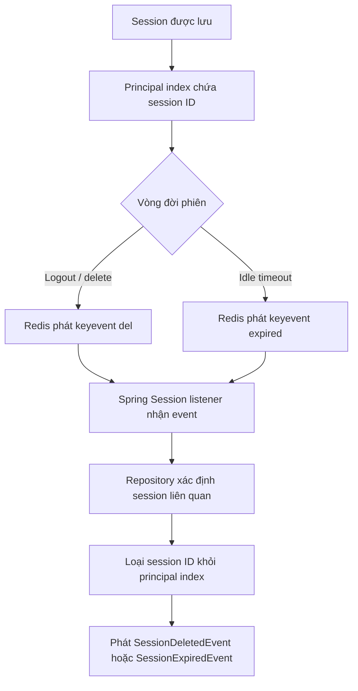
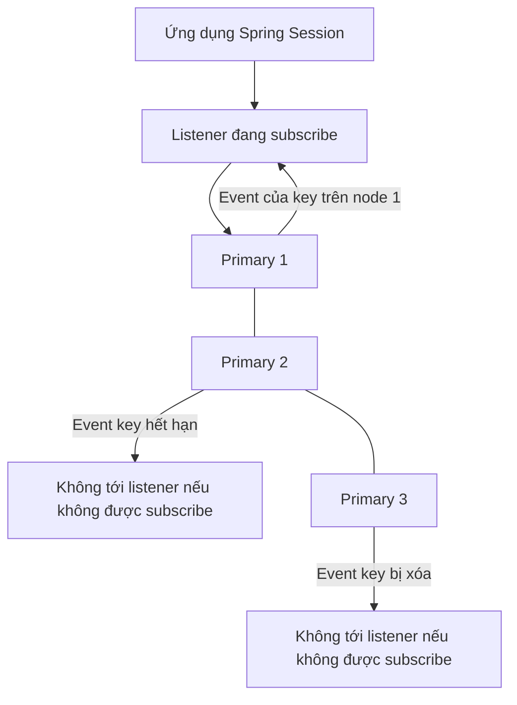

# Redis Cluster, phạm vi nhận sự kiện và nguy cơ chỉ mục không được dọn

`RedisIndexedSessionRepository` dùng Redis để lưu phiên và duy trì chỉ mục, thường là ánh xạ từ principal name tới các session ID. Khi phiên bị xóa hoặc hết hạn, repository cần nhận biết sự kiện vòng đời để xóa session ID khỏi chỉ mục và phát sự kiện Spring tương ứng. Với Redis đơn lẻ, cơ chế này thường dựa trên keyspace notifications. Khi chuyển sang Redis Cluster, phạm vi phát và nhận notification trở thành vấn đề quan trọng: sự kiện được tạo tại node quản lý key, còn subscriber có thể chỉ đang lắng nghe một phần cluster.

Nếu ứng dụng không nhận được sự kiện xóa/hết hạn, session có thể đã biến mất nhưng session ID vẫn nằm trong principal index. Đây là chỉ mục cũ (stale index): truy vấn có thể tốn thêm công sức, số thành viên index tăng dần và chức năng quản lý phiên có thể báo cáo dữ liệu không chính xác nếu không xác minh lại từng session. Kết nối Redis thành công không chứng minh sự kiện đã được nhận đầy đủ.

## 1. Vì sao RedisIndexedSessionRepository cần keyspace notifications?

Repository indexed lưu nhiều loại dữ liệu có quan hệ với nhau:

- Dữ liệu session, gồm session ID, metadata và session attributes.
- Chỉ mục principal, thường là tập các session ID gắn với một principal name.
- Dữ liệu phục vụ theo dõi thời hạn và xử lý vòng đời phiên.

Khi ứng dụng tạo phiên đã xác thực, repository có thể đưa session ID vào principal index. Khi người dùng đăng xuất, phiên bị xóa; khi phiên không hoạt động quá thời hạn, Redis hết hạn dữ liệu liên quan. Repository cần cập nhật index để loại bỏ session ID không còn hợp lệ.

`RedisIndexedSessionRepository` sử dụng Redis keyspace notifications để biết một số key session đã bị xóa hoặc hết hạn. Redis phát notification dưới dạng Pub/Sub message. Spring Session lắng nghe các kênh này, xác định session liên quan, cập nhật cấu trúc index và phát các sự kiện vòng đời như `SessionDeletedEvent` hoặc `SessionExpiredEvent` theo trường hợp.

Khác với việc đọc dữ liệu trực tiếp, notification là tín hiệu bất đồng bộ. Repository không thể chỉ dựa vào `findById` để biết tất cả session đã hết hạn ở mọi thời điểm; cơ chế listener giúp thực hiện phần dọn dẹp và phát sự kiện khi Redis thông báo key event.

## 2. Keyspace notifications và các loại sự kiện Redis

Redis có thể phát hai kiểu kênh notification:

- **Keyspace channel:** tên kênh chứa key, ví dụ `__keyspace@0__:some-key`; message mô tả thao tác xảy ra với key.
- **Keyevent channel:** tên kênh mô tả loại sự kiện, ví dụ `__keyevent@0__:expired`; message chứa tên key đã phát sinh sự kiện.

Spring Session thường quan tâm tới sự kiện key bị xóa và hết hạn. Thuộc tính Redis `notify-keyspace-events` điều khiển loại notification được bật. Các ký tự thường gặp:

| Cờ | Ý nghĩa |
| --- | --- |
| `K` | Phát keyspace notifications |
| `E` | Phát keyevent notifications |
| `g` | Nhóm lệnh tổng quát, bao gồm `DEL` |
| `x` | Sự kiện key hết hạn (`expired`) |
| `A` | Tập hợp nhiều loại sự kiện thông dụng, không bao gồm mọi loại đặc biệt |

Một cấu hình thường gặp để hỗ trợ sự kiện xóa và hết hạn là:

```text
notify-keyspace-events Egx
```

`E` bật kênh keyevent, `g` bao gồm sự kiện xóa tổng quát và `x` bật sự kiện hết hạn. Tập cờ thực tế cần theo tài liệu của phiên bản Spring Session đang dùng và yêu cầu của ứng dụng. Không bật toàn bộ notification một cách tùy tiện vì nó có thể tạo lượng Pub/Sub message đáng kể trên Redis có nhiều key và workload khác.

Redis không mặc định bật mọi keyspace notification. Spring Session có thể cố gắng cấu hình Redis khi khởi động thông qua `ConfigureRedisAction`. Trong môi trường Redis được quản lý, lệnh `CONFIG SET` có thể bị chặn; khi đó cần cấu hình notification bằng parameter group hoặc cơ chế quản trị do nhà cung cấp hỗ trợ.

Ví dụ nếu hạ tầng đã cấu hình `notify-keyspace-events` ở ngoài ứng dụng, có thể tắt thao tác cấu hình tự động của Spring Session:

```java
import org.springframework.context.annotation.Bean;
import org.springframework.context.annotation.Configuration;
import org.springframework.session.data.redis.config.ConfigureRedisAction;

@Configuration
class RedisSessionConfiguration {

    @Bean
    ConfigureRedisAction configureRedisAction() {
        return ConfigureRedisAction.NO_OP;
    }
}
```

`NO_OP` chỉ yêu cầu Spring Session không gửi lệnh cấu hình notification tới Redis. Nó không tự bật notification. Quản trị viên phải bảo đảm cấu hình Redis thực tế đã bật đúng loại event trên tất cả node cần thiết. Nếu notification bị tắt, repository vẫn có thể đọc/ghi session nhưng các hành vi dựa trên event như dọn index hoặc phát sự kiện hết hạn có thể không hoạt động đầy đủ.

## 3. Luồng dọn chỉ mục khi phiên bị xóa hoặc hết hạn

Giả sử principal `mai.tran` có hai session ID `id-A` và `id-B`. Principal index chứa cả hai ID. Khi người dùng đăng xuất trên thiết bị A, repository xóa session A và cần loại `id-A` khỏi index. Khi session B hết idle timeout, Redis phát sự kiện hết hạn và repository cần dọn phần tham chiếu tới `id-B`.

Luồng khái quát:



Chi tiết key và thứ tự xử lý nội bộ có thể thay đổi theo phiên bản. Một số implementation dùng key hoặc marker phụ để xử lý expiration và giữ đủ thông tin cho event listener trước khi dữ liệu session bị dọn vật lý. Không nên dựa vào tên key nội bộ hoặc tự xóa các key đó bằng lệnh Redis; dùng repository API và tài liệu của phiên bản đang chạy.

Điểm cốt lõi là việc xóa session data và việc dọn mọi cấu trúc index có thể là hai bước liên quan nhưng không đồng thời tuyệt đối. Notification giúp nối hai bước này. Nếu message không được phát, không được subscriber nhận hoặc bị mất trong thời gian ứng dụng ngừng lắng nghe, principal index có thể còn session ID cũ.

## 4. Phạm vi sự kiện trong Redis Cluster

Redis Cluster phân phối key theo hash slot trên nhiều primary node. Một key chỉ do node sở hữu slot tương ứng quản lý tại thời điểm đó. Khi key hết hạn hoặc bị xóa, sự kiện keyspace được tạo tại node xử lý key đó.

Không nên giả định một subscription tới một node Redis Cluster sẽ tự động nhận mọi keyspace notification của toàn cluster. Keyspace notifications có phạm vi theo node tạo sự kiện; subscription tới một primary có thể không quan sát event phát sinh ở primary khác. Cơ chế Pub/Sub thông thường, sharded Pub/Sub và keyspace notification cũng có các quy tắc khác nhau; việc cluster hỗ trợ một loại Pub/Sub không chứng minh subscriber đã nhận đầy đủ keyspace event trên mọi shard.

Ví dụ một cluster có ba primary:



Đây là mô tả rủi ro khi listener chỉ nhận notification từ một node. Khả năng subscribe cluster-wide phụ thuộc Redis client, cách Spring Session cấu hình listener và phiên bản đang dùng. Trước khi triển khai `RedisIndexedSessionRepository` trên Redis Cluster, cần kiểm tra tài liệu hỗ trợ chính thức của đúng phiên bản Spring Session và Redis client, xác minh cách listener đăng ký trên tất cả primary, và thử nghiệm sự kiện từ từng shard. Không suy ra hỗ trợ đầy đủ chỉ vì connection factory có thể đọc/ghi key trên cluster.

Một số phiên bản hoặc cấu hình của repository indexed có thể không hỗ trợ đầy đủ Redis Cluster do phụ thuộc keyspace notifications và cách quản lý subscription. Nếu phiên bản triển khai không bảo đảm nhận event từ mọi primary, cần chọn topology được hỗ trợ cho repository indexed hoặc thiết kế cơ chế index khác có khả năng phục hồi. `RedisSessionRepository` không index có thể phù hợp nếu chỉ cần tra cứu session theo ID và không cần principal index; lựa chọn này vẫn cần được kiểm tra với các yêu cầu Redis Cluster khác của hệ thống.

## 5. Failover và thay đổi primary

Trong Redis Cluster, slot có thể được chuyển giữa các node và primary có thể được thay thế bởi replica sau failover. Listener cần theo dõi topology mới và kết nối subscription tới node hiện đang sở hữu key. Nếu listener chỉ đăng ký lúc ứng dụng khởi động và không theo kịp topology, event từ primary mới có thể không được nhận.

Khi kiểm thử failover, cần xác minh:

1. Client nhận biết topology mới và kết nối đọc/ghi session vẫn hoạt động.
2. Listener đăng ký lại hoặc được cập nhật để nhận event trên primary mới.
3. Event hết hạn/xóa sau failover vẫn đến được listener cần xử lý index.
4. Event bị mất trong thời gian chuyển đổi không để lại stale index vô thời hạn.
5. Các instance ứng dụng cùng nhìn thấy trạng thái index nhất quán sau khi cluster ổn định.

Không coi reconnect thành công của Redis connection factory là bằng chứng listener đã khôi phục. Connection dùng cho command và connection dùng cho Pub/Sub có vòng đời khác nhau; cần quan sát riêng trạng thái subscription và số lượng listener đang hoạt động.

## 6. Nguy cơ chỉ mục cũ khi event bị mất

Principal index thường lưu một tập session ID cho mỗi principal. Khi event xóa/hết hạn không được nhận, ID có thể vẫn nằm trong tập dù session data không còn tồn tại. Các hậu quả gồm:

- Tập index tăng dần và chiếm bộ nhớ Redis.
- Truy vấn các phiên của một principal phải kiểm tra nhiều ID đã cũ.
- Chức năng hiển thị phiên đang hoạt động có thể tốn thêm thời gian hoặc báo kết quả không chính xác nếu không xác minh session.
- Tác vụ đăng xuất mọi thiết bị có thể cố xóa các ID không còn tồn tại.
- Sự kiện ứng dụng như `SessionExpiredEvent` có thể không được phát, khiến listener nghiệp vụ bỏ lỡ việc thu hồi tài nguyên phụ.

Tùy phiên bản, truy vấn principal index có thể bỏ qua session không còn tìm thấy hoặc thực hiện một phần dọn dẹp bổ sung. Không nên dựa vào hành vi này như cơ chế thay thế event listener: việc đọc index không bảo đảm quét và sửa mọi stale entry, nhất là với tài khoản có nhiều phiên hoặc dữ liệu index phân tán.

Đặc biệt, keyspace notification là Pub/Sub message, không phải hàng đợi bền vững. Redis không lưu một backlog để subscriber đọc lại toàn bộ event đã bỏ lỡ sau khi ứng dụng restart. Nếu tất cả listener ngừng hoạt động trong lúc key hết hạn, event có thể đã trôi qua. Khi ứng dụng khởi động lại, chỉ kết nối lại subscription không thể khôi phục các message cũ.

## 7. Phân biệt session data hết hạn với event dọn index

Một session có thể hết hạn theo logic timeout trong khi các bước dọn index hoặc phát event chưa hoàn tất. Redis expiration cũng không nhất thiết xảy ra đúng thời điểm TTL vừa về 0; việc xóa vật lý có thể được kích hoạt bởi truy cập hoặc cơ chế active expiration của Redis.

Do đó cần phân biệt:

| Trạng thái | Ý nghĩa |
| --- | --- |
| Session còn hợp lệ | Repository có thể tìm và khôi phục phiên theo ID |
| Session đã hết hạn theo timeout | Không nên chấp nhận phiên cho request mới dù một số dữ liệu phụ còn tồn tại tạm thời |
| Session key đã bị Redis xóa | Dữ liệu key không còn; event có thể được phát nếu notification tương ứng được bật |
| Principal index còn session ID cũ | Index chưa được dọn hoặc chưa được đối soát; không chứng minh session còn tồn tại |
| Event listener đã xử lý | Repository có thể dọn index và phát event ứng dụng theo implementation |

Không dùng `TTL` của một key riêng lẻ làm nguồn chân lý duy nhất cho trạng thái session. Spring Session quản lý metadata và thời hạn theo implementation; các key phụ trợ có thể có TTL khác nhau để phục vụ event lifecycle. Dùng API repository để xác minh phiên, và kiểm tra trạng thái listener/notification để xác minh việc dọn index.

## 8. Kiểm tra cấu hình notification

Trên Redis mà ứng dụng được phép quản trị, có thể kiểm tra cấu hình:

```text
CONFIG GET notify-keyspace-events
```

Kết quả cần chứa các cờ đáp ứng event mà repository cần, thường là keyevent cho `del` và `expired`. Cấu hình thường gặp là `Egx`, nhưng hãy xác minh theo tài liệu phiên bản Spring Session và các thành phần khác đang dùng Redis. Nếu Redis managed service từ chối `CONFIG GET/SET`, kiểm tra parameter group hoặc bảng cấu hình của nhà cung cấp.

Trong Redis Cluster, kiểm tra trên từng primary, không chỉ trên một node bất kỳ. Mỗi node có thể có cấu hình notification riêng. Sau khi thay đổi parameter group hoặc rolling restart, xác nhận cấu hình vẫn còn hiệu lực trên tất cả primary đang sở hữu slot.

Có thể dùng `redis-cli` để quan sát event trong môi trường kiểm thử:

```text
PSUBSCRIBE __keyevent@0__:expired
PSUBSCRIBE __keyevent@0__:del
```

Kênh database và cách subscribe cụ thể phụ thuộc cấu hình Redis; nếu Spring Session dùng database logic khác, điều chỉnh pattern tương ứng. Trong cluster, cần mở subscription tới các node cần quan sát và xác minh hành vi của client. Không để lệnh debug subscription chạy vô thời hạn trong production nếu nó tạo thêm tải hoặc làm lộ thông tin key.

## 9. Cấu hình Spring Session trong Redis managed service

Một số dịch vụ Redis managed giới hạn lệnh `CONFIG` vì cấu hình được điều khiển bằng parameter group. Khi Spring Session tự gửi `CONFIG SET notify-keyspace-events`, ứng dụng có thể nhận lỗi quyền hoặc lệnh không hỗ trợ. Nếu nhà cung cấp yêu cầu cấu hình ngoài ứng dụng, dùng `ConfigureRedisAction.NO_OP` và đặt notification qua cơ chế quản trị dịch vụ.

Quy trình nên thực hiện:

1. Xác định chính xác loại repository đang dùng và event mà repository cần.
2. Xem nhà cung cấp Redis hỗ trợ keyspace notifications ở chế độ standalone, Sentinel hay Cluster ra sao.
3. Cấu hình event cần thiết trên mọi node có thể phát sinh key lifecycle event.
4. Nếu dùng `NO_OP`, xác nhận parameter group đã được áp dụng trước khi triển khai ứng dụng.
5. Khởi động ứng dụng và xác nhận listener subscribe thành công; kiểm tra log không có lỗi `CONFIG` hoặc Pub/Sub.
6. Tạo, xóa và để hết hạn phiên thử nghiệm; xác minh principal index và Spring session events được cập nhật.

Không tắt cấu hình tự động chỉ để làm ứng dụng khởi động qua lỗi `CONFIG`, rồi cho rằng chức năng indexed session đã sẵn sàng. `NO_OP` chuyển trách nhiệm cấu hình sang hạ tầng; nếu hạ tầng chưa bật event, index cleanup có thể không hoạt động.

## 10. Đối soát và phục hồi stale index

Vì Pub/Sub không bền vững, hệ thống quan trọng cần có cách phát hiện và xử lý stale index. Có thể chọn một hoặc kết hợp các biện pháp sau:

- **Giám sát notification:** kiểm tra cấu hình event trên mọi primary, trạng thái subscription, reconnect và lỗi listener.
- **Kiểm thử vòng đời định kỳ:** tạo session test có principal, xác minh index xuất hiện, xóa hoặc chờ hết hạn, rồi xác minh index được dọn.
- **Đối soát có giới hạn:** dùng công cụ hoặc tác vụ bảo trì được thiết kế theo phiên bản repository để so sánh index với session thực tế và phát hiện ID không còn tồn tại.
- **Chạy cleanup qua API được hỗ trợ:** nếu phiên bản cung cấp API hoặc cơ chế dọn chính thức, dùng cơ chế đó thay vì tự sửa key nội bộ.
- **Thiết kế lại nếu cần bảo đảm mạnh hơn:** nếu yêu cầu nghiệp vụ cần event bền vững, dùng outbox hoặc event stream riêng có lưu trữ và retry, không dựa riêng vào Redis keyspace notification.

Không dùng `KEYS *` để quét toàn bộ Redis production. Nếu cần scan, dùng `SCAN` có giới hạn, phân trang và giới hạn tốc độ; chỉ thao tác trong namespace của ứng dụng. Cấu trúc principal index và key session là chi tiết implementation, nên bất kỳ công cụ sửa chữa thủ công nào cũng phải được ràng buộc theo phiên bản, thử trên bản sao dữ liệu và có kế hoạch rollback. Không xóa hàng loạt principal index chỉ để giải phóng bộ nhớ vì có thể làm mất khả năng quản lý phiên đang hoạt động.

Nếu session ID cũ còn trong index, trước khi xóa cần xác minh `findById(id)` thực sự không còn trả session hợp lệ. Với phiên đã tồn tại nhưng event bị bỏ lỡ, việc xóa index mù quáng có thể khiến một phiên hợp lệ không còn được tìm thấy theo principal. Đối soát phải phân biệt session còn sống, session hết hạn và lỗi kết nối tạm thời.

## 11. Kiểm thử Redis Cluster và phạm vi sự kiện

Mock repository không thể xác nhận Redis Cluster phát notification như mong muốn. Cần integration test với cluster thật hoặc môi trường test có nhiều primary node. Bộ kiểm thử nên bao gồm:

| Kịch bản | Điều cần xác minh |
| --- | --- |
| Tạo session có principal trên primary 1 | Principal index được tạo và có session ID |
| Xóa session nằm trên primary 1 | Listener nhận event và index được dọn |
| Để session hết hạn trên primary 2 | Event từ primary 2 được nhận và index được dọn |
| Phiên nằm trên primary 3 | Tra cứu theo principal vẫn hoạt động và event lifecycle được nhận |
| Listener chỉ subscribe một node | Test phát hiện event ở node khác không đến listener nếu không có cluster-wide subscription |
| Redis failover | Listener theo kịp primary mới và tiếp tục nhận event |
| Ứng dụng restart khi session hết hạn | Phát hiện event không được replay và stale index được đối soát |
| Redis notification bị tắt | Health check/test phát hiện index cleanup không hoạt động |
| Redis unavailable | Không nhầm lỗi kết nối với session không tồn tại |

Nên kiểm thử cả `SessionDeletedEvent` và `SessionExpiredEvent` nếu ứng dụng phụ thuộc vào chúng để thu hồi tài nguyên. Xác nhận listener nghiệp vụ xử lý idempotent vì thao tác thu hồi có thể được thử lại hoặc nhận tín hiệu trùng từ các thành phần khác. Không giả định event được phát đúng một lần theo ngữ nghĩa giao dịch bền vững.

## 12. Quan sát và cảnh báo vận hành

Các tín hiệu nên theo dõi gồm:

- Trạng thái và số lượng Redis Pub/Sub subscriptions trên mỗi ứng dụng/primary.
- Lỗi khi khởi tạo `RedisMessageListenerContainer`, reconnect hoặc cập nhật topology.
- Cấu hình `notify-keyspace-events` trên các node.
- Số session đang hoạt động so với số thành viên principal index.
- Tỷ lệ truy vấn principal index trả về ID không còn session.
- Độ trễ từ lúc xóa/hết hạn đến lúc event được xử lý.
- Lỗi Redis command, timeout, failover và memory pressure.

Không log session ID đầy đủ hoặc session attributes nhạy cảm. Khi cần correlation, dùng mã định danh nội bộ đã được bảo vệ hoặc hash có kiểm soát; không dùng principal nhạy cảm làm metric label có cardinality cao.

Nếu index tăng đều dù số phiên đang hoạt động ổn định, kiểm tra notification và listener trước khi tăng bộ nhớ Redis. Nếu event cleanup dừng sau failover, xác minh listener đã subscribe primary mới. Nếu session events không xuất hiện nhưng CRUD vẫn hoạt động, kiểm tra riêng keyspace notification thay vì chỉ kiểm tra `PING` hoặc thao tác `GET`.

## 13. Lựa chọn kiến trúc

| Nhu cầu | Hướng triển khai cần cân nhắc |
| --- | --- |
| Chỉ khôi phục phiên theo ID | Repository không index có thể đơn giản hơn và giảm phụ thuộc principal index |
| Cần tìm các phiên theo principal | Dùng indexed repository trên topology được phiên bản hỗ trợ và bảo đảm event coverage |
| Dùng Redis Cluster để phân tán key | Xác minh rõ hỗ trợ của `RedisIndexedSessionRepository`, subscription trên mọi primary và hành vi failover trước khi chọn |
| Event phải được xử lý bền vững | Dùng event store/queue/outbox riêng; keyspace notification chỉ là tín hiệu Pub/Sub |
| Cần đối soát index định kỳ | Xây dựng quy trình scan có giới hạn, dùng API và schema đúng phiên bản, có giám sát và rollback |

Nếu Redis Cluster là yêu cầu bắt buộc nhưng indexed repository của phiên bản đang dùng không thể bảo đảm nhận keyspace event từ mọi primary, không nên triển khai dựa trên giả định rằng cluster Pub/Sub tự giải quyết mọi việc. Có thể chọn topology Redis được hỗ trợ cho indexed repository, dùng repository không index nếu chỉ cần session ID, hoặc thiết kế index riêng với cơ chế event bền vững và reconciliation. Quyết định cần dựa trên tài liệu phiên bản, giới hạn của nhà cung cấp và kết quả kiểm thử cluster thực tế.

## 14. Checklist trước khi đưa lên production

- Xác nhận `RedisIndexedSessionRepository` là repository thực tế và nhu cầu principal index là có thật.
- Kiểm tra support matrix của Spring Session/Redis client cho Redis Cluster đúng phiên bản triển khai.
- Bật keyspace notifications cần thiết, thường gồm keyevent `del` và `expired`, trên mọi node có thể phát event.
- Xác minh listener nhận event từ mọi primary và theo kịp failover/topology change.
- Với managed Redis không cho phép `CONFIG`, dùng `ConfigureRedisAction.NO_OP` chỉ sau khi hạ tầng đã cấu hình notification.
- Kiểm thử tạo, xóa, hết hạn, restart listener và mất event; xác minh principal index được dọn.
- Có cách phát hiện và đối soát stale index; không dùng `KEYS *` hoặc xóa key nội bộ tùy tiện.
- Theo dõi subscription, event latency, index growth và lỗi repository; không ghi session ID thô vào log.

`RedisIndexedSessionRepository` cần sự phối hợp giữa session data, principal index và keyspace event listener. Trong Redis Cluster, mỗi key thuộc một node và phạm vi notification cần được xác minh trên từng primary. Khi event bị bỏ lỡ, session data có thể đã hết hạn nhưng index vẫn còn ID cũ; vì vậy, triển khai indexed session phải có event coverage, kiểm thử failover và phương án đối soát để giữ chỉ mục nhất quán theo thời gian.
