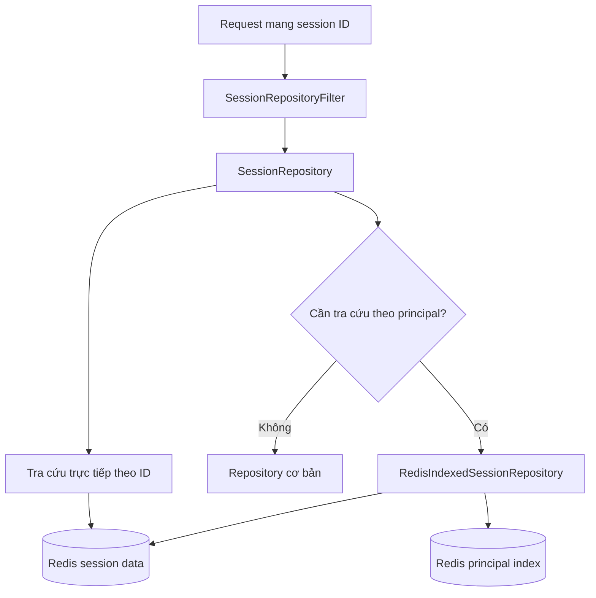
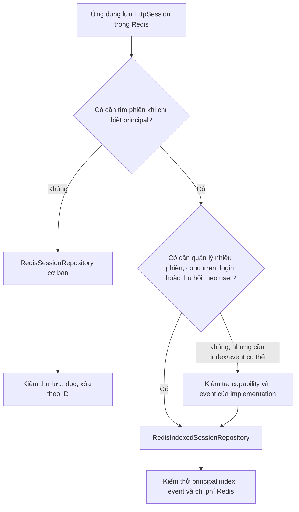

# Chọn repository cơ bản hay có chỉ mục theo khả năng thực sự cần

Spring Session có thể lưu `HttpSession` trong Redis bằng repository cơ bản hoặc repository có chỉ mục. Cả hai đều cho phép ứng dụng tạo, đọc, cập nhật và xóa phiên qua API Spring Session; khác biệt quan trọng là repository có chỉ mục hỗ trợ tra cứu phiên theo principal, chẳng hạn tìm các phiên đang hoạt động của một người dùng để quản lý thiết bị, giới hạn số phiên đăng nhập hoặc thu hồi mọi phiên.

Việc chọn repository nên xuất phát từ thao tác nghiệp vụ mà hệ thống thực sự cần. Nếu ứng dụng chỉ cần khôi phục phiên khi client gửi session ID, repository cơ bản thường đủ. Nếu cần tìm phiên khi chưa biết session ID, đặc biệt theo tên principal, cần implementation hỗ trợ index như `RedisIndexedSessionRepository`. Repository có chỉ mục bổ sung cấu trúc dữ liệu và công việc vận hành trong Redis; không nên chọn nó chỉ vì có nhiều API hơn.

## 1. Hai loại repository và hợp đồng chung

`SessionRepository` là hợp đồng lưu trữ session mà `SessionRepositoryFilter` dùng để tích hợp với Servlet API. Các thao tác cơ bản gồm tạo session, lưu session, tìm theo session ID và xóa theo session ID. Cả repository Redis cơ bản (`RedisSessionRepository`) và repository Redis có chỉ mục (`RedisIndexedSessionRepository`) đều đáp ứng nhu cầu này.

Repository cơ bản tập trung vào tra cứu trực tiếp bằng session ID. Client gửi cookie hoặc header chứa ID; Spring Session dùng ID đó để đọc dữ liệu phiên. Repository không cần biết người dùng sở hữu phiên là ai để phục vụ luồng đọc cơ bản.

Repository có chỉ mục bổ sung khả năng tra cứu theo thuộc tính như principal name. Nó triển khai `FindByIndexNameSessionRepository`, cho phép ứng dụng tìm các session liên quan đến một principal mà không cần biết trước từng session ID. Việc này hữu ích cho màn hình quản lý thiết bị, đăng xuất tất cả thiết bị và chính sách giới hạn số phiên đăng nhập.



Sơ đồ thể hiện khác biệt về khả năng tra cứu. Cả hai loại vẫn lưu dữ liệu session trong Redis và được truy cập qua cùng lớp tích hợp Servlet; index là dữ liệu bổ sung để tìm phiên theo thuộc tính.

## 2. Khi nào repository cơ bản là đủ?

Chọn `RedisSessionRepository` khi yêu cầu chính của ứng dụng là:

- Lấy phiên theo session ID do client gửi trong cookie hoặc header.
- Lưu và đọc các thuộc tính `HttpSession` trong request.
- Xóa một phiên khi người dùng đăng xuất hoặc phiên bị thu hồi khi đã biết session ID.
- Dùng Redis làm kho phiên chung cho nhiều instance.
- Không cần truy vấn danh sách phiên theo principal hoặc một thuộc tính index khác.

Ví dụ, một ứng dụng nội bộ có một phiên đăng nhập cho mỗi client và chỉ cần xác thực từng request theo session ID. Khi logout, request mang cookie của chính phiên cần xóa; ứng dụng có thể invalidate phiên hiện tại mà không cần tìm các phiên khác của cùng principal.

Repository cơ bản giảm số cấu trúc index phải duy trì. Điều đó có thể giúp mô hình dữ liệu và vận hành Redis đơn giản hơn, giảm các thao tác ghi phụ và tránh chi phí index khi số phiên lớn. Tuy nhiên, nó không làm mất chi phí lưu session, TTL, serialization, kết nối Redis hoặc bảo vệ dữ liệu phiên. Ứng dụng vẫn phải giám sát dung lượng, độ trễ và lỗi repository.

Nếu sau này xuất hiện yêu cầu thu hồi tất cả phiên theo người dùng, cần đánh giá lại repository. Không nên giả định có thể tìm mọi session của một principal từ repository cơ bản nếu implementation không lưu chỉ mục đó.

## 3. Khi nào cần repository có chỉ mục?

Chọn `RedisIndexedSessionRepository` khi có một hoặc nhiều yêu cầu cụ thể:

- Tìm tất cả phiên đang hoạt động của một người dùng theo principal name.
- Hiển thị danh sách thiết bị hoặc phiên đăng nhập trong trang bảo mật tài khoản.
- Thu hồi tất cả phiên khi người dùng đổi mật khẩu, tài khoản bị khóa hoặc phát hiện sự cố.
- Giới hạn số phiên đăng nhập đồng thời cho một principal.
- Tích hợp `SpringSessionBackedSessionRegistry` của Spring Security để quản lý phiên đồng thời.
- Xử lý sự kiện vòng đời phiên theo khả năng mà repository có chỉ mục hỗ trợ.

Ví dụ, một cổng quản trị cho phép người dùng xem các phiên đang đăng nhập trên máy tính và điện thoại, rồi đăng xuất một thiết bị bị mất. Ứng dụng cần biết những session ID nào gắn với principal đó; index giúp tìm tập phiên trước khi gọi xóa từng phiên.

Repository có chỉ mục cũng có thể hỗ trợ các sự kiện tạo, xóa và hết hạn phiên tùy cấu hình Redis và phiên bản Spring Session. Nếu nghiệp vụ dựa vào event, cần xác minh đúng implementation, bật các Redis keyspace notifications cần thiết và thiết kế listener chịu được event đến trễ hoặc không được giao. Index không biến event thành hệ thống audit đảm bảo giao nhận đúng một lần.

Không chọn repository indexed chỉ vì ứng dụng có đăng nhập. Hầu hết ứng dụng dùng session đều có principal, nhưng không phải ứng dụng nào cũng cần tìm phiên theo principal. Câu hỏi quyết định là: có nghiệp vụ nào phải tìm session khi chỉ biết người dùng, thay vì đã có session ID của request hiện tại hay không?

## 4. So sánh khả năng và chi phí

| Tiêu chí | `RedisSessionRepository` | `RedisIndexedSessionRepository` |
|---|---|---|
| Tìm session theo ID | Có | Có |
| Lưu/đọc `HttpSession` | Có | Có |
| Xóa session theo ID | Có | Có |
| Tìm phiên theo principal name | Không cung cấp khả năng index này | Có, qua `FindByIndexNameSessionRepository` |
| Quản lý danh sách phiên của người dùng | Phải có cơ chế riêng bên ngoài nếu cần | Có thể tra cứu qua principal index |
| Giới hạn phiên đồng thời theo principal | Không có tra cứu index cần thiết từ repository cơ bản | Có thể tích hợp Spring Security session registry |
| Cấu trúc Redis | Dữ liệu phiên và cơ chế expiration cơ bản | Dữ liệu phiên cùng các cấu trúc index bổ sung |
| Công việc ghi/cập nhật | Tập trung vào dữ liệu phiên | Có thêm cập nhật index khi thông tin principal liên quan thay đổi |
| Vận hành | Ít thành phần index hơn | Cần theo dõi index, keyspace notifications và tính nhất quán index |
| Lựa chọn phù hợp | Luồng request chỉ cần session ID | Quản lý phiên theo principal hoặc cần tính năng index |

Repository indexed thường cần thêm thao tác Redis để duy trì index. Khi tạo, thay đổi thuộc tính định danh hoặc xóa phiên, index tương ứng phải được cập nhật. Điều đó làm tăng công việc ghi và thêm dữ liệu cần giám sát. Mức chi phí thực tế phụ thuộc số phiên, tần suất cập nhật, Redis topology, serializer và phiên bản Spring Session.

Không thể kết luận repository indexed luôn chậm hoặc luôn tốn bộ nhớ nhiều hơn theo một tỷ lệ cố định. Hãy đo bằng workload đại diện: số phiên đồng thời, số lần cập nhật session, số lần tìm theo principal, độ trễ Redis và kích thước index.

## 5. Hiểu principal index hoạt động ra sao

`FindByIndexNameSessionRepository` định nghĩa tên thuộc tính index dành cho principal:

```java
FindByIndexNameSessionRepository.PRINCIPAL_NAME_INDEX_NAME
```

Repository có chỉ mục dùng thông tin principal name để duy trì quan hệ giữa principal và các session ID. Khi ứng dụng gọi `findByPrincipalName`, repository trả về map các phiên tìm được cho principal đó.

Với Spring Security, Spring Session có thể xác định principal từ ngữ cảnh bảo mật được lưu trong session thông qua cơ chế index resolver mặc định của phiên bản. Với cơ chế xác thực tùy chỉnh, ứng dụng phải bảo đảm principal được nhận diện đúng để index được tạo. Một cách tường minh là lưu thuộc tính index sau khi đã xác thực:

```java
session.setAttribute(
        FindByIndexNameSessionRepository.PRINCIPAL_NAME_INDEX_NAME,
        authenticatedPrincipal.getName()
);
```

Chỉ lấy tên từ principal đã được xác thực. Không dùng username do request tự gửi để gắn session vào một tài khoản khác. Khi principal thay đổi hoặc session được tái sử dụng theo luồng đặc biệt, cần cập nhật hoặc xóa index phù hợp. Hãy kiểm tra cách `IndexResolver` của phiên bản đang dùng tìm principal trước khi tự ghi thuộc tính để tránh hai cơ chế index mâu thuẫn.

Ví dụ tra cứu:

```java
Map<String, ? extends Session> sessions =
        indexedRepository.findByPrincipalName(principalName);

sessions.forEach((sessionId, session) -> {
    log.info("Found active session record for principal");
});
```

Trong log thực tế, không ghi session ID hoặc thuộc tính phiên nhạy cảm. Đoạn code chỉ minh họa API tra cứu; biến `indexedRepository` phải có kiểu `FindByIndexNameSessionRepository` và được inject từ implementation hỗ trợ index.

Index principal là một cách tra cứu, không phải bằng chứng phân quyền. Trước khi hiển thị hoặc thu hồi phiên, ứng dụng vẫn phải xác minh người gọi có quyền quản lý principal đó. Một quản trị viên có thể có quyền xem phiên người khác; người dùng thông thường chỉ nên xem hoặc kết thúc phiên thuộc tài khoản của họ.

## 6. Tìm và thu hồi phiên của một người dùng

Với repository indexed, có thể tìm tất cả session theo principal name rồi xóa các phiên cần thu hồi:

```java
@Service
public class UserSessionService {

    private final FindByIndexNameSessionRepository<? extends Session> sessions;

    public UserSessionService(
            FindByIndexNameSessionRepository<? extends Session> sessions) {
        this.sessions = sessions;
    }

    public void revokeAll(String principalName) {
        Map<String, ? extends Session> active =
                sessions.findByPrincipalName(principalName);

        active.values().forEach(session ->
                sessions.deleteById(session.getId()));
    }
}
```

Đây là ví dụ tối giản. Trong production, nên xác thực quyền của người gọi, ghi nhận lý do thu hồi và xử lý lỗi từng phiên theo chính sách. Danh sách trả về là ảnh chụp tại thời điểm truy vấn; một request đăng nhập mới có thể tạo phiên sau khi truy vấn hoàn tất. Nếu cần bảo đảm mọi phiên cũ bị từ chối sau khi đổi mật khẩu hoặc khóa tài khoản, kết hợp thu hồi với `sessionVersion`, trạng thái tài khoản hoặc marker thu hồi được kiểm tra ở các request tiếp theo.

Xóa từng phiên là thao tác có thể lặp an toàn ở mức repository nếu session đã biến mất, nhưng toàn bộ quy trình nghiệp vụ vẫn cần idempotency. Ví dụ, gửi thông báo đăng xuất cho người dùng, ghi audit hoặc thu hồi token ngoài session có thể bị lặp nếu worker chạy lại. Dùng event key, outbox hoặc trạng thái công việc riêng khi các tác vụ phụ cần chống lặp.

## 7. Giới hạn phiên đăng nhập đồng thời

Một yêu cầu thường gặp là giới hạn mỗi tài khoản chỉ được đăng nhập tối đa một hoặc một số thiết bị. `SpringSessionBackedSessionRegistry` tích hợp với `FindByIndexNameSessionRepository` để Spring Security có thể tra cứu phiên của principal.

Ví dụ khai báo registry:

```java
@Bean
SpringSessionBackedSessionRegistry<? extends Session> sessionRegistry(
        FindByIndexNameSessionRepository<? extends Session> sessions) {
    return new SpringSessionBackedSessionRegistry<>(sessions);
}
```

Sau đó có thể cấu hình session management của Spring Security để dùng registry này cho chính sách concurrent session control theo phiên bản Spring Security đang sử dụng. Cấu hình DSL cụ thể thay đổi giữa các phiên bản, vì vậy cần tham khảo API đúng với dự án.

Repository cơ bản không cung cấp truy vấn index theo principal mà registry cần. Nếu yêu cầu giới hạn phiên đồng thời là bắt buộc, chọn repository indexed hoặc một cơ chế quản lý phiên tương đương có thể tra cứu và điều phối theo principal.

Lưu ý rằng giới hạn phiên đồng thời trong môi trường nhiều instance có thể gặp race condition: hai lần đăng nhập cùng lúc đều nhìn thấy số phiên dưới ngưỡng rồi cùng tạo phiên. Nếu giới hạn là yêu cầu bảo mật nghiêm ngặt, cần kiểm thử đăng nhập đồng thời và cân nhắc một cơ chế đồng bộ hoặc cập nhật nguyên tử bổ sung. Index giúp tìm phiên; nó không tự bảo đảm mọi quy tắc nghiệp vụ được thực hiện nguyên tử.

## 8. Sự kiện vòng đời và phụ thuộc Redis

Repository indexed có thể phát các sự kiện Spring Session như `SessionCreatedEvent`, `SessionDeletedEvent` và `SessionExpiredEvent` thông qua cơ chế theo dõi keyspace notifications của Redis. Các sự kiện hữu ích cho việc cập nhật metric, dọn metadata phụ trợ hoặc kích hoạt công việc sau khi phiên thay đổi.

Để nhận sự kiện hết hạn, Redis cần được cấu hình keyspace notifications theo yêu cầu của phiên bản Spring Session và môi trường. Một Redis instance dùng chung có thể phục vụ nhiều ứng dụng; thay đổi `notify-keyspace-events` có thể ảnh hưởng listener khác. Không tự đặt lại cấu hình Redis production nếu chưa đánh giá các consumer đang dùng.

Sự kiện không thay thế kiểm tra repository. Phiên hết hạn phải bị từ chối khi `findById` được thực hiện, ngay cả khi listener chưa nhận event. Event có thể đến trễ, listener có thể tạm mất kết nối và các cơ chế event không nên được xem như một hệ thống message delivery đảm bảo đúng một lần.

Nếu ứng dụng không dùng index principal và không phụ thuộc các sự kiện do indexed repository cung cấp, hãy cân nhắc xem repository cơ bản có đáp ứng đủ. Nếu cần event, kiểm tra khả năng event thực tế của implementation đang chọn thay vì suy ra chỉ từ tên interface.

## 9. Chọn implementation trong ứng dụng Spring Boot

Cách Spring Boot chọn Redis repository có thể phụ thuộc phiên bản Boot, phiên bản Spring Session, dependency có mặt và cấu hình. Không nên giả định mọi phiên bản đều chọn cùng một implementation hoặc chỉ nhìn thấy dependency Redis rồi kết luận repository nào đang chạy.

Quy trình cấu hình an toàn:

1. Kiểm tra phiên bản Spring Boot/Spring Session do dependency management quản lý.
2. Xem cấu hình Spring Session Redis của đúng phiên bản để xác định cách chọn repository cơ bản hoặc indexed.
3. Xác nhận bean `SessionRepository` thực tế trong application context.
4. Nếu cần tra cứu principal, xác nhận bean cũng triển khai `FindByIndexNameSessionRepository`.
5. Không đồng thời bật nhiều cấu hình tạo repository hoặc khai báo hai implementation cùng cạnh tranh cho một `SessionRepositoryFilter`.

Trong cấu hình Java tường minh, repository cơ bản có thể được tạo từ Redis operations đã cấu hình:

```java
@Bean
RedisSessionRepository sessionRepository(
        RedisOperations<String, Object> sessionRedisOperations) {
    return new RedisSessionRepository(sessionRedisOperations);
}
```

Đoạn cấu hình minh họa cho ứng dụng Spring Boot nơi auto-configuration nhận bean repository do ứng dụng cung cấp. Cần xác nhận constructor và kiểu serializer với phiên bản Spring Session thực tế. Không kết hợp bean này với một `@EnableRedisHttpSession` khác đang tạo indexed repository; chỉ có một repository được dùng cho Servlet session trong cấu hình này.

Nếu muốn dùng indexed repository, dùng cấu hình Spring Session Redis được hỗ trợ bởi phiên bản dự án và xác nhận bean cuối cùng là `RedisIndexedSessionRepository`. Một số phiên bản Spring Boot cung cấp thuộc tính lựa chọn repository type; tên và giá trị hợp lệ cần đối chiếu metadata cấu hình đúng phiên bản. Không sao chép property từ phiên bản khác mà không kiểm tra binding.

## 10. Những điều cần kiểm tra trong Redis

Repository indexed duy trì thêm cấu trúc dữ liệu phục vụ tra cứu. Khi điều tra, cần phân biệt key dữ liệu phiên với key index, key expiration và các key phụ phục vụ event. Tên key và định dạng cụ thể phụ thuộc namespace, implementation và phiên bản.

Không dùng `KEYS *` trên Redis production để tìm tất cả key. Nếu cần khảo sát, dùng `SCAN` với pattern hẹp và cursor, đồng thời giới hạn tốc độ và phạm vi. Không xóa thủ công key index hoặc key session vì có thể làm dữ liệu giữa session và index mất đồng bộ.

Các điểm giám sát nên có:

- Số lượng session và số lượng index theo principal.
- Dung lượng Redis, memory pressure và eviction.
- Độ trễ lệnh đọc/ghi và lỗi kết nối.
- Tỷ lệ tìm phiên theo principal và số lượng kết quả mỗi lần tìm.
- Số lần cập nhật hoặc xóa session thất bại.
- Trạng thái Redis keyspace notifications nếu ứng dụng phụ thuộc event.
- Số phiên trong index không còn bản ghi session tương ứng, nếu có công cụ đối soát an toàn.

Index có thể cần được đối soát khi có sự cố mất kết nối, khôi phục Redis từ backup hoặc thay đổi phiên bản. Cách đối soát phải dựa trên API và công cụ phù hợp; không sửa key nội bộ bằng tay khi chưa hiểu schema dữ liệu của repository.

## 11. Các lỗi thường gặp

| Triệu chứng | Nguyên nhân có thể | Hướng xử lý |
|---|---|---|
| Không tìm thấy phiên theo principal | Repository cơ bản đang được dùng hoặc principal chưa được index | Kiểm tra kiểu bean và `IndexResolver`/principal attribute |
| `findByPrincipalName` không có trên bean | Bean chỉ có kiểu `SessionRepository` hoặc implementation không hỗ trợ index | Chọn repository indexed và inject đúng interface |
| Trang quản lý thiết bị hiển thị thiếu phiên | Index không được cập nhật, principal name không nhất quán hoặc session mới được tạo đồng thời | Kiểm tra resolver, luồng đăng nhập và đối soát |
| Thu hồi mọi phiên nhưng vẫn còn phiên mới | Phiên được tạo sau lần truy vấn index hoặc request đang chạy | Dùng session version/revocation marker và kiểm thử race |
| Concurrent session control không hoạt động | Chưa dùng `SpringSessionBackedSessionRegistry` hoặc principal index không có | Kiểm tra cấu hình Spring Security và repository |
| Không nhận event hết hạn | Keyspace notifications hoặc listener chưa được cấu hình | Kiểm tra Redis và cấu hình đúng phiên bản |
| Redis tăng dung lượng sau khi chuyển indexed | Index bổ sung, session nhiều hoặc cleanup không đúng | Theo dõi keyspace, TTL, index và cleanup |
| Một instance tìm thấy phiên, instance khác không | Các node dùng namespace, Redis endpoint hoặc cấu hình repository khác nhau | Đồng nhất cấu hình trên toàn cụm |

Khi điều tra, ghi lại loại repository, phiên bản thư viện, namespace, principal index resolver, instance và mã tương quan. Không ghi session ID hoặc thuộc tính nhạy cảm vào log.

## 12. Kiểm thử lựa chọn repository và index

Nên kiểm tra cả cấu hình lẫn hành vi thực tế:

| Kiểm thử | Cách thực hiện | Kết quả cần xác nhận |
|---|---|---|
| Repository cơ bản | Khởi động profile dùng implementation cơ bản | Bean hỗ trợ `SessionRepository`; không kỳ vọng tra cứu principal |
| Repository indexed | Khởi động profile dùng indexed implementation | Bean hỗ trợ `FindByIndexNameSessionRepository` |
| Lưu và đọc session | Tạo session rồi đọc bằng ID | Cả hai implementation khôi phục được thuộc tính |
| Index principal | Tạo session đã gắn principal rồi gọi `findByPrincipalName` | Trả về session thuộc principal đó |
| Thu hồi principal | Tạo nhiều session cho một principal và xóa theo danh sách tìm được | Các phiên đã chọn không còn khôi phục được |
| Principal tùy chỉnh | Dùng authentication principal riêng | Index resolver nhận diện đúng tên principal |
| Concurrent login | Gửi nhiều yêu cầu đăng nhập cùng principal | Chính sách giới hạn phiên được thực thi theo thiết kế |
| Session expiration | Để session hết TTL rồi truy vấn | Phiên hết hạn không được trả như phiên đang hoạt động |
| Session events | Bật cấu hình Redis cần thiết và theo dõi event | Listener nhận event theo khả năng implementation; xử lý lặp an toàn |
| Nhiều instance | Tạo session ở A và tra cứu theo principal ở B | Index dùng chung được nhìn thấy nhất quán theo cấu hình |

Ví dụ kiểm thử index có thể gọi API repository:

```java
Map<String, ? extends Session> found =
        indexedRepository.findByPrincipalName("alice");

assertThat(found).hasSize(2);
```

Test cần tạo hai session thực sự được index cho principal `alice`, dùng Redis test và dọn dữ liệu sau test. Không chỉ mock `FindByIndexNameSessionRepository`, vì mock không chứng minh index Redis được ghi và đọc đúng.

## 13. Cây quyết định chọn repository



Nếu câu trả lời cho nhu cầu tra cứu theo principal là không, bắt đầu với repository cơ bản. Nếu có, chọn indexed và xác minh index thực sự được tạo cho principal. Nếu yêu cầu chỉ là event, cần kiểm tra implementation nào hỗ trợ đúng loại event và cách cấu hình Redis; đừng mặc định rằng mọi repository có cùng hành vi.

## 14. Nguyên tắc triển khai

- Chọn repository theo thao tác nghiệp vụ cần hỗ trợ, không theo tiêu chí “nhiều tính năng hơn”.
- Dùng repository cơ bản khi chỉ cần lưu, khôi phục và xóa session theo ID.
- Dùng repository indexed khi cần tìm session theo principal, quản lý thiết bị, thu hồi nhiều phiên hoặc concurrent session control.
- Bảo đảm principal được index từ danh tính đã xác thực và resolver phù hợp.
- Không xem index là cơ chế phân quyền; luôn kiểm tra quyền trước khi xem hoặc thu hồi phiên.
- Đánh giá chi phí ghi, bộ nhớ, keyspace và cleanup của index bằng tải thực tế.
- Xác minh implementation thực sự được Spring Boot tạo ra trong phiên bản đang dùng.
- Kiểm thử index, session expiration, event và hành vi nhiều instance bằng Redis test.
- Không chỉnh sửa key nội bộ hoặc ghi session ID vào log để chẩn đoán.

Hai repository Redis của Spring Session cùng phục vụ việc lưu và khôi phục `HttpSession`. Repository cơ bản đáp ứng luồng tra cứu trực tiếp theo session ID; repository indexed bổ sung khả năng tìm các phiên theo principal và hỗ trợ những nghiệp vụ quản lý phiên rộng hơn. Lựa chọn đúng dựa trên việc ứng dụng có thật sự cần tìm phiên theo người dùng hay không, sau đó xác minh bean, index, chi phí Redis và hành vi trong môi trường nhiều instance.
