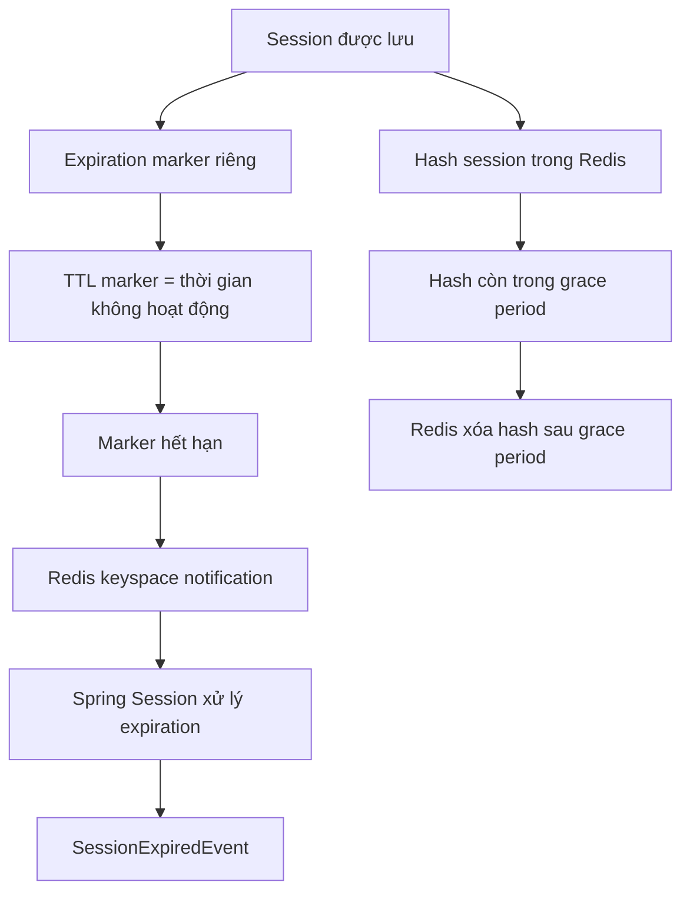

# Thời điểm phiên không còn hợp lệ và thời điểm khóa Redis được xóa

Khi dùng Spring Session với Redis, một phiên có thể đã hết hạn theo chính sách ứng dụng trong khi dữ liệu tương ứng vẫn còn tồn tại vật lý trong Redis thêm một khoảng thời gian. Hai thời điểm này có liên quan nhưng không nhất thiết trùng nhau:

- **Hết hạn về mặt logic:** ứng dụng không còn chấp nhận session vì thời gian không hoạt động tối đa đã trôi qua.
- **Xóa vật lý trong Redis:** Redis thực sự giải phóng key khỏi bộ nhớ và không còn trả dữ liệu của key đó.

Phân biệt hai thời điểm giúp giải thích vì sao một session ID cũ có thể không còn dùng được dù vẫn quan sát thấy key trong Redis, vì sao sự kiện hết hạn có thể đến muộn, và vì sao kiểm thử không nên yêu cầu key biến mất đúng tại giây timeout.

## 1. Session hết hạn dựa trên thời gian không hoạt động

Session có thời điểm truy cập gần nhất (`lastAccessedTime`) và khoảng thời gian không hoạt động tối đa (`maxInactiveInterval`). Với một session có timeout hữu hạn, thời điểm hết hạn logic được xác định từ hai giá trị đó:

\[
\text{expiresAt} = \text{lastAccessedTime} + \text{maxInactiveInterval}
\]

Khi thời điểm hiện tại đạt hoặc vượt `expiresAt`, session được xem là hết hạn. Việc này dựa trên thời gian không hoạt động, không đơn giản là thời gian kể từ lúc tạo session.

Ví dụ:

- Session được tạo lúc 09:00.
- Người dùng truy cập lúc 09:10; `lastAccessedTime` được cập nhật theo request.
- Timeout là 30 phút.
- Nếu không có request tiếp theo làm mới thời điểm truy cập, session hết hạn logic khoảng 09:40.

Nếu người dùng tiếp tục gửi request hợp lệ lúc 09:35, thời điểm truy cập được cập nhật và thời điểm hết hạn mới sẽ khoảng 10:05. Session có thể sống lâu hơn thời gian timeout tính từ lúc tạo vì timeout đo thời gian không hoạt động.

Trong ứng dụng Servlet, timeout mặc định có thể cấu hình qua Spring Boot hoặc đặt trên `HttpSession`:

```java
@PostMapping("/cart/item")
public String addItem(HttpServletRequest request) {
    HttpSession session = request.getSession();
    session.setMaxInactiveInterval(30 * 60); // 30 phút, đơn vị giây
    // Cập nhật trạng thái giỏ hàng...
    return "ok";
}
```

Ví dụ này minh họa timeout của session; nó không đặt TTL trực tiếp cho một key Redis cụ thể. Spring Session và repository chuyển metadata của session thành cách lưu trữ phù hợp với implementation.

## 2. TTL của Redis điều khiển vòng đời key

Redis hỗ trợ thời hạn sống (time to live, TTL) cho từng key. Khi TTL hết, key được xem là hết hạn và không còn được trả về như một key hợp lệ. Redis dùng cả hai cơ chế để dọn key hết hạn:

1. **Passive expiration:** khi một lệnh truy cập key, Redis kiểm tra key có hết hạn chưa; nếu đã hết hạn, Redis loại bỏ key và trả kết quả như key không tồn tại.
2. **Active expiration:** Redis định kỳ kiểm tra một tập key có đặt thời hạn và chủ động dọn những key đã hết hạn, kể cả khi không có client truy cập chúng.

Vì active expiration làm việc theo chu kỳ và lấy mẫu, Redis không cam kết giải phóng bộ nhớ đúng tại mili giây TTL về 0. Key có thể vẫn còn trong cấu trúc nội bộ một khoảng ngắn cho đến khi được truy cập hoặc được tiến trình dọn dẹp phát hiện. Tuy vậy, một lệnh đọc thông thường sau thời điểm hết hạn sẽ không trả nội dung key như dữ liệu còn hiệu lực.

Có thể kiểm tra TTL bằng Redis CLI:

```text
TTL app:session:example
PTTL app:session:example
```

`TTL` trả thời gian còn lại theo giây; `PTTL` trả theo mili giây. Hai giá trị đặc biệt thường gặp:

| Kết quả | Ý nghĩa |
|---|---|
| Số dương | Key tồn tại và còn thời gian sống |
| `-1` | Key tồn tại nhưng không có expiration được đặt |
| `-2` | Key không tồn tại hoặc đã được xem là hết hạn khi Redis kiểm tra |

Không nên coi TTL bằng 0 là bằng chứng key đã được giải phóng khỏi bộ nhớ đúng thời điểm đó. Hãy phân biệt thời hạn đã tới với quá trình dọn vật lý của Redis.

## 3. Vì sao session hết hạn trước khi key Redis bị xóa?

Session và key Redis phục vụ hai mục đích khác nhau. Spring Session cần bảo đảm ứng dụng không sử dụng một phiên đã quá thời hạn. Redis TTL giúp dọn dữ liệu cũ và kiểm soát bộ nhớ. Trong một số implementation, repository còn cần giữ dữ liệu session thêm một khoảng sau thời điểm hết hạn logic để xử lý thông báo vòng đời.

Do đó, repository có thể triển khai một trong các cách sau tùy implementation và phiên bản:

- Đặt expiration trực tiếp lên key session theo timeout của session.
- Dùng một key đánh dấu thời điểm hết hạn riêng, trong khi key chứa dữ liệu session được giữ lại thêm một khoảng grace period.

Cách thứ hai đặc biệt quan trọng với repository Redis có hỗ trợ index và event. Redis không đảm bảo key hết hạn được xóa vật lý và phát thông báo đúng tại thời điểm timeout. Nếu key chứa dữ liệu session biến mất ngay lập tức, repository có thể không còn đọc được attributes khi xử lý `SessionExpiredEvent`. Vì vậy, implementation indexed duy trì key hết hạn riêng và giữ hash session thêm một khoảng thời gian.

## 4. Cách RedisIndexedSessionRepository tách key hết hạn và session record

Với `RedisIndexedSessionRepository`, session thường được lưu trong một Redis hash, còn một key expiration riêng được dùng để theo dõi thời điểm session hết hạn và kích hoạt xử lý event. Tên key cụ thể phụ thuộc namespace và phiên bản, nhưng thường có dạng:

```text
spring:session:sessions:<session-id>
spring:session:sessions:expires:<session-id>
```

Key thứ nhất chứa dữ liệu session; key thứ hai là expiration marker. Repository đặt TTL của marker theo thời gian không hoạt động. Khi marker hết hạn và Redis phát keyspace notification tương ứng, listener của Spring Session có thể xử lý việc hết hạn và phát event ứng dụng.

Trong thiết kế Redis indexed phổ biến, hash session chính được giữ thêm một khoảng grace period (mặc định 5 phút trong implementation này) sau thời điểm hết hạn logic. Việc giữ lại cho phép repository tải dữ liệu session khi xử lý thông báo hết hạn, ví dụ để phát `SessionExpiredEvent` với thông tin phiên. Sau grace period, key chứa dữ liệu session cũng được Redis dọn theo TTL của chính nó.



Khoảng grace period là chi tiết triển khai của repository, không phải một thuộc tính chung của mọi `SessionRepository`. Không nên hard-code tên key hoặc giả định 5 phút là giá trị không thể thay đổi qua mọi phiên bản. Khi cần vận hành hoặc chẩn đoán, đối chiếu tài liệu và mã nguồn của đúng phiên bản Spring Session đang chạy.

## 5. Timeline: session không hợp lệ trước, key bị dọn sau

Giả sử một session có `lastAccessedTime` lúc 10:00 và timeout 30 phút. Với repository indexed sử dụng expiration marker và grace period, diễn biến khái quát như sau:

| Thời điểm | Trạng thái logic của session | Trạng thái Redis |
|---|---|---|
| 10:00 | Còn hiệu lực | Hash session và expiration marker tồn tại |
| 10:20 | Còn hiệu lực; request làm mới last accessed time nếu được xử lý và lưu | Repository cập nhật dữ liệu và thời hạn tương ứng |
| 10:50 | Đã hết hạn nếu không có request làm mới sau 10:20 | Expiration marker đạt TTL; hash session có thể vẫn tồn tại |
| Sau 10:50 | Không được khôi phục như session hợp lệ | Redis phát hiện marker hết hạn và có thể phát notification; thời điểm có thể trễ |
| Trong grace period | Vẫn hết hạn logic | Hash session còn để repository đọc dữ liệu khi xử lý event |
| Sau grace period | Vẫn hết hạn logic | Hash session cũng được Redis dọn vật lý |

Thời gian trong bảng chỉ minh họa. Notification có thể đến sau mốc logic vì cơ chế expiration của Redis; độ trễ thực tế phụ thuộc tải, cấu hình và thời điểm Redis kiểm tra key. Điều quan trọng là ứng dụng phải coi session hết hạn theo timeout, không chờ key hash bị xóa hoàn toàn.

## 6. Điều gì xảy ra khi request gửi lại session ID cũ?

Giả sử trình duyệt vẫn giữ cookie chứa ID sau khi session đã hết hạn logic. Khi request tiếp theo đến Spring Session:

1. `HttpSessionIdResolver` đọc ID từ cookie hoặc header.
2. `SessionRepository` tìm session theo ID.
3. Repository kiểm tra trạng thái và thời hạn theo implementation.
4. Nếu session đã hết hạn, nó không được cung cấp cho ứng dụng như một session còn hiệu lực; ứng dụng sẽ xử lý request như không có session hiện tại hoặc tạo session mới nếu code yêu cầu.

Với repository indexed, việc hash session còn tồn tại trong grace period không có nghĩa request bình thường được phép sử dụng phiên đã hết hạn. Grace period phục vụ việc xử lý expiration event và cleanup. Nó không phải thời gian gia hạn cho người dùng.

Không nên tự đọc hash trong Redis rồi kết luận người dùng vẫn đăng nhập chỉ vì key tồn tại. Cách kiểm tra đúng là đi qua Spring Session và cơ chế xác thực của ứng dụng. Dữ liệu còn lưu để xử lý event không tương đương một phiên còn hợp lệ.

## 7. TTL, cookie max-age và thời hạn session không giống nhau

Ba loại thời gian thường bị nhầm lẫn:

| Khái niệm | Được áp dụng ở đâu? | Ý nghĩa |
|---|---|---|
| Session timeout / max inactive interval | Spring Session | Thời gian không hoạt động tối đa trước khi phiên hết hiệu lực |
| Redis key TTL | Redis | Thời gian Redis giữ key trước khi key được xem là hết hạn và được dọn |
| Cookie `Max-Age` hoặc `Expires` | Trình duyệt | Thời gian client giữ và gửi cookie chứa session ID |

Cookie có thể còn hạn sau khi session đã hết hạn logic. Khi đó trình duyệt vẫn gửi ID cũ, nhưng repository không khôi phục được session hợp lệ. Ngược lại, cookie có thể hết hạn trước session ở máy chủ; trình duyệt ngừng gửi ID dù dữ liệu session vẫn còn trong Redis.

Với Spring Session, cookie thường là session cookie nếu không cấu hình max-age rõ ràng. Muốn thay đổi thời gian cookie, cấu hình `CookieSerializer`; muốn thay đổi thời gian không hoạt động, cấu hình session timeout hoặc `maxInactiveInterval`. Đặt hai giá trị giống nhau không biến chúng thành cùng một cơ chế.

## 8. Tại sao keyspace notification có thể đến muộn?

Redis keyspace notifications là thông báo về sự kiện trên key. Với event hết hạn, Redis phát thông báo khi phát hiện và xử lý key hết hạn; nó không phải bộ định thời chính xác phát đúng mili giây TTL bằng 0.

Các yếu tố có thể ảnh hưởng thời điểm nhận notification:

- Redis active expiration chạy theo chu kỳ và lấy mẫu các key có TTL.
- Key có thể được phát hiện bởi passive expiration khi client truy cập.
- Redis đang chịu tải cao hoặc subscriber xử lý message chậm.
- Ứng dụng bị ngắt kết nối khỏi kênh Pub/Sub và bỏ lỡ notification.
- Keyspace notifications chưa được bật hoặc dịch vụ Redis managed không cho phép cấu hình theo cách ứng dụng mong đợi.

Vì vậy, event hết hạn không nên là nguồn duy nhất quyết định quyền truy cập. Quyền sử dụng session cần dựa vào kiểm tra timeout và trạng thái repository; notification phục vụ phản ứng vòng đời và cleanup.

## 9. Cấu hình keyspace notifications cho event

`RedisIndexedSessionRepository` sử dụng keyspace notifications để phát hiện expiration marker hết hạn. Redis có thuộc tính `notify-keyspace-events` điều khiển nhóm sự kiện được phát. Tài liệu Spring Session mô tả cấu hình thường dùng cho luồng session expiration là `Egx`:

- `E`: phát keyevent notification.
- `g`: nhóm lệnh generic, bao gồm sự kiện xóa key.
- `x`: sự kiện key hết hạn.

Có thể kiểm tra cấu hình bằng lệnh quản trị Redis:

```text
CONFIG GET notify-keyspace-events
```

Trong môi trường Redis managed, lệnh `CONFIG` có thể bị hạn chế. Khi đó cần bật keyspace notifications qua control plane hoặc cấu hình của dịch vụ. Nếu ứng dụng không được phép tự thay đổi cấu hình Redis khi khởi động, Spring Session có thể được cấu hình dùng `ConfigureRedisAction.NO_OP`:

```java
@Bean
ConfigureRedisAction configureRedisAction() {
    return ConfigureRedisAction.NO_OP;
}
```

Chỉ sử dụng `NO_OP` khi quản trị viên đã cấu hình Redis với nhóm notification cần thiết. Nếu tắt thao tác cấu hình tự động mà Redis chưa bật notifications, session vẫn có thể hết hạn theo TTL nhưng listener có thể không nhận `SessionExpiredEvent` như mong đợi.

## 10. Sự kiện hết hạn và việc xóa key là hai việc khác nhau

Với repository hỗ trợ event, expiration marker có thể kích hoạt `SessionExpiredEvent`. Event này được phát trong tiến trình ứng dụng nhận notification. Việc phát event không có nghĩa Redis đã xóa hash session ngay tại cùng thời điểm.

Ngược lại, Redis có thể xóa một key do TTL hoặc eviction mà ứng dụng không nhận được một event nghiệp vụ tương ứng. Ví dụ, eviction do chính sách bộ nhớ không đồng nghĩa session đã hết hạn đúng theo `maxInactiveInterval`. Nếu Redis loại bỏ session key sớm vì thiếu bộ nhớ, session có thể mất trước timeout logic.

Cần phân biệt:

- **Timeout:** session hết hiệu lực theo chính sách không hoạt động.
- **Expiration:** Redis nhận biết key đã đến hạn TTL.
- **Deletion:** key bị xóa khỏi Redis do expiration, lệnh xóa hoặc một cơ chế khác.
- **Eviction:** Redis loại bỏ key để giải phóng bộ nhớ theo chính sách eviction; việc này có thể xảy ra trước TTL.
- **Application event:** Spring Session thông báo cho listener về một sự kiện vòng đời mà repository phát hiện được.

Không dùng `SessionExpiredEvent` như một transaction log bảo đảm chạy đúng một lần. Keyspace notification có thể bị trễ hoặc mất khi subscriber không hoạt động. Nếu nghiệp vụ quan trọng cần xử lý bền vững, hãy dùng outbox, message broker hoặc quy trình đối soát độc lập.

## 11. Những yếu tố vận hành làm thay đổi kết quả quan sát

### Đồng hồ giữa các instance

Thời điểm truy cập và timeout được ghi nhận bởi ứng dụng. Nếu các instance có đồng hồ lệch đáng kể, một instance có thể tính session hết hạn sớm hơn hoặc muộn hơn instance khác. Đồng bộ thời gian trên các máy chạy ứng dụng và hạ tầng Redis bằng cơ chế thời gian chuẩn.

### Lưu thay đổi và làm mới TTL

Request có thể cập nhật `lastAccessedTime`, nhưng repository cần lưu thay đổi theo chính sách flush/save đang cấu hình. Nếu việc lưu thất bại, thời hạn trong Redis có thể không được làm mới như mong đợi. Kiểm tra lỗi ghi repository, timeout kết nối và cấu hình flush mode khi thấy session hết hạn sớm.

### Redis eviction và persistence

TTL không bảo đảm dữ liệu luôn tồn tại cho đến hết thời hạn nếu Redis dùng chính sách eviction có thể loại key sớm. Chọn cấu hình memory limit, eviction policy, persistence và failover phù hợp với vai trò của Redis session store. Nếu session bị xóa sớm, repository không thể khôi phục attributes chỉ vì thời hạn logic chưa tới.

### Namespace và nhiều ứng dụng

Các instance của cùng một ứng dụng phải thống nhất namespace. Nếu hai instance ghi session vào các namespace khác nhau, key TTL có thể hoàn toàn bình thường nhưng request đi đến instance còn lại không tìm thấy phiên. Kiểm tra namespace trước khi kết luận lỗi expiration.

## 12. Kiểm tra TTL mà không nhầm key tồn tại với session còn hiệu lực

Khi điều tra, hãy xác định đúng key của repository và kiểm tra cả session record lẫn expiration marker nếu implementation dùng hai key. Ví dụ các lệnh Redis CLI:

```text
EXISTS spring:session:sessions:<session-id>
TTL spring:session:sessions:<session-id>

EXISTS spring:session:sessions:expires:<session-id>
TTL spring:session:sessions:expires:<session-id>
```

Các tên key trên chỉ minh họa namespace mặc định thường gặp của repository indexed; ứng dụng có thể cấu hình namespace khác. Tránh chạy `KEYS *` trên Redis production vì lệnh này có thể chặn server khi tập key lớn. Dùng `SCAN` có giới hạn hoặc công cụ quan sát phù hợp nếu cần tìm key.

Kết quả cần diễn giải thận trọng:

- Session hash tồn tại, expiration marker đã hết hạn hoặc không còn: có thể đang ở giai đoạn grace period/cleanup; không kết luận session còn hợp lệ.
- Session hash không tồn tại: repository không thể khôi phục dữ liệu phiên từ key đó.
- TTL là `-1`: key không có expiration; cần kiểm tra logic lưu TTL và loại key, vì session record không có hạn có thể gây rò rỉ bộ nhớ.
- TTL là `-2`: key không tồn tại tại thời điểm Redis xử lý lệnh.

Không nên dựa vào việc tự đọc key để cấp quyền. Hãy xác minh qua API Spring Session và endpoint ứng dụng để thấy hành vi thực tế.

## 13. Kiểm thử sự khác nhau giữa hết hạn logic và xóa vật lý

Một kiểm thử tích hợp hữu ích nên chứng minh hai mốc thời gian độc lập:

1. Tạo session trong repository với timeout ngắn, ví dụ 5 giây.
2. Lưu một attribute có thể nhận biết trong session.
3. Xác nhận session được tìm thấy trước khi timeout.
4. Chờ vượt qua thời gian không hoạt động và gọi lại qua repository hoặc request thật; xác nhận session không còn được dùng như phiên hợp lệ.
5. Nếu dùng `RedisIndexedSessionRepository`, kiểm tra expiration marker và session hash riêng biệt; hash có thể còn trong grace period sau khi session hết hạn logic.
6. Xác nhận event hết hạn được phát khi keyspace notifications và listener được cấu hình đúng.
7. Chờ cleanup hoàn tất theo implementation rồi xác nhận hash session không còn.
8. Gửi lại cookie hoặc header chứa ID cũ; ứng dụng không được khôi phục phiên đã hết hạn.

Không dùng một khoảng `sleep` cố định ngắn rồi khẳng định event phải đến ngay. Redis expiration và listener xử lý bất đồng bộ. Dùng polling có timeout trong test để đợi điều kiện cuối cùng, và phân biệt điều kiện “session không còn hợp lệ” với “key đã bị xóa vật lý”.

Các tình huống bổ sung nên kiểm tra:

- Request liên tục làm mới `lastAccessedTime` và TTL theo cấu hình.
- Lỗi Redis khi lưu thay đổi làm TTL không được gia hạn.
- Hai instance cùng đọc session trong thời điểm sát timeout.
- Redis restart/failover và tác động đến TTL, persistence, notification subscription.
- Session bị eviction sớm vì chính sách bộ nhớ.

## 14. Các nhầm lẫn thường gặp

| Nhầm lẫn | Thực tế |
|---|---|
| TTL về 0 nghĩa là Redis chắc chắn đã giải phóng bộ nhớ ngay lập tức | Redis có passive và active expiration; việc dọn vật lý có thể diễn ra sau thời điểm TTL hết |
| Key session còn tồn tại nghĩa là người dùng vẫn đăng nhập | Repository có thể giữ key trong grace period; session đã hết hạn logic không được dùng như phiên hợp lệ |
| Cookie còn hạn thì session còn hạn | Cookie chỉ điều khiển việc client giữ/gửi ID; server-side session timeout độc lập |
| `SessionExpiredEvent` được phát chính xác tại giây timeout | Event phụ thuộc Redis notification và listener, có thể đến trễ hoặc bị bỏ lỡ |
| Redis xóa key là luôn do session timeout | Key cũng có thể bị xóa chủ động hoặc eviction do áp lực bộ nhớ |
| Mọi Redis Session repository dùng cùng cấu trúc key | Cấu trúc và expiration strategy khác nhau theo implementation và phiên bản |

## 15. Quy trình chẩn đoán session hết hạn sớm hoặc key tồn tại lâu

Khi người dùng báo bị đăng xuất sớm, hoặc vận hành thấy key session tồn tại lâu sau timeout, có thể kiểm tra theo trình tự:

1. Xác nhận `maxInactiveInterval` thực tế của session và `lastAccessedTime` cuối cùng.
2. Kiểm tra `spring.session.timeout` hoặc cấu hình tương ứng, đồng thời xác định có cấu hình annotation thủ công ghi đè hay không.
3. Xác định implementation Redis đang dùng: repository cơ bản hay indexed.
4. Kiểm tra key session và expiration marker, TTL/ PTTL của từng key nếu có.
5. Kiểm tra `notify-keyspace-events`, trạng thái subscription và listener nếu cần event hết hạn.
6. Kiểm tra Redis memory, eviction policy, failover và lỗi kết nối.
7. So sánh cấu hình namespace, serializer và đồng hồ giữa các instance.
8. Gửi request thử với session ID cũ để xác nhận hành vi của repository, không chỉ nhìn key trực tiếp.

Nếu session hết hạn logic đúng nhưng key còn trong grace period, đó có thể là hành vi dự kiến của repository indexed. Nếu session mất trước timeout, điều tra eviction, ghi TTL sai, lỗi cập nhật hoặc namespace. Nếu session không hợp lệ đúng lúc nhưng event đến muộn, điều tra keyspace notifications và listener; không kéo dài quyền truy cập chỉ để chờ event.

Điều cần giữ nhất quán trong thiết kế là chính sách hiệu lực của session thuộc Spring Session và repository, còn Redis TTL cùng cơ chế expiration chịu trách nhiệm dọn key. Một key còn tồn tại để phục vụ xử lý event không làm session sống lại; và một session đã hết hạn logic không cần chờ Redis giải phóng bộ nhớ mới bị từ chối.
