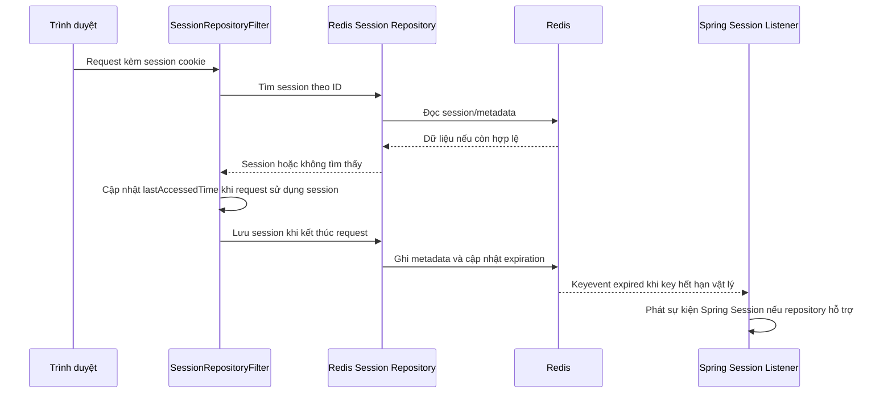

# TTL, tác vụ dọn dẹp và sự kiện hết hạn không đến đúng một thời điểm cố định

Spring Session Data Redis lưu session trong Redis và dùng thời hạn để xác định khi nào một phiên không còn hợp lệ. Khi idle timeout đạt ngưỡng, ứng dụng cần ngừng chấp nhận session đó. Tuy nhiên, thời điểm session hết hạn về mặt logic, thời điểm Redis xóa key vật lý và thời điểm ứng dụng nhận được sự kiện hết hạn có thể khác nhau.

Sự khác biệt này rất quan trọng khi vận hành. Một key còn nhìn thấy trong Redis không nhất thiết có nghĩa session vẫn hợp lệ; một listener chưa nhận sự kiện cũng không có nghĩa session chưa hết hạn. Hãy hiểu riêng ba cơ chế: **TTL của Redis**, **cleanup dữ liệu hết hạn**, và **keyspace notification/sự kiện Spring Session**.

## 1. TTL biểu diễn điều gì?

TTL (time to live) là thời gian còn lại trước khi Redis xem một key đến hạn hết hạn. Redis hỗ trợ đặt expiration theo số giây hoặc milliseconds, và trả thời gian còn lại qua `TTL` hoặc `PTTL`.

```text
EXPIRE session-key 1800
TTL session-key
PTTL session-key
```

Các lệnh trên chỉ minh họa Redis expiration ở mức key. Trong ứng dụng Spring Session, repository tự quản lý key và metadata của session; không dùng lệnh `EXPIRE` trực tiếp để chỉnh sửa key nội bộ của Spring Session.

Kết quả TTL thường có ý nghĩa như sau:

| Kết quả | Ý nghĩa |
|---|---|
| Số dương | Số giây còn lại trước khi key hết hạn |
| `-1` | Key tồn tại nhưng chưa được gắn expiration |
| `-2` | Key không tồn tại tại thời điểm kiểm tra |

`TTL` chỉ mô tả một key cụ thể. Một session Spring Session có thể liên quan đến nhiều key hoặc cấu trúc hỗ trợ như expiration key, index hay dữ liệu phụ. Do đó, TTL của một key không phải lúc nào cũng thể hiện đầy đủ trạng thái của toàn bộ session.

## 2. Hết hạn logic và xóa vật lý là hai thời điểm khác nhau

Khi idle timeout đạt ngưỡng, session không còn được phép sử dụng theo chính sách. Redis có thể chưa xóa key ngay tại đúng thời điểm đó. Redis quản lý expiration bằng kết hợp hai cách:

- **Lazy expiration:** khi một key được truy cập, Redis kiểm tra key đã hết hạn chưa; nếu đã hết hạn thì key không được trả về như dữ liệu hợp lệ và có thể bị xóa ngay trong quá trình truy cập.
- **Active expiration:** Redis chủ động kiểm tra các key có expiration theo chu kỳ và xóa những key đã đến hạn mà không cần chờ client truy cập.

Active expiration giúp dọn key hết hạn dù không có request đọc lại key. Tuy nhiên, nó không phải một lịch chạy bảo đảm mọi key bị xóa chính xác tại mili giây TTL về 0. Redis cần cân bằng công việc dọn expiration với việc phục vụ command khác, vì vậy thời điểm xóa vật lý có thể trễ so với deadline.

Điều này dẫn đến hai kết luận:

1. **Không dùng sự tồn tại vật lý của key làm căn cứ cấp quyền.** Repository và Spring Session phải quyết định session còn hợp lệ hay không.
2. **Không dùng thời điểm key biến mất làm đồng hồ nghiệp vụ chính xác.** Nếu cần một deadline bảo mật, hãy kiểm tra deadline trong luồng request; nếu cần lịch xử lý nghiệp vụ, dùng scheduler hoặc hàng đợi phù hợp.

Ví dụ, session có idle timeout 30 phút và lần truy cập cuối được ghi nhận lúc 10:00. Từ 10:30, session đã vượt ngưỡng inactivity. Một key hỗ trợ session có thể còn thấy trong Redis thêm một khoảng ngắn do cơ chế active expiration hoặc cấu trúc phụ của repository. Request dùng session đó vẫn phải bị từ chối theo logic hết hạn.

## 3. Spring Session cập nhật thời hạn như thế nào?

Khi request đi qua `SessionRepositoryFilter`, Spring Session tìm session từ repository. Nếu request được gắn với session hợp lệ, metadata truy cập cuối được cập nhật theo vòng đời request. `maxInactiveInterval` xác định khoảng không hoạt động tối đa; repository dùng thông tin này để tính expiration và cập nhật Redis khi lưu session.

Đường đi khái quát:



Đây là sơ đồ khái niệm. Cách lưu, flush và bố trí key cụ thể phụ thuộc loại Redis repository, cấu hình và phiên bản Spring Session. Không dựa vào tên key nội bộ để viết logic nghiệp vụ.

Idle timeout có thể được đặt mặc định qua cấu hình Spring Boot:

```yaml
spring:
  session:
    timeout: 30m
    redis:
      namespace: storefront:sessions
```

Hoặc đặt riêng trên `HttpSession`:

```java
HttpSession session = request.getSession();
session.setMaxInactiveInterval(30 * 60); // giây
```

Giá trị `maxInactiveInterval` là idle timeout. Nếu người dùng tiếp tục gửi request gắn với session, thời hạn inactivity được làm mới. Nó không phải absolute timeout; muốn giới hạn tổng tuổi đăng nhập, ứng dụng cần chính sách riêng.

## 4. Redis keyspace notifications là gì?

Redis keyspace notifications là cơ chế phát Pub/Sub message khi một số sự kiện xảy ra trên key, ví dụ key bị xóa, hết hạn hoặc được thay đổi. Với sự kiện hết hạn, Redis có thể phát thông báo theo channel dạng keyevent hoặc keyspace tùy cấu hình.

Spring Session Data Redis có thể dùng thông báo key hết hạn để phát các sự kiện vòng đời như `SessionExpiredEvent`. Khả năng và cách phát sự kiện phụ thuộc repository implementation. Với indexed Redis repository, Spring Session có thể đăng ký listener cho expiration events để ánh xạ key hết hạn thành sự kiện session tương ứng.

Redis thường không bật mọi loại keyspace notification mặc định vì phát sự kiện có chi phí CPU và network. Để nhận expiration events, Redis cần được cấu hình loại thông báo tương ứng. Một cấu hình thường gặp trong tài liệu Spring Session là:

```text
CONFIG SET notify-keyspace-events Egx
```

Trong chuỗi này, `E` bật keyevent notifications, `g` gồm các sự kiện generic và `x` gồm sự kiện expired. Cấu hình cần được xác nhận theo phiên bản Redis và cách Spring Session repository đang lắng nghe. Với Redis managed service, lệnh `CONFIG SET` có thể bị chặn; khi đó cần cấu hình parameter group hoặc thiết lập tương đương do nhà cung cấp hỗ trợ.

Không nên tự động chạy lệnh cấu hình trên mỗi lần ứng dụng khởi động trong production nếu tài khoản ứng dụng không có quyền `CONFIG`. Hãy quản lý cấu hình Redis ở tầng hạ tầng và kiểm tra trạng thái notification sau khi triển khai.

## 5. Vì sao sự kiện hết hạn không đến đúng thời điểm TTL?

Sự kiện expiration thường được phát khi Redis thực sự xóa key hết hạn, không phải một timer chính xác được kích hoạt đúng khoảnh khắc TTL về 0. Có một số nguyên nhân khiến thời điểm nhận sự kiện lệch so với deadline logic:

- **Active expiration chạy theo chu kỳ:** Redis kiểm tra và dọn key hết hạn theo cơ chế nội bộ, không bảo đảm một callback riêng cho từng key tại đúng deadline.
- **Key chưa được truy cập:** lazy expiration chỉ xảy ra khi key được truy cập; nếu active expiration chưa chọn key đó, key có thể còn về mặt vật lý.
- **Tải Redis cao:** lượng key lớn hoặc tải command cao có thể làm thời điểm dọn vật lý và phát thông báo trễ hơn.
- **Cấu trúc phụ của repository:** Spring Session có thể dùng key expiration riêng và dữ liệu phụ để bảo đảm listener còn đủ thông tin xử lý sự kiện. Những key này có vòng đời khác nhau.
- **Subscriber bị ngắt kết nối:** keyspace notifications dùng Redis Pub/Sub; message được phát khi subscriber không kết nối sẽ không được lưu lại để phát bù sau khi subscriber kết nối lại.
- **Cấu hình notification không đúng:** nếu Redis không phát sự kiện expired cần thiết, listener sẽ không nhận được message dù key đã hết hạn.
- **Failover hoặc restart:** kết nối listener có thể bị gián đoạn trong lúc Redis chuyển vai trò hoặc khởi động lại; message phát trong khoảng gián đoạn có thể bị mất.

Do đó, `SessionExpiredEvent` hữu ích cho phản ứng vận hành hoặc dọn dẹp phụ trợ, nhưng không phải một lịch hẹn thời gian thực và không phải nguồn audit bảo đảm đầy đủ mọi lần hết hạn.

## 6. Sự kiện Spring Session và cách sử dụng

Spring Session cung cấp các loại sự kiện vòng đời, trong đó thường gặp:

| Sự kiện | Ý nghĩa |
|---|---|
| `SessionCreatedEvent` | Một session mới được tạo |
| `SessionDeletedEvent` | Session bị xóa chủ động hoặc bị xóa qua repository |
| `SessionExpiredEvent` | Repository phát hiện session hết hạn và phát sự kiện tương ứng |

Có thể dùng `@EventListener` để cập nhật metrics, ghi log đã lọc hoặc dọn dữ liệu phụ trợ:

```java
import org.springframework.context.event.EventListener;
import org.springframework.session.events.SessionCreatedEvent;
import org.springframework.session.events.SessionDeletedEvent;
import org.springframework.session.events.SessionExpiredEvent;
import org.springframework.stereotype.Component;

@Component
class SessionLifecycleEvents {

    @EventListener
    void onCreated(SessionCreatedEvent event) {
        // Tăng metric session_created.
    }

    @EventListener
    void onDeleted(SessionDeletedEvent event) {
        // Tăng metric session_deleted hoặc dọn tài nguyên phụ.
    }

    @EventListener
    void onExpired(SessionExpiredEvent event) {
        // Tăng metric session_expired hoặc phát tín hiệu nghiệp vụ idempotent.
    }
}
```

Listener không nên ghi session ID hoặc dump session attributes vào log. Nếu cần liên kết log, dùng fingerprint HMAC đã được bảo vệ và chỉ lưu trong hệ thống log hạn chế quyền.

Không phải mọi repository đều có cùng khả năng phát mọi sự kiện. Hãy kiểm tra loại repository đang dùng, cấu hình keyspace notification và hành vi trong phiên bản Spring Session của dự án. Kiểm thử tích hợp với Redis thực tế để xác nhận listener nhận đúng sự kiện trong điều kiện bình thường.

## 7. Listener phải idempotent và chịu được sự kiện trễ

Một sự kiện hết hạn có thể đến sau deadline, có thể đến khi dữ liệu phụ đã được dọn, hoặc có thể không đến do subscriber bị gián đoạn. Listener nên được thiết kế theo hướng:

- **Idempotent:** xử lý cùng một thông báo nhiều lần không tạo ra tác dụng phụ sai. Ví dụ, xóa mapping phụ nếu nó còn tồn tại; nếu đã xóa thì thao tác vẫn hoàn tất bình thường.
- **Không phụ thuộc dữ liệu session còn nguyên:** không giả định mọi attribute đều đọc được tại thời điểm event đến.
- **Có timeout:** thao tác gọi service bên ngoài không được chặn thread listener vô thời hạn.
- **Có quan sát lỗi:** ghi metric/log theo loại lỗi và mã tương quan đã lọc; không ghi raw ID hoặc attributes.
- **Không thực hiện logic cấp quyền:** listener không phải nơi quyết định một request được phép tiếp tục.
- **Có thể chạy lại:** nếu cleanup nghiệp vụ phải bảo đảm hoàn tất, lưu công việc vào hàng đợi bền vững hoặc outbox phù hợp thay vì chỉ dựa trên Pub/Sub notification.

Ví dụ, khi session hết hạn, ứng dụng muốn dọn một mapping phụ `user-to-live-connection`. Listener có thể yêu cầu service xóa mapping nếu tồn tại. Nếu message bị lặp, thao tác xóa vẫn phải an toàn. Nếu việc dọn mapping phải được bảo đảm tuyệt đối, cần có tác vụ đối soát định kỳ để tìm mapping mồ côi.

## 8. Không dùng expiration event làm cơ chế bảo mật duy nhất

Giả sử ứng dụng dùng `SessionExpiredEvent` để thu hồi quyền truy cập. Nếu listener mất kết nối và bỏ lỡ event, một hệ thống chỉ dựa vào event có thể để sót trạng thái phụ. Cách đúng là kiểm tra tính hợp lệ của session ngay trong request thông qua Spring Session và chính sách bảo mật.

Các điểm cần giữ rõ:

1. Repository phải từ chối session đã hết hạn khi request cố gắng sử dụng nó.
2. Absolute timeout, nếu có, phải được kiểm tra trên request bằng timestamp và policy riêng.
3. Sự kiện expiration dùng cho metrics, cleanup hoặc thông báo phụ trợ.
4. Quyền truy cập vào tài nguyên nghiệp vụ phải được xác minh ở tầng bảo mật mỗi lần request.
5. JWT, refresh token hoặc remember-me credential có vòng đời riêng; xóa session không tự động thu hồi chúng.

Sự kiện hết hạn cũng không nên được dùng làm bằng chứng kiểm toán duy nhất rằng một phiên đã bị thu hồi. Nếu cần audit có tính đầy đủ, ghi nhận hành động đăng xuất, thu hồi chủ động và kết quả xác thực trong một hệ thống log/audit phù hợp. Với expiration tự nhiên, có thể đối soát từ metadata và metrics thay vì kỳ vọng Pub/Sub tạo ra nhật ký không mất mát.

## 9. Tác vụ dọn dẹp trong Spring Session và Redis

Redis tự quản lý expiration của key. Spring Session và repository có thể duy trì các cấu trúc phụ để hỗ trợ expiration, index và event publishing. Ngoài ra, JDBC repository thường có tác vụ cleanup riêng để xóa các bản ghi hết hạn; Redis repository chủ yếu phối hợp với TTL và keyspace notifications theo implementation.

Không nên viết scheduler quét toàn bộ key Redis để xóa session hết hạn. Cách đó vừa tốn tài nguyên, vừa dễ xóa nhầm key phụ hoặc làm sai trạng thái index. Nếu cần cleanup dữ liệu phụ do ứng dụng tự tạo, hãy dùng namespace riêng và API của chính thành phần đó.

Với dữ liệu nghiệp vụ phụ thuộc session, có thể dùng một trong các chiến lược:

- Đăng ký listener để dọn nhanh khi nhận event, đồng thời chấp nhận khả năng trễ hoặc mất message.
- Chạy reconciliation job định kỳ để tìm mapping mồ côi dựa trên dữ liệu nghiệp vụ có thể truy vấn an toàn.
- Dùng TTL riêng cho dữ liệu phụ nếu semantics cho phép nó tự hết hạn độc lập.
- Ghi công việc cần bảo đảm vào queue bền vững hoặc outbox khi phát sinh hành động nghiệp vụ, thay vì dựa vào Pub/Sub expiration event.

Không đặt TTL của dữ liệu phụ ngắn hơn thời gian nghiệp vụ cần thiết nếu việc mất dữ liệu đó gây sai lệch. Cũng không giữ dữ liệu phụ vô thời hạn chỉ vì sợ event bị mất; hãy định nghĩa retention và cleanup rõ ràng.

## 10. Kiểm tra cấu hình expiration và notifications

Có thể dùng các lệnh tổng hợp sau để kiểm tra Redis:

```text
INFO stats
INFO keyspace
CONFIG GET notify-keyspace-events
```

`INFO stats` có các bộ đếm như expired keys và evicted keys. `INFO keyspace` cho số key và key có expiration theo database. `CONFIG GET notify-keyspace-events` cho biết loại notification đang bật nếu tài khoản và dịch vụ Redis cho phép truy vấn cấu hình.

Khi kiểm tra:

- So sánh `expired_keys` theo khoảng thời gian, không chỉ nhìn một giá trị tổng từ khi Redis khởi động.
- Phân biệt expiration tự nhiên với eviction do áp lực bộ nhớ; eviction không đồng nghĩa idle timeout của Spring Session.
- Xác nhận notification có flag cần thiết cho repository đang dùng.
- Kiểm tra trạng thái Redis listener container, reconnect và subscription errors trong log đã lọc.
- Với Redis managed service, kiểm tra cấu hình parameter group hoặc tài liệu nhà cung cấp nếu `CONFIG GET/SET` không được hỗ trợ.
- Không dùng `MONITOR`, `KEYS *` hoặc lệnh dump raw session values để kiểm tra expiration.

Lưu ý: `expired_keys` là bộ đếm ở cấp Redis server, có thể bao gồm key của nhiều ứng dụng và workload. Không coi nó là số session hết hạn của riêng Spring Session nếu database/instance được dùng chung.

## 11. Kiểm thử sự kiện hết hạn

Kiểm thử đơn vị listener chỉ xác nhận code xử lý event. Để kiểm tra toàn bộ đường đi Redis expiration, cần kiểm thử tích hợp với Redis thật hoặc môi trường tương đương.

Kịch bản nên có:

1. Tạo session qua Spring Session repository với idle timeout ngắn.
2. Xác nhận session được lưu và request tiếp theo có thể đọc session khi còn hạn.
3. Không gửi request mới; chờ hoặc điều khiển thời gian trong môi trường test để session vượt ngưỡng.
4. Xác nhận repository không còn trả session hợp lệ khi truy vấn hoặc request dùng ID cũ.
5. Với repository hỗ trợ expiration events, xác nhận `SessionExpiredEvent` được phát khi Redis notification được cấu hình.
6. Tắt hoặc làm gián đoạn listener trong một test riêng, xác nhận session vẫn bị từ chối dù event không được nhận.
7. Khởi động lại listener và xác nhận hệ thống không giả định Redis Pub/Sub phát bù các message đã mất.
8. Gửi cùng một event giả lập nhiều lần để xác nhận listener idempotent.
9. Kiểm tra cleanup mapping phụ và reconciliation job có thể chạy lại an toàn.

Không dùng `Thread.sleep()` dài trong unit test. Với kiểm thử tích hợp Redis expiration, có thể dùng timeout ngắn, deadline có biên độ chờ hợp lý và poll trạng thái repository cho đến khi đạt điều kiện hoặc timeout test. Vì event không được bảo đảm đến đúng thời điểm TTL, không viết assertion yêu cầu listener phải được gọi chính xác tại một millisecond cụ thể.

## 12. Lỗi thường gặp và cách xử lý

| Hiện tượng | Nguyên nhân có thể | Hướng kiểm tra |
|---|---|---|
| Session đã quá idle timeout nhưng key còn thấy trong Redis | Active expiration chưa xóa vật lý key hoặc đang nhìn key phụ | Kiểm tra qua repository/API Spring Session, không dựa vào key tồn tại |
| Không nhận `SessionExpiredEvent` | Keyspace notification chưa bật, sai flag, repository không hỗ trợ hoặc listener mất kết nối | Kiểm tra repository type, `notify-keyspace-events` và listener subscription |
| Event đến trễ | Redis chỉ phát khi key bị xóa vật lý; active expiration chạy theo cơ chế nội bộ | Thiết kế listener chấp nhận độ trễ, không dùng làm timer chính xác |
| Event bị mất khi ứng dụng restart | Redis Pub/Sub không lưu message để phát bù cho subscriber vắng mặt | Dùng reconciliation hoặc queue bền vững cho công việc cần bảo đảm |
| SessionExpiredEvent nhưng attributes không còn đủ | Dữ liệu phụ/shadow copy đã hết hạn hoặc cleanup đã diễn ra | Không phụ thuộc toàn bộ attributes trong listener; chỉ dùng dữ liệu tối thiểu |
| Expired keys tăng đột biến | Idle timeout thay đổi, traffic giảm, cleanup backlog hoặc workload khác hết hạn | So sánh metrics theo namespace/ứng dụng và kiểm tra thay đổi cấu hình |
| Evicted keys tăng | Redis chạm giới hạn bộ nhớ và eviction policy loại bỏ key | Kiểm tra `maxmemory`, memory headroom và workload; đây không phải expiration bình thường |
| Redis managed từ chối CONFIG | Nhà cung cấp khóa command cấu hình | Thiết lập notification qua parameter group hoặc cấu hình được hỗ trợ |

## 13. Nguyên tắc vận hành

- TTL xác định thời hạn của key; session hết hạn logic và key bị xóa vật lý có thể xảy ra ở hai thời điểm khác nhau.
- Redis kết hợp lazy và active expiration; không giả định key bị xóa chính xác tại thời điểm TTL về 0.
- Spring Session cập nhật expiration dựa trên `lastAccessedTime` và `maxInactiveInterval` theo repository implementation.
- Keyspace notifications cần được cấu hình và subscriber phải đang hoạt động; Pub/Sub không phát bù message đã mất.
- `SessionExpiredEvent` có thể đến trễ hoặc không đến; listener phải idempotent và không được là lớp bảo vệ duy nhất.
- Dùng API Spring Session để xác định session hợp lệ; không dựa vào key tồn tại hoặc event đến đúng hạn.
- Dùng metrics `expired_keys`, `evicted_keys`, keyspace và listener health để quan sát; phân biệt expiration với eviction.
- Dùng queue bền vững hoặc reconciliation cho cleanup nghiệp vụ cần bảo đảm hoàn tất.
- Không sửa key nội bộ hoặc quét/xóa toàn bộ Redis keyspace để tự xử lý expiration.
