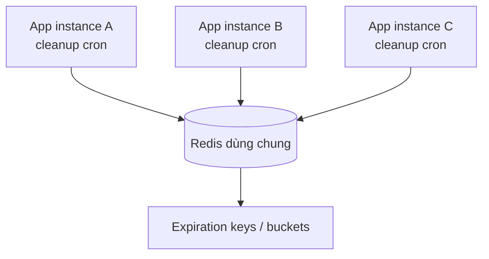

# Cấu hình dọn phiên và phạm vi ảnh hưởng của lịch chạy

Spring Session Redis có thể đặt TTL cho dữ liệu phiên, nhưng thời điểm Redis thực sự phát thông báo hết hạn không luôn trùng chính xác với thời điểm TTL về 0. Với `RedisIndexedSessionRepository`, Spring Session bổ sung một tác vụ nền định kỳ để truy cập các khóa hết hạn đã được lập lịch, giúp Redis phát sự kiện expiration và cho repository xử lý vòng đời session.

Lịch này được cấu hình bằng `cleanupCron` trong `@EnableRedisIndexedHttpSession` hoặc thuộc tính Spring Boot `spring.session.data.redis.cleanup-cron`. Mặc định tác vụ chạy mỗi phút. Hiểu đúng phạm vi của lịch giúp cân bằng độ trễ xử lý sự kiện với tải Redis, đặc biệt khi ứng dụng có nhiều instance cùng sử dụng một kho session.

## 1. Phân biệt TTL của session và lịch cleanup

Hai cấu hình thường bị nhầm lẫn:

- **Session timeout / TTL:** xác định khi nào một session không còn hợp lệ do không hoạt động. Repository ghi thời hạn này vào Redis.
- **Cleanup cron:** xác định tần suất tác vụ nền của repository kiểm tra các mốc hết hạn đã được theo dõi và truy cập khóa liên quan để Redis thực hiện expiration nếu TTL đã hết.

Ví dụ, session có thời hạn không hoạt động 30 phút. Khi hết 30 phút, session phải được xem là hết hạn theo logic ứng dụng. Tuy nhiên, Redis có thể phát thông báo expired muộn hơn vì cơ chế dọn key hết hạn của Redis không cam kết phát event đúng ngay thời điểm TTL đạt 0. Cleanup task giúp chủ động truy cập các key tại những mốc đã dự kiến để việc phát hiện hết hạn ổn định hơn.

`cleanupCron` không kéo dài hay rút ngắn `maxInactiveInterval`. Thay đổi cron từ mỗi phút sang mỗi năm phút không làm session được phép hoạt động lâu hơn năm phút; nó chỉ thay đổi nhịp của tác vụ nền hỗ trợ xử lý expiration.

## 2. Vì sao RedisIndexedSessionRepository có cleanup task?

`RedisIndexedSessionRepository` lưu session và các chỉ mục phụ trợ trong Redis. Repository cũng cần nhận biết khi session bị xóa hoặc hết hạn để phát các sự kiện như `SessionDeletedEvent` và `SessionExpiredEvent`. Những sự kiện này có thể được ứng dụng sử dụng để đóng WebSocket liên quan đến session, giải phóng tài nguyên hoặc cập nhật trạng thái quan sát.

Redis cung cấp keyspace notifications. Khi một key hết hạn hoặc bị xóa, Redis có thể phát thông báo đến các subscriber. Spring Session sử dụng các thông báo này để xác định session liên quan và thực hiện xử lý vòng đời.

Tuy nhiên, Redis có thể chỉ phát thông báo expired khi key được truy cập hoặc khi cơ chế active expiration của Redis chọn dọn key đó. Một key không được truy cập có thể vẫn nằm trong bộ nhớ sau thời điểm TTL về 0. Vì vậy, chỉ dựa vào thông báo tự nhiên của Redis có thể khiến `SessionExpiredEvent` đến trễ.

Cleanup task giải quyết khoảng trễ này bằng cách đọc các mapping expiration đã được lập lịch và truy cập các khóa hết hạn tương ứng. Việc truy cập khiến Redis tự kiểm tra TTL; nếu TTL đã hết, Redis thực hiện xóa key và phát keyspace notification. Repository sau đó xử lý thông báo và phát sự kiện Spring tương ứng.

## 3. Cấu trúc expiration key trong Redis

Để giữ dữ liệu session đủ lâu cho quá trình xử lý event, indexed repository không đặt TTL hết hạn trực tiếp trên hash session theo đúng thời điểm session hết hạn. Thay vào đó, repository sử dụng một khóa expiration riêng và các bucket theo mốc thời gian.

Với namespace mặc định `spring:session`, các key minh họa có dạng:

| Loại key | Ví dụ | Mục đích |
|---|---|---|
| Session hash | `spring:session:sessions:<id>` | Lưu thuộc tính và metadata của session |
| Session expiration key | `spring:session:sessions:expires:<id>` | Có TTL tại thời điểm session cần hết hạn và phát notification |
| Expiration bucket | `spring:session:expirations:<minute>` | Theo dõi các expiration key dự kiến hết hạn quanh một phút |

Một luồng lưu session có thể tạo các thao tác Redis tương đương:

```redis
HSET spring:session:sessions:<id> creationTime <timestamp>
HSET spring:session:sessions:<id> maxInactiveInterval 1800
EXPIRE spring:session:sessions:<id> 2100

SET spring:session:sessions:expires:<id> ""
EXPIRE spring:session:sessions:expires:<id> 1800

SADD spring:session:expirations:<minute> expires:<id>
EXPIRE spring:session:expirations:<minute> 2100
```

Các con số trên minh họa session timeout 30 phút. Trong cách lưu của indexed repository, hash session có thể được giữ thêm khoảng năm phút sau thời điểm hết hạn thực tế để Spring Session còn đọc được dữ liệu cần thiết khi xử lý sự kiện. Khóa `expires:<id>` hết hạn theo thời điểm session cần kết thúc. Expiration bucket gom các khóa theo phút để tác vụ nền có thể tìm những khóa sắp hoặc đã đến hạn.

Tên key, cấu trúc nội bộ và khoảng thời gian giữ thêm là chi tiết triển khai; ứng dụng không nên phụ thuộc trực tiếp vào chúng như một API ổn định. Hãy dùng repository API và tài liệu của đúng phiên bản Spring Session.

## 4. Cleanup task truy cập key thay vì tự xóa session

Khi chạy, cleanup task lấy các expiration bucket đã đến thời điểm cần kiểm tra và truy cập các expiration key được liệt kê trong đó. Nó không đơn giản xóa tất cả session có mặt trong bucket.

Lý do là mapping expiration có thể không hoàn toàn đồng bộ với thay đổi session. Ví dụ, một request mới có thể gia hạn session gần cùng lúc cleanup task xử lý bucket cũ. Nếu task tự gửi `DEL` cho session key dựa trên mapping cũ, nó có thể xóa nhầm một session vừa được gia hạn.

Bằng cách chỉ truy cập expiration key, Redis tự áp dụng TTL hiện tại của key. Nếu TTL chưa hết, key vẫn tồn tại và session không bị xóa chỉ vì cleanup task đã chạy. Nếu TTL đã hết, Redis thực hiện expiration và phát notification theo cấu hình. Cách làm này giảm rủi ro race condition giữa request gia hạn session và tác vụ cleanup.

Cleanup task vì vậy là cơ chế hỗ trợ expiration notification và xử lý các mapping thời hạn. Nó không phải một batch job nghiệp vụ để tự quyết định người dùng nào bị đăng xuất.

## 5. Lịch mặc định và cú pháp cron

`RedisIndexedSessionRepository` mặc định chạy cleanup task mỗi phút. Biểu thức Spring cron sử dụng sáu trường, bắt đầu bằng giây:

```text
second minute hour day-of-month month day-of-week
```

Một số ví dụ:

| Biểu thức | Lịch chạy |
|---|---|
| `0 * * * * *` | Đầu mỗi phút |
| `0 */2 * * * *` | Mỗi hai phút |
| `0 */5 * * * *` | Mỗi năm phút |
| `0 0 * * * *` | Đầu mỗi giờ |

Ví dụ, `0 */5 * * * *` chạy ở giây 0 của các phút chia hết cho 5. Đây là cú pháp cron của Spring, không nên sao chép nguyên xi biểu thức năm trường của một cron daemon Unix.

Mặc định mỗi phút thường là điểm bắt đầu hợp lý. Chỉ thay đổi khi có dữ liệu vận hành cho thấy tần suất hiện tại tạo tải không cần thiết hoặc độ trễ xử lý expiration không đáp ứng yêu cầu.

## 6. Cấu hình bằng @EnableRedisIndexedHttpSession

Khi ứng dụng Servlet dùng cấu hình Spring Session tường minh, có thể đặt `cleanupCron` ngay trên annotation:

```java
import org.springframework.context.annotation.Configuration;
import org.springframework.session.data.redis.config.annotation.web.http.EnableRedisIndexedHttpSession;

@Configuration(proxyBeanMethods = false)
@EnableRedisIndexedHttpSession(
        maxInactiveIntervalInSeconds = 1800,
        redisNamespace = "orders:session",
        cleanupCron = "0 */2 * * * *"
)
public class RedisSessionConfiguration {
}
```

Ví dụ này đặt timeout mặc định 30 phút và yêu cầu cleanup task chạy mỗi hai phút. `redisNamespace` tách dữ liệu session của ứng dụng khỏi ứng dụng khác dùng chung Redis.

Nếu muốn giữ lịch mặc định, có thể bỏ thuộc tính `cleanupCron`. Nếu muốn tắt tác vụ định kỳ, Spring hỗ trợ giá trị `Scheduled.CRON_DISABLED`:

```java
import org.springframework.scheduling.annotation.Scheduled;
import org.springframework.session.data.redis.config.annotation.web.http.EnableRedisIndexedHttpSession;

@Configuration(proxyBeanMethods = false)
@EnableRedisIndexedHttpSession(
        cleanupCron = Scheduled.CRON_DISABLED
)
public class RedisSessionConfiguration {
}
```

Giá trị này tắt lịch cleanup của repository. TTL Redis vẫn được thiết lập cho các key và Redis vẫn có thể phát notification khi tự dọn key hết hạn. Tuy nhiên, không còn tác vụ định kỳ chủ động truy cập expiration key, nên event có thể đến trễ hơn khi Redis chưa tự chọn key đó để active expiration.

Không tắt cleanup chỉ để giảm một ít Redis command nếu ứng dụng phụ thuộc vào sự kiện hết hạn để dọn WebSocket hoặc tài nguyên khác. Hãy đo độ trễ và kiểm thử tác động trước khi thay đổi.

## 7. Cấu hình bằng Spring Boot properties

Nếu dùng Spring Boot auto-configuration với indexed repository, có thể đặt cron trong `application.yml`:

```yaml
spring:
  data:
    redis:
      host: ${REDIS_HOST:localhost}
      port: ${REDIS_PORT:6379}
  session:
    data:
      redis:
        repository-type: indexed
        namespace: orders:session
        cleanup-cron: "0 */2 * * * *"
    timeout: 30m
```

Thuộc tính `spring.session.data.redis.cleanup-cron` chỉ có ý nghĩa khi repository được chọn là `indexed`. Repository Redis cơ bản không có cùng cleanup task và không sử dụng thuộc tính này. Các phiên bản Spring Boot cũ có thể chưa hỗ trợ thuộc tính hoặc prefix giống hiện tại; hãy kiểm tra configuration metadata của phiên bản dự án đang chạy.

Nếu cần tắt lịch trong cấu hình Boot, có thể dùng giá trị cron disabled được Spring hỗ trợ:

```yaml
spring:
  session:
    data:
      redis:
        repository-type: indexed
        cleanup-cron: "-"
```

Khi dùng auto-configuration, không cần đồng thời bật `@EnableRedisIndexedHttpSession` chỉ để đặt cron. Chọn một đường cấu hình để tránh hai cơ chế cùng tạo repository hoặc filter.

## 8. Phạm vi ảnh hưởng của cleanup cron

Lịch cleanup có phạm vi hẹp hơn session timeout. Cần phân biệt những thành phần sau:

| Thành phần | Bị cleanup cron điều khiển? | Ý nghĩa |
|---|---|---|
| `maxInactiveInterval` | Không | Quyết định thời hạn không hoạt động của session |
| TTL trên Redis key | Không trực tiếp | Redis áp dụng thời hạn đã được repository ghi |
| Cleanup task của indexed repository | Có | Quyết định tần suất truy cập các expiration mapping/key |
| Keyspace notifications | Không trực tiếp | Quyết định Redis có phát thông báo hết hạn/xóa hay không |
| `SessionExpiredEvent` | Ảnh hưởng gián tiếp | Event phụ thuộc notification và thời điểm task/Redis phát hiện expiration |
| Cookie ở trình duyệt | Không | Cookie được xử lý bởi resolver và thuộc tính cookie |
| Repository JDBC | Không | JDBC có lịch cleanup riêng |

Do đó, giảm cron không phải cách kéo dài session; tăng cron cũng không phải cách làm session hết hạn sớm hơn. Cookie còn tồn tại sau khi session hết hạn cũng không làm session sống lại. `SessionRepository` vẫn phải từ chối session đã hết hạn theo thời gian của nó.

Cleanup cron trong bài này áp dụng cho `RedisIndexedSessionRepository` của Spring Session Servlet. `RedisSessionRepository` không có cùng cơ chế indexed expiration cleanup. Repository reactive có API tùy chỉnh cleanup riêng; không áp dụng máy móc thuộc tính Servlet này cho WebFlux. JDBC cũng có thuộc tính cleanup cron độc lập, không dùng `spring.session.data.redis.cleanup-cron`.

## 9. Phạm vi lịch chạy trong hệ thống nhiều instance

Một biểu thức cron được cấu hình trong ApplicationContext của ứng dụng. Khi ứng dụng triển khai nhiều replica và mỗi replica tạo một `RedisIndexedSessionRepository`, cần giả định mỗi context có thể đăng ký lịch cleanup cục bộ của nó.

Ví dụ có ba instance cùng dùng namespace `orders:session`:



Các instance cùng truy cập một tập expiration mapping. Điều đó có thể tạo các lượt kiểm tra trùng nhau và tăng số Redis command. Cron không tự cung cấp cơ chế bầu chọn leader hay distributed lock để bảo đảm chỉ một instance chạy.

Repository được thiết kế để truy cập expiration key và để Redis áp dụng TTL, thay vì xóa session key theo một danh sách có thể cũ. Dù vậy, không nên tăng số replica hoặc đặt cron quá dày mà không đo tải. Khi scale out, số lịch cục bộ cũng có thể tăng theo số ApplicationContext.

Các nguyên tắc vận hành:

- Giữ cấu hình cron nhất quán giữa các instance trong cùng ứng dụng.
- Dùng cùng namespace, timeout và cấu hình repository trong toàn cụm.
- Theo dõi Redis command rate và độ trễ khi tăng số replica.
- Không dựa vào cleanup cron như cơ chế đảm bảo một side effect chỉ chạy đúng một lần.
- Nếu nghiệp vụ yêu cầu xử lý đúng một lần hoặc audit bền vững, dùng message broker/outbox và idempotency thay cho session cleanup event.
- Tránh cho nhiều ứng dụng độc lập dùng chung namespace nếu chúng không có cùng vòng đời session.

## 10. Keyspace notifications phải được cấu hình đúng

Cleanup task truy cập expiration key để Redis phát event khi TTL đã hết. Nhưng ứng dụng vẫn cần Redis keyspace notifications được bật cho nhóm sự kiện Spring Session sử dụng.

Một cấu hình thường gặp là:

```text
notify-keyspace-events Egx
```

Trong đó các cờ bật keyevent notifications cùng nhóm generic và expired event cần thiết. Có thể kiểm tra cấu hình Redis trong môi trường được phép:

```redis
CONFIG GET notify-keyspace-events
```

Spring Session có thể tự yêu cầu cấu hình notifications khi khởi tạo. Trong môi trường Redis được bảo vệ, nhà cung cấp có thể chặn `CONFIG SET` hoặc không cấp quyền thay đổi cấu hình. Khi đó, quản trị viên cần bật notifications ở cấu hình Redis managed service trước, và ứng dụng có thể tắt thao tác tự cấu hình bằng bean:

```java
import org.springframework.context.annotation.Bean;
import org.springframework.context.annotation.Configuration;
import org.springframework.session.data.redis.config.ConfigureRedisAction;

@Configuration(proxyBeanMethods = false)
public class RedisNotificationConfiguration {

    @Bean
    ConfigureRedisAction configureRedisAction() {
        return ConfigureRedisAction.NO_OP;
    }
}
```

`ConfigureRedisAction.NO_OP` có nghĩa ứng dụng không tự thay đổi `notify-keyspace-events`. Nó không bật notifications thay cho Redis. Nếu dùng `NO_OP` mà quản trị viên chưa bật cấu hình phù hợp, event expiration/deletion có thể không được chuyển đến listener của Spring Session.

Không dùng `CONFIG SET` tùy tiện trên production nếu cấu hình Redis được quản lý tập trung. Thay đổi notification có thể ảnh hưởng ứng dụng khác cùng Redis instance.

## 11. Chọn tần suất theo độ trễ và tải

Tần suất cleanup là một lựa chọn vận hành. Chạy thường xuyên hơn có thể làm expiration event được kích hoạt gần thời điểm dự kiến hơn, nhưng cũng tăng lượt đọc các expiration bucket. Chạy thưa hơn giảm hoạt động nền, nhưng có thể làm event xử lý muộn hơn khi Redis chưa tự dọn key.

| Mục tiêu | Hướng cấu hình | Điều cần quan sát |
|---|---|---|
| Bắt đầu với hành vi mặc định | Giữ `0 * * * * *` | Redis command rate và event latency |
| Giảm lượt quét khi tải nền đáng kể | Cân nhắc chu kỳ vài phút | Độ trễ `SessionExpiredEvent` và số key hết hạn còn tồn |
| Cần event được phát hiện sớm hơn | Giữ hoặc tăng tần suất so với mặc định nếu phù hợp | CPU/network Redis và tải trên từng instance |
| Không cần cleanup event | Chỉ cân nhắc disable sau khi đánh giá phụ thuộc | Tác động tới listener, WebSocket và tài nguyên liên quan |

Không có một cron expression tối ưu cho mọi hệ thống. Hãy dùng dữ liệu về số session, phân bố thời điểm hết hạn, số replica và chi phí Redis để lựa chọn. Nếu event chỉ dùng cho telemetry, độ trễ vài phút có thể chấp nhận được. Nếu event đóng kết nối hoặc giải phóng tài nguyên cần thiết, cần kiểm thử kỹ trước khi giảm tần suất.

## 12. Chẩn đoán khi session hết hạn nhưng cleanup hoặc event chậm

Khi người dùng đã hết phiên nhưng dữ liệu hoặc tài nguyên liên quan vẫn còn, cần tách việc xác thực session khỏi việc dọn key và xử lý event.

Thực hiện theo thứ tự:

1. Kiểm tra `maxInactiveInterval` và thời điểm truy cập cuối của session.
2. Xác nhận repository thực tế là `RedisIndexedSessionRepository` nếu ứng dụng đang phụ thuộc cleanup cron và indexed events.
3. Kiểm tra `cleanupCron` hoặc `spring.session.data.redis.cleanup-cron` có được bind như dự kiến không.
4. Xác nhận scheduler của ứng dụng đang hoạt động và không có lỗi khi task truy cập Redis.
5. Kiểm tra `notify-keyspace-events` có bao gồm cấu hình cần thiết.
6. Kiểm tra Redis message listener container còn kết nối và nhận notification.
7. Xác nhận namespace mà repository dùng trùng với namespace đang quan sát trong Redis.
8. Kiểm tra các instance có cùng phiên bản và cấu hình, tránh một node dùng indexed còn node khác dùng repository cơ bản.
9. Kiểm tra log và metric để phân biệt lỗi Redis, lỗi subscriber, lỗi scheduled task và lỗi listener ứng dụng.

Một session hết hạn về logic không nên được chấp nhận chỉ vì key hash còn tồn tại tạm thời. `findById` của repository kiểm tra trạng thái hết hạn và không trả session đã hết hạn. Cleanup task và event chủ yếu hỗ trợ dọn dữ liệu vật lý cùng tài nguyên phụ thuộc.

Nếu Redis notification không hoạt động, đừng tăng tần suất cron một cách mù quáng. Task truy cập key có thể giúp Redis phát event khi key đã hết TTL, nhưng không thay thế cấu hình keyspace notification hoặc kết nối subscriber.

## 13. Kiểm thử cleanup cron

Nên kiểm thử bằng Redis thật hoặc môi trường tương đương production vì mock repository không mô phỏng TTL và keyspace notifications đầy đủ.

Một kịch bản kiểm thử:

1. Cấu hình indexed repository với timeout ngắn trong profile test.
2. Đặt cron cleanup ở tần suất ngắn phù hợp với thời gian test.
3. Tạo session và xác nhận các key session/expiration được tạo trong namespace dự kiến.
4. Không gửi request tiếp tục session cho đến khi timeout.
5. Chờ Redis expiration và cleanup task xử lý bucket tương ứng.
6. Xác nhận repository không còn trả session đã hết hạn.
7. Lắng nghe `SessionExpiredEvent` và xác nhận event được phát khi keyspace notifications hoạt động.
8. Thử tắt notification trong một môi trường test riêng để quan sát khác biệt giữa session không còn hợp lệ và event chưa được nhận.
9. Chạy hai instance cùng namespace để xác định tác động của lịch cleanup lặp và kiểm tra không có side effect nghiệp vụ bị nhân đôi.
10. Thử tắt cleanup task và xác nhận TTL vẫn được áp dụng, đồng thời ghi nhận event có thể trễ hơn.

Test nên dùng timeout và cron đủ ngắn để giảm thời gian chạy, nhưng tránh kiểm tra bằng sleep cố định quá sát ranh giới thời gian. Có thể dùng Awaitility hoặc polling có giới hạn để chờ điều kiện repository/event xuất hiện. Khi test event, cần timeout tổng thể và log chẩn đoán nếu notification không đến.

## 14. Những nhầm lẫn thường gặp

**Tăng cleanup cron để kéo dài session.** Cron không điều chỉnh timeout. Hãy cấu hình `maxInactiveInterval` nếu yêu cầu thời hạn phiên thay đổi.

**Tăng cleanup cron để xóa session sớm hơn.** Session timeout và Redis TTL quyết định thời điểm session hết hạn. Cron chỉ hỗ trợ kích hoạt việc phát hiện expiration.

**Cho rằng cleanup task chạy một lần trên toàn cụm.** Mỗi ApplicationContext có repository có thể đăng ký lịch riêng. Không có bảo đảm leader election chỉ từ cron expression.

**Cho rằng cron thay thế keyspace notifications.** Cleanup task truy cập key; Redis vẫn phải phát notification và Spring Session vẫn cần subscriber để chuyển event.

**Cho rằng Redis key hết hạn là mọi dữ liệu session lập tức biến mất.** Indexed repository giữ dữ liệu session thêm một khoảng thời gian phục vụ xử lý event. Session không còn hợp lệ không đồng nghĩa mọi key vật lý đã biến mất ngay lập tức.

**Dùng property Redis cho JDBC hoặc WebFlux.** JDBC có cấu hình cleanup riêng; reactive Redis indexed có cơ chế tùy chỉnh cleanup khác. Cần dùng đúng repository và đúng cấu hình phiên bản.

**Tắt cron mà không kiểm tra listener.** Các tính năng như WebSocket cleanup có thể phụ thuộc session destruction event. Hãy kiểm tra mọi consumer trước khi disable.

## 15. Quy trình triển khai an toàn

Trước khi thay đổi lịch cleanup trong production:

1. Xác nhận repository đang chạy là indexed và phiên bản Spring Session/Boot hỗ trợ thuộc tính cần dùng.
2. Đo baseline về Redis command rate, số session, expiration event latency và số listener failure.
3. Chọn một cron expression có mục tiêu rõ ràng, bắt đầu từ mặc định nếu chưa có dữ liệu.
4. Thử nghiệm trong staging với số replica gần production và lượng session đại diện.
5. Xác nhận keyspace notifications và Redis listener hoạt động.
6. Kiểm thử session hết hạn, logout, WebSocket cleanup và chuyển request giữa các instance.
7. Triển khai đồng nhất cron, namespace và repository type lên mọi instance.
8. Theo dõi Redis load, lỗi scheduler, event latency và số session vật lý tồn tại sau khi hết hạn.
9. Nếu kết quả xấu, quay lại cron mặc định và điều tra notification hoặc listener trước khi tăng thêm tần suất.

`cleanupCron` là một phần của cơ chế expiration của `RedisIndexedSessionRepository`. Nó giúp tác vụ nền truy cập các expiration key để Redis phát hiện key đã hết TTL và gửi notification cho Spring Session. Lịch chạy ảnh hưởng đến độ trễ xử lý expiration event và tải Redis, còn thời hạn hợp lệ của session vẫn do timeout và TTL quyết định. Trong cụm nhiều instance, cần tính đến lịch cục bộ trên từng node, cấu hình notification và khả năng xử lý lặp của listener.

