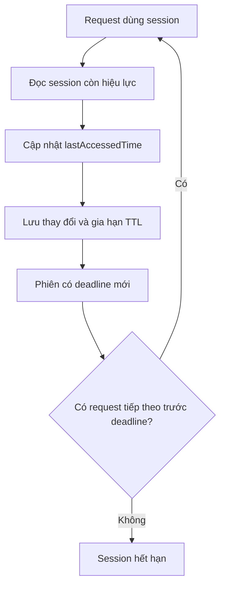
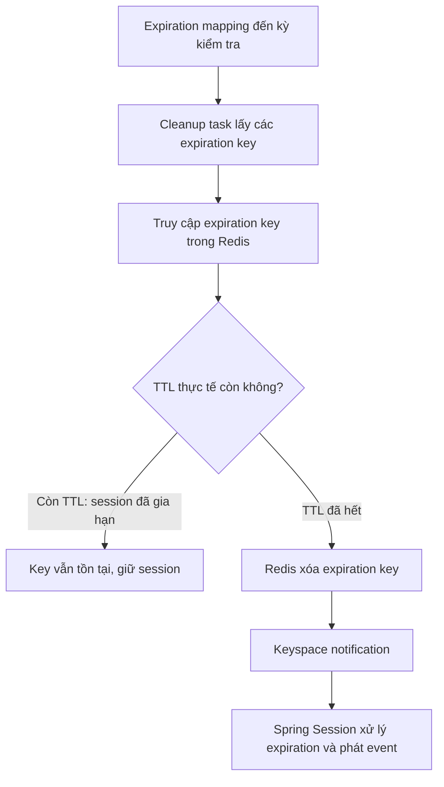

# Gia hạn phiên đồng thời với tác vụ kiểm tra hết hạn

Spring Session dùng Redis để lưu session và quản lý idle timeout. Khi request sử dụng một session còn hiệu lực, thời điểm truy cập gần nhất được cập nhật và thời hạn hết hạn cần được gia hạn tương ứng. Đồng thời, Redis và Spring Session có thể chạy các tác vụ kiểm tra, phát hiện và dọn session đã hết hạn. Hai hoạt động này có thể xảy ra gần như cùng lúc: một request đang gia hạn phiên trong khi tác vụ nền đang xử lý lịch hết hạn cũ.

Nếu tác vụ dọn dữ liệu xóa session chỉ vì một mốc hết hạn đã được ghi từ trước, nó có thể xóa nhầm một phiên vừa được gia hạn. Ngược lại, nếu không xử lý session hết hạn, dữ liệu và tài nguyên liên quan có thể tồn tại quá lâu. Bài học này giải thích cách Spring Session Redis phối hợp TTL, expiration key và tác vụ cleanup; cách hiểu race condition giữa gia hạn và hết hạn; và cách thiết kế listener, tác vụ riêng cùng kiểm thử để tránh thu hồi nhầm phiên đang hoạt động.

## 1. Idle timeout và việc gia hạn session

Session thường có hai thông tin thời gian quan trọng:

- `lastAccessedTime`: thời điểm gần nhất session được sử dụng.
- `maxInactiveInterval`: khoảng thời gian session được phép không hoạt động.

Thời điểm hết hạn logic được tính từ hai giá trị này:

\[
T_{expiry} = T_{lastAccessed} + maxInactiveInterval
\]

Ví dụ, session có idle timeout 30 phút và được truy cập lúc 09:00. Nếu không có request nào sử dụng phiên, thời điểm hết hạn logic là khoảng 09:30. Nếu một request hợp lệ sử dụng session lúc 09:20, `lastAccessedTime` được cập nhật và thời điểm hết hạn mới là khoảng 09:50.



Việc gia hạn chỉ được phản ánh bền vững trong Redis khi thay đổi session được lưu. Trong ứng dụng web, `SessionRepositoryFilter` phối hợp với repository để lưu session trong vòng đời request. Thời điểm ghi phụ thuộc `FlushMode` và cách request kết thúc; vì vậy cần phân biệt request vừa bắt đầu sử dụng session với việc TTL mới đã thực sự được ghi xuống Redis.

## 2. Redis không xóa mọi key đúng ngay tại thời điểm TTL về 0

Redis hỗ trợ TTL cho key. Khi TTL hết, key được xem là hết hạn và Redis sẽ loại bỏ nó theo cơ chế expiration. Tuy nhiên, việc xóa key và phát sự kiện hết hạn có thể xảy ra trễ so với thời điểm TTL về 0, đặc biệt khi key không được truy cập. Redis kết hợp kiểm tra expiration khi truy cập với quá trình quét nền; không nên giả định mọi key sẽ bị xóa đúng vào một mili giây cố định.

Điều này quan trọng với Spring Session vì ứng dụng có thể cần phát `SessionExpiredEvent` hoặc `SessionDestroyedEvent` để dọn tài nguyên gắn với session, ví dụ đóng kết nối WebSocket. Nếu chỉ chờ Redis tự phát sự kiện hết hạn, thời điểm cleanup có thể không đều.

Spring Session Redis vì vậy tổ chức dữ liệu expiration riêng. Với `RedisIndexedSessionRepository`, các chi tiết key cụ thể phụ thuộc namespace và phiên bản, nhưng mô hình thường có:

| Thành phần | Mục đích |
| --- | --- |
| Hash session `...:sessions:<id>` | Lưu `creationTime`, `lastAccessedTime`, `maxInactiveInterval` và session attributes |
| Expiration key `...:sessions:expires:<id>` | Key phụ có TTL theo thời điểm session cần hết hạn; Redis expiration notification trên key này kích hoạt xử lý vòng đời |
| Expiration mapping `...:expirations:<bucket>` hoặc cấu trúc lịch tương đương | Theo dõi các expiration key dự kiến hết hạn trong một khoảng thời gian để tác vụ nền có thể truy cập chúng |

Trong mô hình indexed repository được tài liệu hóa, hash session có thể được đặt TTL dài hơn idle timeout khoảng 5 phút. Khoảng đệm giữ dữ liệu session đủ lâu để repository đọc session và phát sự kiện khi expiration key hết hạn. Expiration key riêng mới mang TTL tương ứng với idle timeout. Không tự suy luận trạng thái phiên chỉ từ TTL của hash session.

Ví dụ minh họa với namespace mặc định và session timeout 1.800 giây:

```text
HSET spring:session:sessions:<id> lastAccessedTime ... maxInactiveInterval 1800
EXPIRE spring:session:sessions:<id> 2100
SET spring:session:sessions:expires:<id> ""
EXPIRE spring:session:sessions:expires:<id> 1800
```

Các lệnh trên nhằm minh họa quan hệ TTL, không phải script để tự chạy trên dữ liệu production. Tên key và chi tiết lệnh nội bộ có thể thay đổi theo phiên bản. Hãy để repository quản lý các key này.

## 3. Vì sao cần tác vụ nền kiểm tra expiration?

Expiration key có TTL đúng thời điểm session hết hạn, nhưng Redis không bảo đảm sự kiện hết hạn luôn được phát ngay khi TTL về 0 nếu key không được truy cập. Spring Session vì vậy theo dõi các phiên theo mốc hết hạn gần nhất và có tác vụ nền truy cập các expiration key dự kiến đã đến hạn.

Điểm quan trọng trong cơ chế này là tác vụ nền **truy cập expiration key**, không tự xóa session hash hoặc expiration key chỉ dựa trên một lịch cũ. Khi tác vụ truy cập key:

- Nếu TTL thực tế đã hết, Redis loại bỏ key và phát expiration event theo cấu hình.
- Nếu phiên đã được gia hạn và expiration key còn TTL dương, key vẫn tồn tại; việc truy cập không làm mất phiên.

Với một số phiên bản repository, expiration mapping được nhóm theo phút bằng Redis Set; các implementation hoặc phiên bản khác có thể dùng cấu trúc lịch khác. Mục tiêu vẫn là tìm các key có thể đã đến hạn và buộc Redis đánh giá TTL hiện tại.



Không xóa trực tiếp key chỉ vì mapping nói rằng phiên đáng lẽ hết hạn. Mapping là lịch dự kiến, có thể đã cũ; TTL hiện tại trên expiration key mới phản ánh việc phiên đã được gia hạn hay chưa.

## 4. Race condition giữa gia hạn và cleanup

Giả sử một session có idle timeout 30 phút. Lúc 10:00, phiên được lưu với thời điểm hết hạn 10:30 và expiration key có TTL 30 phút. Expiration mapping ghi nhận phiên ở bucket 10:30.

Đến gần 10:30, hai hoạt động diễn ra đồng thời:

- Request R1 đến và sử dụng session, cập nhật `lastAccessedTime` để gia hạn đến 11:00.
- Cleanup task R2 đang xử lý mapping cũ của mốc 10:30.

Một cách triển khai sai là R2 thấy mapping 10:30 rồi thực hiện `DEL` trực tiếp expiration key hoặc session hash. Nếu R1 đã gia hạn TTL nhưng R2 vẫn xóa theo lịch cũ, session đang hoạt động có thể bị thu hồi nhầm.

| Thứ tự thao tác | Hành vi an toàn |
| --- | --- |
| R1 lưu TTL mới trước khi R2 truy cập expiration key | R2 đọc key còn TTL, key không bị xóa và phiên tiếp tục tồn tại |
| R2 truy cập expiration key sau khi TTL cũ đã hết nhưng trước khi R1 kịp lưu thay đổi | Redis có thể xóa expiration key và phát event; request chưa hoàn tất việc gia hạn nên phiên có thể đã hết hạn theo trạng thái được lưu |
| R1 và R2 gửi lệnh gần như đồng thời | Redis thực thi các lệnh theo thứ tự xử lý trên node; kết quả phụ thuộc lệnh gia hạn đã được áp dụng trước hay sau lúc key hết hạn được truy cập |
| Mapping cũ còn tồn tại sau khi R1 gia hạn | R2 chỉ truy cập key; TTL mới còn hiệu lực nên mapping cũ không đủ để xóa phiên |

Spring Session chọn cách để Redis tự đánh giá TTL khi expiration key được truy cập. Tài liệu implementation giải thích rằng không chủ động xóa các key theo expiration mapping vì mapping có thể không nhất quán khi phiên được gia hạn đồng thời. Distributed lock cho mọi lần cleanup sẽ làm tăng chi phí và giảm khả năng xử lý; truy cập key để Redis quyết định dựa trên TTL hiện tại giúp tránh một dạng xóa nhầm.

Tuy nhiên, điều đó không có nghĩa mọi thao tác HTTP và mọi tác vụ tùy chỉnh đều trở thành một giao dịch nguyên tử. Nếu request chưa lưu TTL mới trước khi expiration key cũ được xử lý, session vẫn có thể hết hạn. Cần hiểu rõ thời điểm lưu, cấu hình flush và deadline thực tế.

## 5. Vai trò của `FlushMode` khi request đang gia hạn session

Spring Session Redis hỗ trợ các chế độ flush. Ở chế độ mặc định `ON_SAVE`, thay đổi được ghi khi repository thực hiện thao tác save. `IMMEDIATE` cố gắng ghi thay đổi xuống Redis ngay khi có thể. Cấu hình cụ thể có thể đặt qua thuộc tính Spring Boot tương ứng hoặc qua cấu hình repository.

Ví dụ cấu hình minh họa:

```yaml
spring:
  session:
    timeout: 30m
    redis:
      flush-mode: on-save
```

Với `ON_SAVE`, ứng dụng thường gom các thay đổi và ghi khi request kết thúc. Cách này giảm số lần ghi Redis, nhưng tạo một khoảng thời gian giữa lúc request đã đọc và cập nhật session trong bộ nhớ với lúc TTL mới được lưu. Nếu request bắt đầu sát thời điểm hết hạn và kéo dài lâu, expiration task có thể xử lý expiration key cũ trước khi save xảy ra.

`IMMEDIATE` ghi thay đổi sớm hơn, có thể giảm khoảng thời gian chờ giữa cập nhật và Redis. Đổi lại, số lần ghi có thể tăng và tải Redis cao hơn. `IMMEDIATE` không tạo transaction phân tán giữa thao tác request, expiration notification và listener; không dùng nó như một bảo đảm rằng session không thể hết hạn trong mọi race.

Chọn chế độ dựa trên workload và semantics ứng dụng:

| Tiêu chí | `ON_SAVE` | `IMMEDIATE` |
| --- | --- | --- |
| Thời điểm ghi | Khi repository save session | Ghi thay đổi sớm nhất có thể |
| Số lần ghi | Thường ít hơn, có thể gom thay đổi | Có thể nhiều hơn |
| Khoảng trễ trước khi TTL mới có hiệu lực | Có thể kéo dài đến cuối request | Thường ngắn hơn |
| Điều cần kiểm thử | Request dài, request sát hạn, save cuối request | Tải Redis, thứ tự ghi và request đồng thời |

Không chọn `IMMEDIATE` chỉ để che một thiết kế cleanup sai. Tác vụ cleanup tùy chỉnh vẫn phải kiểm tra trạng thái expiration hiện tại và không xóa theo deadline cũ.

## 6. `findById` và kiểm tra session hết hạn

Trong `RedisIndexedSessionRepository`, `findById(sessionId)` đảm bảo không trả về session đã hết hạn theo thông tin session. Vì vậy, ứng dụng không nên tự suy luận rằng session hợp lệ chỉ vì hash session vẫn còn tồn tại trong Redis. Hash có thể còn tồn tại trong khoảng đệm sau idle timeout để phục vụ việc xử lý sự kiện và cleanup.

Luồng đọc nên đi qua Spring Session repository/filter:

1. Request gửi session ID qua cookie hoặc resolver đã cấu hình.
2. `SessionRepositoryFilter` yêu cầu repository tìm session.
3. Repository đọc dữ liệu và kiểm tra trạng thái hết hạn.
4. Nếu session còn hiệu lực, ứng dụng tiếp tục xử lý và cập nhật thời điểm truy cập.
5. Khi request lưu session, repository cập nhật dữ liệu và expiration schedule.

Không dùng lệnh `HGETALL` hoặc sự tồn tại của hash làm phép xác minh session hợp lệ. Cũng không đọc TTL hash session rồi tự quyết định đăng nhập còn hiệu lực hay không. Dùng API của Spring Session để duy trì đúng semantics.

## 7. Xử lý `SessionExpiredEvent` và `SessionDeletedEvent`

Spring Session Redis dựa vào keyspace notifications để phát hiện expiration hoặc deletion và phát các sự kiện vòng đời như `SessionExpiredEvent` và `SessionDeletedEvent` (cả hai thuộc nhóm `SessionDestroyedEvent`). Sự kiện giúp ứng dụng dọn tài nguyên gắn với session, ví dụ trạng thái WebSocket hoặc dữ liệu phụ trợ.

Ví dụ listener:

```java
import org.springframework.context.event.EventListener;
import org.springframework.session.events.SessionDeletedEvent;
import org.springframework.session.events.SessionExpiredEvent;
import org.springframework.stereotype.Component;

@Component
public class SessionLifecycleListener {

    @EventListener
    public void onExpired(SessionExpiredEvent event) {
        // Dọn tài nguyên phụ trợ của phiên đã hết hạn.
        // Không ghi session ID hoặc toàn bộ session attributes vào log.
    }

    @EventListener
    public void onDeleted(SessionDeletedEvent event) {
        // Xử lý phiên bị xóa chủ động, ví dụ logout.
    }
}
```

Listener nên idempotent: chạy lại cùng một sự kiện không làm hỏng trạng thái hoặc thực hiện tác động nghiệp vụ trùng lặp. Redis keyspace notifications là cơ chế thông báo, không phải hàng đợi bền vững bảo đảm exactly-once. Nếu ứng dụng cần một hành động nghiệp vụ quan trọng phải được thực hiện chắc chắn, cần cơ chế lưu công việc bền vững và đối soát riêng; không chỉ dựa vào event hết hạn.

Đảm bảo Redis cho phép các keyspace notification mà Spring Session cần. Cấu hình Redis thường cần nhóm sự kiện expiration và deletion, ví dụ `notify-keyspace-events Egx`; khả năng thay đổi cấu hình phụ thuộc dịch vụ Redis quản lý và phiên bản triển khai. Nếu notification không được bật hoặc subscription bị gián đoạn, cleanup event và tài nguyên phụ trợ có thể không được xử lý đúng thời điểm.

## 8. Không tự viết tác vụ xóa session theo lịch cũ

Một lỗi phổ biến là xây dựng scheduler riêng đọc danh sách session có `expiresAt <= now`, rồi xóa trực tiếp key Redis:

```java
// Mã giả nguy hiểm: không triển khai theo cách này.
if (scheduledExpiry <= now) {
    redisTemplate.delete(sessionHashKey);
    redisTemplate.delete(expirationKey);
}
```

Lịch có thể được tạo từ trạng thái cũ. Trong khi scheduler chờ đến giờ chạy, request có thể đã gia hạn session và cập nhật TTL. Xóa theo mốc cũ sẽ thu hồi nhầm phiên đang hoạt động.

Nếu thật sự cần một tác vụ nghiệp vụ riêng, hãy tuân theo các nguyên tắc:

1. Không xóa key Spring Session nội bộ bằng cách tự suy luận tên key.
2. Không coi một expiration mapping cũ là bằng chứng session đã hết hạn.
3. Đọc trạng thái hiện tại qua repository hoặc API được hỗ trợ.
4. Để Redis đánh giá TTL thực tế của expiration key; tránh `DEL` trực tiếp chỉ vì lịch đã đến hạn.
5. Nếu quản lý một loại dữ liệu hết hạn riêng, lưu deadline/version hiện tại và dùng thao tác atomic compare-and-delete để chỉ xóa nếu phiên bản deadline chưa thay đổi.
6. Giữ listener và tác vụ dọn phụ trợ idempotent, có metric và khả năng đối soát.

Ví dụ, với dữ liệu expiration do chính ứng dụng sở hữu (không phải key nội bộ của Spring Session), có thể dùng Lua script để so sánh version/deadline đã lên lịch với version đang lưu trước khi xóa. Nếu version đã thay đổi do gia hạn, script không xóa. Cơ chế đó cần được thiết kế riêng, kiểm thử với Redis thật và không được áp dụng trực tiếp lên cấu trúc nội bộ của Spring Session.

## 9. Kiểm thử gia hạn đồng thời với cleanup

Kiểm thử đơn lẻ `findById` hoặc `PTTL` chưa đủ để phát hiện race condition. Cần chạy request và cleanup gần nhau trên Redis thật hoặc Testcontainers.

### 9.1. Kịch bản session được gia hạn trước cleanup

1. Cấu hình idle timeout ngắn, ví dụ 30 giây trong môi trường test.
2. Tạo session và lưu cookie.
3. Chờ khoảng 20 giây.
4. Gửi request có cookie để sử dụng session, làm mới `lastAccessedTime`.
5. Đợi cleanup task xử lý bucket/mapping cũ tương ứng deadline ban đầu.
6. Xác minh session vẫn được tìm thấy qua repository và request tiếp theo với cookie cũ vẫn sử dụng cùng phiên.
7. Kiểm tra expiration key đã có TTL mới theo thời điểm gia hạn.

Kịch bản này chứng minh mapping cũ không được dùng như lệnh xóa vô điều kiện.

### 9.2. Kịch bản không có request gia hạn

1. Tạo session với idle timeout ngắn.
2. Không gửi request tiếp theo.
3. Đợi đến khi expiration key hết hạn và cleanup task truy cập key.
4. Xác minh `findById` không trả về session đã hết hạn.
5. Xác minh event hết hạn được phát theo cấu hình keyspace notification.
6. Kiểm tra tài nguyên phụ trợ được dọn và listener có thể chạy lại mà không gây lỗi.

### 9.3. Kịch bản cạnh tranh tại ranh giới timeout

Chạy nhiều vòng trong đó request gia hạn và cleanup task được kích hoạt gần cùng thời điểm. Ghi nhận thứ tự lệnh Redis hoặc timestamp ở mức chẩn đoán, không ghi session ID. Kết quả cần phù hợp với thứ tự thực tế:

- Nếu TTL mới được ghi trước khi cleanup truy cập key, session còn hiệu lực.
- Nếu expiration key cũ đã hết và Redis xử lý expiration trước khi TTL mới được ghi, phiên có thể hết hạn; request không nên được xem là đã gia hạn thành công chỉ vì nó bắt đầu trước deadline.
- Không có trường hợp cleanup xóa hash session đang hoạt động chỉ dựa trên expiration mapping cũ.

Đặt khoảng dung sai cho test vì scheduler, Redis và CI không bảo đảm chạy đúng thời điểm mili giây. Dùng polling có giới hạn thay vì chờ một thời gian cố định quá sát deadline.

### 9.4. Kịch bản request kéo dài

Tạo một endpoint test giữ request trong một khoảng thời gian gần bằng timeout. Gửi request trước deadline nhưng cho nó kết thúc sau deadline. So sánh `ON_SAVE` và `IMMEDIATE` nếu ứng dụng cân nhắc đổi flush mode. Kiểm tra session có được lưu lại đúng semantics hay đã hết hạn trước khi save. Không giả định request bắt đầu trước hạn đồng nghĩa phiên chắc chắn được gia hạn.

## 10. Quan sát và chẩn đoán trong production

Theo dõi các chỉ số giúp phân biệt session hết hạn bình thường với session bị thu hồi nhầm:

- Số lượng session được tạo, cập nhật, xóa và hết hạn theo thời gian.
- Số lượng `SessionExpiredEvent` và `SessionDeletedEvent`.
- Độ trễ giữa thời điểm hết hạn logic và thời điểm listener nhận event.
- Lỗi Redis connection, lỗi subscription/keyspace notification và thời gian chạy cleanup task.
- Số request nhận session mới bất thường hoặc người dùng bị yêu cầu đăng nhập lại nhiều lần.
- Số session được repository tìm thấy sau khi một expiration mapping cũ được xử lý.

Không ghi session ID, cookie hoặc toàn bộ session attributes vào log. Nếu cần ghép sự kiện giữa các thành phần, dùng correlation ID độc lập. Để xác minh TTL, dùng `PTTL` trên key test hoặc một key được chọn có kiểm soát; không chạy `KEYS *` trên production và không sửa/xóa các key nội bộ bằng tay.

Khi dùng Redis Cluster hoặc Redis được quản lý, kiểm tra giới hạn subscription và keyspace notifications của nhà cung cấp. Có cấu hình mà subscriber chỉ nhận event từ một node hoặc một phần keyspace; điều này có thể ảnh hưởng cleanup/index ở node khác. Kiểm thử trên topology thực tế thay vì chỉ dựa vào một Redis local đơn nút.

## 11. Những lỗi thường gặp

- **Xóa session theo expiration mapping cũ:** mapping có thể không còn đúng sau khi request gia hạn; hãy để Redis đánh giá TTL hiện tại.
- **Nhầm TTL hash với idle timeout:** hash session có thể tồn tại thêm khoảng đệm để phục vụ xử lý expiration event.
- **Cho rằng Redis phát expired event đúng thời điểm:** sự kiện có thể đến trễ nếu key chưa được truy cập.
- **Cho rằng request bắt đầu trước deadline luôn gia hạn thành công:** TTL mới cần được ghi trước khi expiration key cũ bị xử lý.
- **Dùng `IMMEDIATE` như một khóa đồng bộ:** flush sớm không biến thao tác request và cleanup thành transaction nguyên tử.
- **Tự xóa key nội bộ Spring Session:** có thể làm mất session, index hoặc event cleanup không đúng.
- **Listener thực hiện side effect không idempotent:** notification có thể trễ, bị mất khi subscription gián đoạn hoặc được xử lý lại ở tầng ứng dụng.
- **Chỉ test bằng Map repository:** không mô phỏng TTL, keyspace notification và expiration mapping của Redis.
- **Không kiểm tra topology Redis production:** keyspace notification hoặc subscription có thể khác Redis local.

## 12. Checklist triển khai

Trước khi phát hành, xác nhận:

- [ ] Đã hiểu `lastAccessedTime` và `maxInactiveInterval` xác định idle timeout.
- [ ] Repository là nơi duy nhất quản lý key session và expiration key nội bộ.
- [ ] Không có scheduler tùy chỉnh xóa session dựa trên expiration mapping cũ.
- [ ] `FlushMode` được chọn phù hợp với độ trễ ghi, tải Redis và độ dài request.
- [ ] Redis keyspace notifications cần thiết được bật và subscription hoạt động trên topology thực tế.
- [ ] `SessionExpiredEvent`/`SessionDeletedEvent` listener có thể chạy lặp an toàn.
- [ ] Tác vụ cleanup truy cập expiration key để Redis đánh giá TTL thay vì xóa theo lịch.
- [ ] Có integration test gia hạn trước cleanup, hết hạn không gia hạn, request kéo dài và cạnh tranh tại ranh giới timeout.
- [ ] Theo dõi độ trễ event, lỗi subscription, cleanup task và tỷ lệ đăng nhập lại bất thường.
- [ ] Không ghi session ID hoặc thao tác thủ công lên key nội bộ trong quá trình chẩn đoán.

## 13. Tự kiểm tra kiến thức

Bạn đã nắm được nội dung nếu có thể giải thích:

- Vì sao một request sử dụng session cần cập nhật `lastAccessedTime` và TTL?
- Vì sao Spring Session Redis có expiration key riêng và có thể giữ hash session thêm một khoảng đệm?
- Tác vụ nền truy cập expiration key giải quyết vấn đề Redis phát expiration event trễ như thế nào?
- Race condition nào xảy ra nếu cleanup xóa session dựa trên một deadline cũ?
- `ON_SAVE` và `IMMEDIATE` ảnh hưởng thời điểm gia hạn TTL ra sao?
- Vì sao `findById` là cách kiểm tra session hợp lệ phù hợp hơn việc chỉ nhìn hash hoặc TTL?
- Vì sao listener hết hạn cần idempotent và không nên là nơi duy nhất thực hiện nghiệp vụ quan trọng?
- Cần kiểm thử những trường hợp nào để xác nhận request gia hạn không bị cleanup thu hồi nhầm?

Gia hạn session và cleanup expiration cùng thao tác trên một vòng đời dữ liệu. Lịch hết hạn chỉ là chỉ dẫn để kiểm tra; TTL hiện tại của expiration key mới quyết định Redis có thực sự loại bỏ key hay không. Khi dùng Spring Session Redis, hãy để repository quản lý các key nội bộ, hiểu thời điểm flush của request, giữ listener idempotent và kiểm thử cạnh tranh trên Redis thật để tránh xóa nhầm phiên đang hoạt động.
